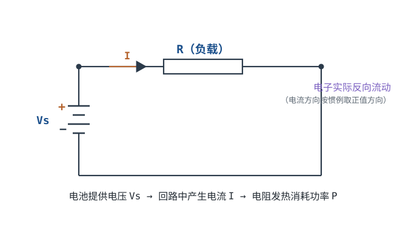
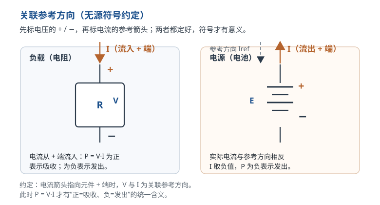

# 电压、电流、电阻与功率 Voltage / Current / Resistance / Power

电路里几乎所有"莫名其妙"的故障，最后都能归到四个量：电压、电流、电阻、功率。芯片击穿是电压超了，连接器熔了是电流大了，电阻发黄是功率超了，信号被拉偏是电阻分压不对。这四个量是硬件工程师的字母表，后面所有定律、拓扑、选型，都是用它们拼出来的句子。

本章先把四个量的**定义、方向约定、单位、功率正负**讲透，再用两个完整算例把它们放进真实电路。读完之后，你应当能对一个二端元件条件反射地问出四件事：它两端电压多少、流过电流多少、等效电阻多少、要耗散多少功率；并且能说清哪个量是"因"、哪个量是"果"、哪个量只是"结果"。定量关系会在[欧姆定律与焦耳定律](ohms-law.md)里展开。

## 1. 设计动机

::: motivation 四个量决定一块板会不会冒烟
先看三个真实场景，它们都不是拓扑画错，而是对四个量的数量级没有感觉。

**场景一：5V/2A 走一根 1 米长的细线。** 28AWG 铜线每米电阻约 0.208Ω，来回两根就是 0.415Ω；2A 下压降 $2\times0.415=0.83$ V，线上发热 $2^2\times0.415=1.66$ W。负载端只剩约 4.17V，已经超出 5V±5% 的范围，设备可能反复重启。线没烧，但系统已经坏了。

**场景二：5V 直接加在一颗 20Ω 的 0603 电阻上。** 电流 $5/20=0.25$ A，功率 $5^2/20=1.25$ W；而这颗电阻的额定功率典型值只有 0.1W，超了 12.5 倍。几秒钟内它就会发黄、冒烟，甚至把焊盘一起带走。

**场景三：一个 20mΩ 的连接器触点过 10A。** 压降 $10\times0.02=0.2$ V 看似不大，但触点发热 $10^2\times0.02=2$ W，全部集中在一个很小的金属接触面上，温升会非常可观。触点氧化后接触电阻变大，发热更多，形成恶性循环。

三个场景的共同点：**电压决定"会不会击穿"，电流决定"导线和触点受不受得了"，功率决定"热能不能散出去"。** 三者又通过电阻互相耦合，所以不能分开拍脑袋。
:::

工程上通常把失效应力分成三类：过压、过流、过功率（过温）。它们不是独立的：过流会在电阻上产生 $I^2R$ 的热，温度升高又会让额定值下降；过压击穿后往往伴随短路，短路又变成过流。理解四个量的定义和方向，是判断"现在发生的是哪一类应力"的前提。

| 你想判断 | 先算哪个量 | 典型判据 |
|---|---|---|
| 导线/触点会不会过热 | $I$、$R$ | $P=I^2R$ 与允许温升、载流曲线 |
| 电阻会不会烧 | $P$ | $P$ 不超过降额后的额定功率 |
| 芯片引脚会不会过压 | $V$ | $V$ 不超过绝对最大额定值 |
| 连接器会不会熔 | $I$ | 每针电流不超过降额后的额定电流 |
| 电池能用多久 | $E$、$P$ | $E=Pt$，再除以效率 |

## 2. 定义与直观

### 2.1 电流：单位时间流过截面的电荷

电流的定义是电荷对时间的导数：

$$I=\frac{dQ}{dt}$$

其中 $I$ 是电流，单位安培（A）；$Q$ 是电荷，单位库仑（C）；$t$ 是时间，单位秒（s）。$1\text{ A}=1\text{ C/s}$，即每秒流过 1 库仑电荷。一个电子的电荷量是 $1.602176634\times10^{-19}$ C，所以 1 库仑包含

$$N=\frac{1}{1.602176634\times10^{-19}}\approx6.2415\times10^{18}$$

个电子。这个数字不需要背，但要有感觉：**20mA 流过 1 秒，就是 $0.02\text{ C}$，约 $1.248\times10^{17}$ 个电子**。看似"很小"的电流，背后是巨量的载流子。

电流必须"流过某个截面"才有意义。说"某点有 2A"，是省略说法，实际指流过该点所在截面的电流是 2A。工程上把**正电荷移动的方向**规定为电流方向；金属导线里真正移动的是带负电的自由电子，电子漂移方向与惯例电流方向相反。这不影响电路计算：分析时一律用惯例电流方向，把电子当成"反方向流动的负电荷"即可。

电流的**参考方向**是人为标的箭头。如果实际电流与箭头相反，算出来的 $I$ 就是负值。负号不是错误，而是"实际方向与参考方向相反"的数学表达。没有参考方向的电流数值没有意义。

::: analogy 水路类比：电流像流量
把导线想成水管，电流就是单位时间流过管道截面的水量。管子越粗、两端压差越大，流量越大；管子被异物堵住（电阻大），流量变小。这个类比在"流量—电流""水压—电压""阀门—电阻"上很好用，但不要延伸太远：水管里的水有惯性，电路里的电流几乎瞬间建立；水管漏水是电荷跑到管外，电路里"漏电"是另一条路径。
:::

### 2.2 电压：两点之间的电位差

电压是两点之间的电位差，定义为单位电荷从一点移到另一点时电场力做的功：

$$V_{AB}=\phi_A-\phi_B=\frac{dW}{dQ}$$

其中 $V_{AB}$ 是 A 点相对 B 点的电压，单位伏特（V）；$\phi_A,\phi_B$ 是两点的电位，单位伏特；$W$ 是功，单位焦耳（J）；$Q$ 是电荷，单位库仑（C）。$1\text{ V}=1\text{ J/C}=1\text{ W/A}$。

"1V"的物理图像是：把 1 库仑电荷从 A 搬到 B，电场力做 1 焦耳的功。所以 5V 电池把 1C 电荷从负极搬到正极，需要做 5J 的功；反过来，1C 电荷从正极经外电路流回负极，会释放 5J 能量。

**电压永远是"两点之间"的量。** 说"这个引脚是 3.3V"，一定省略了"相对 GND（0V 参考点）"。单独说一根导线"有 5V"没有意义，就像不能说"这座山海拔 1000 米"却不提海平面。测量时电压表必须**并联**在被测两点之间；只接一支表笔，读到的只是悬空引线拾取的噪声。

这里有一个必须提前澄清的误区：**电压为零，不等于没有电流。** 理想导线电阻 $R=0$，根据 $V=IR$，无论流过 2A 还是 20A，两端电压都是 0V。导线两端测到 0V，只能说明"这两点之间没有电位差"，不能说明"导线里没有电流"。要判断电流，必须把电流表**串联**进回路，或用钳形表、分流电阻测量。反过来，**电流为零也不等于电压为零**：一个断开的开关两端可以承受 220V，但流过它的电流是 0A。

电压的参考极性用 $+$、$-$ 标在元件两端。与电流一样，参考极性是人为选的；实际极性与参考相反时，电压取负值。

::: analogy 水路类比：电压像水压差
电压对应水管两端的水压差，而不是"水管里有多少水"。水压差推动水流动；电位差推动电荷流动。水压是相对的（相对大气压或另一端点），电压也是相对的（相对 GND 或另一节点）。一个孤立的水箱内部有压力，但如果不接管道、没有参考点，你无法说"某点的水压是多少"；电路里同理，电位必须相对某个参考点才有数值。
:::

### 2.3 电阻：对电流的阻碍

电阻定义为电压与电流的比值：

$$R=\frac{V}{I},\qquad G=\frac{1}{R}$$

其中 $R$ 是电阻，单位欧姆（$\Omega$）；$V$ 是电阻两端电压，单位伏特（V）；$I$ 是流过电阻的电流，单位安培（A）；$G$ 是电导，单位西门子（S）。$1\text{ S}=1\text{ A/V}$。电阻越大，同样电压下电流越小；电导越大，同样电压下电流越大。

电阻的物理来源是材料对载流子运动的散射。对一根截面积均匀、长度为 $L$、电阻率为 $\rho$ 的导体：

$$R=\rho\frac{L}{A}$$

其中 $\rho$ 是电阻率，单位 $\Omega\cdot\text{m}$；$L$ 是长度，单位 m；$A$ 是截面积，单位 $\text{m}^2$。铜在 20°C 的电阻率约为 $1.68\times10^{-8}\ \Omega\cdot\text{m}$，这是本章所有导线计算的起点。代入几个常见尺寸：

- 1 米长、$0.5\ \text{mm}^2$ 的铜线：$R=1.68\times10^{-8}\times1/(0.5\times10^{-6})=0.0336\ \Omega$。
- 1 米长、$1\ \text{mm}^2$ 的铜线：$R=1.68\times10^{-8}\times1/(1\times10^{-6})=0.0168\ \Omega$。
- 1 米长、$2.5\ \text{mm}^2$ 的铜线：$R=1.68\times10^{-8}\times1/(2.5\times10^{-6})=0.00672\ \Omega$。

PCB 铜箔也能用同一套公式。常见 1oz 铜厚约 35µm，方阻为

$$R_{\text{sq}}=\frac{\rho}{t}=\frac{1.68\times10^{-8}}{35\times10^{-6}}\approx4.8\times10^{-4}\ \Omega/\text{sq}$$

即每方块约 0.48mΩ。一条 10 个方块的走线就是 $10\times0.48=4.8$ mΩ。这个量级在信号线上可以忽略，但在 5A、10A 的电源路径上不能忽略。

**电阻是元件属性，但导线、焊点、连接器触点、PCB 铜箔也都有电阻。** 工程上说的"理想导线"只是 $R\approx0$ 的近似；当负载电阻与导线电阻可比时，这个近似就失效了。常见量级：信号电路里的电阻多在 kΩ~MΩ，功率回路里的采样/限流电阻多在 Ω~mΩ，导线和触点则在 mΩ 级。

::: analogy 水路类比：电阻像节流阀
电压是水管两端的水压差，电阻是阀门开度：阀门关得越小（电阻越大），同样水压下流量越小；水压差越大，流量越大。水流过阀门会因摩擦发热，对应电阻的 $I^2R$ 损耗。这个类比的边界是：水管里的流量有惯性，电路里的电流几乎瞬间建立；水管漏水是水跑到管外，电路漏电是另一条并联路径。
:::

### 2.4 功率：能量转移的速率

功率是能量对时间的导数：

$$P=\frac{dW}{dt}=V I$$

其中 $P$ 是功率，单位瓦特（W）；$W$ 是能量，单位焦耳（J）；$t$ 是时间，单位秒（s）。$1\text{ W}=1\text{ J/s}$。在电压、电流恒定的直流情况下，$P=VI$ 就是"每秒转移的能量"。能量则是功率对时间的积分：

$$E=\int P\,dt,\qquad E=Pt\ \text{（}P\text{ 恒定时）}$$

例如 1000W 的电水壶工作 5 分钟，消耗能量 $E=1000\times300=3\times10^5$ J，也就是 $83.3$ Wh（$3\times10^5/3600$）。

**功率的正负，取决于电压和电流的参考方向是否"关联"。** 这是本章最容易被跳过、又最容易在排故时出错的地方。

约定如下：先在元件两端标电压参考极性（$+$ 端、$-$ 端），再标电流参考箭头。**如果电流箭头从电压的 $+$ 端流入元件**，就说 $V$ 与 $I$ 取**关联参考方向**（也叫无源符号约定）。此时

$$P=VI$$

是元件**吸收**的功率：$P>0$ 表示真的在吸收（电阻发热、电池充电），$P<0$ 表示实际在发出（电池放电、电源对外供能）。如果电流箭头从 $+$ 端流出，那么 $P=VI$ 直接就是**发出**功率；或者把电流取负，仍套吸收公式，符号会自己告诉你答案。

举个具体例子：一只 12V 电池以 0.5A 对外供电，电流从电池的 $+$ 端流出。若按"流入 $+$ 端"定义参考电流，则实际 $I=-0.5$ A，$P=12\times(-0.5)=-6$ W，负号表示电池发出 6W。负载若是 24Ω 电阻，电流从电阻的 $+$ 端流入，$P=12\times0.5=6$ W，表示吸收 6W。电源发出的 6W 正好等于电阻吸收的 6W，代数和为 0。

**功率守恒**是检查算例的好工具：一个孤立电路里，所有元件吸收功率的代数和必须为 0。算完如果不等，先检查参考方向，再检查有没有漏掉元件（导线电阻、电源内阻、连接器触点）。

::: analogy 水路类比：功率像水流的做功速率
水从高处流下，推动水轮做功：功率正比于"水压差 × 流量"，也就是电压乘电流。电阻发热，相当于水流过窄管时摩擦生热；水压差越大、流量越大，发热越猛。电池放电，相当于水箱里的水往外流，对外做功；电池充电，相当于把水抽回高处，吸收能量。这个类比能帮你记住 $P=VI$，但具体符号仍要回到参考方向。
:::

### 2.5 四个量的一张关系图

四个量不是并列的，而是有"定义链"的：

- 电荷 $Q$ 的流动率是电流 $I$；
- 单位电荷的能量差是电压 $V$；
- 电压与电流的比值定义电阻 $R$；
- 电压与电流的乘积定义功率 $P$。

只要知道其中两个，往往就能推出另外两个。下表是工程上最常用的几种组合，具体推导和适用条件在[欧姆定律与焦耳定律](ohms-law.md)中展开：

| 已知 | 求 | 公式 | 备注 |
|---|---|---|---|
| $V,I$ | $P$ | $P=VI$ | 对任何二端元件成立 |
| $I,R$ | $P$ | $P=I^2R$ | $R$ 取工作点等效电阻 |
| $V,R$ | $P$ | $P=V^2/R$ | 同上 |
| $V,I$ | $R$ | $R=V/I$ | 静态电阻定义 |
| $P,V$ | $I$ | $I=P/V$ | 已知功率和电压 |
| $P,I$ | $V$ | $V=P/I$ | 已知功率和电流 |

要特别注意：这些式子里的 $V$ 必须是**同一个元件两端**的电压，$I$ 必须是**流过同一个元件**的电流。把电源电压当成电阻两端电压，是后面最常见的计算错误之一。

## 3. 定量关系

### 3.1 定义式、符号与单位

把本章用到的量集中列成一张表，后面所有算例都按这套符号走：

| 量 | 符号 | 定义式 | SI 单位 | 常用单位 |
|---|---|---|---|---|
| 电荷 | $Q$ | $Q=\int I\,dt$ | C（库仑） | mAh、Ah |
| 电流 | $I$ | $I=dQ/dt$ | A（安培） | mA、µA |
| 电压 | $V$ | $V=dW/dQ$ | V（伏特） | mV、kV |
| 电阻 | $R$ | $R=V/I$ | $\Omega$（欧姆） | kΩ、MΩ |
| 电导 | $G$ | $G=1/R$ | S（西门子） | mS |
| 功率 | $P$ | $P=dW/dt=VI$ | W（瓦特） | mW、kW |
| 能量 | $E$ | $E=\int P\,dt$ | J（焦耳） | Wh、kWh |

单位换算的原则只有一条：**代入公式前，把所有量换成 SI 基本单位（A、V、Ω、W、s、C、J），算完再换回工程单位。** 同一个式子里混用 mA 和 A，是数量级错误的主要来源。

常用换算：

- $1\ \text{mA}=10^{-3}\ \text{A}$，$1\ \mu\text{A}=10^{-6}\ \text{A}$；
- $1\ \text{k}\Omega=10^3\ \Omega$，$1\ \text{M}\Omega=10^6\ \Omega$；
- $1\ \text{mW}=10^{-3}\ \text{W}$，$1\ \text{kW}=10^3\ \text{W}$；
- $1\ \text{Wh}=3600\ \text{J}$，$1\ \text{kWh}=3.6\times10^6\ \text{J}$；
- $1\ \text{Ah}=3600\ \text{C}$，$1\ \text{mAh}=3.6\ \text{C}$。

几个代入示例：

- $4.7\ \text{k}\Omega=4.7\times10^3=4700\ \Omega$；
- $250\ \text{mA}=250\times10^{-3}=0.25\ \text{A}$；
- 一块 $2000\ \text{mAh}$ 的电池，电荷量 $Q=2\ \text{Ah}\times3600=7200\ \text{C}$；若标称电压 3.7V，能量 $E=QV=7200\times3.7=26640\ \text{J}=7.4\ \text{Wh}$。

注意 mAh 是**电荷量**单位，不是能量单位。两块都是 2000mAh 的电池，一块 3.7V、一块 1.2V，能量相差三倍多。比较电池"大小"时，要么统一用 Wh，要么先乘上标称电压。

### 3.2 关联参考方向与功率正负的完整规则

把 2.4 节的规则写成表，排故时可以直接对照：

| 电压参考 | 电流参考 | $P=VI$ 的含义 | $P>0$ | $P<0$ |
|---|---|---|---|---|
| $+$ 在 A、$-$ 在 B | 电流从 A 流入元件 | 吸收功率 | 吸收 | 发出 |
| $+$ 在 A、$-$ 在 B | 电流从 A 流出元件 | 发出功率 | 发出 | 吸收 |

最稳妥的做法不是背表，而是**先统一成关联方向，再代公式**：把电流箭头改成"从 $+$ 端流入"，如果原来箭头相反，就在电流值前加负号。这样 $P=VI$ 永远表示吸收功率，正负号交给数学处理。

对二端元件，功率守恒写成：

$$\sum_k P_k=0$$

其中 $P_k$ 是第 $k$ 个元件吸收的功率（发出取负）。用这个式子验算时，电源、电阻、导线电阻、连接器触点都要算进去；漏掉任何一个，都会出现"能量不守恒"的假象。

### 3.3 额定值、降额与失效边界

**额定值（rating）是制造商在指定条件下给出的最大连续应力**，不是"正常工作时应该达到的值"。电阻的额定功率通常规定在某个环境温度（常见 70°C）下，超过这个温度要按降额曲线折减；电容的额定电压是允许长期施加的最大直流电压（交流应用还要看频率、波形与纹波电流）；连接器的额定电流取决于允许温升，而不是"熔断电流"。

**降额（derating）是让器件在低于额定值的应力下工作**，用寿命和可靠性换设计余量。常见工程目标（经验值，具体项目按可靠性规范）是：电阻长期功耗不超过额定的 50%~70%；电容工作电压不超过耐压的 70%~80%（钽电容更保守，常按 50%）；连接器每针电流不超过额定的 50%~70%；半导体结温留 20~30°C 余量。

以一颗典型厚膜贴片电阻为例，数据手册常给出"70°C 以下额定功率不降，70°C 到 155°C 线性降到零"的曲线。设额定功率 $P_{\text{rated}}=0.125$ W（0805 常见值），环境温度 $T=100$°C，则允许功率为

$$P_{\text{allow}}(T)=P_{\text{rated}}\cdot\frac{T_{\max}-T}{T_{\max}-T_{\text{rated}}}
=0.125\times\frac{155-100}{155-70}
=0.125\times\frac{55}{85}
\approx0.0809\ \text{W}$$

如果实际耗散是 0.1W，那么 $0.1/0.0809\approx1.24$，已经超过该温度下的允许值，必须换更大的封装（例如 1206、额定 0.25W，同温度下允许 $0.25\times55/85\approx0.162$ W），或者降低电流。这个例子说明：**同一颗电阻，在 25°C 和 100°C 下的"可用功率"不是一回事。**

额定值失效的边界通常包括：环境温度超过规定值、散热条件变差（密闭壳体、无铜箔、无风）、安装方式改变（引脚长度、散热器）、以及脉冲/浪涌等瞬态应力。数据手册里的额定值是在标准测试板上测的，你的板子不一定满足同样条件。工程上宁可把余量留大一点，也不要把额定值当成"安全线"。

### 3.4 适用条件与失效边界

本章的定义式 $I=dQ/dt$、$V=dW/dQ$、$P=VI$ 在**集总电路近似**下普遍成立；但由它们导出的 $P=I^2R=V^2/R$ 需要额外条件：

1. **$R$ 是工作点附近的等效电阻。** 对线性电阻，$R$ 是常数；对二极管、LED、灯丝、热敏电阻，$R=V/I$ 随工作点变化，不能拿一个标称值套遍全范围。此时 $P=VI$ 仍然成立，$P=I^2R$ 只在"当时的 $R$"下成立。
2. **温度近似恒定。** 电阻随温度变化，铜的电阻温度系数约 $0.00393\ ^{\circ}\text{C}^{-1}$，温度升高 60°C，电阻增加约 $0.00393\times60=23.6\%$。大电流下"发热—电阻变大—发热更多"的耦合不能忽略。
3. **元件尺寸远小于信号波长。** 集总近似要求物理尺寸远小于波长。100MHz 时自由空间波长 $\lambda_0=3\times10^8/10^8=3$ m；FR4 中相对介电常数约 4.2，波长约 $3\times10^8/(10^8\sqrt{4.2})\approx1.46$ m，十分之一波长约 14.6cm。走线或电缆接近这个长度时，不能再把导线当成"零电阻的理想连接"，要按传输线处理。
4. **电压、电流的定义在低频/准静态下有效。** 高频下电压沿导线变化，"某点电压"不再是全局量，需要分布参数模型。

还有一个常被忽略的边界：**欧姆定律不能预测击穿。** 绝缘材料在超过击穿电压后电阻会突然崩塌，这个过程不是 $V=IR$ 能描述的；同样，半导体的雪崩、TVS 的钳位、空气的击穿，都要看器件/材料的额定值，而不是算出来的电流。

## 4. 典型计算

### 4.1 算例一：5V USB 口的小灯

**需求**：USB 口输出 5V，接一个小指示灯，测得电流 20mA。求功率、等效电阻，并验算能量。

**第一步，算功率**：

$$P=VI=5\times0.02=0.1\ \text{W}$$

**第二步，算电阻**：

$$R=\frac{V}{I}=\frac{5}{0.02}=250\ \Omega$$

**第三步，用另外两个公式验算**：

$$P=I^2R=0.02^2\times250=0.0004\times250=0.1\ \text{W}$$

$$P=\frac{V^2}{R}=\frac{5^2}{250}=\frac{25}{250}=0.1\ \text{W}$$

两条路都得到 0.1W，说明数值自洽。

**第四步，算能量**：工作 2 小时，$E=Pt=0.1\times2=0.2\ \text{Wh}=0.2\times3600=720$ J。

**工程解读**：0.1W 的指示灯几乎不发热，普通 0603 电阻（额定 0.1W）在 25°C 下刚好用满，长期工作建议换 0805 或降低电流。作为对比，5V/2A 的负载是 10W，是这颗灯的 100 倍；10W 已经需要认真考虑线径、连接器和散热，不能再用"小信号"的思路对待。

### 4.2 算例二：1 米 USB 线的线径选择（完整设计）

这是一个从需求到验算的完整设计例子。**需求**：5V 电源通过 1 米长的双芯电缆给 2A 负载供电；负载允许 5V±5%（即 4.75~5.25V）；电缆两端各有一个连接器，每个触点接触电阻按 20mΩ 计；环境 25°C。

**第一步，算允许的总压降**：

$$V_{\text{drop,max}}=5\times5\%=0.25\ \text{V}$$

**第二步，算连接器压降**。两个触点，总接触电阻 $R_c=2\times0.02=0.04\ \Omega$：

$$V_c=IR_c=2\times0.04=0.08\ \text{V}$$

留给电缆的压降只剩 $0.25-0.08=0.17$ V。

**第三步，算电缆允许的回路电阻**。电缆有去、回两根线，回路电阻是单根的两倍：

$$R_{\text{loop,max}}=\frac{0.17}{2}=0.085\ \Omega$$

单根允许 $0.085/2=0.0425\ \Omega$。

**第四步，算最小截面积**。由 $R=\rho L/A$ 反解：

$$A_{\min}=\frac{\rho L}{R}=\frac{1.68\times10^{-8}\times1}{0.0425}
\approx3.95\times10^{-7}\ \text{m}^2=0.395\ \text{mm}^2$$

**第五步，选线径**。按 AWG 标准尺寸估算（按直径和铜电阻率计算，未计入绞线系数）：

| 线规 | 直径 | 截面积 | 单根电阻/米 | 2A 下回路压降 | 是否满足 0.17V |
|---|---|---|---|---|---|
| 28AWG | 0.321mm | $0.081\ \text{mm}^2$ | 0.208Ω | 0.83V | 不满足 |
| 24AWG | 0.511mm | $0.205\ \text{mm}^2$ | 0.0819Ω | 0.33V | 不满足 |
| 22AWG | 0.644mm | $0.326\ \text{mm}^2$ | 0.0516Ω | 0.21V | 不满足 |
| 20AWG | 0.812mm | $0.518\ \text{mm}^2$ | 0.0324Ω | 0.13V | 满足 |

22AWG 的截面积 0.326mm² 小于 0.395mm²，不满足；20AWG 的 0.518mm² 大于 0.395mm²，满足。选 **20AWG**。

**第六步，验算 20AWG**：

$$R_{\text{loop}}=2\times0.0324=0.0649\ \Omega$$

$$V_{\text{cable}}=2\times0.0649=0.130\ \text{V}$$

$$V_{\text{total}}=0.130+0.08=0.210\ \text{V}=4.2\%\times5\ \text{V}$$

负载端电压 $5-0.210=4.790$ V，在 4.75~5.25V 范围内，合格。

**第七步，算损耗与效率**：

$$P_{\text{cable}}=I^2R_{\text{loop}}=2^2\times0.0649=0.260\ \text{W}$$

$$P_{\text{contacts}}=I^2R_c=2^2\times0.04=0.160\ \text{W}$$

总损耗 $0.260+0.160=0.420$ W，效率

$$\eta=\frac{P_{\text{load}}}{P_{\text{load}}+P_{\text{loss}}}
=\frac{10}{10+0.42}\approx95.97\%$$

**第八步，看边界**。如果把电流提到 2.5A，总压降变成 $2.5\times(0.0649+0.04)=0.262$ V，占 5V 的 5.25%，超出 ±5% 要求。所以这套 1 米 20AWG 线在 5V 下的"保压"上限约为 2.4A（$0.25/(0.0649+0.04)=2.38$ A）。若要 3A，应换 18AWG、缩短线长，或提高输入电压。

**反例**：若图便宜用 28AWG，回路电阻 0.415Ω，电缆压降 $2\times0.415=0.830$ V，加连接器 0.08V，总压降 0.91V，占 5V 的 18.2%，负载端只有 4.09V。很多"手机插上充电器却越充越少"的现象，就是这种线损造成的。

**注意**：压降合格不等于温升合格。2A 下 20AWG 每米耗散约 0.26W，通常不烫；但如果是 3A、5A 或密闭线束，必须按线缆/连接器的载流—温升曲线核对，PCB 走线则参考 IPC-2152。压降和温升是两个独立的判据，都要过。

### 4.3 算例三：功率正负与电池

一只 12V 电池对外输出 0.5A，负载是 24Ω 电阻。求电池发出功率、电阻吸收功率，并验算守恒。

按"电流从 $+$ 端流出"的实际方向，电池的 $P=VI=12\times0.5=6$ W，这是发出功率。若按关联方向（电流流入 $+$ 端）定义，则 $I=-0.5$ A，$P=12\times(-0.5)=-6$ W，负号表示发出。

电阻上的电流从 $+$ 端流入，$P=VI=12\times0.5=6$ W，表示吸收。用 $I^2R$ 验算：$0.5^2\times24=0.25\times24=6$ W；用 $V^2/R$ 验算：$144/24=6$ W。电池发出 6W，电阻吸收 6W，代数和为 0。

如果此时有人把电池的电流参考方向也标成"流入 $+$ 端"，却直接写 $P=+6$ W，就会得出"电池也在发热"的错误结论。**排故时看到负功率，先别怀疑表坏了，先检查参考方向。**

### 4.4 算例四：电水壶的电流、电阻与能量

**需求**：一台标称 220V、1000W 的电水壶，求工作电流、等效电阻，以及烧开一壶水（按 5 分钟计）消耗的能量。

**电流**：

$$I=\frac{P}{V}=\frac{1000}{220}\approx4.545\ \text{A}$$

**电阻**：

$$R=\frac{V}{I}=\frac{220}{4.545}\approx48.4\ \Omega$$

**验算功率**：

$$P=\frac{V^2}{R}=\frac{220^2}{48.4}=\frac{48400}{48.4}=1000\ \text{W}$$

**能量**：

$$E=Pt=1000\times(5\times60)=1000\times300=3\times10^5\ \text{J}$$

换算成 Wh：$3\times10^5/3600\approx83.3$ Wh，即 0.0833 kWh。

**工程解读**：4.5A 的电流比 5V/2A 的 USB 线大 2.3 倍（$4.545/2\approx2.27$），但真正决定线径的不只是电流，还有允许温升和绝缘要求。家用 10A 插座的 220V 回路可带 2200W，16A 回路可带 3520W；这些是配电设计的基本数量级。另一方面，电水壶的 48.4Ω 是**热态等效电阻**，冷态电阻通常更低，开机瞬间会有更大的浪涌电流——这就是为什么大功率加热器要选慢断保险丝或软启动。

## 5. 工程含义

### 5.1 工程数量级表

把常见场景的电压、电流、功率放在一张表里，建立"数量级感"：

| 场景 | 电压 | 电流 | 功率 | 算式 |
|---|---|---|---|---|
| MCU 的 GPIO 驱动 LED（经限流） | 3.3V | 4mA | 13.2mW | $3.3\times0.004$ |
| 红色指示灯 LED | 2.0V | 10mA | 20mW | $2.0\times0.010$ |
| USB 充电器 5V 档 | 5V | 2A | 10W | $5\times2$ |
| 1.5V 干电池带 100mA 负载 | 1.5V | 100mA | 0.15W | $1.5\times0.1$ |
| 手机快充（9V 档） | 9V | 2A | 18W | $9\times2$ |
| USB PD 3.1（20V 档） | 20V | 5A | 100W | $20\times5$ |
| 笔记本电源 | 19V | 3.42A | 65W | $19\times3.42$ |
| 电水壶 | 220V | 4.55A | 1000W | $220\times4.55$ |
| 家用 10A 插座 | 220V | 10A | 2200W | $220\times10$ |
| 电动车动力电池 | 400V | 100A | 40kW | $400\times100$ |

从 mW 到 kW 跨了六个数量级。**mW 级是信号和指示，W 级是负载，kW 级是动力。** 跨过 W 级，就必须认真算散热、线径和连接器；跨过 100W，安全规范、绝缘、灭弧都要进入设计。

### 5.2 额定值与降额的工程做法

| 对象 | 额定参数 | 常见降额目标 | 说明 |
|---|---|---|---|
| 贴片电阻 | 额定功率（0603 典型 0.1W） | ≤50%~70% | 70°C 以上按曲线降额 |
| 铝电解电容 | 耐压 | ≤70%~80% | 高温寿命按经验法则缩短 |
| 钽电容 | 耐压 | ≤50% | 对浪涌敏感 |
| 连接器 | 每针额定电流 | ≤50%~70% | 多针同时载流时发热叠加 |
| PCB 走线 | 载流—温升 | 按 IPC-2152 | 内层散热比外层差 |
| 半导体 | 结温 $T_j$ | 留 20~30°C 余量 | 按 $\theta_{JA}$ 或散热器算 |

这些数字是工程经验值，不是硬性标准；具体项目要按可靠性规范、客户要求和安规要求调整。关键思想是：**不要把额定值当成工作值。** 额定值是"在标准测试条件下允许的上限"，你的板子散热、环境温度、安装方式都可能比标准条件差。

降额的计算方法在 3.3 节已经给过：先查曲线得到当前温度下的允许功率，再用实际功耗去除。若比值接近 1，说明没有余量；若超过 1，必须换器件或改设计。

### 5.3 导线、接触电阻与温度

铜导线的电阻可以用 2.3 节的公式算。下表是 20°C 下、1 米长的数值，以及 10A 时的压降和功耗：

| 截面积 | 电阻/米 | 10A 压降 | 10A 功耗 |
|---|---|---|---|
| $0.5\ \text{mm}^2$ | 0.0336Ω | 0.336V | 3.36W |
| $1.0\ \text{mm}^2$ | 0.0168Ω | 0.168V | 1.68W |
| $1.5\ \text{mm}^2$ | 0.0112Ω | 0.112V | 1.12W |
| $2.5\ \text{mm}^2$ | 0.00672Ω | 0.0672V | 0.672W |
| $4.0\ \text{mm}^2$ | 0.0042Ω | 0.042V | 0.42W |

10A 下，0.5mm² 导线每米耗散 3.36W，已经相当于一支小功率烙铁；这就是大电流必须用粗线、短路径的原因。注意这里的 10A 是示例电流，不代表 0.5mm² 导线的额定载流；载流能力取决于绝缘材料、环境温度、敷设方式，必须查线缆规格或标准。

温度会进一步放大问题。铜的电阻温度系数约 $0.00393\ ^{\circ}\text{C}^{-1}$，2.5mm² 导线在 80°C 时电阻变为

$$R_{80}=0.00672\times[1+0.00393\times(80-20)]
=0.00672\times1.2358\approx0.00830\ \Omega$$

比 20°C 时增加 23.6%。若仍过 16A，功耗从 $16^2\times0.00672=1.72$ W 增加到 $16^2\times0.00830=2.13$ W。电流大→发热→电阻变大→发热更多，这个正反馈在散热不良的线束里可能失控，所以大电流设计必须留热裕量。

连接器触点也是"隐形电阻"。一个 20mΩ 的触点在 3A 下耗散 $3^2\times0.02=0.18$ W，5A 下 0.5W，10A 下 2W。触点面积小、散热差，2W 足以让塑料壳体软化、触点氧化；氧化后接触电阻上升，发热更多。**大电流连接器不能只看额定电流数字，要看接触电阻和温升曲线。**

PCB 铜箔同样如此。1oz 铜每方块约 0.48mΩ，10 个方块 4.8mΩ；5A 下功耗 $25\times0.0048=0.12$ W，10A 下 0.48W。电源路径、地回流、电流采样点都要按实际电流算，不能默认"铺了铜就没电阻"。

### 5.4 什么时候这些假设会失效

本章的很多结论建立在"理想化"假设上。工程判断的第一步，是问自己：**我现在用的是哪个假设？它什么时候会失效？**

- **理想导线（$R=0$）**：只在导线电阻远小于负载电阻时成立。5V/2A 的 1 米细线，导线电阻与负载等效电阻可比，压降不能忽略。
- **理想电压源（内阻为 0）**：真实电池、适配器都有内阻，带载后端电压会下降。9V 电池内阻典型 1~2Ω；按 1.5Ω 估算，带 100Ω 负载时电流 $9/101.5=88.7$ mA，内阻压降 $0.0887\times1.5=0.133$ V，约为 9V 的 1.5%；带 10Ω 负载时电流 $9/11.5=0.783$ A，内阻压降 1.17V，约为 13%。
- **恒定电阻**：只在一定温度、电压、电流范围内成立。温度系数、电压系数、自热都会让 $R$ 变。
- **集总参数**：只在尺寸远小于波长时成立。100MHz 下 FR4 的十分之一波长约 14.6cm，超过这个尺度要考虑传输线效应。
- **低频/准静态**：高频下电压、电流沿导线分布，$V=IR$ 的集总形式不再够用，要用阻抗和传输线模型。

涉及市电、高压、电池、ESD 的安全问题，不能只靠本章的低压算例外推。安全用电的间距、接地、漏电保护、绝缘等级，见[安全用电与触电防护](electrical-safety.md)。

## 6. 常见坑

::: pitfall 常见坑
- **把导线两端 0V 当成"没有电流"**：现象——万用表测一根导线两端是 0V，就判断回路没电流；串入电流表却发现有 2A。原因——理想导线 $R\approx0$，$V=IR=0$ 仍可以有电流；电压是两点电位差，不是电流的度量。解决——测电流必须串联电流表、用钳形表或分流电阻；导线两端 0V 只能说明"这两点没有电位差"，不能说明"没有电荷在流"。
- **把"某点电压"当成绝对值**：现象——只接一支表笔，读数乱跳；或者把 3.3V 引脚相对 1.8V 引脚测，读到的不是 3.3V。原因——电压是两点之间的量，单表笔悬空拾取的是噪声。解决——黑表笔接参考地（或被测的低电位点），红表笔接被测点；先确认参考点，再读数值。
- **功率正负搞反，把发出当吸收**：现象——电池放电时算出正功率，以为电池在发热；或者电源模块的输入功率算出负值。原因——没有按关联参考方向定义电流，或者把"电流流出 $+$ 端"直接套了吸收公式。解决——先在图上标 $+/-$ 和电流箭头；电流流入 $+$ 端时 $P=VI$ 为吸收，流出时 $P=VI$ 为发出；符号不确定就把电流取负，统一用吸收公式。
- **选线、选连接器只看电压不看电流**：现象——5V/2A 用细线，末端掉压、设备重启；或者连接器摸着发烫。原因——压降是 $IR$，发热是 $I^2R$，都由电流决定；电压低不代表电流小。解决——按电流算回路电阻、压降和功耗，留 5% 压降余量和足够温升余量；大电流查线缆/连接器的载流—温升曲线。
- **电阻功率不降额，按额定值直接用**：现象——0603 电阻长期工作在 0.1W，几个月后发黄、阻值漂移，甚至开路。原因——额定功率是特定温度下的上限，实际环境温度、铜箔散热、密闭壳体都会让有效额定值下降。解决——按降额曲线把实际功耗压到额定的 50%~70% 以下；高温或密闭环境换大封装（0805、1206）或并联分摊。
- **把 mAh 当成能量单位**：现象——两块 2000mAh 电池，一块 3.7V、一块 1.2V，以为续航一样。原因——mAh 是电荷量，能量还要乘电压。解决——统一换算成 Wh：$E=QV$；2000mAh 的 3.7V 电池是 7.4Wh，1.2V 的只有 2.4Wh。
- **混淆惯例电流方向与电子漂移方向**：现象——分析二极管、三极管偏置时把电流箭头画反，导致"该导通"判断成"该截止"。原因——教材按正电荷流动定义电流方向，而金属里实际载流子是带负电的电子，漂移方向与惯例电流相反。解决——电路分析一律用惯例电流方向（从高电位到低电位），只在讨论载流子物理时才提电子方向；两种方向不要混在同一张图上。
:::

## 7. 自测题

2A 电流流过 1 米长、0.5mm² 的铜线，导线电阻、压降和功耗各是多少？

先算电阻：$R=\rho L/A=1.68\times10^{-8}\times1/(0.5\times10^{-6})=0.0336\ \Omega$。

压降：$V=IR=2\times0.0336=0.0672$ V。

功耗：$P=I^2R=4\times0.0336=0.1344$ W；也可用 $P=VI=0.0672\times2=0.1344$ W 验算，一致。

结论：1 米 0.5mm² 铜线在 2A 下压降约 67mV、发热约 0.13W，通常可以接受；但若是 10A，功耗会变成 $100\times0.0336=3.36$ W，就必须认真对待散热和线径了。

一块 3.7V、2000mAh 的电池，电荷量和能量各是多少？若通过 85% 效率的转换器给 5V 负载供电，可用能量是多少 Wh？

电荷量：$Q=2\ \text{Ah}\times3600=7200$ C。

能量：$E=QV=7200\times3.7=26640$ J；换算成 Wh：$26640/3600=7.4$ Wh。

经过 85% 效率的转换器，可用能量 $E_{\text{usable}}=7.4\times0.85=6.29$ Wh。注意这里假设电池标称电压恒定、放电曲线平坦；实际电池电压随 SOC 下降，精确计算要用放电曲线积分。

一只 12V 电源以 0.5A 对外供电。若电流参考方向定为"流入电源的 + 端"，$P=VI$ 是多少？电源是吸收还是发出？若电流参考方向改为"流出 + 端"，结果又如何？

按"流入 $+$ 端"的参考方向，实际电流与参考方向相反，$I=-0.5$ A，$P=12\times(-0.5)=-6$ W。负号表示电源**发出** 6W。

若把参考方向改为"流出 $+$ 端"，$I=+0.5$ A，$P=12\times0.5=+6$ W；此时 $P=VI$ 直接表示发出功率。

两种取法描述的是同一个物理事实：电源发出 6W。关键是参考方向与公式含义必须匹配，不能混用。

一颗额定 0.25W 的电阻，数据手册给出 70°C 以下满额、70~155°C 线性降额。它在 100°C 环境下的允许功率是多少？若实际耗散 0.15W，是否合适？

降额系数：$(155-100)/(155-70)=55/85\approx0.647$。

允许功率：$0.25\times0.647\approx0.162$ W。

实际 0.15W 占允许值的 $0.15/0.162\approx92.6\%$，虽然没超，但余量很小；长期高温工作会加速老化。工程上建议换 0.5W 电阻（同温度允许 $0.5\times0.647\approx0.324$ W，占比 46%），或降低实际功耗。

一根理想导线两端测到 0V，能否说明导线里没有电流？一个断开的开关两端测到 220V，能否说明有电流？分别解释。

都不能。

理想导线 $R=0$，由 $V=IR$ 可知无论电流多大，两端电压都是 0V；0V 只说明两点等电位，不说明没有电流。判断电流要串联电流表或使用钳形表。

断开的开关两端有 220V，但开关断开时回路不通，电流为 0A；220V 是"两点之间存在电位差"，不是"有电流流过"。这正好说明电压和电流是两个独立的量：电压可以很大而电流为零（开路），电流可以很大而电压为零（理想短路/导线）。

## 8. 参考资料

- [Lessons In Electric Circuits, Volume I – DC（Kuphaldt）](https://www.ibiblio.org/kuphaldt/electricCircuits/)：Chapter 1《Basic Concepts of Electricity》讲电荷、电流、电压、电阻的基本定义；Chapter 2《Ohm's Law》讲功率、能量与非线性导电（non-ohmic conduction）。
- The Art of Electronics, 3rd ed.（Horowitz and Hill），Chapter 1《Foundations》：电压、电流、电阻、功率、电源内阻与戴维南等效的工程讲法。
- [NIST Special Publication 811, Guide for the Use of the International System of Units (SI), 2008](https://www.nist.gov/pubs/sp/811/final)：SI 词头、单位换算与有效数字的权威依据。
- GB/T 156-2017《标准电压》（对应 IEC 60038）：我国低压配电 220/380 V、50 Hz 的标称值来源；本章电水壶算例按 220V 计。
- IPC-2152, Standard for Determining Current Carrying Capacity in Printed Board Design, 2009：PCB 铜箔载流—温升的计算依据；本章只给数量级，具体走线宽度按该标准或制造商数据核对。
- Vishay CRCW 系列厚膜贴片电阻数据手册：Power Derating 曲线给出 70°C 以上线性降额、155°C 降为零的典型做法；本章 0.125W/0.25W 的降额算例即按此曲线演示，具体型号以各自数据手册为准。
