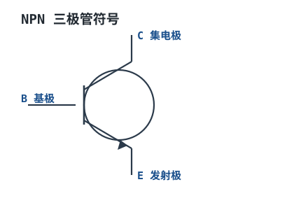
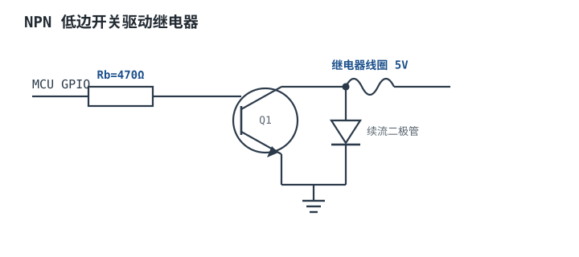

# BJT 三极管：开关与放大 Bipolar Junction Transistor

BJT（双极型晶体管）是一种电流控制电流器件：基极（Base）流入一个小电流 $I_B$，就能控制集电极（Collector）流出大得多的电流 $I_C=\beta I_B$。它分 NPN 和 PNP 两类，在数字电路里做**开关**（饱和导通/截止），在模拟电路里做**放大**（放大区）。

## 1. 设计动机：用小信号控制大电流

::: motivation 单片机 IO 直接驱动负载会怎样
单片机 IO 脚最多输出几 mA，而一颗 LED 需要 5~10mA、一个继电器需要几十 mA。IO 直接接继电器，要么点不亮，要么瞬间烧 IO 口。BJT 就像一个"电动水龙头"：用基极的小电流（几 mA），控制集电极回路的大电流（几百 mA~数 A），实现弱电控制强电。
:::

## 2. 电路符号与结构

NPN 三极管符号：圆圈内一条基极竖线，集电极斜向上、发射极斜向下，发射极带向外箭头（电流流出）。下图给出 NPN 符号与三个电极：

::: analogy 直觉类比：BJT 像"带阀门的水管"
基极电流是"扳动阀门的力"：轻轻推一点（小 $I_B$），主管道里就有大水流（$I_C=\beta I_B$）。完全打开（饱和）时主管道畅通、压降很小；完全关闭（截止）时没水；半开半关（放大区）时水流被精确控制。PNP 只是水流方向相反。
:::

## 3. 三个工作区与关键参数

| 工作区 | 偏置条件 | 特点 | 用途 |
|---|---|---|---|
| 截止区 Cutoff | $V_{BE}<0.6V$ | $I_C\approx0$，管子关断 | 开关"断"态 |
| 放大区 Active | $V_{BE}\approx0.7V$，$V_{CE}>V_{BE}$ | $I_C=\beta I_B$，线性放大 | 模拟放大 |
| 饱和区 Saturation | $V_{BE}$ 正偏，$V_{CE}$ 很小 | $V_{CE(sat)}\approx0.1~0.2V$，管子全导通 | 开关"通"态 |

| 参数 | 英文 | 含义 | 典型数量级 |
|---|---|---|---|
| 电流放大倍数 | β / hFE | $I_C/I_B$ | 100~300（小信号管） |
| 基射压降 | VBE(on) | 正向导通压降 | ≈0.7V（硅管） |
| 饱和压降 | VCE(sat) | 完全导通时 C-E 间电压 | ≈0.1~0.2V |
| 集电极最大电流 | IC(max) | 允许连续集电极电流 | 100mA~数 A |
| 集射耐压 | VCEO | C-E 间可承受电压 | 20V~几百 V |
| 最大功耗 | PD | 集电极耗散功率 | 0.5W~数 W（加散热） |

## 4. 选型要点与工程权衡

- **做开关时强制饱和**：不要按 $\beta$ 算基极电流，要"过驱动"——让 $I_B$ 是理论值的 2~5 倍（硬饱和），保证 $V_{CE(sat)}$ 很低、管子不发热。若基极电流刚好等于 $I_C/\beta$，管子停在放大区，$V_{CE}$ 大、$P=V_{CE}\cdot I_C$ 巨大而烧毁。
- **基极限流电阻**：$R_B=(V_{drive}-V_{BE})/I_B$。MCU 输出 3.3V、要 $I_B=5mA$：$R_B=(3.3-0.7)/0.005=520\Omega$，取 470Ω。
- **感性负载必加续流二极管**：继电器/电机线圈断电瞬间产生反向高压，必须并联续流二极管，否则击穿 C-E。
- **NPN 灌电流、PNP 拉电流**：NPN 适合把负载下端接地（低边开关）；高边开关（负载在电源与开关间）用 PNP 或 N-MOS。
- **功耗留裕量并散热**：$P_D=V_{CE}\cdot I_C$，开关管损耗很小（$V_{CE(sat)}$ 低），但放大区工作时要核算并加散热。

## 5. 典型应用电路：MCU 驱动继电器

下图是 NPN 低边开关：MCU 引脚经基极电阻驱动 NPN，继电器线圈接在电源与集电极之间，线圈两端反向并联续流二极管：

::: example 继电器驱动取值
1. **需求**：5V 继电器线圈电流 70mA，MCU GPIO 高电平 3.3V。
2. **选 NPN**：如 S8050，$I_C$ max 500mA、$V_{CEO}$ 25V，足够。
3. **算基极电流**：要饱和，取过驱动倍数 5，$I_B=I_C/(β\times0.5)=70mA/(100\times0.5)\approx1.4mA$，取 5mA 更稳妥。
4. **算基极电阻**：$R_B=(3.3-0.7)/0.005=520\Omega$，取 470Ω。
5. **续流二极管**：线圈两端反并 1N4148/1N4001，吸收断电反峰。
:::

## 6. 失效模式与常见坑

::: pitfall 常见坑
- **基极电流不足，管子停在放大区发热**：现象——NPN 发烫、$V_{CE}$ 偏高。原因——只按 $\beta$ 算 $I_B$，没留过驱动，管子处于线性区。解决——加大基极电流（硬饱和），或检查基极电阻是否过大。
- **感性负载没加续流二极管**：现象——继电器/电机断电后三极管击穿。原因——线圈反峰高压击穿 C-E。解决——线圈两端反向并联续流二极管。
- **基射反向击穿**：现象——管子基极损坏、hFE 下降。原因——基极-发射极反向电压超过 $V_{EBO}$（通常仅 5~6V），如基极加负压。解决——基射间加钳位/限流，避免反向过压。
- **热失控**：现象——管子越用越烫最终损坏。原因——静态电流随温度升高而增大，正反馈。解决——留功耗裕量、加散热、设发射极负反馈电阻稳定工作点。
:::

## 7. 自测题

做开关时，为什么要让三极管进入饱和区而不是工作在放大区？

饱和区 $V_{CE(sat)}$ 仅 0.1~0.2V，管子损耗 $P=V_{CE}\cdot I_C$ 极小；放大区 $V_{CE}$ 大，同样电流下损耗大得多，管子发热。开关应用要的就是"完全导通或完全关断"，所以强制饱和。

MCU 3.3V 经 470Ω 电阻接 NPN 基极，基极电流大约多少？

$V_{BE}\approx0.7V$，$I_B=(3.3-0.7)/470\approx5.5mA$。这足以驱动小信号 NPN 饱和（带动几十~上百 mA 集电极电流）。

NPN 驱动继电器时，为什么线圈两端要反并联二极管？方向怎么接？

继电器线圈是电感，三极管关断瞬间电流要突变，电感产生很高反向电压，可能击穿 C-E。续流二极管为这个反向电流提供通路。二极管**阴极接电源正、阳极接线圈（集电极侧）**——正常导通时反偏不导通，断电反峰时导通钳位。

## 8. 参考资料

- Microelectronic Circuits (Sedra & Smith, 8th ed.) — BJT 工作区与小信号模型
- The Art of Electronics (Horowitz & Hill, 3rd ed.) — 开关与驱动实践
- Lessons In Electric Circuits (Kuphaldt) — 晶体管基础
