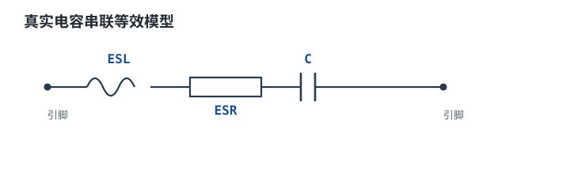
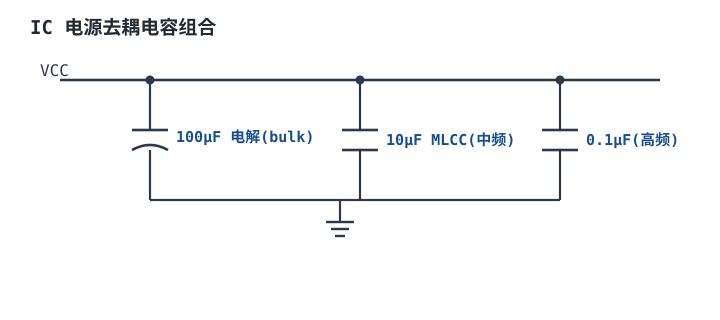

# 电容参数：耐压、ESR、ESL 与失效模式 Capacitor Parameters

理想电容只有一个参数 $C$，阻抗随频率单调下降，容量越大滤波越好。真实电容不是这样：它串着电阻 ESR、串着电感 ESL，容量随温度、偏压、时间变化，还会因为压电效应"唱歌"。同样标 10 µF，一颗 0402 MLCC、一颗 1206 MLCC 和一颗 10 µF 电解，在你关心的频段上可能差两个数量级。

本章只讲"非理想"，而且只讲能算的部分：ESR 与 ESL 怎么从阻抗曲线读出来、纹波电流怎么变成温升与寿命、漏电流怎么毁掉高阻节点、介质吸收怎么吃掉 ADC 的几位、压电效应怎么变成啸叫。主线是一条链：**阻抗模型 → 纹波电流 → ESR 损耗 → 温升 → 寿命**，中间每一步都给公式、代入与判据，最后把一颗 1000 µF 电解放进 24 V 转 5 V、5 A、500 kHz 的 Buck，算清楚它到底行不行。

## 1. 设计动机

::: motivation 五个真实场景
**场景一：纹波电压差 3.6 倍。** 24 V 转 5 V、5 A、500 kHz、2.2 µH 的 Buck，电感纹波电流 3.60 A。用一颗 1000 µF、ESR 50 mΩ 的电解做输出电容，峰值纹波是 $3.60\times(0.05+0.00025)=181$ mV，是 50 mV 指标的 3.6 倍。**问题不在容值——容性纹波只占 0.9 mV，99.5% 的纹波来自 ESR。**

**场景二：温升不大，寿命却不够。** 同一颗电容的纹波电流有效值 1.04 A，ESR 50 mΩ，损耗 54 mW，温升只有 2.4 K。看起来"不热"，但 105 °C/2000 h 的电解放在 55 °C 环境里，算出来寿命 6.3 万小时（7.2 年），达不到 10 年。**电容的短板经常是寿命，不是温升。**

**场景三：介质吸收吃掉 4 位。** 12 位 ADC、5 V 基准，1 LSB 是 1.22 mV。采样保持电容用 X7R（介质吸收 0.1%），一次 5 V 阶跃后回弹 5 mV，等于 4.1 个 LSB。换成 C0G（0.02%）只剩 1 mV，0.8 LSB。**DA 不会让电路坏，只会让精度悄悄掉。**

**场景四：电容在"唱歌"。** 某产品在轻载时听到 5 kHz 的啸叫，换一块板就没了。原因是 PFM 模式让输出纹波落进音频段，MLCC 的钛酸钡在交变电场下伸缩，带着 PCB 一起振动。**换频率、换介质、改布局都能治，唯独"换更大容值"没用。**

**场景五：大电容在高频失效。** 1000 µF 电解的自谐振频率只有 71 kHz，500 kHz 的开关频率已经在它"变成电感"之后。但它仍然有用——因为 ESR 足够大，阻尼掉了谐振峰。**"过了 SRF 就完全没用"是误解，"低 ESR 一定更好"也是误解。**
:::

五个场景对应五组参数。先给索引：

| 你遇到的问题 | 先算 | 判据 |
|---|---|---|
| 输出纹波超标 | $\Delta V=\Delta I_L\left(\text{ESR}+\frac{1}{8fC}\right)$ | 先压 ESR，再补容值 |
| 电容发烫、寿命短 | $P=I_{\text{rms}}^2\text{ESR}$，$\Delta T=P\theta$ | 纹波电流 ≤ 额定（按频率修正），本体温度进寿命公式 |
| 高阻节点电压偏掉 | $I_{\text{leak}}\approx0.01CV$ | 漏电流在节点源阻抗上的压降 <1% 预算 |
| 采样/积分精度不够 | $\varepsilon=\text{DA}\times\Delta V$ | DA 折算的误差 <0.5 LSB |
| 音频段啸叫 | 纹波频谱是否落在 20 Hz~20 kHz | 换频率/换介质/改布局，而不是加容值 |
| 高频去耦无效 | $f_0=\frac{1}{2\pi\sqrt{L_{\text{ESL}}C}}$ | 工作频率低于 SRF，或靠多颗并联降低 ESL |

三个有具体数字的代价：ESR 从 50 mΩ 降到 12.5 mΩ 需要并联 4 颗，元件数与面积翻 4 倍；介质吸收 0.1% 在 12 位系统里就是 4 LSB，相当于把 ADC 降成 10 位；电解放在 85 °C 环境，2000 h 的器件只能撑 8000 h（0.91 年）。

## 2. 定义与直观

### 2.1 从理想电容到三元件模型

真实电容的集总模型是"电容 + 串联电阻 + 串联电感"：

$$Z=\text{ESR}+j\left(\omega L_{\text{ESL}}-\frac{1}{\omega C}\right),\qquad |Z|=\sqrt{\text{ESR}^2+\left(\omega L_{\text{ESL}}-\frac{1}{\omega C}\right)^2}$$

符号：$Z$ 是阻抗（Ω），ESR 是等效串联电阻（Ω），$L_{\text{ESL}}$ 是等效串联电感（H），$C$ 是容量（F），$\omega=2\pi f$ 是角频率（rad/s）。三个元件各有物理来源：

- **ESR** 来自极板与引出端的金属电阻、介质损耗（$\tan\delta$）与电解液的离子电阻。它是**唯一会消耗能量**的项，所以纹波电流会在它上面发热。
- **ESL** 来自极板回路、内部引出结构与焊盘/过孔。它与容值无关，主要由封装几何决定。
- **C** 本身也不是常数：Class II 陶瓷随直流偏压、温度、时间变化，电解随温度与老化变化。



### 2.2 阻抗曲线的三个区段

把 $|Z|$ 画成频率的函数，会看到一条"山谷"形曲线，分三段：

1. **低频段（容性）**：$\omega L\ll1/(\omega C)$，$|Z|\approx1/(\omega C)$。双对数坐标下斜率 -20 dB/十倍频。这一段里，容值越大阻抗越低。
2. **自谐振点（SRF）**：$\omega L=1/(\omega C)$，两项抵消，$|Z|$ 取最小值，等于 ESR。这是"电容最像理想电容"的频率。
3. **高频段（感性）**：$\omega L\gg1/(\omega C)$，$|Z|\approx\omega L$，斜率 +20 dB/十倍频。电容变成了电感，再加容量也没用。

自谐振频率由两个寄生参数决定：

$$f_0=\frac{1}{2\pi\sqrt{L_{\text{ESL}}C}}$$

代入 1000 µF、5 nH：$f_0=1/(2\pi\sqrt{5\times10^{-9}\times10^{-3}})=1/(2\pi\times2.236\times10^{-6})=71.2$ kHz。代入 100 nF、0.7 nH：$f_0=19.0$ MHz。**容值大 10000 倍，SRF 只低 267 倍**——因为 SRF 与 $\sqrt{C}$ 成反比，与 $\sqrt{L}$ 也成反比。想让 SRF 高，缩小封装（降 ESL）比减小容值更有效。

下面这张图是用上面的模型算出来的（1000 µF 电解：ESR 50 mΩ、ESL 5 nH；100 nF MLCC：ESR 10 mΩ、ESL 0.7 nH），两条曲线的谷底就是各自的 SRF，也是各自的 ESR：

```echarts
{
  "tooltip": {"trigger": "axis"},
  "legend": {"data": ["1000 µF 电解", "100 nF MLCC"], "bottom": 0, "textStyle": {"fontSize": 13}},
  "grid": {"left": 64, "right": 28, "top": 28, "bottom": 56},
  "xAxis": {"type": "category", "name": "频率 Hz", "data": ["100", "300", "1k", "3k", "10k", "30k", "100k", "300k", "1M", "3M", "10M", "30M", "100M"], "axisLabel": {"fontSize": 11}},
  "yAxis": {"type": "log", "name": "|Z| Ω", "min": 0.01, "max": 100000, "axisLabel": {"fontSize": 11}},
  "series": [
    {"name": "1000 µF 电解", "type": "line", "showSymbol": true, "symbolSize": 5,
     "lineStyle": {"width": 2.6, "color": "#1a4f8b"}, "itemStyle": {"color": "#1a4f8b"},
     "data": [1.5923, 0.5329, 0.1668, 0.0728, 0.0524, 0.0502, 0.05, 0.0508, 0.059, 0.1066, 0.3181, 0.9438, 3.142]},
    {"name": "100 nF MLCC", "type": "line", "showSymbol": true, "symbolSize": 5,
     "lineStyle": {"width": 2.6, "color": "#b4541f"}, "itemStyle": {"color": "#b4541f"},
     "data": [15915.5, 5305.2, 1591.5, 530.5, 159.2, 53.05, 15.92, 5.30, 1.587, 0.5174, 0.1156, 0.0795, 0.424]}
  ]
}
```

图中读出的三件事：**① 1000 µF 在 10 kHz 以下阻抗低于 100 nF，100 nF 在 1 MHz 以上反而更低——"大电容滤低频、小电容滤高频"是 ESR 与 ESL 共同决定的，不是容值单独决定的。② 谷底值就是 ESR：1000 µF 是 50 mΩ，100 nF 是 10 mΩ。③ 过了谷底，曲线按 +20 dB/十倍频上升，1000 µF 在 100 MHz 是 3.14 Ω，已经比 100 nF 的 0.42 Ω 差 7.4 倍。**

实际产品里，这一步落地成"按频段配电容"：一颗大容量电解顶住低频与负载瞬变，几颗中容量 MLCC 顶住开关纹波，最靠近芯片的地方再放 0.1 µF。三级配合的依据就是上面这条阻抗曲线——每一级负责自己 SRF 以下的频段，越靠近负载的电容封装越小、ESL 越低。



### 2.3 直觉类比及其边界

::: analogy 山谷与"锅底"
把 $|Z|$ 曲线想成一条山谷：左边山坡是容抗（越往低频越陡），谷底是 ESR，右边山坡是感抗（越往高频越陡）。工作频率落在谷底附近，去耦最有效；落在右边山坡上，电容已经"变成电感"，再并联同型号也没用。

电解电容的山谷又宽又浅（ESR 大、Q 低），MLCC 的山谷又窄又深（ESR 小、Q 高）。窄谷的好处是谷底低，坏处是**稍微偏离就爬坡**，而且容易和别的电容形成新的谐振峰。
:::

类比的边界：山谷模型只描述"单颗电容"。多颗不同容值并联时会出现**反谐振峰**——比如 22 µF（SRF 876 kHz、ESL 1.5 nH）与 100 nF（SRF 19 MHz、ESL 0.7 nH）并联，在两者之间会有一个并联谐振点，估算频率

$$f_{\text{anti}}\approx\frac{1}{2\pi\sqrt{L_{22\mu\text{F}}C_{100\text{nF}}}}=\frac{1}{2\pi\sqrt{1.5\times10^{-9}\times100\times10^{-9}}}=13.0\ \text{MHz}$$

在 13 MHz 附近，两只电容"互相看不见"，阻抗可能比单只还高。**"多并几种容值更好"是错的**，正确做法是用仿真或阻抗分析仪确认，必要时选 ESR 稍大的型号做阻尼。

## 3. 定量关系

### 3.1 从实测曲线读 ESR、ESL 与 SRF

阻抗分析仪给出的是一条 $|Z|$ 与相位的曲线，从中可以反解三个参数：

$$\text{ESR}=|Z|_{\min},\qquad C=\frac{1}{2\pi f|Z|}\ (f\ll f_0),\qquad L_{\text{ESL}}=\frac{|Z|}{2\pi f}\ (f\gg f_0)$$

实测判据（按顺序核四条）：

1. **谷底阻抗是否等于标称 ESR**：数据手册的 ESR 常标在 100 kHz（电解）或 1 MHz（MLCC），谷底应该落在这个量级。谷底明显偏高 → 电容老化、焊点虚接或测试夹具接触电阻太大。
2. **相位是否在 SRF 处过零**：理想模型里容性相位 -90°、感性 +90°，过零点的频率就是 SRF。相位过零比"阻抗最低"更可靠，因为谷底很平，肉眼难判断。
3. **两侧斜率是否 ±20 dB/十倍频**：低频斜率变缓说明介质损耗大或测量带宽不够；高频斜率变陡说明夹具电感混进来了。
4. **加直流偏压后重测容值**：MLCC 的实际工作容值可能只有标称的 30%~70%，必须在偏压下测，或者按数据手册的 DC Bias 曲线取值。

### 3.2 纹波电流、ESR 损耗与温升

开关电源的输出电容承受三角波纹波。设电感电流纹波峰峰值为 $\Delta I_L$，电容电流的有效值是

$$I_{\text{rms}}=\frac{\Delta I_L}{\sqrt{12}}=0.2887\,\Delta I_L$$

系数 $1/\sqrt{12}$ 来自三角波的均方根：一个峰峰值为 $\Delta I$、均值不为零的三角波，其交流分量的有效值就是 $\Delta I/\sqrt{12}$。ESR 上的损耗与温升是

$$P_{\text{ESR}}=I_{\text{rms}}^2\text{ESR},\qquad \Delta T=P_{\text{ESR}}\,\theta_{\text{CA}}$$

符号：$P_{\text{ESR}}$ 是 ESR 损耗（W），$\theta_{\text{CA}}$ 是热点到环境的热阻（K/W）。数据手册通常不直接给 $\theta_{\text{CA}}$，而是给"额定纹波电流"，并用"额定电流下热点温升不超过某个值"（电解常见 5 K）来界定。于是可以反推：

$$\theta_{\text{CA}}=\frac{\Delta T_{\text{rated}}}{I_{\text{rated}}^2\text{ESR}}$$

例：1000 µF、ESR 50 mΩ、额定纹波 1.5 A（105 °C、100 kHz）、额定温升 5 K：

$$\theta_{\text{CA}}=\frac{5}{1.5^2\times0.05}=\frac{5}{0.1125}=44.4\ \text{K/W}$$

这个数一旦得到，任意纹波电流下的温升都能算。**注意两点**：一是额定纹波电流通常标在 100 kHz，工作频率更高时 ESR 下降、允许电流上升（频率修正系数典型 1.1~1.4，以数据手册为准）；二是低温下电解的 ESR 会上升（-40 °C 可到 25 °C 的 10 倍以上），寒区启动时的纹波与温升要单独核。

### 3.3 纹波电压的分解

输出纹波由两部分叠加：ESR 上的电阻性压降，和电容充放电的容性纹波。

$$\Delta V_{\text{ripple}}\approx\Delta I_L\left(\text{ESR}+\frac{1}{8f_{\text{sw}}C}\right)$$

容性项的推导要点：三角波电流的电荷变化是 $\Delta Q=\Delta I_L/(8f_{\text{sw}})$，除以 $C$ 就是电压摆幅。这个式子是估算，忽略了 ESL 与环路电感，但对几百 kHz 的 Buck 够用；更高频或更低 ESR 时，ESL 与 PCB 环路会成为主导。

从这个式子能直接看出优先级：**ESR 项与频率无关，容性项与频率成反比。** 500 kHz、1000 µF 时，容性项只有 $1/(8\times5\times10^5\times10^{-3})=0.25$ mΩ，是 ESR 50 mΩ 的 0.5%。**这时候把容值加 10 倍，纹波只降 0.45%；把 ESR 降一半，纹波降 50%。**

### 3.4 漏电流与绝缘电阻

漏电流是介质不理想导致的直流通道，三类电容的规格完全不同：

- **铝电解**：$I_{\text{leak}}\approx0.01CV$（µA，$C$ 取 µF、$V$ 取 V），或 3 µA 取大者。1000 µF/25 V 约 250 µA。
- **钽电容**：$I_{\text{leak}}\approx0.01CV$ 或 1 µA 取大者，量级比电解小。
- **陶瓷**：用绝缘电阻表示，$R_{\text{ins}}\cdot C\ge500\ \Omega\cdot\text{F}$（即时间常数 ≥500 s）。10 µF 的 $R_{\text{ins}}\ge500/10^{-5}=50$ MΩ，25 V 下漏电 0.5 µA。

高阻节点上，漏电流会直接变成电压误差。250 µA 流过 100 kΩ 就是 25 V——比 3.3 V 电源还高。**分压网络、采样保持、电荷放大器这类节点，不能用漏电大的电解；10 µF 陶瓷的 0.5 µA 在 1 MΩ 节点上也有 0.5 V 误差，同样要算。**

### 3.5 介质吸收对采样电路的影响

介质吸收（Dielectric Absorption，DA）是介质里的"慢极化"：快速放电到零后，被"冻住"的极化电荷会慢慢释放，让端电压回弹。它可以用一组 RC 支路并联在理想电容上来建模，时间常数从毫秒到秒。

常用测量方法：充电到额定电压保持 60 s，用 5 Ω 电阻放电 10 s，开路静置 60 s 后测回弹电压 $V_r$，则

$$\text{DA}=\frac{V_r}{V_{\text{charge}}}\times100\%$$

典型量级（以数据手册为准）：C0G 约 0.02%，薄膜 0.02%~0.2%，X7R/X5R 约 0.1%~1%，铝电解 5%~15%，钽 5%~10%。

在采样保持与积分电路里，DA 造成的误差近似为

$$\varepsilon_{\text{DA}}=\text{DA}\times\Delta V_{\text{step}}$$

例：12 位、5 V 基准、满量程阶跃 5 V，X7R 的 0.1% 给出 5 mV 误差，而 1 LSB 只有 1.22 mV——**DA 一项就吃掉 4.1 个 LSB**。这不是噪声，无法用平均消除；只能换介质（C0G/薄膜）、缩短保持时间、或在软件里做 DA 补偿。

### 3.6 压电效应与啸叫

Class II 陶瓷（钛酸钡）是铁电体，也是压电体：外加电场会让它伸缩，机械应力也会在它两端产生电压。交流纹波因此变成机械振动，振动传到 PCB 就成了可听的啸叫（singing）。

量级估算：设压电系数 $d_{31}=500$ pm/V、单层介质厚度 $t=3$ µm、纹波幅值 100 mV，则应变

$$S=d_{31}\frac{\Delta V}{t}=500\times10^{-12}\times\frac{0.1}{3\times10^{-6}}=1.67\times10^{-5}$$

即 16.7 ppm。以 1206 的 3.2 mm 本体长度算，位移 $1.67\times10^{-5}\times3.2\ \text{mm}=53$ nm。53 nm 本身听不见，但 PCB 是厘米级的"鼓面"，会被放大到可听水平。**频率落在 20 Hz~20 kHz 才会响**，所以啸叫的根源往往是轻载 PFM 的音频段纹波、或开关频率的低次谐波。

对策按有效性排序：把纹波频谱移出音频段（改开关频率、加抖频、轻载改 PWM）；换 C0G/薄膜（$d_{31}$ 小两到三个数量级）；用高耐压/大封装（介质更厚、同样电压下电场更小）；把电容从板边、螺丝孔、连接器附近移开；必要时在电容与板之间加垫片或开槽。**"换更大容值"通常无效，因为容值大往往意味着介质更薄、电场更强。**

### 3.7 寿命与温度

铝电解的寿命由电解液蒸发速率决定，近似服从"每降 10 °C 翻倍"：

$$L=L_0\,2^{(T_0-T)/10}$$

符号：$L_0$ 是额定温度 $T_0$ 下的寿命（h），$T$ 是实际工作温度（°C），$L$ 是估算寿命（h）。纹波引起的温升要加进 $T$：$T=T_a+\Delta T_{\text{ripple}}$。更严格的做法是用 Arrhenius 模型（$\ln L\propto E_a/kT$），厂商手册通常给出带纹波修正的完整公式；"10 °C 翻倍"只是工程近似，实际指数在每 8~12 °C 翻倍之间。

## 4. 典型计算

### 4.1 算例一：Buck 输出电容，从纹波电流算到温升与寿命

**需求**：24 V 转 5 V、5 A、开关频率 500 kHz、电感 2.2 µH，输出纹波要求 ≤50 mV，环境 55 °C，寿命要求 10 年（87600 h）。

**第 1 步：算占空比与电感纹波电流。**

$$D=\frac{V_{\text{out}}}{V_{\text{in}}}=\frac{5}{24}=0.2083$$

$$\Delta I_L=\frac{V_{\text{out}}(1-D)}{Lf_{\text{sw}}}=\frac{5\times(1-0.2083)}{2.2\times10^{-6}\times5\times10^5}=\frac{3.9585}{1.1}=3.599\ \text{A}$$

**第 2 步：算电容纹波电流有效值。**

$$I_{\text{rms}}=\frac{3.599}{\sqrt{12}}=\frac{3.599}{3.464}=1.039\ \text{A}$$

**第 3 步：选一颗电容，算 ESR 损耗与温升。** 候选：1000 µF/25 V 铝电解，ESR 50 mΩ，额定纹波 1.5 A（105 °C、100 kHz），由 3.2 节反推 $\theta_{\text{CA}}=44.4$ K/W。

$$P_{\text{ESR}}=I_{\text{rms}}^2\text{ESR}=1.039^2\times0.05=5.40\times10^{-2}\ \text{W}=54.0\ \text{mW}$$

$$\Delta T=P_{\text{ESR}}\theta_{\text{CA}}=0.0540\times44.4=2.40\ \text{K}$$

纹波电流利用率 $1.039/1.5=69\%$，温升 2.4 K，**热上没问题**。若 ESR 有 +30% 的批次偏差（65 mΩ），损耗升到 70.1 mW、温升 3.1 K，仍在 5 K 以内。

**第 4 步：算纹波电压。**

$$\Delta V_{\text{ESR}}=\Delta I_L\,\text{ESR}=3.599\times0.05=0.180\ \text{V}$$

$$\Delta V_C=\frac{\Delta I_L}{8f_{\text{sw}}C}=\frac{3.599}{8\times5\times10^5\times10^{-3}}=0.899\ \text{mV}$$

$$\Delta V_{\text{ripple}}=180+0.9=181\ \text{mV}$$

**181 mV 是 50 mV 指标的 3.6 倍，不满足。** 结构上 ESR 项占 99.5%，所以正确方向是降 ESR，而不是加容量——把容值加到 10000 µF，容性项从 0.90 mV 降到 0.09 mV，总纹波只从 180.9 mV 降到 180.0 mV。

**第 5 步：并联 4 颗。** ESR 变成 12.5 mΩ，容值 4000 µF：

$$\Delta V=3.599\times\left(0.0125+\frac{1}{8\times5\times10^5\times4\times10^{-3}}\right)=3.599\times(0.0125+0.0000625)=45.2\ \text{mV}$$

满足 50 mV，余量 9.6%。此时每颗电容的纹波电流 $1.039/4=0.260$ A，损耗 $0.260^2\times0.05=3.38$ mW，温升 $3.38\times10^{-3}\times44.4=0.15$ K。**并联把 ESR 与单颗纹波电流同时降下来，温升按电流平方下降，所以降得比纹波更多。**

**第 6 步：算寿命。** 本体温度 $55+0.15=55.15$ °C。

2000 h 品：

$$L=2000\times2^{(105-55.15)/10}=2000\times2^{4.985}=2000\times31.67=6.33\times10^4\ \text{h}$$

$$6.33\times10^4/8760=7.2\ \text{年}$$

**不满足 10 年。** 换 5000 h 品：

$$L=5000\times2^{4.985}=1.58\times10^5\ \text{h}=18.1\ \text{年}$$

满足。若只并联 1 颗（温升 2.4 K，本体 57.4 °C），2000 h 品是 $2000\times2^{4.76}=5.42\times10^4$ h（6.2 年），5000 h 品是 $1.35\times10^5$ h（15.5 年）。

**第 7 步：换型对比。** 如果不想放 4 颗电解，可以选 4 颗 22 µF/25 V X7R 1210 并联（标称 88 µF、有效约 27 µF，方法见[电容器全解](../components/capacitors.md)）。ESR 按每颗 5 mΩ 算是 1.25 mΩ，纹波 $3.599\times(0.00125+0.0000025)=4.5$ mV，纹波电流每颗 0.26 A。**MLCC 的问题不是性能而是容值随偏压/温度衰减、以及压电啸叫**；电解的问题则是寿命与体积。这是一次典型的"用面积与成本换寿命"的取舍。

**第 8 步：核对 SRF 与高频行为。** 1000 µF 与 5 nH 的 SRF 是 71.2 kHz，低于 500 kHz 开关频率，单颗在开关频率上已呈感性。但 $|Z|$ 在 500 kHz 是

$$|Z|=\sqrt{0.05^2+\left(2\pi\times5\times10^5\times5\times10^{-9}-\frac{1}{2\pi\times5\times10^5\times10^{-3}}\right)^2}=\sqrt{0.05^2+0.0154^2}=0.0523\ \Omega$$

**只比 ESR 高 4.6%**，因为这只电容的 $Q=(1/\text{ESR})\sqrt{L/C}=0.045\ll1$，是严重过阻尼的。这解释了"过了 SRF 电容并非立刻失效"——ESR 把谐振峰完全压平了。反过来，100 nF MLCC 的 $Q=8.37$，谐振峰尖锐，才需要担心反谐振。

**第 9 步：顺带核对输入电容。** 输入电容的纹波电流有效值是

$$I_{\text{rms,in}}=I_{\text{out}}\sqrt{D(1-D)}=5\times\sqrt{0.2083\times0.7917}=5\times0.4061=2.031\ \text{A}$$

**比输出电容的 1.04 A 大一倍。** 用同一颗 1.5 A 额定的电解，已经超额定 35%，损耗 $2.031^2\times0.05=0.206$ W、温升 9.2 K，**超过 5 K 的额定温升**。输入电容必须并联两颗以上，或改用低 ESR 的 MLCC/聚合物。**做电源时最容易漏的就是"输入电容的纹波电流比输出大"。**

**结论**：4 颗 1000 µF/25 V、105 °C/5000 h 的电解并联，输出纹波 45.2 mV、每颗温升 0.15 K、寿命 18 年，满足指标；输入侧同样要 ≥2 颗或改 MLCC。若坚持单颗，纹波 181 mV 不达标，且寿命只有 7.2 年。

### 4.2 算例二：介质吸收吃掉几位 ADC

**需求**：12 位、5 V 基准的采样保持电路，采样电容 100 pF，输入阶跃 5 V，要求 DA 引起的误差 <0.5 LSB。

**第 1 步：算 1 LSB。**

$$V_{\text{LSB}}=\frac{5}{2^{12}}=\frac{5}{4096}=1.221\ \text{mV}$$

**第 2 步：算各介质的 DA 误差。**

$$\varepsilon_{\text{DA}}=\text{DA}\times5\ \text{V}$$

- C0G（0.02%）：$0.02\%\times5=1.0$ mV $=0.82$ LSB
- 薄膜 PPS（0.05%）：2.5 mV $=2.05$ LSB
- X7R（0.1%）：5.0 mV $=4.10$ LSB
- 铝电解（5%）：250 mV $=205$ LSB（完全不可用）

**第 3 步：结论。** C0G 的 0.82 LSB 已经是四种介质里最好的，但仍超过 0.5 LSB 的目标；要严格达标，得选 DA ≤0.012% 的型号（0.6 mV = 0.49 LSB），或者把采样电容增大、缩短保持时间让回弹来不及发生。工程上更常见的做法是**接受 1 LSB 量级的 DA 误差**，或用软件做两步补偿（先采样、再注入反向电荷）。

**第 4 步：对比积分器。** 积分器里 DA 的影响被累积：每次复位后介质里残留的慢极化电荷会叠加到下一次积分。0.1% 的 DA 意味着每次积分开始时就"预置"了上一周期 0.1% 的电荷，等效 0.1% 的增益误差——**对 12 位系统就是 4 LSB 的固定增益偏差，可以用校准消掉一部分；但它随温度和时间漂移，校准值会过期。**

### 4.3 算例三：压电位移与啸叫判据

**需求**：判断 1206、X7R、10 µF/25 V 的 MLCC 在 100 mV、5 kHz 纹波下会不会啸叫。

**第 1 步：算电场。** 单层介质厚度按 3 µm（高压高容型号的实际层厚更小，以数据手册为准）：

$$E=\frac{\Delta V}{t}=\frac{0.1}{3\times10^{-6}}=3.33\times10^4\ \text{V/m}$$

**第 2 步：算应变与位移。** 取 $d_{31}=500$ pm/V：

$$S=d_{31}E=500\times10^{-12}\times3.33\times10^4=1.67\times10^{-5}$$

$$\Delta L=S\times L_{\text{body}}=1.67\times10^{-5}\times3.2\ \text{mm}=53\ \text{nm}$$

**第 3 步：判据。** 53 nm 的位移作用在几平方毫米的陶瓷体上，辐射面积太小，单靠它自己几乎听不见；但它会激励 cm 级、面积大几十倍的 PCB 板面一起振动，听感取决于板面积、固定方式与距离。**工程判据不是"算位移"，而是三条经验规则**：纹波频谱是否落在 20 Hz~20 kHz；轻载时开关频率是否进入音频段；同一块板换不同厂家的同规格电容，声音是否明显变化（说明是压电，不是环路）。

**第 4 步：对策验证。** 把介质从 X7R 换成 C0G：C0G 是顺电体，压电系数比钛酸钡小两到三个数量级以上，53 nm 降到亚纳米，啸叫基本消失；代价是同样容值的 C0G 体积大十倍以上，10 µF 基本做不到，只能改拓扑（提高开关频率、减小纹波）或改布局（远离板边）。

## 5. 工程含义

### 5.1 参数速查

| 类型/封装 | 典型 ESR | 典型 ESL | SRF（计算值） | 主要限制 |
|---|---|---|---|---|
| 100 nF X7R 0603 | 3~10 mΩ | 0.7 nH | 19.0 MHz | 直流偏压降容 |
| 1 µF X7R 0805 | 3~10 mΩ | 1.0 nH | 5.03 MHz | 偏压降容、压电 |
| 10 µF X7R 1210 | 2~5 mΩ | 1.5 nH | 1.30 MHz | 偏压降容、压电、板弯裂纹 |
| 22 µF X7R 1210 | 2~5 mΩ | 1.5 nH | 876 kHz | 同上 |
| 100 µF 铝电解 | 0.1~1 Ω | 5 nH | 225 kHz | 寿命、低温 ESR、极性 |
| 1000 µF 铝电解 | 0.05~0.3 Ω | 5 nH | 71.2 kHz | 寿命、纹波电流、体积 |
| 100 µF 钽（MnO₂） | 0.1~5 Ω | 3~5 nH | 225~290 kHz | 过压短路、起火风险 |
| 100 µF 聚合物 | 10~50 mΩ | 3~5 nH | 225~290 kHz | 成本、耐压 |
| 1 µF 薄膜 | 5~100 mΩ | 5~10 nH | 1.6~2.3 MHz | 体积、单位容量成本 |

（ESR/ESL 为典型量级，SRF 按 $1/(2\pi\sqrt{LC})$ 计算，具体以数据手册为准。）

### 5.2 选型五步

1. **先定纹波电压预算**：把 $\Delta I_L(\text{ESR}+1/(8fC))$ 的两项分开算，看谁是主导。主导项是 ESR 就选低 ESR 型号，是容性就加容量。
2. **再算纹波电流与温升**：$I_{\text{rms}}=\Delta I_L/\sqrt{12}$，按额定纹波与反推的 $\theta_{\text{CA}}$ 算 $\Delta T$，确认不超过额定温升。
3. **算寿命**：$T=T_a+\Delta T$，代入 $L=L_0 2^{(T_0-T)/10}$，与产品寿命目标比。
4. **核偏压与温度下的有效容值**：Class II 陶瓷按 DC Bias 曲线取最坏保持率，别用标称值。
5. **最后看高频与机械**：SRF 是否高于工作频率的谐波；是否有压电啸叫风险；大封装是否有板弯裂纹风险。

### 5.3 测量与验证

- **容值**：LCR 表在 1 kHz（大电容）或 100 kHz/1 MHz（小电容）测；测之前确认偏压为零，否则测到的是"工作点容值"。
- **ESR**：ESR 表在 100 kHz 测。几 mΩ 的 MLCC 必须用四线开尔文夹具——表笔与接触电阻有 10~100 mΩ，不用四线法读数会大一个数量级。
- **SRF**：阻抗分析仪扫频，看相位过零点；没有仪器时可用"串联谐振法"（串一只已知电感，找阻抗最低点，反解 $L_{\text{ESL}}$）。
- **纹波**：示波器 AC 耦合、20 MHz 带宽限制、短地弹簧。用长地线测到的是环路电感上的感应电压，不是电容纹波。
- **温度**：热电偶贴电容本体测**壳温**，寿命公式用的是本体/热点温度，不是环境温度。
- **漏电**：充电到额定电压，等 2 min 后测电流；陶瓷的漏电在 µA 以下，要用高阻计或皮安表。
- **DA**：按 3.5 节的三步法（充 60 s、放 10 s、静置 60 s 测回弹），同一批样品比相对值。

### 5.4 环路稳定性与低 ESR

输出电容不只是滤波器，它还是环路的一部分。ESR 在环路里产生一个零点 $f_z=1/(2\pi\text{ESR}\,C)$，对相位有提升作用。1000 µF、50 mΩ 的零点在 3.18 kHz，正好落在常见环路带宽附近，**这是老式电解"好补偿"的原因**。

换成 4 颗 MLCC（ESR 1.25 mΩ、总容量 27 µF）后，零点跑到 $1/(2\pi\times1.25\times10^{-3}\times27\times10^{-6})=4.7$ MHz，远超带宽，**等于把环路的一个零点拿走了**。这时必须用 Type III 补偿或加前馈电容，否则相位裕度不够。**"低 ESR 更好"只在纹波与损耗的意义上成立，在稳定性上未必。** 补偿设计见[开关电源控制环路](../power/smps-control-loop.md)，去耦布局见[电源完整性与去耦体系](../power/power-integrity-decoupling.md)。

### 5.5 安全

- **高压储能**：能量与 $V^2$ 成正比。400 V、470 µF 储存 $0.5\times470\times10^{-6}\times400^2=37.6$ J，足以致命。断电后要并泄放电阻，等待足够时间并实测，见[电气安全](../basics/electrical-safety.md)。
- **极性**：电解与钽反接会发热、鼓包甚至爆炸；钽反接可能直接短路起火。丝印、封装、来料方向三处都要核对。
- **钽电容降额**：按 ≤50% 额定电压使用，低阻负载串限流电阻抑制浪涌；失效模式是低阻短路。
- **安规电容**：跨接市电的 X/Y 电容必须是安规认证型号，不能用普通 MLCC 替代。
- **介质吸收回弹**：断电后电容可能"回弹"出电压，维修前要重复放电并实测。

## 6. 常见坑

::: pitfall 常见坑
- **只加容量不加 ESR**：现象——输出纹波怎么加电容都下不去，换了更大容值只降几毫伏。原因——纹波由 $\Delta I_L(\text{ESR}+1/(8fC))$ 两项组成，500 kHz、1000 µF 时容性项只有 0.25 mΩ，ESR 项 50 mΩ，占 99.5%。解决——先算两项的比例；ESR 主导就并联或多相并联降 ESR，容性主导才加容量。
- **忽略输入电容的纹波电流**：现象——输出电容温温的，输入电解却鼓包、寿命很短。原因——Buck 输入电容的纹波电流是 $I_{\text{out}}\sqrt{D(1-D)}$，本例 2.03 A 比输出的 1.04 A 大一倍，已超 1.5 A 额定。解决——输入电容单独核算并按 ≥2 颗并联或改低 ESR 型号；别把输出电容的经验直接搬到输入。
- **用降额曲线算温升，忽略 $\theta_{\text{CA}}$ 的来源**：现象——按额定电流选型，实际温升远超预期。原因——额定纹波电流是在 105 °C、100 kHz 下定义的，低频（120 Hz）时 ESR 更大、允许电流更小；高温下寿命又对温度极敏感。解决——按工作频率查频率修正系数，按实际纹波算损耗，再用 $\theta_{\text{CA}}$ 反推温升。
- **高阻节点用电解做滤波**：现象——分压节点电压比计算值低几伏，换一块板又不同。原因——电解的漏电流按 $0.01CV$ 估算，1000 µF/25 V 是 250 µA，流过 100 kΩ 就是 25 V。解决——高阻节点用 C0G/薄膜（漏电 0.5 µA 量级），或把节点阻抗降到几 kΩ 以下。
- **采样保持电路用 X7R**：现象——12 位 ADC 的有效位数只有 10 位，读数有一个固定的偏置型误差。原因——X7R 的介质吸收 0.1% 在 5 V 阶跃上回弹 5 mV，等于 4.1 LSB，且无法用平均消除。解决——采样/积分电容用 C0G 或薄膜；必要时做 DA 补偿或缩短保持时间。
- **忽略压电啸叫**：现象——轻载时听到音频啸叫，负载一重就消失。原因——PFM/跳周期模式让纹波落进音频段，Class II 陶瓷的压电效应把电信号变成机械振动。解决——改开关频率或加抖频、轻载切 PWM、换 C0G/薄膜、把电容移离板边与螺丝孔。
- **以为低 ESR 一定更好**：现象——把电解换成多颗 MLCC 后，纹波好了，环路却振荡或动态响应变差。原因——ESR 零点被推到环路带宽之外，相位裕度下降；多容值并联还可能产生反谐振峰。解决——按环路需要保留适量 ESR 或改补偿网络；并联组合用仿真确认阻抗曲线，不要凭"越多越好"。
:::

## 7. 自测题

<details><summary>1000 µF、ESR 50 mΩ、ESL 5 nH 的电解，自谐振频率是多少？在 500 kHz 时它呈容性还是感性？阻抗比 ESR 高多少？</summary>

$$f_0=\frac{1}{2\pi\sqrt{5\times10^{-9}\times10^{-3}}}=71.2\ \text{kHz}$$

500 kHz 高于 SRF，呈**感性**。阻抗：

$$|Z|=\sqrt{0.05^2+\left(2\pi\times5\times10^5\times5\times10^{-9}-\frac{1}{2\pi\times5\times10^5\times10^{-3}}\right)^2}$$

$$=\sqrt{0.05^2+(0.01571-0.000318)^2}=\sqrt{0.0025+0.000237}=0.0523\ \Omega$$

只比 ESR 高 4.6%。原因是这只电容的 $Q=(1/0.05)\sqrt{5\times10^{-9}/10^{-3}}=0.045$，严重过阻尼，谐振峰被 ESR 压平了。**"过了 SRF 就失效"对高 Q 的 MLCC 更成立，对低 Q 的电解不成立。**
</details>

<details><summary>Buck 输出 5 V/5 A、500 kHz、2.2 µH，电感纹波电流是多少？用 1000 µF、ESR 50 mΩ 的电解，纹波电压多少？其中容性项占多少？</summary>

$$D=5/24=0.2083$$

$$\Delta I_L=\frac{5\times(1-0.2083)}{2.2\times10^{-6}\times5\times10^5}=3.599\ \text{A}$$

$$I_{\text{rms}}=\frac{3.599}{\sqrt{12}}=1.039\ \text{A}$$

纹波：

$$\Delta V=3.599\times\left(0.05+\frac{1}{8\times5\times10^5\times10^{-3}}\right)=3.599\times(0.05+0.00025)=181\ \text{mV}$$

容性项 $3.599\times0.00025=0.9$ mV，占 0.5%。**所以加容量几乎没用，必须降 ESR**：并联 4 颗后 ESR 12.5 mΩ，纹波 45.2 mV。
</details>

<details><summary>1000 µF/25 V 电解的漏电流按 0.01CV 估算多大？接到 100 kΩ 分压节点上会偏多少？10 µF 陶瓷呢？</summary>

电解：

$$I_{\text{leak}}=0.01\times1000\times25=250\ \mu\text{A}$$

$$V=I_{\text{leak}}R=250\times10^{-6}\times10^5=25\ \text{V}$$

完全不可用——分压节点会被拉到地。

陶瓷（$R_{\text{ins}}\cdot C\ge500\ \Omega\cdot\text{F}$）：$R_{\text{ins}}\ge500/10^{-5}=50$ MΩ，25 V 下漏电 $25/(5\times10^7)=5\times10^{-7}\ \text{A}=0.5\ \mu\text{A}$，在 100 kΩ 上是 0.05 V（1.5%）。**比电解好 500 倍，但在 1 MΩ 节点上仍有 0.5 V，照样要算。**
</details>

<details><summary>X7R 的介质吸收 0.1%，在 12 位、5 V 基准、满量程阶跃的采样保持电路里造成几个 LSB？换成 C0G 呢？为什么平均采样消不掉这个误差？</summary>

1 LSB：

$$V_{\text{LSB}}=5/4096=1.221\ \text{mV}$$

DA 误差：

$$\varepsilon_{\text{DA}}=0.001\times5=5\ \text{mV}=4.1\ \text{LSB}$$

C0G（0.02%）：$0.0002\times5=1.0$ mV $=0.82$ LSB。

平均消不掉的原因：DA 是**确定性**的电荷释放，不是随机噪声。每次采样后的回弹方向与幅度都一样，多次平均只会收敛到同一个偏值。只能换介质、缩短保持时间，或做模型补偿。
</details>

<details><summary>铝电解 105 °C/2000 h，工作在 85 °C 和 55 °C 的估算寿命各是多少？纹波让本体温度再升 2.4 K 后，55 °C 的情况变成多少？</summary>

85 °C：

$$L=2000\times2^{(105-85)/10}=2000\times2^2=8000\ \text{h}=0.91\ \text{年}$$

55 °C：

$$L=2000\times2^{(105-55)/10}=2000\times2^5=64000\ \text{h}=7.3\ \text{年}$$

加纹波温升 2.4 K（本体 57.4 °C）：

$$L=2000\times2^{(105-57.4)/10}=2000\times2^{4.76}=5.42\times10^4\ \text{h}=6.2\ \text{年}$$

**2.4 K 的温升让寿命少了 15%。** 若环境是 85 °C，2.4 K 的温升把 8000 h 压到约 6770 h（0.77 年）——高温下每一点温升都更贵。这也说明"电解电容要远离热源"不是经验教条，而是这条指数公式的直接推论。
</details>

## 8. 参考资料

- IEC 60384-1:2016，*Fixed capacitors for use in electronic equipment – Part 1: Generic specification*：额定电压、类别电压、耐久性试验、绝缘电阻与损耗角正切的定义；本章 3.4 节与 3.7 节的口径按该标准。
- IEC 60384-4:2016，铝电解电容分规范：纹波电流、漏电流与耐久性试验；本章 3.2 节的额定纹波与温升口径参考该分规范。
- IEC 60384-3:2016，钽电解电容分规范：漏电流、浪涌与降额要求；本章 5.5 节的钽电容降额参考该分规范。
- IEC 60384-8 / IEC 60384-9，陶瓷介质 Class 1 / Class 2 分规范：温度特性编码、容值变化限值与损耗角正切上限；本章 5.1 节表格的分类参考该标准。
- EIA-198，*Ceramic Dielectric Capacitors Classes I, II, III*：X7R/X5R/Y5V 温度特性编码与容值变化范围；本章"介质决定容值稳定性"的讲法按该标准整理。
- Texas Instruments，Application Report SLTA055，*Input and Output Capacitor Selection*：Buck 输出纹波分解、纹波电流有效值与 ESR 损耗；本章 4.1 节的纹波预算与电容数量计算按该应用笔记的方法重写。
- Murata GRM 系列片式陶瓷电容数据手册：阻抗/ESR 频率特性、直流偏置特性与压电（啸叫）效应的技术说明；本章 3.6 节的位移估算按该类手册的压电参数方法给出，具体数值以数据手册为准。
- Panasonic 铝电解电容数据手册：Endurance 105 °C 2000 h、纹波电流频率修正系数与寿命推算公式；本章 3.7 节与 4.1 节的寿命计算按该类手册的公式简化。
- The Art of Electronics, 3rd ed.，Chapter 1 *Foundations*（Horowitz and Hill）：非理想电容、介质吸收与去耦的工程讲法；本章关于"低 ESR 拿走环路零点"的讨论参考该书的思路。
