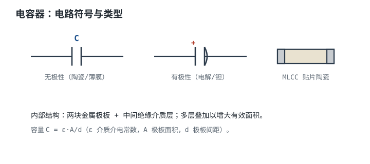

# 电容器全解：MLCC、电解、钽、薄膜 Capacitor

电容器（Capacitor）用两片导体夹一层绝缘介质，靠电场储存电荷。它的伏安关系是 $i=C\,dV/dt$：**对直流相当于开路，对交流相当于通路**。在[电容原理与 RC 时间常数](../basics/capacitor-rc.md)里，重点是这个关系带来的"时间"；本章的重点是"物料"——同样标 10µF，MLCC、铝电解、钽电容和薄膜电容的实际表现可以差一个数量级。

电容是仅次于电阻的第二大用量元件，承担去耦、储能、滤波、耦合、定时、补偿六类工作。它的"水很深"：标称容值只是起点，真正决定电路能不能工作的是**介质在温度、直流偏压、时间三重作用下的容值保持率**，以及 ESR、ESL、自谐振频率、纹波电流和漏电流。本章的主线是：先看六个角色（每个给一个数量级判据），再把介质谱系与六个参数讲透，最后用一个 24V 转 12V、3A 的 Buck 输出电容选型，从纹波指标一路算到需要几颗并联。

## 1. 设计动机：六个角色

::: motivation 三个每天都在发生的场景
**去耦。** 一颗芯片在时钟沿瞬间拉走 2A 电流，上升时间 5ns。如果只靠远处的电源，走线电感上的压降 $L\,di/dt$ 会让芯片电源脚瞬间塌陷。旁边的电容要在这几纳秒里顶住：按 $\Delta V=I\Delta t/C$，2A、5ns、允许跌 30mV，至少需要 333nF。但更扎心的是封装电感：1nH 的回路电感在 $di/dt=2\text{A}/5\text{ns}=4\times10^8\ \text{A/s}$ 下产生 $1\times10^{-9}\times4\times10^8=0.4$V 的感应压降，比电容容值不足严重得多。**去耦的瓶颈经常不是容值，而是回路电感。**

**掉电保持。** 12V 电源掉电后，系统要用输出电容撑 10ms 把数据写进 Flash。负载 10W，允许电压从 12V 掉到 7V：$C\geq2Pt/(V_1^2-V_2^2)=2\times10\times0.01/(144-49)=2.11$mF。这个量级只有铝电解或聚合物电容能做，MLCC 要几百颗。

**滤波。** 24V 转 12V、3A 的 Buck，输出纹波要求 20mV。算出来需要二十多 µF 的**有效**容量；但一颗标称 22µF/25V 的 X7R 在 12V 偏压下可能只剩 10µF 左右，再叠加温度、老化和初始容差，实际只有 7µF。**按标称值选电容，纹波会翻倍。**
:::

六个角色的公式、判据和典型量级：

| 角色 | 核心公式 | 数量级判据 | 典型量级 |
|---|---|---|---|
| 储能/掉电保持 | $E=\frac12CV^2$，$C\geq\frac{2Pt}{V_1^2-V_2^2}$ | 保持时间与允许掉压决定容量 | 10µF~10mF |
| 去耦 | $C\geq\frac{I\Delta t}{\Delta V}$，$f_0>f_{\text{工作}}$ | 瞬态电流、允许跌落、回路电感 | 每脚 100nF + 10µF bulk |
| 耦合 | $C\geq\frac{1}{2\pi f_cR}$，$f_c\leq f_{\min}/10$ | 转折频率低于信号最低频率 | 1µF~10µF |
| 滤波 | $\Delta V=\Delta I(\text{ESR}+\frac{1}{8fC})$ | 纹波电压、纹波电流、ESR | µF 级 + 低 ESR |
| 定时 | $t=kRC$ | 容值稳定性与容差决定精度 | nF~µF，C0G/薄膜 |
| 补偿 | $C=\frac{1}{2\pi Rf_p}$ | 极点频率与相位裕度 | pF~nF |

**不算会摔在哪，三个有具体数字的代价：**

1. **把标称容值当有效容值。** 22µF/25V X7R 在 12V 下按 45% 保持率只剩 9.9µF；再乘温度 0.85、老化 0.90、初始容差 0.90，只剩 6.82µF，是标称值的 31%。容值少了 $22/6.82=3.2$ 倍，按 22µF 设计的 20mV 纹波会变成 40mV 以上。
2. **忽略 ESR。** 100µF 铝电解的 ESR 按 0.1Ω 估算，0.909A 的三角波纹波在它上面产生 $0.909\times0.1=90.9$mV 的峰值压降，单这一项就是 20mV 指标的 4.5 倍；容值再大也救不了。
3. **忽略电解寿命。** 105°C、2000h 的电解电容，在 65°C 下按"每降 10°C 寿命翻倍"是 $2000\times2^4=32000$h，约 3.65 年；如果纹波再让它内部升 10K，就只剩 1.83 年。**电解电容经常是整板寿命的短板。**

## 2. 定义与直观

### 2.1 电容是什么：$C=Q/V$

电容是两块被绝缘介质隔开的导体。两端加电压 $V$，两块板上出现等量异号电荷 $+Q$ 与 $-Q$，定义

$$C=\frac{Q}{V}$$

其中 $Q$ 是一块极板上的电荷量（C），$V$ 是极板间电压（V），$C$ 是电容量（F）。平行板电容器的电容由几何和介质决定：

$$C=\varepsilon_0\varepsilon_r\frac{A}{d}$$

其中 $\varepsilon_0=8.854\times10^{-12}$ F/m 是真空介电常数，$\varepsilon_r$ 是相对介电常数（无量纲），$A$ 是极板正对面积（$\text{m}^2$），$d$ 是介质厚度（m）。

算两个对比：$A=1\ \text{cm}^2=10^{-4}\ \text{m}^2$、$d=10\ \mu\text{m}$，若介质是 $\varepsilon_r=4$ 的 PET 薄膜，

$$C=8.854\times10^{-12}\times4\times\frac{10^{-4}}{10\times10^{-6}}=3.54\times10^{-10}\ \text{F}=354\ \text{pF}$$

若换成 $\varepsilon_r=3000$ 的 X7R 陶瓷，同样几何是 $8.854\times10^{-12}\times3000\times10^{-4}/10^{-5}=2.66\times10^{-7}$ F，即 266nF——**同样的面积和厚度，容量差 750 倍。这就是"高 K 陶瓷"能用小封装做大容量的原因，也是它容值不稳定的原因。**

储能公式：

$$E=\frac12CV^2$$

其中 $E$ 是储能（J）。100µF 充到 25V 储存 $0.5\times100\times10^{-6}\times625=31.25$mJ；1000µF 充到 50V 储存 $0.5\times1000\times10^{-6}\times2500=1.25$J。**能量与电压平方成正比，高压大电容的危险远大于同容量的低压电容。**

动态关系：

$$I_C=C\frac{dV_C}{dt}$$

其中 $I_C$ 是流入正极的电流（A），$dV_C/dt$ 是电压变化率（V/s）。这个式子说明：**电容电压不能突变**（否则需要无穷大电流），但电流可以突变。直流稳态下 $dV_C/dt=0$，电容相当于开路；高频下同样的电压摆幅对应更大的 $dV/dt$，电流更大，阻抗更低：

$$Z_C=\frac{1}{j\omega C},\qquad |Z_C|=\frac{1}{2\pi fC}$$

串联和并联：

$$\frac{1}{C_{\text{eq}}}=\frac{1}{C_1}+\frac{1}{C_2}\quad(\text{串联}),\qquad C_{\text{eq}}=C_1+C_2\quad(\text{并联})$$

串联提高耐压但容量减半，而且电压分配取决于漏电流，不是电容量的比例。两只 100µF/25V 串联得到 50µF/50V，但如果两只漏电流差一倍，电压可能一边 33V、一边 17V，33V 已经超过单只耐压。工程上要在每只电容上并 100kΩ 均压电阻：50V 时每只约 25V，电阻电流 0.25mA，功耗 $25^2/100\text{k}=6.25$mW。

### 2.2 介质决定"容值稳不稳"

理想电容的 $C$ 是常数。真实电容的 $C$ 随温度、直流偏压、时间和频率变化，而变化的幅度几乎完全由介质决定。介质分两大类：

- **Class I（C0G/NP0）**：顺电体，介电常数低（约 30~100），极化与电场近似线性，所以容值几乎不随电压变，温度系数可以做到 ±30ppm/°C，没有老化。代价是容量做不大。
- **Class II/III（X7R/X5R/Y5V）**：铁电体（钛酸钡），介电常数高（2000~20000），但电畴在外电场下会饱和、翻转和"冻结"，所以容值随直流偏压下降、随温度变化、随时间老化。**高 K 是用稳定性换来的。**

用一个类比：C0G 像一个刚性的金属水箱，水位（电压）怎么变，截面积（容量）都不变；X7R 像一个侧壁是海绵的水箱，水压（直流偏压）越大，海绵被压得越扁，有效截面积越小——**你按标称截面积算的水位，永远对不上实际水位。**

这个类比有边界：海绵不会"恢复"，而 X7R 在撤掉偏压后会恢复一部分容量；海绵也不会因为时间而变硬，而 X7R 会老化。更准确的说法是：**X7R 的容量是一个"工作点相关"的量，必须按实际偏压、温度和时间查曲线，不能当成常数。**

### 2.3 电压连续、电流可以跳变

由 $I=C\,dV/dt$，电容电压只能连续变化；开关闭合瞬间，电流可以从 0 跳到 $V_S/R$，电压仍从 0 开始爬。这条规则和[电感](../components/inductors-ferrite-beads.md)正好对偶：电容的电压连续、电流可跳；电感的电流连续、电压可跳。所有去耦、滤波、软启动、缓冲电路的设计，都建立在这条对偶上。

对直流（$f=0$），$Z_C\to\infty$，开路；对高频，$Z_C\to0$，接近短路；对阶跃，合闸瞬间电容像短路，之后按指数充电。细节和 RC 时间常数见[电容原理与 RC 时间常数](../basics/capacitor-rc.md)，阻抗的频率行为见[阻抗与导纳](../basics/impedance.md)。

## 3. 定量关系：参数全解

### 3.1 容值、容差与 E 系列

电容的标称值也用 IEC 60063 的优先数系列，但常用的是 E6 和 E12：

- E6：10、15、22、33、47、68（每十倍程 6 个值，步进比 $10^{1/6}=1.468$，对应 ±20%）；
- E12：10、12、15、18、22、27、33、39、47、56、68、82（步进比 $10^{1/12}=1.212$，对应 ±10%）；
- E24：在 E12 基础上加密，对应 ±5%，多用于薄膜和 C0G。

和电阻一样，容差与步进比的关系是 $\varepsilon_{\max}=\sqrt{10^{1/n}}-1$：E6 为 21.2%，E12 为 10.1%，E24 为 4.91%。所以"E6 配 ±20%、E12 配 ±10%"不是随意定的。

陶瓷电容的实际容差常用字母表示：J=±5%，K=±10%，M=±20%，Z=+80%/−20%。**高 K 陶瓷的标称容差只描述 25°C、零偏压、刚出厂的状态**，不包含直流偏压、温度和老化——这三项要单独算，见 3.3 节。

### 3.2 介质全解：八类电容的真实降幅

| 介质 | 相对介电常数 | 温度范围与容值变化 | 直流偏压降容 | 老化 | tanδ / ESR | 典型容值 | 关键限制 |
|---|---|---|---|---|---|---|---|
| C0G/NP0（Class I） | 30~100 | −55~125°C，±30ppm/°C | 可忽略 | 无 | tanδ ≤0.001 | 1pF~100nF | 容量做不大，贵 |
| X7R（Class II） | 2000~4000 | −55~125°C，±15% | 额定电压下 −20%~−70% | 1~2%/十倍时 | tanδ ≤0.025 | 100pF~22µF | 偏压/温度/老化三重降容 |
| X5R（Class II） | 2000~4000 | −55~85°C，±15% | 同 X7R 量级 | 1~2%/十倍时 | tanδ ≤0.025 | 1µF~100µF | 上限温度只有 85°C |
| Y5V（Class II/III） | 10000~20000 | −30~85°C，+22%/−82% | 额定电压下可降 80% 以上 | 3~5%/十倍时 | tanδ ≤0.035 | 10nF~10µF | 只能做旁路，不能定时/滤波 |
| 铝电解（非固体） | 约 8~10（氧化膜） | −40~105/125°C，±20%（20°C） | 无"偏压降容"，但耐压与极性 | 无老化，但电解液干涸 | ESR 0.01~1Ω | 1µF~10000µF | 寿命、极性、低温 ESR 变大 |
| 钽（MnO₂） | 约 27 | −55~125°C，±20% | 无偏压降容，但必须降额 | 很小 | ESR 0.1~5Ω | 0.1~1000µF | 过压/浪涌会短路起火 |
| 钽（聚合物） | 约 27 | −55~105°C，±20% | 无 | 很小 | ESR 10~100mΩ | 1~1000µF | 成本高，漏电略大 |
| 薄膜（PET/PP/PPS） | 2.2~3.3 | −40~105/125°C，±5% | 可忽略 | 无 | tanδ 0.0002~0.005 | 1nF~10µF | 体积大，单位容量贵 |
| 固态聚合物铝 | 约 8~10 | −55~105°C，±20% | 无 | 无干涸 | ESR 10~50mΩ | 2~1000µF | 成本高，耐压偏低 |

（表内为典型量级，不同厂商、不同系列差异很大，具体以所选型号的数据手册为准。）

逐类说清楚"实际降幅"：

- **C0G/NP0**：温度系数 ±30ppm/°C，温升 75K 时容值变化 $30\times10^{-6}\times75=0.225\%$；直流偏压系数几乎为零；没有老化。**它是最接近"把标称值当实际值用"的陶瓷电容**，代价是 100nF 以上又大又贵。
- **X7R**：全温区 ±15%；直流偏压是主要杀手，25V 额定、12V 偏压（48%）时典型只剩 45%~65%；老化约 1~2%/十倍时，10 年（约 4.94 个十倍时）累计 5%~10%。三项叠加，10µF 可能只剩 3~5µF。
- **X5R**：温度上限只有 85°C，其余与 X7R 类似。85°C 以上的环境不能用 X5R，哪怕标称容值更大。
- **Y5V**：−30~85°C 容值变化 +22%/−82%，额定偏压下还能再降 80% 以上，老化 3~5%/十倍时。**它只适合做"有没有电容"的旁路，不能用于定时、滤波、耦合等对容值有要求的场合。**
- **铝电解**：容值在 20°C、100Hz 下测量，常见容差 ±20%，小容量型号有 −20%/+80% 的；低温（−40°C）容量下降 10%~20%，ESR 上升 10 倍以上；高温下电解液通过密封圈缓慢蒸发，ESR 上升、容量下降，最终干涸。**铝电解没有"偏压降容"，但有"寿命降容"。**
- **钽电容（MnO₂）**：容值稳定（±20%），但介质氧化膜很薄，过压或浪涌会击穿，失效模式是**低阻短路**，可能起火。工程上按 ≤50% 额定电压降额，必要时串限流电阻。
- **钽（聚合物）/固态聚合物铝**：ESR 低、无干涸机制、寿命长，但耐压偏低、成本高、漏电略大。适合替代铝电解做低压大容量滤波。
- **薄膜**：PET/PP/PPS 的容值稳定（±5%）、损耗低（PP 的 tanδ 可到 0.0002）、耐压高、无极性，适合音频耦合、安规跨接、脉冲和高压场合。缺点是单位容量体积大、价格高。

### 3.3 容值的三重降额：温度、偏压、老化

把标称容值变成实际容值，用一个乘性模型：

$$C_{\text{eff}}=C_{\text{nom}}\,k_T\,k_V\,k_{\text{age}}\,k_{\text{tol}}$$

其中 $k_T$ 是温度保持率，$k_V$ 是直流偏压保持率，$k_{\text{age}}$ 是老化保持率，$k_{\text{tol}}$ 是初始容差下限。四项都是小于 1 的数（Y5V 的 $k_T$ 可能大于 1，但那种"变大"没有工程价值）。

**温度项。** X7R 的 ±15% 是全温区包络，取最坏 0.85；C0G 的 ±30ppm/°C 在 75K 温升下是 0.9978，几乎为 1。

**偏压项。** 这是 MLCC 最关键、也最容易被忽略的一项。经验曲线（小尺寸、高容值型号偏下限）：

| 直流偏压 / 额定电压 | 10% | 25% | 50% | 75% | 100% |
|---|---|---|---|---|---|
| X7R/X5R 容量保持率（典型范围） | 90%~98% | 75%~90% | 45%~70% | 25%~45% | 15%~25% |

注意：**保持率与封装、介质厚度、额定电压都有关**。同样 10µF，1206/25V 的保持率通常好于 0603/16V；高容值、小尺寸、低耐压的型号最差。设计时不要用"典型值"，要按所选型号的 DC Bias 曲线取**下限**。

**老化项。** Class II 陶瓷的容值随时间对数下降，常用"每十倍时 1~2%"描述。从焊接后的去老化状态（约 1h）算起，10 年 = 87600h，是 $\log_{10}(87600)=4.94$ 个十倍时；按 1.5%/十倍时，累计 $1.5\times4.94=7.4\%$，$k_{\text{age}}=0.926$。工程上取 0.90 更保守。**回流焊会"重置"老化时钟**，所以数据手册的老化曲线从焊接后开始算；如果电容在仓库放了很久，上板前的老化已经发生，但回流焊会把它重置。

**初始容差。** X7R 常见 ±10%（K），取下限 0.90；C0G 常见 ±5%，取 0.95。

把四项乘起来，10µF/25V X7R 在 12V、85°C、10 年、±10% 容差下的最坏有效容值：

$$C_{\text{eff}}=10\times0.85\times0.45\times0.90\times0.90=3.10\ \mu\text{F}$$

只有标称值的 31%。**如果电路需要 10µF 有效容量，就要选 33µF 标称，或者并联多颗，或者换 C0G/薄膜/聚合物。**

### 3.4 ESR、ESL 与自谐振

真实电容是"电容 + 串联电阻 ESR + 串联电感 ESL"：

$$Z=\text{ESR}+j\omega L_{\text{ESL}}+\frac{1}{j\omega C}$$

低频时容抗主导，频率升高容抗下降；到自谐振频率（Self-Resonant Frequency，SRF）时容抗与感抗相等，阻抗最低，等于 ESR；再往上感抗主导，电容"变成电感"。

$$f_0=\frac{1}{2\pi\sqrt{L_{\text{ESL}}C}}$$

其中 $L_{\text{ESL}}$ 是等效串联电感（H），$C$ 是容量（F）。几个算例（ESL 为典型量级，具体看封装）：

- 100nF、ESL 0.7nH：$f_0=1/(2\pi\sqrt{0.7\times10^{-9}\times100\times10^{-9}})=19.0$ MHz；
- 1µF、ESL 1nH：$f_0=1/(2\pi\sqrt{1\times10^{-9}\times1\times10^{-6}})=5.03$ MHz；
- 10µF、ESL 1.5nH：$f_0=1/(2\pi\sqrt{1.5\times10^{-9}\times10\times10^{-6}})=1.30$ MHz；
- 22µF、ESL 1.5nH：$f_0=1/(2\pi\sqrt{1.5\times10^{-9}\times22\times10^{-6}})=876$ kHz；
- 100µF 铝电解、ESL 5nH：$f_0=1/(2\pi\sqrt{5\times10^{-9}\times100\times10^{-6}})=225$ kHz；
- 1000µF 铝电解、ESL 5nH：$f_0=1/(2\pi\sqrt{5\times10^{-9}\times1000\times10^{-6}})=71.2$ kHz。

在 SRF 以上，电容的阻抗随频率上升。100nF 在 100MHz 的容抗只有 $1/(2\pi\times10^8\times100\times10^{-9})=15.9$mΩ，但 0.7nH 的感抗是 $2\pi\times10^8\times0.7\times10^{-9}=0.44\Omega$，是容抗的 27.6 倍。**所以"大电容滤低频、小电容滤高频"的本质不是容值，而是封装电感和 SRF。**

多只不同容值的电容并联，还会出现**反谐振（anti-resonance）**。1µF（ESL 1nH，SRF 5.03MHz）与 100nF（ESL 0.7nH，SRF 19.0MHz）并联，在两者之间会有一个并联谐振峰，估算频率

$$f_{\text{anti}}\approx\frac{1}{2\pi\sqrt{L_{1\mu\text{F}}\,C_{100\text{nF}}}}=\frac{1}{2\pi\sqrt{1\times10^{-9}\times100\times10^{-9}}}=15.9\ \text{MHz}$$

在这个频率附近，两只电容"互相看不见"，阻抗可能比单只还高。解决办法是选 ESR 稍大的电容阻尼、缩小封装电感、或者用仿真确认；不能简单地"多并几种容值就更好"。

### 3.5 纹波电流与 ESR 损耗

开关电源的输出电容要承受三角波纹波。设电感电流纹波峰峰值为 $\Delta I_L$，则电容电流的有效值是

$$I_{\text{rms}}=\frac{\Delta I_L}{\sqrt{12}}$$

这个 $\sqrt{12}$ 来自三角波的均方根：峰峰值 $\Delta I$ 的三角波，有效值是 $\Delta I/\sqrt{12}=0.2887\Delta I$。ESR 上的损耗是

$$P_{\text{ESR}}=I_{\text{rms}}^2\text{ESR}$$

纹波电压由两部分组成：容值充放电产生的容性纹波，和 ESR 上的电阻性纹波：

$$\Delta V_{\text{ripple}}\approx\Delta I_L\left(\text{ESR}+\frac{1}{8f_{\text{sw}}C}\right)$$

其中 $f_{\text{sw}}$ 是开关频率（Hz）。$1/(8fC)$ 这一项来自三角波电荷的积分：电容电荷变化 $\Delta Q=\Delta I_L/(8f)$，除以 $C$ 就是容性纹波。这个式子是估算，忽略了 ESL 和环路电感，但对几百 kHz 的 Buck 足够用。

### 3.6 漏电流

漏电流是介质不是理想绝缘体导致的。三类电容的规格不同：

- **铝电解**：$I_{\text{leak}}\approx0.01CV$（µA，$C$ 用 µF、$V$ 用 V），或 3µA 取大者。100µF/25V 的漏电约 $0.01\times100\times25=25\ \mu$A。
- **钽电容**：$I_{\text{leak}}\approx0.01CV$ 或 1µA 取大者。10µF/16V 约 1.6µA。
- **陶瓷**：用绝缘电阻 $R_{\text{ins}}\geq500\ \Omega\cdot\text{F}/C$ 表示。10µF 的 $R_{\text{ins}}\geq500/(10\times10^{-6})=50$ MΩ，16V 下漏电 $16/50\text{M}=0.32\ \mu$A。

漏电流在低功耗、高阻节点里是大事。25µA 流过 100kΩ 就是 2.5V 的误差——一个分压网络如果用了漏电大的电解电容做滤波，直流工作点可能完全偏掉。**高阻节点优先 C0G/薄膜，钽和电解要算漏电。**

### 3.7 降额规则

| 类型 | 电压降额 | 温度/纹波降额 | 备注 |
|---|---|---|---|
| 陶瓷 Class II（X7R/X5R） | 长期 ≤50%~80% 额定 | 按 DC Bias 曲线取实际容值；温度 ≤85% 上限 | 高压、高容值、小封装降额更狠 |
| 陶瓷 Class I（C0G） | ≤80% 额定 | 温度余量 ≥20°C | 容值稳定，主要看耐压 |
| 铝电解 | ≤80% 额定 | 纹波 ≤80%~100% 额定（按频率/温度修正）；温度每降 10°C 寿命翻倍 | 注意极性与低温 ESR |
| 钽（MnO₂） | ≤50% 额定 | 浪涌/低阻负载要串限流电阻 | 失效是短路，可能起火 |
| 钽（聚合物） | ≤80% 额定 | 按厂商建议 | 比 MnO₂ 安全，但仍怕过压 |
| 薄膜 | ≤80% 额定（AC 按数据手册） | 脉冲与 dv/dt 按数据手册 | 自愈特性，适合高压 |
| 固态聚合物铝 | ≤80% 额定 | 纹波按数据手册 | 低 ESR、长寿命 |

降额的本质是**把工作点从失效边界拉回来**：陶瓷怕偏压和机械裂纹，电解怕温度和纹波，钽怕过压和浪涌。三种器件的降额逻辑完全不同，不能套同一个百分比。

### 3.8 介质吸收、压电效应与其它非理想

- **介质吸收（Dielectric Absorption，DA）**：电容放电到 0 后断开，介质里的"慢极化"电荷会慢慢释放，两端电压回弹。铝电解的 DA 可达 10%~15%，钽 5%~10%，薄膜 0.02%~0.2%，C0G 约 0.02%。采样保持、积分器、高压维修都要考虑；维修时断电后要等足够久并实测。
- **压电/微音效应**：X7R/X5R 的钛酸钡是压电材料，机械应力（板弯、振动、敲击）会在电容上产生电压噪声，反过来电压变化也会让电容伸缩，发出可听的"电容啸叫"。音频、传感器前端优先 C0G/薄膜，或让电容远离板边和螺丝孔。
- **ESR 的温度特性**：铝电解的 ESR 在 −40°C 会上升到 25°C 的 10 倍以上，低温启动时纹波会突然变大；MLCC 的 ESR 随温度变化较小。
- **直流偏压下的 ESR**：高 K 陶瓷在偏压下容值下降，ESR 可能略升，但通常仍远低于电解。
- **焊接裂纹**：MLCC 的陶瓷体脆，板弯或手工焊接的热应力会产生微裂纹，漏电增大甚至短路。大封装（1206 以上）尤其要注意分板方向和应力释放。

## 4. 典型计算

### 4.1 算例一：X7R 的直流偏压降容，需要几颗并联

**需求**：12V 电源轨需要一个 22µF 的**有效**滤波容量，环境最高 85°C，寿命 10 年，初始容差 ±10%。候选是 10µF/25V X7R 1206。

**第一步，算单项保持率。** 12V/25V=48% 偏压，按曲线下限取 $k_V=0.45$；85°C 取 $k_T=0.85$；10 年老化 $k_{\text{age}}=0.90$；容差下限 $k_{\text{tol}}=0.90$。

**第二步，算单颗有效容值：**

$$C_{\text{eff}}=10\times0.45\times0.85\times0.90\times0.90=3.10\ \mu\text{F}$$

**第三步，算并联数量：**

$$N=\frac{22}{3.10}=7.10\ \longrightarrow\ 8\ \text{颗}$$

8 颗 10µF 并联，标称 80µF，有效 $8\times3.10=24.8\mu$F，才刚过 22µF。**标称 80µF 只换来 24.8µF 的有效值，这就是"按标称值选电容"会翻车的原因。**

**第四步，换大容量/大封装。** 若改用 22µF/25V X7R 1210，按同样的 45%/0.85/0.90/0.90：

$$C_{\text{eff}}=22\times0.45\times0.85\times0.90\times0.90=6.82\ \mu\text{F}$$

$$N=\frac{22}{6.82}=3.23\ \longrightarrow\ 4\ \text{颗}$$

4 颗 22µF 并联，有效 $27.3\mu$F。**同样的有效容量，22µF 方案用 4 颗，10µF 方案用 8 颗**；元件数、贴装面积、失效点都少一半。选电容不能只看单价，要看"每 µF 有效容量"的成本。

### 4.2 算例二：Buck 输出电容完整选型

**需求**：24V 转 12V、3A 的 Buck，开关频率 300kHz，电感 22µH，输出纹波要求 ≤20mV，环境 60°C，寿命 10 年。

**第 1 步：算占空比和电感纹波。**

$$D=\frac{V_{\text{out}}}{V_{\text{in}}}=\frac{12}{24}=0.5$$

$$\Delta I_L=\frac{V_{\text{out}}(1-D)}{Lf_{\text{sw}}}=\frac{12\times(1-0.5)}{22\times10^{-6}\times300\times10^3}=\frac{6}{6.6}=0.909\ \text{A}$$

**第 2 步：算电容纹波电流有效值。**

$$I_{\text{rms}}=\frac{\Delta I_L}{\sqrt{12}}=\frac{0.909}{3.464}=0.262\ \text{A}$$

**第 3 步：分配纹波预算。** 总 20mV，留给 ESR 4mV，容性纹波允许 16mV。由 $\Delta V_C=\Delta I_L/(8f_{\text{sw}}C)$ 反算所需有效容量：

$$C_{\text{need}}=\frac{\Delta I_L}{8f_{\text{sw}}\Delta V_C}=\frac{0.909}{8\times300\times10^3\times0.016}=2.37\times10^{-5}\ \text{F}=23.7\ \mu\text{F}$$

**第 4 步：按有效容值算并联数量。** 选 22µF/25V X7R 1210，12V 偏压（48% 额定）取 $k_V=0.45$，温度 60°C 取 $k_T=0.85$，老化 0.90，容差 0.90：

$$C_{\text{eff}}=22\times0.45\times0.85\times0.90\times0.90=6.82\ \mu\text{F}$$

$$N=\frac{23.7}{6.82}=3.47\ \longrightarrow\ 4\ \text{颗}$$

**第 5 步：验算纹波。** 4 颗并联的总有效容量 $4\times6.82=27.3\mu$F，容性纹波

$$\Delta V_C=\frac{0.909}{8\times300\times10^3\times27.3\times10^{-6}}=13.9\ \text{mV}$$

ESR 按每颗 5mΩ、4 颗并联 1.25mΩ：

$$\Delta V_{\text{ESR}}=0.909\times1.25\times10^{-3}=1.14\ \text{mV}$$

总纹波 $13.9+1.14=15.0$mV，低于 20mV，余量 $(20-15.0)/20=25\%$。

**第 6 步：验算纹波电流与 ESR 损耗。** 每颗电容分担 $0.262/4=0.0656$A 有效值：

$$P_{\text{ESR,each}}=0.0656^2\times5\times10^{-3}=2.15\times10^{-5}\ \text{W}=21.5\ \mu\text{W}$$

4 颗合计 86µW，发热可以忽略。MLCC 的纹波电流限制主要来自端电极和陶瓷体的温升，不是 ESR 损耗；具体额定值查数据手册。

**第 7 步：验算自谐振。** 22µF、ESL 1.5nH 的 SRF 是 $1/(2\pi\sqrt{1.5\times10^{-9}\times22\times10^{-6}})=876$kHz，高于开关频率 300kHz，在基波上仍呈容性；但 3 次、5 次谐波（900kHz、1.5MHz）已经在 SRF 附近或以上，容抗不再下降。**输出纹波的边沿由 ESL 和布局决定，不能只靠加容量。**

**第 8 步：对比铝电解。** 100µF/25V 铝电解，ESR 按 0.1Ω、纹波电流额定 300mA（100kHz、105°C）：

$$\Delta V_{\text{ESR}}=0.909\times0.1=90.9\ \text{mV}$$

仅 ESR 一项就是 20mV 指标的 4.5 倍，**直接淘汰**。若并联 5 颗，ESR 降到 20mΩ，纹波 18.2mV 才勉强达标，但体积、成本、寿命都远不如 4 颗 MLCC。纹波电流方面，单颗 $0.262/5=0.052$A，远低于 300mA 额定；ESR 损耗 $0.262^2\times0.02=1.37$mW，也不大。**电解的问题不是容量，是 ESR。**

**第 9 步：校核环路。** 4 颗 MLCC 的等效 ESR 只有 1.25mΩ，ESR 零点在

$$f_z=\frac{1}{2\pi\text{ESR}\,C}=\frac{1}{2\pi\times1.25\times10^{-3}\times27.3\times10^{-6}}=4.66\ \text{MHz}$$

远高于环路带宽，**不能靠 ESR 零点补偿**，需要 Type III 补偿或前馈电容。铝电解的 ESR 零点在 $1/(2\pi\times0.02\times500\mu\text{F})=15.9$kHz，反而对稳定性有帮助——**低 ESR 不是永远的优点，它拿走了环路的一个零点。** 补偿设计见[开关电源控制环路](../power/smps-control-loop.md)。

**第 10 步：结论。** 选 4 颗 22µF/25V X7R 1210 并联，总标称 88µF、有效 27.3µF；输出纹波 15.0mV（容性 13.9mV + ESR 1.14mV），满足 20mV；纹波电流每颗 0.0656A，ESR 损耗可忽略；SRF 876kHz，需注意高频段靠布局而非容值。12V/25V=48% 的电压降额也满足"陶瓷 ≤50%~80%"的规则。

### 4.3 算例三：去耦电容能顶几纳秒

**需求**：负载在 5ns 内拉 2A，允许电源跌落 30mV。

**第一步，按容值算：**

$$C\geq\frac{I\Delta t}{\Delta V}=\frac{2\times5\times10^{-9}}{0.03}=3.33\times10^{-7}\ \text{F}=333\ \text{nF}$$

**第二步，按现有 100nF 反算跌落：**

$$\Delta V=\frac{2\times5\times10^{-9}}{100\times10^{-9}}=0.1\ \text{V}=100\ \text{mV}$$

超过 30mV 指标 3.3 倍。

**第三步，算 ESL 的贡献。** 电流变化率 $di/dt=2/(5\times10^{-9})=4\times10^8$ A/s；1nH 的回路电感产生

$$V_L=L\frac{di}{dt}=1\times10^{-9}\times4\times10^8=0.4\ \text{V}$$

**0.4V 是容值跌落的 4 倍。** 也就是说，即使并再多的电容，只要回路电感是 1nH，这个 5ns/2A 的瞬变就无法满足 30mV。实际可行的方向是：把电容放到负载旁边、缩短回路、多过孔并联降低电感、在封装内做去耦、或者降低 $di/dt$。**去耦设计的第一变量是几何，第二才是容值。**

### 4.4 算例四：音频耦合电容

**需求**：音频信号最低 20Hz，后级输入阻抗 10kΩ，要求 20Hz 处衰减小于 3dB。

**第一步，按转折频率选电容。** 高通转折频率

$$f_c=\frac{1}{2\pi RC}$$

要求 $f_c\leq20$Hz，则

$$C\geq\frac{1}{2\pi\times20\times10\times10^3}=7.96\times10^{-7}\ \text{F}=0.796\ \mu\text{F}$$

取 E6 的 1µF。

**第二步，验算 20Hz 处衰减。** 一阶高通幅频特性

$$|H|=\frac{f/f_c}{\sqrt{1+(f/f_c)^2}}$$

$f_c=1/(2\pi\times10^4\times10^{-6})=15.92$Hz，$f/f_c=20/15.92=1.256$，

$$|H|=\frac{1.256}{\sqrt{1+1.256^2}}=0.782$$

即 $20\log_{10}0.782=-2.13$dB，满足小于 3dB。

**第三步，对比 100nF。** $f_c=159.2$Hz，20Hz 处 $|H|=0.125$，衰减 $-18.1$dB，低频几乎没了。**耦合电容的容值由最低频率和输入阻抗共同决定，不是"越大越好"：太大则体积、漏电、极性电容的失真都增加。**

## 5. 工程含义

### 5.1 容值、ESR 与自谐振频率的数量级

| 电容/封装 | 典型 ESR | 典型 ESL | SRF（计算值） | 主要用途 |
|---|---|---|---|---|
| 10pF C0G 0402 | 0.01~0.1Ω | 0.4nH | 2.52GHz | 射频匹配、晶振负载 |
| 100pF C0G 0402 | 0.01~0.1Ω | 0.4nH | 796MHz | 高频滤波 |
| 1nF C0G 0402 | 0.01~0.1Ω | 0.4nH | 252MHz | 高频旁路 |
| 10nF X7R 0402 | 5~20mΩ | 0.5nH | 71.2MHz | 高频去耦 |
| 100nF X7R 0603 | 3~10mΩ | 0.7nH | 19.0MHz | 每脚去耦主力 |
| 1µF X7R 0805 | 3~10mΩ | 1nH | 5.03MHz | 中频去耦 |
| 10µF X7R 1210 | 2~5mΩ | 1.5nH | 1.30MHz | 板级储能/滤波 |
| 22µF X7R 1210 | 2~5mΩ | 1.5nH | 876kHz | Buck 输出 |
| 100µF 铝电解 | 0.1~1Ω | 5nH | 225kHz | 低频 bulk |
| 1000µF 铝电解 | 0.05~0.3Ω | 5nH | 71.2kHz | 电源入口 bulk |
| 100µF 钽 | 0.1~5Ω | 3~5nH | 225~290kHz | 空间受限的 bulk |
| 100µF 聚合物 | 10~50mΩ | 3~5nH | 225~290kHz | 低 ESR 替代电解 |
| 1µF 薄膜 | 5~100mΩ | 5~10nH | 1.59~2.25MHz | 音频、高压、脉冲 |

（ESR/ESL 为典型量级，SRF 按 $1/(2\pi\sqrt{LC})$ 计算，具体以数据手册为准。）

这张表最有用的一点是：**SRF 与容值的平方根成反比，与 ESL 的平方根成反比。** 容值增大 10 倍，SRF 只降到 1/3.16；封装从 0402 换到 1210，ESL 增大 3~4 倍，SRF 又降一半。所以"用大电容替代小电容"往往在低频有效、高频无效。

### 5.2 电解电容寿命：每降 10°C 翻倍

铝电解的寿命遵循近似 Arrhenius 关系，工程口诀是**"温度每降 10°C，寿命翻倍"**：

$$L=L_0\,2^{(T_0-T)/10}$$

其中 $L_0$ 是额定温度 $T_0$ 下的寿命（h），$T$ 是实际工作温度（°C），$L$ 是估算寿命（h）。这个口诀是近似，实际指数与电解液、密封材料、纹波电流有关，通常折算成"每 8~12°C 翻倍"，以厂商寿命公式为准。

算例：105°C、2000h 的电解电容，工作在 65°C：

$$L=2000\times2^{(105-65)/10}=2000\times2^4=32000\ \text{h}$$

换算成年：$32000/8760=3.65$ 年。若工作在 55°C：$2000\times2^5=64000$h，7.31 年。若纹波让内部温度再升 10K（等效 75°C）：$2000\times2^3=16000$h，1.83 年。

**这个数字说明两件事：** 一是电解电容的寿命对温度极其敏感，机箱内靠近热源的位置要单独核算；二是"105°C/2000h"不是"能用 2000 小时"，而是"在 105°C 下 2000 小时"，常温下可以长很多。选型时优先 105°C 而非 85°C，留足纹波余量，并让电容远离发热器件。

### 5.3 选型清单与降额

选电容按顺序问七个问题：

1. **容值要多少有效值？** 先按公式算需求，再按 3.3 节的四项保持率反推标称值。
2. **耐压够不够？** 按 3.7 节降额：陶瓷 50%~80%，电解 80%，钽 50%，薄膜 80%。
3. **介质能不能接受？** 定时、耦合、谐振用 C0G/薄膜；去耦、滤波用 X7R/X5R；Y5V 只做旁路。
4. **ESR/纹波电流够不够？** 按 $I_{\text{rms}}$ 和 ESR 算损耗与纹波，电解还要查频率修正。
5. **SRF 够不够高？** 开关频率、谐波、瞬态边沿的频率要低于 SRF，否则电容已经"变成电感"。
6. **寿命/温度够不够？** 电解按 10°C 翻倍估算，陶瓷看偏压与温度，钽看降额与浪涌。
7. **机械与安全有没有问题？** 大封装 MLCC 的板弯裂纹、钽的极性、高压电容的泄放与安规。

### 5.4 测量与验证

- **容值**：LCR 表在 1kHz（大电容）或 100kHz/1MHz（小电容）测量；测量前确认偏压为零，否则测到的是"工作点容值"。
- **DC Bias**：用带直流偏置的 LCR 表或专用夹具，在 0V、额定电压的 25%/50%/75% 各测一次，画保持率曲线；没有条件时按数据手册曲线取值。
- **ESR**：ESR 表在 100kHz 测，注意表笔与接触电阻；低 ESR 的 MLCC（几 mΩ）要用四线开尔文夹具，否则引线电阻就盖过读数。
- **纹波**：示波器 AC 耦合、20MHz 带宽限制、短地弹簧；不能用长地线，否则测到的是环路电感上的感应电压。
- **温度**：热电偶贴电容本体，或红外测温；电解的寿命估算要用**本体温度**，不是环境温度。
- **漏电**：给电容充电到额定电压，等 2 分钟后测电流；陶瓷的漏电很小，要用高阻计或皮安表。

### 5.5 安全

- **高压储能**：400V、470µF 储存 $0.5\times470\times10^{-6}\times400^2=37.6$J，足以造成严重伤害。断电后必须并联泄放电阻（如 47kΩ/5W，$\tau=22.1$s），等待足够时间并用万用表实测。
- **极性**：电解和钽电容反接会发热、鼓包、甚至爆炸；钽反接可能直接短路起火。PCB 丝印、封装极性、来料方向三处都要核对。
- **钽电容**：按 ≤50% 额定电压降额，低阻负载串 1Ω/V 左右的限流电阻，避免浪涌。
- **安规电容**：跨接市电的 X/Y 电容必须用安规认证型号，不能用普通 MLCC 替代；失效模式、耐压、阻燃都有专门要求。
- **介质吸收回弹**：断电后电容可能"回弹"出电压，维修前要重复放电并实测。

## 6. 常见坑

::: pitfall 常见坑
- **按标称容值设计，忽略直流偏压**：现象——12V 电源用 22µF/25V X7R，实测纹波是计算值的 2 倍；换一块板又好了。原因——X7R 在 48% 额定偏压下只剩 45%~65%，再叠加温度、老化、容差，实际只有标称的 31%。解决——按所选型号的 DC Bias 曲线取最坏保持率，用 3.3 节的四项乘积反推标称值；必要时换大封装、高耐压或聚合物电容。
- **只看容值，不看 ESR**：现象——100µF 电解的容量明明够，输出纹波却超标。原因——0.909A 的纹波在 0.1Ω ESR 上产生 90.9mV，是容性纹波的几倍；容值再大也压不下去。解决——按 $\Delta V=\Delta I(\text{ESR}+1/(8fC))$ 分解两项，先选低 ESR 的 MLCC/聚合物，再补容量。
- **多容值并联忽略反谐振**：现象——加了 1µF 电容后，某个频段的电源阻抗反而升高，EMI 变差。原因——不同容值的 SRF 之间会形成并联谐振峰，两只电容在该频率"互相看不见"。解决——用仿真或阻抗分析仪确认；选 ESR 稍大的电容阻尼、缩小封装电感，或改用单一容值多颗并联。
- **忽略电解电容的寿命与纹波**：现象——设备用了两三年，电源纹波变大、输出电压掉，拆开发现电解鼓包。原因——电解液干涸使 ESR 上升、容量下降；纹波电流和高温加速这一过程。解决——按 10°C 翻倍估算寿命，选 105°C 长寿命型号，留纹波余量，远离热源。
- **钽电容过压或浪涌**：现象——上电瞬间钽电容冒烟、短路，甚至引燃 PCB。原因——氧化膜缺陷在过压/浪涌下击穿，钽的失效模式是低阻短路，持续过流发热。解决——降到 ≤50% 额定电压，低阻负载串限流电阻，避免热插拔浪涌；关键位置改用聚合物钽或 MLCC。
- **陶瓷电容的压电/微音效应**：现象——敲击电路板，音频输出有"咔哒"声；或者振动环境下传感器读数漂移。原因——X7R/X5R 的钛酸钡是压电材料，机械应力转换成电压噪声。解决——音频/传感器前端用 C0G 或薄膜，电容远离板边、螺丝孔和变压器，必要时加机械缓冲。
- **断电就以为没电**：现象——维修时被高压电容电击，或拆电容时打火。原因——大电容储能与 $V^2$ 成正比，没有泄放通路时只能靠漏电慢慢掉；介质吸收还会让电压回弹。解决——并泄放电阻，按 $\tau=RC$ 算等待时间，断电后实测确认；高压电容还要注意电阻耐压与安规。
:::

## 7. 自测题

100µF/25V 铝电解的漏电流按 0.01CV 估算，接到 100kΩ 分压节点上会带来多大误差？这说明什么？

漏电流：

$$I_{\text{leak}}=0.01CV=0.01\times100\times25=25\ \mu\text{A}$$

流过 100kΩ 的压降：

$$V=I_{\text{leak}}R=25\times10^{-6}\times100\times10^3=2.5\ \text{V}$$

2.5V 的误差足以让一个 3.3V 分压节点完全偏掉。**高阻节点不能用漏电大的电解电容做滤波**；应选 C0G/薄膜（漏电 0.1µA 量级），或把分压电阻降到几 kΩ 以下，让漏电电流的影响小于 1%。

10µF/25V X7R 用在 12V、85°C、10 年、±10% 容差的场合，最坏有效容值是多少？如果要 22µF 有效容量，需要几颗？

12V/25V=48%，按曲线下限取偏压保持率 0.45；温度 0.85；10 年老化（1.5%/十倍时，4.94 个十倍时，约 7.4%）取 0.90；容差 0.90。

$$C_{\text{eff}}=10\times0.45\times0.85\times0.90\times0.90=3.10\ \mu\text{F}$$

只有标称的 31%。需要 22µF：

$$N=\frac{22}{3.10}=7.10\ \longrightarrow\ 8\ \text{颗}$$

标称总容量 80µF，有效 24.8µF。若换 22µF/25V 1210，单颗有效 6.82µF，只需 4 颗。**"多少 µF"必须问清楚是标称还是有效。**

24V 转 12V、3A、300kHz、22µH 的 Buck，电感纹波电流是多少？要求输出纹波 20mV，至少需要多少有效容量？用 22µF/25V X7R（有效 6.82µF/颗）需要几颗？

占空比 $D=12/24=0.5$。

电感纹波：

$$\Delta I_L=\frac{12\times(1-0.5)}{22\times10^{-6}\times300\times10^3}=0.909\ \text{A}$$

电容纹波电流有效值：

$$I_{\text{rms}}=0.909/\sqrt{12}=0.262\ \text{A}$$

留 16mV 给容性纹波：

$$C_{\text{need}}=\frac{0.909}{8\times300\times10^3\times0.016}=23.7\ \mu\text{F}$$

每颗 22µF 的有效值 6.82µF：

$$N=23.7/6.82=3.47\ \longrightarrow\ 4\ \text{颗}$$

验算：4 颗总有效 27.3µF，容性纹波 13.9mV；ESR 1.25mΩ 贡献 1.14mV；总 15.0mV，满足 20mV。

1µF 的 MLCC，ESL 1nH，自谐振频率是多少？在 10MHz 时它呈容性还是感性？阻抗大约多少？

自谐振频率：

$$f_0=\frac{1}{2\pi\sqrt{1\times10^{-9}\times1\times10^{-6}}}=5.03\ \text{MHz}$$

10MHz 高于 SRF，呈**感性**。感抗：

$$X_L=2\pi\times10^7\times1\times10^{-9}=0.0628\ \Omega=62.8\ \text{m}\Omega$$

容抗只有 $1/(2\pi\times10^7\times10^{-6})=0.0159\Omega=15.9$mΩ，感抗是容抗的 3.95 倍。所以高频去耦不能只看容值，要看封装电感和 SRF。

12V 电源掉电后，要用输出电容给 10W 负载撑 10ms，允许电压从 12V 掉到 7V。需要多大电容？1000µF 够吗？

由 $E=\frac12CV^2$，释放的能量等于负载消耗：

$$C\geq\frac{2Pt}{V_1^2-V_2^2}=\frac{2\times10\times0.01}{12^2-7^2}=\frac{0.2}{144-49}=2.11\times10^{-3}\ \text{F}=2.11\ \text{mF}$$

1000µF 只有 1mF，**不够**，大约需要 2110µF。实际还要考虑电容容差、ESR 压降和转换器的最小工作电压，通常取 2~3 倍余量。2.11mF 只有铝电解或聚合物电容能做，MLCC 要几十颗并联。

音频耦合电容用 1µF 接 10kΩ 输入阻抗，转折频率是多少？20Hz 处衰减多少 dB？如果改用 100nF 呢？

1µF：

$$f_c=\frac{1}{2\pi\times10\times10^3\times1\times10^{-6}}=15.92\ \text{Hz}$$

20Hz 处 $f/f_c=1.256$：

$$|H|=\frac{1.256}{\sqrt{1+1.256^2}}=0.782$$

$20\log_{10}0.782=-2.13$dB，满足小于 3dB。

100nF：

$$f_c=\frac{1}{2\pi\times10^4\times100\times10^{-9}}=159.2\ \text{Hz}$$

20Hz 处 $f/f_c=0.1256$，$|H|=0.1247$，即 $-18.1$dB，低频基本没了。耦合电容的容值由最低频率和输入阻抗共同决定。

## 8. 参考资料

- IEC 60384-1:2016, *Fixed capacitors for use in electronic equipment – Part 1: Generic specification*：固定电容的通用规范，定义额定电压、类别电压、耐久性试验与容值允许偏差；本章的耐压、降额与寿命口径按该标准及厂商数据手册。
- IEC 60384-8 / IEC 60384-9：陶瓷介质 Class 1 / Class 2 固定电容的分规范，规定温度特性编码与容值变化限值；本章 3.2 节的介质分类参考该标准。
- EIA-198, *Ceramic Dielectric Capacitors Classes I, II, III*：X7R/X5R/Y5V 等温度特性编码的来源；本章的介质表按该标准的类别定义整理。
- Murata GRM 系列片式陶瓷电容数据手册：DC Bias Characteristics 与 Temperature Characteristics 章节；本章 3.3 节的偏压保持率与温度降容按该类曲线的方法给出，具体数值以所选型号为准。
- TDK C 系列 MLCC 数据手册：直流偏置特性、老化（aging）与焊接后去老化说明；本章 3.3 节的老化模型参考该手册的试验条件。
- Panasonic 铝电解电容数据手册：Endurance 105°C 2000h、纹波电流频率修正与寿命推算章节；本章 5.2 节的"每降 10°C 翻倍"口径按该手册的寿命公式简化。
- KEMET 钽电容数据手册：电压降额、浪涌（surge）试验与失效模式章节；本章 3.7、5.5 节的钽电容降额与安全规则参考该手册。
- Texas Instruments, Application Report SLTA055, *Input and Output Capacitor Selection*：Buck 输出纹波分解与 ESR 损耗的工程算法；本章 4.2 节的纹波预算与电容数量计算按该应用笔记的方法重写。
- The Art of Electronics, 3rd ed.（Horowitz and Hill），Chapter 1 *Foundations*：电容介质、ESR 与去耦的工程讲法；本章的"按频段配电容"和低 ESR 环路影响的思路参考该书。
