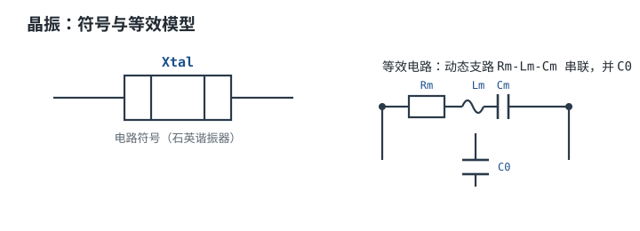
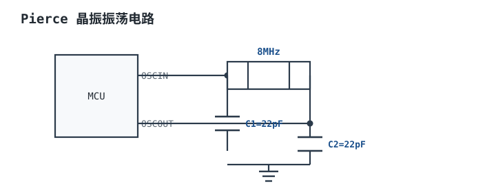

# 晶振与谐振器 Crystal Oscillator

时钟是整个数字系统里唯一"越用越差"的指标：程序可以改、滤波可以加，但晶振一旦焊上去，频率偏差就固定在那里，并且随温度和年龄慢慢漂移。更麻烦的是它**不会坏得明显**——晶振出问题时，板子往往还能启动、能跑，只是在高温下偶尔 USB 不枚举、串口偶尔丢一个字节、RTC 一个月差几分钟。这类故障用示波器也看不出来，因为时钟波形本身是好的。

所以这一章的重点不是"认识晶振"，而是把三件事算清楚：**负载电容算对（决定频率偏差多少 ppm）、驱动能力算够（决定能不能起振）、误差预算算全（决定这套时钟能不能满足接口规范）**。这三件事都是可以提前算出来的，而且算错了必然在现场以"偶发"的形式出现。

主线：先用压电效应和等效 RLC 模型建立"两个谐振点"的直觉，再把负载电容、频率偏差、负阻、驱动电平、温度与老化逐项拆成可算的式子，最后用一个 8MHz 无源晶振的设计把 C1/C2、ppm 偏差、gm 裕度、驱动功率和启动时间一路算完。数字接口对时钟精度的具体要求见[时钟与复位设计](../digital/clock-reset-design.md)；32.768kHz RTC 的低功耗与校准见[看门狗、RTC 与低功耗](../mcu/watchdog-rtc-lowpower.md)；串口与 USB 的速率匹配见[串口与 RS-232](../mcu/uart-rs232.md)与[USB 与以太网](../mcu/usb-ethernet.md)。

## 1. 设计动机

::: motivation 三个真实场景
**场景一：抄了参考设计的 22pF。** 参考板的 MCU 引脚旁就是晶振，杂散电容约 3pF；自己的板子晶振放在板边、走线 8mm，杂散电容到了 7pF。同样的 22pF 负载电容，实际 $C_L$ 从 18pF 变成 14pF，频率偏移 $+91.5$ppm。跑串口没问题，接 2.4GHz 射频模块就出了频偏——BLE 的容限是 ±50ppm。

**场景二：换了低功耗 MCU 就不起振。** 原来 8MHz 晶振用得好好的，换到一颗强调低功耗的 MCU 后低温下起不来。低功耗 MCU 的内部反相器跨导 $g_m$ 小，而新晶振的 ESR 是 80Ω 而不是 40Ω，增益裕度从 30 倍掉到 4 倍，低于工程要求的 5 倍。

**场景三：RTC 一个月差三分钟。** 32.768kHz 晶振标称 ±20ppm，算下来应该是每天 1.73 秒、每月 52 秒。实际每月差 3 分钟，说明总偏差到了 70ppm——多出来的部分是负载电容配错（+30ppm）加上温漂（-20ppm）。
:::

| 你遇到的问题 | 先算 | 判据 |
|---|---|---|
| 通信时好时坏、高低温才出问题 | $\Delta f/f$ 与接口容限比 | 总预算 < 接口容限的 50% |
| 偶尔不起振、低温不起振 | $g_m/g_{m,crit}$ | 增益裕度 ≥ 5 |
| 晶振用一段时间后停振 | $P_{drive}=I_{rms}^2\cdot ESR$ | 低于数据手册最大激励电平的 50% |
| 频率随温度漂 | $\alpha(T)$ 曲线 + 老化 | 全温区 + 全寿命的 ppm 和 |
| 换批次后频率变了 | $C_L$ 与 $C_{stray}$ 复核 | 实测频率反推实际 $C_L$ |

**不算会摔在哪**，三个带数字的代价：

1. **负载电容按数据手册的 $C_L$ 直接选。** 数据手册写 $C_L=18$pF，就把两只 18pF 电容接上去，实际 $C_L=18/2+C_{stray}=12$pF（取杂散 3pF），偏差 $+153.5$ppm。USB 全速容限是 ±0.25%（±2500ppm），还过得去；但 USB 高速是 ±500ppm、BLE 是 ±50ppm，直接出局。
2. **不核对增益裕度。** 某晶振 ESR=80Ω、$C_L=12$pF、$C_0=5$pF、8MHz，代入判据得 $g_{m,crit}=0.47$mA/V；低功耗 MCU 的 $g_m$ 只有 1.5mA/V，裕度 3.2 倍，低于 5 倍。表现为**常温能起振、低温起振时间从 2ms 拉到 50ms 甚至失败**——因为低温下 ESR 还会上升 1.5~2 倍。
3. **忽略驱动电平。** 一只 8MHz 晶振在 $V_{pp}=3.3$V、$C_L=30$pF 的条件下，驱动功率按 3.4 节算是 155μW，而数据手册的最大激励电平常见 100μW。超驱不会立刻坏，但会让晶振在几个月到几年内频率老化和停振——这类失效最难归因。

## 2. 定义与直观

### 2.1 一句话定义：电与机械的共振

**石英晶体**（Quartz Crystal）是利用石英的**压电效应**（piezoelectric effect）做成的谐振器：加电压时石英片发生机械形变，形变又反过来在电极上产生电荷。这两个方向耦合起来，就构成了一个**机电谐振系统**——电学上它表现为一个 Q 值极高的谐振回路，机械上它是一个音叉。

关键在于"高 Q"。普通 LC 回路的 Q 在 10~200 量级，而石英晶体的 Q 可以到 $10^4$~$10^5$。Q 高意味着两件事：**谐振频率极稳定**（受外部电路影响小），以及**谐振峰极窄**（对频率的选择性极强）。

无源晶振（Crystal / XTAL）只是这个谐振元件本身，需要外部电路（MCU 内部的反相器 + 两只负载电容）才能构成振荡器；有源振荡器（Oscillator / OSC）把整个振荡电路做在一个封装里，加电就出方波。

### 2.2 等效模型：动态支路与静电容

晶振的电学等效是一个**动态支路**（$R_m$-$L_m$-$C_m$ 串联，代表机械谐振）再并联一个**静电容** $C_0$（代表两块电极之间的电容）：



- $C_m$（动态电容，motional capacitance）：代表机械弹性，典型 10~30fF，**极小**。
- $L_m$（动态电感，motional inductance）：代表机械质量，典型 10~100mH，**极大**。
- $R_m$（动态电阻，或等效串联电阻 ESR）：代表机械损耗，典型 10~100Ω。
- $C_0$（静电容，shunt capacitance）：代表电极电容，典型 1~7pF。

这四个参数不是独立的：串联谐振频率由 $L_m$ 和 $C_m$ 决定：

$$
f_s=\frac{1}{2\pi\sqrt{L_mC_m}}
$$

其中 $f_s$ 是串联谐振频率（Hz）；$L_m$ 单位 H；$C_m$ 单位 F。以 $C_m=20$fF、$L_m=19.8$mH 代入：

$$
f_s=\frac{1}{2\pi\sqrt{19.8\times10^{-3}\times20\times10^{-15}}}
=\frac{1}{2\pi\sqrt{3.96\times10^{-16}}}
=\frac{1}{2\pi\times1.990\times10^{-8}}
=8.00\times10^{6}\ \text{Hz}
$$

正好是 8MHz——这不是巧合：**只要给定 $C_m$ 和频率，$L_m$ 就被确定了**。所以看数据手册时，"$C_m$ 小"和"$L_m$ 大"是同一件事。

### 2.3 两个谐振点：$f_s$ 与 $f_p$

动态支路自己有一个串联谐振 $f_s$（阻抗最小），而整条并联网络（动态支路 + $C_0$）还有一个并联谐振 $f_p$（阻抗最大）。两者只差一点点：

$$
f_p=f_s\sqrt{1+\frac{C_m}{C_0}}\approx f_s\left(1+\frac{C_m}{2C_0}\right)
$$

其中 $f_p$ 是并联谐振频率（Hz）；$C_0$ 是静电容（F）。以 $C_m=20$fF、$C_0=5$pF 代入：

$$
\frac{C_m}{C_0}=\frac{20\times10^{-15}}{5\times10^{-12}}=4.0\times10^{-3}
$$

$$
f_p\approx8.00\times10^{6}\times\left(1+\frac{0.004}{2}\right)=8.00\times10^{6}\times1.002=8.016\ \text{MHz}
$$

**两个谐振点只差 16kHz（2000ppm），但这 16kHz 就是晶振全部的可用调节范围。** 在这两个频率之间，晶体呈**感性**，可以和外部电容一起构成振荡器；低于 $f_s$ 或高于 $f_p$ 都呈容性，不能起振。

实际工作点不在 $f_s$ 也不在 $f_p$，而是在两者之间由**负载电容 $C_L$** 决定的位置——这就是下一节的内容。

### 2.4 为什么 Q 这么高

$$
Q=\frac{1}{R_m}\sqrt{\frac{L_m}{C_m}}=\frac{2\pi f_sL_m}{R_m}
$$

其中 $Q$ 是无量纲的品质因数。以 $f_s=8$MHz、$L_m=19.8$mH、$R_m=50\Omega$ 代入：

$$
Q=\frac{2\pi\times8\times10^{6}\times19.8\times10^{-3}}{50}
=\frac{9.95\times10^{5}}{50}=1.99\times10^{4}
$$

接近 2 万，比 LC 回路高两个数量级。对应的谐振带宽：

$$
B=\frac{f_s}{Q}=\frac{8.00\times10^{6}}{1.99\times10^{4}}=402\ \text{Hz}
$$

**402Hz 的带宽 vs 16kHz 的调节范围**——这个对比说明：晶振的选择性极强（相邻频道间隔几十 kHz 就能分开），但正因为选择性太强，外部电容的一点点变化就会显著改变工作点。

### 2.5 类比：音叉与两根弹簧

::: analogy 晶振像一只电驱动的音叉
- **敲一下会响很久** = 高 Q、低损耗。音叉的余音长短对应 Q 高低，晶振的 Q 在两万量级，所以"余音"极长、频率极稳。
- **音叉的形状决定音高** = 石英片的切割角度和尺寸决定标称频率。AT 切、BT 切这些"切型"就是不同的音叉形状，温度特性完全不同。
- **用手指轻碰音叉会改变音高** = 负载电容 $C_L$ 就是那只"手指"。碰得越重（$C_L$ 越大），频率越低（越靠近 $f_s$）。
- **音叉需要一个初始的敲击才能响** = 振荡器需要一个增益足够大的放大器把噪声放大成稳定振荡。这个"敲击力度"就是 $g_m$。
- **敲得太狠会把音叉敲坏** = 驱动电平过大，晶振会加速老化甚至破裂。

类比的边界：音叉不会因为温度变化而跑调（金属的弹性模量温度系数很小），石英会——AT 切晶体在 -40~+85°C 有几十 ppm 的变化。而且音叉不会"起振失败后自己恢复"，晶振会（增益裕度不足时表现为间歇起振）。涉及温度与可靠性时不能只靠音叉直觉。
:::

## 3. 定量关系

### 3.1 负载电容 $C_L$：不是"接一个 $C_L$"

晶振 datasheet 上的 $C_L$ 是**标称负载电容**，指的是"要在这个电容负载下才达到标称频率"。实际电路里，晶体两端各接一只电容到地，加上 PCB 和引脚的杂散电容，共同构成这个负载：

$$
C_L=\frac{C_1C_2}{C_1+C_2}+C_{stray}
$$

其中 $C_L$ 是负载电容（F）；$C_1$、$C_2$ 是两只外部负载电容（F）；$C_{stray}$ 是杂散电容（F），包括 MCU 引脚电容（典型 2~3pF）、PCB 焊盘与走线（典型 2~4pF）、晶振支架电容（约 0.5pF）。

对称设计时 $C_1=C_2=C$，上式化简为：

$$
C_L=\frac{C}{2}+C_{stray}\quad\Longrightarrow\quad C=2(C_L-C_{stray})
$$

**这是本章最容易算错的一个式子，因为它反直觉**：$C_L=18$pF 的晶振配的不是 18pF 电容，而是 22~30pF（取决于杂散）。而且 $C_{stray}$ 必须按**实际板子**估，不能抄参考设计——这是 1.2 节场景一的根源。

$C_1\neq C_2$ 时公式仍然成立，只是两只电容的比值可以调：$C_1$ 影响起振裕度（接 OSC_IN 侧），$C_2$ 影响驱动电平。工程上通常保持对称，非对称设计要重新核 gm 和驱动功率。

### 3.2 频率偏差的定量估算

$C_L$ 偏离标称值时，工作频率按"拉动公式"（pulling formula）变化：

$$
f_L\approx f_s\left(1+\frac{C_m}{2(C_0+C_L)}\right)
$$

其中 $f_L$ 是带负载电容时的振荡频率（Hz）。两个不同的 $C_L$ 之间的频率差：

$$
\frac{\Delta f}{f}\approx\frac{C_m}{2}\left(\frac{1}{C_0+C_{L2}}-\frac{1}{C_0+C_{L1}}\right)
$$

**灵敏度**（每皮法多少 ppm）对上式求导：

$$
\frac{\partial}{\partial C_L}\left(\frac{\Delta f}{f}\right)\approx-\frac{C_m}{2(C_0+C_L)^2}
$$

以 $C_m=20$fF、$C_0=5$pF、$C_L=18$pF 代入：

$$
\left|\frac{\partial}{\partial C_L}\right|=\frac{10\times10^{-15}}{(23\times10^{-12})^2}
=\frac{10\times10^{-15}}{5.29\times10^{-22}}=1.89\times10^{7}\ \text{/F}=18.9\ \text{ppm/pF}
$$

**约 19ppm/pF**——这是必须记住的量级：负载电容差 1pF，频率差约 19ppm。对 ±50ppm 的场合，$C_L$ 的误差必须控制在 2~3pF 以内。

下图给出 $C_L$ 从 5pF 到 47pF 时的工作频率相对 $f_s$ 的偏移，数据由上面的拉动公式逐点算出：

```echarts
{
  "animation": false,
  "tooltip": {"trigger": "axis"},
  "legend": {"data": ["工作频率相对 f_s 的偏移"], "bottom": 0, "textStyle": {"fontSize": 12}},
  "grid": {"left": 70, "right": 30, "top": 34, "bottom": 58},
  "xAxis": {"type": "category", "name": "负载电容 C_L / pF", "nameLocation": "middle", "nameGap": 30,
            "data": ["5", "8", "10", "12", "14", "16", "18", "20", "22", "27", "33", "39", "47"],
            "axisLabel": {"fontSize": 11}},
  "yAxis": {"type": "value", "name": "Δf / f / ppm", "nameLocation": "middle", "nameGap": 50,
            "min": 0, "max": 1100, "axisLabel": {"fontSize": 11}},
  "series": [
    {"name": "工作频率相对 f_s 的偏移", "type": "line", "symbol": "circle", "symbolSize": 5,
     "lineStyle": {"width": 2.6, "color": "#1a4f8b"}, "itemStyle": {"color": "#1a4f8b"},
     "areaStyle": {"opacity": 0.08},
     "data": [1000.0, 769.2, 666.7, 588.2, 526.3, 476.2, 434.8, 400.0, 370.4, 312.5, 263.2, 227.3, 192.3]}
  ]
}
```

可逐点复算，例如 $C_L=18$pF：$(C_m/2)/(C_0+C_L)=10\times10^{-15}/23\times10^{-12}=4.348\times10^{-4}=434.8$ppm。

曲线形状说明两件事：$C_L$ 越大频率越低（越靠近 $f_s$），而且**小电容区斜率大**——$C_L$ 从 5pF 到 14pF 就走完了 474ppm，从 14pF 到 47pF 才走 334ppm。所以低 $C_L$ 的晶振（如 8pF、10pF）对杂散电容更敏感，布局要求更严。

### 3.3 负阻与振荡裕度：$g_m$ 够不够

振荡器能不能起振，取决于放大器的**负阻**能不能补偿晶体的 ESR 并留下余量。ST 的应用笔记给出的设计判据是：

$$
g_{m,crit}=4\cdot ESR\cdot(2\pi f)^2\cdot(C_0+C_L)^2
$$

$$
\text{增益裕度}=\frac{g_m}{g_{m,crit}}\geq5
$$

其中 $g_{m,crit}$ 是临界跨导（S）；$ESR$ 是晶振等效串联电阻（$\Omega$）；$f$ 是标称频率（Hz）；$C_0$、$C_L$ 单位 F；$g_m$ 是 MCU 内部反相器的跨导（S，数据手册的 Oscillator Characteristics 表给出）。量纲验证：$\Omega\times(1/\text{s})^2\times\text{F}^2=\Omega\times\text{F}^2/\text{s}^2$，而 $\Omega\cdot\text{F}=\text{s}$，所以结果是 $\text{F/s}=\text{A/V}=\text{S}$，正确。

**这个式子里最容易被忽略的是平方项**：频率翻倍，$g_{m,crit}$ 涨 4 倍；$C_L$ 翻倍，也涨 4 倍。所以 32.768kHz 的晶振看起来"低频应该好起振"，实际上因为 $C_L$ 和 $C_0$ 都小而 $g_m$ 也小，裕度往往比 8MHz 更紧张（4.2 节算例）。

**实测判据**是负阻测量法：在晶振支路串一个可变电阻，从 0 开始慢慢加大，直到振荡停止。停振时的电阻值就是电路的负阻 $|R_{neg}|$。判据：

$$
|R_{neg}|\geq(3\sim5)\cdot ESR
$$

这个方法比查 $g_m$ 更可靠，因为它把 PCB 布局、负载电容、MCU 内部反馈电阻全都算进去了。量产前建议至少做一次。

### 3.4 驱动电平：晶振会不会被"敲坏"

晶振内部的石英片有最大允许振动幅度，数据手册用**驱动电平**（drive level）表示，常见额定 100μW（部分型号 500μW）。超过额定值不会立刻坏，但会加速老化、增加频率漂移，极端情况会震裂石英片。

驱动功率的估算：晶体支路的电流主要由负载电容路径决定，所以

$$
I_{rms}\approx2\pi fC_LV_{rms},\qquad V_{rms}=\frac{V_{pp}}{2\sqrt2}
$$

$$
P_{drive}=I_{rms}^2\cdot ESR
$$

其中 $I_{rms}$ 是流过晶体的有效值电流（A）；$V_{pp}$ 是晶振两端的峰峰电压（V，典型 0.8~1.2V，以实测为准）；$P_{drive}$ 是驱动功率（W）。

以 $f=8$MHz、$C_L=18$pF、$V_{pp}=1$V、$ESR=50\Omega$ 代入：

$$
V_{rms}=\frac{1}{2\sqrt2}=0.3536\ \text{V}
$$

$$
I_{rms}=2\pi\times8\times10^{6}\times18\times10^{-12}\times0.3536=3.20\times10^{-4}\ \text{A}
$$

$$
P_{drive}=(3.20\times10^{-4})^2\times50=5.12\times10^{-6}\ \text{W}=5.1\ \mu\text{W}
$$

只占 100μW 额定的 5%，很安全。但如果换成 $V_{pp}=3.3$V、$C_L=30$pF：

$$
I_{rms}=2\pi\times8\times10^{6}\times30\times10^{-12}\times\frac{3.3}{2\sqrt2}=1.76\times10^{-3}\ \text{A}
$$

$$
P_{drive}=(1.76\times10^{-3})^2\times50=1.55\times10^{-4}\ \text{W}=155\ \mu\text{W}
$$

**超过 100μW 的额定值 55%。** 这种情况常见于：电路实际装了两只大电容（$C_L$ 用得比晶振额定值大），或者把晶振直接接在 3.3V 逻辑门输出上（摆幅远大于 MCU 内部反相器）。解法是在晶振支路串一只阻尼电阻（典型 100~470Ω）限制电流，代价是起振裕度下降，要重新核 $g_m$。

### 3.5 启动时间

振荡从噪声开始，幅度按指数增长，时间常数由 Q 和频率决定：

$$
\tau_{start}=\frac{2Q}{\omega_0}=\frac{Q}{\pi f}
$$

$$
t_{start}\approx\tau_{start}\ln\frac{A_{final}}{A_{init}}
$$

其中 $\tau_{start}$ 是包络时间常数（s）；$\omega_0=2\pi f$（rad/s）；$A_{final}/A_{init}$ 是幅度增长倍数（从热噪声到稳态，典型 $10^3$~$10^5$，取 $10^3$ 即 $6.9$ 个时间常数）。

以 $Q=1.99\times10^4$、$f=8$MHz 代入：

$$
\tau_{start}=\frac{1.99\times10^{4}}{\pi\times8\times10^{6}}=7.92\times10^{-4}\ \text{s}=0.792\ \text{ms}
$$

$$
t_{start}=0.792\times10^{-3}\times\ln(1000)=0.792\times10^{-3}\times6.91=5.47\ \text{ms}
$$

**约 5.5ms**——这就是为什么很多 MCU 数据手册的振荡器启动时间写 2~10ms，也是为什么低功耗模式唤醒后要等振荡稳定才能用高速时钟。增益裕度越小，启动越慢；裕度掉到 2~3 倍时，启动时间可能拉长到几十毫秒（1.3 节场景二）。

### 3.6 温度特性与老化

晶振的频率误差由四部分叠加，**误差预算必须全部算进去**：

$$
\frac{\Delta f}{f}\bigg|_{\text{total}}
=\underbrace{\frac{\Delta f}{f}\bigg|_{\text{tol}}}_{\text{初始容差}}
+\underbrace{\frac{\Delta f}{f}\bigg|_{T}}_{\text{温度}}
+\underbrace{\frac{\Delta f}{f}\bigg|_{\text{age}}}_{\text{老化}}
+\underbrace{\frac{\Delta f}{f}\bigg|_{\text{load}}}_{\text{负载电容误差}}
$$

- **初始容差**：25°C、标称 $C_L$ 下的偏差，普通晶振 ±10~±30ppm，高精度 ±5ppm（典型量级，以型号数据为准）。
- **温度特性**：AT 切晶体是三次曲线，拐点在 25°C 附近。普通 AT 切在 -20~+70°C 内约 ±10~±30ppm，扩到 -40~+85°C 会到 ±50~±100ppm。TCXO（温度补偿型）能把这一项压到 ±0.5~±2ppm。
- **老化**：首年典型 ±3ppm，之后每年 ±1ppm 量级，随温度和驱动电平加速（典型量级，以型号的 Aging 指标为准）。
- **负载电容误差**：按 3.2 节，1pF 约 19ppm。

**换算成时间**：1ppm 对应每天

$$
\Delta t_{day}=86400\times10^{-6}=0.0864\ \text{s/ppm}
$$

所以 20ppm = 每天 1.73 秒，每月 51.8 秒。这个换算在 RTC 设计中是最基本的口算。

### 3.7 适用条件与失效边界

- **拉动公式只在 $f_s$ 和 $f_p$ 之间成立。** $C_L$ 太小（趋近 0）会顶到 $f_p$ 附近，那里阻抗急剧变化，振荡器可能不起振或跳到泛音。
- **$C_m$、$C_0$、ESR 都是频率和切型相关的量。** 32.768kHz 的 $C_m$ 只有 2~5fF、$C_0$ 约 1~2pF、ESR 几十 kΩ；MHz 级晶振的 $C_m$ 是 10~30fF、ESR 几十欧。不要跨频段套参数。
- **ESR 随温度上升。** 低温（-40°C）时 ESR 可能比 25°C 高 1.5~2 倍，这是"常温能起振、低温不起振"的直接原因。gm 裕度必须按最低工作温度核算。
- **负阻不是"越大越好"。** 负阻过大意味着环路增益过大，驱动电平升高、谐波丰富、EMI 变差。合适的做法是裕度 5~10 倍，而不是 100 倍。
- **晶振的精度不能靠软件校准完全补救。** 温度是连续变化的，而校准只能在标定点做；只有在恒温或已知温度的条件下，软件校准才有效。
- **32.768kHz 的 PCB 漏电是隐形杀手。** 这个频段的阻抗极高（几十 kΩ 起），助焊剂残留、湿气、表面污染都会形成并联漏电，等效于降低了负阻，表现为"清洗后能起振、脏了就不起振"。

## 4. 典型计算

### 4.1 完整算例：8MHz 无源晶振

**需求与假设**（全部为示例量级，实际以所选型号数据手册为准）：

| 项目 | 值/要求 |
|---|---|
| 晶振 | 8.000MHz 无源，$C_L=18$pF，$C_0=5$pF，$C_m=20$fF，ESR=50Ω，最大驱动电平 100μW |
| MCU | 3.3V，内部反相器 $g_m=5$mA/V（Oscillator Characteristics 表），工作温度 -40~+85°C |
| 板级杂散 | $C_{stray}=7$pF（引脚 3pF + 走线焊盘 4pF） |
| 目标 | 频率偏差 <±50ppm，起振裕度 ≥5，驱动功率 <50μW |



**第 1 步：算负载电容。** 由 $C=C_1=C_2=2(C_L-C_{stray})$：

$$
C=2\times(18-7)=2\times11=22\ \text{pF}
$$

取 E24 标准值 22pF（C0G 材质）。反算验证：

$$
C_L=\frac{22\times22}{22+22}+7=\frac{484}{44}+7=11+7=18\ \text{pF}
$$

与标称值一致，零偏差。

**第 2 步：验算杂散估计错误的后果。** 如果这块板子的实际杂散只有 3pF（晶振紧贴引脚、走线 2mm），而电容仍按 22pF 装：

$$
C_L=\frac{22}{2}+3=14\ \text{pF}
$$

代入频率偏差公式（$C_m=20$fF、$C_0=5$pF，参考点 18pF）：

$$
\frac{\Delta f}{f}=\frac{20\times10^{-15}}{2}\left(\frac{1}{5\times10^{-12}+14\times10^{-12}}-\frac{1}{5\times10^{-12}+18\times10^{-12}}\right)
$$

$$
=10\times10^{-15}\left(\frac{1}{19\times10^{-12}}-\frac{1}{23\times10^{-12}}\right)
=10\times10^{-15}\times(5.263\times10^{10}-4.348\times10^{10})
$$

$$
=10\times10^{-15}\times9.15\times10^{9}=9.15\times10^{-5}=91.5\ \text{ppm}
$$

**+91.5ppm**。这个数超过 BLE 的 ±50ppm，超过 USB 高速的 ±500ppm 吗？没有。所以这块板子跑 USB 没问题，接射频模块就出频偏——这正是最难排查的一类问题。

下面这张图把常见取值错误对应的偏差一次列全（参考点均为 $C_L=18$pF）：

```echarts
{
  "animation": false,
  "tooltip": {"trigger": "axis"},
  "legend": {"data": ["相对 18pF 的频率偏差"], "bottom": 0, "textStyle": {"fontSize": 12}},
  "grid": {"left": 70, "right": 30, "top": 34, "bottom": 58},
  "xAxis": {"type": "category", "name": "实际负载电容 C_L / pF", "nameLocation": "middle", "nameGap": 30,
            "data": ["12", "14", "16", "18", "20", "22", "24", "30"],
            "axisLabel": {"fontSize": 11}},
  "yAxis": {"type": "value", "name": "Δf / f / ppm", "nameLocation": "middle", "nameGap": 50,
            "min": -170, "max": 170, "axisLabel": {"fontSize": 11}},
  "series": [
    {"name": "相对 18pF 的频率偏差", "type": "bar", "barWidth": "52%",
     "itemStyle": {"color": "#1a4f8b"},
     "label": {"show": true, "position": "top", "fontSize": 10, "color": "#2b3a4a"},
     "data": [153.5, 91.5, 41.4, 0, -34.8, -64.4, -90.0, -149.1]}
  ]
}
```

每个柱子都由 $10\times10^{-15}\times[1/(5+C_L)-1/23]\times10^{12}$ 算出，可逐根复算。注意**曲线不对称**：往小电容方向走 2pF 是 +41ppm，往大电容方向走 2pF 是 -35ppm——因为 $1/(C_0+C_L)$ 是双曲线，不是直线。

**第 3 步：验算增益裕度。** 代入 $g_{m,crit}$ 判据：

$$
g_{m,crit}=4\times50\times(2\pi\times8\times10^{6})^2\times(23\times10^{-12})^2
$$

$$
=200\times2.527\times10^{15}\times5.29\times10^{-22}
=200\times1.336\times10^{-6}=2.67\times10^{-4}\ \text{S}=0.267\ \text{mA/V}
$$

$$
\text{增益裕度}=\frac{5\ \text{mA/V}}{0.267\ \text{mA/V}}=18.7
$$

18.7 ≥ 5，满足要求。**但要注意这是 25°C、ESR=50Ω 的结果**。按 3.7 节，-40°C 时 ESR 可能升到 75~100Ω，$g_{m,crit}$ 同比例上升，裕度降到 9.4~12.5 倍，仍然够。如果用的是 ESR=80Ω 的晶振，常温裕度就只有 $18.7\times50/80=11.7$ 倍，低温最坏情况约 5.9 倍——贴着判据线。

**第 4 步：验算驱动功率。** $V_{pp}$ 取 1V（3.3V MCU 的 Pierce 电路典型值，以实测为准）：

$$
P_{drive}=(2\pi\times8\times10^{6}\times18\times10^{-12}\times0.3536)^2\times50=5.12\ \mu\text{W}
$$

5.12μW 远低于 100μW 额定和 50μW 的目标线，安全。

**第 5 步：验算启动时间。**

$$
\tau_{start}=\frac{1.99\times10^{4}}{\pi\times8\times10^{6}}=0.792\ \text{ms},\qquad
t_{start}=0.792\times6.91=5.47\ \text{ms}
$$

**第 6 步：误差预算。** 把 3.6 节的四项加起来（取典型值）：

| 误差源 | 取值 | 依据 |
|---|---|---|
| 初始容差 | ±20ppm | 普通晶振规格 |
| 温度（-40~+85°C） | ±20ppm | AT 切典型值，以型号曲线为准 |
| 负载电容误差 | ±5ppm | 按 $C_L$ 偏差 0.25pF 估（19ppm/pF） |
| 老化（5 年） | ±7ppm | 首年 3ppm + 每年 1ppm |
| **合计（算术和）** | **±52ppm** | 保守算法 |

±52ppm。对 USB 全速（±0.25% = ±2500ppm）绰绰有余；对 BLE 的 ±50ppm **刚好超线**。如果要过 BLE，必须把温度项压下来（换 ±10ppm 的晶振或 TCXO），或者接受"出厂校准 + 恒温"的前提。

**第 7 步：结论。** 这只 8MHz 晶振在本设计里：$C_1=C_2=22$pF（C0G）、增益裕度 18.7 倍、驱动功率 5.1μW、启动 5.5ms、误差预算 ±52ppm。**唯一需要盯的是杂散电容**——它是唯一一个"算的时候靠估、错了才暴露"的量。量产时建议抽一块板实测频率，反推实际 $C_L$：

$$
C_{L,actual}=\frac{C_m/2}{\Delta f/f}-C_0
$$

实操上更简单：先把实测频率偏差（ppm）换算成 $C_L$ 偏差（除以本频段的 ppm/pF 灵敏度），再按 $\Delta C=2\Delta C_L$ 调整两只电容。

### 4.2 算例二：32.768kHz RTC 的裕度为什么紧张

**需求：** STM32 类 MCU 的 LSE 用 32.768kHz 晶振，$C_L=12.5$pF，$C_0=1.5$pF，ESR=50kΩ，MCU 的 LSE 驱动器 $g_m=5\mu$A/V。

**第一步，负载电容。**

$$
C=2(C_L-C_{stray})=2\times(12.5-3)=19\ \text{pF}
$$

取 18pF（E24），实际 $C_L=9+3=12$pF，比标称 12.5pF 低 0.5pF。这个频段的灵敏度按同一个公式算是 $C_m/(2(C_0+C_L)^2)=3\times10^{-15}/(2\times(14\times10^{-12})^2)\approx7$ppm/pF，所以频率偏差约 $-7\times0.5=-3.5$ppm，可以接受。

**第二步，增益裕度。**

$$
g_{m,crit}=4\times50000\times(2\pi\times32768)^2\times(14\times10^{-12})^2
$$

$$
=2\times10^{5}\times4.239\times10^{10}\times1.96\times10^{-22}
=2\times10^{5}\times8.31\times10^{-12}=1.66\times10^{-6}\ \text{S}=1.66\ \mu\text{A/V}
$$

$$
\text{增益裕度}=\frac{5\ \mu\text{A/V}}{1.66\ \mu\text{A/V}}=3.0
$$

**只有 3.0，低于 5 倍的判据线。** 这就是 32.768kHz 设计的真实处境：频率低、$C_L$ 小，$g_{m,crit}$ 的绝对值很小（1.66μA/V），但 MCU 能提供的 $g_m$ 更小（微安级）。

**第三步，最坏情况。** 如果这颗晶振的 ESR 是规格上限 90kΩ（$C_L=6$pF 的型号常见 70~90kΩ 上限）：

$$
g_{m,crit}=1.66\times10^{-6}\times\frac{90}{50}=2.99\times10^{-6}\ \text{S},\qquad
\text{裕度}=\frac{5}{2.99}=1.67
$$

裕度 1.67 倍，起振极其勉强。表现是：新板子能起振、老化后不起振；常温能起振、低温不起振；清洗后能起振、有助焊剂残留时不起振。

**第四步，改进方向。** 三个方向，按代价排序：(1) 换 ESR 更低的晶振（选 ESR ≤ 50kΩ 的型号）；(2) 减小 $C_L$（从 12.5pF 换到 6pF，$C_{stray}$ 的影响占比变大但 $g_{m,crit}$ 里 $C_L$ 的平方项减小）；(3) 提高 $g_m$（换 MCU 或用外部振荡器）。**不能靠加大负载电容"增强振荡"**——那只会让 $g_{m,crit}$ 更大、裕度更小。

### 4.3 算例三：ppm 怎么换算成时间和接口容限

**问题：** 手上一堆 ppm 指标，怎么判断"够不够"？

**第一步，ppm 到日误差。** 1ppm 对应每天 $86400\times10^{-6}=0.0864$s。于是：

| 精度 | 日误差 | 月误差 | 年误差 |
|---|---|---|---|
| ±1ppm | 0.086s | 2.6s | 31.5s |
| ±20ppm | 1.73s | 51.8s | 631s（10.5 分钟） |
| ±50ppm | 4.32s | 130s | 1361s（22.7 分钟） |
| ±100ppm | 8.64s | 259s | 2722s（45.4 分钟） |

**第二步，UART 的容限。** 异步串口的采样点在每个位的中间，一帧 10 位（1 起始 + 8 数据 + 1 停止），最后一个采样点在 9.5 个位时间处。允许的累计误差是半个位：

$$
\varepsilon_{total}\leq\frac{0.5}{9.5}=5.26\%
$$

两端各分一半，每端约 2.6%。**普通陶瓷谐振器（±0.3~0.5%）绰绰有余，片内 RC（±2~5%）勉强，只有温漂极小的场合才能用 RC 跑串口。**

**第三步，USB 的容限。** USB 2.0 规定全速 12Mbps 的数据速率容差 ±0.25%（±2500ppm），高速 480Mbps 为 ±500ppm。按 3.6 节的预算，普通晶振的 ±52ppm 对两者都够，但 ±2500ppm 的陶瓷谐振器和 ±2% 的 RC 都不行——这就是"USB 必须用晶振"的定量原因。

**第四步，射频的容限。** BLE 的载波容限是 ±50ppm 量级（以具体协议版本为准）。这条线卡得很紧：晶振本身的温度 + 老化 + 负载电容误差加起来必须留在 50ppm 以内，冗余空间非常小，所以射频模块常用 TCXO 或带温度补偿的晶体。

**第五步，结论。** 选时钟源时先确定接口的容限，再乘 0.5 作为设计预算（留一半给批次和温度），最后选器件。**"±20ppm 的晶振"只是一个参数，真正决定成败的是它加上温度、老化、负载电容之后的和。**

## 5. 工程含义

### 5.1 三类频率源的取舍

| 类型 | 初始精度 | 全温区 | 老化 | 起振 | 外围 | 成本 | 典型用途 |
|---|---|---|---|---|---|---|---|
| 无源晶振 XTAL | ±10~±30ppm | ±20~±100ppm | ±1~5ppm/年 | 需匹配 gm | 2 只负载电容 | 低 | USB、以太网、射频 |
| 陶瓷谐振器 | ±0.3~±0.5% | ±0.2~±0.3% | 小 | 快、裕度大 | 内置电容（三端） | 最低 | UART、普通 MCU 时钟 |
| 硅振荡器 / MEMS | ±20~±100ppm | ±20~±50ppm | ±1~5ppm/年 | 立即 | 无 | 中高 | 高可靠、无晶振引脚 |
| 片内 RC | ±1~±5% | ±1~±10% | — | 立即 | 无 | 0 | 非通信、可校准场合 |

取舍逻辑：

- **要精度就要晶振。** 晶振是唯一能用低成本做到几十 ppm 的无源方案，代价是需要匹配负载电容、布局敏感、起振依赖 MCU 的 $g_m$。
- **要鲁棒就用陶瓷谐振器或硅振荡器。** 陶瓷谐振器精度差一个数量级（±0.3% 级别），但内置电容、起振快、不怕布局问题，跑 UART 完全够。硅振荡器/MEMS 更贵，但没有晶振的起振与布局问题，适合高振动、高可靠场合。
- **要零成本就用片内 RC。** 出厂校准后能到 ±1~2%，但温漂大；只能用于非通信场合，或者用外部参考定期校准。
- **射频与 USB 没有捷径。** 这两类接口的容限太紧，只能用晶振或 TCXO。

### 5.2 数量级表

| 参数 | 32.768kHz | 8MHz | 25MHz |
|---|---|---|---|
| $C_m$ | 2~5fF | 10~30fF | 10~30fF |
| $L_m$ | 数千 H | 10~30mH | 1~5mH |
| $C_0$ | 1~2pF | 3~7pF | 3~7pF |
| ESR | 30~90kΩ | 20~80Ω | 20~60Ω |
| $Q$ | 3万~10万 | 1万~5万 | 1万~5万 |
| 灵敏度（同一 $C_L$ 附近） | 5~10ppm/pF | 15~25ppm/pF | 15~25ppm/pF |
| 最大驱动电平 | 0.1~1μW | 100~500μW | 100~500μW |

同一类器件在不同频段的参数差几个数量级，**选型时不能跨频段套经验值**。以上全部是典型量级，同一型号不同批次、不同厂家可以差一个数量级，实际取值必须回到所选型号数据手册的 Electrical Characteristics 表。

### 5.3 选型清单与布局

1. **先查 MCU 数据手册的推荐 $C_L$ 范围。** 大多数 MCU 的 Oscillator Characteristics 表会直接给"推荐负载电容范围"，比如 8~18pF。超出范围可能起振不良。
2. **按 $C_L$ 和实测杂散算 $C_1=C_2=2(C_L-C_{stray})$，用 C0G/NP0。** X7R 的容值随温度和偏置变化 10~20%，直接变成频率漂移（19ppm/pF 的量级，0.5pF 就是 10ppm）。
3. **核 $g_m$ 裕度，按最低工作温度算。** ESR 在 -40°C 会上升 1.5~2 倍；能用负阻测量法实测最好。
4. **核驱动功率。** 超过数据手册最大激励电平的一半就要串阻尼电阻。
5. **布局三原则**：晶振紧贴 MCU 引脚（走线 <5mm）；下方禁止走任何信号；四周包地并打地过孔。这三条同时决定 $C_{stray}$、抗干扰和漏电。
6. **量产抽测频率。** 用频率计测实际输出，反推 $C_L$ 偏差，必要时微调电容值。这是唯一能兜住"杂散电容估错"的手段。
7. **32.768kHz 额外注意清洗与助焊剂。** 高阻抗节点对表面漏电极敏感，必须彻底清洗并做防潮处理。

## 6. 常见坑

::: pitfall 常见坑
- **把 $C_L$ 当成单只电容值**：现象——频率整体偏了几十到一百多 ppm，通信偶发失败。原因——数据手册的 $C_L$ 是"负载电容"，实际由两只电容串联再并联杂散构成，直接装 18pF 会得到 12pF。解决——按 $C_1=C_2=2(C_L-C_{stray})$ 算；用 C0G 电容；实测频率反推修正。
- **杂散电容照抄参考设计**：现象——同一份原理图，两块板子频率差 50ppm 以上；或者换 PCB 厂家后频率变了。原因——$C_{stray}$ 取决于走线长度、焊盘、层叠，参考板上是 3pF，你的板子上可能是 7pF。解决——按实际布局估 $C_{stray}$（或实测反推），把晶振贴近 MCU、走线尽量短，减少不确定性。
- **低温不起振**：现象——常温一切正常，-20°C 以下偶发不启动，或启动时间从 2ms 变成几十 ms。原因——ESR 随温度上升 1.5~2 倍，增益裕度从 10 倍掉到 5 倍以下。解决——按最低温度核算 $g_{m,crit}$；选 ESR 更低的晶振；减小 $C_L$；必要时换振荡器。
- **负载电容用 X7R**：现象——频率随温度漂移比预期大，或不同批次的板子频率不一致。原因——X7R 的容值温度系数 ±15%、直流偏置下还会掉容，0.5pF 的变化就是 10ppm。解决——负载电容一律用 C0G/NP0 材质，精度选 ±5% 或 ±1%。
- **32.768kHz 不起振但换了晶振就好**：现象——同一块板子，换一颗晶振能起振，换回去又不行，反复无常。原因——裕度只有 2~3 倍时，起振与否取决于晶振 ESR、板上漏电、助焊剂残留的微小差异，属于典型的"边缘振荡"。解决——不要靠换料碰运气，按 4.2 节重算裕度并换低 ESR 型号；彻底清洗；必要时降低 $C_L$。
- **驱动电平超标导致长期老化**：现象——新板子频率正常，用一两年后频率偏移超出规格，或晶振停振。原因——驱动功率超过数据手册额定值，石英片长期过应力，频率老化和机械损伤累积。解决——按 3.4 节算 $P_{drive}$，超了就在晶振支路串 100~470Ω 阻尼电阻，并重新核 gm 裕度。
- **用有源振荡器替换无源晶振时忘了改电路**：现象——换上有源振荡器后不起振或功耗异常。原因——有源振荡器输出要接 OSC_IN 且 OSC_OUT 悬空，而原来的 Pierce 电路还带着反馈电阻和负载电容。解决——按有源器件的接法删掉负载电容、断开反馈路径，把输出接到 OSC_IN。
:::

## 7. 自测题

<details><summary>某 8MHz 晶振标称 $C_L=18$pF，板上杂散电容估计 7pF。两只负载电容应取多大？如果实际杂散只有 3pF，频率会偏多少 ppm？</summary>

取值：

$$
C=2(C_L-C_{stray})=2\times(18-7)=22\ \text{pF}
$$

反算：$C_L=22/2+7=11+7=18$pF，正确。

若实际杂散 3pF，实际负载电容 $C_L=11+3=14$pF。代入拉动公式（$C_m=20$fF、$C_0=5$pF）：

$$
\frac{\Delta f}{f}=\frac{20\times10^{-15}}{2}\left(\frac{1}{19\times10^{-12}}-\frac{1}{23\times10^{-12}}\right)
=10\times10^{-15}\times9.15\times10^{9}=91.5\ \text{ppm}
$$

偏差 +91.5ppm。相对 USB 全速（±2500ppm）不算大，但超过 BLE 的 ±50ppm。这解释了为什么"同一份原理图换个布局就出问题"。

</details>

<details><summary>已知 $C_m=20$fF、$C_0=5$pF、$C_L=18$pF，求负载电容每变化 1pF 对应的频率变化（ppm），并说明 $C_L$ 误差应控制在多少以内才能满足 ±50ppm。</summary>

灵敏度公式：

$$
\left|\frac{\partial(\Delta f/f)}{\partial C_L}\right|=\frac{C_m}{2(C_0+C_L)^2}
=\frac{10\times10^{-15}}{(23\times10^{-12})^2}
=\frac{10\times10^{-15}}{5.29\times10^{-22}}=1.89\times10^{7}\ \text{/F}
$$

即 18.9 ppm/pF ≈ 19ppm/pF。

要满足 ±50ppm，若把全部预算都给 $C_L$ 误差：

$$
\Delta C_L\leq\frac{50}{19}=2.6\ \text{pF}
$$

考虑还有温度、老化、初始容差，实际应把 $C_L$ 误差控制在 1~1.5pF 以内，也就是杂散估计要准到 2~3pF。

</details>

<details><summary>8MHz 晶振 ESR=50Ω、$C_0=5$pF、$C_L=18$pF，MCU 的 $g_m=5$mA/V。求 $g_{m,crit}$ 和增益裕度，并判断能否起振。</summary>

$$
g_{m,crit}=4\cdot ESR\cdot(2\pi f)^2\cdot(C_0+C_L)^2
$$

$$
=4\times50\times(2\pi\times8\times10^{6})^2\times(23\times10^{-12})^2
$$

$$
=200\times2.527\times10^{15}\times5.29\times10^{-22}=2.67\times10^{-4}\ \text{S}=0.267\ \text{mA/V}
$$

$$
\text{裕度}=\frac{5}{0.267}=18.7
$$

18.7 ≥ 5，满足判据，能可靠起振。

但要做温度核算：-40°C 时 ESR 可能到 75~100Ω，$g_{m,crit}$ 同比例上升到 0.40~0.53mA/V，裕度降到 9.4~12.5 倍，仍然够。如果 ESR 是 80Ω 的型号，常温裕度只有 11.7 倍，低温最坏约 5.9 倍，已经贴着判据线。

</details>

<details><summary>某 32.768kHz RTC 晶振 $C_L=12.5$pF、$C_0=1.5$pF、ESR=50kΩ，MCU 的 LSE 跨导为 5μA/V。求增益裕度，并说明为什么这个频段的设计比 8MHz 更紧张。</summary>

$$
g_{m,crit}=4\times50000\times(2\pi\times32768)^2\times(14\times10^{-12})^2
$$

$$
(2\pi\times32768)^2=4.239\times10^{10},\qquad(14\times10^{-12})^2=1.96\times10^{-22}
$$

$$
g_{m,crit}=4\times50000\times4.239\times10^{10}\times1.96\times10^{-22}=1.66\times10^{-6}\ \text{S}=1.66\ \mu\text{A/V}
$$

$$
\text{裕度}=\frac{5}{1.66}=3.0
$$

只有 3.0，低于 5 倍的判据。

紧张的原因：频率低了 244 倍，$(2\pi f)^2$ 小了约 6 万倍，所以 $g_{m,crit}$ 绝对值很小；但 MCU 为省电把 LSE 的 $g_m$ 也压到微安级，两者同时下降，比值并没有变宽松。加上这个频段的晶振 ESR 高达几十 kΩ，任何漏电、ESR 偏大都直接把裕度吃掉。

</details>

<details><summary>某晶振 $Q=2\times10^4$、$f=8$MHz。估算启动时间（幅度从热噪声增长到稳态，约 $10^3$ 倍）。如果增益裕度只有 2 倍，启动时间会怎么变？</summary>

时间常数：

$$
\tau_{start}=\frac{Q}{\pi f}=\frac{2\times10^{4}}{\pi\times8\times10^{6}}=7.96\times10^{-4}\ \text{s}=0.796\ \text{ms}
$$

启动时间：

$$
t_{start}=0.796\times10^{-3}\times\ln(1000)=0.796\times10^{-3}\times6.91=5.5\ \text{ms}
$$

增益裕度变小时，幅度的指数增长率按 $(\text{裕度}-1)$ 的比例下降，等效时间常数变长。裕度 18.7 → 2 时，增长率大约降到原来的 $(2-1)/(18.7-1)=1/17.7$，启动时间按比例拉长到几十毫秒量级。**这就是"低温启动慢"的定量解释**：裕度被 ESR 上升吃掉，启动时间成倍拉长。

</details>

<details><summary>1ppm 对应每天多少秒？一个 ±20ppm 的 RTC 一年最多差多少？如果把负载电容配错导致额外 +30ppm，总数变成多少？</summary>

$$
\Delta t_{day}=86400\times1\times10^{-6}=0.0864\ \text{s/ppm}
$$

±20ppm：

$$
20\times0.0864=1.728\ \text{s/天}
$$

一年：

$$
1.728\times365=631\ \text{s}=10.5\ \text{分钟}
$$

加上 +30ppm 的负载电容误差，总偏差 50ppm：

$$
50\times0.0864=4.32\ \text{s/天}\quad\Rightarrow\quad4.32\times365=1577\ \text{s}=26.3\ \text{分钟/年}
$$

**误差是可加的，不是可抵消的**——所以每一项都要单独控制。这也是为什么 RTC 设计要先算误差预算，再决定要不要校准、要不要用 TCXO。

</details>

## 8. 参考资料

- **STMicroelectronics, AN2867, Oscillator design guide for STM8 and STM32 microcontrollers**：给出 $g_{m,crit}=4\cdot ESR\cdot(2\pi f)^2\cdot(C_0+C_L)^2$ 的判据、增益裕度 ≥5 的要求、负阻测量方法、驱动电平估算与启动时间分析；本章 3.3、3.4、3.5 节的公式与判据按该应用笔记。
- **IEC 60122-1, Quartz crystal units for frequency control and selection – Part 1, Standard values and test conditions**：定义标称频率、负载电容 $C_L$、等效串联电阻 ESR、驱动电平等级与标准值系列；本章 2.2、3.1、5.2 节的术语与数量级按该标准。
- **IEC 60444-1, Measurement of quartz crystal unit parameters**：规定串联谐振频率、负载谐振频率与动态电阻的测量方法；本章 4.1 节"实测频率反推 $C_L$"的做法与该标准的测量口径一致。
- **AEC-Q200 Rev E, Stress Test Qualification for Passive Components**：晶体与谐振器的温度循环、耐湿、老化、机械冲击试验项目与判定条件；本章 3.6 节的老化量级参考该标准的试验条件。
- **USB 2.0 Specification（Universal Serial Bus Specification Revision 2.0）**：全速 12Mbps 的数据速率容差 ±0.25%、高速 480Mbps 为 ±500ppm；本章 4.3 节"USB 必须用晶振"的结论按该规范。
- **Horowitz & Hill, The Art of Electronics（3rd ed.）**：Oscillators and Timers 一章的晶体振荡器与 Pierce 电路小节，给出高 Q 谐振器起振与稳定的直观解释；本章 2.4、2.5 节的直觉部分按该书重写。
- **Epson 晶体器件技术资料（Crystal Device Technical Handbook）**：AT 切晶体的三次温度特性曲线、拐点位置、老化与激励电平的工程说明；本章 3.6 节的温度特性形状与量级参考该资料，具体数值以所选型号的温度特性表为准。
- **常见 MCU 数据手册的 Oscillator Characteristics 表**：给出内部反相器跨导 $g_m$、反馈电阻、OSC_IN/OSC_OUT 引脚电容与推荐负载电容范围；本章 3.3、5.3 节强调"先查这张表"的原因就在这里。
- **open-electronics（https://github.com/ajaymnk/open-electronics）**：基础电子器件与电路符号资料，用于核对本章符号画法。
- **Lessons In Electric Circuits（https://www.ibiblio.org/kuphaldt/electricCircuits/）**：谐振、品质因数与振荡电路的入门讲法，用于校准本章 2.3、2.4 节的术语。
