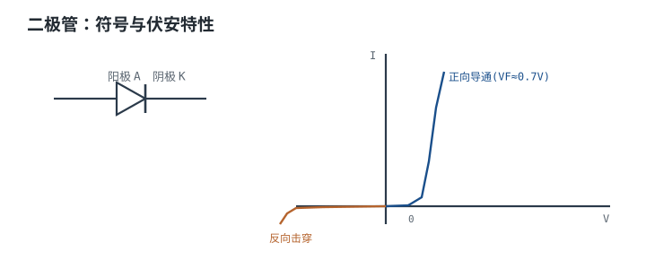
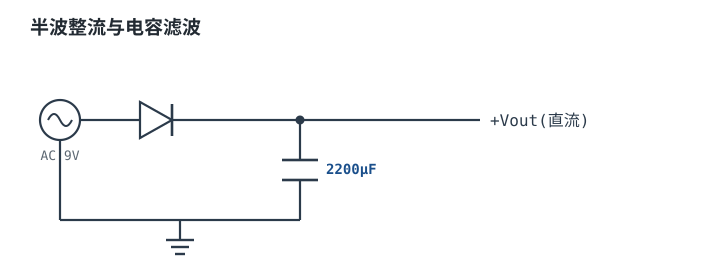
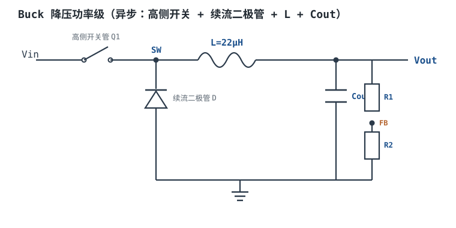

# 二极管：整流、快恢复、肖特基 Diode

二极管（Diode）是最简单的半导体器件，也是被低估得最厉害的器件。它只有一个 PN 结，教科书上用一句"单向导电"就讲完了；但真实电路里，决定电源效率、温升、EMI 和可靠性的，恰恰是这句话之外的三件事：**正向压降随电流和温度怎么变、反向漏电随温度怎么涨、从导通切换到截止要多久**。前两件决定直流损耗，第三件决定高频损耗。

这一章的主线是：先用 PN 结和伏安特性建立直觉，再把八类二极管放进同一张参数谱系；然后逐项拆开 $V_F$、$I_R$、$C_j$、$t_{rr}$、$Q_{rr}$、$I_{FSM}$、$R_{\theta}$ 的定量关系；最后用一个 500 kHz、24V 转 5V/3A 的 Buck 续流二极管选型，把反向电压、平均电流、峰值电流、反向恢复损耗、结温一路算到"要不要换同步整流"。齐纳、TVS 与 LED 的特殊工作区在[稳压管、LED 与 TVS/ESD 保护管](zener-led-tvs.md)里展开；电感关断时为什么需要续流，见[电感原理与 RL 暂态](../basics/inductor-rl.md)；整流滤波后变压器为什么按 VA 而不是 W 选，见[变压器原理](../basics/transformer.md)。

## 1. 设计动机

::: motivation 三个真实场景
**场景一：500 kHz 的 Buck 用了一只工频整流管。** 24V 转 5V/3A、开关频率 500 kHz，开关周期只有 2 µs。手边只有 1N400x 这类通用整流管，看它标称 1A、1000V，觉得"余量很大"。但这类管子的反向恢复时间 $t_{rr}$ 在微秒量级，二极管在开关管下一次开通时还没有恢复阻断，反向电流直接贯穿开关管。结果是效率低、开关管发热、示波器上全是振铃。

**场景二：两路 5V 电源做 OR-ing。** 每路 3A，各串一只肖特基二极管防止倒灌。肖特基 $V_F$ 取 0.4V，每只二极管耗 $0.4\times3=1.2$ W，输出只剩 4.6V。两路加起来 2.4W 的"防倒灌税"，在 15W 的输出上就是 16% 的损耗。换成理想二极管控制器加 10 mΩ MOSFET，损耗降到 $3^2\times0.01=0.09$ W。

**场景三：12V 继电器线圈不接续流二极管。** 线圈 0.5H、100mA，驱动管关断时电流被迫归零，$V=L\,\Delta I/\Delta t$ 会在漏极打出几千伏。用 100 pF 寄生电容估算峰值是 $0.1\times\sqrt{0.5/100\times10^{-12}}=7071$ V，40V/60V 的管子每次关断都在雪崩。续流二极管把线圈电压钳在约 $-V_F$，开关管只承受 $12+0.7=12.7$ V。
:::

| 你遇到的问题 | 先算 | 判据 |
|---|---|---|
| 整流管发热、效率低 | $P_D=V_0I_{avg}+R_sI_{rms}^2$ | 结温低于降额后的 $T_{j,max}$ |
| 高频续流管发烫、开关管振铃 | $P_{rr}\approx Q_{rr}V_Rf_{sw}$ | $Q_{rr}$ 在可接受范围，或改用肖特基/SiC |
| 上电瞬间二极管炸裂 | $I^2t$ 与 $I_{FSM}$ | 浪涌能量低于数据手册的 $I^2t$ |
| 肖特基高温下越用越热 | $I_R(T)$ 与热阻自洽求解 | 漏电损耗不随温度正反馈失控 |
| 防反接/OR-ing 吃掉电压 | $V_F I$ 与允许压降 | 低压系统改用理想二极管 |

**不算会摔在哪**，三个带数字的代价：

1. **把 $t_{rr}$ 当成"零"。** 设某只微秒级恢复的整流管在 3A、$dI/dt=100$ A/µs 下 $Q_{rr}=1$ µC，工作频率 500 kHz、反向电压 24V，仅反向恢复一项的损耗上界就是 $P_{rr}=Q_{rr}V_Rf=1\times10^{-6}\times24\times5\times10^{5}=12$ W。这个数已经超过 24V/5A 电源本身能承受的耗散，说明这只管子根本不能用在 500 kHz。
2. **用 25°C 的 $V_F$ 算低温损耗。** 硅二极管 $V_F$ 的温度系数约 $-2$ mV/°C。从 25°C 降到 $-40$°C，$V_F$ 升高 $2\times65=130$ mV；10A 下多耗 $0.13\times10=1.3$ W。冷机启动时二极管反而更热，这是很多人没算过的工况。
3. **忽略肖特基的反向漏电。** 设某只 60V 肖特基在 125°C、48V 反压下的漏电为 20 mA，阻断占空比 0.5，则反向损耗 $P_R=48\times0.02\times0.5=0.48$ W；而 $R_{\theta ja}=50$°C/W 时的热失控临界功率只有 $10/(50\ln2)=0.289$ W。漏电产生的热已经超过散热能力，结温会自己往上爬，直到失效。

## 2. 定义与直观

### 2.1 一句话定义：PN 结的单向导电

**二极管**是两个端子（阳极 Anode、阴极 Cathode）的半导体器件，正向偏置时导通、反向偏置时近似阻断。它的物理核心是一个 PN 结：P 区多空穴、N 区多电子，交界处形成耗尽层和内建电场。加正向电压时耗尽层变窄、势垒降低，载流子大量越过结；加反向电压时耗尽层变宽、势垒升高，只剩很小的漏电流。

正向伏安特性用肖克利方程描述：

$$
I=I_S\left(e^{\frac{V}{nV_T}}-1\right),\qquad V_T=\frac{kT}{q}
$$

其中 $I$ 是正向电流（A）；$V$ 是结电压（V）；$I_S$ 是反向饱和电流（A，强烈依赖温度和工艺）；$n$ 是理想因子（无量纲，硅二极管典型 1~2）；$V_T$ 是热电压（V）；$k=1.380649\times10^{-23}$ J/K 是玻尔兹曼常数；$T$ 是绝对温度（K）；$q=1.602177\times10^{-19}$ C 是电子电荷。

在 $T=300$ K 时：

$$
V_T=\frac{1.380649\times10^{-23}\times300}{1.602177\times10^{-19}}=2.585\times10^{-2}\ \text{V}=25.85\ \text{mV}
$$

由此得到一个能口算的结论：室温下电流每增加 10 倍，$V_F$ 增加

$$
nV_T\ln10=1\times25.85\times2.303=59.5\ \text{mV}
$$

约 60 mV。所以"0.6V 开始导通"不是一条硬门槛，而是一条指数曲线：1 µA 时可能只有 0.4V，1A 时约 0.7~0.9V，10A 时到 1V 以上。**数据手册给 $V_F$ 时必须同时给测试电流和温度**，否则这个数没有意义。



### 2.2 符号、伏安特性与三个工作区

二极管的符号是三角形顶一根竖线，三角形指向阴极，箭头方向就是正向电流方向。伏安特性分三个区：

- **正向区**：$V>0$，电流指数上升。工程上用"膝点电压 + 斜率电阻"近似，见 3.1 节。
- **反向阻断区**：$V<0$ 但未击穿，只有漏电流 $I_R$，典型 nA~µA（肖特基可到 mA）。这个区是二极管"关断"的状态。
- **反向击穿区**：反向电压超过 $V_{RRM}$ 后电流急剧上升。普通二极管在这里会过热损坏；齐纳和 TVS 是**故意**工作在这个区，用击穿电压做基准或钳位，见[稳压管、LED 与 TVS/ESD 保护管](zener-led-tvs.md)。

```echarts
{
  "animation": false,
  "tooltip": {"trigger": "axis"},
  "legend": {"data": ["硅 PN 结", "肖特基"], "bottom": 0, "textStyle": {"fontSize": 12}},
  "grid": {"left": 66, "right": 26, "top": 28, "bottom": 58},
  "xAxis": {"type": "value", "name": "V_F / V", "nameLocation": "middle", "nameGap": 30,
            "min": 0, "max": 1.2, "interval": 0.2, "axisLabel": {"fontSize": 11}},
  "yAxis": {"type": "value", "name": "I_F / A（对数）", "nameLocation": "middle", "nameGap": 46,
            "type": "log", "min": 0.01, "max": 20, "axisLabel": {"fontSize": 11}},
  "series": [
    {"name": "硅 PN 结", "type": "line", "showSymbol": false,
     "lineStyle": {"width": 2.6, "color": "#1a4f8b"},
     "data": [[0.40, 0.01], [0.48, 0.03], [0.55, 0.1], [0.62, 0.3], [0.70, 1.0], [0.78, 3.0], [0.86, 10.0], [0.92, 20.0]]},
    {"name": "肖特基", "type": "line", "showSymbol": false,
     "lineStyle": {"width": 2.4, "color": "#b5642e", "type": "dashed"},
     "data": [[0.20, 0.01], [0.25, 0.03], [0.30, 0.1], [0.35, 0.3], [0.40, 1.0], [0.46, 3.0], [0.53, 10.0], [0.58, 20.0]]}
  ]
}
```

上图是按典型器件形状画的示意曲线，不是实测数据：低电流段弯曲、高电流段接近直线（由斜率电阻 $R_s$ 决定）；同电流下肖特基比硅管低约 0.2~0.3V。具体形状以数据手册曲线为准。

### 2.3 类型谱系：从工频整流到 SiC

同样是二极管，八类器件的参数取舍完全不同。下表是工程选型的第一张地图（全部为典型量级，具体以所选型号的数据手册为准）：

| 类型 | $V_F$（额定电流附近） | 反向恢复 | 耐压范围 | 反向漏电（25°C） | 主要场景 |
|---|---|---|---|---|---|
| 通用整流（1N400x 类） | 0.9~1.1V | $t_{rr}$ 2~30 µs | 50~1000V | ≤5 µA | 50/60Hz 整流、便宜、耐浪涌 |
| 快恢复（FR） | 1.0~1.5V | $t_{rr}$ 150~500 ns | 200~1200V | ≤10 µA | 开关电源输出整流、缓冲 |
| 超快恢复（UF） | 1.2~1.8V | $t_{rr}$ 15~50 ns | 200~600V | ≤10 µA | 高频整流、PFC |
| 肖特基（Schottky） | 0.35~0.6V | 无少数载流子恢复，只有 $Q_c$ | 15~150V | 0.01~10 mA，随温度暴涨 | 低压大电流整流、续流、OR-ing |
| SiC 肖特基 | 1.2~1.8V | 无少数载流子恢复，$Q_c$ 数 nC | 650~1700V | ≤100 µA | PFC、高压高频、高温 |
| 齐纳（Zener） | 反向击穿 2.4~200V | 不适用 | — | 击穿区工作 | 电压基准、钳位、限流稳压 |
| TVS | 钳位电压 $V_C$ | 响应 ns 级 | 5~数百 V | 击穿前 µA 级 | ESD、浪涌、感性负载钳位 |
| LED | 1.8~3.5V（按颜色） | 不适用 | 反向 5V 左右 | — | 指示、照明、光耦 |

每一类的取舍逻辑：

- **通用整流管**用厚漂移区换高耐压，用长载流子寿命换便宜和耐浪涌，代价是 $t_{rr}$ 慢、$V_F$ 高。它适合 50/60Hz，不适合几十 kHz 以上。
- **快恢复/超快恢复**用金掺杂或电子辐照缩短载流子寿命，把 $t_{rr}$ 压到几百或几十 ns，代价是 $V_F$ 升高、软恢复特性变差。它是硅二极管在 100V 以上高频场合的主力。
- **肖特基**用金属-半导体结代替 PN 结，没有少数载流子存储，所以几乎没有反向恢复；同时势垒低，$V_F$ 只有 0.35~0.6V。代价是耐压难做高（一般 ≤150V）、反向漏电大且随温度指数上升、抗浪涌能力弱。
- **SiC 肖特基**把肖特基结做到 650V 以上，保持无反向恢复和高温能力，代价是 $V_F$ 高（1.2~1.8V）、成本高。它在高压高频下用"更高的导通损耗"换"几乎为零的开关损耗"。
- **齐纳/TVS/LED** 是"故意工作在特殊区"的二极管：齐纳在反向击穿区做基准，TVS 在击穿区吸收浪涌，LED 在正向注入时发光。它们的设计逻辑与整流管不同，分别见[稳压管、LED 与 TVS/ESD 保护管](zener-led-tvs.md)。

### 2.4 为什么肖特基没有反向恢复，而硅管有

PN 结导通时，N 区注入大量空穴、P 区注入大量电子，这些**少数载流子**在结附近存储起来。要让二极管从导通转为阻断，必须先把这些存储电荷抽走或复合掉，这段时间就是**反向恢复时间** $t_{rr}$，抽走的电荷就是**反向恢复电荷** $Q_{rr}$。

用三角形近似描述反向恢复电流波形：反向电流从 0 升到峰值 $I_{rr}$，再回到 0，整个过程持续 $t_{rr}$，则

$$
Q_{rr}\approx\frac{1}{2}I_{rr}t_{rr}\quad\Longrightarrow\quad t_{rr}\approx\frac{2Q_{rr}}{I_{rr}}
$$

其中 $Q_{rr}$ 单位 C，$I_{rr}$ 单位 A，$t_{rr}$ 单位 s。这个式子说明：**同样的存储电荷，反向电流越大，恢复时间越短**；反之，轻载时反向电流小，$t_{rr}$ 反而更长。所以数据手册的 $t_{rr}$ 必须连同测试条件（正向电流、$dI/dt$、反向电压、温度）一起看。

肖特基是金属-半导体结，正向电流以多数载流子为主，没有少数载流子存储，因此没有"抽走存储电荷"的过程，$t_{rr}$ 可以认为接近零。但它仍有结电容，开关时要把电容电荷 $Q_c$ 充放掉；这个电荷通常比同电流硅管的 $Q_{rr}$ 小一个数量级以上，但在高频下仍要算进损耗（3.3 节）。SiC 肖特基同理：没有少数载流子恢复，只有电容电荷。

### 2.5 类比：单向阀、开启压力与反向漏水

::: analogy 二极管像一只带弹簧的单向阀
- **正向压降 $V_F$** = 顶开阀门需要的压力。硅管约 0.6~0.8V，肖特基约 0.3~0.5V；压力不够，阀门只漏一点点。
- **反向阻断** = 阀门关死。但真实阀门有缝隙，对应反向漏电 $I_R$；温度越高，缝隙越大。
- **反向耐压 $V_{RRM}$** = 阀门能承受的最大背压，超过就爆裂（击穿）。
- **反向恢复 $t_{rr}$** = 阀门从全开回到全关需要的时间。硅管的阀芯有惯性（存储电荷），肖特基的阀芯很轻（多数载流子）。
- **齐纳/TVS** = 故意设计的"爆破片"：压力到某个值就主动泄放，用来保护后面的管路。

类比的边界：阀门不会因为温度升高而漏得更厉害，也不会在关断瞬间把下游的电流"倒吸"回去；二极管的漏电随温度指数上升，反向恢复会把开关管的电流路径短暂短路。这些是半导体特有的，不能只用阀门直觉。
:::

## 3. 定量关系

### 3.1 正向压降：$V_F$ 随电流与温度

工程上最常用的正向模型是**分段线性模型**：

$$
V_F(I)=V_0+R_sI
$$

其中 $V_F$ 是正向压降（V）；$V_0$ 是"膝点电压"（V，硅管 0.6~0.8V，肖特基 0.25~0.4V）；$R_s$ 是斜率电阻（$\Omega$，由漂移区电阻、引线电阻和封装电阻组成）；$I$ 是正向电流（A）。这个模型在 $I$ 大于额定电流的 5%~10% 时够用，太小或太大都会偏。

从数据手册的两个点可以反解 $V_0$ 和 $R_s$。设某硅整流管在 1A 时 $V_F=0.90$ V、10A 时 $V_F=1.30$ V：

$$
R_s=\frac{1.30-0.90}{10-1}=0.0444\ \Omega,\qquad V_0=0.90-0.0444\times1=0.8556\ \text{V}
$$

用它预测 3A 和 20A：

$$
V_F(3)=0.8556+0.0444\times3=0.989\ \text{V},\qquad V_F(20)=0.8556+0.0444\times20=1.744\ \text{V}
$$

3A 时约 0.99V，20A 时约 1.74V。**这就是为什么不能用"0.7V"算所有电流下的损耗**：20A 时误差超过 1V。

温度对 $V_F$ 有两个方向相反的作用：

1. **结电压随温度下降**：恒定电流下，硅 PN 结的 $V_F$ 温度系数约 $-2$ mV/°C（典型量级，具体随电流密度变化）。温度升高，$I_S$ 指数增大，同样的电流只需要更低的电压。
2. **斜率电阻随温度上升**：晶格散射增强，迁移率下降，$R_s$ 大约每升高 1°C 增加 0.3%。大电流下这一项会抵消一部分结电压的下降。

把两项写在一起：

$$
V_F(T)=V_0(25)+TC\,(T-25)+R_s(25)\left[1+\alpha_R(T-25)\right]I
$$

其中 $TC\approx-2$ mV/°C 是结电压温度系数；$\alpha_R\approx+0.3\%/^\circ\text{C}$ 是斜率电阻温度系数；$T$ 是结温（°C）。用上面的 $V_0=0.8556$ V、$R_s=0.0444\ \Omega$、$I=5$ A 算三个温度：

| 结温 | $V_0$（V） | $R_s$（$\Omega$） | $V_F$ @5A（V） |
|---|---|---|---|
| −40°C | $0.8556+0.13=0.9856$ | $0.0444\times0.805=0.0358$ | $0.9856+0.0358\times5=1.164$ |
| 25°C | 0.8556 | 0.0444 | $0.8556+0.0444\times5=1.078$ |
| 125°C | $0.8556-0.20=0.6556$ | $0.0444\times1.30=0.0578$ | $0.6556+0.0578\times5=0.944$ |

净温度系数是 $(0.944-1.078)/100=-1.34$ mV/°C，比结电压的 $-2$ mV/°C 小，因为 $R_s$ 的上升吃掉了一部分。**低温下 $V_F$ 更高，这是冷启动损耗被低估的根源。**

导通损耗要用两个不同的电流口径：

$$
P_D=V_0I_{D,avg}+R_sI_{D,rms}^2
$$

其中 $I_{D,avg}$ 是正向平均电流（A），$I_{D,rms}$ 是正向有效值电流（A）。为什么第一项用平均值、第二项用有效值？因为 $V_0$ 是一个近似恒定的电压源，它的功率是 $V_0\times$（电荷/时间）$=V_0I_{avg}$；而 $R_s$ 是电阻，功率永远是 $I^2R$ 的时间平均，必须用有效值。把两项都写成 $V_F I_{avg}$ 会在电流波形有尖峰时低估损耗。

### 3.2 反向漏电：每升 10°C 约翻一倍

反向漏电来自耗尽区里的少子产生和表面漏电，对温度极其敏感。低温段可以用一条经验规则估算：

$$
I_R(T)=I_R(25)\cdot2^{\frac{T-25}{10}}
$$

其中 $I_R(25)$ 是 25°C 的漏电（A）；$T$ 是结温（°C）。每升 10°C 翻一倍，等价于约 $+7.2\%/^\circ\text{C}$ 的指数增长（$2^{0.1}=1.072$）。以 $I_R(25)=0.1$ mA 为例：

| 结温 | 倍数 $2^{(T-25)/10}$ | $I_R$ |
|---|---|---|
| 25°C | 1 | 0.1 mA |
| 85°C | $2^6=64$ | 6.4 mA |
| 105°C | $2^8=256$ | 25.6 mA |
| 125°C | $2^{10}=1024$ | 102 mA |

**这条规则在高温段会高估。** 实际器件的倍增率随温度下降，数据手册通常直接给 25°C 和 125°C 两个漏电值，后者往往只有外推值的 1/5~1/10。所以正确做法是：低温段用翻倍规则做灵敏度分析，高温段直接用数据手册的 $I_R(T_j)$ 曲线。

反向损耗是漏电乘以反压，再乘以阻断占空比：

$$
P_R=V_RI_RD_{block}
$$

其中 $V_R$ 是反向电压（V）；$D_{block}$ 是二极管承受反压的时间占空比（无量纲）。以 $V_R=36$ V、$I_R=3$ mA、$D_{block}=0.139$ 为例：

$$
P_R=36\times3\times10^{-3}\times0.139=0.015\ \text{W}
$$

15 mW，相对于 1W 级的导通损耗可以忽略。但如果换成 48V、20 mA、占空比 0.5 的高漏电管子：

$$
P_R=48\times0.02\times0.5=0.48\ \text{W}
$$

这就不再是小量了。更麻烦的是它会形成正反馈：漏电产生热 → 结温升高 → 漏电更大。把热路方程和漏电方程联立：

$$
T_j=T_a+R_{\theta}P_R(T_j),\qquad P_R(T_j)=V_RD_{block}I_R(25)2^{(T_j-25)/10}
$$

对 $T_j$ 求导，热平衡稳定的条件是 $\frac{dP_R}{dT_j}R_{\theta}<1$。代入指数式：

$$
\frac{P_R\ln2}{10}R_{\theta}<1\quad\Longrightarrow\quad P_R<\frac{10}{R_{\theta}\ln2}
$$

其中 $R_{\theta}$ 是结到环境的热阻（°C/W）。以 $R_{\theta}=50$°C/W 为例，临界功率：

$$
P_{crit}=\frac{10}{50\times0.693}=0.289\ \text{W}
$$

前面的 0.48W 已经超过 0.289W，所以这个工作点没有稳定解：结温会一直上升，直到器件损坏。**肖特基在高压、高温、大反压下工作时，必须做这个自洽核算，不能只看 25°C 的漏电。**

### 3.3 结电容与电荷

二极管的结电容随反向电压变化，近似为

$$
C_j(V_R)=\frac{C_{j0}}{\left(1+V_R/V_{bi}\right)^m}
$$

其中 $C_{j0}$ 是零偏结电容（F）；$V_{bi}$ 是内建电势（V，硅约 0.6~0.8V）；$m$ 是结型指数（无量纲，突变结约 0.5，线性缓变结约 0.33）；$V_R$ 是反向电压（V）。以 $C_{j0}=500$ pF、$V_{bi}=0.65$ V、$m=0.42$ 为例：

| 反向电压 | $C_j$ |
|---|---|
| 0V | 500 pF |
| 5V | $500/(1+7.69)^{0.42}=202$ pF |
| 24V | $500/(1+36.9)^{0.42}=109$ pF |
| 36V | $500/(1+55.4)^{0.42}=91.9$ pF |

电容充电要能量，放电时这部分能量通常耗散在开关或二极管里。每个周期耗散的能量是 $\frac12C_jV_R^2$，功率：

$$
P_{Cj}=\frac{1}{2}C_jV_R^2f_{sw}
$$

以 36V、91.9 pF、500 kHz 为例：

$$
P_{Cj}=0.5\times91.9\times10^{-12}\times36^2\times5\times10^5=0.0298\ \text{W}
$$

约 30 mW。更准确的做法是用数据手册的**总电容电荷 $Q_c$**（把非线性电容从 0 积分到 $V_R$ 的电荷）：

$$
P_{Qc}=\frac{1}{2}Q_cV_Rf_{sw}
$$

$Q_c=5$ nC、36V、500 kHz 时：

$$
P_{Qc}=0.5\times5\times10^{-9}\times36\times5\times10^5=0.045\ \text{W}
$$

45 mW，与电容模型的 30 mW 同量级。用上面的 $C_j$ 模型积分到 36V，得到 $Q_c=5.25$ nC，正好落在 5 nC 附近，说明两个口径是自洽的。**高频下肖特基的"零反向恢复"不等于零损耗，$Q_c$ 这一项要算。**

### 3.4 反向恢复 $t_{rr}$、$Q_{rr}$ 与损耗

反向恢复过程分两段：**存储时间 $t_s$**（抽走存储电荷，反向电流上升到峰值 $I_{rr}$）和**下降时间 $t_f$**（电荷抽完，反向电流回到零）。两者之和是 $t_{rr}=t_s+t_f$。数据手册给出的 $Q_{rr}$ 是整个过程的反向电荷积分。

工程上最常用的损耗上界估算：

$$
P_{rr}\approx Q_{rr}V_Rf_{sw}
$$

其中 $Q_{rr}$ 单位 C；$V_R$ 是恢复后承受的反向电压（V）；$f_{sw}$ 是开关频率（Hz）。这个式子的物理含义是：每个周期把 $Q_{rr}$ 的电荷在近似恒定的反压 $V_R$ 下抽走，消耗能量 $Q_{rr}V_R$。实际电压在恢复过程中是逐渐建立的，所以这是上界，真实值通常是它的 0.6~0.9 倍。

以 $Q_{rr}=25$ nC、$V_R=36$ V、$f_{sw}=500$ kHz 为例：

$$
P_{rr}=25\times10^{-9}\times36\times5\times10^5=0.45\ \text{W}
$$

对应的平均反向电流是 $I_{rr,avg}=Q_{rr}f_{sw}=25\times10^{-9}\times5\times10^5=12.5$ mA。这个电流在每个周期都会流过开关管，是开关管开通损耗和 EMI 的一部分。

用三角形近似还能从 $Q_{rr}$ 反推 $t_{rr}$。设 $I_{rr}=1$ A：

$$
t_{rr}\approx\frac{2Q_{rr}}{I_{rr}}=\frac{2\times25\times10^{-9}}{1}=50\ \text{ns}
$$

**$Q_{rr}$ 和 $t_{rr}$ 不能单独看。** 同样的 $Q_{rr}$，$I_{rr}$ 越大，$t_{rr}$ 越短，但电流尖峰越高、EMI 越差；$I_{rr}$ 越小，$t_{rr}$ 越长，反向电流持续的时间越久。数据手册的 $t_{rr}$ 是在特定 $I_F$、$dI/dt$、$V_R$、$T_j$ 下测的，换工况必须重新查曲线或实测。

三类器件的恢复特性对比：

| 器件 | 恢复机制 | 典型电荷 | 损耗口径 |
|---|---|---|---|
| 硅 PN 结（快恢复/超快恢复） | 少数载流子存储 | $Q_{rr}$ 10 nC~数 µC | $P_{rr}\approx Q_{rr}V_Rf$ |
| 肖特基 | 只有结电容 | $Q_c$ 1~20 nC | $P\approx\frac12Q_cV_Rf$ |
| SiC 肖特基 | 只有结电容 | $Q_c$ 5~30 nC | $P\approx\frac12Q_cV_Rf$ |

### 3.5 浪涌电流 $I_{FSM}$ 与 $I^2t$

数据手册的 $I_{FSM}$ 是**单次半正弦浪涌电流峰值**，测试脉宽通常是 8.3 ms（60Hz 半周）或 10 ms（50Hz 半周）。它描述的是"上电给大电容充电"这类短时大电流，不是连续电流。

把半正弦的 $I^2t$ 算出来：

$$
I^2t=\frac{I_{FSM}^2t_p}{2}
$$

其中 $I_{FSM}$ 是浪涌峰值（A）；$t_p$ 是脉宽（s）。以 1N4007 的 $I_{FSM}=30$ A、$t_p=8.3$ ms 为例（数值以数据手册为准）：

$$
I^2t=\frac{30^2\times8.3\times10^{-3}}{2}=3.735\ \text{A}^2\text{s}
$$

如果实际浪涌不是 8.3 ms，而是更短的 1 ms，按 $I^2t$ 守恒可以估算允许峰值：

$$
I_{pk}(1\ \text{ms})=I_{FSM}\sqrt{\frac{8.3\ \text{ms}}{1\ \text{ms}}}=30\times2.88=86.4\ \text{A}
$$

**所以"峰值超过 $I_{FSM}$ 就一定坏"是不对的，要看脉宽和 $I^2t$；反过来，峰值没超但持续时间很长，也可能超 $I^2t$。** 这两个口径要一起用。

### 3.6 热阻、结温与散热

二极管的热路和电阻分压长得一样：

$$
T_j=T_a+P_DR_{\theta ja},\qquad R_{\theta ja}=R_{\theta jc}+R_{\theta cs}+R_{\theta sa}
$$

其中 $T_j$ 是结温（°C）；$T_a$ 是环境温度（°C）；$P_D$ 是总损耗（W）；$R_{\theta ja}$ 是结到环境热阻（°C/W）；$R_{\theta jc}$ 是结到壳热阻；$R_{\theta cs}$ 是壳到散热器热阻；$R_{\theta sa}$ 是散热器到环境热阻。没有散热器时，$R_{\theta ja}$ 直接由封装和 PCB 铜箔决定。

以 DO-41 封装的整流管为例，自然对流下 $R_{\theta ja}$ 约 80°C/W（典型量级，以数据手册为准）。若 $P_D=0.423$ W、$T_a=40$°C：

$$
T_j=40+0.423\times80=73.9^\circ\text{C}
$$

离 150°C 的结温上限还很远。同样的损耗放在 SMC 封装（$R_{\theta ja}$ 约 45°C/W）里，结温只有 $40+0.423\times45=59.0$°C。**封装的热阻常常比器件本身的 $V_F$ 更决定温升**，选型时不能只看电气参数。

浪涌是瞬态，应该用**瞬态热阻抗 $Z_{\theta}(t)$** 而不是稳态 $R_{\theta ja}$。数据手册的 $Z_{\theta}$ 曲线给出不同脉宽下的等效热阻；一个 8.3 ms 的浪涌，$Z_{\theta}$ 通常只有稳态值的几十分之一，所以 $I_{FSM}$ 才能比连续电流大一个数量级以上。

### 3.7 适用条件与失效边界

- **分段线性模型只在中等电流下准。** 低于额定电流 5% 时，指数段占主导，$V_0+R_sI$ 会高估 $V_F$；高于额定电流时，$R_s$ 本身随温度上升，模型会低估损耗。
- **$t_{rr}$ 和 $Q_{rr}$ 是条件量。** 同一只管子，$I_F$ 越大、$dI/dt$ 越大、$T_j$ 越高，$Q_{rr}$ 通常越大。拿 25°C、小电流的 $t_{rr}$ 去算 100°C、满载的损耗，会偏乐观。
- **漏电翻倍规则只是低温段粗估。** 高温段必须用数据手册的 $I_R(T)$ 曲线；肖特基尤其如此，外推值可能高估 10 倍，也可能因为热失控而实际更糟。
- **$R_{\theta ja}$ 依赖 PCB。** 数据手册的 $R_{\theta ja}$ 通常标注测试板条件（铜箔面积、层数、焊盘）；实际板子铜箔少，热阻可能是标称值的 1.5~2 倍。
- **反向击穿不是"钳位"。** 普通整流管进入击穿区会过流损坏；只有齐纳和 TVS 是设计来承受击穿的，而且要在规定的功率和脉冲条件下。
- **二极管不能随便并联。** 硅二极管的 $V_F$ 有负温度系数：温度高的管子 $V_F$ 更低，会分到更多电流，更热，形成正反馈。并联整流管要加均流电阻、选正温度系数的器件，或者干脆用一只更大的管子。肖特基的 $V_F$ 温度系数较小，但也需要核对。

## 4. 典型计算

### 4.1 算例一：整流滤波二极管的损耗、温升与浪涌

**需求**：12V/1A 直流输出，变压器次级 12V 有效值，桥式整流，每只二极管压降按 0.8V，滤波电容 4700 µF，50Hz。求每只二极管的平均电流、有效值电流、损耗、结温，并核对上电浪涌。



**第一步，电流口径。** 桥式整流每只二极管每半周导通一次，[变压器原理](../basics/transformer.md)已经算过：直流 1A 时，每只二极管平均电流 $I_{D,avg}=0.5$ A、有效值 $I_{D,rms}=1.081$ A，次级有效值 1.529 A。这里不再重复导通角推导，直接用这三个结果。

**第二步，损耗。** 取 $V_0=0.8$ V、$R_s=0.02\ \Omega$（示例量级，以所选型号为准）：

$$
P_D=0.8\times0.5+0.02\times1.081^2=0.400+0.0234=0.423\ \text{W}
$$

**第三步，结温。** DO-41 封装 $R_{\theta ja}=80$°C/W、环境 40°C：

$$
T_j=40+0.423\times80=73.9^\circ\text{C}
$$

低于 150°C 上限，也低于 125°C 的降额线，可用。

**第四步，上电浪涌。** 4700 µF 从 0 充到整流峰值 15.37V。设变压器次级绕组、线路和二极管动态电阻合计 $R=0.6\ \Omega$（示例假设），则初始峰值电流

$$
I_{pk}=\frac{15.37}{0.6}=25.6\ \text{A}
$$

充电时间常数

$$
\tau=RC=0.6\times4700\times10^{-6}=2.82\ \text{ms}
$$

浪涌的 $I^2t$（指数衰减电流的平方积分）：

$$
I^2t=\frac{1}{2}I_{pk}^2\tau=0.5\times25.6^2\times2.82\times10^{-3}=0.925\ \text{A}^2\text{s}
$$

与 1N4007 的 3.735 A²s 相比只用了 25%，所以这次上电浪涌是安全的。但注意：如果电容加到 10000 µF，时间常数翻倍，$I^2t$ 会按比例增加到约 1.85 A²s，余量只剩一半；如果变压器内阻更小，峰值电流会更高，必须先算 $I^2t$ 再选管。

**第五步，结论。** 每只二极管 0.42W、结温 74°C，1N4007 级别足够；浪涌按 $I^2t$ 核对，不要只看 $I_{FSM}$ 的 30A。

### 4.2 算例二：OR-ing 与防反接的压降代价

**需求**：两路 5V/3A 电源做 OR-ing，要求一路失效时另一路接管，且不能倒灌。比较肖特基二极管方案和理想二极管 MOSFET 方案。

**肖特基方案**：取 $V_F=0.4$ V，每只二极管在 3A 下的损耗

$$
P_D=V_FI=0.4\times3=1.2\ \text{W}
$$

输出电压 $5-0.4=4.6$ V，OR-ing 级的效率

$$
\eta=\frac{4.6\times3}{5\times3}=\frac{13.8}{15}=92.0\%
$$

两路各一只，总损耗 2.4W。

**理想二极管方案**：用 P-MOSFET 或带电荷泵的 N-MOSFET 控制器，导通电阻取 10 mΩ：

$$
P=I^2R_{DS(on)}=3^2\times0.01=0.09\ \text{W}
$$

输出压降 $3\times0.01=0.03$ V，输出电压 4.97V，OR-ing 级效率 99.4%。代价是需要控制器、外部电容和更复杂的布局，而且 MOSFET 的体二极管在控制器未上电时仍会导通，要做好启动时序。

**防反接的同类计算**：5V/2A 负载串一只肖特基，$V_F=0.4$ V，损耗 $0.4\times2=0.8$ W，输出 4.6V；串硅管 0.7V 则损耗 1.4W、输出 4.3V。低压大电流场合，这个压降往往比器件成本更贵，所以要用 [MOSFET](mosfet.md) 做理想二极管。

### 4.3 算例三：稳压管限流

**需求**：12V 输入、5.1V 稳压、负载电流 0~20 mA，齐纳最小工作电流取 5 mA。求限流电阻和功耗。

**第一步，电阻。** 最大负载时流过电阻的电流是 $20+5=25$ mA：

$$
R=\frac{12-5.1}{25\times10^{-3}}=\frac{6.9}{0.025}=276\ \Omega
$$

取标准值 270 Ω，实际电流

$$
I=\frac{6.9}{270}=25.6\ \text{mA}
$$

**第二步，功耗。** 电阻：

$$
P_R=\frac{(12-5.1)^2}{270}=\frac{47.61}{270}=0.176\ \text{W}
$$

选 0.25W 电阻，降额到 70% 以内。齐纳在空载时承受全部 25.6 mA：

$$
P_Z=5.1\times0.0256=0.131\ \text{W}
$$

选 0.5W 齐纳，余量约 3.8 倍；满载时齐纳电流只有 5.6 mA，功耗 28.6 mW。**最坏情况是空载或输入电压最高时**，不是满载。

**第三步，稳压精度。** 齐纳的动态电阻 $r_z$ 取 10 Ω（示例量级，以数据手册为准），负载从 0 到 20 mA 时齐纳电流变化 20 mA：

$$
\Delta V_Z=r_z\Delta I_Z=10\times0.02=0.2\ \text{V}
$$

输出空载时约 5.3V、满载时约 5.1V（5.1V 是 5mA 测试电流下的标称值，电流越大 $V_Z$ 略高）。要更稳，用 TL431 或 LDO；齐纳只适合对精度要求不高的场合。齐纳的击穿机理、温度系数和 TVS 的浪涌算法见[稳压管、LED 与 TVS/ESD 保护管](zener-led-tvs.md)。

### 4.4 完整设计：500 kHz Buck 的续流二极管

**需求与假设**：

| 项目 | 要求/假设 |
|---|---|
| 输入 | 24V 标称，范围 18~36V |
| 输出 | 5V/3A（15W） |
| 开关频率 | 500 kHz |
| 拓扑 | 异步 Buck，高边开关 + 续流二极管 + 电感 + 输出电容 |
| 环境 | 50°C，最高 70°C |
| 二极管 | 60V 肖特基，SMC 封装，$R_{\theta ja}=45$°C/W（示例，以数据手册为准） |
| 正向模型 | $V_0=0.35$ V，$R_s=0.03\ \Omega$（示例量级） |
| 结电容电荷 | $Q_c=5$ nC @36V（示例量级） |
| 反向漏电 | 105°C 时约 3 mA（示例量级） |
| 结温上限 | 降额后 125°C |



**第 1 步：占空比与电感电流。** 忽略二极管压降：

$$
D=\frac{V_{out}}{V_{in}}=\frac{5}{24}=0.2083
$$

取纹波为输出电流的 30%，即 $\Delta I=0.9$ A，所需电感

$$
L=\frac{(V_{in}-V_{out})D}{\Delta If_{sw}}=\frac{(24-5)\times0.2083}{0.9\times5\times10^5}=8.80\ \mu\text{H}
$$

取标准值 10 µH，实际纹波

$$
\Delta I=\frac{(24-5)\times0.2083}{10\times10^{-6}\times5\times10^5}=0.792\ \text{A}
$$

峰值电流 $3+0.396=3.396$ A，谷值 $3-0.396=2.604$ A。

**第 2 步：反向电压与降额。** 高边开关导通时，二极管承受约 $V_{in}$。最坏输入 36V，按 80% 降额，需要

$$
V_{RRM}\geq\frac{36}{0.8}=45\ \text{V}
$$

选 60V 肖特基，实际占用 $36/60=60\%$，满足降额。

**第 3 步：电流口径。** 二极管在关断期间导通，占空比 $1-D=0.7917$：

$$
I_{D,avg}=I_{out}(1-D)=3\times0.7917=2.375\ \text{A}
$$

有效值要把纹波算进去。关断期间电流在 3.396A 和 2.604A 之间线性下降，其有效值平方为 $I_{out}^2+\Delta I^2/12$，再按占空比加权：

$$
I_{D,rms}=\sqrt{(1-D)\left(I_{out}^2+\frac{\Delta I^2}{12}\right)}
=\sqrt{0.7917\times\left(3^2+\frac{0.792^2}{12}\right)}
=\sqrt{0.7917\times9.052}=2.677\ \text{A}
$$

**第 4 步：导通损耗。**

$$
P_{cond}=V_0I_{D,avg}+R_sI_{D,rms}^2
=0.35\times2.375+0.03\times2.677^2
=0.831+0.215=1.046\ \text{W}
$$

**第 5 步：结电容电荷损耗。** 24V 时 $Q_c$ 约 4.06nC，36V 时约 5.25nC，分别计算：

$$
P_{Qc}(24)=\frac{1}{2}\times4.06\times10^{-9}\times24\times5\times10^5=0.024\ \text{W}
$$

$$
P_{Qc}(36)=\frac{1}{2}\times5.25\times10^{-9}\times36\times5\times10^5=0.047\ \text{W}
$$

**第 6 步：反向漏电损耗。** 按最坏结温 105°C 取 $I_R=3$ mA。24V 输入时阻断占空比 0.208，36V 输入时 0.139：

$$
P_R(24)=24\times3\times10^{-3}\times0.208=0.015\ \text{W}
$$

$$
P_R(36)=36\times3\times10^{-3}\times0.139=0.015\ \text{W}
$$

两者数值几乎相同，因为反压和占空比的乘积近似不变。

**第 7 步：总损耗与结温（24V 标称）。**

$$
P_D=1.046+0.024+0.015=1.085\ \text{W}
$$

$$
T_j=50+1.085\times45=98.8^\circ\text{C}
$$

**第 8 步：最坏工况（36V 输入、70°C 环境）。** 36V 时 $D=0.1389$，纹波

$$
\Delta I=\frac{(36-5)\times0.1389}{10\times10^{-6}\times5\times10^5}=0.861\ \text{A}
$$

平均电流和有效值：

$$
I_{D,avg}=3\times(1-0.1389)=2.583\ \text{A}
$$

$$
I_{D,rms}=\sqrt{0.8611\times\left(9+\frac{0.861^2}{12}\right)}=2.793\ \text{A}
$$

导通损耗：

$$
P_{cond}=0.35\times2.583+0.03\times2.793^2=0.904+0.234=1.138\ \text{W}
$$

总损耗 $1.138+0.047+0.015=1.200$ W，结温

$$
T_j=70+1.200\times45=124.0^\circ\text{C}
$$

刚好压在 125°C 降额线上，只剩约 1°C 余量。**这就是为什么"24V 标称"不能只按 24V 算**：36V 输入时二极管导通时间变短、电流有效值反而更大，加上 70°C 环境，余量几乎用完。

**第 9 步：灵敏度。** 如果 PCB 铜箔不足，$R_{\theta ja}$ 从 45 升到 60°C/W：

$$
T_j=70+1.200\times60=142.0^\circ\text{C}
$$

虽然还低于 150°C 的绝对上限，但已经超过 125°C 降额线，长期可靠性不可接受。解决方向有三个：加大铜箔/加散热过孔把 $R_{\theta ja}$ 压回 45 以下；换更低 $V_F$ 的二极管；或者改同步整流。

**第 10 步：选型结论。**

| 项目 | 数值 | 判定 |
|---|---|---|
| 反向电压 | 36V / 60V = 60% | 满足 80% 降额 |
| 平均电流 | 2.375 A（24V）/ 2.583 A（36V） | 5A 额定下约 52% |
| 有效值电流 | 2.677 A / 2.793 A | 发热口径 |
| 导通损耗 | 1.046 W / 1.138 W | 主要损耗 |
| $Q_c$ 损耗 | 0.024 W / 0.047 W | 次要 |
| 漏电损耗 | 0.015 W / 0.015 W | 可忽略 |
| 结温 | 98.8°C（50°C）/ 124.0°C（70°C） | 70°C 时压线 |
| 结论 | 60V/5A 肖特基、SMC、≥1 in² 覆铜 | 50°C 可用；70°C 需改同步或加强散热 |

### 4.5 同步整流对比：把 1.1W 降到 0.37W

同样的 24V→5V/3A、500 kHz，把续流二极管换成低边 N-MOSFET（同步整流），看损耗差多少。

**导通损耗**：低边 MOSFET 的电流有效值与二极管相同，$I_{rms}=2.677$ A。取 $R_{DS(on)}=10$ mΩ（100°C 时，25°C 标称约 6.7 mΩ），

$$
P_{cond}=I_{rms}^2R_{DS(on)}=2.677^2\times0.01=0.0717\ \text{W}
$$

**其余损耗**：栅极驱动、$Q_{oss}$、死区体二极管、反向恢复合计按 0.30W 估算（按同级器件的量级，逐项算法见 [MOSFET](mosfet.md)），低边总损耗约

$$
P_{sync}=0.0717+0.30=0.372\ \text{W}
$$

**效率对比**：设高边开关、电感、控制和驱动的其余损耗合计 0.53W（示例假设），输出 15W：

$$
\eta_{async}=\frac{15}{15+1.085+0.53}=90.3\%,\qquad
\eta_{sync}=\frac{15}{15+0.372+0.53}=94.3\%
$$

同步整流把效率提高约 4 个百分点，发热从 1.1W 降到 0.37W。代价是：需要低边驱动和死区控制、体二极管仍有反向恢复、轻载时可能强制 CCM 降低效率、成本增加。**判据不是"同步一定更好"，而是：输出电流大于 2~3A、开关频率高于 100 kHz、效率或温升有硬指标时，同步整流的收益才明显；高压输出（60V 以上）或极低成本场合，肖特基仍是合理选择。**

## 5. 工程含义

### 5.1 工程数量级表

| 参数 | 通用整流 | 快恢复 | 肖特基 | SiC 肖特基 |
|---|---|---|---|---|
| $V_F$ @ 额定电流 | 0.9~1.1V | 1.0~1.5V | 0.35~0.6V | 1.2~1.8V |
| $t_{rr}$ / $Q_c$ | 2~30 µs | 150~500 ns | $Q_c$ 1~20 nC | $Q_c$ 5~30 nC |
| 耐压 | 50~1000V | 200~1200V | 15~150V | 650~1700V |
| $I_R$ @25°C | ≤5 µA | ≤10 µA | 0.01~10 mA | ≤100 µA |
| $I_{FSM}$/额定电流 | 30~100 倍 | 10~30 倍 | 5~15 倍 | 5~15 倍 |
| 结温上限 | 150°C | 150°C | 125~175°C | 175°C |
| 典型场景 | 工频整流 | SMPS 输出 | 低压大电流 | PFC/高压 |

这些是量级，不是保证值。同一类器件不同型号可以差一个数量级，选型必须回到具体数据手册。

### 5.2 选型清单

1. **反向电压**：按最坏输入电压（含浪涌和振铃）留 20% 以上余量。36V 母线选 60V，48V 母线选 100V；肖特基在高压下漏电急剧上升，能选低一档就低一档。
2. **平均电流**：按 $I_{D,avg}$ 选额定值，并留 30%~50% 余量；不要用输出电流直接当二极管电流。
3. **有效值电流**：发热按 $I_{rms}$ 算，不是 $I_{avg}$。纹波大的场合两者能差 20% 以上。
4. **浪涌**：上电给大电容充电的场合，按 $I^2t$ 核对，不要只看 $I_{FSM}$。
5. **反向恢复**：按实际 $I_F$、$dI/dt$、$V_R$、$T_j$ 查 $Q_{rr}$，算 $P_{rr}=Q_{rr}V_Rf$；高频场合优先肖特基/SiC。
6. **漏电与热**：肖特基要按最高结温的 $I_R$ 算反向损耗，并做热失控自洽核算。
7. **热阻**：按实际 PCB 铜箔估算 $R_{\theta ja}$，不要直接套数据手册的测试板数值；浪涌用 $Z_{\theta}$。

### 5.3 布局与热设计

- **功率回路尽量小**：二极管、开关管、电感、输出电容围成的环路面积越大，寄生电感越大，关断振铃和 EMI 越严重。肖特基的恢复快，振铃频率高，布局比慢恢复管更敏感。
- **散热焊盘要铺铜**：SMC/SMA 的阴极焊盘是主要散热路径，按数据手册的推荐焊盘尺寸铺铜，必要时加过孔到内层。
- **远离热源**：二极管紧挨着电感、开关管或变压器时，环境温度不是 25°C，而是 70~90°C；热设计要按局部环境温度算。
- **并联要谨慎**：硅二极管负温度系数会导致电流集中，必须加均流电阻或选正温度系数器件；肖特基稍好，但也要核对。
- **浪涌路径**：上电浪涌经过的走线、连接器和保险丝都要按峰值电流校核，不要只盯着二极管。

### 5.4 模型什么时候不够用

本章的公式建立在几个假设上：$V_F$ 用分段线性、$I_R$ 用指数外推、$Q_{rr}$ 用常数、热路用稳态 $R_{\theta}$。下面这些情况要更细的模型或实测：

- **极高 $dI/dt$（>1000 A/µs）**：反向恢复波形不再是三角形，$Q_{rr}$ 和 $I_{rr}$ 都会偏离数据手册条件。
- **高频（>1 MHz）**：结电容、封装电感和 PCB 寄生参数共同决定波形，$Q_c$ 和振铃损耗不能用低频公式。
- **高温（>125°C）**：漏电、$V_F$、$Q_{rr}$ 都强烈非线性，必须用数据手册的高温曲线。
- **雪崩/浪涌**：超出 $I_{FSM}$ 或 $I^2t$ 时，器件进入雪崩，损耗模型完全失效，只能按器件的雪崩能量额定值核对。
- **并联/多管**：电流分配由 $V_F$ 的正温度系数和布局决定，单管模型不适用。

## 6. 常见坑

::: pitfall 常见坑
- **工频整流管用于高频续流**：现象——开关电源效率低、二极管和开关管发热、示波器上反向电流尖峰大。原因——通用整流管 $t_{rr}$ 在微秒量级，远大于高频开关周期，每个周期都来不及恢复。解决——按工作频率选快恢复/超快恢复/肖特基；用 $P_{rr}=Q_{rr}V_Rf$ 估算损耗，$Q_{rr}$ 按实际 $dI/dt$ 和 $I_F$ 查。
- **只看平均电流，不看有效值和浪涌**：现象——二极管按 1A 额定选的，运行却发烫；或者上电几次就炸。原因——发热按 $I_{rms}$ 算，而上电浪涌按 $I^2t$ 算，两者都可能远大于平均电流。解决——同时核对 $I_{avg}$、$I_{rms}$、$I_{FSM}$ 与 $I^2t$，并留降额。
- **肖特基高温漏电失控**：现象——肖特基在高温、大反压下越用越热，最后短路。原因——$I_R$ 随温度指数上升，反向损耗正反馈，超过 $10/(R_{\theta}\ln2)$ 的临界功率后没有稳定工作点。解决——按最高结温的 $I_R$ 算反向损耗，做热自洽核算；降低反压、加大散热、改用低漏电器件或 SiC。
- **二极管并联不均流**：现象——两只并联的二极管一只热一只凉，热的先坏。原因——硅二极管 $V_F$ 负温度系数，温度高的分到更多电流。解决——每管串均流电阻、选正温度系数器件，或改用一只更大电流的管子。
- **忽略反向恢复对开关管的影响**：现象——二极管本身温度还行，开关管却过热、EMI 超标。原因——$Q_{rr}$ 的反向电流流过开关管，增加开通损耗和 $dV/dt$ 噪声。解决——把 $Q_{rr}$ 计入开关管损耗预算，选低 $Q_{rr}$ 器件，必要时加 RC 缓冲或改用同步整流。
- **用 25°C 的 $V_F$ 算低温工况**：现象——冷机启动时二极管或整流桥过热，热机反而正常。原因——$V_F$ 温度系数约 $-2$ mV/°C，低温下 $V_F$ 更高；大电流下多耗的功率可达数十%。解决——按最低工作温度算 $V_F$，热设计取冷热两种工况的较大值。
- **把普通二极管当钳位管用**：现象——感性负载关断时二极管炸裂，或者钳位电压远高于预期。原因——普通整流管的反向击穿不是可控钳位，击穿后电流失控；TVS/齐纳才是设计来吸收浪涌的。解决——钳位用 TVS 或齐纳，按浪涌能量和钳位电压选；续流用普通二极管或肖特基即可。
:::

## 7. 自测题

<details><summary>室温 300K 下热电压 $V_T$ 是多少？为什么说"电流每增 10 倍，$V_F$ 增加约 60mV"？</summary>

热电压：

$$
V_T=\frac{kT}{q}=\frac{1.380649\times10^{-23}\times300}{1.602177\times10^{-19}}=25.85\ \text{mV}
$$

肖克利方程在正向导通时近似为 $I\approx I_Se^{V/(nV_T)}$。电流从 $I_1$ 增到 $10I_1$：

$$
\Delta V=nV_T\ln\frac{10I_1}{I_1}=nV_T\ln10
$$

取 $n=1$：

$$
\Delta V=1\times25.85\times2.303=59.5\ \text{mV}\approx60\ \text{mV}
$$

所以 $V_F$ 是对数关系，不是固定 0.7V；$n$ 越大，每十倍电流的电压增量越大。

</details>

<details><summary>某硅二极管在 1A 时 $V_F=0.90V$、10A 时 $V_F=1.30V$。求 $V_0$、$R_s$，并预测 3A 和 20A 时的 $V_F$ 与 3A 下的导通损耗（设电流为直流）。</summary>

斜率电阻：

$$
R_s=\frac{1.30-0.90}{10-1}=0.0444\ \Omega
$$

膝点电压：

$$
V_0=0.90-0.0444\times1=0.8556\ \text{V}
$$

预测：

$$
V_F(3)=0.8556+0.0444\times3=0.989\ \text{V}
$$

$$
V_F(20)=0.8556+0.0444\times20=1.744\ \text{V}
$$

3A 直流下 $I_{avg}=I_{rms}=3$A，导通损耗：

$$
P_D=0.8556\times3+0.0444\times3^2=2.567+0.400=2.967\ \text{W}
$$

如果只用 0.7V 估算，会得到 2.1W，低估约 30%。

</details>

<details><summary>一只快恢复二极管 $Q_{rr}=25nC$，在 36V、500kHz 下工作。反向恢复损耗是多少？若 $I_{rr}=1A$，$t_{rr}$ 大约多少？换成肖特基 $Q_c=5nC$ 后损耗多少？</summary>

快恢复管的损耗上界：

$$
P_{rr}=Q_{rr}V_Rf=25\times10^{-9}\times36\times5\times10^5=0.45\ \text{W}
$$

三角形近似：

$$
t_{rr}\approx\frac{2Q_{rr}}{I_{rr}}=\frac{2\times25\times10^{-9}}{1}=50\ \text{ns}
$$

肖特基只有电容电荷：

$$
P_{Qc}=\frac{1}{2}Q_cV_Rf=0.5\times5\times10^{-9}\times36\times5\times10^5=0.045\ \text{W}
$$

相差 10 倍。注意肖特基的 $Q_c$ 随反压非线性变化，数据手册给的是额定反压下的值，低压时会更小。

</details>

<details><summary>24V 转 5V/3A、500kHz 的 Buck，续流二极管用 60V 肖特基。24V 输入时 $I_{D,avg}$、$I_{D,rms}$ 各是多少？导通损耗多少（$V_0=0.35V$，$R_s=0.03\Omega$）？</summary>

占空比 $D=5/24=0.2083$，关断占空比 $1-D=0.7917$。

平均电流：

$$
I_{D,avg}=3\times0.7917=2.375\ \text{A}
$$

取纹波 30%、即 0.9A（近似），有效值：

$$
I_{D,rms}=\sqrt{0.7917\times\left(3^2+\frac{0.9^2}{12}\right)}
=\sqrt{0.7917\times9.0675}=2.679\ \text{A}
$$

导通损耗：

$$
P_{cond}=0.35\times2.375+0.03\times2.679^2=0.831+0.215=1.046\ \text{W}
$$

发热主要来自第一项（$V_0I_{avg}$），第二项只占约 20%；所以低 $V_0$ 的肖特基比低 $R_s$ 更重要。

</details>

<details><summary>1N4007 的 $I_{FSM}=30A$（8.3ms 半正弦）。一个 4700µF 电容从 0 充到 15.4V，回路总电阻 0.6Ω。峰值电流和 $I^2t$ 各是多少？是否安全？</summary>

峰值电流：

$$
I_{pk}=\frac{15.4}{0.6}=25.7\ \text{A}
$$

时间常数：

$$
\tau=RC=0.6\times4700\times10^{-6}=2.82\ \text{ms}
$$

指数衰减电流的平方积分：

$$
I^2t=\frac{1}{2}I_{pk}^2\tau=0.5\times25.7^2\times2.82\times10^{-3}=0.931\ \text{A}^2\text{s}
$$

1N4007 的 $I^2t$ 额定：

$$
I^2t=\frac{30^2\times8.3\times10^{-3}}{2}=3.735\ \text{A}^2\text{s}
$$

实际只用 25%，安全。但峰值 25.7A 已经接近 30A，若电容加倍或回路电阻减半，必须先重算 $I^2t$。

</details>

<details><summary>某肖特基在 125°C、48V 反压下的漏电为 20mA，阻断占空比 0.5，$R_{\theta ja}=50$°C/W。反向损耗多少？是否会发生热失控？临界功率是多少？</summary>

反向损耗：

$$
P_R=V_RI_RD=48\times0.02\times0.5=0.48\ \text{W}
$$

临界功率：

$$
P_{crit}=\frac{10}{R_{\theta}\ln2}=\frac{10}{50\times0.693}=0.289\ \text{W}
$$

$0.48>0.289$，所以没有稳定热平衡点，存在热失控风险。解决：降低反压或阻断占空比、换低漏电器件、把 $R_{\theta}$ 降到 $10/(0.48\times0.693)=30$°C/W 以下，或改用 SiC 肖特基（漏电更小但 $V_F$ 更高）。

</details>

<details><summary>为什么硅二极管不能简单并联使用？肖特基呢？</summary>

硅二极管的 $V_F$ 约 $-2$ mV/°C：温度高的管子 $V_F$ 更低，在并联回路里会分到更多电流，变得更热，形成正反馈。所以直接并联会电流集中，必须每管串均流电阻，或选正温度系数的器件。

肖特基的 $V_F$ 温度系数较小，均流特性略好，但漏电随温度指数上升，高温下仍可能一只管子承担大部分反向损耗；并联时同样要核对热耦合和布局对称性。最稳妥的做法是用一只电流更大的器件，而不是并联多只小器件。

</details>

## 8. 参考资料

- **Vishay, 1N4001–1N4007 数据手册**：*Maximum Ratings and Electrical Characteristics* 表给出 $V_F$、$I_{FSM}$、$t_{rr}$、$C_j$ 的测试条件；本章 3.4、3.5 节的口径按该表。<https://www.vishay.com/docs/88503/1n4001.pdf>
- **Vishay, 1N4148 数据手册**：小信号二极管的 $V_F$、$t_{rr}$、$C_d$ 与开关特性；本章"小信号管可以到 ns 级恢复"的量级参考该手册。<https://www.vishay.com/docs/81857/1n4148.pdf>
- **STMicroelectronics, STPS340 数据手册**：40V/3A 肖特基的 $V_F$、$I_R$、$R_{th(j-c)}$ 与热阻测试条件；本章肖特基的量级与热阻口径参考该手册。<https://www.st.com/resource/en/datasheet/stps340.pdf>
- **onsemi, MBRS340 数据手册**：肖特基的正向压降、反向漏电、结电容与热阻；本章 3.1~3.3 节的典型值范围按该手册与同类器件整理。<https://www.onsemi.com/pdf/datasheet/mbr340-d.pdf>
- **Infineon, CoolSiC Schottky Diode 产品页与数据手册**：650V/1200V SiC 肖特基的 $V_F$、$Q_c$、无反向恢复特性与高温漏电；本章 2.3、3.4 节的 SiC 口径参考该资料。<https://www.infineon.com/cms/en/product/power/diodes-thyristors/>
- **IEC 60747-2:2016** *Semiconductor devices – Part 2: Discrete devices – Rectifier diodes*：$V_{RRM}$、$I_{FSM}$、$t_{rr}$ 的定义与测试条件；本章 3.4、3.5 节的术语按该标准。
- **JEDEC JESD51-1 与 JESD51-14**：结到环境热阻与结到壳瞬态热阻抗的测试方法；本章 3.6 节的 $R_{\theta ja}$、$Z_{\theta}$ 口径按该系列标准。<https://www.jedec.org/standards-documents/docs/jesd-51>
- **王兆安、刘进军《电力电子技术》**（机械工业出版社）「电力电子器件」一章：快恢复二极管、肖特基二极管、反向恢复损耗与缓冲电路的工程讲法；本章 3.4、4.5 节的损耗口径与该章一致。
- **Sedra & Smith, Microelectronic Circuits（8th ed.）** 二极管一章：PN 结伏安特性、温度系数、击穿机理与结电容；本章 2.1、3.1、3.3 节的物理图像按该章重写。
