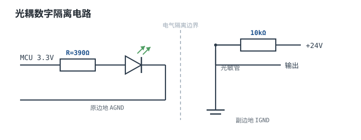

# IGBT、可控硅、继电器与光耦 IGBT / SCR / Relay / Optocoupler

这一章收编四类"大功率/隔离"器件：IGBT 是高压大电流的电压控制开关；可控硅（SCR）是一旦触发就锁存的交流开关；继电器是电磁机械开关；光耦（Optocoupler）用光信号实现电气隔离。它们各有分工，分别用在电机驱动、交流调功、强电切换和信号隔离里。

## 1. 设计动机：各解决什么问题

::: motivation
- 市电 220V、几十 A 的电机调速，MOSFET 耐压/电流不够 → 用 IGBT。
- 交流调压（调光、调温）需要一个"触发后自己保持"的开关 → 用 SCR。
- 要在强电与弱电之间做物理隔离的通断 → 用继电器。
- 数字信号要跨"地不同"的两个系统传过去、不能共地 → 用光耦。
:::

## 2. 电路符号与工作原理

| 器件 | 英文 | 核心特点 | 关键参数 |
|---|---|---|---|
| IGBT | Insulated Gate Bipolar Transistor | MOSFET 栅极(电压控制) + BJT 低导通压降；高压大电流 | VCE(sat)≈1.5~2V；耐压 600V~6.5kV；电流 A~kA |
| 可控硅 | SCR / Thyristor | 门极触发后**锁存导通**，电流降到维持电流以下才关断 | 维持电流 IH；重复峰值电压；通态电流 |
| 继电器 | Relay | 线圈通电吸合触点，机械开关，物理隔离 | 线圈电压/电流；触点额定电压/电流；机械寿命(次) |
| 光耦 | Optocoupler | 内部 LED+光敏管，光信号跨隔离传信号 | CTR(电流传输比)；隔离电压；速度 |

::: analogy 直觉类比
- **IGBT**像"MOSFET 的阀门手柄 + BJT 的粗大主管道"：既有 MOSFET 电压控制、好驱动的优点，又有 BJT 低导通压降、扛高压大电流的本事。
- **SCR**像"撞针点火的锁存阀门"：门极给一下触发，它就自己保持全开，不再理会门极；只有当主电流小到撑不住（低于维持电流）才关闭。
- **继电器**像"电磁拉手"：通电产生磁力，机械地把触点吸合/断开，线圈和触点之间空气隔离。
- **光耦**像"发暗号的窗口"：这边 LED 亮，那边光敏管看到光就导通，两边电气上完全不连通，只靠光传话。
:::

## 3. 选型要点与工程权衡

- **IGBT 用于高压中低频**：$V_{CE(sat)}$ 比 MOSFET 高（1.5~2V），开关慢，不适合高频；但耐压高、电流大，变频器/电机/逆变器首选。栅极驱动同 MOSFET（注意 ±15V 驱动）。
- **SCR 只在交流里自然关断**：直流电路里触发后关不断，需附加换流回路；交流过零时电流自然过零关断，所以 SCR 广泛用于交流相位控制。
- **继电器看触点容量与寿命**：触点电流/电压要留裕量，感性负载要降额；机械寿命约 $10^5$~$10^7$ 次，频繁动作选固态继电器(SSR)或 MOS。线圈必加续流二极管。
- **光耦选 CTR 与速度**：低速开关/反馈用普通晶体管光耦（PC817，CTR 50~600%）；高速通信（URS/USB 隔离）选高速光耦/数字隔离器。隔离电压通常 2.5~5kVrms。

## 4. 典型应用电路：光耦数字隔离

下图是典型光耦隔离：MCU 侧 LED 经电阻限流发光，副边光敏三极管导通，把信号传到另一侧不共地的电路：

::: example 光耦隔离取值
1. **需求**：MCU(3.3V) 经光耦把开关信号传到 24V 工业侧。
2. **原边 LED 电阻**：$R=(3.3-1.2)/I_F$，取 $I_F=5mA$，$R=420\Omega$，取 390Ω。
3. **CTR**：PC817 CTR≈100%，即副边能抽取的电流 ≈ 原边电流×CTR = 5mA。
4. **副边上拉**：副边光敏管发射极/集电极接 24V 上拉电阻 10kΩ，LED 亮时输出被拉低，暗时为高电平；核对副边能灌/拉的电流满足 CTR。
5. **注意**：两侧地(AGND/IGND)不相连，仅靠光耦耦合。
:::

## 5. 失效模式与常见坑

::: pitfall 常见坑
- **直流 SCR 无法关断**：现象——SCR 触发后断不开。原因——直流回路电流不会自然过零，低于维持电流才关断。解决——交流用 SCR 自然过零；直流需换流回路，或改用 MOS/IGBT。
- **继电器线圈无续流二极管触点打弧**：现象——触点烧蚀、寿命短。原因——线圈反峰电压打弧。解决——线圈反并续流二极管（或 RC 吸收）。
- **IGBT 栅压不足/过压**：现象——IGBT 发热或击穿。原因——驱动电压不够致 $V_{CE}$ 偏高，或栅极过压。解决——按数据手册用 ±15V 左右栅驱，栅极加钳位。
- **光耦 CTR 随老化下降**：现象——用几年后隔离信号传不过去。原因——LED 光衰使 CTR 下降。解决——设计时留 CTR 裕量（如按 50% 余量设计工作点），高速/高可靠场合选数字隔离器。
:::

## 6. 自测题

SCR 被门极触发后，门极信号撤掉它还导通吗？什么时候关断？

**还导通**。SCR 是锁存器件，一旦触发，门极就失去控制作用，主电流继续导通。只有当主回路电流降到**维持电流 IH 以下**（交流自然过零时）才恢复阻断。

IGBT 相对 MOSFET 的优势和代价是什么？

优势：耐压高（数百 V~kV）、电流大、导通压降低且不随电压急剧变差，适合高压大功率。代价：开关速度比 MOSFET 慢、$V_{CE(sat)}$ 较高（1.5~2V），不适合高频，多用于电机/逆变器等中低频大功率场合。

光耦的 CTR 是什么意思？设计副边上拉电阻时为什么要留裕量？

CTR（电流传输比）= 副边输出电流 / 原边 LED 输入电流的百分比。它决定了给定 LED 电流下副边能驱动多大负载。CTR 随 LED 老化下降，所以设计时不能让副边工作在 CTR 边界，要按 50% 甚至更低余量选工作点，否则几年后信号就传不过去。

## 7. 参考资料

- NEETS — SCR/继电器/光耦等功率与控制器件
- The Art of Electronics (Horowitz & Hill, 3rd ed.) — 功率开关与隔离
- open-electronics (Kitspace 资源) — 器件与应用链接
