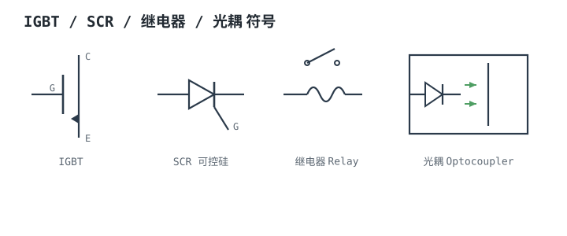
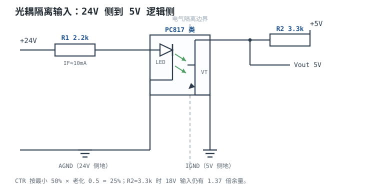

# IGBT、可控硅、继电器与光耦 IGBT / SCR / Relay / Optocoupler

这一章收编四类"大功率/隔离"器件，它们解决的是四个不同边界上的问题：**IGBT** 解决"高电压 + 大电流 + 中等频率"的开关；**可控硅（SCR/TRIAC）** 解决"交流、触发后自锁、靠过零关断"的开关；**继电器**解决"机械触点、物理隔离、极低导通电阻"的开关；**光耦**解决"两个不共地系统之间传信号"的隔离。它们看起来都属于"开关"，但选型参数、失效模式和安全要求完全不同。

这一章的主线是：先用电压、电流、频率三个维度把 IGBT 与 MOSFET 的边界算出来；再讲清 SCR/TRIAC 的擎住与关断，以及继电器线圈的续流为什么要和 [电感原理与 RL 暂态](../basics/inductor-rl.md) 对齐；最后用一个 PC817 类光耦的 24V 输入、5V 输出设计，把最小 CTR、老化降额、限流电阻、上拉电阻和上升时间一路算到"9600 baud 能不能用"。

## 1. 设计动机

::: motivation 四个真实场景
**场景一：600V 母线、30A、10kHz 的电机驱动。** 用 600V MOSFET，导通电阻按 100°C 时 0.38Ω 算，30A 下导通损耗 $30^2\times0.38=342$W；用 IGBT，$V_{CE(sat)}=1.8$V，导通损耗只有 $1.8\times30=54$W。再加开关损耗，IGBT 仍然明显占优。但如果电流只有 5A，MOSFET 的 $5^2\times0.38=9.5$W 与 IGBT 的 $1.8\times5=9$W 几乎打平，而 MOSFET 的开关损耗更低——**边界在电流上，不在"IGBT 一定比 MOSFET 好"。**

**场景二：220V/1kW 加热器的调功。** 用 TRIAC 做相位控制，通态电流 4.5A，$V_{TM}=1.2$V、$r_T=20$mΩ，满导通时损耗约 5.3W；不加散热片，TO-220 的 $R_{\theta ja}$ 约 60°C/W，结温会冲到 360°C。**"能触发"不等于"能散热"。**

**场景三：24V 工业输入接 PLC。** 用 PC817 类光耦，LED 侧 10mA，CTR 最小 50%，看起来副边能拉 5mA；但 LED 老化后 CTR 可能只剩一半，实际只有 2.5mA。上拉电阻按 10kΩ 选，副边只需要 0.5mA，似乎够；可上升时间随上拉电阻变大，9600 baud 可能刚好，115200 baud 不够。**光耦的设计必须同时算 CTR、老化和速度。**

**场景四：继电器线圈不接续流二极管。** 12V/200mA 线圈，关断瞬间 $V=L\,di/dt$ 能把集电极打到几千伏，驱动管一次就坏。续流二极管把电压钳在 $V_{CC}+V_F$，但释放时间变慢——**这是"耐压"和"速度"的权衡，不是加一只二极管就完事。**
:::

| 你遇到的问题 | 先算 | 判据 |
|---|---|---|
| 600V 母线该用 IGBT 还是 MOSFET | $P_{cond}=I^2R_{DS(on)}$ 与 $V_{CE(sat)}I$ | 总损耗（含开关）与结温 |
| TRIAC 触发后关不掉 | 负载电流是否过零、是否低于 $I_H$ | 交流过零或强制换流 |
| 继电器触点粘死 | 浪涌电流、感性负载降额 | 触点额定值与寿命曲线 |
| 光耦用几年后失效 | $I_C=I_F\cdot CTR_{min}\cdot k_{age}$ | 副边电流裕量、上升时间 |
| 隔离耐压不够 | 爬电距离、电气间隙、隔离额定值 | IEC 60664-1 与器件手册 |

**不算会摔在哪**，三个带数字的代价：

1. **IGBT 按 MOSFET 的开关频率用。** 600V/30A 的 IGBT，$E_{on}+E_{off}$ 约 3mJ，10kHz 就是 30W；到 100kHz 就是 300W，结温直接失控。IGBT 的尾巴电流（tail current）决定了它不适合高频。
2. **TRIAC 按平均电流选。** 1kW/220V 负载的平均电流 4.09A，但有效值 4.55A；相位控制 90° 时有效值 3.21A、平均 2.05A。发热按 $I_{rms}^2r_T$ 算，不是按平均值。
3. **光耦按典型 CTR 设计。** 典型 100% 时副边有 10mA，看起来绰绰有余；最小 50%、老化后再打 50% 折，只剩 2.5mA。上拉电阻按 10kΩ 选，副边需要 0.5mA，看似够；但如果上拉改到 1kΩ 提高速度，需要 4.6mA，直接不够。

## 2. 定义与直观

### 2.1 IGBT：MOSFET 的栅极 + BJT 的输出

IGBT（Insulated Gate Bipolar Transistor，绝缘栅双极型晶体管）可以看成"MOSFET 的电压控制栅极"加"BJT 的低导通压降输出"。栅极加正压时，内部 MOSFET 导通，给 BJT 的基区注入载流子，器件进入低阻导通；关断时，注入的少数载流子需要时间复合，形成**尾巴电流（tail current）**，所以 IGBT 的关断损耗比 MOSFET 大。

它的关键参数是：

- **$V_{CE(sat)}$**：饱和导通压降，典型 1.5~2.5V（随电流、温度变），决定导通损耗。
- **$E_{on}$、$E_{off}$**：单次开通/关断能量（J），乘以频率就是开关损耗。
- **$Q_g$**：栅极电荷（C），决定驱动功率和驱动电流。
- **$V_{CES}$**：集电极-发射极耐压（V），常见 600V、1200V、1700V 等。
- **短路耐受时间**：几 µs 级，必须用退饱和检测（desaturation）保护。

### 2.2 SCR/TRIAC：触发后自锁，靠电流过零关断

SCR（Silicon Controlled Rectifier，可控硅）是四层 PNPN 器件，三个端子：阳极 A、阴极 K、门极 G。它的工作过程分两段：

1. **触发**：门极注入电流，SCR 从阻断转为导通；一旦阳极电流超过**擎住电流 $I_L$**，门极就失去控制作用，即使撤掉门极信号也继续导通。
2. **关断**：只有当阳极电流降到**维持电流 $I_H$** 以下，器件才恢复阻断。交流电路中，电流每个半周自然过零，SCR 在过零附近关断；直流电路中电流不会自然过零，必须加换流回路，或者改用 MOSFET/IGBT。

TRIAC 是两个 SCR 反并联的单片器件，可以双向导通，常用于交流调光、调温、电机调速。它的关键参数是 $V_{DRM}$（重复峰值阻断电压）、$I_{T(RMS)}$（通态有效值电流）、$I_{GT}$/$V_{GT}$（门极触发电流/电压）、$I_H$（维持电流）、$I_L$（擎住电流）和 $dv/dt$（抗误触发能力）。

### 2.3 继电器：线圈、触点与物理隔离

继电器（Relay）用线圈产生磁场，吸合机械触点。它的优点是**触点导通电阻极低（mΩ 级）、隔离电压高、没有半导体漏电**；缺点是**机械寿命有限、动作慢（ms 级）、触点会电弧烧蚀**。

关键参数：线圈额定电压/电流/电阻、must-operate/must-release 电流、触点额定电压/电流、触点形式（NO/NC/CO）、机械寿命与电气寿命、隔离电压。线圈是电感，关断时必须有续流回路；具体计算见 [电感原理与 RL 暂态](../basics/inductor-rl.md)，本章只讲与选型相关的部分。

### 2.4 光耦：用光跨过隔离边界

光耦（Optocoupler）内部是一只 LED 和一个光敏器件（光敏三极管、光敏二极管或光敏达林顿）。原边电流 $I_F$ 让 LED 发光，副边光敏管接收光，产生集电极电流 $I_C$。输入输出之间没有电气连接，只有光，所以能跨过不同的地电位。

核心参数是 **CTR（Current Transfer Ratio，电流传输比）**：

$$
CTR=\frac{I_C}{I_F}\times100\%
$$

其中 $I_F$ 是 LED 正向电流（A），$I_C$ 是副边集电极电流（A）。CTR 不是常数：它随 $I_F$、温度、器件批次变化，而且**随 LED 老化而下降**。所以设计必须按**最小 CTR**，再乘一个老化降额系数。

::: analogy 四件工具，四种边界
- **IGBT** 像"带 MOSFET 手柄的重型闸门"：手柄很轻（电压控制），闸门很重（大电流），但开关速度受机械惯性限制（尾巴电流）。
- **SCR** 像"撞针点火的锁存阀门"：给一下触发就自己保持全开，不再理会门极；只有水流小到撑不住（低于 $I_H$）才关上。
- **继电器**像"电磁拉手"：线圈通电，机械触点吸合；线圈和触点之间是空气/绝缘体，天然隔离，但动作有声音、有寿命。
- **光耦**像"发暗号的窗口"：这边 LED 亮，那边光敏管看到光就导通，两边电气上不通，只靠光传话；但 LED 会老化，暗号会越来越弱。

类比的边界：IGBT 的"惯性"是载流子复合，不是机械惯性；SCR 的关断需要电流过零，不是"门极关一下"；继电器的触点会电弧烧蚀，光耦的 LED 会光衰。这些退化机制决定了它们的安全裕量。
:::

## 3. 定量关系

### 3.1 IGBT 与 MOSFET：电压、电流、频率三维边界

**导通损耗**：

$$
P_{MOS}=I^2R_{DS(on)},\qquad P_{IGBT}=V_{CE(sat)}I
$$

其中 $I$ 是导通电流（A），$R_{DS(on)}$ 是 MOSFET 导通电阻（$\Omega$），$V_{CE(sat)}$ 是 IGBT 饱和压降（V）。令两者相等，得到导通损耗的交叉电流：

$$
I_{cross}=\frac{V_{CE(sat)}}{R_{DS(on)}}
$$

以 600V 级器件为例，取 $V_{CE(sat)}=1.8$V、$R_{DS(on)}=0.38\ \Omega$（100°C 时的示例值）。0.38Ω 对应一只 600V/十余安级的 MOSFET；把它放到 30A 下已经超出连续电流能力，这里用同一组参数说明损耗趋势，实际 30A 设计要选更低 $R_{DS(on)}$ 的器件或多管并联。

$$
I_{cross}=\frac{1.8}{0.38}=4.74\ \text{A}
$$

低于 4.74A，MOSFET 的导通损耗更小；高于 4.74A，IGBT 更小。**但这个交叉点不是固定的**：MOSFET 的 $R_{DS(on)}$ 随耐压升高按约 $V^2$ 增长，1200V 器件的交叉电流会低得多；IGBT 的 $V_{CE(sat)}$ 也随电流和温度变。

| 电流 | MOSFET 导通损耗（0.38Ω） | IGBT 导通损耗（1.8V） | 谁更小 |
|---|---|---|---|
| 5A | 9.5W | 9.0W | 接近，IGBT 略小 |
| 10A | 38W | 18W | IGBT |
| 30A | 342W | 54W | IGBT |

**开关损耗**：

$$
P_{sw}=(E_{on}+E_{off})f_{sw}
$$

其中 $E_{on}$、$E_{off}$ 是单次开关能量（J），$f_{sw}$ 是开关频率（Hz）。以 600V/30A 为例，IGBT 的 $E_{on}+E_{off}\approx3$mJ，MOSFET 约 0.3mJ（示例量级，以数据手册为准）：

| 频率 | IGBT 开关损耗 | MOSFET 开关损耗 |
|---|---|---|
| 10kHz | 30W | 3W |
| 20kHz | 60W | 6W |
| 100kHz | 300W | 30W |

把导通和开关加起来，30A、10kHz 时 IGBT 约 $54+30=84$W，MOSFET 约 $342+3=345$W；5A、10kHz 时 IGBT 约 $9+10=19$W（开关能量按 1mJ 估），MOSFET 约 $9.5+2=11.5$W。**电流大、频率中等时 IGBT 赢；电流小、频率高时 MOSFET 赢。**

三个维度的典型边界（不是绝对规则，必须按具体器件算）：

| 维度 | MOSFET 更合适 | IGBT 更合适 | 原因 |
|---|---|---|---|
| 电压 | <200V | >600V | 高压 MOSFET 的 $R_{DS(on)}$ 按 $V^2$ 上升 |
| 电流 | <5A（600V 级） | >10A（600V 级） | IGBT 的 $V_{CE(sat)}$ 不随电流线性恶化 |
| 频率 | >100kHz | <20kHz | IGBT 有尾巴电流，$E_{off}$ 大 |
| 高温 | 取决于封装 | 结温 150~175°C | 两者都要按结温降额 |

### 3.2 SCR/TRIAC：擎住、维持与过零关断

SCR 的触发条件可以写成：

$$
I_A>I_L\quad\text{（擎住）},\qquad I_A<I_H\quad\text{（关断）}
$$

其中 $I_A$ 是阳极电流（A），$I_L$ 是擎住电流（A），$I_H$ 是维持电流（A）。$I_L$ 通常大于 $I_H$：触发时，阳极电流必须超过 $I_L$，门极撤掉后才不会退回阻断；导通后，电流降到 $I_H$ 以下才关断。

**交流过零关断**：50Hz 正弦，每 10ms 过零一次；SCR 在电流过零附近自然关断。所以：

- 交流相位控制（调光、调温）可以直接用 SCR/TRIAC，靠过零关断；
- 直流电路必须加换流回路（电容、电感、辅助 SCR），或者改用 MOSFET/IGBT；
- 感性负载的电流滞后电压，过零点与电压过零点不同，关断时刻要按电流过零算。

**通态损耗**：

$$
P_T=V_{T0}I_{avg}+r_TI_{rms}^2
$$

其中 $V_{T0}$ 是通态门槛电压（V），$r_T$ 是通态斜率电阻（$\Omega$），$I_{avg}$ 是通态平均电流（A），$I_{rms}$ 是通态有效值电流（A）。**发热用有效值，不能用平均值。**

对电阻负载、全波相位控制，触发角为 $\alpha$ 时：

$$
I_{rms}=\frac{V_p}{R}\sqrt{\frac{1}{\pi}\left[\frac{\pi-\alpha}{2}+\frac{\sin2\alpha}{4}\right]},\qquad
I_{avg}=\frac{V_p}{R}\frac{1+\cos\alpha}{\pi}
$$

其中 $V_p$ 是交流峰值电压（V），$R$ 是负载电阻（$\Omega$），$\alpha$ 是触发角（rad）。$\alpha=0$ 是全导通，$\alpha=\pi$ 是全关断。这个式子是正弦半波积分的结果；推导放在下面的进阶框里。

::: advanced 相位控制电流积分的来源
设 $i(\theta)=\frac{V_p}{R}\sin\theta$，在每个半周 $\alpha<\theta<\pi$ 内导通。有效值的平方是

$$
I_{rms}^2=\frac{1}{\pi}\int_{\alpha}^{\pi}\left(\frac{V_p}{R}\sin\theta\right)^2d\theta
=\left(\frac{V_p}{R}\right)^2\frac{1}{\pi}\left[\frac{\pi-\alpha}{2}+\frac{\sin2\alpha}{4}\right]
$$

平均值是

$$
I_{avg}=\frac{1}{\pi}\int_{\alpha}^{\pi}\frac{V_p}{R}\sin\theta\,d\theta
=\frac{V_p}{R}\frac{1+\cos\alpha}{\pi}
$$

$\alpha=0$ 时，$I_{rms}=V_p/(R\sqrt2)$、$I_{avg}=2V_p/(\pi R)$；$\alpha=\pi/2$ 时，$I_{rms}=V_p/(2R)$、$I_{avg}=V_p/(\pi R)$。**有效值和平均值不是同一个数，发热必须用有效值。**
:::

### 3.3 继电器线圈：续流与触点降额

线圈的稳态电流和功耗：

$$
I_{coil}=\frac{V_{coil}}{R_{coil}},\qquad P_{coil}=V_{coil}I_{coil}
$$

其中 $V_{coil}$ 是线圈额定电压（V），$R_{coil}$ 是线圈电阻（$\Omega$）。线圈是电感，关断时电流不能突变，必须反并续流二极管；有续流时，驱动管承受的电压被钳在

$$
V_{CE}=V_{CC}+V_F
$$

其中 $V_F$ 是续流二极管正向压降（V）。续流二极管的电流、能量、释放时间公式见 [电感原理与 RL 暂态](../basics/inductor-rl.md)，这里不再重复。**本章要记住的是：续流二极管把电压钳住，但把释放时间拉长；需要快速释放时，用齐纳/TVS 钳位，代价是驱动管耐压更高。**

触点选型要看三个电流：

- **稳态电流**：触点额定电流，按 50%~80% 降额；
- **浪涌电流**：白炽灯、电机、电容负载的浪涌可以是稳态的 5~10 倍；
- **分断电流**：感性负载分断时电弧能量大，触点寿命按负载类型降额。

机械寿命与电气寿命不是一回事：机械寿命可达 $10^7$ 次，电气寿命在额定负载下可能只有 $10^5$ 次。**频繁开关的场合，先算电气寿命，再决定要不要用 SSR。**

### 3.4 光耦：CTR、老化与速度

LED 侧限流电阻：

$$
R_F=\frac{V_{in}-V_F}{I_F}
$$

其中 $V_{in}$ 是输入电压（V），$V_F$ 是 LED 正向压降（V，典型 1.1~1.4V），$I_F$ 是目标 LED 电流（A）。副边集电极电流：

$$
I_C=I_F\cdot CTR_{min}\cdot k_{age}
$$

其中 $CTR_{min}$ 是数据手册规定条件下的最小电流传输比（无量纲），$k_{age}$ 是老化降额系数（例如 0.5，表示寿命末期只剩一半）。上拉电阻由副边需要的低电平电流决定：

$$
R_L\leq\frac{V_{CC}-V_{OL}}{I_C}
$$

其中 $V_{CC}$ 是副边电源（V），$V_{OL}$ 是允许的低电平电压（V）。**注意：$R_L$ 越大，低电平越容易满足，但上升时间越长。** 这是光耦设计的基本矛盾。

上升时间的粗略 RC 下限：

$$
t_r\approx2.2R_LC_{out}
$$

其中 $C_{out}$ 是副边等效电容（F）。但这个公式只算了 RC 充放电，**没有算光敏三极管的基区存储电荷**；实际 $t_r$ 通常比它大一个数量级以上，必须查数据手册的 $t_r$–$R_L$ 曲线。以 $R_L=3.3$kΩ、$C_{out}=50$pF 为例：

$$
t_{r,RC}=2.2\times3300\times50\times10^{-12}=0.363\ \mu\text{s}
$$

而 PC817 类器件在 $R_L=100\ \Omega$ 时 $t_r$ 典型就有 4µs；$R_L=3.3$kΩ 时按曲线量级约 15~20µs。**RC 公式只能当下限，不能当设计依据。**

数字信号的上升时间判据：

$$
t_r\leq0.2T_{bit},\qquad T_{bit}=\frac{1}{\text{baud}}
$$

其中 $T_{bit}$ 是位时间（s）。9600 baud 时 $T_{bit}=104.2\ \mu\text{s}$，$0.2T_{bit}=20.8\ \mu\text{s}$；19200 baud 时 $10.4\ \mu\text{s}$；115200 baud 时只有 $1.74\ \mu\text{s}$。**PC817 类光耦适合 9600 baud 及以下；更高速率要用高速光耦或数字隔离器。**

## 4. 典型计算

### 4.1 算例一：600V/30A、10kHz 的 IGBT 与 MOSFET 对比

**需求与假设**：

| 项目 | 要求/假设 |
|---|---|
| 母线电压 | 600V |
| 负载电流 | 30A（有效值近似等于平均值） |
| 开关频率 | 10kHz |
| MOSFET | $R_{DS(on)}=0.38\ \Omega$（100°C，示例值） |
| IGBT | $V_{CE(sat)}=1.8$V，$E_{on}+E_{off}=3$mJ（示例值） |
| MOSFET 开关能量 | $E_{on}+E_{off}=0.3$mJ（示例值） |
| 散热 | 环境 50°C，散热器 $R_{\theta}=1.5$°C/W |
| 结温上限 | 150°C（降额后） |

**第 1 步：导通损耗。**

$$
P_{MOS}=30^2\times0.38=342\ \text{W},\qquad P_{IGBT}=1.8\times30=54\ \text{W}
$$

**第 2 步：开关损耗。**

$$
P_{sw,IGBT}=3\times10^{-3}\times10\times10^{3}=30\ \text{W}
$$

$$
P_{sw,MOS}=0.3\times10^{-3}\times10\times10^{3}=3\ \text{W}
$$

**第 3 步：总损耗。**

$$
P_{IGBT}=54+30=84\ \text{W},\qquad P_{MOS}=342+3=345\ \text{W}
$$

IGBT 的总损耗只有 MOSFET 的 24%。在这个工况下，MOSFET 单管根本不可行，需要多管并联或改用 IGBT。

**第 4 步：结温。**

$$
T_{j,IGBT}=50+84\times1.5=176^\circ\text{C}
$$

超过 150°C 降额线，**单管 IGBT 也不够**。需要的散热器热阻：

$$
R_{\theta}\leq\frac{150-50}{84}=1.19\ ^\circ\text{C/W}
$$

或者用两只 IGBT 并联，每只 42W，$T_j=50+42\times1.5=113^\circ\text{C}$，满足。**并联时要核对均流；IGBT 的 $V_{CE(sat)}$ 正温度系数有利于均流，但仍要按最坏器件核算。**

**第 5 步：栅极驱动。** 取 $Q_g=200$nC、驱动电压 $+15$V/−8V（$\Delta V=23$V）、$f_{sw}=10$kHz：

$$
P_{gate}=Q_g\Delta Vf_{sw}=200\times10^{-9}\times23\times10\times10^{3}=0.046\ \text{W}
$$

栅极电阻 10Ω 时的峰值电流：

$$
I_{g,pk}=\frac{23}{10}=2.3\ \text{A}
$$

**第 6 步：母排寄生电感。** 取 $L_{stray}=50$nH、$di/dt=500$A/µs：

$$
V_{spike}=L\frac{di}{dt}=50\times10^{-9}\times500\times10^{6}=25\ \text{V}
$$

600V 器件上叠加 25V，约 4.2%，可接受；如果母排电感 200nH，就是 100V，必须优化布局或加吸收。

**第 7 步：结论。** 600V/30A/10kHz 用 IGBT，但要两只并联或加强散热；MOSFET 在这个电流下不经济。如果电流降到 5A，按 0.2mJ 开关能量估，MOSFET 的总损耗约 $9.5+2=11.5$W；按 1mJ 估，IGBT 约 $9+10=19$W，MOSFET 更合适。如果频率升到 100kHz，IGBT 的开关损耗 300W，完全不可行，必须用 MOSFET/SiC。

### 4.2 算例二：220V/1kW TRIAC 调功与散热

**需求与假设**：

| 项目 | 要求/假设 |
|---|---|
| 负载 | 220V 交流、1kW 电阻加热器 |
| TRIAC | $V_{T0}=1.2$V、$r_T=20$mΩ（示例值） |
| 触发角 | 全导通、90° 两种工况 |
| 环境 | 50°C |
| 散热器 | $R_{\theta}=5$°C/W；无散热片时 60°C/W |
| 门极 | $I_{GT}=50$mA、$V_{GT}=1.3$V，5V 驱动 |

**第 1 步：负载电流。**

$$
I_{rms}=\frac{P}{V_{rms}}=\frac{1000}{220}=4.545\ \text{A}
$$

$$
R=\frac{V_{rms}^2}{P}=\frac{220^2}{1000}=48.4\ \Omega,\qquad
V_p=220\sqrt2=311.1\ \text{V},\qquad
I_p=\frac{311.1}{48.4}=6.428\ \text{A}
$$

**第 2 步：全导通损耗。**

$$
I_{avg}=\frac{2I_p}{\pi}=\frac{2\times6.428}{\pi}=4.092\ \text{A},\qquad
I_{rms}=4.545\ \text{A}
$$

$$
P_T=1.2\times4.092+0.02\times4.545^2=4.910+0.413=5.323\ \text{W}
$$

**第 3 步：90° 相位控制损耗。**

$$
I_{rms}=6.428\times0.5=3.214\ \text{A},\qquad
I_{avg}=\frac{6.428}{\pi}=2.046\ \text{A}
$$

$$
P_T=1.2\times2.046+0.02\times3.214^2=2.455+0.207=2.662\ \text{W}
$$

**第 4 步：结温。**

全导通、带 5°C/W 散热器：

$$
T_j=50+5.323\times5=76.6^\circ\text{C}
$$

无散热片：

$$
T_j=50+5.323\times60=369.4^\circ\text{C}
$$

**必须加散热器。** 90° 工况下 $T_j=50+2.662\times5=63.3^\circ\text{C}$，更安全；但选型要按全导通的最坏情况。

**第 5 步：门极电阻。**

$$
R_G=\frac{5-1.3}{0.050}=74\ \Omega
$$

取 68Ω，实际门极电流：

$$
I_G=\frac{5-1.3}{68}=0.0544\ \text{A}=54.4\ \text{mA}
$$

门极脉冲宽度取 100µs，50Hz 下平均门极功率：

$$
P_G=1.3\times0.0544\times100\times10^{-6}\times50=0.354\ \text{mW}
$$

很小，但脉冲峰值电流要由驱动电路提供。

**第 6 步：RC 缓冲。** 取 $C=0.1\ \mu\text{F}$、$R=100\ \Omega$：

$$
P_{snubber}=C V_p^2f=0.1\times10^{-6}\times311.1^2\times50=0.484\ \text{W}
$$

选 1W 电阻。缓冲电容在 TRIAC 关断时充电、开通时通过电阻放电，能量变成热；$C$ 越大，缓冲越强，损耗也越大。

**第 7 步：零交叉的 $dv/dt$。** 50Hz 正弦在过零点的斜率：

$$
\left.\frac{dv}{dt}\right|_{0}=2\pi fV_p=2\pi\times50\times311.1=97.7\ \text{V/ms}=0.0977\ \text{V/}\mu\text{s}
$$

这个值远低于常见 TRIAC 的 $dv/dt$ 额定值（典型几百 V/µs，以数据手册为准）；但感性负载关断时的换向 $dv/dt$ 更大，需要缓冲和核对。

**第 8 步：结论。** 1kW/220V 用 BTA16 类 16A TRIAC（4.5A 的 3.5 倍，覆盖浪涌和降额），全导通损耗 5.3W，必须配 5°C/W 散热器；90° 相位控制时损耗 2.7W，散热更容易。门极用 68Ω、5V 驱动，脉冲 100µs。**如果负载是感性（电机、变压器），要额外核对换向 $dv/dt$ 和缓冲，不能只按电阻负载算。**

### 4.3 完整设计：PC817 类光耦的 24V 输入、5V 输出隔离

**需求与假设**：

| 项目 | 要求/假设 |
|---|---|
| 输入 | 24V 工业电平，范围 18~30V |
| 输出 | 5V 逻辑，低电平有效 |
| 速率 | 9600 baud（位时间 104.2µs） |
| 光耦 | PC817 类，CTR 最小 50%（$I_F=5$mA 条件） |
| 老化 | 寿命末期按 50% 降额，即有效 CTR 25% |
| LED 电流 | 设计 10mA（24V 标称） |
| $V_F$ | 1.2V（典型，以数据手册为准） |
| 输出低电平 | $V_{OL}\leq0.4$V |
| 环境 | 60°C |

**第 1 步：限流电阻。**

$$
R_F=\frac{24-1.2}{0.010}=2280\ \Omega
$$

取 2.2kΩ，实际 LED 电流：

$$
I_F(24)=\frac{24-1.2}{2200}=0.01036\ \text{A}=10.36\ \text{mA}
$$

在输入范围两端：

$$
I_F(18)=\frac{18-1.2}{2200}=7.64\ \text{mA},\qquad
I_F(30)=\frac{30-1.2}{2200}=13.09\ \text{mA}
$$

**第 2 步：限流电阻功耗。** 最坏在 30V：

$$
P_R=\frac{(30-1.2)^2}{2200}=\frac{28.8^2}{2200}=0.377\ \text{W}
$$

24V 时是 $22.8^2/2200=0.236$W。按 50% 降额，选 1W 电阻；如果空间允许，0.5W 在 30V 时已经用了 75%，偏紧。

**第 3 步：副边可用电流。** 按最小 CTR 50%、老化 50%：

$$
CTR_{eff}=0.50\times0.50=0.25
$$

$$
I_C(24)=10.36\times0.25=2.59\ \text{mA},\qquad
I_C(18)=7.64\times0.25=1.91\ \text{mA}
$$

这里把 50% 当作 10mA 下的保守值；如果所选型号在 10mA 下的最小 CTR 更低，必须按更低的值重算。

**第 4 步：上拉电阻。** 取 $R_L=3.3$kΩ，低电平时需要的灌电流：

$$
I_{OL}=\frac{5-0.4}{3300}=1.394\ \text{mA}
$$

最坏 18V 输入时，可用 1.91mA，裕量：

$$
\frac{1.91}{1.394}=1.37
$$

24V 时裕量 $2.59/1.394=1.86$。**满足，但 18V 时只有 1.37 倍；如果 CTR 老化超过 50%，或光耦批次更差，就会不够。** 这就是"按最小 CTR 设计"的意义。

**第 5 步：输出低电平。** 光敏管在 1.91mA 可用、1.394mA 需求下进入饱和，$V_{OL}$ 约 0.2~0.3V（典型），满足 0.4V 的判据。如果 $R_L$ 取 10kΩ，需要的电流只有 0.46mA，低电平更容易，但上升时间会变长；如果取 1kΩ，需要 4.6mA，18V 时只有 1.91mA，**不满足**。

**第 6 步：上升时间。** PC817 类数据手册在 $R_L=100\ \Omega$ 时 $t_r$ 典型 4µs；$R_L$ 增大，$t_r$ 近似按曲线增长。$R_L=3.3$kΩ 时按曲线量级约 15~20µs（典型值，必须查所选型号的 $t_r$–$R_L$ 曲线或实测）：

| 速率 | 位时间 | $0.2T_{bit}$ | $R_L=3.3$kΩ 的 $t_r$ | 判定 |
|---|---|---|---|---|
| 9600 baud | 104.2µs | 20.8µs | 约 15~20µs | 通过，余量 1.04~1.39 倍（偏紧） |
| 19200 baud | 52.1µs | 10.4µs | 约 15~20µs | 不通过 |
| 115200 baud | 8.68µs | 1.74µs | 约 15~20µs | 不通过 |

**第 7 步：为什么不能用 RC 公式交差。** 用 $C_{out}=50$pF 算：

$$
t_{r,RC}=2.2\times3300\times50\times10^{-12}=0.363\ \mu\text{s}
$$

实际约 15~20µs，差了约 41~55 倍。原因是光敏三极管的基区存储电荷和 Miller 电容，不是简单的 RC。**光耦的速度必须查数据手册曲线，不能自己用 RC 估。**

**第 8 步：输入保护。** 光耦 LED 的反向耐压通常只有 5~6V；24V 输入接反会直接击穿 LED。应在 LED 两端反并一只 1N4148 类小信号二极管，反向时电流经二极管旁路，LED 两端电压被钳在约 0.7V。反向电流由 2.2kΩ 限制在 $24/2200=10.9$mA，1N4148 可以承受。**这只二极管不是可选项，是 24V 工业输入的必需保护。**

**第 9 步：隔离与安全。** PC817 类的隔离电压常见 5kVrms 级（以数据手册为准）；但隔离电压不等于爬电距离。24V 属于 SELV，功能隔离的要求较低；如果副边接市电或高压，必须按 IEC 60664-1 核算电气间隙、爬电距离和 CTI，按加强绝缘设计。**"光耦能隔离 5kV"不等于"这块板满足安规"，爬电距离、PCB 开槽、污染等级都要一起看。**

**第 10 步：验算汇总。**

| 项目 | 数值 | 判定 |
|---|---|---|
| 24V 时 $I_F$ | 10.36mA | LED 额定内 |
| 18V 时 $I_F$ | 7.64mA | 仍大于 5mA |
| 30V 时 $I_F$ | 13.09mA | 小于 LED 最大 50mA |
| $R_F$ 功耗（30V） | 0.377W | 1W 电阻，降额 38% |
| 有效 CTR（老化后） | 25% | 按最小 50% × 0.5 |
| 18V 时 $I_C$ | 1.91mA | — |
| $R_L=3.3$kΩ 需求 | 1.394mA | 1.37 倍裕量 |
| $t_r$ @3.3kΩ | 约 15~20µs | 9600 baud 通过但余量偏紧 |
| 19200 / 115200 | — | 不通过，需高速光耦/数字隔离器 |
| 结论 | 9600 baud、24V 输入可用 | 需加反并保护二极管，并实测 $t_r$ |

**第 11 步：如果要更高速率。** 把 $R_L$ 降到 1kΩ，需要 4.6mA；18V 时有效 CTR 25%，需要 $I_F\geq4.6/0.25=18.4$mA，限流电阻

$$
R_F\leq\frac{18-1.2}{18.4\times10^{-3}}=912\ \Omega
$$

取 910Ω。30V 时 $I_F=28.8/910=31.6$mA，电阻功耗 $28.8^2/910=0.91$W，LED 老化也更快。即使这样，PC817 类在 1kΩ 下的 $t_r$ 仍有约 10µs，19200 baud（预算 10.4µs）只是勉强，115200 baud 不可能。**高速隔离应选 6N137 类高速光耦或数字隔离器，不要用 PC817 硬撑。**

## 5. 工程含义

### 5.1 选型矩阵

| 需求 | 首选 | 备选 | 关键判据 |
|---|---|---|---|
| 600V/30A/10kHz 电机驱动 | IGBT | 并联 MOSFET | 总损耗、结温、短路耐受 |
| 600V/5A/100kHz 高频开关 | MOSFET/SiC | — | $R_{DS(on)}$、$E_{oss}$、$Q_{rr}$ |
| 220V 交流调光/调温 | TRIAC | 继电器/SSR | $I_{T(RMS)}$、$I_H$、$dv/dt$、散热 |
| 直流大电流通断 | MOSFET/IGBT | 继电器 | 导通损耗、续流、寿命 |
| 需要物理隔离、极低导通电阻 | 继电器 | SSR | 触点容量、电气寿命、浪涌 |
| 低速信号隔离（≤9600） | 光耦 | 数字隔离器 | CTR、老化、$t_r$ |
| 高速信号隔离（>1Mbps） | 数字隔离器 | 高速光耦 | 速率、共模瞬态、功耗 |

### 5.2 IGBT 栅极驱动与保护

- **驱动电压**：常见 +15V/−8V；太低会增大 $V_{CE(sat)}$ 和开关损耗，太高会超过栅极耐压。
- **栅极电阻**：$R_g$ 越小，开关越快、损耗越低，但 $di/dt$、$dv/dt$ 和振铃越大；要在开关损耗与 EMI 之间折中。
- **退饱和保护**：IGBT 短路时电流迅速上升，必须在几 µs 内关断；用 $V_{CE}$ 检测（desaturation）配合软关断。
- **米勒钳位**：关断时栅极可能被米勒电容耦合抬升，导致误导通；需要负压关断或米勒钳位。
- **母排电感**：50nH 的母排在 500A/µs 下产生 25V 尖峰；叠层母排、紧耦合电容可以降低。

### 5.3 SCR/TRIAC 的触发与缓冲

- **触发脉冲**：脉冲宽度要足够，保证阳极电流升到 $I_L$ 以上；一般取几十~几百 µs。
- **擎住/维持**：轻载时电流可能低于 $I_H$，TRIAC 会提前关断或误触发；最小负载电流要核对。
- **$dv/dt$**：电压上升太快会让 TRIAC 误触发；RC 缓冲、压敏电阻可以抑制。
- **换向**：感性负载关断时，电流过零后电压立即反向，TRIAC 可能来不及恢复；需要缓冲或选换向能力强的器件。
- **散热**：通态损耗按 $I_{rms}$ 算，TO-220 无散热片约 60°C/W，5W 就足以过热。

### 5.4 继电器触点与寿命

- **触点降额**：阻性负载按 75%~80%，感性负载按 50% 或更低，白炽灯/电机按浪涌电流选。
- **电弧抑制**：触点两端加 RC 缓冲、压敏电阻或 TVS；直流负载用电弧吹弧磁铁/灭弧罩。
- **电气寿命**：额定负载下可能只有 $10^5$ 次；频繁开关用 SSR 或 MOSFET。
- **线圈续流**：反并二极管，释放时间按 [电感原理与 RL 暂态](../basics/inductor-rl.md) 算；需要快速释放时用齐纳/TVS。
- **安全隔离**：线圈与触点之间的隔离电压、爬电距离要满足安规；市电触点与低压控制之间按加强绝缘。市电侧的操作与安规要求见[电气安全](../basics/electrical-safety.md)。

### 5.5 光耦的 CTR 老化与选型

- **按最小 CTR**：数据手册的 CTR 是一个范围，设计取最小值；如果分档（A/B/C），按所选档的最小值。
- **老化降额**：LED 光输出随时间和温度下降，寿命末期 CTR 可能只剩 50%；高温、大电流加速老化。
- **速度与 $R_L$**：$R_L$ 越大，低电平越容易，但 $t_r$ 越长；按数据手册的 $t_r$–$R_L$ 曲线选。
- **隔离安规**：隔离电压、爬电距离、CTI、污染等级一起看；IEC 60747-5-5、UL 1577、IEC 60664-1 是常见依据。
- **替代方案**：高速/高可靠场合用数字隔离器（电容/磁耦），CTR 不再是问题，但要注意共模瞬态和电源域。

### 5.6 模型什么时候不够用

- **IGBT 的尾巴电流**：$E_{off}$ 随温度、电流、栅极电阻变化，数据手册的典型值不能直接外推到短路/高温。
- **TRIAC 的感性负载**：换向 $dv/dt$、$di/dt$ 与缓冲相互作用，电阻负载的公式不够。
- **继电器的电弧**：触点分断是等离子体过程，寿命曲线比电路公式复杂。
- **光耦的 CTR**：批次、温度、老化、$I_F$ 都影响，数据手册的 50% 只是特定条件。
- **隔离安规**：爬电距离、电气间隙、CTI 由标准和 PCB 结构决定，不能只用器件参数。

## 6. 常见坑

::: pitfall 常见坑
- **IGBT 用于高频**：现象——IGBT 发热严重、效率低，甚至热击穿。原因——IGBT 关断有尾巴电流，$E_{off}$ 大，频率越高开关损耗越大。解决——按 $P_{sw}=(E_{on}+E_{off})f$ 算；高频改用 MOSFET/SiC，或降低频率。
- **TRIAC 在直流回路里触发后关不掉**：现象——触发后一直导通，门极失去控制。原因——SCR/TRIAC 是锁存器件，只有电流降到 $I_H$ 以下才关断；直流电流不会自然过零。解决——交流用自然过零关断；直流加换流回路，或改用 MOSFET/IGBT。
- **继电器线圈不接续流二极管**：现象——驱动管关断时击穿，触点打弧、寿命短。原因——线圈电感关断产生高压。解决——线圈两端反并续流二极管（阴极接电源正），或按释放要求用齐纳/TVS 钳位；计算见 [电感原理与 RL 暂态](../basics/inductor-rl.md)。
- **光耦按典型 CTR 设计**：现象——样机正常，量产或几年后隔离信号失效。原因——CTR 离散、LED 老化，最小 CTR 可能只有典型值的一半。解决——按 $CTR_{min}$ 乘老化系数设计，副边电流留 1.5 倍以上裕量；必要时提高 $I_F$ 或换数字隔离器。
- **光耦上拉电阻只考虑低电平，不考虑速度**：现象——低电平正常，但通信误码率高、波形上升沿很慢。原因——$R_L$ 越大，$t_r$ 越长；PC817 类在 10kΩ 下上升时间可到几十 µs。解决——按数据手册的 $t_r$–$R_L$ 曲线选 $R_L$，并用 $t_r\leq0.2T_{bit}$ 校验；高速改用高速光耦/数字隔离器。
- **光耦 LED 没有反接保护**：现象——24V 输入线接反，光耦立即失效。原因——LED 反向耐压只有 5~6V。解决——LED 两端反并 1N4148 类二极管，或串一只反向耐压足够的二极管；反向电流要用限流电阻限制。
- **TRIAC 不加散热片**：现象——调功器工作几分钟后失控、外壳烫手。原因——通态损耗 5W 级，TO-220 无散热片 $R_{\theta ja}$ 约 60°C/W，结温远超上限。解决——按 $P_T=V_{T0}I_{avg}+r_TI_{rms}^2$ 算损耗，配散热器，按最坏全导通工况选。
- **继电器触点按稳态电流选**：现象——触点粘连、烧蚀，尤其带电机/白炽灯负载。原因——浪涌电流是稳态的 5~10 倍，感性分断电弧能量大。解决——按浪涌和负载类型降额，选更大容量触点或 SSR，加 RC/压敏吸收。
:::

## 7. 自测题

600V 级器件，$V_{CE(sat)}=1.8$V、$R_{DS(on)}=0.38\ \Omega$。导通损耗的交叉电流是多少？30A 时 IGBT 和 MOSFET 的导通损耗各是多少？

交叉电流：

$$
I_{cross}=\frac{V_{CE(sat)}}{R_{DS(on)}}=\frac{1.8}{0.38}=4.74\ \text{A}
$$

30A 时：

$$
P_{IGBT}=1.8\times30=54\ \text{W},\qquad P_{MOS}=30^2\times0.38=342\ \text{W}
$$

IGBT 的导通损耗只有 MOSFET 的 15.8%。但还要加开关损耗：IGBT 3mJ×10kHz=30W，MOSFET 0.3mJ×10kHz=3W；总损耗 84W 对 345W，IGBT 仍然占优。

SCR 被门极触发后，撤掉门极信号还导通吗？什么时候关断？直流电路为什么不能直接用 SCR 关断？

还导通。SCR 是锁存器件，只要阳极电流超过擎住电流 $I_L$，门极就失去控制；只有阳极电流降到维持电流 $I_H$ 以下才恢复阻断。交流电路中电流每半周过零，SCR 自然关断；直流电流不会自然过零，所以触发后关不掉，必须加换流回路或改用 MOSFET/IGBT。

220V/1kW 电阻负载，TRIAC 全导通时 $I_{avg}$、$I_{rms}$ 各是多少？取 $V_{T0}=1.2$V、$r_T=20$mΩ，通态损耗多少？

负载电流：

$$
I_{rms}=\frac{1000}{220}=4.545\ \text{A},\qquad I_p=\frac{220\sqrt2}{48.4}=6.428\ \text{A}
$$

全导通时：

$$
I_{avg}=\frac{2I_p}{\pi}=4.092\ \text{A},\qquad I_{rms}=4.545\ \text{A}
$$

损耗：

$$
P_T=1.2\times4.092+0.02\times4.545^2=4.910+0.413=5.323\ \text{W}
$$

发热用有效值；如果误用平均值算第二项，会得到 $0.02\times4.092^2=0.335$W，低估约 19%。

PC817 类光耦，$I_F=10$mA、CTR 最小 50%、老化 50%，副边可用电流多少？$V_{CC}=5$V、$V_{OL}=0.4$V 时，$R_L=3.3$kΩ 够不够？

有效 CTR：

$$
CTR_{eff}=0.50\times0.50=0.25
$$

副边电流：

$$
I_C=10\times0.25=2.5\ \text{mA}
$$

（按 24V 实际 $I_F=10.36$mA 算是 2.59mA。）

$R_L=3.3$kΩ 需要的灌电流：

$$
I_{OL}=\frac{5-0.4}{3300}=1.394\ \text{mA}
$$

$2.59>1.394$，够；18V 输入时 $I_F=7.64$mA，$I_C=1.91$mA，仍大于 1.394mA，裕量 1.37 倍。如果 $R_L=1$kΩ，需要 4.6mA，18V 时不够。

为什么 $R_L=3.3$kΩ 时不能用 $t_r\approx2.2R_LC_{out}$ 算光耦上升时间？这个例子差多少？

RC 公式只算输出电容的充放电，忽略光敏三极管的基区存储电荷和 Miller 电容；光耦的上升时间主要由载流子输运和基区电荷决定，$R_L$ 只是其中一个因素。以 $C_{out}=50$pF 算：

$$
t_{r,RC}=2.2\times3300\times50\times10^{-12}=0.363\ \mu\text{s}
$$

实际 PC817 类在 3.3kΩ 下约 15µs，差约 41 倍。所以必须查数据手册的 $t_r$–$R_L$ 曲线或实测，RC 公式只能当下限。

24V 输入的光耦，LED 反向耐压只有 5~6V。输入接反时会发生什么？怎么保护？

24V 反向加在 LED 上，会超过 5~6V 的反向耐压，LED 反向击穿，光耦失效。保护方法是在 LED 两端反并一只小信号二极管（如 1N4148 类）：正常时二极管反偏不导通；接反时二极管正偏，把 LED 两端电压钳在约 0.7V，反向电流由限流电阻限制。以 2.2kΩ、24V 为例，反向电流约 $24/2200=10.9$mA，1N4148 可以承受。

## 8. 参考资料

- **Infineon, IGBT Discretes 数据手册**：*Electrical Characteristics* 表给出 $V_{CE(sat)}$、$Q_g$，*Switching Characteristics* 表给出 $E_{on}$、$E_{off}$；本章 3.1、4.1 节的量级按该类手册。<https://www.infineon.com/cms/en/product/power/igbt/igbt-discretes/>
- **Infineon, MOSFET 数据手册**：*Electrical Characteristics* 表中的 $R_{DS(on)}$ 与温度曲线；本章 4.1 节的 MOSFET 损耗对比按该类手册的量级。<https://www.infineon.com/cms/en/product/power/mosfet/>
- **STMicroelectronics, BTA16 数据手册**：*Electrical Characteristics* 表给出 $V_{TM}$、$I_H$、$I_L$、$dv/dt$；本章 4.2 节的 TRIAC 计算按该手册的量级。<https://www.st.com/resource/en/datasheet/bta16.pdf>
- **Sharp, PC817 数据手册**：*Electro-optical Characteristics* 表给出 CTR、$V_F$、$t_r/t_f$，并有 *Rise Time vs. Load Resistance* 曲线；本章 4.3 节的光耦设计按该手册。<https://www.sharpsde.com/products/optoelectronics/>
- **IEC 60747-9** *Semiconductor devices — Discrete devices — Part 9 — Insulated-gate bipolar transistors*：IGBT 的额定值与测试条件；本章 3.1 节的参数口径按该标准。<https://webstore.iec.ch>
- **IEC 60747-6:2016** *Semiconductor devices — Part 6 — Thyristors*：擎住电流、维持电流与关断的定义；本章 3.2 节按该标准。<https://webstore.iec.ch>
- **IEC 61810-1:2015** *Electromechanical elementary relays — Part 1 — General and safety requirements*：线圈与触点额定值、试验条件；本章 3.3、5.4 节的继电器口径按该标准。<https://webstore.iec.ch>
- **IEC 60747-5-5:2020** *Semiconductor devices — Part 5-5 — Optoelectronic devices — Photocouplers*：CTR 与隔离额定值；本章 4.3、5.5 节的光耦口径按该标准。<https://webstore.iec.ch>
- **IEC 60664-1:2020** *Insulation coordination for equipment within low-voltage supply systems — Part 1 — Principles, requirements and tests*：电气间隙、爬电距离与污染等级；本章 4.3、5.5 节的隔离安规按该标准。<https://webstore.iec.ch>
- **The Art of Electronics, 3rd ed.（Horowitz and Hill）**：功率开关、继电器与隔离的工程讲法；本章 2.1、2.3 节的直觉部分参考该书。
- **NEETS（Navy Electricity & Electronics Training Series）**：SCR、继电器与光耦的基础讲法；本章 2.2、2.4 节的定义按该公开教材重写。
- **open-electronics（Kitspace 资源）**：器件与应用链接；本章的器件选型入口参考该资源。<https://github.com/ajaymnk/open-electronics>
