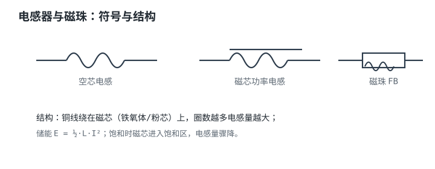
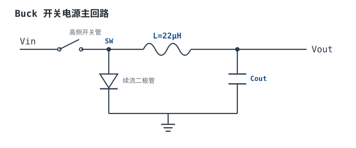

# 电感器与磁珠 Inductor & Ferrite Bead

电感器（Inductor）把电能储存在线圈产生的磁场里，伏安关系是 $V=L\,di/dt$：**对直流相当于短路（稳态无压降），对变化的电流（交流）呈现阻碍**。它是开关电源的核心储能元件。磁珠（Ferrite Bead）外形像电感，但用途完全不同——它不储能，而是把高频噪声转成热消耗掉。

## 1. 设计动机：电感在电源里干什么

::: motivation 没有电感的开关电源
Buck 开关电源靠开关管高速通断，把直流切成方波，再用电感+电容把方波"平滑"成连续直流。电感的作用是：开关管导通时储能，关断时释放能量维持电流连续。没有电感，开关电源要么输出纹波巨大，要么直接无法工作。磁珠则用在另一个场景：某条电源/信号线上有高频噪声，串一颗磁珠把噪声"吃掉"。
:::

## 2. 电路符号与结构

电感符号是一串半圆弧（线圈）；带磁芯的电感在圆弧上加一条平行实线。磁珠符号类似电阻/电感，常用带"U"形或标注 FB 的符号。下图给出符号、功率电感结构与磁珠：

::: analogy 直觉类比：电感像"水车/惯性轮"
把电流比作水流，电感就像水管里装的一个大惯性水轮：水流稳定时它随波逐流、不阻碍（直流短路）；但你想突然加大或减小水流，水轮的惯性会反抗这种变化（阻碍 di/dt）。它储存的是"运动的惯性"（磁场能量 $E=\frac12 LI^2$）。磁珠则像一个带阻尼的水轮——它不是存能量，而是用阻尼把高频振动直接耗散成热。
:::

## 3. 关键参数

| 参数 | 英文 | 含义 | 典型数量级 |
|---|---|---|---|
| 电感量 | Inductance | 线圈储磁能力 | µH 级（电源）；nH 级（RF） |
| 饱和电流 | Isat (Saturation Current) | 电感量下降到标称 70%/90% 时的直流电流 | 功率电感 0.5~10A |
| 温升电流 | Irms / Heating Current | 温升允许（如 40℃）的直流电流 | 与 Isat 接近，取小者 |
| 直流电阻 | DCR | 线圈铜线电阻 | 数 mΩ~数百 mΩ，越低越好 |
| 自谐振频率 | SRF | 与寄生电容谐振频率 | 几十~几百 MHz |
| 磁珠阻抗 | Z @100MHz | 磁珠在 100MHz 下的阻抗 | 60Ω、100Ω、600Ω 等 |

## 4. 选型要点与工程权衡

- **饱和电流 Isat 是第一约束**：选电感时必须让峰值电流（含纹波峰值）< Isat，否则磁芯饱和、电感量骤降，电流失控、效率暴跌甚至炸开关管。要留裕量（峰值 < 0.7~0.8 Isat）。
- **DCR 决定铜损**：$P=I^2 DCR$，大电流电源要选低 DCR（mΩ 级）的大电流电感。
- **屏蔽 vs 非屏蔽**：屏蔽电感（带磁罩）漏磁小、对外 EMI 低，贵一点；非屏蔽便宜但辐射大，高密度板/敏感模拟电路要选屏蔽型。
- **磁珠不是电感**：磁珠靠损耗抑制高频噪声，直流电阻很小、不储能。它的选型看数据手册的阻抗-频率曲线（Z 和 R/X 分量）：希望噪声频段阻抗大、直流电阻小。
- **磁珠怕大直流偏置**：磁珠在直流偏流下阻抗会下降（材料饱和），要选额定电流足够的型号，否则发热且失效。
- **RF/小信号电感**：选高 Q、低容值、高 SRF 的薄膜/叠层电感，别用功率电感（Q 低、寄生大）。

## 5. 典型应用电路

**Buck 电源电感**：开关管+二极管（或同步整流）后串电感 L，再并输出电容滤波。下图示意 Buck 主回路：

::: example Buck 电感取值
1. **需求**：Buck 输入 12V→输出 3.3V/1A，开关频率 fsw=400kHz。
2. **占空比**：$D=V_{out}/V_{in}=3.3/12\approx0.275$。
3. **纹波电流**：取峰峰值 $\Delta I_L=30\%\times I_{out}=0.3A$。
4. **算电感量**：$L=(V_{in}-V_{out})\cdot D/(\Delta I_L\cdot fsw)=(12-3.3)\times0.275/(0.3\times400e3)\approx20\mu H$。
5. **选型号**：取标准值 22µH，要求 Isat > 1A+0.15A≈1.2A（留裕量选 2A 以上），DCR < 50mΩ，屏蔽型。
:::

磁珠应用：在给模拟/敏感电路供电的 LDO 输入前串一颗 100Ω@100MHz 磁珠，配合后级电容形成 π 型滤波，抑制板级高频噪声。

## 6. 失效模式与常见坑

::: pitfall 常见坑
- **电感饱和导致电流失控**：现象——Buck 输出过载/啸叫，开关管发热甚至击穿。原因——峰值电流超过 Isat，磁芯饱和、电感量骤降，电流尖峰失控。解决——按峰值电流+裕量选 Isat 足够的电感，必要时选更大电流规格。
- **磁珠选型不当发热**：现象——磁珠发烫、甚至熔焊。原因——直流电流超过额定值致材料饱和，或高频噪声功率过大，损耗全变成热。解决——按实际直流电流与噪声功率选额定电流足够、阻抗合适的磁珠，勿用小磁珠扛大电流。
- **磁珠与电容形成振铃**：现象——电源轨出现高频振铃/尖峰。原因——磁珠阻抗与后级电容谐振。解决——后级电容选低 ESR 或加阻尼电阻，必要时换阻抗曲线更平缓的磁珠。
- **非屏蔽电感干扰模拟电路**：现象——附近 ADC/模拟信号拾取噪声。原因——非屏蔽电感漏磁辐射。解决——敏感电路附近改用屏蔽电感，或拉开距离/加屏蔽罩。
:::

## 7. 自测题

电感器对直流稳态相当于短路还是开路？为什么？

直流稳态下电流恒定（di/dt=0），由 $V=L\,di/dt$ 得电感两端电压为 0，理想电感相当于**短路**。只有电流变化时它才呈现阻碍（交流/瞬态）。

选 Buck 电感时，Isat 为什么要按峰值电流（含纹波）而不是平均输出电流来选？

电感电流是在平均值上叠加纹波的三角波，峰值 = 平均 + 纹波/2。若按平均电流选 Isat，纹波峰值会超过饱和点导致磁芯饱和。必须让峰值电流 < Isat，并留裕量。

磁珠和储能电感的本质区别是什么？磁珠能用来做 Buck 储能吗？

储能电感要低损耗、在宽电流范围保持电感量，靠磁场储能；磁珠是**有耗元件**，故意把高频噪声能量转成热，直流电阻小、不储能。磁珠不能做 Buck 储能——它没有足够低损耗的电感量，且大电流下会饱和发热。

## 8. 参考资料

- The Art of Electronics (Horowitz & Hill, 3rd ed.) — 电感与磁珠应用
- The Circuit Designer's Companion (P. Wilson) — 电源磁件与噪声抑制
- Lessons In Electric Circuits (Kuphaldt) — 电感与感应基础
