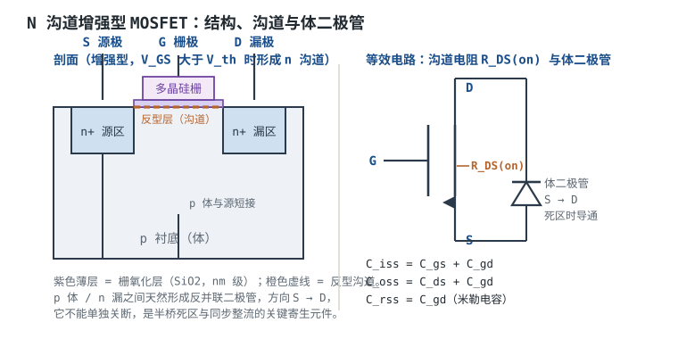
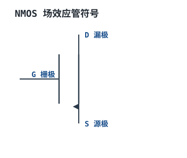
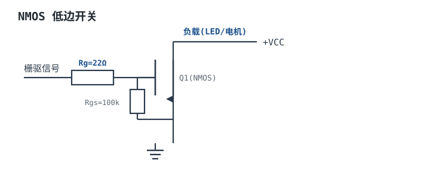
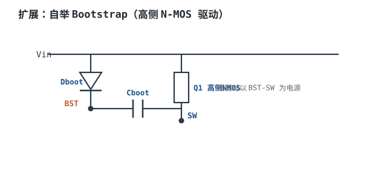

# MOSFET：参数、导通、驱动与损耗 MOSFET

MOSFET（Metal-Oxide-Semiconductor Field-Effect Transistor，金属-氧化物-半导体场效应管）是**电压控制**器件：栅极与沟道之间隔着一层二氧化硅，直流下不取电流，只用栅源电压 $V_{GS}$ 控制漏极电流。它开关快、导通电阻低，是现代开关电源、电机驱动、负载开关和热插拔电路的主力。

但"电压控制、不取电流"这半句话很容易让人低估它：栅极不取稳态电流，却要在每次开关时搬运电荷；导通电阻很低，却随栅压和温度成倍变化；体二极管看不见，却在死区时间里承担全部负载电流。这一章从结构讲到参数，再到驱动与损耗，最后用一个 24V/5A Buck 的低边开关选型，把 $R_{DS(on)}$、$Q_g$、$Q_{oss}$、体二极管和热阻算到"要不要加散热片"。三极管的电流控制视角见 [BJT 三极管：开关与放大](bjt.md)；二极管的反向恢复与续流见[二极管：整流、快恢复、肖特基](diodes.md)；IGBT、可控硅与继电器见 [IGBT、可控硅、继电器与光耦](igbt-scr-relay-optocoupler.md)。

## 1. 设计动机

::: motivation 三个真实场景
**场景一：3.3V GPIO 直接驱动"标准"MOSFET。** 某颗管子 $V_{GS(th)}$ 最大 4V、$R_{DS(on)}$ 标称是在 $V_{GS}=10$V 下测的 5 mΩ。用 3.3V 单片机直推，栅压连阈值都不够，管子工作在线性区，$R_{DS(on)}$ 可能到几十 mΩ；10A 负载下损耗从 0.5W 变成 4.5W，环境 60°C 时结温直接冲到 285°C（按 $R_{\theta ja}=50$°C/W 估），几秒钟就失效。

**场景二：24V/5A Buck 的低边开关。** 低边 MOS 在每个周期导通 $1-D=79\%$ 的时间，导通损耗是主角；但栅极电荷、输出电荷和死区体二极管也在偷偷吃功率。只看 $R_{DS(on)}$ 选管，可能选到一只 $Q_g$ 很大、开关损耗高的管子，总损耗反而更大。

**场景三：两只 MOSFET 并联扩流。** 以为"电流自动平分"，结果一只热一只凉。MOSFET 的 $R_{DS(on)}$ 有正温度系数，直流上确实会自平衡，但阈值电压、栅极电阻和布局不对称会让开关瞬间的电流分配严重不均；热耦合不好时，动态均流比静态更危险。
:::

| 你遇到的问题 | 先算 | 判据 |
|---|---|---|
| 管子一开就发烫 | $R_{DS(on)}$ 在实际 $V_{GS}$ 和 $T_j$ 下的值 | 导通损耗在热预算内 |
| 高频下效率上不去 | $Q_gV_{GS}f$ 与 $Q_{oss}V_{DS}f$ | 开关损耗不超过总损耗的 30%~50% |
| 半桥直通炸管 | 死区、$dV/dt$ 与米勒电容 | 栅极不被 $C_{gd}$ 注入误开通 |
| 热插拔/软启动烧管 | SOA 与 $Z_{th}(t)$ | 脉冲工作点落在 SOA 内 |
| 并联不均流 | $R_{DS(on)}$ 正温度系数与栅极电阻 | 静态与动态都留裕量 |
| 栅极驱动波形振铃 | $R_g$、$C_{iss}$ 与栅极回路电感 | 振铃不超 $V_{GS(max)}$，不误开通 |

**不算会摔在哪**，三个带数字的代价：

1. **栅压不足。** 同一只管子，$V_{GS}=10$V 时 $R_{DS(on)}=5$ mΩ，$V_{GS}=3.3$V 时按曲线可能到 45 mΩ。10A 下损耗从 $10^2\times0.005=0.5$W 变成 $10^2\times0.045=4.5$W，是 9 倍。
2. **忽略 $Q_{oss}$。** 24V、$Q_{oss}=12$nC、500kHz，每个周期放电能量 $\frac12Q_{oss}V_{DS}=0.5\times12\times10^{-9}\times24=144$nJ，功率 $144\times10^{-9}\times5\times10^5=72$mW。单看不大，但在 0.5W 级的低边损耗里占 14%。
3. **死区体二极管。** 死区 20ns、5A、体二极管 $V_F=0.8$V、500kHz、每周期两个死区，损耗 $2\times20\times10^{-9}\times5\times0.8\times5\times10^5=0.08$W。死区拉到 100ns，就是 0.4W，足以让低边温升多 16~20°C（按 $R_{\theta ja}=40\sim50$°C/W 估）。

## 2. 定义与直观

### 2.1 结构与导通机理

N 沟道增强型 MOSFET 的剖面可以简化成四层结构：**p 型衬底（体）**、两个 **n+ 区**（源极和漏极）、覆盖在源漏之间沟道区上的**栅氧化层**，以及氧化层上的**多晶硅栅极**。

- 当 $V_{GS}=0$ 时，p 体与 n+ 源、n+ 漏之间是两个背靠背的 PN 结，漏源之间没有导电通路，管子截止。
- 当 $V_{GS}>V_{GS(th)}$ 时，栅极正电压通过氧化层在 p 体表面感应出电子，形成一层很薄的 **n 型反型层（沟道）**，把源区和漏区连起来。$V_{GS}$ 越大，反型层越厚、载流子越多，沟道电阻越小。
- 导通后，电流从漏极经沟道流向源极。沟道电阻、漂移区电阻、衬底电阻和封装引线电阻加起来，就是数据手册的 $R_{DS(on)}$。

**体二极管（Body Diode）** 是结构自带的：p 体与 n+ 漏之间形成一个 PN 结，阳极是体/源，阴极是漏。所以 N 沟道 MOSFET 天然反并联一只从源指向漏的二极管。它不能通过栅极关断，在 half-bridge 的死区时间里，电感电流就是经它续流的。

### 2.2 符号、电极与体二极管

MOSFET 符号有三个电极：**栅极 G（Gate）**、**漏极 D（Drain）**、**源极 S（Source）**。N 沟道符号的源极箭头指向沟道，对应体二极管从源指向漏的方向；正常导通时电子从源极流向漏极，常规电流从漏极流向源极。P 沟道箭头方向相反。

符号本身不画体二极管，但实际器件一定有。分析半桥、同步整流、负载开关和热插拔时，要把它当成一个真实存在的反并联二极管：

- 低边开关关断、电感电流还在从地流向开关节点时，体二极管导通，把开关节点钳在约 $-V_F$；
- 半桥死区设置不当，体二极管导通时间变长，损耗和反向恢复都会增加；
- 电池反接或输出倒灌时，体二极管可能把电流引到不该去的地方，必要时串一只外部二极管或背靠背 MOSFET。

### 2.3 类比：电压控制的闸门

::: analogy MOSFET 像一座由电压控制的水闸
- **$V_{GS}$** = 闸门的开度指令。电压越高，闸门开得越大。
- **$V_{GS(th)}$** = 刚好能推开一条缝的指令电压，对应"开始导通"，不是"完全导通"。
- **$R_{DS(on)}$** = 闸门全开时的水流阻力。闸门没全开，阻力会大很多。
- **$Q_g$** = 每次把闸门从全关推到全开、再拉回来，需要搬运的"操作杆行程"。行程越大，开关越慢、驱动功率越大。
- **体二极管** = 闸门旁边的一扇只能单向开的旁通门，关不死。

类比的边界：水闸的阻力不随温度变，MOSFET 的 $R_{DS(on)}$ 会随温度上升 50% 以上；水闸没有寄生电容，MOSFET 的栅极是一个几 nF 的电容，开关瞬间要灌安培级电流。**"栅极不耗电"只对直流稳态成立，对开关过程不成立。**
:::

### 2.4 三个工作区与输出特性

以 $V_{GS}$ 为参数，MOSFET 的输出特性 $I_D$-$V_{DS}$ 分三个区：

1. **截止区**：$V_{GS}<V_{GS(th)}$，$I_D\approx0$，只有漏电。这是开关的"关"状态。
2. **线性/可变电阻区**：$V_{GS}>V_{GS(th)}$ 且 $V_{DS}$ 很小（小于 $V_{GS}-V_{GS(th)}$），沟道像一只电阻，$I_D$ 随 $V_{DS}$ 线性上升。开关导通时就工作在这里，斜率就是 $1/R_{DS(on)}$。
3. **饱和区（恒流区）**：$V_{DS}$ 大于 $V_{GS}-V_{GS(th)}$，沟道在漏端夹断，$I_D$ 基本只由 $V_{GS}$ 决定。放大器和恒流源工作在这里，开关管要**避免**长时间停在这里，因为同时有高电压和大电流，损耗极大。

**开关应用的目标，是让管子快速穿过饱和区，在截止区和线性区之间切换。** 开关损耗的本质，就是每次穿越饱和区时 $V_{DS}$ 和 $I_D$ 同时不为零的那段时间。

## 3. 定量关系

### 3.1 导通电阻：随 $V_{GS}$ 与温度变化

数据手册的 $R_{DS(on)}$ 一定带测试条件，常见的是 $V_{GS}=10$V、某个规定的 $I_D$、$T_j=25$°C。它不是一个常数：

**随 $V_{GS}$ 变化。** 栅压越接近阈值，沟道越薄，$R_{DS(on)}$ 越大。典型曲线在 $V_{GS}$ 从 10V 降到 4.5V 时，$R_{DS(on)}$ 增加 20%~100%；降到接近 $V_{GS(th)}$ 时，增加几倍到几十倍。所以选型时必须查"实际驱动电压下的 $R_{DS(on)}$ 曲线"，不能直接取标称最小值。

**随温度变化。** 晶格散射随温度增强，迁移率下降，$R_{DS(on)}$ 近似线性上升：

$$
R_{DS(on)}(T)=R_{DS(on)}(25)\left[1+\alpha(T-25)\right]
$$

其中 $R_{DS(on)}(25)$ 是 25°C 的导通电阻（$\Omega$）；$\alpha$ 是温度系数（$^\circ\text{C}^{-1}$，典型 0.006~0.010）；$T$ 是结温（°C）。取 $\alpha=0.0067\ ^\circ\text{C}^{-1}$，在 100°C 时：

$$
R_{DS(on)}(100)=R_{DS(on)}(25)\left[1+0.0067\times(100-25)\right]=1.50R_{DS(on)}(25)
$$

正好是 1.5 倍。到 125°C 是 $1+0.0067\times100=1.67$ 倍。

**正温度系数是好事也是坏事。** 好事：并联的管子，温度高的那只 $R_{DS(on)}$ 更大，自动少分电流，直流均流是稳定的。坏事：高温下损耗更大，热设计必须按最高结温算，不能用 25°C 的值。

导通损耗按有效值电流算：

$$
P_{cond}=I_{D,rms}^2R_{DS(on)}(T_j)
$$

其中 $I_{D,rms}$ 是漏极电流有效值（A）。对 Buck 的低边开关，电流只在关断期间流过，有效值要按占空比加权，见 4.4 节。

### 3.2 栅极电荷 $Q_g$ 与驱动损耗

栅极是一个电容。把 $V_{GS}$ 从 0 充到驱动电压，需要注入电荷 $Q_g$；关断时把这些电荷放掉。每个开关周期搬运一次，驱动功率：

$$
P_g=Q_gV_{GS}f_{sw}
$$

其中 $Q_g$ 是总栅极电荷（C，数据手册通常给到某个 $V_{GS}$）；$V_{GS}$ 是驱动电压（V）；$f_{sw}$ 是开关频率（Hz）。$Q_g=18$nC、$V_{GS}=10$V、$f_{sw}=500$kHz 时：

$$
P_g=18\times10^{-9}\times10\times5\times10^5=0.09\ \text{W}
$$

驱动器的平均输出电流：

$$
I_{g,avg}=Q_gf_{sw}=18\times10^{-9}\times5\times10^5=9\ \text{mA}
$$

峰值电流由栅极电阻决定：

$$
I_{g,pk}=\frac{V_{GS}}{R_g}
$$

$V_{GS}=10$V、$R_g=10\ \Omega$ 时峰值 1A。栅极回路的充电时间常数：

$$
\tau=R_gC_{iss}
$$

$C_{iss}=3$nF 时 $\tau=10\times3\times10^{-9}=30$ns。**驱动器不是"能出 9mA 就行"，它要在几十 ns 内给出安培级峰值电流，否则开关变慢、开关损耗增加。**

$Q_g$ 本身也随驱动电压变化：数据手册常给 $V_{GS}=10$V 和 4.5V 两个值，4.5V 的 $Q_g$ 通常只有 10V 的 40%~60%。用 5V 驱动时，驱动损耗和开关速度都要按 5V 的 $Q_g$ 重新算。

### 3.3 输出电荷 $Q_{oss}$ 与开关损耗

漏源之间还有输出电容 $C_{oss}$，它随 $V_{DS}$ 非线性变化。数据手册用**输出电荷 $Q_{oss}$** 描述从 0 充到额定 $V_{DS}$ 所需的总电荷。每次开关，这部分电荷被充放，按等效电容近似，能量：

$$
E_{oss}=\frac{1}{2}Q_{oss}V_{DS},\qquad P_{oss}=E_{oss}f_{sw}
$$

其中 $Q_{oss}$ 单位 C；$V_{DS}$ 是关断时承受的电压（V）。$Q_{oss}=12$nC、$V_{DS}=24$V、$f_{sw}=500$kHz 时：

$$
E_{oss}=0.5\times12\times10^{-9}\times24=144\ \text{nJ},\qquad P_{oss}=144\times10^{-9}\times5\times10^5=0.072\ \text{W}
$$

这是"每次都被完全耗散"的上界。如果电路能实现零电压开通（ZVS），这部分能量会回馈到电感或输出，不全部变成热；硬开关下则基本全部耗散。

硬开关的交叉损耗用另一个式子估算：

$$
P_{sw}=\frac{1}{2}V_{DS}I_D(t_r+t_f)f_{sw}
$$

其中 $t_r$、$t_f$ 是漏极电压/电流的上升、下降时间（s）；系数 $\frac12$ 来自"电压和电流同时线性变化"的近似。$V_{DS}=24$V、$I_D=5$A、$t_r+t_f=40$ns、$f_{sw}=500$kHz 时：

$$
P_{sw}=0.5\times24\times5\times40\times10^{-9}\times5\times10^5=1.2\ \text{W}
$$

1.2W，比导通损耗大得多。**这就是为什么高频开关电源要拼命缩短开关时间、或者用软开关/同步整流。** 但要注意：同步 Buck 的低边开通发生在体二极管已经导通之后，$V_{DS}$ 只有约 0.8V，不是 24V，所以低边的实际交叉损耗远小于这个硬开关估算；这个式子更适合高边开关或硬开关拓扑。

### 3.4 米勒平台与 $C_{iss}$、$C_{oss}$、$C_{rss}$

MOSFET 的三个寄生电容定义如下：

$$
C_{iss}=C_{gs}+C_{gd},\qquad C_{oss}=C_{ds}+C_{gd},\qquad C_{rss}=C_{gd}
$$

其中 $C_{iss}$ 是输入电容（F）；$C_{oss}$ 是输出电容；$C_{rss}$ 是反向传输电容，也叫**米勒电容**（F）。$C_{iss}$ 决定栅极充电时间，$C_{oss}$ 决定输出电荷和关断振铃，$C_{rss}$ 决定米勒平台和 $dV/dt$ 误开通。

栅极电荷曲线在 $V_{GS}$ 上升到某个值后会**变平**，这段时间叫**米勒平台**。原因是：$V_{GS}$ 达到阈值、漏极电流建立后，漏极电压开始下降，$C_{gd}$ 通过栅极放电，把驱动电流"吸走"，栅压暂时不再上升。平台电压近似：

$$
V_{pl}\approx V_{GS(th)}+\frac{I_D}{g_{fs}}
$$

其中 $V_{pl}$ 是平台电压（V）；$g_{fs}$ 是跨导（S，A/V）。$V_{GS(th)}=2.5$V、$I_D=5$A、$g_{fs}=10$S 时：

$$
V_{pl}=2.5+\frac{5}{10}=3.0\ \text{V}
$$

平台持续时间由米勒电荷 $Q_{gd}$ 和驱动电流决定：

$$
t_{pl}=\frac{Q_{gd}}{I_g},\qquad I_g=\frac{V_{drive}-V_{pl}}{R_g}
$$

$Q_{gd}=5$nC、$V_{drive}=10$V、$V_{pl}=3$V、$R_g=10\ \Omega$ 时：

$$
I_g=\frac{10-3}{10}=0.7\ \text{A},\qquad t_{pl}=\frac{5\times10^{-9}}{0.7}=7.1\ \text{ns}
$$

**米勒平台是开关损耗最集中的地方**：这段时间漏极电压在变、电流也在变，$V_{DS}$ 和 $I_D$ 同时不为零。缩短平台时间的方法：减小 $R_g$（但会增加振铃）、提高驱动电压、选 $Q_{gd}$ 小的管子。

### 3.5 体二极管与死区

同步 Buck 的半桥里，高边和低边不能同时导通，必须留**死区（Dead Time）**。死区期间，电感电流没有开关管通道，只能走低边的体二极管。体二极管的正向压降 $V_F$ 典型 0.7~1.5V，比 MOSFET 的导通压降大得多，损耗：

$$
P_{dead}=2V_FI_Dt_{dead}f_{sw}
$$

其中系数 2 表示每个周期有两个死区（高边关断到低边开通、低边关断到高边开通）；$t_{dead}$ 是单次死区时间（s）。$V_F=0.8$V、$I_D=5$A、$t_{dead}=20$ns、$f_{sw}=500$kHz 时：

$$
P_{dead}=2\times0.8\times5\times20\times10^{-9}\times5\times10^5=0.08\ \text{W}
$$

死区越长，体二极管导通越久，损耗越大；死区越短，直通风险越高。工程上通常取 10~50ns，并随温度、驱动能力和器件开关时间调整。

体二极管还有**反向恢复**：死区结束时，高边开通，体二极管从导通转为阻断，存储电荷被抽走，形成反向恢复电流。它的电荷记作 $Q_{rr}$，损耗近似：

$$
P_{rr}=Q_{rr}V_{DS}f_{sw}
$$

$Q_{rr}=20$nC、$V_{DS}=24$V、$f_{sw}=500$kHz 时：

$$
P_{rr}=20\times10^{-9}\times24\times5\times10^5=0.24\ \text{W}
$$

这部分损耗主要落在高边开关开通瞬间，但根源是低边的体二极管。选低 $Q_{rr}$ 的管子、优化死区，或者用没有体二极管的 GaN 器件，可以缓解；SiC MOSFET 仍有体二极管，只是反向恢复通常比同规格硅管小，不能当作"没有"。

### 3.6 SOA 与安全工作区

**SOA（Safe Operating Area，安全工作区）** 是数据手册上的一张双对数图：横轴 $V_{DS}$，纵轴 $I_D$，画出不同脉宽下允许的工作点边界。边界通常由四条线组成：

1. **$R_{DS(on)}$ 限制线**：$I_D=V_{DS}/R_{DS(on)}$，左下角的斜线，表示完全导通时的欧姆区。
2. **最大电流线**：键合线、封装和芯片金属化的电流上限，顶部水平线。
3. **最大功率/热限制线**：$P=V_{DS}I_D$，受 $R_{\theta}$ 和 $Z_{th}(t)$ 限制，中间的双曲线族。
4. **最大电压线**：$V_{DS}$ 额定值，右侧垂直线。

MOSFET 的数据手册通常不标 BJT 那样的二次击穿额定值，但在**线性区**（高 $V_{DS}$、低 $V_{GS}$、大电流）仍可能因为局部热斑而失效。热插拔、软启动、电子负载、线性稳压这些"管子停在线性区"的应用，必须看 SOA，不能只看 $R_{DS(on)}$ 和 $I_D$ 额定值。

SOA 的使用方法：

- 确定脉冲电流 $I$、脉冲电压 $V$、脉宽 $t$；
- 在 SOA 图上找到 $(V,I)$ 点，确认它在对应脉宽的曲线以内；
- 如果数据手册没有 SOA 图，用瞬态热阻抗 $Z_{th}(t)$ 估算结温：

$$
\Delta T_j=P\,Z_{th}(t),\qquad P=V_{DS}I_D
$$

其中 $Z_{th}(t)$ 是瞬态热阻抗（°C/W）；$P$ 是脉冲功率（W）。热插拔 24V、20A、1ms 的脉冲，功率 $P=24\times20=480$W，能量 $E=480\times10^{-3}=0.48$J；若数据手册给出 $Z_{th}(1\text{ms})=0.5$°C/W，则 $\Delta T_j=480\times0.5=240$°C，远超结温上限，这个工作点不可用。**没有 SOA 曲线或 $Z_{th}$ 曲线的管子，不要用于热插拔。**

### 3.7 热阻与结温

MOSFET 的热路和二极管一样，是一条串联热阻链：

$$
T_j=T_a+P\left(R_{\theta jc}+R_{\theta cs}+R_{\theta sa}\right)
$$

其中 $T_j$ 是结温（°C）；$T_a$ 是环境温度（°C）；$P$ 是总损耗（W）；$R_{\theta jc}$ 是结到壳热阻；$R_{\theta cs}$ 是壳到散热器（或 PCB）热阻；$R_{\theta sa}$ 是散热器到环境热阻。单位都是 °C/W。

- **$R_{\theta jc}$** 由芯片、封装和散热焊盘决定，数据手册直接给，典型值：SOT-23 约 100~200°C/W，DFN3×3 约 3~10°C/W，TO-220 约 0.5~2°C/W。
- **$R_{\theta cs}$** 取决于界面材料：导热硅脂约 0.1~1°C/W，导热垫约 0.5~2°C/W，焊接或直接覆铜可以更低。
- **$R_{\theta ja}$** 是结到环境的综合热阻，强烈依赖 PCB 铜箔面积、层数、过孔和气流。数据手册的 $R_{\theta ja}$ 通常标注测试板条件；实际板子铜箔少，热阻可能是标称值的 1.5~2 倍。

没有散热器时，直接用 $R_{\theta ja}$；有散热器时，用 $R_{\theta jc}+R_{\theta cs}+R_{\theta sa}$。散热器选型的反推式：

$$
R_{\theta sa}\leq\frac{T_{j,max}-T_a}{P}-R_{\theta jc}-R_{\theta cs}
$$

其中 $T_{j,max}$ 是降额后的结温上限（°C）。$T_{j,max}=125$°C、$T_a=60$°C、$P=2$W、$R_{\theta jc}=1.5$°C/W、$R_{\theta cs}=0.5$°C/W 时：

$$
R_{\theta sa}\leq\frac{125-60}{2}-1.5-0.5=30.5\ ^\circ\text{C/W}
$$

需要一个 $R_{\theta sa}\leq30.5$°C/W 的散热器（自然对流的小型铝片大致在这个量级，具体以散热器数据手册为准）。

### 3.8 适用条件与失效边界

- **$R_{DS(on)}$ 的测试条件必须对齐。** 数据手册标 10V 的管子，用 4.5V 驱动时 $R_{DS(on)}$ 可能翻倍；标 4.5V 的逻辑电平管，用 3.3V 驱动也要查曲线。
- **$Q_g$、$Q_{oss}$、$Q_{rr}$ 都随电压、电流、温度变化。** 数据手册给的是特定条件下的值，实际工作点不同要按曲线修正。
- **体二极管的反向恢复随温度升高而变慢、$Q_{rr}$ 增大**，死区设计要按最高工作温度核算，不能只用 25°C 的数据。
- **SOA 只对单脉冲有效。** 重复脉冲要按占空比和平均功率降额；热插拔、软启动、短路保护要单独核对。
- **正温度系数只保证直流均流。** 并联管的阈值电压、跨导、栅极电阻和布局不对称会导致动态不均流，必须每管串独立栅极电阻、对称布局、热耦合。
- **$V_{GS}$ 绝对最大额定值不能超。** 典型 ±20V，薄栅氧化层器件可能只有 ±12V；栅极振铃、静电和米勒耦合都可能瞬间超过。

## 4. 典型计算

### 4.1 算例一：温度系数与并联均流

**需求**：两只 10 mΩ（25°C）的 MOSFET 并联，总电流 10A。一只结温 80°C，另一只 100°C。求电流分配，并判断正温度系数是否帮忙均流。

**第一步，各自电阻。** 取 $\alpha=0.0067\ ^\circ\text{C}^{-1}$：

$$
R_1=0.010\times\left[1+0.0067\times(80-25)\right]=0.010\times1.3685=13.69\ \text{m}\Omega
$$

$$
R_2=0.010\times\left[1+0.0067\times(100-25)\right]=0.010\times1.5025=15.03\ \text{m}\Omega
$$

**第二步，电流分配。** 并联两端电压相同：

$$
I_1=I_{total}\frac{R_2}{R_1+R_2}=10\times\frac{15.03}{28.72}=5.23\ \text{A}
$$

$$
I_2=10-5.23=4.77\ \text{A}
$$

热的管子（$R_2$ 大）反而少分电流，两只电流相差 0.46A，约为 5A 平均值的 9.2%。这就是正温度系数的自平衡作用。

**第三步，损耗验算。**

$$
P_1=5.23^2\times0.01369=0.375\ \text{W},\qquad P_2=4.77^2\times0.01503=0.342\ \text{W}
$$

热的管子损耗反而略小，会稍微降温，系统稳定。如果两只管子热耦合很好（共用散热器），温差会更小，均流更好；如果各自独立散热，温差可能拉大到 30°C 以上，电流分配更不均匀，但正温度系数仍然保证它是稳定的，不会像二极管那样出现电流集中失控。**正温度系数解决的是"直流稳态"，不解决"开关瞬间"的不均流。**

### 4.2 算例二：3.3V 逻辑驱动高阈值管的后果

**需求**：某"标准"MOSFET，$V_{GS(th)}$ 最大 4V，$R_{DS(on)}=5$mΩ（$V_{GS}=10$V、25°C），用 3.3V GPIO 直接驱动，负载 10A。判断是否可行。

**第一步，栅压是否够。** 3.3V 小于最大阈值 4V，这只管子在最坏情况下**根本不能可靠开通**；即使典型阈值是 2.5V，3.3V 也只比阈值高 0.8V，沟道很薄。

**第二步，按曲线估 $R_{DS(on)}$。** 设数据手册曲线给出 $V_{GS}=3.3$V 时 $R_{DS(on)}\approx45$mΩ（约为 10V 时的 9 倍，示例值，实际以曲线为准）。10A 下：

$$
P_{cond}=10^2\times0.045=4.5\ \text{W}
$$

对比 10V 驱动：

$$
P_{cond}=10^2\times0.005=0.5\ \text{W}
$$

**第三步，结温。** 取 $R_{\theta ja}=50$°C/W、环境 60°C：

$$
T_j=60+4.5\times50=285^\circ\text{C}
$$

远超 150°C 的结温上限，管子会在几秒内失效。即使负载只有 3A，$P=3^2\times0.045=0.405$W，$T_j=60+20.3=80.3$°C，能工作但发热明显，且 $R_{DS(on)}$ 会随温度继续上升。

**第四步，解决方案。** 三个方向：

1. 换**逻辑电平 MOSFET**：数据手册明确给出 $V_{GS}=4.5$V（甚至 2.5V）下的 $R_{DS(on)}$，3.3V 驱动时查曲线确认；
2. 加**栅极驱动器**或电荷泵，把 $V_{GS}$ 抬到 10V；
3. 降低负载电流或并联多只，但要注意均流和成本。

**结论：3.3V 能不能驱动，不看 $V_{GS(th)}$ 的典型值，而要看数据手册在 3.3V 下的 $R_{DS(on)}$ 曲线和最大阈值。** 阈值 4V 的管子用 3.3V 驱动，属于设计错误，不是"余量小一点"。

### 4.3 算例三：栅极电阻、振铃与 $dV/dt$ 误开通

**需求**：$C_{iss}=3$nF、$C_{rss}=100$pF、栅极回路电感 $L_g=5$nH、驱动电压 10V。分别取 $R_g=10\ \Omega$ 和 $R_g=1\ \Omega$，看栅极振铃；再算半桥 $dV/dt=24\text{V}/20\text{ns}$ 时，$C_{rss}$ 通过 $R_g$ 注入的栅压。

**第一步，栅极回路谐振。** 

$$
f_r=\frac{1}{2\pi\sqrt{L_gC_{iss}}}=\frac{1}{2\pi\sqrt{5\times10^{-9}\times3\times10^{-9}}}=41.1\ \text{MHz}
$$

特征阻抗：

$$
Z_0=\sqrt{\frac{L_g}{C_{iss}}}=\sqrt{\frac{5\times10^{-9}}{3\times10^{-9}}}=1.29\ \Omega
$$

品质因数 $Q=Z_0/R_g$。$R_g=10\ \Omega$ 时 $Q=0.129$，过阻尼，基本不振铃；$R_g=1\ \Omega$ 时 $Q=1.29$，欠阻尼，会有明显振铃。**$R_g$ 太小，开关快但振铃大；$R_g$ 太大，振铃小但开关慢、损耗大。** 10Ω 左右是常见的折中起点，具体要结合驱动器和布局实测。

**第二步，$dV/dt$ 误开通。** 半桥高边开通时，开关节点电压在 20ns 内上升 24V：

$$
\frac{dV}{dt}=\frac{24}{20\times10^{-9}}=1.2\times10^9\ \text{V/s}
$$

米勒电容注入电流：

$$
I_{gd}=C_{rss}\frac{dV}{dt}=100\times10^{-12}\times1.2\times10^9=0.12\ \text{A}
$$

这个电流流过关断管的栅极电阻，产生栅压尖峰：

$$
V_{gs}=I_{gd}R_g
$$

$R_g=10\ \Omega$ 时 $V_{gs}=1.2$V，低于阈值 2.5V，安全；$R_g=100\ \Omega$ 时 $V_{gs}=12$V，远超阈值，低边会被误导通，半桥直通。**所以"栅极电阻越大越安全"是错的：太大的 $R_g$ 会让 $dV/dt$ 通过米勒电容把管子重新打开。** 正确做法是低阻关断（用驱动器下拉或加 PNP/MOSFET 关断管）、必要时加米勒钳位。

### 4.4 完整设计：24V/5A Buck 的低边开关

**需求与假设**：

| 项目 | 要求/假设 |
|---|---|
| 输入 | 24V 标称，范围 21.6~26.4V |
| 输出 | 5V/5A（25W） |
| 开关频率 | 500 kHz |
| 拓扑 | 同步 Buck，高边 + 低边 N-MOS |
| 环境 | 60°C |
| 低边器件 | 40V N-MOS，$R_{DS(on)}=8$mΩ@10V/25°C，$Q_g=18$nC，$Q_{oss}=12$nC@24V，$Q_{rr}=20$nC，体二极管 $V_F=0.8$V（示例量级） |
| 电感 | 6.8 µH |
| 死区 | 20 ns（每边） |
| 结温上限 | 降额后 125°C |
| 封装 | DFN3×3，$R_{\theta ja}=50$°C/W（示例，以数据手册为准） |

**第 1 步：占空比与电流。** 

$$
D=\frac{V_{out}}{V_{in}}=\frac{5}{24}=0.2083
$$

低边导通占空比 $1-D=0.7917$。纹波电流：

$$
\Delta I=\frac{(V_{in}-V_{out})D}{Lf_{sw}}=\frac{(24-5)\times0.2083}{6.8\times10^{-6}\times5\times10^5}=1.164\ \text{A}
$$

峰值 $5+0.582=5.582$A，谷值 $4.418$A。

低边电流有效值（关断期间导通，按占空比加权）：

$$
I_{rms}=\sqrt{(1-D)\left(I_{out}^2+\frac{\Delta I^2}{12}\right)}
=\sqrt{0.7917\times\left(25+\frac{1.164^2}{12}\right)}
=\sqrt{19.88}=4.459\ \text{A}
$$

低边平均电流 $I_{avg}=5\times0.7917=3.958$A。

**第 2 步：导通损耗。** 100°C 时 $R_{DS(on)}$ 按 1.5 倍：

$$
R_{DS(on)}(100)=8\times1.5=12\ \text{m}\Omega
$$

$$
P_{cond}=I_{rms}^2R_{DS(on)}(100)=4.459^2\times0.012=19.88\times0.012=0.239\ \text{W}
$$

**第 3 步：栅极驱动损耗。** 

$$
P_g=Q_gV_{GS}f_{sw}=18\times10^{-9}\times10\times5\times10^5=0.090\ \text{W}
$$

**第 4 步：$Q_{oss}$ 损耗。** 

$$
P_{oss}=\frac{1}{2}Q_{oss}V_{DS}f_{sw}=0.5\times12\times10^{-9}\times24\times5\times10^5=0.072\ \text{W}
$$

**第 5 步：死区体二极管损耗。** 

$$
P_{dead}=2V_FI_Dt_{dead}f_{sw}=2\times0.8\times5\times20\times10^{-9}\times5\times10^5=0.080\ \text{W}
$$

**第 6 步：低边开关交叠损耗。** 同步 Buck 的低边开通时，体二极管已经导通，$V_{DS}$ 只有约 0.8V，不是 24V。按 $V_{DS}=0.8$V、$t_r+t_f=40$ns 估：

$$
P_{ov}=\frac{1}{2}\times0.8\times5\times40\times10^{-9}\times5\times10^5=0.040\ \text{W}
$$

若错误地按 24V 硬开关算，这一项会得到 1.2W，是实际值的 30 倍；总损耗会从 0.521W 变成 $0.239+0.090+0.072+0.080+1.2=1.681$W，高估约 3.2 倍。**这就是"公式要用对工况"的典型例子。**

**第 7 步：低边总损耗。** 

$$
P_{LS}=0.239+0.090+0.072+0.080+0.040=0.521\ \text{W}
$$

体二极管反向恢复损耗 $P_{rr}=Q_{rr}V_{DS}f=20\times10^{-9}\times24\times5\times10^5=0.24$W，主要落在高边开通瞬间，不计入低边热设计（保守可把一半算给低边，见第 8 步）。

**第 8 步：结温。** 

$$
T_j=60+0.521\times50=86.1^\circ\text{C}
$$

低于 125°C 降额线，余量约 39°C。若把 $P_{rr}$ 的一半 0.12W 也算给低边：

$$
T_j=60+(0.521+0.12)\times50=92.1^\circ\text{C}
$$

仍满足。

**第 9 步：最坏工况。** 如果 PCB 铜箔不足，$R_{\theta ja}$ 从 50 升到 100°C/W：

$$
T_j=60+0.641\times100=124.1^\circ\text{C}
$$

刚好压在 125°C 线上。如果环境温度到 85°C，$T_j=85+0.641\times100=149.1^\circ\text{C}$，超过降额线、逼近绝对上限。**同样的损耗，封装和铜箔决定成败。**

**第 10 步：要不要加散热片？** 

- 在 60°C 环境、DFN3×3、$R_{\theta ja}=50$°C/W 的条件下，$T_j=86\sim92$°C，**不需要独立散热片**，但必须按数据手册的推荐焊盘铺铜、打热过孔。
- 如果实测 $R_{\theta ja}$ 超过 100°C/W，或环境温度超过 85°C，就需要换更大封装（如 TO-252/TO-220）、加散热片或并联。
- 用散热器时的反推：若 $P=0.64$W、$T_{j,max}=125$°C、$T_a=60$°C、$R_{\theta jc}=3$°C/W、$R_{\theta cs}=0.5$°C/W：

$$
R_{\theta sa}\leq\frac{125-60}{0.64}-3-0.5=101.6-3.5=98.1\ ^\circ\text{C/W}
$$

几乎任何小散热片都满足，所以这个功率级别**优先靠 PCB 散热，不必加散热片**；只有损耗到 2W 以上，散热片才划算。

**第 11 步：损耗分解与优化方向。**

| 损耗项 | 数值 | 占比 |
|---|---|---|
| 导通 $I^2R$ | 0.239 W | 45.9% |
| 栅极驱动 | 0.090 W | 17.3% |
| $Q_{oss}$ | 0.072 W | 13.8% |
| 死区体二极管 | 0.080 W | 15.4% |
| 交叠 | 0.040 W | 7.7% |
| 合计 | 0.521 W | 100% |

导通损耗不到一半，栅极、$Q_{oss}$ 和死区加起来超过 46%。这说明：**在这个工作点，单纯追求低 $R_{DS(on)}$ 不一定最优；低 $Q_g$、低 $Q_{oss}$、短死区同样重要。** 两只并联可以把导通损耗减半到 0.119W，但 $Q_g$ 和 $Q_{oss}$ 翻倍到 0.324W，总损耗反而变成约 0.563W（0.119+0.18+0.144+0.08+0.04），比单管更差。**并联不是无脑扩流，要先看损耗结构。**

### 4.5 低边与高边的分工

同一个半桥，低边和高边的优化目标不同：

- **低边**：导通时间占 $1-D$，在 24V→5V 的 Buck 里是 79%，所以 $R_{DS(on)}$ 最重要；开通时体二极管已经导通，交叠损耗小；关断时电流转移到体二极管，损耗也小。低边适合选**低 $R_{DS(on)}$、中等 $Q_g$** 的管子。
- **高边**：导通时间只占 $D=21\%$，但每次开通都要硬扛 24V 和 5A，还要处理低边体二极管的反向恢复。高边适合选**低 $Q_g$、低 $Q_{oss}$、低 $Q_{rr}$** 的管子，$R_{DS(on)}$ 可以适当放宽。

这也是为什么同步 Buck 常用"低边大芯片、高边小芯片"的组合，而不是两只一样的管子。

## 5. 工程含义

### 5.1 封装与热阻数量级

| 封装 | 典型 $R_{\theta jc}$ | 典型 $R_{\theta ja}$（推荐焊盘） | 典型 $R_{DS(on)}$ 范围 | 典型 $Q_g$ | 适用功率 |
|---|---|---|---|---|---|
| SOT-23 | 100~200°C/W | 250~350°C/W | 50~200 mΩ | 2~5 nC | 小于 0.5W |
| SOT-223 | 20~40°C/W | 60~100°C/W | 20~100 mΩ | 5~15 nC | 0.5~1W |
| DFN3×3 | 3~10°C/W | 40~60°C/W | 5~30 mΩ | 5~20 nC | 1~2W |
| DFN5×6 | 1~3°C/W | 25~40°C/W | 2~10 mΩ | 10~40 nC | 2~5W |
| TO-252（DPAK） | 2~5°C/W | 50~80°C/W | 5~50 mΩ | 10~40 nC | 1~3W |
| TO-220 | 0.5~2°C/W | 50~70°C/W | 2~20 mΩ | 20~100 nC | 5~50W（带散热器） |
| 功率模块 | 0.2~1°C/W | — | 0.5~5 mΩ | 50~300 nC | 50W 以上 |

这些是典型量级，具体以数据手册和 PCB 条件为准。**同样一颗芯片，DFN 封装的 $R_{\theta jc}$ 可能只有 SOT-23 的几十分之一，但 $R_{\theta ja}$ 取决于焊盘和铜箔，不是封装本身。**

### 5.2 优值 FOM：$R_{DS(on)}\times Q_g$

选管时常看一个优值：

$$
\text{FOM}=R_{DS(on)}\times Q_g
$$

其中 $R_{DS(on)}$ 单位 $\Omega$，$Q_g$ 单位 C，乘积单位 $\Omega\cdot\text{C}$，工程上常用 $\text{m}\Omega\cdot\text{nC}$。它近似正比于"导通损耗 × 驱动损耗"的乘积：FOM 越小，同样工艺下越适合高频。

| 器件类型 | 典型 FOM（mΩ·nC） | 说明 |
|---|---|---|
| 30V 逻辑电平 | 20~100 | 低压高频首选 |
| 40~60V | 50~200 | 24V/48V 系统 |
| 100~150V | 150~600 | 48V/72V 系统 |
| 600V 超结 | 500~2000 | 离线电源 |
| SiC MOSFET | 1000~5000 | 高压高频，FOM 口径不同 |

FOM 只用于**同电压等级、同工艺**的粗略比较，不能跨电压等级直接比。600V 管子的 FOM 天然比 30V 大一个数量级，这是耐压换来的，不是"器件差"。

### 5.3 驱动拓扑：低边、高边与自举

**低边驱动**最简单：源极接地，驱动器以地为参考，栅极电压直接加在 G-S 之间。栅极电阻 $R_g$ 串联在驱动器和栅极之间，$R_{gs}$（10k~100k）并联在 G-S 之间，保证驱动器未上电时管子关断。

**高边驱动**麻烦在参考点：N-MOS 的源极是开关节点，电压在 0 和 $V_{in}$ 之间跳。要让它导通，$V_{GS}$ 必须比源极高 10V 左右，所以栅极驱动电源必须"浮"在开关节点上。常用方案：

- **自举（Bootstrap）**：用一只二极管从 $V_{in}$ 给自举电容充电，电容跨接在 BST 和 SW 之间，高边导通时 SW 升到 $V_{in}$，BST 也跟着升到 $V_{in}+10$V，驱动器就有了浮地电源。
- **隔离电源/变压器驱动**：适合高占空比、需要长时间保持高边导通的场合。
- **P-MOS 高边**：源极接 $V_{in}$，栅极拉低导通，简单但 P-MOS 的 $R_{DS(on)}$ 通常比同规格 N-MOS 大，且驱动电平受 $V_{in}$ 限制。

**自举电容取值**：

$$
C_{boot}\geq\frac{Q_g}{\Delta V_{boot}}
$$

其中 $Q_g$ 是高边管总栅极电荷（C）；$\Delta V_{boot}$ 是允许的自举电压跌落（V）。$Q_g=18$nC、允许跌落 0.5V：

$$
C_{boot}\geq\frac{18\times10^{-9}}{0.5}=36\ \text{nF}
$$

取 100nF 标准值，实际跌落 $18\times10^{-9}/100\times10^{-9}=0.18$V。还要考虑自举二极管的漏电、驱动器静态电流和最小占空比：占空比接近 100% 时，高边长时间导通，自举电容没有机会刷新，需要强制低边开通一小段（bootstrap refresh）或改用隔离电源方案。

**为什么高边常用 N-MOS 而不是 P-MOS**：同电压等级下 N-MOS 的 $R_{DS(on)}$ 通常只有 P-MOS 的 1/2~1/3，且更容易并联；代价就是需要浮地驱动。

### 5.4 选型与降额清单

1. **$V_{DS}$ 额定**：按最坏母线电压（含浪涌）留 20%~50% 余量。24V 系统选 40V，48V 系统选 100V；开关节点振铃会叠加到 $V_{DS}$，布局差时要留更多。
2. **$V_{GS}$ 额定**：典型 ±20V，薄栅器件可能 ±12V；驱动电压、振铃和米勒耦合都要在额定内。
3. **$V_{GS(th)}$**：只看最大值和实际驱动电压的关系；逻辑电平管要确认 4.5V 或 2.5V 下的 $R_{DS(on)}$。
4. **$R_{DS(on)}$**：按实际 $V_{GS}$ 和最高 $T_j$ 查，不要用 25°C 标称值。导通损耗按 $I_{rms}^2R$ 算。
5. **$Q_g$、$Q_{oss}$、$Q_{rr}$**：高频场合决定开关损耗，按 $P_g=Q_gV_{GS}f$、$P_{oss}=\frac12Q_{oss}V_{DS}f$、$P_{rr}=Q_{rr}V_{DS}f$ 逐项算。
6. **SOA**：热插拔、软启动、线性区应用必须核对 SOA 和 $Z_{th}(t)$。
7. **热阻**：按实际封装、焊盘、铜箔和气流估算 $R_{\theta ja}$，留 20%~30% 余量。
8. **体二极管**：死区、反向恢复、倒灌路径都要考虑；必要时并外部肖特基或改用背靠背拓扑。

### 5.5 模型什么时候不够用

- **开关频率超过 1MHz**：寄生电感、封装电容、栅极回路振铃主导，集总参数模型不够。
- **高 $dV/dt$、高 $di/dt$**：米勒耦合、体二极管反向恢复、PCB 寄生参数会让波形严重偏离理想。
- **线性区/热插拔**：SOA 和 $Z_{th}$ 是唯一可靠的判据，$R_{DS(on)}$ 模型完全失效。
- **并联/多管**：阈值、跨导、栅极电阻和热耦合的分散性决定均流，单管模型不适用。
- **低温/高温极端**：$R_{DS(on)}$、$V_{GS(th)}$、体二极管 $V_F$ 都随温度变化，要按最坏温度核算。

## 6. 常见坑

::: pitfall 常见坑
- **3.3V/5V 直接驱动标准 MOSFET**：现象——管子发热、效率低，甚至几秒内烧毁。原因——$V_{GS}$ 不足以完全开通，$R_{DS(on)}$ 是标称值的几倍到几十倍，工作点落在饱和区。解决——选逻辑电平 MOSFET 并查实际 $V_{GS}$ 下的曲线，或加栅极驱动器/电荷泵。
- **栅极悬空**：现象——上电后管子半通半断、发热，或随机开关。原因——栅极是高阻节点，电荷积累让 $V_{GS}$ 漂移。解决——G-S 之间并 10k~100k 泄放电阻，驱动器未上电时保证关断；长线驱动要加 TVS 或稳压管钳位。
- **栅极过压击穿**：现象——栅极短路、管子失效，常发生在热插拔或长线驱动时。原因——栅极振铃、静电或米勒耦合超过 $V_{GS(max)}$。解决——栅极串电阻、加双向 TVS/稳压管、缩短栅极回路、确保驱动器供电干净。
- **$dV/dt$ 误导通/半桥直通**：现象——半桥上下管同时导通、瞬间大电流炸管。原因——高边开通时 $dV/dt$ 通过 $C_{rss}$ 给低边栅极注入电流，低边被短暂开通。解决——降低 $R_g$（关断路径）、加米勒钳位、用负压关断、优化死区。
- **忽略体二极管与死区**：现象——同步 Buck 轻载或死区过长时效率低、低边发热。原因——死区期间体二极管导通，$V_F$ 远高于 $R_{DS(on)}$ 压降，还伴随反向恢复。解决——优化死区、选低 $Q_{rr}$ 器件、必要时并肖特基。
- **并联不均流**：现象——两只并联管一只热一只凉。原因——阈值、跨导、栅极电阻和布局不对称导致动态不均流；正温度系数只保证直流稳态。解决——每管独立栅极电阻、对称布局、热耦合，按最坏不均流降额。
- **只看 $R_{DS(on)}$ 不看 $Q_g$**：现象——低频工况选管没问题，一提高频率就过热。原因——开关损耗随频率线性上升，$Q_g$、$Q_{oss}$ 大的管子在高频下损耗更高。解决——按工作频率算完整损耗预算，用 FOM 做同电压等级筛选。
- **热插拔不看 SOA**：现象——上电瞬间管子炸裂，平时工作正常。原因——启动时管子停在线性区，同时承受高电压和大电流，超出 SOA。解决——用带软启动/限流的控制器，按 SOA 和 $Z_{th}(t)$ 核对脉冲工作点。
:::

## 7. 自测题

一只 MOSFET 在 25°C 时 $R_{DS(on)}=8m\Omega$，温度系数 $\alpha=0.0067/^\circ C$。100°C 时是多少？若通过 4.46A 有效值电流，导通损耗多少？

100°C 时：

$$
R_{DS(on)}(100)=8\times\left[1+0.0067\times(100-25)\right]=8\times1.5025=12.02\ \text{m}\Omega
$$

导通损耗：

$$
P_{cond}=4.46^2\times0.01202=19.89\times0.01202=0.239\ \text{W}
$$

如果直接用 25°C 的 8mΩ，会算成 0.159W，低估 33%。高温下损耗更大，热设计必须用最高结温的电阻。

为什么 MOSFET 的 $R_{DS(on)}$ 正温度系数有利于并联均流？它不能解决什么问题？

正温度系数意味着温度高的管子 $R_{DS(on)}$ 更大。两只并联时端电压相同，电阻大的分到的电流小，损耗小，温度会降下来，形成负反馈，所以直流稳态下电流会自动趋于平衡。

它不能解决：① 开关瞬间的动态均流——阈值电压、跨导、栅极电阻和布局不对称会让开通/关断时序不同，瞬时电流可能严重不均；② 热耦合不好时，两只管子的温度差更大，电流分配更不均匀（但仍稳定，热的管子少分电流）；③ 反向恢复和体二极管电流分配。所以并联时仍要每管串独立栅极电阻、对称布局、共享散热。

某管 $Q_g=18nC$，用 10V 驱动、500kHz 开关。驱动损耗多少？平均驱动电流多少？若 $R_g=10\Omega$，峰值驱动电流多少？

驱动损耗：

$$
P_g=Q_gV_{GS}f=18\times10^{-9}\times10\times5\times10^5=0.09\ \text{W}
$$

平均电流：

$$
I_{g,avg}=Q_gf=18\times10^{-9}\times5\times10^5=9\ \text{mA}
$$

峰值电流：

$$
I_{g,pk}=\frac{V_{GS}}{R_g}=\frac{10}{10}=1\ \text{A}
$$

平均电流只有 9mA，但峰值 1A，所以驱动器要能提供脉冲电流，不能只看平均电流选型。

$Q_{oss}=12nC$、$V_{DS}=24V$、500kHz，$Q_{oss}$ 损耗多少？如果电路实现 ZVS，这项损耗会怎样？

$$
E_{oss}=\frac{1}{2}Q_{oss}V_{DS}=0.5\times12\times10^{-9}\times24=144\ \text{nJ}
$$

$$
P_{oss}=E_{oss}f=144\times10^{-9}\times5\times10^5=0.072\ \text{W}
$$

这是硬开关下"电荷全部泄放"的上界。ZVS 时，$Q_{oss}$ 的能量先转移到电感或对管电容，开通时 $V_{DS}\approx0$，大部分能量被回收，$P_{oss}$ 显著降低。所以高频软开关拓扑要特别关注 $Q_{oss}$ 和 $C_{oss}$ 的非线性。

24V/5A Buck，低边占空比 0.79，纹波 1.16A。求低边电流有效值；若 $R_{DS(on)}(100^\circ C)=12m\Omega$，导通损耗多少？

有效值：

$$
I_{rms}=\sqrt{0.7917\times\left(5^2+\frac{1.164^2}{12}\right)}
=\sqrt{0.7917\times25.113}=4.459\ \text{A}
$$

导通损耗：

$$
P_{cond}=4.459^2\times0.012=19.88\times0.012=0.239\ \text{W}
$$

注意不能用平均电流 3.958A 算，否则会得到 0.188W，低估 21%。发热按有效值，平均电流只用于电荷/平均压降的口径。

半桥 $dV/dt=1.2V/ns$，$C_{rss}=100pF$，关断管的 $R_g=100\Omega$。米勒注入电流和栅压尖峰各是多少？会误开通吗？

注入电流：

$$
I_{gd}=C_{rss}\frac{dV}{dt}=100\times10^{-12}\times1.2\times10^9=0.12\ \text{A}
$$

栅压尖峰：

$$
V_{gs}=I_{gd}R_g=0.12\times100=12\ \text{V}
$$

典型阈值 2.5V，12V 远高于阈值，关断管会被误导通，半桥直通。$R_g=10\Omega$ 时只有 1.2V，低于阈值，安全。所以栅极电阻不能一味加大，关断路径要低阻。

热插拔 24V、20A、1ms，$Z_{th}(1ms)=0.5^\circ C/W$，环境 60°C。结温升多少？能用吗？

脉冲功率：

$$
P=24\times20=480\ \text{W}
$$

结温升：

$$
\Delta T_j=P\,Z_{th}(t)=480\times0.5=240^\circ\text{C}
$$

$T_j=60+240=300^\circ\text{C}$，远超 150°C 上限，不能用。解决：降低启动电流、延长软启动时间、用 SOA 更大的管子、并联分流，或改用带限流的热插拔控制器。**这个工况下 $R_{DS(on)}$ 和额定电流都没有意义，首要判据是 SOA/$Z_{th}$。**

自举电容 $C_{boot}$ 怎么选？$Q_g=18nC$、允许跌落 0.5V，至少多少？取 100nF 时实际跌落多少？

$$
C_{boot}\geq\frac{Q_g}{\Delta V_{boot}}=\frac{18\times10^{-9}}{0.5}=36\ \text{nF}
$$

取 100nF：

$$
\Delta V_{boot}=\frac{Q_g}{C_{boot}}=\frac{18\times10^{-9}}{100\times10^{-9}}=0.18\ \text{V}
$$

还要考虑自举二极管漏电、驱动器静态电流和最小占空比。占空比接近 100% 时自举电容无法刷新，需要隔离电源或"续流"方案。

## 8. 参考资料

- **Infineon, OptiMOS 5 与 StrongIRFET 数据手册**：*Electrical Characteristics* 表给出 $R_{DS(on)}$ 在 $V_{GS}=10$V/4.5V 下的值、$Q_g$、$Q_{oss}$、$R_{th(jc)}$，并附 SOA 图；本章 3.1~3.7 节的参数口径按该手册与同类器件整理。<https://www.infineon.com/cms/en/product/power/mosfet/>
- **Vishay, Application Note AN608** *Power MOSFET Basics: Understanding Gate Charge and Using It to Assess Switching Performance*：栅极电荷、米勒平台、开关损耗的推导；本章 3.2~3.4 节的 $Q_g$、$V_{pl}$、$t_{pl}$ 口径参考该文。<https://www.vishay.com/docs/73217/an608.pdf>
- **Texas Instruments, Gate Driver 产品与设计资料**：低边/高边驱动、自举电容、栅极电阻与死区设计；本章 5.3 节的自举方案与 $C_{boot}$ 计算按该资料的口径。<https://www.ti.com/power-management/gate-drivers/overview>
- **JEDEC JESD51-14**：结到壳瞬态热阻抗的测试与定义；本章 3.7 节的 $R_{\theta jc}$、$Z_{th}(t)$ 用法按该标准。<https://www.jedec.org/standards-documents/docs/jesd51-14>
- **IEC 60747-8:2010** *Semiconductor devices – Discrete devices – Part 8: Field-effect transistors*：$V_{GS(th)}$、$R_{DS(on)}$、SOA 的定义与测试条件；本章 3.6 节的 SOA 边界按该标准。
- **王兆安、刘进军《电力电子技术》**（机械工业出版社）「电力电子器件」一章：MOSFET 导通损耗、开关损耗、驱动电路与缓冲电路的工程讲法；本章 3.2、3.3、4.4 节的损耗口径与该章一致。
- **Sedra & Smith, Microelectronic Circuits（8th ed.）** MOSFET 一章：结构、阈值电压、沟道形成、输出特性与跨导；本章 2.1、2.4、3.4 节的物理图像按该章重写。
