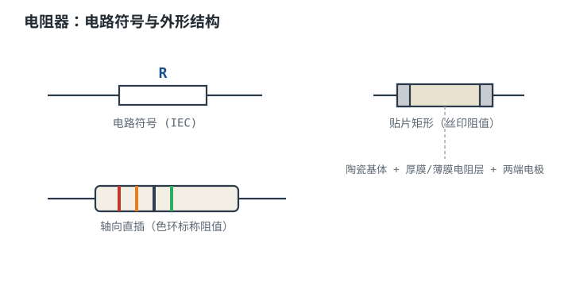
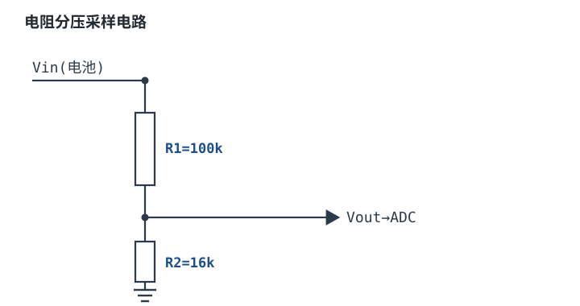
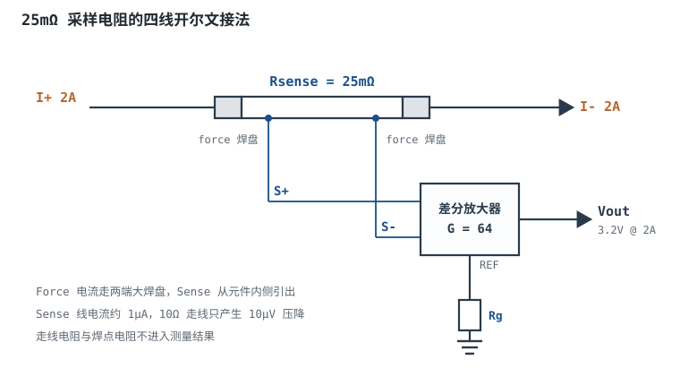

# 电阻器全解：材质、精度、功率、温漂 Resistor

电阻器（Resistor）是最基础、用量最大的无源器件。在[欧姆定律](../basics/ohms-law.md)里，它只是公式中的一个字母 $R$；本章把这个字母拆开：它由什么材料做、能散多少热、随温度漂多少、噪声多大、在多少频率以上就不再是"电阻"。

一个几百元的设计里可能没有一颗 FPGA，但一定有上百颗电阻。它看似最简单，**但选错材质、算错功率余量或忽略采样接法，是现场返修与精度不达标最常见的根因之一。** 电阻的难点不在"阻值"，而在阻值之外的那六个参数：容差、额定功率与降额、TCR、长期漂移、噪声、寄生参数。本章的主线是：先看电阻在电路里的四种角色（每种给一个数量级判据），再把六个参数逐个算清楚，最后用一个 12 位 ADC 的 25mΩ 电流采样设计，从需求一路走到选型、误差预算与开尔文接法。

## 1. 设计动机

::: motivation 四个真实场景，四种摔法
**场景一：限流。** 5V 直接接一颗正向压降 1.9V 的红光 LED，导通后的动态电阻只有几欧到几十欧，电流会冲到几百 mA，几秒内结温超标。串一只 270Ω 后电流是 11.48mA，电阻耗散 35.6mW；如果随手用 0402（额定 0.0625W），在 85°C 环境下只允许 51.5mW，35.6mW 已经占到 69%，长期工作会发黄、漂移。

**场景二：分压。** 24V 电池直接进 3.3V 的 ADC，用 100kΩ 和 16kΩ 分压，标称 24V 时输出 3.310V，看起来"刚刚好"。但电池满电 28V 时输出是 3.862V，超过参考电压，ADC 输入钳位二极管开始导通，读数饱和；电压再高就可能损伤输入。**分压比必须按最高输入电压算，不是按标称电压算。**

**场景三：上拉。** I²C 总线用 10kΩ 上拉，总线电容 100pF，从 0.3VDD 爬到 0.7VDD 需要 847ns，超过快速模式 300ns 的上升时间上限，示波器上看到的是圆角，通信随机出错。换成 3.3kΩ 后是 280ns，才进规范。

**场景四：采样。** 2A 电流流过 25mΩ 采样电阻，产生 50mV、耗散 100mW。若用两线接法，PCB 走线和焊点再串 10mΩ，测量结果直接偏大 40%——比电阻本身 0.5% 的初始精度大了 80 倍。**采样电阻的精度不是买来的，是接法决定的。**
:::

这四个场景的共同点：拓扑都是对的，但"量级"没算。电阻是线性元件，不代表它的非理想参数是线性的；恰恰相反，功率降额、TCR、噪声、寄生参数都随封装、材料、频率强烈变化。先建立一张"问题 → 先算 → 判据"的索引：

| 你遇到的问题 | 先算 | 判据 |
|---|---|---|
| LED 偏暗或烧毁 | $R=(V_S-V_F)/I$，$P=I^2R$ | $P$ 不超过降额后的额定功率，$I$ 不超过器件额定 |
| ADC 读数饱和或不准 | $V_{\text{out}}=V_{\text{in}}R_2/(R_1+R_2)$，$R_{\text{eq}}=R_1\parallel R_2$ | 最高输入下 $V_{\text{out}}<V_{\text{ref}}$；$R_{\text{eq}}$ 满足采样建立时间 |
| 上拉波形圆角、通信失败 | $t_r=0.8473RC$ | $t_r$ 小于总线标准上限，低电平电流不超过驱动能力 |
| 电流采样精度差 | $V=IR$，$P=I^2R$ | burden 电压占电源轨的比例可接受，误差预算小于目标 |
| 电阻发烫、阻值漂移 | $T_{\text{body}}=T_{\text{amb}}+P\theta$，$P_{\text{allow}}(T)$ | 工作点落在降额曲线以内，且留 20°C 以上温度余量 |
| 高频或脉冲下异常 | $f_L=R/(2\pi L)$，$E=P_{\text{pk}}t_p$ | 工作频率远低于寄生转折频率；脉冲能量在数据手册曲线内 |

不算会摔的三个具体代价：5V 加在 10Ω 的 0402 上是 2.5W，是额定功率的 40 倍；25mΩ 采样电阻串 10mΩ 走线，误差 40%；100ppm/°C 的电阻在 50K 温升下漂 0.5%，足以吃掉 12 位 ADC 的大半精度预算。

## 2. 定义与直观

### 2.1 从一块导体到一只电阻

电阻器的定义：**在额定工作范围内，端子电压与流过电流近似成正比、比值 $R$ 为常数的二端元件。** 物理上，它是人为设计的"散射体"：电子在晶格、晶界、碳粒或金属膜中穿行时不断碰撞，把定向漂移的动能交给晶格，宏观上表现为发热。

宏观关系还是[欧姆定律](../basics/ohms-law.md)里的几何式：

$$R=\rho\frac{L}{A}$$

其中 $\rho$ 是材料电阻率，单位 $\Omega\cdot\text{m}$；$L$ 是导体长度，单位 m；$A$ 是截面积，单位 $\text{m}^2$。对薄膜和厚膜电阻，工程上更常用**方块电阻（sheet resistance）**：

$$R_s=\frac{\rho}{t},\qquad R=R_s N_{\text{sq}}$$

其中 $t$ 是膜厚，单位 m；$R_s$ 的单位是 $\Omega/\square$（读作"欧姆每方"）；$N_{\text{sq}}=L/W$ 是方块数，无量纲。这个式子的工程价值在于：**同样一种膜，任意大小的正方形电阻都是同一个阻值**，所以版图设计者只需数方块。

算一个基准：1oz 铜厚 $t=35\ \mu\text{m}$，铜的电阻率 $\rho=1.68\times10^{-8}\ \Omega\cdot\text{m}$，

$$R_s=\frac{1.68\times10^{-8}}{35\times10^{-6}}=4.8\times10^{-4}\ \Omega/\square=0.48\ \text{m}\Omega/\square$$

一条 10 个方块的走线就是 $10\times0.48=4.8$ mΩ。这个数字在大电流采样里非常关键：它和 25mΩ 的采样电阻是同一量级。厚膜电阻的方阻可以从 $10\ \Omega/\square$ 做到 $1\ \text{M}\Omega/\square$，所以同样几何能做出完全不同的阻值；精密电阻还要用激光修调把方块数"修"到目标值。

### 2.2 四种角色与数量级判据

同一只电阻，放在不同位置，设计变量完全不同。下面四种角色覆盖了绝大多数用法，每种给出公式、判据和典型量级。

#### 角色一：限流

限流电阻串在电源与负载之间，承担"电源电压减去负载压降"的那部分电压：

$$R=\frac{V_S-V_F}{I},\qquad P=I^2R$$

其中 $V_S$ 是电源电压（V），$V_F$ 是负载的等效压降（V），$I$ 是目标电流（A）。判据有两条：一是 $R$ 取标准值后反算的电流不超过负载额定值；二是 $P$ 不超过降额后的额定功率的 50%。

**数量级判据：** LED 限流在 5V 供电、1~20mA 时是 $100\ \Omega\sim10\ \text{k}\Omega$；三极管基极电阻在 1kΩ~100kΩ。在 5V 下，100Ω 对应 50mA、1kΩ 对应 5mA——低于 100Ω 通常意味着几十 mA 以上的电流，要检查驱动能力；100kΩ 对应 50µA——高于 100kΩ 通常意味着几十 µA 以下的电流，要检查漏电与噪声。

算例：5V、$V_F=1.9$V、目标 12mA，

$$R=\frac{5-1.9}{0.012}=258.3\ \Omega\ \longrightarrow\ \text{取 E24 的 }270\ \Omega$$

反算电流 $I=3.1/270=11.48$ mA，功耗 $P=0.01148^2\times270=35.6$ mW。这个例子在 4.1 节会完整走一遍降额校验。

BJT 基极电阻同理：集电极电流 100mA、$h_{FE}=100$，基极电流至少 1mA；按 2 倍过驱动取 2mA，$R_B=(3.3-0.7)/0.002=1300\ \Omega$，取 1.3kΩ（E24），功耗 $2.6^2/1300=5.2$ mW。**基极电阻不是"随便串一个"，它决定了三极管是深度饱和还是放大区。**

#### 角色二：分压

分压器把高电压按比例缩小给 ADC 或比较器：

$$V_{\text{out}}=V_{\text{in}}\frac{R_2}{R_1+R_2},\qquad R_{\text{eq}}=R_1\parallel R_2=\frac{R_1R_2}{R_1+R_2}$$

其中 $R_{\text{eq}}$ 是从输出端看进去的戴维南等效电阻（$\Omega$），它决定了后级采样电路的建立时间。

**数量级判据：** 分压总阻一般在 10kΩ~200kΩ。太小则静态电流大、功耗高；太大则 $R_{\text{eq}}$ 大，ADC 采样电容充不满，且高阻节点容易拾取噪声。定量的三条判据：

1. **量程判据**：最高输入电压下 $V_{\text{out,max}}<V_{\text{ref}}$，并留 5%~10% 余量。
2. **负载判据**：分压电流至少是后级负载电流的 100 倍，负载引入的误差才小于 1%。
3. **建立判据**：$R_{\text{eq}}C_s\ln 2^{n+1}\leq t_{\text{sample}}$，其中 $C_s$ 是 ADC 采样电容，$n$ 是位数，$t_{\text{sample}}$ 是采样窗口。

例：24V 电池、$R_1=100$kΩ、$R_2=16$kΩ，标称输出 $24\times16/116=3.310$ V，分压电流 $24/116\text{k}=207\ \mu$A，$R_{\text{eq}}=100\text{k}\parallel16\text{k}=13.79$ kΩ。若 ADC 采样电容 20pF、12 位，建立到 0.5LSB 需要 $13.79\text{k}\times20\text{pF}\times\ln 8192=2.49\ \mu$s——对 1MSPS、300ns 采样窗口的 ADC 来说太慢。这就是"分压电阻不能只按比值选"的定量原因。

#### 角色三：上拉 / 下拉

上拉/下拉给高阻节点一个确定的直流电平，防止 CMOS 输入悬空、MOS 栅极半开、I²C 总线浮空。判据有三条：

1. **漏电判据**：$I_{\text{leak}}R\leq0.1V_{\text{DD}}$。3.3V、1µA 漏电时 $R\leq330$ kΩ。
2. **电平判据**：拉低时 $I_{\text{OL}}\geq(V_{\text{DD}}-V_{\text{OL}})/R$，不能超过驱动器的灌电流能力。
3. **速度判据**：$t_r=RC\ln\frac{1-0.3}{1-0.7}=0.8473RC$。这个系数来自"从 0.3VDD 爬到 0.7VDD"的定义。

**数量级判据：** 通用上拉/下拉 1kΩ~100kΩ；I²C 快速模式 1.8kΩ~4.7kΩ；复位、使能等慢速信号可以用到 100kΩ。1kΩ 以下功耗大，100kΩ 以上抗扰差。

例：3.3V、100pF 总线、3.3kΩ 上拉，$t_r=0.8473\times3300\times100\times10^{-12}=280$ ns，满足快速模式 300ns；拉低电流 $(3.3-0.4)/3300=0.879$ mA，电阻功耗 $(3.3-0.4)^2/3300=2.55$ mW。

#### 角色四：采样

采样电阻把电流转换成电压，是电流环、电池管理、电机驱动、过流保护的入口：

$$V_{\text{sense}}=IR,\qquad P=I^2R,\qquad V_{\text{burden}}=I_{\text{FS}}R$$

其中 $V_{\text{burden}}$ 是满量程时采样电阻从负载回路"偷走"的电压（V）。**数量级判据：** 1mΩ~1Ω。大电流（>1A）用 mΩ 级，小电流（mA）可以用 Ω 级；burden 一般控制在电源轨的 1% 以内，功耗控制在降额后的 50% 以内。

例：25mΩ、2A 时 $V_{\text{sense}}=50$ mV、$P=100$ mW；对 5V 负载 burden 占 1.0%，对 3.3V 负载占 1.52%。如果负载是 3.3V 且对压降敏感，就应改 10mΩ 并把放大器增益从 64 提高到 160，或者接受 1.5% 的 burden。

| 角色 | 核心公式 | 数量级判据 | 最容易忽略的量 |
|---|---|---|---|
| 限流 | $R=(V_S-V_F)/I$ | 100Ω~10kΩ（LED） | 电阻功耗与降额 |
| 分压 | $V_{\text{out}}=V_{\text{in}}R_2/(R_1+R_2)$ | 总阻 10kΩ~200kΩ | 源阻抗与采样建立时间 |
| 上拉/下拉 | $t_r=0.8473RC$ | 1kΩ~100kΩ | 漏电、总线电容、灌电流 |
| 采样 | $V=IR$，$P=I^2R$ | 1mΩ~1Ω | burden、TCR、热电动势、接法 |

### 2.3 串并联与"选不出来的阻值"

E 系列只提供离散值，但串并联可以合成几乎任意阻值：

$$R_{\text{series}}=R_1+R_2,\qquad R_{\text{parallel}}=\frac{R_1R_2}{R_1+R_2}$$

例：$100\ \text{k}\Omega\parallel1\ \text{M}\Omega=100\times1000/1100=90.91$ kΩ；两只 10kΩ 并联是 5kΩ；100kΩ 串 10kΩ 是 110kΩ。

串并联还有两个工程好处：**分摊功率**（两只 0.1W 并联承担 0.2W）和**改善散热**（面积翻倍）。坏处是**引入失配**：并联两只 1% 电阻，等效阻值的误差仍是 1%，但如果两只电阻温度不同，电流分配会不均。精密分压更推荐用同一封装、同一批次、同一 TCR 的配对网络，而不是拿两只独立电阻去"凑"。

## 3. 定量关系

### 3.1 阻值、容差与 E 系列

IEC 60063 定义了优先数系列。第 $n$ 个系列（E$n$）在一个十倍程内有 $n$ 个值，相邻值之比为

$$R_k=10^{k/n},\qquad k=0,1,\dots,n-1$$

相邻步进比是 $10^{1/n}$：E24 为 1.1007（约 10%），E96 为 1.0243（约 2.4%），E192 为 1.0121（约 1.2%）。

容差与步进的关系不是巧合：如果两个标称值相距一个步进比 $s$，那么一个实际值最多偏离标称 $\sqrt{s}$ 就会"更接近邻居"。因此可用的相对容差约为

$$\varepsilon_{\max}=\sqrt{10^{1/n}}-1$$

代入：E24 为 $\sqrt{1.1007}-1=4.91\%$，对应 ±5%；E96 为 $\sqrt{1.0243}-1=1.21\%$，对应 ±1%；E192 为 $\sqrt{1.0121}-1=0.60\%$，对应 ±0.5%。**这就是"E24 配 5%、E96 配 1%"的由来**，不是厂商随意定的。

E24 的全部 24 个尾数（乘 $10^k$ 得到各十倍程）：

| 10 | 11 | 12 | 13 | 15 | 16 | 18 | 20 | 22 | 24 | 27 | 30 |
|---|---|---|---|---|---|---|---|---|---|---|---|
| 33 | 36 | 39 | 43 | 47 | 51 | 56 | 62 | 68 | 75 | 82 | 91 |

E96 在 100Ω~200Ω 区间的常用值：100、102、105、107、110、113、115、118、121、124、127、130、133、137、140、143、147、150、154、158、162、165、169、174、178、182、187、191、196、200。再往上还有 205、210、215、221、226、232、237、243、249、255、261、267、274、280、287、294、301、309、316、324、332、340、348、357、365、374、383、392、402……直到 976。完整 96 个值以 IEC 60063 为准。

选值时的舍入误差可以直接算。需要 258.3Ω：取 E24 的 270Ω，偏差 $270/258.3-1=+4.52\%$；取 E96 的 261Ω，偏差 $261/258.3-1=+1.03\%$。**同样一颗电阻，E96 把舍入误差压到 E24 的约四分之一**，代价是物料更贵、更不好买。

### 3.2 额定功率与降额曲线

电阻的额定功率不是"任何温度下都能散这么多"，而是在某个环境温度（常见 70°C）下的上限；超过这个温度要线性降额，到最高工作温度（常见 155°C）降为零。写成公式：

$$P_{\text{allow}}(T)=P_{\text{rated}}\cdot\frac{T_{\text{zero}}-T}{T_{\text{zero}}-T_{\text{knee}}},\qquad T_{\text{knee}}<T<T_{\text{zero}}$$

其中 $P_{\text{rated}}$ 是 70°C 下的额定功率（W），$T_{\text{knee}}$ 是降额拐点（°C），$T_{\text{zero}}$ 是允许功率归零的温度（°C）。以 70°C/155°C 为例，分母是 $155-70=85$ K。

三个算例：

- 0603、0.1W，环境 100°C：$P_{\text{allow}}=0.1\times(155-100)/85=64.7$ mW。
- 0805、0.125W，环境 85°C：$0.125\times(155-85)/85=102.9$ mW。
- 1206、0.25W，环境 125°C：$0.25\times(155-125)/85=88.2$ mW。

注意最后一行：125°C 时 1206 只剩 88.2mW，已经低于 0603 在 70°C 的 100mW。**"封装大"不等于"高温下还能满功率"，降额曲线比封装尺寸更重要。**

更严格的做法是把自热耦合进去。电阻自身发热会让温度高于环境，而温度升高又降低允许功率，形成一个隐式方程：

$$T_{\text{body}}=T_{\text{amb}}+P\theta_{\text{JA}},\qquad P=P_{\text{allow}}(T_{\text{body}})$$

其中 $\theta_{\text{JA}}$ 是结到环境的热阻（K/W）。设 0805、0.125W、$\theta_{\text{JA}}=300$ K/W、环境 65°C，把降额式代入：

$$P=0.125\times\frac{155-(65+300P)}{85}=\frac{11.25-37.5P}{85}$$

整理得 $85P=11.25-37.5P$，即 $122.5P=11.25$，$P=91.8$ mW。验算：$T_{\text{body}}=65+0.0918\times300=92.5$°C，允许 $0.125\times(155-92.5)/85=91.9$ mW，自洽。**如果只按 65°C 查曲线，会得到 $0.125\times(155-65)/85=132.4$ mW，高估了 $(132.4-91.8)/91.8=44\%$。**

### 3.3 温度系数 TCR

电阻温度系数（Temperature Coefficient of Resistance，TCR）定义为单位温度变化引起的相对阻值变化：

$$\text{TCR}=\frac{1}{R}\frac{dR}{dT}\quad\Longrightarrow\quad\frac{\Delta R}{R}=\text{TCR}\cdot\Delta T$$

单位是 ppm/°C（$1\ \text{ppm}=10^{-6}$）。在几十 K 的范围内线性近似足够：100ppm/°C、温升 60K，$\Delta R/R=100\times10^{-6}\times60=0.6\%$。

不同工艺的量级差别很大：

| 材质 | 典型 TCR | 典型容差 | 电流噪声 | 适用 |
|---|---|---|---|---|
| 碳膜 Carbon Film | $-200\sim-500$ ppm/°C | ±2%~±5% | 大（噪声指数 0.1~3 µV/V） | 低成本、非精密 |
| 厚膜贴片 Thick Film | ±100~±200（可到 ±300）ppm/°C | ±1%~±5% | 中（0.05~0.5 µV/V） | 量产主力、上拉、限流 |
| 金属膜 Metal Film | ±25~±100 ppm/°C | ±0.1%~±1% | 小（0.01~0.1 µV/V） | 模拟信号、精密分压 |
| 薄膜贴片 Thin Film | ±5~±25 ppm/°C | ±0.05%~±0.5% | 很小 | 精密放大、基准 |
| 金属箔 Foil | ±0.2~±2 ppm/°C | ±0.001%~±0.1% | 极小 | 仪器基准、精密电桥 |
| 线绕 Wirewound | ±20~±50 ppm/°C | ±0.1%~±1% | 小 | 大功率、低阻，高频慎用 |
| 合金采样条 Metal Strip | ±25~±75 ppm/°C | ±0.1%~±1% | 小 | 大电流采样 |

TCR 在分压器里有一个重要性质：**如果两只电阻的 TCR 相同，比值漂移会一阶抵消。** 设 $k=R_2/(R_1+R_2)$，对 $k$ 取对数微分：

$$\frac{\Delta k}{k}=\frac{R_1}{R_1+R_2}\left(\frac{\Delta R_2}{R_2}-\frac{\Delta R_1}{R_1}\right)=\frac{R_1}{R_1+R_2}(\text{TCR}_2-\text{TCR}_1)\Delta T$$

代入 $R_1=100$kΩ、$R_2=16$kΩ，系数 $100/116=0.862$。若两只电阻 TCR 相差 50ppm/°C、温升 60K，则 $\Delta k/k=0.862\times50\times10^{-6}\times60=0.259\%$；如果 TCR 相同，这一项为零。**精密分压要选"同 TCR"的配对，而不是各自选高精度。** 这也是电阻网络（resistor network）存在的理由：同一基片上的多只电阻 TCR 跟踪可以做到 5ppm/°C 以内。

自热也会通过 TCR 变成误差。25mΩ 采样电阻耗散 100mW，按 0.5W 额定的降额等效热阻 $\theta_{\text{eq}}=170$ K/W（见 5.1 节），温升 $0.1\times170=17$ K；若 TCR 为 25ppm/°C，附加误差 $25\times10^{-6}\times17=0.0425\%$；若 TCR 是 100ppm/°C，则是 0.17%。**低 TCR 不只是为了环境温度，也是为了自己的发热。**

### 3.4 长期漂移与老化

数据手册里的"负载寿命（load life）"通常规定：额定功率、70°C、1000h 后阻值变化不超过某个百分比。典型量级：

- 厚膜贴片：0.1%~1%（1000h，额定功率，70°C）；
- 金属膜/薄膜：0.01%~0.1%；
- 金属箔：小于 0.01%，部分型号标 25ppm/年（0.0025%/年）。

这些数字是**特定试验条件下的上限**，不是"每年漂这么多"的线性外推。实际漂移与温度、功率、湿度、机械应力都有关，通常前期快、后期慢，近似按时间的对数或平方根变化。工程上的正确用法是：**按数据手册的试验条件确认量级，再按最坏情况留预算，不要拿 1000h 的数据线性外推到 10 年。**

厚膜电阻还有一个容易被忽略的失效模式：**硫化（sulfur corrosion）**。含硫环境（橡胶、润滑油、某些工业大气）会腐蚀厚膜电阻的端电极，导致开路。抗硫化型号在端电极上加了保护层，成本略高；户外、汽车、工业场景要专门确认。

### 3.5 噪声

电阻的噪声有两类，来源不同，量级也不同。

**热噪声（Johnson-Nyquist noise）** 来自载流子的热运动，任何电阻都有，与材料无关：

$$e_n=\sqrt{4kTR\Delta f}$$

其中 $k=1.380649\times10^{-23}$ J/K 是玻尔兹曼常数，$T$ 是绝对温度（K），$R$ 是阻值（$\Omega$），$\Delta f$ 是带宽（Hz），$e_n$ 是噪声有效值（V）。噪声密度是 $\sqrt{4kTR}$，单位 $\text{V}/\sqrt{\text{Hz}}$。

室温 300K 下：

- 1kΩ：$\sqrt{4\times1.38\times10^{-23}\times300\times1000}=4.07\ \text{nV}/\sqrt{\text{Hz}}$；
- 100kΩ：$40.7\ \text{nV}/\sqrt{\text{Hz}}$，在 1kHz 带宽内 $40.7\times\sqrt{1000}=1.29\ \mu$V；
- 100kΩ 在 20kHz 音频带宽内：$40.7\times\sqrt{20000}=5.76\ \mu$V；
- 1MΩ 在 10kHz 带宽内：$\sqrt{4\times1.38\times10^{-23}\times300\times10^6\times10^4}=12.9\ \mu$V。

**电流噪声（excess noise / current noise）** 只在有直流电流流过时出现，来自导电颗粒之间的接触起伏，与材料工艺强相关。它用**噪声指数（noise index）** 表示：每伏直流压降、每个十倍频程内产生的噪声有效值，单位 µV/V。碳膜约 0.1~3 µV/V，金属膜约 0.01~0.1 µV/V，厚膜介于两者之间。

例：1MΩ 电阻上有 10V 直流压降，噪声指数 1 µV/V，则每个十倍频程 10µV；10Hz~10kHz 共 3 个十倍频程，按不相关叠加 $\sqrt{3}\times10=17.3\ \mu$V，已经超过同带宽的热噪声 12.9µV。**高阻、高压降的节点，电流噪声可能比热噪声更大，必须选金属膜或薄膜。**

分压器的总噪声不是简单相加，而要按分压比折算。100kΩ 与 16kΩ 分压、1kHz 带宽：100kΩ 的热噪声 1.287µV 被分压比 $16/116=0.138$ 衰减到 0.178µV；16kΩ 的热噪声 $0.515\ \mu$V 被 $100/116=0.862$ 衰减到 0.444µV；两者不相关，总噪声 $\sqrt{0.178^2+0.444^2}=0.478\ \mu$V。**噪声主要由"输出端看到的最大的那只电阻"决定，而不是总阻值。**

### 3.6 脉冲与浪涌

连续额定功率描述的是"长期平均散热"，脉冲能力描述的是"短时间内的局部极限"，两者不是一回事。数据手册通常给一张**峰值功率—脉宽曲线**：脉宽越短，允许的峰值功率越高。

工程估算分两步。第一步算能量：

$$E=P_{\text{pk}}t_p,\qquad P_{\text{avg}}=E f=P_{\text{pk}}t_p f$$

其中 $P_{\text{pk}}$ 是脉冲峰值功率（W），$t_p$ 是脉宽（s），$f$ 是重复频率（Hz）。第二步看平均功率是否超过降额后的连续额定值；平均功率过关，再查峰值是否在脉冲曲线内。

例：1206、0.25W，100µs 脉冲、峰值 5W（20 倍连续额定），重复频率 1kHz：

$$E=5\times100\times10^{-6}=5\times10^{-4}\ \text{J}=0.5\ \text{mJ}$$

$$P_{\text{avg}}=0.5\times10^{-3}\times1000=0.5\ \text{W}$$

平均 0.5W 已经是连续额定的 2 倍，**这个脉冲串不允许**。若要把平均功率压到 50% 降额（0.125W），最高重复频率是 $0.125/(0.5\times10^{-3})=250$ Hz。

为什么 0.5mJ 的脉冲平均发热看起来很小，却仍然危险？因为能量在电阻膜里是局部集中的。做一个绝热估算：1206 陶瓷基体质量按 8mg、比热按 800 J/(kg·K)，

$$\Delta T=\frac{E}{mc}=\frac{0.5\times10^{-3}}{8\times10^{-6}\times800}=0.078\ \text{K}$$

平均温升只有 0.078K，说明**失效不是整体过热，而是膜层局部热点、电流拥挤或电压击穿**。所以脉冲能力必须查曲线，不能只算平均功率；同时要检查峰值电压是否超过最大工作电压。

### 3.7 寄生电感、电容与自谐振

真实电阻的集总模型是"串联电感 + 电阻体与寄生电容并联"：

$$Z=j\omega L+\frac{R}{1+j\omega R C_p}$$

低频时 $Z\approx R$；频率升高后，$C_p$ 先旁路电阻体，阻抗下降；更高频，$L$ 的感抗主导，阻抗上升。两个转折频率最有用：

$$f_C=\frac{1}{2\pi RC_p},\qquad f_L=\frac{R}{2\pi L}$$

其中 $L$ 是串联电感（H），$C_p$ 是并联电容（F）。$f_C$ 是容抗等于电阻的频率——高阻电阻在此之上呈容性；$f_L$ 是感抗等于电阻的频率——低阻电阻在此之上呈感性。两者相等时 $R=\sqrt{L/C_p}$，对应封装寄生的 LC 谐振频率：

$$f_0=\frac{1}{2\pi\sqrt{LC_p}}$$

$f_0$ 是"这颗电阻还能不能当电阻用"的最终上限；在它附近阻抗出现峰谷，之后由封装电抗主导。工程上更常用 $f_L$ 和 $f_C$ 作为实用判据，因为它们直接告诉你"阻抗偏离标称值多少"。

典型寄生量级：0402 约 0.4~0.7nH，0603 约 0.7~1nH，0805 约 1~1.5nH，1206 约 1.5~2nH，2512 约 2~3nH；轴向直插 5~10nH；线绕可达 µH 级。并联电容约 0.05~0.5pF。

算例：2512 采样电阻 50mΩ、$L=2$nH，在 4MHz 时感抗 $2\pi\times4\times10^6\times2\times10^{-9}=0.0503\ \Omega$，与 50mΩ 同量级；阻抗模 $|Z|=\sqrt{0.05^2+0.0503^2}=0.0709\ \Omega$，比标称值高 41.8%。这颗电阻的 $\sqrt{L/C_p}$ 按 $C_p=0.2$pF 算是 $\sqrt{(2\times10^{-9})/(0.2\times10^{-12})}=100\ \Omega$，50mΩ 远小于它，所以表现为"先到 $f_L$、后到 $f_0$"；$f_L=3.98$MHz，$f_0=7.96$GHz。**在 4MHz 以上，这颗"50mΩ"已经不是 50mΩ 了。**

高阻电阻的问题相反：100kΩ、$C_p=0.2$pF，$f_C=1/(2\pi\times10^5\times0.2\times10^{-12})=7.96$ MHz；1kΩ 的 $f_C$ 是 795.8MHz。所以**高阻值电阻的带宽反而更窄**，精密放大器的反馈电阻到了几 MHz 就要考虑并联电容补偿。

### 3.8 最大工作电压与电压系数

电阻有两个独立的上限：功率上限和电压上限。前者由散热决定，后者由封装尺寸、端电极间距和绝缘决定。常见量级：0402 约 50V，0603 约 75V，0805 约 150V，1206 约 200V，2512 约 200V（具体以数据手册为准）。

例：1MΩ、0805，接 200V，功率 $200^2/10^6=40$ mW，远低于 0.125W；但 200V 已超过 0805 的典型最大工作电压 150V，应该用两只 500kΩ 串联，每只承压 100V、耗散 10mW。**"功率没超"不代表"电压没超"。**

厚膜电阻还有微弱的电压系数（voltage coefficient），典型 0.1~1 ppm/V：200V 下阻值变化 20~200ppm，即 0.002%~0.02%。对一般电路可以忽略，对 ppm 级精密分压则要计入。

## 4. 典型计算

### 4.1 算例一：LED 限流，从 258Ω 到 270Ω

**需求**：5V 电源点亮红光 LED，$V_F=1.9$V（典型值，以数据手册为准），目标电流 12mA，环境最高 85°C。

**第一步，算限流电阻：**

$$R=\frac{V_S-V_F}{I}=\frac{5-1.9}{0.012}=258.3\ \Omega$$

E24 没有 258.3Ω，取 270Ω。

**第二步，用实际阻值反算电流：**

$$I=\frac{3.1}{270}=0.01148\ \text{A}=11.48\ \text{mA}$$

比目标低 4.3%，肉眼几乎看不出。

**第三步，算电阻功耗：**

$$P=I^2R=0.01148^2\times270=3.56\times10^{-2}\ \text{W}=35.6\ \text{mW}$$

**第四步，按 85°C 降额校验。** 0402 额定 0.0625W，85°C 时

$$P_{\text{allow}}=0.0625\times\frac{155-85}{85}=51.5\ \text{mW}$$

35.6mW 占 69%，超过 50% 的降额目标，长期高温下不合适。0603 额定 0.1W，85°C 时 $0.1\times70/85=82.4$ mW，35.6mW 占 43%，可以接受。**同一颗电阻，换封装就从不合格变成合格，差别不在阻值。**

### 4.2 算例二：24V 电池分压，比值、源阻抗与建立时间

**需求**：24V 电池（最高 28V）分压给 3.3V、12 位 ADC，采样窗口 300ns，采样电容 20pF。

先看一个常见取值：$R_1=100$kΩ、$R_2=16$kΩ。

**第一步，算标称输出：**

$$V_{\text{out}}=24\times\frac{16}{116}=3.310\ \text{V}$$

**第二步，算最高输入：**

$$V_{\text{out,max}}=28\times\frac{16}{116}=3.862\ \text{V}$$

超过 3.3V 参考 17%，ADC 会饱和；若输入端没有限流电阻，钳位二极管电流可能损坏引脚。**这个分压比按 24V 设计，但电池满电是 28V，设计输入选错了。**

**第三步，按 30V 最高输入重选比值。** 目标 $V_{\text{out}}\leq3.3$V，取 5% 余量，允许最高 3.135V：

$$k=\frac{3.135}{30}=0.1045$$

选 $R_2/(R_1+R_2)=0.1045$，即 $R_1/R_2=8.57$。取 $R_1=100$kΩ、$R_2=11.8$kΩ（E96），实际 $k=11.8/111.8=0.1055$，30V 时输出 $30\times0.1055=3.166$V，仍低于 3.3V。

**第四步，算源阻抗与建立时间。** $R_{\text{eq}}=100\text{k}\parallel11.8\text{k}=10.56$kΩ。12 位建立到 0.5LSB 需要

$$t=10.56\times10^3\times20\times10^{-12}\times\ln 2^{13}=2.11\times10^{-7}\times9.011=1.90\ \mu\text{s}$$

仍然大于 300ns。要满足 300ns，$R_{\text{eq}}\leq300\times10^{-9}/(20\times10^{-12}\times9.011)=1.665$kΩ。按同样比值（约 8.5），取 $R_1=14.0$kΩ、$R_2=1.65$kΩ（E96），$R_{\text{eq}}=14\text{k}\parallel1.65\text{k}=1.477$kΩ，建立时间 $1.477\text{k}\times20\text{pF}\times9.011=266$ns，满足。

**第五步，算功耗与选型。** 30V 时分压电流 $30/(15.65\text{k})=1.917$mA；$R_1$ 上压降 $30-3.166=26.83$V，功耗 $26.83^2/14\text{k}=51.4$mW。0603 在 85°C 只允许 82.4mW，占 62%，超过 50% 目标；改 0805（0.125W，允许 102.9mW，占 50%）刚好，或把总阻提高到 2 倍、接受更长的建立时间并加缓冲器。

**结论**：分压电阻的取值是三件事的折中——量程（按最高输入）、源阻抗（按 ADC 建立时间）、功耗（按降额）。只按"24V 变 3.3V"算比值，三个都会错。精度上，两只 ±1% 独立电阻的比值最坏误差是 $0.862\times(1\%+1\%)=1.72\%$，对应 3.31V 上 57mV、约 71 个 12 位 LSB；要进 1 个 LSB，必须用 0.1% 配对网络或逐板校准。

### 4.3 算例三：I²C 上拉，847ns 与 280ns

**需求**：3.3V I²C 快速模式（400kHz），总线电容 100pF，上升时间上限 300ns，$V_{\text{OL}}=0.4$V。

**第一步，算上拉上限：**

$$t_r=0.8473RC\quad\Longrightarrow\quad R\leq\frac{300\times10^{-9}}{0.8473\times100\times10^{-12}}=3.54\ \text{k}\Omega$$

**第二步，取标准值并验算。** 取 3.3kΩ：

$$t_r=0.8473\times3300\times100\times10^{-12}=2.80\times10^{-7}\ \text{s}=280\ \text{ns}$$

满足。若取 10kΩ：$t_r=847$ns，超标 182%，这就是"上拉太大导致通信不稳"的定量解释。

**第三步，校验低电平电流与功耗：**

$$I_{\text{OL}}=\frac{3.3-0.4}{3300}=0.879\ \text{mA},\qquad P=\frac{(3.3-0.4)^2}{3300}=2.55\ \text{mW}$$

大多数 MCU 的 I²C 引脚可以灌 3mA 以上，0.879mA 安全。如果总线电容是 200pF，同样 3.3kΩ 的上升时间是 559ns，必须降到 1.65kΩ；这时低电平电流升到 1.76mA，仍可接受，但功耗翻倍。

### 4.4 完整设计：12 位 ADC 的 25mΩ 电流采样

这是一个从需求到验算的完整设计例子。目标：测量 0~2A 负载电流，用 12 位 ADC 读取，满量程精度优于 1%，环境最高 60°C。

**需求与假设：**

| 项目 | 要求/假设 |
|---|---|
| 负载电流 | 0~2A |
| 负载电源 | 5V（burden 目标 ≤1%） |
| ADC | 12 位，$V_{\text{ref}}=3.3$V，INL ±1LSB，基准精度 0.1% |
| 放大器 | 差分/仪表放大器，增益 $G=64$，增益误差 0.1%，失调 25µV，CMRR ≥100dB |
| 采样电阻 | 25mΩ，待定精度/TCR/封装 |
| 环境 | 最高 60°C，自然对流 |
| 目标精度 | 满量程 1%（最坏情况） |

**第 1 步：定采样电阻值。** 满量程压降取 50mV：

$$R=\frac{V_{\text{FS}}}{I_{\text{FS}}}=\frac{0.05}{2}=0.025\ \Omega=25\ \text{m}\Omega$$

burden 校验：对 5V 负载是 $0.05/5=1.0\%$，对 3.3V 负载是 $0.05/3.3=1.52\%$。如果负载是 3.3V 且不能接受 1.5%，应改 10mΩ、把增益提到 160，或给采样点加一只高边电流检测放大器。

**第 2 步：算功耗与封装。** 2A 时

$$P=I^2R=2^2\times0.025=0.1\ \text{W}=100\ \text{mW}$$

选 1206、额定 0.5W 的金属条电阻（典型量级，具体以数据手册为准）：60°C 低于 70°C 拐点，不降额，100mW 占 20%。若环境升到 100°C，允许功率 $0.5\times(155-100)/85=323.5$ mW，100mW 占 31%，仍安全。

**第 3 步：算自热与 TCR 误差。** 1206 的降额等效热阻 $\theta_{\text{eq}}=(155-70)/0.5=170$ K/W（见 5.1 节），自热温升

$$\Delta T=P\theta_{\text{eq}}=0.1\times170=17\ \text{K}$$

本体温度 $60+17=77$°C，相对 25°C 的温升是 52K。若 TCR 为 25ppm/°C：

$$\frac{\Delta R}{R}=25\times10^{-6}\times52=0.13\%$$

若 TCR 为 50ppm/°C，则是 0.26%。**TCR 从 50 降到 25，误差减半，这就是选低 TCR 合金条的理由。**

**第 4 步：算热电动势。** 采样电阻的两种金属连接处会形成热电偶。按铜—锰铜结点 $2\ \mu\text{V}/^{\circ}\text{C}$ 的量级，电阻两端有 5K 温度梯度时：

$$V_{\text{TE}}=2\times5=10\ \mu\text{V}$$

折算成电流误差 $10\mu\text{V}/25\text{m}\Omega=0.4$ mA，占满量程 $0.4/2000=0.02\%$。看起来很小，但它会随温度梯度漂移，且无法用增益校准消除。更严重的是低电流端：在 10% 满量程（0.2A）时，采样电压只有 5mV，10µV 就是读数的 0.2%；在 1% 满量程（20mA）时，采样电压 0.5mV，热电动势已经是读数的 2%。**热电动势决定的是"低端精度"，不是"满量程精度"。**

**第 5 步：定放大器增益与 ADC 满量程。** 采样电压 50mV，取 $G=64$：

$$V_{\text{out}}=50\ \text{mV}\times64=3.2\ \text{V}$$

占 3.3V 参考的 97%，留 0.1V 余量，合适。ADC 的 1LSB 是

$$V_{\text{LSB}}=\frac{3.3}{2^{12}}=8.057\times10^{-4}\ \text{V}=805.7\ \mu\text{V}$$

折算到采样电阻输入端是 $805.7/64=12.59\ \mu$V，折算到电流是 $12.59\mu\text{V}/25\text{m}\Omega=0.504$ mA。**12 位分辨率对应约 0.5mA，已经优于 1% 指标（20mA）40 倍，瓶颈不在 ADC 位数，而在模拟前端。**

**第 6 步：算共模抑制。** 高边采样时放大器输入端有约 5V 共模。CMRR 为 80dB（$10^4$）时，输入折算误差

$$V_{\text{err,cm}}=\frac{5}{10^4}=500\ \mu\text{V}$$

折算成电流 $500\mu\text{V}/25\text{m}\Omega=20$ mA，正好是满量程的 1%——**仅 CMRR 一项就吃掉了全部预算。** 所以必须选 CMRR ≥100dB（$10^5$）的器件：$5/10^5=50\ \mu$V，对应 2mA、0.1%。

**第 7 步：算噪声。** 采样电阻的热噪声在 10kHz 带宽内：

$$e_{n,R}=\sqrt{4\times1.38\times10^{-23}\times300\times0.025\times10^4}=2.03\times10^{-9}\ \text{V}=2.0\ \text{nV}$$

可以忽略。放大器噪声按 20nV/√Hz 估算，10kHz 带宽内 $20\times\sqrt{10000}=2\ \mu$V，折算电流 80µA，占满量程 0.004%。**低阻采样电阻的热噪声极小，前端噪声由放大器决定。**

**第 8 步：开尔文接法。** 如果采用两线接法，电流走线和焊点会串入测量路径。按额外 10mΩ 估算，相对 25mΩ 的误差是 $10/25=40\%$。四线开尔文接法把大电流路径（force）和电压检测路径（sense）分开：force 从电阻两端的大焊盘进出，sense 从电阻内侧的小焊盘引出，检测路径几乎没有电流，走线电阻不产生压降。

sense 路径本身也不是完全没有误差。若 sense 走线各 10Ω、放大器偏置电流 1µA，压降是 $1\mu\text{A}\times10\Omega=10\ \mu$V，与热电动势同量级。所以 sense 走线要短、对称、远离热源，必要时加 RC 滤波（但滤波电阻会与偏置电流产生新的误差）。

**第 9 步：做误差预算。** 先按 0.5%、50ppm/°C 的采样电阻算：

| 误差项 | 计算 | 占满量程 |
|---|---|---|
| 初始容差 | 0.5% | 0.500% |
| TCR | $50\times10^{-6}\times52$ | 0.260% |
| 热电动势 | $10\mu\text{V}/50\text{mV}$ | 0.020% |
| 放大器增益 | 0.1% | 0.100% |
| 放大器失调 | $25\mu\text{V}/50\text{mV}$ | 0.050% |
| CMRR（100dB） | $5\text{V}/10^5/50\text{mV}$ | 0.100% |
| 基准 | 0.1% | 0.100% |
| ADC INL | $1/4096$ | 0.024% |

最坏情况线性相加：$0.5+0.26+0.02+0.1+0.05+0.1+0.1+0.024=1.154\%$，超过 1%。按均方根合成：

$$\varepsilon_{\text{RSS}}=\sqrt{0.5^2+0.26^2+0.02^2+0.1^2+0.05^2+0.1^2+0.1^2+0.024^2}\%=0.59\%$$

RSS 达标，但最坏情况不达标。**批量生产要按最坏情况或做校准，不能拿 RSS 当保证值。**

**第 10 步：改选 0.1%、25ppm/°C 的采样电阻。** 初始容差降到 0.1%，TCR 降到 0.13%：

$$\varepsilon_{\text{worst}}=0.1+0.13+0.02+0.1+0.05+0.1+0.1+0.024=0.624\%$$

$$\varepsilon_{\text{RSS}}=\sqrt{0.1^2+0.13^2+0.02^2+0.1^2+0.05^2+0.1^2+0.1^2+0.024^2}\%=0.246\%$$

两项都满足 1%。代价是采样电阻成本上升，但换来的是**不需要逐板校准**。另一条路是保留 0.5% 电阻、做增益校准：校准可以消掉初始容差和放大器增益误差，剩余最坏 $0.26+0.02+0.05+0.1+0.1+0.024=0.554\%$，也达标；但校准只能在一个温度点做，TCR 仍会随温度漂。

**第 11 步：验算工作点。**

| 负载电流 | 采样电压 | 放大器输出 | 采样电阻功耗 |
|---|---|---|---|
| 0.2A | 5mV | 0.32V | 1mW |
| 0.5A | 12.5mV | 0.80V | 6.25mW |
| 1A | 25mV | 1.60V | 25mW |
| 2A | 50mV | 3.20V | 100mW |

四组都满足 $V=IR$、$P=I^2R$，且 2A 时 100mW 低于 1206 在 60°C 的允许值。放大器输出 3.2V 低于 3.3V，留 0.1V 余量。

**结论**：选 25mΩ、0.1%、25ppm/°C、1206、0.5W 的金属条采样电阻，四线开尔文接法；放大器增益 64、CMRR ≥100dB、失调 ≤25µV；12 位 ADC 的 1LSB 约 0.5mA。最坏情况误差 0.62%，RSS 0.25%，满足 1% 目标。若改用 0.5%/50ppm 的电阻，最坏 1.15%，必须逐板校准或放宽指标。

## 5. 工程含义

### 5.1 封装、额定功率与等效热阻

把降额曲线反推，可以得到一个"降额等效热阻"：

$$\theta_{\text{eq}}=\frac{T_{\text{zero}}-T_{\text{knee}}}{P_{\text{rated}}}=\frac{155-70}{P_{\text{rated}}}=\frac{85}{P_{\text{rated}}}$$

它的含义是：在 70°C 环境、满载额定功率时，器件内部热点相对环境上升 85K。这个数比实测的"结到环境热阻"保守，因为它包含了数据手册的安全余量和标准测试板的散热条件，但**它与降额曲线自洽，适合做设计估算**。

| 封装 | 典型额定功率（70°C） | 降额等效热阻 $\theta_{\text{eq}}$ | 典型最大工作电压 |
|---|---|---|---|
| 0201 | 0.05W | 1700 K/W | 25V |
| 0402 | 0.0625W | 1360 K/W | 50V |
| 0603 | 0.1W | 850 K/W | 75V |
| 0805 | 0.125W | 680 K/W | 150V |
| 1206 | 0.25W | 340 K/W | 200V |
| 1210 | 0.33W | 258 K/W | 200V |
| 2010 | 0.75W | 113 K/W | 200V |
| 2512 | 1W | 85 K/W | 200V |
| 1206 高功率 | 0.5W | 170 K/W | 200V |
| 2512 高功率 | 2W | 42.5 K/W | 200V |

（额定功率与最大工作电压为典型量级，不同厂商、不同系列差异很大，以具体数据手册为准。）

用法示例：0603、50mW，环境 60°C，自热温升 $0.05\times850=42.5$K，本体温度 102.5°C；该温度下允许 $0.1\times(155-102.5)/85=61.8$ mW，50mW 占 81%，超过 50% 目标，应该换 0805（$\theta_{\text{eq}}=680$，温升 34K，本体温度 94°C，允许 $0.125\times61/85=89.7$mW，50mW 占 56%）或降低功耗。

### 5.2 E24/E96 速查与选值

| 场景 | 推荐系列 | 理由 |
|---|---|---|
| 限流、上拉、普通分压 | E24（±5%） | 便宜、好买，5% 精度够用 |
| 一般模拟信号、1% 分压 | E96（±1%） | 舍入误差 1.2%，精度与成本平衡 |
| 精密放大、基准、电桥 | E96/E192 + 0.1% | 舍入误差 0.6%，配合低 TCR |
| 需要任意比值 | E96 + 串并联 | 用两只电阻合成，注意失配与 TCR 跟踪 |
| 0Ω 跳线/配置 | 0Ω 电阻 | 比焊锡跳线可返修，注意额定电流 |

选值三步：先算理论值；再选最近的 E 系列值并反算实际电流/电压；最后校验容差、功耗、TCR 和封装。**不要跳过"反算"这一步**——4.1 节的 258.3Ω 取 270Ω 后电阻值偏高 4.52%，电流从 12mA 变成 11.48mA；对 LED 无所谓，对精密分压就必须用 E96 或校准。

### 5.3 按位置选材质

- **电源限流、上拉/下拉、普通分压**：厚膜贴片足够，1% 或 5%，成本最低。注意高温降额和硫化环境。
- **运放反馈、ADC 分压、传感器前端**：金属膜或薄膜，0.1%~1%，TCR ≤25ppm/°C，低噪声。高阻节点优先金属膜，避免电流噪声。
- **精密基准、电桥、仪表**：金属箔或配对网络，0.01%~0.1%，TCR 跟踪 ≤5ppm/°C。注意热电动势：不同金属结点会产生 µV 级误差，布局上让两结点等温。
- **大电流采样**：合金条（metal strip）或四端子采样电阻，TCR ≤50ppm/°C，开尔文接法。不要用普通厚膜，它的 TCR 和热电动势都太大。
- **大功率、制动、泄放**：厚膜功率电阻、绕线或水泥电阻；绕线的高频寄生电感大，脉冲/高频场合慎用。
- **高频**：薄膜贴片，0402/0603 小封装；避免绕线和长引线。射频场合还要看电阻的寄生电容和封装谐振。

### 5.4 降额与可靠性

工程降额规则可以总结成一张表：

| 项目 | 推荐降额 | 说明 |
|---|---|---|
| 连续功率 | ≤50%~70% 额定（按温度降额后） | 高温、密闭、无铜箔散热时取更保守 |
| 最大工作电压 | ≤80% 额定 | 高压、高阻值尤其要查 |
| 工作温度 | 本体温度比最高额定低 20°C 以上 | 用自热后的本体温度，不是环境温度 |
| 脉冲 | 按数据手册脉冲曲线，平均功率也校核 | 峰值、能量、重复频率三者都要看 |
| 长期漂移 | 按 1000h 试验值留 2~3 倍预算 | 不要线性外推到 10 年 |
| 汽车/工业 | 选 AEC-Q200 认证型号 | 温度循环、耐湿、硫化都有专门试验 |

降额不是"保险系数越大越好"：过大的降额意味着更大的封装、更大的寄生参数和更高的成本。**合理的做法是先算实际本体温度，再按曲线留 20~30°C 余量**，而不是一律"功率减半"。

### 5.5 测量与验证

**四线法测低阻。** 普通两线万用表的表笔和接触电阻约 0.1~0.3Ω，测 25mΩ 时误差可达 $0.2/0.025=800\%$。四线法用一对线通电流、另一对线测电压，把引线电阻排除在外。台式万用表的 4W 模式、毫欧计、电池内阻仪都是这个原理。

**测 TCR。** 在 25°C 和 85°C 各测一次阻值：

$$\text{TCR}=\frac{R_{85}-R_{25}}{R_{25}(85-25)}$$

例：100.00Ω 在 85°C 变成 100.60Ω，TCR $=0.60/(100\times60)=1.0\times10^{-4}\ /^{\circ}\text{C}=100$ ppm/°C。注意测量前要让电阻在目标温度稳定足够长时间，且测量电流不能引起自热。

**测噪声。** 用低噪声放大器加频谱仪，或者用示波器的 AC 耦合、20MHz 带宽限制看峰峰值，再换算有效值。测量时要屏蔽、短接输入端测本底，否则测到的是环境噪声。

**在板测量。** 电阻在板上与其他元件并联，直接测阻值会偏小；要断开一端或分析并联路径。电流采样电阻的走线电阻也会并入，必须用四线法在焊盘上取点。测量方法见[万用表与基本测量](../practice/multimeter.md)。

## 6. 常见坑

::: pitfall 常见坑
- **只按标称功率选，不看降额曲线**：现象——0603 电阻长期工作在 0.1W，几个月后发黄、阻值漂移甚至开路。原因——额定功率是 70°C 下的值，实际环境温度、密闭壳体、铜箔散热都会降低有效额定值；100°C 时 0603 只剩 64.7mW。解决——先算实际本体温度（环境 + 自热），再按降额曲线把功耗压到允许值的 50%~70%；高温环境换 0805/1206 或并联分摊。
- **分压电阻只看比值，不看源阻抗**：现象——ADC 读数跳变、偏低，换一块板又正常。原因——$R_1\parallel R_2$ 太大，ADC 采样电容在采样窗口内充不满；高阻节点还容易拾取工频噪声。解决——按 $R_{\text{eq}}C_s\ln2^{n+1}\leq t_{\text{sample}}$ 反算最大源阻抗；做不到就降低总阻、加缓冲器，或在 ADC 前加 RC 但注意建立时间。
- **忽略 TCR 与自热，以为 0.1% 就是 0.1%**：现象——常温校准好的电路，高温下读数偏 0.5% 以上。原因——初始容差只是误差的一部分，TCR、自热、长期漂移都会叠加；100ppm/°C 在 50K 温升下就是 0.5%。解决——把 TCR、自热、老化都列进误差预算；精密位置选 25ppm/°C 以下，并用同 TCR 的配对网络做分压。
- **低阻采样用两线接法**：现象——25mΩ 采样电阻的读数比实际电流大 30%~50%，而且随板子不同而不同。原因——走线、焊点、过孔的电阻串进了测量路径；10mΩ 相对 25mΩ 就是 40%。解决——四线开尔文接法，force 走大焊盘、sense 从元件内侧引出；sense 走线短、对称、远离热源。
- **用平均功率判断脉冲能力**：现象——脉冲电路里的电阻明明平均功率没超，却在使用一段时间后开路。原因——脉冲的局部热点、电流拥挤和电压击穿与平均功率无关；0.5mJ 的脉冲平均温升只有 0.078K，但膜层局部可能已经超限。解决——查数据手册的脉冲功率—脉宽曲线，同时校核峰值功率、单脉冲能量、重复频率和峰值电压。
- **高频/大阻值忽略寄生参数**：现象——高频电路里 100kΩ 反馈电阻的增益比计算值低，或者 50mΩ 采样电阻在几 MHz 上波形失真。原因——高阻值的并联电容使 $f_C=1/(2\pi RC_p)$ 降低（100kΩ 配 0.2pF 只有 7.96MHz）；低阻值的串联电感使 $f_L=R/(2\pi L)$ 降低（50mΩ 配 2nH 只有 3.98MHz）。解决——高频选小封装薄膜电阻，必要时并联电容补偿；低阻采样看厂商的高频模型，别把直流阻值当高频阻抗。
- **忽略最大工作电压**：现象——1MΩ 电阻接 200V，功率只有 40mW 却打火或阻值永久漂移。原因——电阻还有独立的电压上限，0805 典型 150V、0603 约 75V，超过会沿端电极或封装表面击穿。解决——同时校核功率和电压；高压用多只串联分压，或选高压专用型号。
:::

## 7. 自测题

0603、0.1W 的电阻工作在 105°C 环境，允许耗散多少功率？如果实际耗散 60mW，合适吗？

按 70°C 拐点、155°C 归零的降额曲线：

$$P_{\text{allow}}=0.1\times\frac{155-105}{155-70}=0.1\times\frac{50}{85}=58.8\ \text{mW}$$

60mW 已经超过 58.8mW，**不合适**。即使按 50% 降额目标，也只能用到约 29.4mW。解决办法：换 0805（0.125W）或 1206（0.25W），或降低功耗、改善散热。注意这里还没有算自热，实际本体温度会高于 105°C，允许值更低。

25mΩ 采样电阻过 3A 电流，采样电压和功耗各是多少？用 1206、0.25W 的电阻，在 85°C 环境下是否合适？

采样电压：

$$V=IR=3\times0.025=0.075\ \text{V}=75\ \text{mV}$$

功耗：

$$P=I^2R=3^2\times0.025=0.225\ \text{W}=225\ \text{mW}$$

1206、0.25W 在 85°C 的允许功率：

$$P_{\text{allow}}=0.25\times\frac{155-85}{85}=0.25\times\frac{70}{85}=205.9\ \text{mW}$$

225mW 已经超过 205.9mW，**不合适**；即使没超，也只留了很小的余量。应换 0.5W 的 1206 高功率版、2512，或把电流降到 2.8A 以下（$2.8^2\times0.025=196$mW）。另外 75mV 的 burden 对 3.3V 负载占 2.27%，要核对负载的最低工作电压。

24V 电池用 100kΩ 和 16kΩ 分压，标称输出是多少？电池满电 28V 时呢？这个分压器的戴维南电阻是多少，12 位 ADC（20pF 采样电容）建立到 0.5LSB 要多久？

标称 24V：

$$V_{\text{out}}=24\times\frac{16}{100+16}=24\times\frac{16}{116}=3.310\ \text{V}$$

28V：

$$V_{\text{out}}=28\times\frac{16}{116}=3.862\ \text{V}$$

已经超过 3.3V 参考，ADC 会饱和。

戴维南电阻：

$$R_{\text{eq}}=100\text{k}\parallel16\text{k}=\frac{100\times16}{116}=13.79\ \text{k}\Omega$$

建立到 0.5LSB（12 位，误差小于 $1/2^{13}$）：

$$t=R_{\text{eq}}C_s\ln2^{13}=13.79\times10^3\times20\times10^{-12}\times9.011=2.49\ \mu\text{s}$$

对 300ns 的采样窗口来说太慢，必须降低分压电阻或加缓冲器。

100kΩ、100ppm/°C 的电阻从 25°C 升到 85°C，阻值变化多少？它在 1kHz 带宽内的热噪声是多少？如果两端有 1V 直流压降、噪声指数 0.5µV/V，电流噪声大概多大？

阻值变化：

$$\frac{\Delta R}{R}=100\times10^{-6}\times(85-25)=6.0\times10^{-3}=0.60\%$$

即 100kΩ 变成 100.6kΩ。

热噪声密度：

$$e_n=\sqrt{4kTR}=\sqrt{4\times1.38\times10^{-23}\times300\times10^5}=4.07\times10^{-8}\ \text{V}/\sqrt{\text{Hz}}=40.7\ \text{nV}/\sqrt{\text{Hz}}$$

1kHz 带宽内：$40.7\times\sqrt{1000}=1.29\ \mu$V。

电流噪声：1V 压降、0.5µV/V，每个十倍频程 0.5µV；1kHz 约 3 个十倍频程（10Hz~10kHz），按不相关叠加 $\sqrt{3}\times0.5=0.87\ \mu$V，与热噪声 1.29µV 同量级。若阻值升到 1MΩ、压降 10V，电流噪声会明显超过热噪声。

1206、0.25W 的电阻承受 5W、100µs 的脉冲，每 1ms 重复一次。平均功率是多少？能长期工作吗？如果把重复频率降到 250Hz 呢？

单脉冲能量：

$$E=P_{\text{pk}}t_p=5\times100\times10^{-6}=5\times10^{-4}\ \text{J}=0.5\ \text{mJ}$$

1kHz 重复时平均功率：

$$P_{\text{avg}}=E f=5\times10^{-4}\times1000=0.5\ \text{W}$$

是连续额定 0.25W 的 2 倍，**不能长期工作**。

降到 250Hz：

$$P_{\text{avg}}=5\times10^{-4}\times250=0.125\ \text{W}$$

正好是 0.25W 的 50%，满足降额目标。还要注意：这只是平均功率校核，峰值 5W 是否在脉冲曲线上、峰值电压是否超限，仍要查数据手册。平均温升估算：8mg、800J/(kg·K) 的基体，0.5mJ 对应 $\Delta T=0.5\times10^{-3}/(8\times10^{-6}\times800)=0.078$K；失效风险来自局部热点，不是整体温升。

I²C 快速模式、3.3V、总线电容 100pF，上升时间上限 300ns。上拉电阻最大取多少？取 3.3kΩ 时上升时间和低电平电流各是多少？如果总线电容是 200pF 呢？

上升时间公式：

$$t_r=RC\ln\frac{1-0.3}{1-0.7}=0.8473RC$$

最大电阻：

$$R_{\max}=\frac{300\times10^{-9}}{0.8473\times100\times10^{-12}}=3.54\ \text{k}\Omega$$

取 3.3kΩ：

$$t_r=0.8473\times3300\times100\times10^{-12}=280\ \text{ns}$$

低电平电流（$V_{\text{OL}}=0.4$V）：

$$I_{\text{OL}}=\frac{3.3-0.4}{3300}=0.879\ \text{mA}$$

总线电容 200pF 时，同样 3.3kΩ 的 $t_r=559$ns，超标；必须把上拉降到 $1.65$kΩ 左右，此时 $I_{\text{OL}}=1.76$mA，功耗也翻倍。上拉电阻是"速度、功耗、灌电流"三者的折中。

## 8. 参考资料

- IEC 60115-1:2020, *Fixed resistors for use in electronic equipment – Part 1: Generic specification*：固定电阻的通用规范，定义额定耗散、电阻温度系数、耐久性试验与气候类别；本章的额定功率、降额与 TCR 口径按该标准及厂商数据手册。
- IEC 60063:2015, *Preferred number series for resistors and capacitors*：E24/E96/E192 标称值系列；本章的 E 系列表、步进比与容差对应关系按该标准计算。
- AEC-Q200 Rev D, *Stress Test Qualification for Passive Components*：车规无源器件的应力试验规范，包含高温工作寿命、温度循环、耐湿等试验；本章 5.4 节的车规选型口径参考该标准。https://www.aecouncil.com/AECDocuments.html
- Vishay CRCW 系列厚膜贴片电阻数据手册：Power Derating 曲线（70°C 拐点、155°C 归零）、脉冲负载限制与 TCR 分档；本章 3.2、3.6 节的降额与脉冲算例按该曲线的方法演示，具体数值以所选型号的数据手册为准。
- Vishay WSL 系列 Power Metal Strip 采样电阻数据手册：四端子（Kelvin）接法、TCR 与热电动势（Thermal EMF）章节；本章 4.4 节的开尔文接法与热电动势估算参考该手册的术语和量级。
- Yageo RC 系列厚膜贴片电阻数据手册：额定功率表、工作温度范围与降额曲线；本章 5.1 节的封装功率表按多个厂商的典型值整理，具体以各系列数据手册为准。
- The Art of Electronics, 3rd ed.（Horowitz and Hill），Chapter 1 *Foundations*：电阻类型、温度系数、噪声与功率额定的工程讲法；本章的噪声数量级与"按位置选材质"的思路参考该书。
