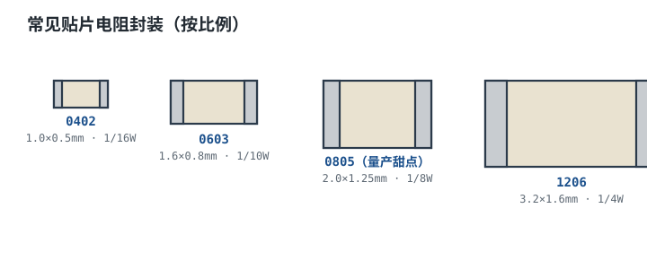

# 贴片封装与 E 系列标准值 SMD Package & E-series Preferred Values

选电阻时第二个绕不开的问题是：**用多大封装？取哪个阻值？** 封装（Package / Footprint）决定了功率、焊接性和 PCB 占地；阻值不是随便取的——全世界电阻厂商只生产一套"优先数"（Preferred Values），叫 E 系列。理解这两件事，BOM 才不会出现"买不到的阻值"或"功率不够的封装"。

## 1. 设计动机：为什么阻值和封装都要"标准化"

::: motivation 如果阻值可以随便取
假如你设计时算出需要 13.7kΩ，理论上很完美，但全世界没有一颗现成电阻是 13.7kΩ——开模定做的成本是通用料的几十倍，交期以月计。于是工程界约定：电阻阻值按对数等间距取一套"优先数"，相邻档位覆盖的误差带首尾相接，任何"算出的阻值"都能就近落在某个标准值 ±容差以内。同理，封装尺寸也标准化，让 0805 在任何厂家、任何贴片厂都能贴装。
:::

## 2. 贴片封装：尺寸与功率

贴片电阻封装名是英制尺寸（单位 0.01 英寸）：0402 = 长 0.04 英寸 × 宽 0.02 英寸。公制对应 1005、1608 等。下图按比例画出常见封装外形：

| 英制 | 公制 | 长×宽 (mm) | 额定功率 | 工作电压 | 典型用途 |
|---|---|---|---|---|---|
| 0201 | 0603 | 0.6×0.3 | 1/20W | 25V | 超密集便携设备，难手工焊 |
| 0402 | 1005 | 1.0×0.5 | 1/16W | 50V | 手机/高密度板，批量贴片 |
| 0603 | 1608 | 1.6×0.8 | 1/10W | 75V | 消费类常用，可手工焊 |
| 0805 | 2012 | 2.0×1.25 | 1/8W | 150V | **量产甜点区**，功率/面积平衡好 |
| 1206 | 3216 | 3.2×1.6 | 1/4W | 200V | 稍大功率、高压采样 |
| 2010 | 5025 | 5.0×2.5 | 3/4W | 200V | 功率电阻 |
| 2512 | 6432 | 6.3×3.2 | 1W | 200V | 大功率采样/限流 |

::: analogy 直觉类比：封装像"集装箱标准尺寸"
为什么不把封装做成任意大小？因为贴片机、钢网、回流焊炉、编带卷都按标准尺寸设计。统一了 0805，所有厂家的 0805 都能进同一条产线，就像集装箱统一尺寸后能上船、上车、上吊车。
:::

## 3. E 系列优先数：为什么是 10、15、22、33…

E 系列把每个数量级（ decade，如 10~100、100~1000）按**对数等间距**分成 N 档，N 就是 E 后面的数字。容差越大，档位可以越疏；容差越小，档位必须越密。

| 系列 | 每 10 倍分档数 | 对应容差 | 10~100 间的代表值 |
|---|---|---|---|
| E6 | 6 | ±20% | 10, 15, 22, 33, 47, 68 |
| E12 | 12 | ±10% | 10, 12, 15, 18, 22, 27, 33, 39, 47, 56, 68, 82 |
| E24 | 24 | ±5% | 在 E12 上再加密，含 11, 13, 16, 20… |
| E48 | 48 | ±2% | 更密 |
| E96 | 96 | ±1% | 精密电阻主力 |
| E192 | 192 | ±0.5%/±0.1% | 仪器级 |

相邻两档的比值约为 $10^{1/N}$：E24 相邻比 ≈ 1.10，E96 相邻比 ≈ 1.024。这样设计的结果是：**任意两相邻标准值的中点，刚好落在各自 ±容差的边界上**，既不浪费料号，又保证任意计算值都能被最近的标准值覆盖。

## 4. 贴片电阻丝印识读

贴片电阻体积极小，用数字编码标注：

| 标注 | 含义 | 例子 |
|---|---|---|
| 3 位数字 | 前两位有效数 + 第三位 10 的幂 | 103 = 10×10³ = 10kΩ |
| 4 位数字 | 前三位有效数 + 第四位 10 的幂（±1%） | 1002 = 100×10² = 10kΩ |
| R 当小数点 | 表示整数部分为 0 的小阻值 | 4R7 = 4.7Ω；R100 = 0.100Ω |
| 字母代码 | E96 厂家特殊码（如 01A=100Ω），需查表 | 数据手册识读表 |

## 5. 选型要点与工程权衡

- **功率跟着封装走**：先算功耗，再选封装留 ≥50% 余量。0805 只有 1/8W，做电源采样电阻若耗散 0.15W 就得 1206 甚至 2512。
- **可制造性（DFM）**：研发样机阶段尽量用 0805/1206，方便万用表扎点和手工换料；量产后再把非关键位换成 0603/0402 省面积。0402 以下手工焊接几乎不可行。
- **阻值就近取 E 系列**：算出 13.7kΩ 时，选 E24 的 15kΩ（误差约 +9.5%）或 E96 的 13.3kΩ（误差 −2.9%）；高要求用 E96 甚至双电阻串/并联凑值。
- **高压注意工作电压**：小封装耐压低，24V 采样用 0805(150V) 没问题，但 220V 交流整流后需 1206 以上或多颗串联分压。
- **大电流采样用合金/锰铜**：毫欧级采样电阻要选低温漂合金材质，别用普通厚膜。

## 6. 典型应用：用 E 系列凑精确比值

::: example 需要 Rf/R1 = 12.5 的运放增益
1. 算比值 12.5。若取 R1=10kΩ，则 Rf=125kΩ——不是 E 系列标准值。
2. 就近：E96 里 124kΩ（误差 −0.8%），比值 124/10=12.4，增益误差约 −0.8%，多数场景可接受。
3. 若要更准：用 Rf=100kΩ + 24.9kΩ 串联 = 124.9kΩ，或 Rf=127kΩ。精密场合优先选同批次、同 TCR 的配对电阻，保证比值稳定。
:::

## 7. 失效模式与常见坑

::: pitfall 常见坑
- **封装功率不足导致过热**：现象——0805 电阻在电源回路里发烫、变色。原因——把 1/8W 封装用在耗散 0.2W 的位置。解决——按功耗选大一级封装或并联，核算高温降额。
- **取了非 E 系列阻值买不到料**：现象——采购反馈"这个阻值没有库存，交期 12 周"。原因——原理图里写了 13.7kΩ 这类计算值。解决——设计评审时把所有阻值就近圆整到 E 系列，精密比值用串并联凑。
- **小封装贴错/虚焊**：现象——0402 批量贴装良率低、开路。原因——封装太小，钢网开孔与贴片精度不足。解决——样机/小批量避免 0402，统一用 0603 起步，DFM 评审确认厂能。
- **丝印误读**：现象——把 1002（10kΩ，4 位）当成 100×10²，或把 103（10kΩ）和 1002 混淆。解决——±1% 用 4 位码、±5% 用 3 位码，拿不准用万用表量。
:::

## 8. 自测题

0805 封装的物理尺寸大约是多少毫米？额定功率多少？

约 2.0mm × 1.25mm，额定功率约 1/8W（0.125W），工作电压约 150V。

E24、±5% 系列中，10kΩ 后面相邻的两档阻值大约是多少？为什么不是 11k、12k？

E24 在 10 之后约为 11k、12k、13k、15k…（对数等间距，相邻比约 1.10）。它不是等差而是**对数等间距**，这样在宽阻值范围内每档覆盖的相对误差带均匀、首尾相接。±5% 容差用 E24（24 档）正好相邻误差带相接。

电阻上丝印"4R7"和"470"分别是多少欧？

"4R7" = 4.7Ω（R 当小数点）；"470" = 47×10⁰ = 47Ω（3 位码，第三位是 10 的幂，0 即 ×1）。注意"470"不是 470Ω。

## 9. 参考资料

- The Art of Electronics (Horowitz & Hill, 3rd ed.) — 标准值与噪声/精度取舍
- Practical Electronics for Inventors (Scherz & Monk, 4th ed.) — 封装与实物识读
- Kitspace awesome-electronics — EDA 与封装库资源入口
