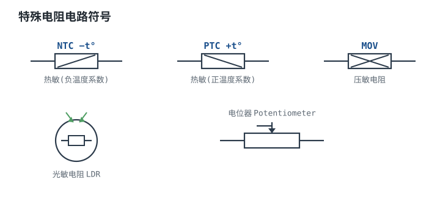
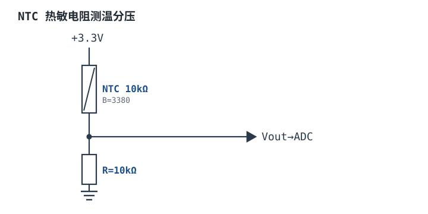

# 特殊电阻：热敏、压敏、光敏、电位器 Special Resistor

普通电阻的阻值由材料和几何定死，温度、电压、光照只会带来 ppm 级的"非理想漂移"；特殊电阻（Special Resistor）把这件坏事变成功能：**让阻值随外部物理量大幅变化，用一只几分钱的二端器件完成测量或保护。** 本章讲四类：NTC/PTC 热敏电阻（温度）、MOV 压敏电阻（电压）、LDR 光敏电阻（光照）、电位器（机械位置）。

它们共同的特点是**强非线性**：阻值随自变量变化几个数量级，所以不能用一条直线近似，更不能把标称值当工作值。本章的主线是——先把四种器件的物理图像与定量模型讲清楚（B 值、非线性指数 α、照度指数 γ、分压灵敏度），再用一颗 10 kΩ、B=3950 的 NTC 把 25~85 °C 测温从需求算到误差预算，最后回到工程：入口浪涌怎么配 NTC、MOV 的钳位电压怎么和后级耐压对账、电位器的负载误差怎么估。

## 1. 设计动机

::: motivation 五个真实场景，五种摔法
**场景一：NTC 测温，线性外推会算出负阻值。** 10 kΩ、B=3950 的 NTC 在 25 °C 是 10 kΩ，在 25 °C 附近每升高 1 °C 阻值降约 4.44%。若有人拿这个斜率做线性预算，到 85 °C 会得到 $10\times(1-0.0444\times60)=-16.6$ kΩ——一个负阻值。指数关系必须用指数式算，真实值是 1.087 kΩ，与线性外推差了一个数量级以上。

**场景二：浪涌电流。** 230 V 交流入口、470 µF 储能电容。没有限流时，合闸瞬间峰值电流只受线路电阻约束：按 0.1 Ω 算是 3580 A，断路器跳闸、整流桥受损。串一只冷态 10 Ω 的 NTC 后峰值降到 35.4 A；稳态 1 A 时它自己被加热到约 0.5 Ω，只损失 0.5 V。**限流元件必须"冷态高阻、热态低阻"，普通电阻做不到。**

**场景三：浪涌保护反而变成过压源。** 275 VAC 的 MOV 在 2 kA、8/20 µs 浪涌下把线电压钳到 618~697 V。如果后级是 400 V 耐压的 MOS 和电解电容，这个"保护"就是一次过压事件——**钳位电压必须和后级耐压一起算，不能只看压敏电压。**

**场景四：电位器烧在功率上。** 10 kΩ 电位器接在 50 V 上耗散 250 mW，而常见微调电位器额定只有 100 mW 量级；同样一只电位器接 24 V 只有 57.6 mW。**电位器的第一限制常常是功率，不是阻值。**

**场景五：光控路灯在临界点反复开关。** LDR 的响应时间是几十毫秒，本身不慢；但 100 Hz 的 LED 驱动纹波会被它采样成周期性信号，加上没有回差，继电器在黄昏临界点抖动。解决靠 RC 滤波与迟滞，而不是换更"快"的光敏电阻。
:::

这五个场景的共同点：拓扑都对，但**非线性器件的"工作点"没算**。先用一张"问题 → 先算 → 判据"的索引把思路固定下来。

| 你遇到的问题 | 先算 | 判据 |
|---|---|---|
| 测温在高温端不准 | $R(T)=R_0\exp\left[B\left(\frac{1}{T}-\frac{1}{T_0}\right)\right]$ | 用指数式而非线性斜率；B 容差、自热、分压电阻容差都进预算 |
| 合闸跳闸、整流桥损坏 | $I_{\text{pk}}=\frac{V_{\text{pk}}}{R_{\text{NTC}}+R_{\text{line}}}$ | 峰值电流在断路器与器件允许内；NTC 吸收能量在额定内 |
| 浪涌过后后级仍损坏 | $V_{\text{clamp}}=V_{1\text{mA}}\left(\frac{I}{1\ \text{mA}}\right)^{1/\alpha}$ | 钳位电压低于后级耐压，并留 20% 余量 |
| 光控在临界点抖动 | $R(E)=R_{10}\left(\frac{E}{10\ \text{lx}}\right)^{-\gamma}$ | 有回差（迟滞）+ RC 滤波，不靠单点阈值 |
| 调好的电压随时间漂 | 中点负载误差 $\approx\frac{R_{\text{pot}}}{4R_L}$ | 负载电阻 ≥100 倍电位器阻值，或加缓冲器 |

不算会摔的三个具体代价：358 V 峰值电压给 470 µF 充电的能量是 30.1 J，要在几毫秒内被吸收；MOV 从 50 µA 漏电退化到 10 mA，在 325 V 直流母线上就是 3.25 W 的持续发热，几分钟内走向热失控；100 Ω 的 NTC 引线多 1 Ω 就是 1% 阻值误差，在 85 °C 附近折合 0.32 K 的测温误差。

## 2. 定义与直观

### 2.1 一句话定义与物理图像

特殊电阻是**阻值由一个外部物理量主导的二端元件**，写成 $R=R(x)$，其中 $x$ 可以是温度、电压、照度或滑臂位置。它与普通电阻的区别不在结构，而在设计意图：普通电阻努力让 $R$ 不随 $x$ 变，特殊电阻故意让 $R$ 随 $x$ 变，并且变化幅度大到可以当信号用。

四种器件的机理完全不同，理解机理才能理解它们的失效模式：

- **NTC**：锰、钴、镍的氧化物陶瓷（尖晶石结构），载流子靠"跳跃"在阳离子之间移动。温度升高，载流子浓度与跳跃概率同时上升，阻值按指数下降。它是**体效应**，所以响应时间由热容决定，通常几秒。
- **PTC**：钛酸钡（BaTiO$_3$）铁电陶瓷。温度超过居里点 $T_c$，晶粒边界势垒陡增，阻值在几十 K 内上升三到六个数量级。聚合物 PPTC 是另一种实现：导电颗粒填充的高分子在过流发热时膨胀、导电链断开。
- **MOV**：氧化锌晶粒烧结体。正常电压下晶界是肖特基势垒，呈高阻；过压时晶界发生隧道击穿与雪崩倍增，阻值骤降，把浪涌电流引走。它是**电压敏感**的，但本质是"压敏电阻体"，不是开关。
- **LDR**：硫化镉（CdS）薄膜。光照产生电子-空穴对，电导率上升；光照越强，阻值越低。它是**光电导效应**，响应受载流子寿命限制。
- **电位器**：一条电阻轨道加一个滑动触点，把机械位置变成"取轨道上的哪一段电阻"。它不是传感器，而是**可调的分压器或可变电阻**。

### 2.2 三端与两端：电位器的两种接法

电位器有三个端子：两端是轨道两端，中间是滑臂。接法不同，功能完全不同：

- **分压接法**：两端接电源与地，滑臂输出。输出电压与位置近似成正比，输出阻抗随位置变化（中点最大，等于 $R_{\text{pot}}/4$）。
- **可变电阻接法（rheostat）**：滑臂与一端短接，串在回路里。阻值从 0 变到 $R_{\text{pot}}$，用于调电流、调增益、调时间常数。

这两种接法的误差来源不同：分压接法怕**负载拉低**，可变电阻接法怕**触点接触电阻**。后面 3.7 节会分别给出定量判据。

### 2.3 直觉类比及其边界

::: analogy 用"水路"建立第一印象
- **NTC** 像一只随温度变软的节流阀：越热开得越大（阻值越小）。但开度与温度的关系是指数的，冷端很"硬"、热端很"软"。
- **MOV** 像泄压阀与保险丝的组合：压力到阈值才开，开一次磨损一点，最后可能卡在开位（短路）。
- **LDR** 像瞳孔：亮处收缩、暗处放大，但对光的颜色有偏好，反应也比人眼慢。
- **电位器** 像可移动的取水口：轨道两端接电源，取水口位置决定取到多少水位；一旦大量取水（带重负载），水位就会被拉低。
:::

类比的边界必须写清楚：NTC 的"指数阀门"在窄温区（约 50 K 内）够用，宽温区要改用 Steinhart-Hart 三点式；MOV 的"泄压阀"没有说明它会**老化**——每次浪涌都会让压敏电压下移一点，这才是它的主要失效路径；LDR 的"瞳孔"不会疲劳，而 CdS 存在**光历史效应**（长期处于亮环境或暗环境后特性漂移），校准要在实际光照历史下做。

## 3. 定量关系

### 3.1 NTC：B 值与电阻-温度换算

NTC 的阻值-温度关系用 **B 值（材料常数）** 参数化，最常用的是 beta 方程：

$$\frac{1}{T}=\frac{1}{T_0}+\frac{1}{B}\ln\frac{R}{R_0}$$

反过来写成更好用的形式：

$$R(T)=R_0\exp\left[B\left(\frac{1}{T}-\frac{1}{T_0}\right)\right]$$

符号与单位：$T$ 是热力学温度（K），$T_0$ 是参考温度（K，通常 298.15 K 即 25 °C）；$R$ 是温度 $T$ 下的阻值（Ω），$R_0$ 是 $T_0$ 下的阻值（Ω）；$B$ 是材料常数（K），典型 3000~4500 K。**适用条件**：$B$ 在 $T_0$ 与 $T$ 之间近似恒定。区间窄于 50 K 时误差可以忽略；宽温区或要求 0.1 °C 时改用三点 Steinhart-Hart 方程，或直接在 MCU 里查表。

对温度求导可以得到相对灵敏度，这个量决定"1 K 能换来多少阻值变化"：

$$\alpha\equiv\frac{1}{R}\frac{dR}{dT}=-\frac{B}{T^2}$$

代入 25 °C：$\alpha=-3950/298.15^2=-4.44\times10^{-2}\ \text{K}^{-1}$，即 -4.44 %/K。代入 85 °C：$\alpha=-3950/358.15^2=-3.08\times10^{-2}\ \text{K}^{-1}$，即 -3.08 %/K。**同一个器件，冷端比热端灵敏 44%**，这就是 NTC 测温"冷端准、热端粗"的根源。

从 $T_0$=298.15 K、$R_0$=10 kΩ 出发，代入 $T$=358.15 K：

$$R=10^4\times\exp\left[3950\times\left(\frac{1}{358.15}-\frac{1}{298.15}\right)\right]=10^4\times e^{-2.219}=1.087\ \text{k}\Omega$$

验算：$1/358.15=2.7921\times10^{-3}$，$1/298.15=3.3540\times10^{-3}$，差 $-5.6189\times10^{-4}$；乘 3950 得 $-2.2195$；$e^{-2.2195}=0.1087$；乘 10 kΩ 得 1.087 kΩ。

### 3.2 分压电路与灵敏度

NTC 最常见用法是和一只固定电阻分压。以 NTC 在上、固定电阻 $R_{\text{top}}$ 在下（输出随温度升高而升高）为例：

$$V_{\text{out}}=V_{\text{ref}}\frac{R_{\text{top}}}{R_{\text{top}}+R_T},\qquad \frac{dV_{\text{out}}}{dT}=V_{\text{ref}}\frac{R_{\text{top}}\,B\,R_T}{T^2\left(R_{\text{top}}+R_T\right)^2}$$

符号：$V_{\text{ref}}$ 是激励电压（V），$R_T$ 是该温度下的 NTC 阻值（Ω），$R_{\text{top}}$ 是上拉/下拉的固定电阻（Ω）。灵敏度公式的推导要点是链式法则：$dV/dR_T=-V_{\text{ref}}R_{\text{top}}/(R_{\text{top}}+R_T)^2$，再乘 $dR_T/dT=-BR_T/T^2$，负负得正。

这个式子给出三条工程结论：

1. **灵敏度在 $R_{\text{top}}=R_T$ 时最大**（对 $R_{\text{top}}$ 求导可知）。所以"取 $R_{\text{top}}$ 等于目标温度下的 NTC 阻值"不是习惯，而是最优解。
2. **灵敏度随温度迅速下降**：$R_T$ 每降一个数量级，灵敏度大致也降一个数量级。同一个电路在 85 °C 的灵敏度只有 25 °C 的 24%。
3. **激励电压越大灵敏度越高，但自热也越严重**，两者直接冲突，见 3.3 节。

### 3.3 自热与测量电流的取舍

流过 NTC 的电流会发热，测温结果系统性偏高。用两个参数描述：

$$P=I^2R_T,\qquad \Delta T_{\text{self}}=\frac{P}{\delta}$$

符号：$P$ 是 NTC 自身耗散（W），$I$ 是流过它的电流（A），$\delta$ 是**耗散系数**（W/K，数据手册常写作 mW/°C），典型 1~5 mW/K（小珠状、静止空气，以数据手册为准）。工程判据是让自热误差只占误差预算的十分之一以内：

$$P_{\max}=\delta\,\Delta T_{\max},\qquad I_{\max}=\sqrt{\frac{P_{\max}}{R_T}}$$

若要求总误差 ±1 °C、自热只占 0.1 °C，取 $\delta=2$ mW/K：

$$P_{\max}=2\times10^{-3}\times0.1=2\times10^{-4}\ \text{W}=0.2\ \text{mW}$$

$$I_{\max}=\sqrt{\frac{2\times10^{-4}}{10^4}}=1.41\times10^{-4}\ \text{A}=0.141\ \text{mA}$$

也就是说，10 kΩ 的 NTC 上长期电流要控制在 0.14 mA 以内。这个约束和"分压要给出大信号"是矛盾的：3.3 V 激励、10 kΩ 上拉时分压电流是 0.165 mA，已经略超；把上拉改到 100 kΩ 电流降到 0.03 mA，自热变成 0.0045 °C，但灵敏度会塌掉（见 4.1 节的算例）。**这就是 NTC 测温必须在"自热、灵敏度、源阻抗"三者之间做取舍的原因。**

### 3.4 PTC：开关型与自恢复保险丝

PTC 分两类，模型不同。

**陶瓷 PTC 加热器**的电阻在居里点以上陡升，因而有自限功率特性：

$$P(T)=\frac{V^2}{R(T)}$$

符号：$V$ 是施加电压（V），$R(T)$ 是该温度下的阻值（Ω）。例：12 V 供电、25 °C 时 10 Ω 的 PTC，初始功率 $12^2/10=14.4$ W；升温到 $T_c$ 以上，阻值升到 100 Ω，功率降到 $12^2/100=1.44$ W。**功率自动降到十分之一，这就是"恒温加热"不需要闭环控制的原因。**

**聚合物 PPTC** 用作自恢复保险丝，关键参数是保持电流 $I_h$、触发电流 $I_t$ 与最大工作电压。它的压降必须校核：

$$V_{\text{drop}}=I\,R_{\text{PPTC}}$$

例：$I_h=0.5$ A、初始电阻 1 Ω 的 PPTC，正常工作时压降 0.5 V、耗散 $0.5^2\times1=0.25$ W。这个 0.5 V 会直接吃掉低压轨的余量。PPTC 的动作时间随过流倍数迅速缩短（典型从秒级缩短到几十毫秒），但**它不能替代安规保险丝**：耐压有限、动作慢、失效时可能不彻底断开。

### 3.5 MOV：钳位电压与能量吸收

MOV 的伏安特性用幂律近似：

$$V(I)=V_{1\text{mA}}\left(\frac{I}{1\ \text{mA}}\right)^{1/\alpha}$$

符号：$V_{1\text{mA}}$ 是 1 mA 直流下的压敏电压（V），$I$ 是浪涌电流（A），$\alpha$ 是非线性指数（无量纲），ZnO 压敏电阻典型 30~50。$\alpha$ 越大，钳位越"硬"。代入 $V_{1\text{mA}}=430$ V（对应 275 VAC 的器件）、$I=2$ kA、$\alpha=40$：

$$V=430\times\left(\frac{2000}{10^{-3}}\right)^{1/40}=430\times(2\times10^{6})^{0.025}=430\times1.437=618\ \text{V}$$

若 $\alpha=30$，同样电流下是 $430\times(2\times10^6)^{0.0333}=430\times1.622=697$ V。**同一只 MOV，α 差 10，钳位电压差 79 V**，所以选型要看数据手册的钳位电压曲线，而不是自己套指数。

能量吸收按波形积分：

$$E=\int v(t)i(t)\,dt\approx \bar{V}_{\text{clamp}}\int i(t)\,dt,\qquad Q=\int i\,dt\approx\frac{1}{2}I_{\text{pk}}t_d$$

符号：$E$ 是单次浪涌能量（J），$Q$ 是电荷（C），$t_d$ 是电流波半值宽度（s）。8/20 µs 波形用三角近似，$I_{\text{pk}}=2$ kA：

$$Q\approx\frac{1}{2}\times2000\times20\times10^{-6}=0.02\ \text{C}$$

$$E\approx650\times0.02=13\ \text{J}$$

（$650$ V 取 618~697 V 的中间值。）13 J 对 20 mm 片的单次浪涌是安全量级，但**多次浪涌会累积退化**：每次吸收能量后 $V_{1\text{mA}}$ 下移、漏电流上升，最终在正常工作电压下就发热失控。退化后的漏电功耗是

$$P_{\text{leak}}=V_{\text{op}}I_{\text{leak}}$$

例：退化到 $I_{\text{leak}}=10$ mA，母线 325 V，则 $P=3.25$ W；而正常器件的 50 µA 只有 16.3 mW。**从 16 mW 到 3.25 W 是 200 倍**，这就是"MOV 老化后烧保险甚至起火"的定量图像。前级必须串保险丝或热熔断器，让短路电流被切断。

### 3.6 光敏电阻：阻值范围与响应速度

LDR 的阻值-照度关系用幂律描述：

$$R(E)=R_{10}\left(\frac{E}{10\ \text{lx}}\right)^{-\gamma}$$

符号：$E$ 是照度（lx），$R_{10}$ 是 10 lx 下的阻值（Ω），$\gamma$ 是照度指数（无量纲），CdS 典型 0.6~1.0。取 $R_{10}=50$ kΩ、$\gamma=0.8$：

$$R(100)=5\times10^4\times\left(\frac{100}{10}\right)^{-0.8}=5\times10^4\times10^{-0.8}=7.92\ \text{k}\Omega$$

$$R(1000)=5\times10^4\times100^{-0.8}=5\times10^4\times0.0251=1.26\ \text{k}\Omega$$

验算：$10^{-0.8}=0.1585$，$5\times10^4\times0.1585=7.92$ kΩ；$100^{-0.8}=10^{-1.6}=0.0251$，乘 50 kΩ 得 1.26 kΩ。

响应速度：CdS 的上升时间（暗→亮）典型 10~50 ms，下降时间（亮→暗）典型 10~100 ms，弱光下更慢，可达秒级（以数据手册为准）。这个速度对路灯、背光足够，对通信、编码器远远不够。

### 3.7 电位器：精度、寿命与噪声

**负载误差。** 电位器分压时，滑臂接负载 $R_L$ 会把输出拉低。中点最严重，近似式为

$$\frac{\Delta V}{V}\approx\frac{R_{\text{pot}}}{4R_L}$$

严格式是

$$V_{\text{out}}=V_{\text{in}}\frac{R_{\text{bot}}\parallel R_L}{R_{\text{top}}+R_{\text{bot}}\parallel R_L}$$

符号：$R_{\text{top}}$、$R_{\text{bot}}$ 是滑臂上下两段轨道电阻（Ω），$R_L$ 是负载电阻（Ω）。代入 10 kΩ 电位器、中点（$R_{\text{top}}=R_{\text{bot}}=5$ kΩ）、$R_L=100$ kΩ：$R_{\text{bot}}\parallel R_L=5\times100/105=4.762$ kΩ，$V_{\text{out}}=3.3\times4.762/(5+4.762)=1.610$ V，与理想 1.65 V 差 -2.44%，与近似式 $10/(4\times100)=2.5\%$ 吻合。

**功率。** 电位器跨接电源时的耗散是 $P=V^2/R_{\text{pot}}$。10 kΩ 接 24 V 是 57.6 mW，接 50 V 是 250 mW。选型时按**最大工作电压**算，不是按常用档位算。

**分辨率与噪声。** 电位器理论上是连续的，实际可分辨的最小变化受接触电阻跳动限制，典型 0.1%~1%；末端电阻典型 0.5~2 Ω，会影响"调到 0"的精度。转动寿命：碳膜 1 万~10 万次，导电塑料 100 万次以上，微调电位器只有 200~2000 次（以数据手册为准）。**分压接法下，滑臂电流应尽量小**：滑臂电流会在接触电阻上产生噪声与局部发热，典型微调电位器建议控制在 mA 级以下。

## 4. 典型计算

### 4.1 算例一：10 kΩ、B=3950 的 NTC 做 25~85 °C 测温

**需求**：3.3 V 单电源，12 位 ADC（$V_{\text{ref}}=3.3$ V），测温范围 25~85 °C，目标精度 ±1 °C，环境温度最高 60 °C。

**第 1 步：算两个端点的阻值。** 由 3.1 节的指数式：

$$R_{25}=10\ \text{k}\Omega,\qquad R_{85}=10^4\times e^{-2.219}=1.087\ \text{k}\Omega$$

中间点（55 °C，即 328.15 K）留作验算：$1/328.15=3.0474\times10^{-3}$，与 $1/298.15$ 差 $-3.066\times10^{-4}$，乘 3950 得 $-1.211$，$e^{-1.211}=0.2979$，即 2.979 kΩ。

**第 2 步：算输出电压范围。** 取 $R_{\text{top}}=10$ kΩ（等于 25 °C 阻值，按 3.2 节的结论这是 25 °C 处灵敏度最大）：

$$V_{25}=3.3\times\frac{10}{10+10}=1.650\ \text{V}$$

$$V_{85}=3.3\times\frac{10}{10+1.087}=2.977\ \text{V}$$

跨度 $2.977-1.650=1.327$ V，占 3.3 V 量程的 40%。顺手核一下边界：0 °C 时 $R=33.62$ kΩ，输出 0.757 V；100 °C 时 $R=0.698$ kΩ，输出 3.085 V。**NTC 短路时输出也只到 3.3 V，这个拓扑不会把 ADC 顶出量程**，比"NTC 在下"的接法更耐故障。

**第 3 步：算灵敏度与 ADC 分辨率。** 由 3.2 节的灵敏度式：

$$\frac{dV}{dT}\bigg|_{25}=3.3\times\frac{10^4\times3950\times10^4}{298.15^2\times(2\times10^4)^2}=3.66\times10^{-2}\ \text{V/K}=36.6\ \text{mV/K}$$

$$\frac{dV}{dT}\bigg|_{85}=3.3\times\frac{10^4\times3950\times1087}{358.15^2\times(11087)^2}=8.98\times10^{-3}\ \text{V/K}=8.98\ \text{mV/K}$$

12 位 ADC 的 1 LSB 是 $3.3/4096=805.7\ \mu$V。折算成温度：

$$\frac{36.6\ \text{mV/K}}{0.8057\ \text{mV/LSB}}=45.5\ \text{LSB/K}\ \Rightarrow\ 0.022\ ^{\circ}\text{C/LSB}$$

$$\frac{8.98\ \text{mV/K}}{0.8057\ \text{mV/LSB}}=11.2\ \text{LSB/K}\ \Rightarrow\ 0.090\ ^{\circ}\text{C/LSB}$$

量化误差按 ±0.5 LSB 算，最差 0.045 °C。**ADC 分辨率完全够用，瓶颈不在位数。**

**第 4 步：算自热。** 取 $\delta=2$ mW/K。25 °C 时分压电流 $3.3/20\text{k}=0.165$ mA：

$$P=I^2R=(1.65\times10^{-4})^2\times10^4=2.72\times10^{-4}\ \text{W}=0.272\ \text{mW}$$

$$\Delta T_{\text{self}}=\frac{0.272\ \text{mW}}{2\ \text{mW/K}}=0.136\ \text{K}$$

85 °C 时电流升到 $3.3/11.087\text{k}=0.298$ mA，但 $R_T$ 只剩 1.087 kΩ，功率反而降到 0.096 mW，自热 0.048 K。**自热误差在冷端最大**，这与直觉相反，原因是冷端阻值高。0.136 K 略高于 3.3 节按"总预算十分之一"定的 0.1 K，但在 ±1 °C 的总目标下仍可接受；若目标是 ±0.2 °C，就必须把上拉加大、降低激励占空比或改用脉冲供电。

**第 5 步：做误差预算。** 各单项都折算到温度：

| 误差项 | 计算 | 85 °C 处折合温度 |
|---|---|---|
| B 值容差 ±1% | 固定 $R$ 反解 $T$，$B$ 变 3989.5 K | 0.71 K |
| $R_{25}$ 容差 ±1% | $\Delta R=10.87\ \Omega$，除以 $\lvert dR/dT\rvert=33.5\ \Omega/\text{K}$ | 0.33 K |
| 分压电阻 ±1% | $\Delta V=2.92$ mV，除以 8.98 mV/K | 0.33 K |
| 基准 ±0.1% | $\Delta V=0.323$ mV，除以 8.98 mV/K | 0.04 K |
| 自热 | 0.048 K | 0.05 K |
| ADC 量化 | ±0.5 LSB | 0.05 K |
| **最坏线性相加** | 0.71+0.33+0.33+0.04+0.05+0.05 | **1.49 K** |
| **均方根合成** | $\sqrt{0.71^2+0.33^2+0.33^2+0.04^2+0.05^2+0.05^2}$ | **0.85 K** |

**第 6 步：结论与改法。** 不校准时的最坏误差 1.49 K，达不到 ±1 °C。两条改法：

- **两点校准（25 °C 与 85 °C）**：可以消掉 $R_{25}$ 容差、分压电阻容差、基准误差带来的增益与偏置误差，只剩 B 值误差 0.71 K、基准残差 0.04 K、自热 0.05 K、量化 0.05 K，最坏 0.85 K，达标。代价是产线要加两个温度点，或者用一次性写入的校准系数。
- **挑 B 值容差 ±0.5% 的型号**：B 项降到 0.36 K，不校准的最坏误差降到 1.14 K，仍差一点；再把分压电阻换成 ±0.1%、基准换成 ±0.05%，最坏降到 0.83 K，达标。**只换器件不改电路，很难稳定做到 ±1 °C。**

**第 7 步：验算"为什么不用 100 kΩ 上拉"。** 若把 $R_{\text{top}}$ 改成 100 kΩ，25 °C 自热降到 0.0045 K，但输出变成 $3.3\times100/110=3.0$ V，85 °C 时 $3.3\times100/101.087=3.265$ V，25~85 °C 的跨度只有 0.265 V（原来的 20%），灵敏度 1.08 mV/K，折合 1.34 LSB/K，量化误差 0.37 °C。**自热省下的 0.13 K，换来量化误差增加 0.33 K，净亏 2.5 倍。**

**第 8 步：反向验算。** 若把 $R_{\text{top}}$ 取成 85 °C 的阻值 1.087 kΩ，85 °C 处灵敏度升到 25.4 mV/K，但 0 °C 输出只有 0.103 V、灵敏度 5.3 mV/K，冷端几乎不可用。**"灵敏度最大化"只能在目标温区的一个点上做，宽温区必须接受灵敏度的衰减，或者做分段/线性化。**

### 4.2 算例二：230 V 入口的 NTC 浪涌抑制

**需求**：230 VAC（+10% 到 253 V）、470 µF 母线电容、稳态输入电流 1 A。

**第 1 步：算峰值电压与储能。**

$$V_{\text{pk}}=253\times1.414=358\ \text{V}$$

$$E=\frac{1}{2}CV^2=\frac{1}{2}\times470\times10^{-6}\times358^2=30.1\ \text{J}$$

**第 2 步：算无限流时的峰值电流。** 按线路与器件电阻合计 0.1 Ω：

$$I_{\text{pk}}=\frac{358}{0.1}=3580\ \text{A}$$

这个电流由断路器与线路电感实际限制，但足以让整流桥过流、触点拉弧。

**第 3 步：加 10 Ω 冷态 NTC。** 峰值电流

$$I_{\text{pk}}=\frac{358}{10+0.1}=35.4\ \text{A}$$

下降 101 倍。充电时间常数 $\tau=RC=10\times470\times10^{-6}=4.7$ ms，浪涌持续约 $3\tau=14$ ms。

**第 4 步：算稳态损耗。** 1 A 稳态电流把 NTC 加热，阻值降到约 0.5 Ω（热态阻值以数据手册为准）：

$$V_{\text{drop}}=1\times0.5=0.5\ \text{V},\qquad P=1^2\times0.5=0.5\ \text{W}$$

相对 230 W 的输入功率是 0.22%，可以接受。**但要注意两件事**：一是 NTC 的额定电流必须大于稳态电流并留 30% 余量；二是断电后 NTC 需要几十秒冷却，**热机重启时限流会失效**，频繁开关的场合要用继电器/可控硅在启动后把 NTC 旁路。

### 4.3 算例三：MOV 的钳位电压与后级耐压对账

**需求**：230 VAC 入口，选 275 VAC 的 MOV，后级是 400 V 耐压的 MOS 与 450 V 电解电容。

**第 1 步：核对持续电压。** 最高持续电压 $253\times1.414=358$ V 峰值；MOV 的 $V_{1\text{mA}}=430$ V，高于 358 V，正常工作时不导通。最大持续交流电压 275 VAC 也覆盖 253 VAC，满足。

**第 2 步：算 2 kA 浪涌下的钳位电压。** 由 3.5 节，$\alpha=40$ 时 618 V，$\alpha=30$ 时 697 V。取中间值 650 V。

**第 3 步：与后级耐压对账。**

$$650\ \text{V}>400\ \text{V}$$

**不满足。** 400 V 的 MOS 会被雪崩击穿；450 V 电解的额定电压只有 650 V 钳位的 0.69 倍，等于每次浪涌都过压一次，寿命骤降。三条改法：换 700 V 以上耐压的 MOS 与 650 V 电容；在 MOV 之后加一级 TVS 把残压再压到 400 V 以下；或改用两级保护（MOV 吸收大能量、TVS 钳残压），并把 MOV 的引线做短。

**第 4 步：算引线电感的影响。** 若 MOV 到母线的引线是 1 m、按 1 µH 估算，8/20 µs 波形的电流上升率约 $2000/(8\times10^{-6})=2.5\times10^{8}$ A/s：

$$V_L=L\frac{di}{dt}=1\times10^{-6}\times2.5\times10^{8}=250\ \text{V}$$

**250 V 的感应压降与 650 V 的钳位电压同量级**，等于把保护水平抬高 38%。所以 MOV 必须紧贴入口端子、引线短而粗、两条引线尽量靠近（减小回路面积）。

### 4.4 算例四：电位器的负载误差与功率

**需求**：10 kΩ 线性电位器做 0~3.3 V 可调阈值，后级是比较器的 100 kΩ 输入分压网络，要求调节误差小于 1%。

**第 1 步：算中点误差。** 由 3.7 节，中点处近似误差 $\Delta V/V\approx R_{\text{pot}}/(4R_L)=10\text{k}/(4\times100\text{k})=2.5\%$，严格值 2.44%，**超过 1%**。

**第 2 步：选改法。** 若把电位器换成 1 kΩ，$R_{\text{pot}}/(4R_L)=0.25\%$，达标；此时跨接 3.3 V 的电流 3.3 mA、耗散 10.9 mW，滑臂电流最大 1.65 mA，要确认在电位器允许范围内。另一条路是保持 10 kΩ 并在滑臂后加一级运放缓冲器，负载误差变成运放的输入偏置电流乘 $R_{\text{eq}}$，可以忽略。

**第 3 步：算功率。** 若同一只 10 kΩ 电位器被误接到 50 V 辅助电源上，$P=50^2/10^4=0.25$ W，超过常见 0.1 W 额定 2.5 倍。**选电位器先看功率，再看阻值。**

**第 4 步：验算分辨率。** 电位器机械行程 300°，接触电阻跳动按 0.5% 计，10 kΩ 就是 50 Ω。分压接法下，这 50 Ω 折合到输出是 $3.3\times50/10^4=16.5$ mV，对 12 位 ADC 是 20 个 LSB。**"电位器连续可调"不等于"能稳定停在 1 LSB 上"**，精密设定要用多圈电位器或数字电位器。

## 5. 工程含义

### 5.1 数量级速查

| 器件 | 关键参数 | 典型量级 | 选型第一问 |
|---|---|---|---|
| NTC 测温 | $R_{25}$、$B$、$\delta$ | 1 kΩ~100 kΩ；B=3000~4500 K；$\delta$=1~5 mW/K | 目标温区的灵敏度够不够？自热与源阻抗怎么折中？ |
| NTC 限流 | 冷态阻值、额定电流、能量 | 1~50 Ω；0.5~10 A；几十 J | 稳态损耗能否接受？热机重启怎么办？ |
| 陶瓷 PTC | $T_c$、耐压、阻值 | $T_c$=60~160 °C；阻值升 3~6 个数量级 | 是加热还是过流保护？ |
| PPTC | $I_h$、$I_t$、最大电压 | 0.1~5 A；16~60 V | 压降占电源轨的百分比？能否替代保险丝？ |
| MOV | MCOV、$V_{1\text{mA}}$、通流/能量 | MCOV 14~1000 VAC；$V_{1\text{mA}}$ 18~1800 V | 钳位电压低于后级耐压吗？前级有保险丝吗？ |
| LDR | 亮阻/暗阻、$\gamma$、响应时间 | 亮阻 100 Ω~10 kΩ；暗阻 1~10 MΩ；10~100 ms | 光谱匹配吗？合规吗？ |
| 电位器 | 总阻、功率、寿命、线性度 | 100 Ω~1 MΩ；0.05~2 W；$10^3$~$10^7$ 次 | 负载误差、功率、寿命哪个先到限？ |

（表内为典型量级，不同厂商、不同系列差异很大，以所选型号的数据手册为准。）

### 5.2 接口、布局与引线

- **NTC 的引线电阻**：10 kΩ 的 NTC 多 1 Ω 只有 0.01% 误差，可以忽略；但 100 Ω 的 NTC 多 1 Ω 就是 1%，在 85 °C 附近（$dR/dT=-3.08\ \Omega/\text{K}$）折合 0.32 K。低阻 NTC 要用三线制或四线制，把引线电阻排除。
- **ADC 源阻抗**：分压节点到 ADC 之间加 RC 低通（如 10 kΩ + 100 nF，截止 159 Hz），既滤引线噪声也限制注入电流；但要按 [ADC 采样建立时间](../mcu/adc.md) 校核源阻抗，必要时用缓冲器。
- **MOV 的引线电感**：见 4.3 节，1 m 引线在 2 kA/8 µs 下等效 250 V。MOV 紧贴入口，两条引线绞在一起走。
- **LDR 的光路**：避免被外壳遮挡、避免与发热体对吹（CdS 有温度系数），窗口要做防水与防紫外老化。
- **电位器的机械**：调好后点胶或锁紧螺母；避免让直流长期通过滑臂（电化学迁移会增大接触电阻），必要时用交流激励或数字电位器。

### 5.3 安全与合规

- **MOV 失效模式是短路**：必须与前级保险丝或热熔断器配合，否则短路后持续工频电流会引燃。金属氧化物压敏电阻没有"自恢复"能力，浪涌后要按厂家判据（压敏电压偏移、漏电流）评估是否更换。
- **MOV 不能作为唯一的隔离手段**：它是并联泄流器件，不是隔离开关；高压安全仍依赖爬电距离、绝缘与接地，见[电气安全](../basics/electrical-safety.md)。
- **CdS 含镉**：受 RoHS 限制，很多出口产品已改用光电二极管/光电三极管。选型前先确认合规状态与豁免适用范围，不要默认"能用"。
- **认证口径**：抗浪涌等级按 IEC 61000-4-5 的等级（1/2/3/4 级对应不同的开路电压与源阻抗）声明；SPD 整机按 UL 1449 的 MCOV 与电压保护水平标注。写规格书时把"测试波形、源阻抗、次数"写全，否则数字没有意义。

## 6. 常见坑

::: pitfall 常见坑
- **用线性斜率外推 NTC 阻值**：现象——常温标定好的测温电路，在 80 °C 以上读数偏低几度，甚至算出负阻值。原因——NTC 是指数关系，25 °C 附近的 -4.44 %/K 不能外推到 60 K 之外。解决——始终用 beta 方程或查表；宽温区用 Steinhart-Hart 三点式；把 B 值容差写进误差预算（B 差 1% 在 85 °C 就是 0.71 K）。
- **忽略 NTC 自热，测温系统性偏高**：现象——读数总比标准温度计高 0.5~2 °C，且环境温度越低偏差越大。原因——分压电流过大，$P=I^2R$ 在冷端最大；本文算例中 10 kΩ 上拉就有 0.136 K 自热。解决——按 $P_{\max}=\delta\Delta T$ 反算最大电流；提高上拉电阻、降低激励占空比，或改用脉冲供电并同步采样。
- **MOV 老化后短路起火**：现象——用了几年的浪涌保护板烧保险、甚至冒烟。原因——每次浪涌让 $V_{1\text{mA}}$ 下移、漏电流上升，退化到 10 mA 时在 325 V 母线上就是 3.25 W 的持续发热，最终热失控。解决——前级串保险丝或热熔断器；按浪涌次数与能量选足够大的片径；关键场合用带热脱扣的 MOV 模块。
- **MOV 钳位电压高于后级耐压**：现象——浪涌过后 MOV 完好，后级 MOS 与电容却击穿。原因——只看压敏电压 430 V，没算 2 kA 下的钳位电压 618~697 V。解决——按数据手册的钳位电压曲线核对后级耐压并留 20% 余量；必要时用两级保护或换更高耐压的器件。
- **NTC 限流在热机重启时失效**：现象——冷启动正常，快速断电再上电时断路器仍然跳闸。原因——NTC 冷却需要几十秒，热态阻值只有冷态的 1/20，限流失效。解决——用继电器或可控硅在启动后旁路 NTC，或在软件上限制重启间隔。
- **电位器带负载后非线性**：现象——调到中点时输出比预期低 2%~5%，两端又正常。原因——负载与下半段轨道并联，中点误差最大，近似 $R_{\text{pot}}/(4R_L)$。解决——负载电阻 ≥100 倍电位器阻值，或加运放缓冲；不要用高阻电位器直接驱动低阻负载。
- **LDR 在临界照度下抖动**：现象——黄昏时路灯反复开关，继电器咔咔响。原因——单点阈值没有回差，且 100 Hz 光源纹波被 LDR 采样成周期信号。解决——加迟滞（如 1.5 倍照度的回差）、加 RC 滤波与软件平均；响应要求高时改用光电二极管。
:::

## 7. 自测题

10 kΩ、B=3950 的 NTC 在 85 °C 时阻值是多少？如果误用 25 °C 的 -4.44 %/K 做线性外推，会得到什么荒谬结果？

用 beta 方程：

$$R=10^4\times\exp\left[3950\times\left(\frac{1}{358.15}-\frac{1}{298.15}\right)\right]=10^4\times e^{-2.219}=1.087\ \text{k}\Omega$$

线性外推：$10\times(1-0.0444\times60)=10\times(-1.664)=-16.6$ kΩ，负阻值，物理上不可能。

差异的根源是指数关系：从 25 °C 到 85 °C，阻值降到原来的 10.87%，而线性模型只允许降到 0。**只要温区超过 20~30 K，就必须用指数式或查表。**

用 3.3 V 激励、10 kΩ 上拉、$\delta=2$ mW/K 的 NTC 测温，25 °C 时自热误差是多少？若要求自热不超过 0.1 °C，上拉电阻至少要多大（只按 25 °C 算）？这样做的副作用是什么？

25 °C 时分压电流：

$$I=\frac{3.3}{10^4+10^4}=1.65\times10^{-4}\ \text{A}$$

$$P=I^2R=(1.65\times10^{-4})^2\times10^4=2.72\times10^{-4}\ \text{W}=0.272\ \text{mW}$$

$$\Delta T_{\text{self}}=\frac{0.272}{2}=0.136\ \text{K}$$

要求 0.1 °C，则 $P_{\max}=2\times10^{-3}\times0.1=0.2$ mW，即 $I^2R\leq0.2$ mW。设上拉为 $R_s$，25 °C 时 $I=3.3/(R_s+10^4)$，代入解得总阻 $R_s+10^4\geq3.3/\sqrt{0.2\times10^{-3}/10^4}=23.34$ kΩ，即 $R_s\geq13.3$ kΩ。

副作用在 13.3 kΩ 时还比较温和：25~85 °C 的跨度从 1.327 V 缩到 1.165 V（-12%），25 °C 灵敏度从 36.6 mV/K 降到 35.9 mV/K（-2%），源阻抗从 5 kΩ 升到 5.72 kΩ。但如果设计要求 ±0.2 °C、自热预算只有 0.02 K，同样的算法要求 $R_s\geq42$ kΩ，此时跨度掉到 0.55 V、灵敏度只剩 22.7 mV/K（-38%），**自热与灵敏度的冲突才真正显现**。这就是"先定误差预算，再定激励"的原因。

275 VAC 的 MOV（$V_{1\text{mA}}=430$ V）在 2 kA、8/20 µs 浪涌下钳位电压大约多少？吸收能量多少？后级是 400 V 耐压的 MOS，够不够？

钳位电压（$\alpha=40$）：

$$V=430\times\left(\frac{2000}{10^{-3}}\right)^{1/40}=430\times1.437=618\ \text{V}$$

电荷与能量（三角近似）：

$$Q\approx\frac{1}{2}\times2000\times20\times10^{-6}=0.02\ \text{C}$$

$$E\approx650\times0.02=13\ \text{J}$$

618 V 远高于 400 V，**不够**。后级必须换 700 V 以上的器件，或在 MOV 后加一级 TVS 把残压压到 400 V 以下。另外要核对 MOV 的通流与能量额定是否覆盖 2 kA/13 J（典型 20 mm 片可以，具体以数据手册为准）。还要注意引线电感：1 m 引线在 2.5×10⁸ A/s 下额外产生 250 V。

电位器中点接负载时的误差为什么最大？10 kΩ 电位器接 100 kΩ 负载，中点误差是多少？要求小于 1% 该怎么办？

中点时上下两段各 5 kΩ，输出端看到的戴维南电阻最大（$R_{\text{pot}}/4=2.5$ kΩ），负载分流的比例也最大，所以误差在中点最大、两端为零。

严格计算：$R_{\text{bot}}\parallel R_L=5\times100/105=4.762$ kΩ，

$$V_{\text{out}}=3.3\times\frac{4.762}{5+4.762}=1.610\ \text{V}$$

相对理想值 1.65 V 是 -2.44%（近似式 $R_{\text{pot}}/(4R_L)=2.5\%$）。

要求 <1%，可把电位器降到 1 kΩ（误差 0.25%），或在滑臂后加运放缓冲器（负载误差变成偏置电流乘 $2.5\ \text{k}\Omega$，可忽略）。加缓冲器还能顺便解决后级输入阻抗随温度漂移的问题。

MOV 正常漏电 50 µA、母线 325 V；老化后漏电升到 10 mA。两种情况的发热功率各是多少？为什么说前级必须串保险丝？

$$P_1=325\times50\times10^{-6}=1.63\times10^{-2}\ \text{W}=16.3\ \text{mW}$$

$$P_2=325\times10\times10^{-3}=3.25\ \text{W}$$

从 16.3 mW 涨到 3.25 W，是 200 倍。3.25 W 在几平方厘米的片体上足以把温度推到热失控点：温度升高→漏电更大→功率更大，正反馈直到短路。

MOV 失效的终点是**低阻短路**，短路后工频电流只受线路阻抗限制，会持续加热直到起火。保险丝的作用不是"保护 MOV"，而是**在 MOV 短路后切断故障电流**；没有保险丝，保护器件本身就成了点火源。

## 8. 参考资料

- IEC 60539-1:2016，*Directly heated negative temperature coefficient thermistors – Part 1: Generic specification*：NTC 的 R-T 特性、B 值、耗散系数与热时间常数的定义与测量方法；本章 3.1、3.3 节的口径按该标准。
- IEC 60738-1:2006，*Directly heated positive temperature coefficient thermistors – Part 1: Generic specification*：PTC 的开关温度、保持电流与触发电流定义；本章 3.4 节参考该标准的参数体系。
- IEC 61051-1:2018 与 IEC 61051-2:2021，*Varistors for use in electronic equipment*（通用规范与浪涌抑制型分规范）：压敏电压、钳位电压、能量吸收与耐久性试验；本章 3.5 节的钳位与能量算法按该标准的方法给出。
- IEC 61000-4-5:2014+AMD1:2017，*Surge immunity test*：1.2/50 µs 开路电压波与 8/20 µs 短路电流波的定义与试验等级；本章 4.3 节的波形参数来自该标准。
- UL 1449（4th edition），*Surge Protective Devices*：SPD 的 MCOV、电压保护水平与失效判据；本章 5.3 节的认证口径参考该标准。
- IEC 60393-1:2008，*Potentiometers for use in electronic equipment – Part 1: Generic specification*：总阻、线性度、末端电阻、转动寿命与滑臂噪声的测量；本章 3.7 节参考该标准的参数定义。
- Vishay BCcomponents NTCLE100E3 系列数据手册：R-T 数值表、B 值容差与耗散系数（Dissipation Factor）章节；本章的自热计算按该类手册的耗散系数口径给出，具体数值以所选型号为准。
- TDK Epcos S20K275 数据手册：最大持续交流电压、压敏电压、8/20 µs 通流与能量曲线；本章 4.3 节以该类器件为例，数字为典型量级。
- Advanced Photonix PDV-P 系列 CdS 光敏电阻数据手册：亮阻/暗阻、γ 特性与响应时间章节；本章 3.6 节的指数模型与响应时间按该类器件的方法给出。
