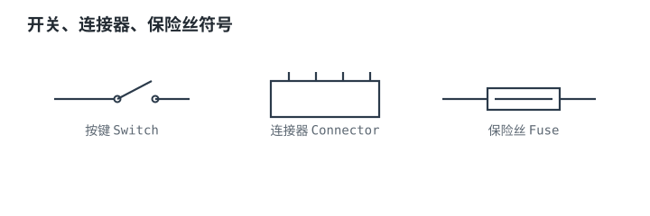
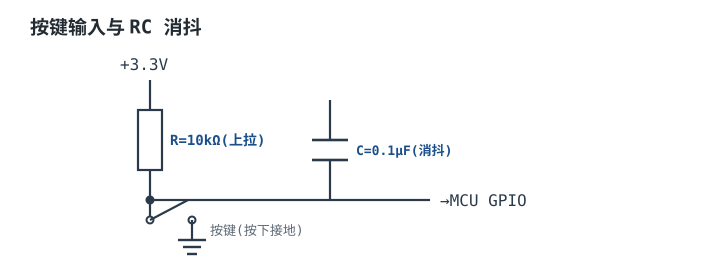

# 开关、接插件、连接器与保险丝 Switch / Connector / Fuse

这三类器件有个共同点：**它们几乎不参与信号处理，却决定了设备的现场可靠性**。开关和连接器是"机械"进入"电气"的两个入口——所有振动、氧化、插拔磨损、人为误操作都从这里进来；保险丝则是最后一道防线，它不阻止故障，只保证故障不会变成火灾。

它们的参数体系和半导体完全不同：没有 $V_F$、没有 $t_{rr}$，取而代之的是**抖动时间、接触电阻、机械/电气寿命、I²t、分断能力**。这些参数有一个共同特征——数据手册给的是"额定值"，而现场失效几乎全部发生在"额定值看起来还有余量"的地方。原因是这些器件的额定值都附带测试条件（负载类型、环境温度、插拔次数、脉冲波形），一旦条件变了，额定值就要打折。

主线：先把抖动、接触电阻、I²t 三个核心量的物理图像建立起来，再逐项推导开关的寿命与降额、连接器的电流分配与温升降额、保险丝的浪涌与分断判据，最后用一个 12V/5A 输出的保险丝选型走完整设计，并算清"为什么保险丝救不了走线和半导体"。按键与 GPIO 的接口电路见[GPIO 与按键](../mcu/gpio.md)；供电入口的器件选型见[电源器件选型](../power/power-component-selection.md)；降额与可靠性的一般方法见[降额设计](../practice/reliability-derating.md)与[安规认证](../practice/safety-certification.md)。

## 1. 设计动机

::: motivation 三个真实场景
**场景一：一个按键触发三次。** 轻触按键按下时触点会弹跳 1~5ms，MCU 的 1kHz 扫描周期正好把每一次弹跳都读成一次按下。用户按一下，菜单跳三格。

**场景二：连接器发烫但电流"没超"。** 一个 4 针连接器，每针额定 3A，实际每针走 2.8A，看起来余量 7%。但 4 针挤在一起互相加热，85°C 环境下外壳温度到了 118°C，超过 105°C 的额定值——**额定电流是在 25°C、单针加载条件下测的，多针同时载流时有效额定值要打折**。

**场景三：保险丝"没坏"，板子烧了。** 12V/5A 输出用了 7A 慢熔保险丝，输出端短路。保险丝的 $I^2t$ 是 100A²s，在 60A 故障电流下要 27.8ms 才熔断。这 27.8ms 里，2mm 宽的走线温升已经超过 100K，MOSFET 早就炸了。**保险丝保的是"不着火"，不是"不坏"。**
:::

| 你遇到的问题 | 先算 | 判据 |
|---|---|---|
| 按一次键触发多次 | $\tau=RC$ 与扫描周期 | 消抖时间 > 抖动时间 |
| 开关用一段时间就接触不良 | 触点电流、寿命、负载类型 | 电气寿命按实际负载降额后够用 |
| 连接器发烫、塑料变形 | $P=I^2R$ 与温升降额曲线 | 降额后的电流 ≥ 实际电流 |
| 上电就烧保险丝 | 浪涌 $I^2t$ 与保险丝 $I^2t$ | 浪涌 $I^2t$ ≤ 保险丝 $I^2t$ 的 20%~30% |
| 短路后保险丝熔断但板子已烧 | 故障电流与熔断时间 | 半导体另配限流，不依赖保险丝 |
| 保险丝熔断时拉弧、炸裂 | 分断能力与预期短路电流 | $I_{break}>I_{sc}$ |

**不算会摔在哪**，三个带数字的代价：

1. **连接器按单针额定值满载。** 4 针各 2.8A、85°C 环境，按 30K 温升额定算，允许电流只有 $3\times\sqrt{20/30}=2.45$A；再乘 0.8 的多针捆扎系数，只剩 1.96A。实际 2.8A 超了 43%，温升按 $I^2$ 关系涨到 $30\times(2.8/1.96)^2=61$K，外壳温度 $85+61=146$°C——远超 105°C，塑料会软化、触点会退火失去弹性。
2. **快熔保险丝用在有浪涌的地方。** 22mF 输入电容、0.1Ω 回路电阻，上电浪涌 $I^2t=15.84$A²s。7A 快熔管的熔化 $I^2t$ 约 40A²s，按 20% 预算只有 8A²s——浪涌是预算的 2 倍，**一上电就误熔断**，而且每次都是"换一根又烧"。
3. **以为保险丝能保护半导体。** 60A 短路电流下，7A 保险丝的熔断时间是 $I^2t/I^2=100/3600=27.8$ms。MOSFET 的短路耐受时间通常是 µs 量级，差了四个数量级。

## 2. 定义与直观

### 2.1 三类器件的定位

- **开关**（Switch）：用机械触点的开合控制电路通断。核心矛盾是"机械动作慢、有弹跳、有磨损"，而电气侧要求"干净的通断"。
- **连接器/接插件**（Connector）：实现可拆卸的电气连接。核心矛盾是"接触面必须有压力才能导通，而压力、氧化、磨损三者互相制约"。
- **保险丝**（Fuse）：用可熔金属体在过流时熔断来切断电路。核心矛盾是"要扛住正常浪涌，又要在故障时足够快熔断"——这两件事在时间尺度上只差一到两个数量级。



### 2.2 开关：四个不可忽略的量

| 量 | 典型范围 | 为什么重要 |
|---|---|---|
| 抖动时间（bounce） | 1~20ms（轻触 1~5ms） | 决定消抖时间常数的下限 |
| 接触电阻 | 新触点 10~50mΩ，氧化后可达数百 mΩ | 小信号时影响电平，大电流时发热 |
| 机械寿命 | $10^5$~$10^7$ 次（空载） | 决定"手感"能用多久 |
| 电气寿命 | $10^4$~$10^5$ 次（额定负载） | 决定"带载切换"能用多久 |

**机械寿命和电气寿命不是一个数，通常差一个数量级**，因为带载切换时触点之间有电弧，每次动作都在烧蚀触点。很多设计事故就是把机械寿命当成电气寿命来估算。

### 2.3 连接器：接触电阻与温升

连接器的导通靠**接触压力**把两个金属面压在一起，实际接触面积只有名义面积的百分之几。接触电阻由三部分组成：收缩电阻（电流线在接触点收缩）、膜层电阻（氧化膜、污染膜）、体电阻。前两项决定了它对压力、氧化和磨损极其敏感。

关键参数：

- **接触电阻**：新件典型 10~20mΩ（每对接触件），经过温度循环和插拔后可能升到 30~50mΩ。
- **额定电流**：不是"烧不坏"的电流，而是**在规定温升下的电流**。行业惯例是"在 25°C 环境下、温升不超过 30K 时的电流"，具体依标准而定。
- **插拔寿命**：排针几十到几百次，USB 上万次，板对板连接器几次到几十次。

### 2.4 保险丝：$I^2t$ 与分断能力

保险丝的熔断过程分两段：**熔化**（pre-arcing，金属体升温到熔点）和**燃弧**（arcing，金属蒸气继续导电直到电流过零熄灭）。数据手册给的两个核心参数正好对应这两段：

- **$I^2t$（熔化热积分）**：描述熔化阶段。单位 A²s。熔化时间近似 $t=I^2t/I^2$，**只在大电流（≥4 倍额定）区成立**；接近额定电流时是热平衡过程，时间会拉长到秒甚至分钟。
- **分断能力 $I_{break}$**：能安全切断的最大故障电流。分断能力不足时，熔断瞬间的电弧无法熄灭，会持续燃烧、喷溅甚至炸裂外壳。

还有一个容易忽略的参数：**额定电压**。直流分断比交流难得多，因为交流每半周有过零点，电弧会自然熄灭；直流没有过零点，只能靠拉长电弧、冷却灭弧。所以同一只保险丝标"250VAC / 125VDC"很常见，直流额定值往往只有交流的一半。

### 2.5 类比：门闩、插头与保险片

::: analogy 三个机械类比
- **开关的抖动**像关门时门闩弹了两下才卡住：动作已经完成了，但信号在几毫秒内反复通断。消抖就是"等门闩稳定了再判定"。
- **连接器的接触电阻**像两只手握手：握得越紧（接触压力越大）接触越好；手上有油（氧化膜）就握不实；反复握（插拔）会让手磨出茧（磨损镀层）。
- **保险丝的 $I^2t$** 像一根蜡烛的"熔化预算"：火焰（电流）越大，烧断得越快，但总热量（$I^2t$）是守恒的。短时间的大火和长时间的小火可以烧掉同样多的蜡。

类比的边界：蜡烛不会因为"上次烧过一点"就更容易烧断，保险丝会（累积损伤）；门闩弹两下不影响门的功能，开关弹跳会让数字电路数出多个脉冲。涉及累积效应和数字逻辑时，类比会误导。
:::

## 3. 定量关系

### 3.1 开关抖动与消抖时间常数

机械触点在闭合和断开的瞬间会弹跳，产生一串随机宽度的脉冲。工程上用 RC 低通把这段"脏时间"滤掉：



$$
V_C(t)=V_{CC}\left(1-e^{-t/RC}\right),\qquad \tau=RC
$$

其中 $V_C(t)$ 是电容电压（V）；$V_{CC}$ 是上拉电源（V）；$R$ 是上拉电阻（$\Omega$）；$C$ 是消抖电容（F）；$\tau$ 是时间常数（s）。工程上取 3~5 个时间常数作为稳定时间：

$$
t_{settle}=(3\sim5)\tau
$$

以 $R=10$kΩ、$C=0.1\mu$F 代入：

$$
\tau=10\times10^{3}\times0.1\times10^{-6}=1\ \text{ms},\qquad t_{settle}=3\times1=3\ \text{ms}
$$

**3ms 覆盖不了 5~20ms 的抖动**，所以硬件 RC 只能滤掉最快的弹跳，剩下的必须靠软件延时（典型 10~20ms 二次确认）。这是"RC + 软件"组合的原因：RC 负责抗干扰和抑制快速毛刺，软件负责彻底消抖。

**但 RC 有个副作用**：每次按下，电容通过触点瞬间放电。放电能量：

$$
E=\frac{1}{2}CV_{CC}^2
$$

以 $C=0.1\mu$F、$V_{CC}=3.3$V 代入：

$$
E=\frac{1}{2}\times0.1\times10^{-6}\times3.3^2=\frac{1}{2}\times0.1\times10^{-6}\times10.89=0.545\ \mu\text{J}
$$

能量很小，但**峰值电流很大**：如果电容直接经触点接地，回路的电阻只有触点电阻（几十 mΩ）加走线电阻，理论峰值电流是安培级，实际被走线电感和电容 ESR 限制。长期反复冲击会造成触点电蚀、接触电阻上升。解法是在电容和触点之间串一只 100Ω~1kΩ 的电阻，把峰值电流压到 mA 级：

$$
I_{peak}\approx\frac{V_{CC}}{R_s}=\frac{3.3}{470}=7.0\ \text{mA}
$$

代价是放电时间常数变成 $R_sC=470\times0.1\times10^{-6}=47\mu$s，比弹跳宽度短，不影响消抖。

### 3.2 开关的额定电流、降额与寿命

开关的额定值有两个陷阱：

**陷阱一：额定值带着负载类型。** 同一只开关，标"10A/250VAC"指的是**电阻性负载**。换成电感性、白炽灯、电机，允许电流要按系数降额（典型量级，以数据手册的额定值表为准）：

| 负载类型 | 降额系数 | 原因 |
|---|---|---|
| 电阻性（加热丝） | 1.0 | 无浪涌、无电弧延长 |
| 电感性（继电器、电磁阀） | 0.5~0.75 | 关断时电感反峰拉长电弧 |
| 白炽灯 | 0.2~0.3 | 冷态电阻只有热态的 1/10，接通浪涌 10 倍 |
| 电机 | 0.3~0.5 | 启动电流 5~8 倍，且有感性反峰 |

**陷阱二：直流额定值远低于交流。** 交流每半周有过零点，电弧自然熄灭；直流没有。所以"10A/250VAC"的开关在 30VDC 下可能只有 3A。银触点的最小起弧电压约 12V、最小起弧电流约 0.4A（典型量级，以触点材料数据为准）——低于这个"起弧门槛"，触点在断开时不会拉弧，寿命会显著改善。

**寿命的算法**：把寿命次数除以每天的动作次数：

$$
t_{life}=\frac{N}{n\times365}
$$

其中 $t_{life}$ 是寿命（年）；$N$ 是寿命次数；$n$ 是每天动作次数。以 $N_{mech}=2\times10^5$、$N_{elec}=1\times10^4$、每天 20 次代入：

$$
t_{mech}=\frac{2\times10^{5}}{20\times365}=\frac{2\times10^{5}}{7300}=27.4\ \text{年}
$$

$$
t_{elec}=\frac{1\times10^{4}}{7300}=1.37\ \text{年}
$$

**同样的开关，空载能用 27 年，带载只能用 1.4 年——差 20 倍。** 这正是"电源开关用一两年就接触不良"的定量解释。要延长寿命，要么降额使用（减小切换电流），要么让开关只驱动一个继电器/MOSFET，把功率切换交给半导体。

### 3.3 连接器的接触电阻、电流分配与温升降额

**单针的功耗**：

$$
P=I^2R_{contact}
$$

以 $I=3$A、$R_{contact}=20$mΩ 代入：

$$
P=3^2\times0.02=0.18\ \text{W},\qquad V_{drop}=3\times0.02=60\ \text{mV}
$$

0.18W 在几毫米见方的接触件上，温升可以到几十 K。

**多针并用的电流分配**不是平均分。两只接触件并联时，电流按电阻反比分配：

$$
I_1=I_{total}\frac{R_2}{R_1+R_2},\qquad I_2=I_{total}\frac{R_1}{R_1+R_2}
$$

以 $R_1=10$mΩ、$R_2=15$mΩ、总电流 6A 代入：

$$
I_1=6\times\frac{15}{10+15}=6\times0.6=3.6\ \text{A},\qquad
I_2=6\times\frac{10}{25}=2.4\ \text{A}
$$

**平均是 3A，但实际一只 3.6A、一只 2.4A**——电阻小的那针多承担 20%。如果按"总电流/针数"选型，那根 3.6A 的针已经超了。接触电阻的分散主要来自压力、镀层厚度和污染，老化后分散会更大。

**温升降额**：连接器的额定电流对应一个规定的温升（常见 30K）。环境温度升高时，允许的温升变小，而温升近似与电流平方成正比：

$$
I_{derated}=I_{rated}\sqrt{\frac{\Delta T_{allowed}}{\Delta T_{rated}}},\qquad
\Delta T_{allowed}=T_{max}-T_a
$$

其中 $I_{rated}$ 是额定电流（A）；$\Delta T_{rated}$ 是额定电流下的温升（K）；$T_{max}$ 是连接器允许的最高温度（°C，通常由塑料壳体决定）；$T_a$ 是环境温度（°C）。

以 $I_{rated}=3$A、$\Delta T_{rated}=30$K、$T_{max}=105$°C 为例，在 85°C 环境下：

$$
\Delta T_{allowed}=105-85=20\ \text{K}
$$

$$
I_{derated}=3\times\sqrt{\frac{20}{30}}=3\times0.8165=2.45\ \text{A}
$$

**降额 18%。** 温度再升到 95°C，允许电流只有 $3\times\sqrt{10/30}=1.73$A，降额 42%。

把整条曲线画出来更直观（$I_{rated}=3$A、$\Delta T_{rated}=30$K、$T_{max}=105$°C）：

```echarts
{
  "animation": false,
  "tooltip": {"trigger": "axis"},
  "legend": {"data": ["单针允许电流"], "bottom": 0, "textStyle": {"fontSize": 12}},
  "grid": {"left": 70, "right": 32, "top": 34, "bottom": 58},
  "xAxis": {"type": "category", "name": "环境温度 / °C", "nameLocation": "middle", "nameGap": 30,
            "data": ["25", "50", "75", "80", "85", "90", "95", "100", "105"], "axisLabel": {"fontSize": 11}},
  "yAxis": {"type": "value", "name": "允许电流 / A", "nameLocation": "middle", "nameGap": 48,
            "min": 0, "max": 3.4, "axisLabel": {"fontSize": 11}},
  "series": [
    {"name": "单针允许电流", "type": "line", "symbol": "circle", "symbolSize": 5,
     "lineStyle": {"width": 2.6, "color": "#b5642e"}, "itemStyle": {"color": "#b5642e"},
     "areaStyle": {"opacity": 0.08},
     "data": [3.0, 3.0, 3.0, 2.74, 2.45, 2.12, 1.73, 1.22, 0]}
  ]
}
```

75°C 以下电流被额定温升卡死在 3A（不能因为环境凉就用更大电流，接触件本身的发热极限不变）；75°C 以上按 $\sqrt{(105-T_a)/30}$ 下降，105°C 时归零。逐点可复算：85°C 时 $\sqrt{20/30}=0.8165$，$3\times0.8165=2.45$A。

**多针还有第二重降额。** 相邻多针同时载流时互相加热，行业惯例是再乘一个 0.5~0.8 的捆扎系数（以连接器数据手册的降额曲线为准）。这意味着一个"4 针 × 3A"的连接器，在 85°C 环境下的实际总额定电流只有 $3\times4\times0.8165\times0.8=7.84$A，而不是 12A——**几乎打了六五折**。

### 3.4 保险丝的 $I^2t$、分断能力与时间-电流特性

**浪涌的 $I^2t$**：上电给电容充电是最典型的浪涌。设回路总电阻 $R$（电源内阻 + 走线 + 电容 ESR）、电容 $C$，则峰值电流和电流平方积分是：

$$
I_{pk}=\frac{V}{R},\qquad \tau=RC,\qquad I^2t=\frac{1}{2}I_{pk}^2\tau
$$

把三式合并，得到一个非常干净的结论：

$$
I^2t=\frac{1}{2}\left(\frac{V}{R}\right)^2RC=\frac{V^2C}{2R}
$$

其中 $V$ 是充电电压（V）；$C$ 是电容（F）；$R$ 是回路总电阻（$\Omega$）；$I^2t$ 单位 A²s。这个式子的工程含义是：**浪涌的 $I^2t$ 正比于电容容量，反比于回路电阻**——加大电容或降低回路电阻（比如换成低 ESR 的电容、缩短走线）都会让浪涌更狠。

固定 $V=12$V、$R=0.1\Omega$ 时，$I^2t=720C$（$C$ 取法拉），是一条过原点的直线。把它和保险丝的预算线画在一起，快熔/慢熔的选择就一目了然：

```echarts
{
  "animation": false,
  "tooltip": {"trigger": "axis"},
  "legend": {"data": ["上电浪涌 I²t"], "bottom": 0, "textStyle": {"fontSize": 12}},
  "grid": {"left": 74, "right": 32, "top": 34, "bottom": 58},
  "xAxis": {"type": "category", "name": "输入电容 C / μF", "nameLocation": "middle", "nameGap": 30,
            "data": ["100", "470", "1000", "4700", "10000", "22000", "47000"], "axisLabel": {"fontSize": 11}},
  "yAxis": {"type": "value", "name": "I²t / A²s", "nameLocation": "middle", "nameGap": 52,
            "min": 0, "max": 36, "axisLabel": {"fontSize": 11}},
  "series": [
    {"name": "上电浪涌 I²t", "type": "line", "symbol": "circle", "symbolSize": 6,
     "lineStyle": {"width": 2.6, "color": "#1a4f8b"}, "itemStyle": {"color": "#1a4f8b"},
     "data": [0.072, 0.338, 0.72, 3.38, 7.2, 15.84, 33.8],
     "markLine": {"silent": true, "symbol": "none",
       "lineStyle": {"type": "dashed", "width": 1.6, "color": "#b5642e"},
       "data": [{"yAxis": 20, "label": {"formatter": "T 型 7A 的 20% 预算", "position": "insideEndTop", "fontSize": 11}},
                {"yAxis": 8, "label": {"formatter": "F 型 7A 的 20% 预算", "position": "insideEndTop", "fontSize": 11}}]}}
  ]
}
```

两条虚线就是 3.5 节的判据线：浪涌曲线在虚线以下才安全。22000μF 时浪涌 15.84A²s，在 T 型预算 20A²s 以下、在 F 型预算 8A²s 以上——**这就是"必须用慢熔"的图形依据**。1000μF 时浪涌只有 0.72A²s，快熔完全够用（占预算 9%）。

**保险丝的熔化 $I^2t$** 由数据手册给出（同一系列不同额定电流的值不同）。判据是：

$$
\frac{I^2t_{surge}}{I^2t_{fuse}}\leq(0.2\sim0.3)\quad\text{（低频次动作）}
$$

$$
\frac{I^2t_{surge}}{I^2t_{fuse}}\leq0.1\quad\text{（上万次上电循环）}
$$

这个"20%~30%"的经验值本质是给脉冲累积损伤留余量：每次浪涌都会让熔体发生一点冶金变化，次数越多，实际熔化 $I^2t$ 越低。

**分断能力**：保险丝的 $I_{break}$ 必须大于安装点的**预期短路电流**：

$$
I_{sc}=\frac{V_{source}}{R_{loop}}
$$

其中 $R_{loop}$ 是故障回路的全部电阻（电源内阻 + 线缆 + 接触电阻），单位 $\Omega$。$I_{break}<I_{sc}$ 的后果不是"熔断得慢"，而是**熔断时电弧无法熄灭**：玻璃管会炸裂、喷出金属蒸气，甚至引燃周围。所以直流侧、电池供电的设备必须选**陶瓷体、高分断能力**的保险丝。

**时间-电流特性**：数据手册给的是对数坐标的带状曲线。大电流段近似满足 $t_{pre}=I^2t_{fuse}/I^2$，但在 1~3 倍额定电流区，曲线变得很平（热平衡主导），熔断时间从秒到分钟不等。**这意味着保险丝对"轻度过载"几乎没有保护作用**——6A 持续流过 7A 保险丝，它可能永远不熔断，但走线和器件已经在过热。

### 3.5 慢熔与快熔的选择判据

| 类型 | 标记 | 时间-电流特性 | $I^2t$（同额定） | 适用 |
|---|---|---|---|---|
| 快熔 | F | 过流后快速熔断 | 较小 | 电阻性负载、半导体前级、无浪涌 |
| 慢熔/延时 | T | 短时浪涌可承受，持续过流才熔断 | 较大（约 2~3 倍） | 电容充电、电机启动、变压器 |
| 特慢熔 | TT | 更强的浪涌承受 | 最大 | 大电感、大电容 |

**判据只有一条**：把浪涌的 $I^2t$ 和保险丝的 $I^2t$ 都算出来，比值落在 20%~30% 以内就是安全的。这一步做完，快熔/慢熔的选择就自然确定了——如果浪涌超了快熔的预算，就只能上慢熔。

注意顺序：**先用"正常工作电流"定额定值，再用"浪涌 $I^2t$"定快/慢熔类型**。反过来做（先挑慢熔再定电流）会选出偏大的额定值，失去过流保护能力。

### 3.6 适用条件与失效边界

- **$t=I^2t/I^2$ 只在大电流区成立。** 低于 4 倍额定电流时，熔断时间由热平衡决定，公式严重低估时间。
- **$I^2t$ 随环境温度下降。** 高温下熔体本身温度更高、散热更差，熔化 $I^2t$ 变小；数据手册的温度降额曲线（常见 50°C 时 90%、70°C 时 80%）必须乘进去。
- **分断能力与电压等级绑定。** "1000A @ 125VDC"不代表在 400VDC 下也能分断 1000A，直流电压越高越难灭弧。
- **连接器的额定电流不能按针数线性叠加。** 多针同时载流时互相加热，且有电流分配不均（3.3 节），有效总额定值通常只有"单针额定 × 针数 × 0.5~0.8"。
- **开关的额定值不能跨负载类型使用。** 电阻负载的 10A 和白炽灯负载的 10A 不是一回事，差 3~5 倍。
- **保险丝不是限流器件。** 它的动作时间在 ms~s 量级，保护不了 µs 级就失效的半导体；也保护不了额定电流 1.2 倍以内的长期过载。

## 4. 典型计算

### 4.1 完整算例：12V/5A 输出的保险丝选型

**需求与假设**（全部为示例量级，实际以所选型号数据手册为准）：

| 项目 | 值/要求 |
|---|---|
| 输出 | 12V/5A 连续，环境 50°C |
| 输入电容 | 22000μF（低 ESR 电解） |
| 回路总电阻 | 0.1Ω（电池内阻 + 线缆 + 保险丝 + 电容 ESR） |
| 电源 | 12V 铅酸电池，充电电压 14.4V，回路短路电阻 0.05Ω |
| 上电次数 | 每天 2 次，5 年约 3650 次 |
| 保险丝 | 5×20mm 圆筒形，候选 7A F 型与 7A T 型 |

**第 1 步：按正常电流定额定值。** 工程惯例是长期工作电流不超过额定值的 75%（留出公差、温度、老化的余量）：

$$
I_{rated}\geq\frac{I_{load}}{0.75}=\frac{5}{0.75}=6.67\ \text{A}
$$

取标准值 **7A**。

**第 2 步：温度降额复核。** 50°C 环境下的降额系数取 0.9（典型量级，以厂家降额曲线为准）：

$$
I_{capacity}=7\times0.9=6.3\ \text{A}
$$

$$
\text{负载率}=\frac{5}{6.3}=79.4\%
$$

79% 略高于 75% 的理想值但在可接受范围（一般要求 ≤80%）。若环境是 70°C（降额 0.8），容量只有 5.6A，负载率 89%——**这时应该升到 8A 或 10A**。

**第 3 步：算上电浪涌的 $I^2t$。**

$$
I_{pk}=\frac{12}{0.1}=120\ \text{A}
$$

$$
\tau=RC=0.1\times22000\times10^{-6}=2.2\ \text{ms}
$$

$$
I^2t_{surge}=\frac{1}{2}I_{pk}^2\tau=\frac{1}{2}\times120^2\times2.2\times10^{-3}=15.84\ \text{A}^2\text{s}
$$

也可以用合并式直接算：$V^2C/(2R)=144\times0.022/(2\times0.1)=3.168/0.2=15.84$A²s，两式一致。

**第 4 步：与保险丝的 $I^2t$ 比。** 设 7A T 型的熔化 $I^2t=100$A²s（典型量级，以所选型号数据手册为准），按 20% 预算：

$$
I^2t_{budget}=100\times0.2=20\ \text{A}^2\text{s}
$$

$$
\frac{I^2t_{surge}}{I^2t_{budget}}=\frac{15.84}{20}=79.2\%
$$

在预算内（≤100%），合格，但余量只有 21%。

**第 5 步：换成快熔会怎样。** 7A F 型的 $I^2t$ 约 40A²s（典型量级）：

$$
I^2t_{budget}=40\times0.2=8\ \text{A}^2\text{s}
$$

$$
\frac{15.84}{8}=1.98>1\quad\Rightarrow\quad\text{浪涌超预算 98%，会误熔断}
$$

**结论：必须用 T 型。** 这就是 3.5 节判据的实际用法——不是"电机才用慢熔"，而是"算出来浪涌超了就上慢熔"。

**第 6 步：分断能力。** 预期短路电流：

$$
I_{sc}=\frac{V_{source}}{R_{loop}}=\frac{12.6}{0.05}=252\ \text{A}
$$

（用电池标称 12.6V 而非充电电压 14.4V，是偏保守的算法；严格应按最高电压算，得 $14.4/0.05=288$A。）

要求 $I_{break}>I_{sc}$ 且直流电压等级 ≥ 系统最高电压（14.4V，取 32VDC 档）。选陶瓷体、1000A @ 125VDC 的型号，余量 $1000/288=3.5$ 倍，合格。**玻璃管保险丝的分断能力常见只有 35A 量级，绝对不够**——在这个电路里用玻璃管，短路时可能炸裂喷溅。

**第 7 步：结论表。**

| 项目 | 计算值 | 选型要求 | 判定 |
|---|---|---|---|
| 正常电流 | 5A | 额定 ≥6.67A | 7A ✓ |
| 温度降额（50°C） | 容量 6.3A | 负载率 ≤80% | 79.4% ✓ |
| 浪涌 $I^2t$ | 15.84A²s | ≤20A²s（T 型 20%） | 79.2% ✓ |
| 浪涌 vs 快熔 | 15.84A²s | ≤8A²s | 超 98% ✗ |
| 分断能力 | $I_{sc}=288$A | $I_{break}>288$A @ ≥32VDC | 1000A ✓ |
| **结论** | — | 7A / T 型 / 陶瓷体 / 125VDC / 1000A | 合格 |

### 4.2 算例二：按键消抖的时间常数与触点电蚀

**需求：** 3.3V MCU，上拉 10kΩ，轻触按键接地，抖动 5ms，扫描周期 1ms。

**第一步，算 RC。** 目标是让 RC 时间常数覆盖抖动的一部分（覆盖全部会让响应变慢）：

$$
\tau=RC=10\times10^{3}\times0.1\times10^{-6}=1\ \text{ms}
$$

3τ = 3ms，能滤掉 3ms 以内的毛刺，剩下的 2ms 由软件延时处理。

**第二步，评估毛刺数量。** 抖动 5ms、扫描 1ms，最坏情况下 MCU 会读到 5 次电平跳变——**一次按键被识别成 5 次**。软件消抖的做法是"检测到变化后延时 10~20ms 再读一次"，用 2 倍以上的抖动时间做二次确认。

**第三步，触点电蚀评估。** 电容储能：

$$
E=\frac{1}{2}CV^2=0.545\ \mu\text{J}
$$

单次能量很小，但峰值电流安培级。加 470Ω 串联电阻后：

$$
I_{peak}=\frac{3.3}{470}=7.0\ \text{mA},\qquad E_{R}=\frac{1}{2}\times0.1\times10^{-6}\times3.3^2=0.545\ \mu\text{J}
$$

能量不变（还是那 0.545µJ），但**峰值电流从安培级降到 7mA**，放电过程被拉长到 47µs，触点不再承受电流冲击。这是"能量不是主要矛盾、电流密度才是"的典型例子。

**第四步，软件消抖的时间预算。** 若按 10ms 二次确认，按键响应延迟约 15ms（RC 3ms + 软件 10ms + 扫描 1~2ms），人感觉不到（人的触觉响应阈值约 50~100ms）。若按 50ms 确认，就会出现"按了没反应"的抱怨。**消抖时间取抖动时间的 2~4 倍即可，不是越大越好。**

### 4.3 算例三：多针连接器的电流分配与降额

**需求：** 4 针连接器传输 6A 电源，每针额定 3A（25°C、温升 30K），外壳耐温 105°C，环境 85°C，接触电阻实测 10~15mΩ。

**第一步，理想分配。** 6A 分 4 针，每针 1.5A，看起来余量一半。

**第二步，考虑电阻分散。** 最坏情况是三针 15mΩ、一针 10mΩ。并联后总电阻：

$$
\frac{1}{R_{eq}}=\frac{1}{10}+\frac{1}{15}+\frac{1}{15}+\frac{1}{15}=0.1+0.0667\times3=0.3\ \text{m}\Omega^{-1}
$$

$$
R_{eq}=\frac{1}{0.3}=3.33\ \text{m}\Omega
$$

总压降 $6\times3.33=20$mV，各针电流：

$$
I_{low}=\frac{20\ \text{mV}}{10\ \text{m}\Omega}=2.0\ \text{A},\qquad
I_{high}=\frac{20\ \text{mV}}{15\ \text{m}\Omega}=1.33\ \text{A}
$$

**最好的针承担 2.0A，是平均值 1.5A 的 1.33 倍。**

**第三步，温度降额。** 85°C、105°C 外壳、30K 额定温升：

$$
I_{derated}=3\times\sqrt{\frac{105-85}{30}}=3\times\sqrt{0.667}=3\times0.816=2.45\ \text{A}
$$

**第四步，多针捆扎系数。** 4 针相邻、同时载流，互相加热，取 0.8（典型量级，以连接器数据手册的降额曲线为准）：

$$
I_{allowed}=2.45\times0.8=1.96\ \text{A}
$$

**第五步，判定。** 最坏那针要 2.0A，允许 1.96A——**超了 2%，临界不合格**。而且这还是"新件"的接触电阻；老化到 20mΩ 后，分散更大，最坏针会到 2.3A 以上。

**第六步，改进。** 三个方向：(1) 增加并联针数到 6 针，把每针压到 1.3A；(2) 换更大额定电流的连接器（每针 5A）；(3) 用两针专门走电源、并且加短而粗的并联铜排。**最不该做的是"按平均值算，看起来够"**。

### 4.4 算例四：保险丝救不了走线和半导体

**场景：** 上面的 7A 保险丝，输出端短路，故障电流 60A。

**第一步，熔断时间。** 大电流区用 $I^2t$ 反推：

$$
t_{pre}=\frac{I^2t_{fuse}}{I^2}=\frac{100}{60^2}=\frac{100}{3600}=27.8\ \text{ms}
$$

**第二步，走线的电阻。** 2mm 宽、35µm 厚（1oz）、20mm 长的铜走线：

$$
R=\rho\frac{L}{A}=1.72\times10^{-8}\times\frac{0.02}{2\times10^{-3}\times35\times10^{-6}}
=1.72\times10^{-8}\times\frac{0.02}{7\times10^{-8}}=4.91\ \text{m}\Omega
$$

**第三步，走线在这 27.8ms 里吸收的能量。**

$$
E=I^2Rt=60^2\times4.91\times10^{-3}\times27.8\times10^{-3}=3600\times4.91\times10^{-3}\times0.0278=0.492\ \text{J}
$$

**第四步，温升。** 铜的比热 $c=385$J/(kg·K)，走线质量：

$$
m=\rho_{Cu}\cdot A\cdot L=8960\times7\times10^{-8}\times0.02=1.25\times10^{-5}\ \text{kg}
$$

$$
\Delta T=\frac{E}{mc}=\frac{0.492}{1.25\times10^{-5}\times385}=\frac{0.492}{4.83\times10^{-3}}=102\ \text{K}
$$

**走线温度瞬间升高 102K**，从 50°C 环境升到 152°C——超过 FR-4 的玻璃化温度（典型 130~180°C），焊盘和层间结合会受损。而这还是 2mm 宽的"粗线"；0.5mm 宽的信号线电阻是它的 4 倍，温升会到 400K 以上，直接烧断。

**第五步，半导体更惨。** MOSFET 的短路耐受时间通常是几微秒到几十微秒（以器件 SOA 曲线为准），比 27.8ms 快三个数量级。**在保险丝熔断之前，半导体早就失效了。**

**第六步，结论。** 保险丝的定位是**防火**：它保证故障能量不会持续到引燃 PCB 或外壳。要保护半导体和走线，必须在 µs 级动作的器件上做文章：

- 用带限流的 eFuse / 热插拔控制器（响应 µs 级）；
- 用电流模式控制的开关电源逐周期限流；
- 在关键支路串小阻值采样电阻 + 比较器做硬件过流关断；
- 保险丝只作为最后一道防线，且分断能力必须够。

## 5. 工程含义

### 5.1 数量级表

| 参数 | 开关（轻触/船型） | 连接器（排针/板对板） | 保险丝（5×20mm） |
|---|---|---|---|
| 额定电流 | 50mA~10A | 每针 0.5~5A | 0.1~10A |
| 接触/导通电阻 | 10~50mΩ | 10~50mΩ（每对） | 10~30mΩ |
| 寿命 | 机械 $10^5$~$10^7$；电气 $10^4$~$10^5$ | 插拔 10~$10^4$ 次 | 一次性 |
| 关键降额因素 | 负载类型、直流电压 | 环境温度、多针捆扎 | 环境温度、浪涌 $I^2t$ |
| 失效模式 | 接触不良、抖动变大、触点粘连 | 氧化、退针、塑料软化 | 误熔断、熔断后不复位、分断失败 |

### 5.2 选型清单

**开关：**

1. 先确定负载类型（电阻/感性/灯/电机），按降额系数折算实际切换电流。
2. 确认直流电压下的额定值，不要拿交流额定值直接用。
3. 按每天动作次数算电气寿命，不够就加继电器/MOSFET 做功率切换。
4. 小信号（<1mA）场合必须用镀金触点，否则氧化膜会让接触电阻不稳定。

**连接器：**

1. 按"降额后的单针电流 × 针数 × 0.5~0.8"估总额定电流，不要线性叠加。
2. 电源针和信号针分开排布，避免大电流针的温升影响信号针。
3. 关键信号、大电流、频繁插拔的场合用镀金触点；一次性插接可以用镀锡。
4. 按最高环境温度查降额曲线，不要用 25°C 的额定值。

**保险丝：**

1. 额定电流 ≥ 最大正常工作电流 / 0.75，再乘温度降额系数。
2. 算浪涌 $I^2t$，与保险丝 $I^2t$ 的 20%~30% 预算比，决定快熔还是慢熔。
3. 分断能力必须大于安装点的预期短路电流，直流侧优先陶瓷体。
4. 电压等级按系统最高电压选，直流降额另算。
5. 保险丝不能替代限流，半导体保护要另做。

### 5.3 布局与安全

- **保险丝放在最靠电源入口的位置**，保证故障电流一定经过它；放在分支后面，前面的走线就失去保护。
- **连接器的大电流针要就近铺铜、加过孔**，把热量导到内层；只靠针脚散热，温升会翻倍。
- **按键的 RC 要靠近 MCU 引脚**，不要放在按键一端——放远了，走线拾取的干扰会直接进引脚。
- **涉及市电、电池、大电流的开关与保险丝，必须按相应安规标准做温升、耐压、分断能力验证，并保证爬电距离与电气间隙。** 本章的算式只适用于低压直流与板级设计，市电入口的设计见[安规认证](../practice/safety-certification.md)与[电气安全](../basics/electrical-safety.md)。
- **走线的载流能力要单独校核。** 1oz 铜、2mm 宽的走线，按 10K 温升大约只能长期承载 3~4A（典型量级，具体按 IPC-2221 的图表查）。保险丝选 7A 不代表走线能过 7A，见[PCB 布线](../pcb/routing.md)。

## 6. 常见坑

::: pitfall 常见坑
- **按键没消抖或消抖不足**：现象——按一次键，菜单跳好几格；或者快速连按识别不出来。原因——机械触点抖动 1~20ms，扫描周期比抖动短，每次弹跳都被读成一次动作。解决——RC 硬件滤波 + 软件 10~20ms 二次确认；消抖时间取抖动时间的 2~4 倍，不是越大越好。
- **消抖电容直接并在触点上**：现象——按键用一两年后接触不良，拆开看触点发黑。原因——每次按下，0.1µF 电容经触点瞬间放电，峰值电流安培级，长期电蚀触点。解决——电容与触点之间串 100Ω~1kΩ 电阻，把峰值电流压到 mA 级；或者干脆去掉硬件电容，纯软件消抖。
- **连接器按单针额定值满载**：现象——连接器塑料发黄变形、针脚退火失去弹性、接触电阻越来越大。原因——额定电流是 25°C、单针、30K 温升下的值；多针同时载流互相加热，高温环境又压缩了允许温升。解决——按 $I_{derated}=I_{rated}\sqrt{\Delta T_{allowed}/\Delta T_{rated}}$ 降额，再乘 0.5~0.8 的捆扎系数，并按最坏电流分配核单针。
- **保险丝一上电就烧**：现象——换一根烧一根，负载却完全正常。原因——上电浪涌（大电容充电、电机启动）的 $I^2t$ 超过保险丝的脉冲预算；或者选了快熔型。解决——算 $I^2t_{surge}=V^2C/(2R)$，与保险丝 $I^2t$ 的 20%~30% 比；超了就换 T 型或加大额定值（加大额定值后要重新核过流保护能力）。
- **保险丝分断能力不足**：现象——短路时保险丝玻璃管炸裂、喷出黑色金属蒸气，甚至引燃周边。原因——预期短路电流超过保险丝的 $I_{break}$，熔断时电弧无法熄灭。解决——算 $I_{sc}=V/R_{loop}$，选 $I_{break}>I_{sc}$ 的型号；直流侧、电池供电优先陶瓷体高分断型；电压等级按系统最高电压选。
- **以为保险丝能保护半导体**：现象——短路后保险丝正常熔断，但 MOSFET 和 PCB 走线已经烧毁。原因——保险丝熔断要 ms~s，半导体耐受只有 µs。解决——半导体保护用 eFuse、逐周期限流或硬件过流比较器；保险丝只做防火的最后防线。
- **保险丝和走线载流能力不匹配**：现象——保险丝没熔断，走线却发黑、板材分层。原因——保险丝的额定值按负载选，走线的载流能力按 10K 温升算往往更小；长期 1.2 倍过载时保险丝永远不会熔断。解决——走线按实际最大电流单独校核（查 IPC-2221 图表），必要时加宽、加铜厚或改用铜排。
:::

## 7. 自测题

<details><summary>轻触按键抖动 5ms，MCU 用 10kΩ 上拉、0.1µF 消抖电容、1kHz 扫描。RC 时间常数是多少？能完全消除抖动吗？应该怎么配合软件？</summary>

时间常数：

$$
\tau=RC=10\times10^{3}\times0.1\times10^{-6}=1\ \text{ms}
$$

3τ = 3ms，只能覆盖 3ms 以内的毛刺，覆盖不了 5ms 的全部抖动。

扫描周期 1ms，最坏情况下 5ms 抖动会被读成 5 次跳变。所以：

- 硬件 RC 负责抑制快速毛刺和干扰；
- 软件在检测到变化后延时 10~20ms 再读一次，做二次确认。

代价：响应延迟约 15ms（3ms + 10ms + 扫描），人感觉不到，可以接受。若把 RC 加到 10ms 以"彻底"消抖，响应延迟会到 30ms 以上，且放电电流冲击触点的时间更长。

</details>

<details><summary>一只开关机械寿命 $2\times10^5$ 次、电气寿命 $10^4$ 次，设备每天动作 20 次。两种寿命各对应多少年？这说明什么？</summary>

$$
t_{mech}=\frac{2\times10^{5}}{20\times365}=\frac{2\times10^{5}}{7300}=27.4\ \text{年}
$$

$$
t_{elec}=\frac{1\times10^{4}}{7300}=1.37\ \text{年}
$$

同样一只开关，空载能用 27 年，带载只能用 1.4 年，**差 20 倍**。

原因是带载断开时触点之间有电弧，每次动作都在烧蚀触点；空载时只有机械磨损。这说明：功率切换不要直接交给面板开关，应该让开关去驱动继电器或 MOSFET，把电弧问题转移给半导体。

</details>

<details><summary>4 针连接器传 6A，接触电阻三针 15mΩ、一针 10mΩ。求各针电流。若每针额定 3A（25°C、温升 30K）、外壳耐温 105°C、环境 85°C、多针系数 0.8，判断是否合格。</summary>

总电阻：

$$
\frac{1}{R_{eq}}=\frac{1}{10}+\frac{3}{15}=0.1+0.2=0.3\ \text{m}\Omega^{-1}\Rightarrow R_{eq}=3.33\ \text{m}\Omega
$$

总压降 $6\times3.33=20$mV，各针电流：

$$
I_{10}=\frac{20}{10}=2.0\ \text{A},\qquad I_{15}=\frac{20}{15}=1.33\ \text{A}
$$

最坏针 2.0A（平均值 1.5A 的 1.33 倍）。

温度降额：

$$
I_{derated}=3\times\sqrt{\frac{105-85}{30}}=3\times0.816=2.45\ \text{A}
$$

多针捆扎：

$$
I_{allowed}=2.45\times0.8=1.96\ \text{A}
$$

最坏针需要 2.0A > 1.96A，**超 2%，不合格**。而且这是新件数据，老化到 20mΩ 后分散更大。改进：增加并联针数、换更大额定值的连接器，或单独走电源铜排。

</details>

<details><summary>12V 电源给 22000µF 电容充电，回路总电阻 0.1Ω。求峰值电流、时间常数和浪涌 $I^2t$。若保险丝熔化 $I^2t=100$A²s，按 20% 预算够不够？</summary>

$$
I_{pk}=\frac{12}{0.1}=120\ \text{A}
$$

$$
\tau=RC=0.1\times22000\times10^{-6}=2.2\ \text{ms}
$$

$$
I^2t=\frac{1}{2}I_{pk}^2\tau=\frac{1}{2}\times120^2\times2.2\times10^{-3}=15.84\ \text{A}^2\text{s}
$$

用合并式核验：$I^2t=V^2C/(2R)=144\times0.022/0.2=15.84$A²s，一致。

预算：$100\times0.2=20$A²s。$15.84<20$，**在预算内，但只用了 79%**。如果保险丝是快熔型（$I^2t$ 约 40A²s，预算 8A²s），浪涌超预算 98%，会误熔断——所以必须选慢熔型。

</details>

<details><summary>同上电路，输出端短路，故障电流 60A，保险丝 $I^2t=100$A²s。求熔断时间。2mm 宽、35µm 厚、20mm 长的走线在这段时间里温升多少？结论是什么？</summary>

熔断时间：

$$
t_{pre}=\frac{I^2t_{fuse}}{I^2}=\frac{100}{3600}=27.8\ \text{ms}
$$

走线电阻：

$$
R=1.72\times10^{-8}\times\frac{0.02}{2\times10^{-3}\times35\times10^{-6}}=4.91\ \text{m}\Omega
$$

能量：

$$
E=I^2Rt=3600\times4.91\times10^{-3}\times27.8\times10^{-3}=0.492\ \text{J}
$$

质量与温升：

$$
m=8960\times7\times10^{-8}\times0.02=1.25\times10^{-5}\ \text{kg}
$$

$$
\Delta T=\frac{0.492}{1.25\times10^{-5}\times385}=102\ \text{K}
$$

走线瞬间升温 102K，从 50°C 到 152°C，超过 FR-4 的玻璃化温度。MOSFET 的短路耐受只有 µs 级，比 27.8ms 快三个数量级，早就失效了。

**结论：保险丝是防火器件，不是半导体保护器件。** 半导体要另配 eFuse、逐周期限流或硬件过流关断。

</details>

<details><summary>为什么连接器的额定电流不能按针数线性叠加？列出至少三个原因。</summary>

三个原因：

1. **温升是叠加的。** 每针的 $I^2R$ 损耗都在加热同一块塑料壳体，相邻针互相加热；总散热面积不随针数线性增加，所以 N 针的总允许电流小于 N × 单针额定。
2. **电流分配不均。** 并联路径按电阻反比分流（$I_1=I_{total}R_2/(R_1+R_2)$），接触电阻分散 30% 就会让一针多承担 20% 以上的电流，最坏针先超。
3. **额定值的测试条件不成立。** 单针额定是 25°C、单针加载、规定温升下的值；实际环境温度更高、多针同时载流，允许温升被压缩（$I\propto\sqrt{\Delta T_{allowed}}$）。

工程做法：$I_{total}\leq I_{rated}\times N\times(0.5\sim0.8)$，并按最坏电流分配核单针。

</details>

## 8. 参考资料

- **IEC 60127-1, Miniature fuses – Part 1, Definitions for miniature fuses and general requirements for miniature fuse-links**：定义额定电流、熔化系数 $I^2t$、分断能力、时间-电流特性与标志要求；本章 2.4、3.4 节的术语与判据按该标准。
- **IEC 60127-2, Miniature fuses – Part 2, Cartridge fuse-links**：5×20mm 圆筒形熔断体的尺寸、额定值系列与时间-电流带；本章 4.1 节的 7A 额定值与 100A²s 量级参考该标准给出的特性带，具体数值以所选型号数据手册为准。
- **UL 248-14, Low-voltage fuses – Part 14, Supplemental fuses**：补充型熔断体的额定电流、分断能力与标志要求，北美市场的口径与 IEC 略有差异；本章 4.1 节的分断能力要求按两类标准中更严的一侧取。
- **Littelfuse, Fuseology 保险丝选型应用手册**：给出 $I^2t$ 脉冲承受能力、温度降额曲线、分断能力与快熔/慢熔选型判据；本章 3.4、3.5 节的 20%~30% 预算与温度降额系数按该手册的工程口径。
- **IEC 60512-5-2, Connectors for electronic equipment – Tests and measurements – Part 5-2, Test 5b, Current-temperature derating**：规定连接器电流-温度降额的试验方法与判定；本章 3.3、4.3 节的降额曲线口径按该标准。
- **EIA-364-70, Temperature Rise versus Current Test Procedure for Electrical Connectors and Sockets**：给出接触件温升随电流变化的测试方法，以及"额定电流 = 规定温升下的电流"这一定义；本章 2.3、3.3 节反复强调"额定值带温升条件"的原因就在这里。
- **IEC 60947-5-1, Low-voltage switchgear and controlgear – Part 5-1, Control circuit devices and switching elements**：定义 AC-1、DC-1 等使用类别与额定接通/分断能力；本章 3.2 节的负载类型降额系数按该标准的使用类别划分。
- **IEC 61058-1, Switches for appliances – Part 1, General requirements**：机械寿命与电气寿命的试验条件与标注方式；本章 2.2、3.2 节"两种寿命差一个数量级"的结论按该标准的定义。
- **Scherz & Monk, Practical Electronics for Inventors（4th ed.）**：开关、连接器与保险丝的实物类型、参数含义与选型经验；本章 2.1、5.2 节的器件分类与选型清单按该书重写。
- **Horowitz & Hill, The Art of Electronics（3rd ed.）**：开关消抖与接口电路小节，给出 RC 消抖与软件确认的组合做法；本章 3.1、4.2 节的消抖设计口径与该书一致。
- **open-electronics（https://github.com/ajaymnk/open-electronics）**：基础电子器件与电路符号资料，用于核对本章符号画法。
