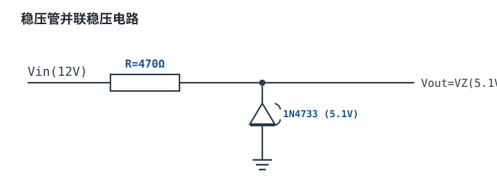

# 稳压管、LED 与 TVS/ESD 保护管 Zener / LED / TVS

稳压管（Zener Diode）、发光二极管（LED）和瞬态抑制二极管（TVS，Transient Voltage Suppressor）在符号上都只是一只"带花样的二极管"，但它们的设计逻辑与整流管完全不同：整流管追求"导通时压降小、阻断时漏电小"，而这三个器件是**故意钉在伏安特性最陡的那一段上工作**——稳压管靠在反向击穿区取一个几乎不变的电压，LED 靠在正向注入区把电流换成光，TVS 靠在击穿区把瞬态能量一次性吃掉。

一旦接受"工作在陡段"这个前提，本章要回答的问题就非常具体：**那一段到底有多陡、温度一变它跑到哪去、串多大的电阻才能保证电流始终落在这一段里、器件自己会不会先烧掉**。这四件事都是算出来的，不是选出来的。

主线：先用伏安特性建立"膝点—陡段—击穿"三段直觉，然后把温度系数、动态电阻、限流电阻、LED 分档、TVS 钳位与结电容逐项拆成可算的式子，最后用一个 12V 输入、5.1V 输出的稳压管电路走完从负载电流到电阻功耗的完整设计，再补两个 LED 与 TVS 的算例。整流二极管的通用参数（$V_F$、$t_{rr}$、$I_{FSM}$、热阻）见[二极管：整流、快恢复、肖特基](diodes.md)；LED 灯珠串的恒流驱动拓扑见[线性稳压器](../power/ldo.md)与[降压变换器](../power/buck.md)；接口的 ESD 系统设计见[ESD 防护设计](../pcb/esd-protection.md)。

## 1. 设计动机

::: motivation 三个真实场景
**场景一：拿 12V 稳压管当 ADC 基准。** 室温标定好的 12.00V，机器运行两小时后机内温度 65°C。这只管子的温度系数是 $+0.08\%/^\circ\text{C}$，40°C 的温升带来 $0.08\%\times40=3.2\%$ 的漂移，也就是 0.38V。12 位 ADC 的 1 LSB 只有满量程的 1/4096 = 0.024%，这 3.2% 相当于 130 个 LSB——基准比 ADC 还差两个数量级。

**场景二：从 3.3V 轨直接串电阻点白光 LED。** 白光 LED 的 $V_F$ 分档是 2.8~3.4V，3.3V 电源只剩 0.5V 到 -0.1V 的余量。$V_F$ 偏高的那一档根本点不亮，偏低的又超流；同一批板子上灯的亮度差异肉眼可见。

**场景三：USB 数据线上并一颗"1500W"TVS。** 峰值脉冲功率确实够大，但它的结电容是 500 pF。480Mbps 的差分对上，和 45Ω 阻抗一起构成的低通转折频率只有 7MHz，信号根本出不去——保护器件把功能做没了。
:::

| 你遇到的问题 | 先算 | 判据 |
|---|---|---|
| 稳压值随温度跑偏 | $\Delta V_Z=\alpha_Z V_Z\Delta T$ | 总漂移占输出允许误差的比例 |
| 一带载电压就掉 | $\Delta V_{out}=r_z\Delta I_Z$ | 空载/满载两种工况的 $I_Z$ 都在膝点以上 |
| 稳压管或电阻发热烧毁 | $P_Z=V_ZI_{Z,max}$、$P_R=(V_{in}-V_Z)^2/R$ | 最坏工况是**空载 + 最高输入** |
| LED 亮度不一致 | $I_F=(V_s-V_F)/R$ | $V_F$ 分档与电源公差叠加后的电流区间 |
| TVS 没保住后级 | $V_C$ 与芯片绝对最大额定值比 | $V_C$ 必须低于后级耐压 |
| TVS 把高速信号滤没了 | $f_{-3dB}=1/(2\pi RC_j)$ | 转折频率至少是信号最高频率的 3~5 倍 |

**不算会摔在哪**，三个带数字的代价：

1. **把稳压管的 $V_Z$ 当成常数。** 一只标称 12V、温度系数 $+0.08\%/^\circ\text{C}$ 的稳压管，从 25°C 到 85°C 漂移 $0.08\%\times12\times60=0.576$ V，相对漂移 $0.576/12=4.8\%$。若后级按 12V 设计耐压 13V，高温时只剩 $13-12.58=0.42$ V 余量。
2. **限流电阻只按满载算。** 12V 输入、5.1V 输出、负载 15mA、取 240Ω，满载时稳压管还有 6.25mA；一旦空载且输入升到 13.8V，稳压管电流涨到 $(13.8-5.1)/240=36.25$ mA，功耗 $5.26\times0.03625=0.191$ W。选 0.5W 管子时这只占 38%，但电阻功耗同时涨到 $8.7^2/240=0.315$ W——**先烧的往往是电阻，不是稳压管**。
3. **拿 $P_{PP}$ 直接比浪涌功率。** 同样一只标称 1500W 的 TVS，在 10/1000μs 波形下能扛 1500W 持续 500μs 量级（能量约 0.75J），在 8/20μs 波形下峰值功率可以高一个量级，但持续时间只有 10μs，能量只有 0.1J 量级。**跨波形比较 $P_{PP}$ 没有意义，要比能量和峰值两个口径。**

## 2. 定义与直观

### 2.1 一句话定义：三个"钉在陡段上"的二极管

- **稳压管**是设计来在反向击穿区长期工作的二极管，击穿后端电压近似不随电流变化，用这个近似恒定的电压做基准或钳位。
- **LED**是正向注入时电子空穴复合发光的二极管，发光强度近似正比于正向电流，但**它自己没有限流能力**。
- **TVS** 是结面积做得很大、专门吸收瞬态脉冲的稳压管，平时高阻，脉冲到来时在纳秒到微秒内击穿并把电压钳在 $V_C$。

三者共用一条伏安特性曲线，区别只在于"被允许待在哪一段"：


### 2.2 稳压管的伏安特性：膝点、$V_Z$ 与 $r_z$

反向偏置下，稳压管的电流先是一段极小的漏电（nA~µA 量级），到达**膝点电压** $V_{ZK}$ 后电流开始明显上升，之后进入**陡段**：电流变化几十毫安，电压只变几十毫伏。这段的斜率就是**动态电阻**（dynamic resistance）：

$$
r_z=\frac{\Delta V_Z}{\Delta I_Z}
$$

其中 $r_z$ 单位 $\Omega$；$\Delta V_Z$ 是击穿区电压变化（V）；$\Delta I_Z$ 是稳压管电流变化（A）。典型量级：5~15V 的 1W 稳压管在 $I_Z$ 为几十毫安时 $r_z$ 约 5~20Ω；工作电流降到膝点附近（1mA 量级）时，$r_z$ 会涨到几百欧，放大 30~100 倍。**所以"动态电阻"不是一个常数，必须连同工作电流一起给出。** 数据手册通常给两个点：$Z_{ZT}$（在测试电流 $I_{ZT}$ 下）和 $Z_{ZK}$（在膝点电流 $I_{ZK}$ 下），具体数值以数据手册的 Electrical Characteristics 表为准。

膝点以下不能用线性模型：那里是指数段，$r_z$ 随电流迅速变化，任何"$V_Z=r_zI_Z$"的线性外推都会错得离谱。

### 2.3 齐纳击穿与雪崩击穿：两种机理，两个温度系数

同为"反向击穿"，物理机理有两种，而且它们的分界正好落在 5~6V 附近：

| 机理 | 发生条件 | 温度系数 | 噪声 | 工程含义 |
|---|---|---|---|---|
| 齐纳击穿（Zener breakdown） | 高掺杂、耗尽层很薄，强电场直接把电子从价带隧穿到导带，一般 $V_Z<5$V | 负，典型 $-2$~$-3$ mV/°C | 以散粒噪声为主，相对低 | 低压基准、3.3V 钳位 |
| 雪崩击穿（Avalanche breakdown） | 耗尽层较厚，载流子在电场中加速后碰撞电离，$V_Z>6$V | 正，典型 $+0.05\%$~$+0.1\%/^\circ\text{C}$ | 有载流子倍增带来的倍增噪声，通常更大 | 12V/24V 钳位、TVS 主体 |
| 两者混合 | $V_Z\approx5.6$V | 接近零，典型绝对值小于 1 mV/°C | 居中 | 分立基准的经典取值 |

温度系数的符号可以这样记：**隧穿靠电场强度，温度升高晶格散射增强、要更高的场才能维持同样的隧穿电流，所以需要更高电压——但实际测得的是负系数**，因为齐纳区的击穿电压主要由禁带宽度决定，而禁带宽度随温度升高而减小，占主导。雪崩区正相反：温度升高使声子散射增强、载流子平均自由程变短、倍增更难，需要更高的电压才能击穿，所以是正系数。

**噪声的工程结论**：不要拿一只 12V 稳压管直接当低噪声基准。雪崩区的倍增噪声在音频和精密测量里很明显，需要并联电容或用 RC 低通（3.6 节给算例）。如果要低噪声基准，用带隙基准 IC 或埋层齐纳基准，它们的噪声指标是写在数据手册里的。

::: advanced 为什么 5.6V 附近温度系数最小
两种机理的温度系数符号相反：齐纳区为负（随温度升高 $V_Z$ 下降），雪崩区为正。在 5~6V 之间两种电流成分同时存在，一正一负部分抵消，所以净温度系数过零。这也解释了为什么经典的分立基准和稳压管选 5.6V、6.2V 这两档——不是巧合，是机理交点。低于 5V 只能走负温度系数，高于 6V 只能走正温度系数，没有第三种选择。
:::

### 2.4 LED：$V_F$ 分档与亮度一致性

LED 的正向特性同样是指数曲线，工程上用"膝点电压 + 斜率电阻"近似：

$$
V_F(I_F)=V_0+R_sI_F
$$

其中 $V_F$ 是正向压降（V）；$V_0$ 是膝点电压（V，白光约 2.6~2.9V，红光约 1.6~1.8V）；$R_s$ 是斜率电阻（$\Omega$，典型 5~20Ω）；$I_F$ 是正向电流（A）。

问题在于**同一型号、同一批次的 LED，$V_F$ 也有 0.4~0.6V 的分散**。厂商按 0.1~0.2V 一档做**分组（bin）**，白光常见 2.8~3.0V、3.0~3.2V、3.2~3.4V 三档。分档的意义是：同一档内的 LED 在同样电流下亮度接近，可以直接并联或串联使用；跨档混用则亮度差异肉眼可见。

但分档只解决"同批一致"，不解决"电流一致"。串一个固定电阻时，$V_F$ 的分散直接变成电流的分散（4.2 节算例），所以对亮度一致性有要求的场合（背光、指示灯阵列、标牌）必须用恒流驱动。

### 2.5 TVS：钳位，不是稳压

TVS 的参数体系和稳压管不同，四个电压必须分清：

| 参数 | 含义 | 选型约束 |
|---|---|---|
| $V_{RWM}$（反向工作电压） | 平时允许长期施加的最大反向电压，此时漏电只有 µA 级 | $V_{RWM}\geq$ 线路最高正常工作电压 |
| $V_{BR}$（击穿电压） | 测试电流（通常 1mA）下的电压，有 min/max 范围 | 只作参考，不作为保护判据 |
| $V_C$（钳位电压） | 在指定峰值电流 $I_{PP}$ 下两端的电压 | **$V_C$ 必须低于后级器件的绝对最大额定值** |
| $P_{PP}$（峰值脉冲功率） | $V_C\times I_{PP}$，**必须注明波形** | 与到来的浪涌波形匹配才有意义 |

关键认知：**$V_C$ 是在 $I_{PP}$ 下测的，不是 $V_{BR}$**。$V_{BR}$ 标 6.8V 的管子，在 30A 脉冲下 $V_C$ 可能到 12V。用 $V_{BR}$ 去判断"能不能保护 5V 芯片"是最常见的错。

### 2.6 类比：泄压阀、灯泡与保险片

::: analogy 三个阀门的类比
- **稳压管**像一只"定压泄压阀"：压力（电压）到了设定值就打开，把压力死死压在设定值附近。但阀门打开后流量（电流）必须由前面的管路阻力（限流电阻）决定，否则阀门口会把自己冲烂。
- **LED**像一只"流量驱动的灯"：流量（电流）越大越亮，但它自己没有阀门，必须靠外面的阻力限流；压力稍高于阈值，流量就暴涨。
- **TVS**像一只"爆破片"：平时完全封死（高阻），压力瞬间冲高时立刻破开泄放，泄完不能复原（虽然电学上它可恢复，但每次都在消耗寿命）。
- TVS 的**结电容**像阀门前面的一段盲管：它不挡直流，但对高频信号是一个对地电容，会把快速边沿"灌"掉。

类比的边界：真实的泄压阀不会因为温度升高而提前开启，稳压管的击穿电压会；爆破片是一次性的，TVS 可以反复吸收脉冲但每次都有累积损伤。涉及寿命与温度时，不能只靠阀门直觉。
:::

## 3. 定量关系

### 3.1 $V_Z$ 的温度系数

定义相对温度系数：

$$
\alpha_Z=\frac{1}{V_Z}\cdot\frac{\Delta V_Z}{\Delta T}
$$

其中 $\alpha_Z$ 单位 $1/^\circ\text{C}$（工程上常写成 %/°C）；$\Delta T$ 是相对 25°C 的温升（°C）。则任意温度下的漂移：

$$
\Delta V_Z=\alpha_Z V_Z(T-25)
$$

以 12V 稳压管、$\alpha_Z=+0.08\%/^\circ\text{C}$ 为例：

$$
\Delta V_Z(85^\circ\text{C})=0.0008\times12\times(85-25)=0.576\ \text{V}
$$

$$
\Delta V_Z(125^\circ\text{C})=0.0008\times12\times(125-25)=0.960\ \text{V}
$$

$$
\Delta V_Z(-40^\circ\text{C})=0.0008\times12\times(-40-25)=-0.624\ \text{V}
$$

也就是 11.38~12.96V，跨度 1.58V，占标称值的 13%。下图把三档典型器件的相对漂移画在同一张图上，横轴是结温，纵轴是相对 25°C 的百分比偏差：

```echarts
{
  "animation": false,
  "tooltip": {"trigger": "axis"},
  "legend": {"data": ["3.3V（齐纳区，-2mV/°C）", "5.6V（混合区，≈0）", "12V（雪崩区，+9.6mV/°C）"], "bottom": 0, "textStyle": {"fontSize": 11}},
  "grid": {"left": 62, "right": 26, "top": 30, "bottom": 62},
  "xAxis": {"type": "category", "name": "温度 / °C", "nameLocation": "middle", "nameGap": 30,
            "data": ["-40", "-20", "0", "25", "50", "85", "125"], "axisLabel": {"fontSize": 11}},
  "yAxis": {"type": "value", "name": "相对 25°C 偏差 / %", "nameLocation": "middle", "nameGap": 44,
            "axisLabel": {"fontSize": 11, "formatter": "{value}"}},
  "series": [
    {"name": "3.3V（齐纳区，-2mV/°C）", "type": "line", "symbol": "circle", "symbolSize": 5,
     "lineStyle": {"width": 2.4, "color": "#1a4f8b"}, "itemStyle": {"color": "#1a4f8b"},
     "data": [3.94, 2.73, 1.52, 0, -1.52, -3.64, -6.06]},
    {"name": "5.6V（混合区，≈0）", "type": "line", "symbol": "diamond", "symbolSize": 5,
     "lineStyle": {"width": 2.4, "color": "#4f9e63"}, "itemStyle": {"color": "#4f9e63"},
     "data": [-0.12, -0.08, -0.05, 0, 0.04, 0.11, 0.18]},
    {"name": "12V（雪崩区，+9.6mV/°C）", "type": "line", "symbol": "rect", "symbolSize": 5,
     "lineStyle": {"width": 2.4, "color": "#b5642e"}, "itemStyle": {"color": "#b5642e"},
     "data": [-5.2, -3.6, -2.0, 0, 2.0, 4.8, 8.0]}
  ]
}
```

图中数值由 $\alpha_ZV_Z(T-25)/V_Z=\alpha_Z(T-25)$ 直接算出，三条线斜率不同但同过 (25°C, 0)，可逐点复算。

**读数结论**：低压齐纳管是负温度系数（越冷电压越高），高压雪崩管是正温度系数（越热电压越高），5.6V 附近几乎不动。选基准时，先在数据手册的 Temperature Coefficient 图上确认自己这一档的符号和斜率，再决定要不要在系统里做温度补偿。

### 3.2 动态电阻 $r_z$ 与负载调整率

并联稳压电路的输出电流由两部分组成：负载电流 $I_L$ 和稳压管电流 $I_Z$，两者之和由限流电阻决定。负载变化时，$I_Z$ 反向变化，输出电压随之变化：

$$
\Delta V_{out}=r_z\,\Delta I_Z\approx-r_z\,\Delta I_L
$$

其中 $\Delta V_{out}$ 是输出电压变化（V）；$\Delta I_Z$ 是稳压管电流变化（A）；$\Delta I_L$ 是负载电流变化（A）；$r_z$ 是该工作点上的动态电阻（$\Omega$）。

**算例：** 一只 5.1V 稳压管在 20mA 附近的 $r_z=10\Omega$，负载从 0 变到 15mA：

$$
\Delta V_{out}=10\times15\times10^{-3}=0.150\ \text{V}
$$

相对标称值 $0.150/5.1=2.9\%$。若把工作电流压到 1mA（接近膝点），$r_z$ 可能涨到 400Ω，同样的 15mA 负载变化会造成

$$
\Delta V_{out}=400\times15\times10^{-3}=6.0\ \text{V}
$$

**比标称电压还大**——这个工作点根本不存在稳定的稳压区。所以"最小工作电流"不是随便取的裕量，它决定了负载调整率是否成立。工程上取 $I_{Z,min}\geq(5\sim10)I_{ZK}$，$I_{ZK}$ 是数据手册给的膝点电流。

### 3.3 限流电阻怎么算：两个工况，一个窗口

限流电阻 $R$ 由基尔霍夫电压定律决定：

$$
R=\frac{V_{in}-V_Z}{I_Z+I_L}
$$

其中 $V_{in}$ 是输入电压（V）；$V_Z$ 是稳压值（V）；$I_Z$ 是稳压管工作电流（A）；$I_L$ 是负载电流（A）。这个式子只有一个方程，却有两个未知量（$R$ 和 $I_Z$），所以要**用两个最坏工况各解一次，得到一个允许区间**。

**工况一：最低输入 + 最大负载。** 这时 $I_Z$ 最小，必须保证它不低于 $I_{Z,min}$，否则稳压管掉进膝点、失去稳压能力：

$$
R\leq R_{max}=\frac{V_{in,min}-V_Z}{I_{Z,min}+I_{L,max}}
$$

**工况二：最高输入 + 空载。** 这时 $I_Z$ 最大，稳压管和电阻的功耗都最大。这个工况给出两个下限：稳压管功耗上限和电阻功耗上限：

$$
R\geq R_{Z,min}=\frac{V_{in,max}-V_Z}{I_{Z,max}},\qquad
R\geq R_{R,min}=\frac{(V_{in,max}-V_Z)^2}{P_{R,rated}}
$$

其中 $I_{Z,max}$ 是稳压管允许的最大工作电流（A），由额定功耗降额得到；$P_{R,rated}$ 是电阻的额定功率（W）。

**工程判据：** 三个数排完后，若 $R_{max}>R_{min}$，说明存在可行区间，取区间内靠 $R_{max}$ 一侧的标准值（多留一点稳压管电流）；若 $R_{max}<R_{min}$，说明**这个稳压管 + 这个电阻功率的组合撑不住**，要么换大功率电阻、要么换大功率稳压管、要么改 LDO。这个"无解"的判断，比算出某个具体阻值更有价值。

::: advanced 为什么空载是最坏工况
很多人直觉认为"满载最狠"，因为负载在抽电流。但看功耗：负载电流不经过稳压管，只经过电阻，而电阻电流 $I_R=(V_{in}-V_Z)/R$ 在固定输入下几乎恒定。负载一撤，原本属于负载的那部分电流全部转给稳压管——**稳压管的最大功耗出现在空载，而且往往还叠加最高输入电压**。这就是为什么稳压管电路的额定功率要按"空载 + 最高输入 + 最高环境温度"三点同时成立来选。
:::

### 3.4 LED 限流电阻与电源波动下的余量

LED 串电阻的电流：

$$
I_F=\frac{V_s-V_F}{R_{LED}}
$$

其中 $V_s$ 是电源电压（V）；$V_F$ 是 LED 正向压降（V）；$R_{LED}$ 是限流电阻（$\Omega$）；$I_F$ 是正向电流（A）。阻值直接由目标电流反解：

$$
R_{LED}=\frac{V_s-V_F}{I_F}
$$

真正要小心的是**灵敏度**。对上式求导：

$$
\frac{dI_F}{I_F}=-\frac{dV_F}{V_s-V_F}
$$

这个式子说明：**$V_F$ 的任何误差，都会被放大 $(V_s-V_F)$ 这个"余量"的倒数倍**。余量越小，电流越敏感。设 $V_s-V_F=0.3$V（3.3V 轨点白光 LED），$V_F$ 偏 0.1V 就是 33% 的电流误差；余量 2V（5V 轨）时同样的 0.1V 只带来 5% 误差。所以**低压轨直接串电阻驱动 LED 是不可靠的**。

电阻功耗：

$$
P_{R}=I_F^2R_{LED}=(V_s-V_F)I_F
$$

其中 $P_R$ 单位 W。这个式子还直接给出驱动效率 $\eta=V_F/V_s$：5V 驱 3V 的 LED，效率上限只有 60%，剩下 40% 全部变成电阻上的热。这是"用电阻限流"的固有代价，也是大功率 LED 必须用恒流开关驱动的原因。

### 3.5 TVS 的钳位电压、峰值脉冲功率与波形

TVS 在脉冲期间的端电压可以用"击穿电压 + 动态电阻"近似：

$$
V_C\approx V_{BR}+I_{PP}r_d
$$

其中 $V_C$ 是钳位电压（V）；$V_{BR}$ 是击穿电压（V）；$I_{PP}$ 是峰值脉冲电流（A）；$r_d$ 是击穿区的动态电阻（$\Omega$，大结面积的 TVS 典型 0.1~1Ω）。数据手册直接给 $V_C$ 在某个 $I_{PP}$ 下的值，**优先用表中的 $V_C$，不要自己外推**。

峰值脉冲功率：

$$
P_{PP}=V_CI_{PP}
$$

但这个数**只有和波形一起才有意义**。IEC 61000-4-5 定义了两种典型波形：**8/20μs**（上升沿 8μs、半值时间 20μs，模拟雷电感应和大多数板级浪涌）和 **10/1000μs**（半值时间 1ms，模拟电源线的长时过压）。同一只器件在两种波形下的允许峰值功率差一个数量级，因为热扩散的时间尺度不同。

```echarts
{
  "animation": false,
  "tooltip": {"trigger": "axis"},
  "legend": {"data": ["8/20 μs", "10/1000 μs"], "bottom": 0, "textStyle": {"fontSize": 12}},
  "grid": {"left": 68, "right": 28, "top": 30, "bottom": 60},
  "xAxis": {"type": "log", "name": "时间 / μs（对数）", "nameLocation": "middle", "nameGap": 32,
            "min": 1, "max": 2000, "axisLabel": {"fontSize": 11}},
  "yAxis": {"type": "value", "name": "归一化电流 i / I_PP", "nameLocation": "middle", "nameGap": 44,
            "min": 0, "max": 1.05, "axisLabel": {"fontSize": 11}},
  "series": [
    {"name": "8/20 μs", "type": "line", "showSymbol": false, "smooth": false,
     "lineStyle": {"width": 2.6, "color": "#b5642e"},
     "data": [[1, 0.2], [2, 0.45], [4, 0.75], [6, 0.92], [8, 1.0], [10, 0.89], [15, 0.67], [20, 0.5], [30, 0.28], [40, 0.16], [60, 0.05], [100, 0.006]]},
    {"name": "10/1000 μs", "type": "line", "showSymbol": false, "smooth": false,
     "lineStyle": {"width": 2.6, "color": "#1a4f8b", "type": "dashed"},
     "data": [[1, 0.1], [2, 0.36], [5, 0.67], [10, 1.0], [20, 0.98], [50, 0.955], [100, 0.94], [200, 0.875], [500, 0.71], [1000, 0.5], [1500, 0.352], [2000, 0.248]]}
  ]
}
```

两条曲线都按"峰值归一为 1"绘制，横轴取对数才能同时看清 20μs 和 1ms 两个尺度。8/20μs 在 20μs 处正好降到 0.5（这就是"半值时间"的定义），10/1000μs 在 1000μs 处降到 0.5；形状是双指数波形的示意，不是实测数据，用来理解"同样归一化，尾部差 50 倍"。

**跨波形的功率换算**只能做量级估算。瞬态热扩散在绝热区近似满足 $P_{PP}\propto1/\sqrt{t}$，于是：

$$
P_{PP}(t_2)\approx P_{PP,ref}\sqrt{\frac{t_{2,ref}}{t_2}}
$$

以某只标称 1500W（10/1000μs）的器件为例，换算到 8/20μs：

$$
P_{PP}(20\ \mu\text{s})\approx1500\times\sqrt{\frac{1000}{20}}=1500\times7.07=10.6\ \text{kW}
$$

**注意这是量级估算，不是额定值**：真实器件的 8/20μs 额定值由厂家单独给出，受引线、封装、结面积限制，不能直接套公式。工程上正确的做法是查数据手册里两种波形各自的额定值。

### 3.6 结电容对高速信号的影响

TVS 的结电容在高频下就是一个对地电容，和线路阻抗构成一阶低通：

$$
f_{-3dB}=\frac{1}{2\pi R C_j},\qquad t_r\approx2.2RC_j
$$

其中 $f_{-3dB}$ 是转折频率（Hz）；$R$ 是线路的特征阻抗（$\Omega$，单端 50Ω、USB 差分 45Ω）；$C_j$ 是结电容（F）；$t_r$ 是 10%~90% 上升时间（s）。

以 USB 2.0 高速（480Mbps，位宽 $1/480\text{M}=2.08$ns）的 45Ω 差分线为例：

- 普通 TVS，$C_j=500$pF：$f_{-3dB}=1/(2\pi\times45\times500\times10^{-12})=7.07$ MHz，$t_r=2.2\times45\times500\times10^{-12}=49.5$ ns——**比位宽慢 24 倍**，眼图完全闭合。
- 低电容 TVS，$C_j=3$pF：$f_{-3dB}=1/(2\pi\times45\times3\times10^{-12})=1.18$ GHz，$t_r=2.2\times45\times3\times10^{-12}=297$ ps——约为位宽的 1/7，可用。

再算一下 USB 全速（12Mbps，位宽 83.3ns）：500pF 时 $t_r=49.5$ns 已经和位宽同量级，勉强能通但眼图很差；所以**即使是全速 USB，也要选低电容器件**。判据：$f_{-3dB}\geq(3\sim5)f_{signal}$，或 $t_r\leq$ 位宽的 1/10。

### 3.7 适用条件与失效边界

- **线性化模型只在陡段成立。** $V_Z=V_{Z0}+r_zI_Z$ 只在 $I_Z$ 大于膝点电流若干倍时可用；膝点以下必须用数据手册的完整曲线。
- **$r_z$ 是工作点的函数。** 同一个型号，1mA 和 50mA 下的 $r_z$ 可以差 50 倍。所有负载调整率计算都必须声明工作点。
- **温度系数本身也随温度变。** 上面用的 $\alpha_Z$ 是 25~85°C 的平均值；从 -40°C 到 125°C 的整段曲线通常略弯，精确计算要用数据手册的温度系数图。
- **TVS 的 $P_{PP}$ 是单次脉冲额定值。** 多次脉冲有累积损伤，寿命随脉冲次数下降；数据手册的 $P_{PP}$ 不适用于连续过压。
- **TVS 不能替代过压保护。** 电源误接 24V 到 12V 系统是"持续过压"，TVS 会持续导通并烧毁。持续过压要用[线性稳压器](../power/ldo.md)、[降压变换器](../power/buck.md)的 OVP 或 eFuse。
- **LED 的 $V_F$ 有负温度系数**（约 $-2$~$-4$ mV/°C）。恒压驱动时温度升高→$V_F$ 下降→电流上升→更热，是正反馈；大功率 LED 必须恒流驱动。

## 4. 典型计算

### 4.1 完整算例：12V 输入、5.1V 输出的稳压管电路

**需求与假设**（全部为示例量级，实际以所选型号数据手册为准）：

| 项目 | 值/要求 |
|---|---|
| 输入 | 12V 标称，范围 10.8~13.2V（±10%），叠加 100Hz、1.2Vpp 纹波 |
| 输出 | 5.1V 标称，负载 0~15mA |
| 允许输出纹波 | ≤100mV |
| 稳压管 | 5.1V/1W 玻璃封装，$I_{ZT}=49$mA，$I_{ZK}\leq1$mA，20mA 处 $r_z=10\Omega$，$\alpha_Z\approx-1.5$mV/°C |
| 环境 | 40°C，自然对流 |



**第 1 步：定最小工作电流。** 取 $I_{Z,min}=5$mA，是 $I_{ZK}$ 的 5 倍，保证工作在陡段。

**第 2 步：由"最低输入 + 满载"求 $R$ 上限。** 最低输入取纹波谷值：

$$
V_{in,min}=10.8-\frac{1.2}{2}=10.2\ \text{V}
$$

$$
R_{max}=\frac{10.2-5.1}{(5+15)\times10^{-3}}=\frac{5.1}{0.020}=255\ \Omega
$$

**第 3 步：由"最高输入 + 空载"求 $R$ 下限。** 最高输入取纹波峰值：

$$
V_{in,max}=13.2+\frac{1.2}{2}=13.8\ \text{V}
$$

稳压管侧的约束（1W 降额到 50%，即 0.5W）：

$$
I_{Z,max}=\frac{0.5}{5.1}=98\ \text{mA}\quad\Rightarrow\quad R\geq\frac{13.8-5.1}{0.098}=88.8\ \Omega
$$

电阻侧的约束（选 0.5W 电阻）：

$$
R\geq\frac{(13.8-5.1)^2}{0.5}=\frac{75.69}{0.5}=151\ \Omega
$$

**第 4 步：取标准值并验算。** 可行区间 151~255Ω，取 E24 的 **240Ω**。此时四个角点的工作点：

| 工况 | $V_{in}$ | $I_L$ | $I_R=(V_{in}-V_Z)/240$ | $I_Z=I_R-I_L$ | $V_Z=5.1+0.01(I_Z-20\text{mA})$ | $P_Z=V_ZI_Z$ | $P_R=(V_{in}-V_Z)^2/240$ |
|---|---|---|---|---|---|---|---|
| 空载·高线 | 13.8V | 0 | 36.25mA | 36.25mA | 5.263V | 0.191W | 0.315W |
| 空载·标称 | 12.0V | 0 | 28.75mA | 28.75mA | 5.188V | 0.149W | 0.198W |
| 满载·标称 | 12.0V | 15mA | 28.75mA | 13.75mA | 5.038V | 0.069W | 0.198W |
| 满载·低线 | 10.2V | 15mA | 21.25mA | 6.25mA | 4.963V | 0.031W | 0.108W |

逐条代入第一行验证：表中 $I_R=36.25$mA 是用标称 $V_Z=5.1$V 算的一阶值；若用自洽的 $V_Z=5.263$V，则 $I_R=(13.8-5.263)/240=35.6$mA，差 1.8%，属于二阶效应。功耗两种算法分别是 $5.263\times0.03625=0.191$W 与 $5.263\times0.0356=0.187$W，取较大者 0.191W。

**第 5 步：功耗与降额判定。**

- 稳压管最大功耗 0.191W，占 1W 额定的 19%，按 50% 降额线（0.5W）有 2.6 倍余量，合格。
- 电阻最大功耗 0.315W，占 0.5W 额定的 63%，超过常见的 50% 降额惯例但低于 70%，可以用 0.5W；若坚持 50% 降额则要选 1W 电阻。
- **如果这里选了 0.25W 电阻**，$R_{R,min}=(8.7)^2/0.25=303\Omega>R_{max}=255\Omega$，可行区间消失——这就是 3.3 节说的"无解"判断，必须先换电阻功率再谈阻值。

**第 6 步：输出纹波。** 稳压管把输入纹波按分压比衰减：

$$
V_{ripple,out}=V_{ripple,in}\cdot\frac{r_z}{R+r_z}=1.2\times\frac{10}{240+10}=1.2\times0.04=48\ \text{mV}
$$

48mV ≤ 100mV，满足要求。注意纹波也在调制 $I_Z$：纹波电流 $\Delta I_Z=1.2/(240+10)=4.8$mA，所以第 2 步必须用纹波谷值而不是平均值来算 $R_{max}$，否则低线满载时 $I_Z$ 会掉到 $6.25-4.8=1.45$mA，接近膝点。

**第 7 步：调整率。**

负载调整率（固定 12V，负载 0→15mA）：$\Delta V_{out}=r_z\Delta I_L=10\times0.015=0.150$V。

电源调整率（固定满载，输入 10.2→13.8V）：

$$
\Delta V_{out}=\frac{r_z}{R+r_z}\Delta V_{in}=0.04\times3.6=0.144\ \text{V}
$$

两项叠加，输出范围约 4.96~5.26V，相对 5.1V 是 -2.7%/+3.2%。这还没算初始容差（1W 稳压管常见 ±5%，即 ±0.26V）和温漂（$-1.5\text{mV}/^\circ\text{C}\times45^\circ\text{C}=-0.068$V）。全部算进去，最坏情况约 ±8%。

**第 8 步：效率。** 满载时输入功率：

$$
P_{in}=V_{in}I_R=12\times28.75\times10^{-3}=0.345\ \text{W},\qquad
P_{out}=5.1\times0.015=0.0765\ \text{W}
$$

$$
\eta=\frac{0.0765}{0.345}=22.2\%
$$

**第 9 步：结论。** 这个电路能用，但只在"负载电流稳定、精度要求 ±10% 以内、效率无所谓"的场合。它最大的问题是并联型结构：**空载时仍要烧掉 0.345W**，效率随负载变轻而线性恶化。要精度就换 TL431 或带隙基准；要效率就换 LDO 或 Buck，见[线性稳压器](../power/ldo.md)。稳压管的正确定位是**钳位与粗基准**，不是功率变换。

### 4.2 算例二：5V 轨驱动白光 LED 的电阻与余量

**需求：** 5V ±5% 电源驱动一只白光 LED，目标电流 20mA 量级。

**第一步，取标称点算电阻。** 取中档 $V_F=3.1$V、目标 $I_F=19$mA：

$$
R_{LED}=\frac{5.0-3.1}{0.019}=100\ \Omega
$$

**第二步，算 $V_F$ 分档带来的电流分散。** 白光分档 2.8~3.4V：

$$
I_{F,max}=\frac{5.0-2.8}{100}=22.0\ \text{mA},\qquad
I_{F,min}=\frac{5.0-3.4}{100}=16.0\ \text{mA}
$$

比值 $22.0/16.0=1.38$。LED 的光通量对电流近似亚线性（大电流下有 droop），1.38 倍的电流大约对应 1.25~1.3 倍的光通量——并排看是明显的亮度差。

**第三步，叠加电源公差。** 4.75~5.25V：

$$
I_{F,max}=\frac{5.25-2.8}{100}=24.5\ \text{mA},\qquad
I_{F,min}=\frac{4.75-3.4}{100}=13.5\ \text{mA}
$$

$$
\frac{I_{F,max}}{I_{F,min}}=\frac{24.5}{13.5}=1.81
$$

**最坏情况的电流是最小情况的 1.81 倍**，亮度差接近 1.6 倍，已经无法接受。

**第四步，功耗与封装。** 最坏电流下电阻功耗：

$$
P_R=I_F^2R=0.0245^2\times100=0.060\ \text{W}
$$

0603 封装额定 0.1W，占 60%——勉强；0402 封装额定 0.063W，占 95%——**超标**。这类"电流不大却烧电阻"的案例，根源就是把电阻功率按标称电流算、没按最坏电流算。

**第五步，效率和替代方案。** 标称点：

$$
P_{LED}=3.1\times0.019=58.9\ \text{mW},\qquad P_R=0.019^2\times100=36.1\ \text{mW}
$$

$$
\eta=\frac{58.9}{58.9+36.1}=62.0\%
$$

**38% 的能量白烧在电阻上。** 改进方向有三个：把电源抬到 12V 串 3 只灯（效率能到 75% 量级，但三只灯的 $V_F$ 容差叠加更严重，见下）、用恒流二极管/恒流源、或用带恒流环的开关驱动。

**第六步，反向验证"串 3 只"。** 3 只白光串联，总 $V_F$ 的分散是 8.4~10.2V（单只 2.8~3.4V 相加），12V 供电、串 150Ω：

$$
I_{F,max}=\frac{12-8.4}{150}=24.0\ \text{mA},\qquad
I_{F,min}=\frac{12-10.2}{150}=12.0\ \text{mA}
$$

电流比 2:1，**比单只更糟**。原因是 3 只灯的 $V_F$ 误差叠加（±0.9V），而余量只有 2.7V。结论：串联不能改善容差，只会放大；要么挑同一分档（bin）的灯珠，要么恒流驱动。

### 4.3 算例三：USB 数据线的 TVS 选型

**需求：** USB 2.0 高速差分对（480Mbps，45Ω 差分阻抗）加 ESD 保护，芯片的差分引脚绝对最大额定值 ±5.5V（以数据手册为准）。

**第一步，电容判据。** 位宽 $1/480\text{MHz}=2.08$ns，要求 $t_r\leq$ 位宽/10 ≈ 0.21ns：

$$
C_j\leq\frac{0.21\times10^{-9}}{2.2\times45}=2.1\ \text{pF}
$$

所以必须选 $C_j<2$pF 量级的专用低电容 TVS 阵列。普通 500pF 器件差了 240 倍。

**第二步，钳位判据。** 5V 线路的 $V_{RWM}$ 取 5.0V（≥ 线路最高工作电压）， $V_{BR}$ 典型 6.0~7.0V。若厂商给的 $V_C$ 在 1A 下是 9.2V，而芯片绝对最大额定值是 5.5V，则：

$$
V_C=9.2\ \text{V}>5.5\ \text{V}\quad\Rightarrow\quad\text{不满足钳位要求}
$$

TVS 在 1A 脉冲下钳不住 5.5V，这是 5V 逻辑接口的普遍困境：**TVS 的 $V_C$ 通常高于芯片的绝对最大额定值**。真正起作用的是 TVS 先把大部分能量泄放掉，剩下的残压由芯片内部的 ESD 二极管 + 串联电阻承担。

**第三步，串联电阻的代价。** 若允许流入芯片钳位二极管的电流为 20mA（典型量级，以数据手册为准），残压 9.2V、芯片钳位二极管正向压降 0.6V，则需要：

$$
R_s\geq\frac{9.2-5.0-0.6}{0.020}=\frac{3.6}{0.020}=180\ \Omega
$$

180Ω 串在 480Mbps 的差分线上会直接破坏阻抗匹配和信号完整性——**所以高速线不能靠串阻补钳位**，必须用专门的低钳位 ESD 阵列，或者接受"芯片内部 ESD 结构承担残余能量"的设计。

**第四步，能量校核。** 按 IEC 61000-4-5 的组合波发生器，1kV 开路电压对应 2Ω 源阻抗、8/20μs、500A 短路电流。若 TVS 把电压钳在 20V，则：

$$
P_{PP}=20\times500=10\ \text{kW},\qquad
W=V_C\cdot\frac{1}{2}I_{PP}t_2=20\times0.5\times500\times20\times10^{-6}=0.1\ \text{J}
$$

对照 3.5 节的量级：1500W（10/1000μs）器件换算到 8/20μs 约 10.6kW，刚好在这条浪涌的边界上。**工程上要留 50% 以上余量，选大一号的器件**。

### 4.4 算例四：稳压管噪声与 RC 滤波

**问题：** 5.1V 稳压管做基准，需要估算输出噪声，判断能否满足 12 位 ADC。

**假设：** 该稳压管的噪声密度取 $e_n=200\ \text{nV}/\sqrt{\text{Hz}}$（假设值，仅演示算法；实际以数据手册或实测为准），输出并联 10μF 滤波电容，源电阻 240Ω。

**第一步，转折频率。**

$$
f_c=\frac{1}{2\pi RC}=\frac{1}{2\pi\times240\times10\times10^{-6}}=66.3\ \text{Hz}
$$

**第二步，噪声带宽。** 一阶 RC 的等效噪声带宽是 $\pi/2$ 倍转折频率：

$$
B_n=\frac{\pi}{2}f_c=1.571\times66.3=104\ \text{Hz}
$$

**第三步，总噪声。**

$$
V_n=e_n\sqrt{B_n}=200\times10^{-9}\times\sqrt{104}=200\times10^{-9}\times10.20=2.04\ \mu\text{V}_{rms}
$$

**第四步，判定。** 12 位 ADC、5.1V 满量程时 1 LSB $=5.1/4096=1.245$mV。2.04μV 只有 0.0016 LSB，完全可以忽略——**瓶颈不在噪声，而在温漂和初始容差**。温漂 $-1.5\text{mV}/^\circ\text{C}$，温度变 0.01°C 就产生 15μV，是噪声的 7 倍。

这个对比是本章最重要的工程直觉之一：**低速精密电路里，噪声通常不是主要误差源，温漂、初始精度和长期漂移才是。**

## 5. 工程含义

### 5.1 数量级表

| 参数 | 稳压管（1W 级） | 白光 LED（指示级） | TVS（板级） |
|---|---|---|---|
| 工作电压 | 2.4~200V | $V_F$ 2.8~3.4V | $V_{RWM}$ 5~数百 V |
| 工作电流 | 5~50mA（稳压） | 2~20mA（指示） | 脉冲，µs 级 |
| 动态电阻 | 5~20Ω @ 几十 mA；几百 Ω @ 膝点 | 5~20Ω | 0.1~1Ω（击穿区） |
| 温度系数 | $-2$~$+10$ mV/°C（随 $V_Z$ 变号） | $-2$~$-4$ mV/°C | 击穿电压的正温度系数 |
| 结电容 | 几十~几百 pF | 几十~几百 pF | 1pF（低容型）~数 nF（大功率型） |
| 典型失效 | 过流烧穿、开路 | 过流烧黑、金线熔断 | 过压击穿短路、漏电变大 |

### 5.2 选型清单

1. **先定工作点，再定器件。** $I_Z$ 的范围（min/max）、$V_F$ 的目标电流、TVS 的 $V_C$ 对应的 $I_{PP}$——三个工作点必须先写下来。
2. **稳压管：$V_Z$ 选在温度系数过零附近。** 需要接近零温漂时优先 5.6V/6.2V 档；需要更高电压时接受正温度系数并做补偿。
3. **稳压管：按空载 + 最高输入算功耗。** 这是唯一的最坏工况，不是满载。
4. **限流电阻：先用两个工况框出区间，再取标准值。** 区间为空说明方案不成立，换功率等级而不是硬凑阻值。
5. **LED：$V_F$ 余量至少 1V 以上。** 5V 轨驱 3V LED 是最低可接受余量；3.3V 轨必须用升压或恒流驱动。
6. **LED：亮度一致性靠恒流，不靠电阻。** 分档只能保证同档一致，不能保证跨档一致。
7. **TVS：$V_{RWM}$ 高于线路最高电压，$V_C$ 低于后级绝对最大额定值。** 两个条件要同时成立，做不到就选更低的钳位或改用两级保护。
8. **TVS：高速线先看 $C_j$。** $C_j$ 决定了它能用在哪，$P_{PP}$ 只决定它能扛多大。

### 5.3 布局与安全

- **稳压管的限流电阻要贴着稳压管放。** 电阻到稳压管的走线越长，寄生电感越大，负载突变时的尖峰越高。
- **TVS 的接地回路要短。** TVS 的钳位效果取决于"被保护点到 TVS 再到地"的回路电感，走线绕一圈，$V_C$ 上的尖峰能翻倍。ESD 电流的 $di/dt$ 在 A/ns 量级，$1\text{nH}\times1\text{A/ns}=1$V 的额外压降。
- **LED 的热设计决定寿命。** 结温每升高 10°C，光衰速度大约翻倍（典型量级，以厂家 LM-80 数据为准）；大功率 LED 必须按热阻算结温。
- **涉及市电或高压的钳位/保护，必须做安全距离与爬电距离设计，并按相应安规标准验证。** 本章的所有算式只适用于低压直流与板级瞬态，不能直接用于市电入口的浪涌保护设计，后者见[EMI 与 EMC](../pcb/emi-emc.md)与[安规认证](../practice/safety-certification.md)。
- **ESD 防护的落地细节**（放电回路、结构地、TVS 位置）见[ESD 防护设计](../pcb/esd-protection.md)。

## 6. 常见坑

::: pitfall 常见坑
- **稳压管电流落在膝点以下**：现象——空载时电压正常，一加负载输出掉几百毫伏甚至更多，负载调整率远差于计算值。原因——$I_Z$ 接近 $I_{ZK}$，$r_z$ 从 10Ω 涨到几百欧，$\Delta V=r_z\Delta I_L$ 被放大几十倍。解决——按最低输入 + 最大负载核算 $I_{Z,min}$，取 $(5\sim10)I_{ZK}$；同时把纹波谷值算进去。
- **只算满载功耗，空载烧器件**：现象——样机满载测试一切正常，客户空载放置几小时后稳压管或限流电阻发黑。原因——空载时全部电流灌进稳压管，叠上最高输入电压，$P_Z$ 和 $P_R$ 同时达到峰值。解决——按"空载 + 最高输入 + 最高环温"算功耗；电阻功率按 $P=(V_{in,max}-V_Z)^2/R$ 选，并留 50% 降额。
- **用 12V 稳压管当 ADC 基准**：现象——室温校准后，机器热起来读数整体偏移几个百分点。原因——雪崩击穿是正温度系数，$+0.08\%/^\circ\text{C}$ 的漂移在 40°C 温升下就是 3.2%。解决——基准改用带隙基准 IC 或 TL431；若必须用稳压管，选 5.6V 档并做温度补偿。
- **3.3V 轨直接串电阻点白光 LED**：现象——同一批板子有的灯亮有的暗，有的干脆不亮。原因——白光 $V_F$ 分档上限 3.4V 已超过 3.3V 电源，余量为负；余量小的管子电流对 $V_F$ 极其敏感（$\Delta I/I=-\Delta V_F/(V_s-V_F)$）。解决——提高电源电压到 5V 以上、用升压恒流驱动，或改用低压差的红光/绿光LED。
- **TVS 用 $V_{BR}$ 判断能否保护**：现象——按 $V_{BR}=6.8$V 选了 TVS 保护 5V 芯片，ESD 测试后芯片仍然损坏。原因——$V_{BR}$ 是 1mA 下的值，真正钳位的是 $V_C$（几十安下可能到 12V）。解决——按数据手册 $V_C$-vs-$I_{PP}$ 曲线选，确保最坏脉冲电流下 $V_C$ 低于芯片绝对最大额定值。
- **高速线上用大结电容 TVS**：现象——加了 ESD 保护后 USB 枚举失败、以太网丢包、眼图闭合。原因——$C_j$ 与线路阻抗构成低通，500pF 在 45Ω 上把转折频率压到 7MHz。解决——按 $f_{-3dB}\geq(3\sim5)f_{signal}$ 选低容器件（USB HS 用 $C_j<2$pF），并把 TVS 放在连接器侧、走线尽量短。
- **TVS 当稳压管做持续过压保护**：现象——电源误接高压后 TVS 短路、甚至起火。原因——TVS 的 $P_{PP}$ 是 µs~ms 级脉冲额定值，持续过压的能量高几个数量级。解决——持续过压用 OVP 开关、eFuse 或 LDO 的过压保护；TVS 只负责瞬态，且前面要有保险丝限制故障能量。
:::

## 7. 自测题

<details><summary>一只 12V 稳压管的温度系数是 +0.08%/°C，从 25°C 升到 85°C，电压漂移多少伏？相对漂移多少？如果后级耐压 13V，还剩多少余量？</summary>

温升 $\Delta T=85-25=60^\circ\text{C}$。

$$
\Delta V_Z=\alpha_ZV_Z\Delta T=0.0008\times12\times60=0.576\ \text{V}
$$

$$
\text{相对漂移}=\frac{0.576}{12}=4.8\%
$$

85°C 时电压 $12+0.576=12.576$V，后级耐压 13V 时余量只剩

$$
13-12.576=0.424\ \text{V}
$$

这就是"按 25°C 标定、按 85°C 工作"的典型翻车点。要更稳，应选温度系数过零的 5.6V 档并升压，或改用带温度补偿的基准。

</details>

<details><summary>12V 输入（10.8~13.2V）、5.1V 输出、负载 0~15mA、$I_{Z,min}=5$mA、$I_{ZK}=1$mA、$r_z=10\Omega$。求限流电阻的允许区间（电阻额定 0.5W，稳压管 1W 降额到 50%），并选一个标准值。</summary>

满载 + 最低输入给出上限：

$$
R_{max}=\frac{10.8-5.1}{(5+15)\times10^{-3}}=\frac{5.7}{0.020}=285\ \Omega
$$

（若再考虑 1.2Vpp 纹波谷值 10.2V，则为 255Ω。）

空载 + 最高输入给出两个下限。稳压管侧：

$$
I_{Z,max}=\frac{0.5\text{W}}{5.1\text{V}}=98\ \text{mA},\qquad R\geq\frac{13.2-5.1}{0.098}=82.7\ \Omega
$$

电阻侧：

$$
R\geq\frac{(13.2-5.1)^2}{0.5}=\frac{65.61}{0.5}=131\ \Omega
$$

区间 131~285Ω，取 E24 的 240Ω。验算：最低输入满载时 $I_Z=(10.8-5.1)/240-0.015=23.75-15=8.75$mA，大于 5mA；最高输入空载时 $P_R=(8.1)^2/240=0.273$W，占 0.5W 的 55%。

</details>

<details><summary>5V ±5% 电源串 100Ω 驱动白光 LED（$V_F$ 分档 2.8~3.4V）。求最大和最小电流，并说明为什么不能靠"挑电阻"解决亮度一致性问题。</summary>

最大电流出现在电源最高、$V_F$ 最低：

$$
I_{F,max}=\frac{5.25-2.8}{100}=24.5\ \text{mA}
$$

最小电流出现在电源最低、$V_F$ 最高：

$$
I_{F,min}=\frac{4.75-3.4}{100}=13.5\ \text{mA}
$$

比值 $24.5/13.5=1.81$。

"挑电阻"只能把整个区间平移，不能压缩区间：电阻增大，区间两端同时下降，但比值不变（因为 $I\propto1/R$）。要压缩区间，必须减小 $(V_s-V_F)$ 的相对变化——也就是提高余量（升压）或改用恒流驱动。电阻功耗按最坏电流算：$0.0245^2\times100=0.060$W，0402 封装（0.063W）会超标。

</details>

<details><summary>某 TVS 标称 1500W（10/1000μs）。用 $P\propto1/\sqrt{t}$ 估算它在 8/20μs 下的峰值功率，并比较两种波形下的能量（设钳位电压 20V）。</summary>

功率换算：

$$
P_{PP}(20\ \mu s)\approx1500\times\sqrt{\frac{1000}{20}}=1500\times7.07=10.6\ \text{kW}
$$

对应峰值电流 $I_{PP}=10600/20=530$A。

能量用三角形近似 $W=V_C\cdot\frac{1}{2}I_{PP}t_2$：

$$
W(10/1000)=\frac{1}{2}\times20\times75\times1000\times10^{-6}=0.75\ \text{J}
$$

$$
W(8/20)=\frac{1}{2}\times20\times530\times20\times10^{-6}=0.106\ \text{J}
$$

**8/20μs 的峰值功率是 10/1000μs 的 7 倍，但能量只有它的 1/7。** 所以"这只 TVS 标 1500W，来一个 10kW 的脉冲会不会坏"这个问题本身问错了：要看脉冲波形和能量，不是只看峰值。

</details>

<details><summary>USB 2.0 高速（480Mbps、45Ω 差分）线上并一颗 500pF 的 TVS，转折频率和上升时间各是多少？为什么不能用在高速线上？</summary>

$$
f_{-3dB}=\frac{1}{2\pi\times45\times500\times10^{-12}}=\frac{1}{1.414\times10^{-7}}=7.07\ \text{MHz}
$$

$$
t_r=2.2RC_j=2.2\times45\times500\times10^{-12}=49.5\ \text{ns}
$$

480Mbps 的位宽是 $1/480\text{MHz}=2.08$ns，上升时间比位宽慢 24 倍，眼图完全闭合。判据是 $C_j\leq t_{r,allowed}/(2.2R)$，取 $t_r\leq0.21$ns 得 $C_j\leq2.1$pF。

顺带算一下：即使换成 3pF，$t_r=2.2\times45\times3\times10^{-12}=297$ps，约为位宽的 1/7，可用。

</details>

<details><summary>稳压管基准 + 10μF 滤波电容，源电阻 240Ω，噪声密度 200nV/√Hz。求输出噪声，并与 12 位 ADC 的 1 LSB（5.1V 满量程）比较。结论说明什么？</summary>

转折频率：

$$
f_c=\frac{1}{2\pi\times240\times10\times10^{-6}}=66.3\ \text{Hz}
$$

噪声带宽（一阶 RC 为 $\pi/2$ 倍转折频率）：

$$
B_n=1.571\times66.3=104\ \text{Hz}
$$

总噪声：

$$
V_n=200\times10^{-9}\times\sqrt{104}=2.04\ \mu\text{V}_{rms}
$$

12 位、5.1V 满量程的 1 LSB：

$$
\frac{5.1}{4096}=1.245\ \text{mV}
$$

2.04μV 只占 0.0016 LSB，噪声可以忽略。结论：**低速精密电路的瓶颈通常不是噪声，而是温漂（-1.5mV/°C）和初始容差（±5%）**。优化方向应该先做温度补偿和校准，而不是加更大的滤波电容。

</details>

## 8. 参考资料

- **Horowitz & Hill, The Art of Electronics（3rd ed.）**：Foundations 与 Voltage Regulation and Power Conversion 两章给出稳压管、电压基准与恒流源的工程讲法；本章 2.2、3.2 节的"膝点 + 斜率"图像与 4.1 节的并联稳压设计口径与该书一致。
- **Boylestad, Electronic Devices and Circuit Theory**：Zener Diodes 与 Special-Purpose Diodes 两节系统讲齐纳/雪崩机理、温度系数与 LED 特性；本章 2.3 节两种击穿机理的对比按该书的表述重写。
- **NEETS Module 7, Introduction to Solid-State Devices and Power Supplies**：稳压管与发光二极管的基础讲法，用于校准本章入门段的术语与量级。
- **onsemi, 1N4728A–1N4758A Zener Regulator Diodes 数据手册**：Electrical Characteristics 表给出 $V_Z$、$I_{ZT}$、$Z_{ZT}$、$Z_{ZK}$、$I_R$ 的测试条件，Temperature Coefficient 曲线给出各档 $\alpha_Z$；本章 2.2、3.1 节的量级与"$r_z$ 随电流变化"的结论按该手册。
- **Vishay, 1N4728A to 1N4764A Zener Diodes 数据手册**：Maximum Ratings 表与 $V_Z$ 温度系数图；本章 5.1 节数量级表的稳压管列参考该手册，具体数值以所选型号为准。
- **主流 LED 厂商（Osram Opto Semiconductors、Lumileds、Nichia）白光 LED 数据手册**：Forward Voltage 分组（$V_F$ bin）表给出 0.1~0.2V 一档的分档边界，Relative Luminous Flux vs Forward Current 曲线给出光通量对电流的亚线性关系；本章 2.4、4.2 节的分档与亮度一致性讨论按这类表格的口径。
- **Littelfuse, 1.5KE 系列 1500W TVS 数据手册**：Maximum Ratings 表标注 $P_{PPM}$ 对应的 10/1000μs 波形，Electrical Characteristics 表给出 $V_R$、$V_{BR}$、$V_C$、$I_{PP}$；本章 2.5、3.5、4.3 节的 $V_C$/$P_{PP}$ 口径按该手册。
- **IEC 61000-4-5:2014, Electromagnetic compatibility (EMC) – Part 4-5, Surge immunity test**：定义 1.2/50μs 电压波与 8/20μs 电流波、组合波发生器的 2Ω 等效源阻抗；本章 3.5、4.3 节的浪涌波形与 500A 短路电流按该标准。
- **IEC 61000-4-2:2008, Electromagnetic compatibility (EMC) – Part 4-2, Electrostatic discharge immunity test**：接触放电与空气放电的等级划分、放电电流波形参数；本章 4.3 节的 ESD 场景与[ESD 防护设计](../pcb/esd-protection.md)共用这套口径。
- **IEC 60747-3, Semiconductor devices – Signal (including switching) and regulator diodes**：稳压管反向击穿电压、动态电阻与测试电流的定义；本章 2.2、3.2 节的 $Z_{ZT}$/$Z_{ZK}$ 术语按该标准。
