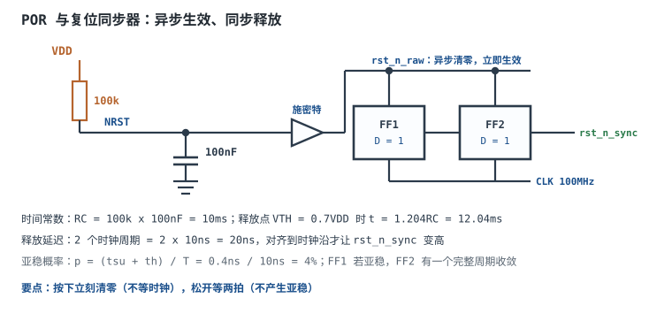

# 数字系统时钟与复位设计

## 1. 设计动机：偶发死机的两个源头

数字系统里所有触发器都听同一个节拍器——时钟。时钟到达各处的时刻差（偏斜）、时钟本身的抖动、复位释放的时刻，只要有一样不规范，系统就会出现"查不出原因"的故障：

- 同一批板子，有的上电正常、有的要按两次复位；换一片芯片就好，过几天又坏。
- 常温测试全过，低温启动失败；或者运行几小时后死机，断电重启又正常。
- 按键按一次，LED 翻转好几次；或者偶尔不响应。
- 两块板之间通信偶发错帧，降频就正常。

这些现象很少是"程序写错"，多数是**时钟与复位的地基没打牢**：复位释放沿落在时钟沿附近导致某些触发器亚稳；时钟走了普通 IO 导致偏斜不可控；晶振负载电容算错导致频偏偏出规格；按键抖动被当成多个时钟沿。本章把这些问题变成可计算的量：ppm 与 ps 的换算、RC 时间常数、两级同步器的亚稳概率、看门狗超时与去抖计数器位宽。

本章与[时序分析：建立/保持时间与亚稳态](timing-analysis-metastability.md)互补：那一章讲"一个时钟域内数据来不来得及"，本章讲"时钟从哪来、怎么分发、复位怎么发"。

## 2. 定义与直观：六种时钟源、五类复位

### 2.1 时钟源的六种选择

| 类型 | 频率准确度（典型量级） | 抖动 | 成本 | 起振/启动 | 适用 |
|---|---|---|---|---|---|
| 石英晶振（无源） | ±10ppm 到 ±50ppm | 低（ps 级） | 低 | 毫秒级 | MCU、FPGA 主时钟 |
| TCXO（温补晶振） | ±0.5ppm 到 ±2ppm | 很低 | 高 | 毫秒级 | 无线、授时、GPS |
| OCXO（恒温晶振） | ±0.001ppm 到 ±0.05ppm | 极低 | 很高 | 秒级（预热） | 计量、基站 |
| 陶瓷谐振器 | ±0.3% 到 ±0.5%（3000ppm 到 5000ppm） | 较高 | 很低 | 微秒到毫秒 | 遥控、玩具、时序不敏感场合 |
| 硅 MEMS 振荡器 | ±20ppm 到 ±50ppm | 中 | 中 | 微秒级 | 消费电子、可穿戴 |
| 片内 RC 振荡器 | ±1% 到 ±3%（未校准） | 高 | 零 | 微秒级 | 低速、可校准的场合 |

选型的第一问不是"哪个准"，而是"**协议允许多大误差**"。UART 允许百分之几的波特率误差，20ppm 的晶振绰绰有余；而长时间累积的计时（如一个月误差不超过 1 分钟）要求约 ±23ppm，就必须算上温度与老化。

### 2.2 四个容易混淆的概念

- **频率准确度**（accuracy）：实际频率与标称值的偏差，单位 ppm（百万分之一）。它导致**长期累积漂移**。
- **抖动**（jitter）：每个周期长度围绕平均值的随机波动，单位 ps（峰峰值或 rms）。它导致**单个边沿位置不确定**，压缩时序裕量与眼图。
- **相位噪声**（phase noise）：频域看抖动，单位 dBc/Hz。晶振在 10kHz 偏移处典型 -140dBc/Hz 到 -160dBc/Hz（量级）。
- **偏斜**（skew）：同一个时钟沿到达不同触发器的时刻差，单位 ps。它来自时钟树布线不等长、缓冲级数不同。

频率准确度是"慢漂移"，抖动是"快抖动"，偏斜是"空间不一致"——三者成因与对策完全不同，不能互相替代。

### 2.3 五类复位

- **上电复位（POR, Power-On Reset）**：电源上升过程中把系统按住，电压稳定并延时一段时间后释放。RC + 施密特比较器是最常见的实现。
- **掉电复位（BOR, Brown-Out Reset）**：电源跌到阈值以下时复位，防止低压下 Flash 写坏、逻辑乱跑。
- **看门狗复位（WDT）**：程序跑飞后没人喂狗，计数器溢出产生复位。
- **手动复位**：按键，必须去抖并整形。
- **软件复位**：写寄存器触发内部复位，用于升级后重启。

不管哪一种，最终都要经过**复位同步器**：异步生效（按下立刻清寄存器），同步释放（释放沿对齐到时钟）。

### 2.4 时钟树与复位树

时钟从晶振出发，经 PLL/MMCM 倍频与移相，再由全局缓冲（BUFG）驱动专用时钟网络，以树形分发到每个触发器。走专用网络的原因是：它的缓冲级数与线长经过设计，偏斜可控（典型几十 ps 到几百 ps）；走普通布线则偏斜可能到纳秒级，时序无法收敛。

复位树相反：它要求"到达所有寄存器的时间尽量一致，但允许慢"。所以复位通常也走全局网络，并在每个时钟域入口放一个同步器。

## 3. 定量关系：ppm、ps、RC 与亚稳概率

### 3.1 ppm 与 Hz、ps 的换算

ppm 是比例，换算成绝对量：

$$\Delta f = f_0\times\frac{\text{ppm}}{10^{6}}$$

$$\Delta t = T_0\times\frac{\text{ppm}}{10^{6}}$$

符号与单位：$f_0$ 为标称频率（Hz），$T_0=1/f_0$ 为标称周期（s），ppm 为百万分比，$\Delta f$ 单位 Hz，$\Delta t$ 为每周期的时间偏差（s）。

两条常用结论：

- **每秒累积误差**：$X$ ppm 意味着每秒漂 $X$ 微秒。因为 $1\text{s}\times X\times10^{-6}=X\mu\text{s}$。
- **每周期偏差**：100MHz（$T_0=10\text{ns}$）下，1ppm 对应 0.01ps；25MHz（$T_0=40\text{ns}$）下，1ppm 对应 0.04ps。

注意区分"频率准确度造成的周期偏差"与"抖动"：前者是系统性偏移、可累积；后者是随机波动、不累积但压缩单周期裕量。

### 3.2 抖动与 UI、眼图

串行链路的单位间隔（Unit Interval，UI）就是一个比特的时间：

$$UI=\frac{1}{f_{baud}}$$

抖动的相对大小用 UI 的百分比表示：

$$J_{rel}=\frac{J_{pp}}{UI}\times100\%$$

符号与单位：$J_{pp}$ 为峰峰抖动（s），$UI$ 为比特周期（s），$J_{rel}$ 为百分比。100MHz 时 $UI=10\text{ns}$，50ps 抖动占 0.5% UI；1% UI 就是 100ps。

工程判据：接收端留给抖动的预算通常是 UI 的 10% 到 20%，超过就要换更低抖动的时钟源或加时钟调理。

### 3.3 时钟树的扇出与偏斜

时钟树按"每级缓冲驱动 $F$ 个下级"组织，$L$ 级可驱动：

$$N_{FF}=F^{L}$$

符号与单位：$F$ 为每级扇出，$L$ 为级数，$N_{FF}$ 为可驱动的触发器数（末端负载）。$F=16$、$L=3$ 时 $N_{FF}=4096$。

每级缓冲引入的偏斜约几十 ps（典型量级）。若每级 50ps，3 级累计 150ps；对 10ns 周期是 1.5%。这看起来很小，但时序方程里它是直接从裕量中扣掉的：

$$T_{clk}\ \ge\ t_{co}+t_{logic}+t_{route}+t_{su}-t_{skew}$$

符号与单位同[FPGA 章](fpga-verilog.md)：全部为 ns。$t_{skew}$ 取正表示收端时钟晚到（对建立有利），取负表示早到（对建立不利）。最坏情况按"收端最早、发端最晚"算，所以偏斜的绝对值直接吃裕量。

### 3.4 POR 的 RC 时间常数

RC 充电：

$$V(t)=V_{DD}\left(1-e^{-t/\tau}\right),\qquad \tau=RC$$

符号与单位：$R$ 单位 Ω，$C$ 单位 F，$\tau$ 单位 s，$V(t)$ 单位 V。

复位释放发生在电压达到施密特阈值 $V_{TH}$ 时，解出时间：

$$t_{POR}=-\tau\ln\left(1-\frac{V_{TH}}{V_{DD}}\right)$$

若 $V_{TH}=0.7V_{DD}$：

$$t_{POR}=-\tau\ln(0.3)=1.204\tau$$

符号与单位：$t_{POR}$ 单位 s。这个 1.204 是设计时的常用系数，记住它比每次推导快。

### 3.5 复位同步器的亚稳概率

复位释放沿如果恰好落在时钟的建立/保持窗口内，触发器可能进入亚稳态。单个释放沿落入窗口的概率近似为：

$$p=\frac{t_{su}+t_h}{T_{clk}}$$

符号与单位：$t_{su}$、$t_h$ 为建立、保持时间（s），$T_{clk}$ 为时钟周期（s），$p$ 无量纲。

一级触发器被亚稳击中后，若下一级在同一个时钟沿就采样它，错误直接传下去；若中间隔一个完整周期 $T_{clk}$，残余亚稳概率按指数衰减：

$$p_{res}=p\cdot e^{-T_{clk}/\tau_{meta}}$$

符号与单位：$\tau_{meta}$ 为触发器的亚稳分辨率时间常数（s，由工艺决定，典型几十 ps），$p_{res}$ 为下一级仍采到非法电平的概率。

对应的 MTBF 公式（与[时序分析](timing-analysis-metastability.md)一致）：

$$MTBF=\frac{e^{t_r/\tau_{meta}}}{T_0\cdot f_{clk}\cdot f_{data}}$$

符号与单位：$t_r$ 为留给亚稳收敛的时间（s），$T_0$ 为工艺常数（s），$f_{clk}$ 为时钟频率（Hz），$f_{data}$ 为异步事件频率（Hz）。**每多一级同步，$t_r$ 增加一个时钟周期，MTBF 乘上 $e^{T_{clk}/\tau_{meta}}$**——这就是"两级同步器"的全部理论依据。

### 3.6 去抖计数器与看门狗超时

去抖的本质是"电平必须稳定足够长时间才认"：

$$N_{cnt}=\lceil t_{debounce}\cdot f_{samp}\rceil$$

$$W=\lceil\log_2 N_{cnt}\rceil$$

符号与单位：$t_{debounce}$ 为确认窗口（s），$f_{samp}$ 为采样时钟（Hz），$N_{cnt}$ 为计数值，$W$ 为计数器位宽（bit）。

看门狗超时：

$$t_{WDT}=\frac{2^{W}}{f_{WDT}}$$

符号与单位：$W$ 为看门狗计数器位宽，$f_{WDT}$ 为看门狗时钟（Hz），$t_{WDT}$ 为超时时间（s）。

## 4. 典型计算：一个 100MHz 系统的时钟与复位

### 4.1 算例一：25MHz 晶振倍频到 100MHz 的频率偏差

**已知**：晶振 25MHz、容差 ±20ppm；PLL 倍频系数 $N=4$，输出 100MHz。

**输出频率**：

$$f_{out}=25\text{MHz}\times4=100\text{MHz}$$

**绝对偏差**（ppm 不随倍频改变，绝对频率偏差按比例放大）：

$$\Delta f_{XTAL}=25\text{MHz}\times20\times10^{-6}=500\text{Hz}$$

$$\Delta f_{out}=100\text{MHz}\times20\times10^{-6}=2000\text{Hz}=2\text{kHz}$$

**每周期偏差**（$T_0=10\text{ns}$）：

$$\Delta t=10\text{ns}\times20\times10^{-6}=0.2\text{ps}$$

**每秒累积**：

$$20\text{ppm}\times1\text{s}=20\mu\text{s}$$

**对 UART 的影响**：115200 波特的位宽 $1/115200=8.68\mu\text{s}$。一帧 10 位共 86.8µs，累积漂移：

$$86.8\mu\text{s}\times20\times10^{-6}=1.74\text{ns}$$

漂移只占一个位宽的 $1.74\text{ns}/8.68\mu\text{s}=0.0002$，远小于 UART 通常允许的 2% 到 3% 总量。**结论：20ppm 的晶振做 UART 完全够用，误差瓶颈在分频器取整而不是晶振**。

**对长期计时的影响**：若用这个时钟做"每天累计运行时间"，20ppm 对应每天漂：

$$86400\text{s}\times20\times10^{-6}=1.728\text{s/天}$$

即每天 1.73 秒，一周约 12 秒。要月误差小于 1 分钟，需要：

$$\frac{60\text{s}}{30\times86400\text{s}}=23.1\text{ppm}$$

即 ±23ppm 以内——普通晶振的初始容差（±20ppm）刚好卡线，必须把温度与老化算进去（见 5.1 的误差预算）。

### 4.2 算例二：晶振负载电容与起振裕量

**已知**：晶振标称负载电容 $C_L=10\text{pF}$，PCB 与引脚寄生电容 $C_{stray}=5\text{pF}$，两端负载电容对称 $C_1=C_2=C$。

晶振看到的等效负载：

$$C_L=\frac{C_1C_2}{C_1+C_2}+C_{stray}=\frac{C}{2}+C_{stray}$$

反解：

$$C=2\left(C_L-C_{stray}\right)=2\times(10-5)\text{pF}=10\text{pF}$$

**结论**：两端各取 10pF。若错取 22pF，等效负载变成 $11+5=16\text{pF}$，频率会偏低（具体偏多少由晶振的牵引系数决定，典型几 ppm 到几十 ppm 每 pF，以手册为准）。

**起振裕量**（ST AN2867 判据）：晶振等效串联电阻 $ESR=50\Omega$，要求放大器的负阻满足：

$$\left|R_{neg}\right|\ \ge\ 5\times ESR=5\times50\Omega=250\Omega$$

即 MCU 内部反相器在晶振频率处提供的负阻至少 250Ω。负载电容取大、走线太长、寄生电容过大都会降低负阻，表现为"冷启动不起振、加热后又能起"。

### 4.3 算例三：POR 时间常数与释放时刻

**已知**：$R=100\text{k}\Omega$，$C=100\text{nF}$，施密特阈值 $V_{TH}=0.7V_{DD}$。

**时间常数**：

$$\tau=RC=100\text{k}\Omega\times100\text{nF}=10\text{ms}$$

**释放时刻**：

$$t_{POR}=1.204\times10\text{ms}=12.04\text{ms}$$

**校验需求**：电源上升时间典型 1ms 到 10ms（取决于 LDO 与负载），晶振起振 1ms 到 5ms。复位必须一直保持到"电源稳定 + 时钟稳定"之后，即至少 5ms 到 15ms。12ms 落在合理区间；若 LDO 上升很慢（比如 20ms），12ms 就不够，必须加大 RC 或改用带延时控制的复位芯片。

**一个常见错误**：MCU 的 NRST 引脚内部有 40kΩ 上拉，与外部 100kΩ 并联后等效 $R=100\text{k}\parallel40\text{k}=28.6\text{k}\Omega$：

$$\tau'=28.6\text{k}\Omega\times100\text{nF}=2.86\text{ms},\qquad t'_{POR}=1.204\times2.86=3.44\text{ms}$$

3.44ms 可能短于晶振起振时间，导致"上电偶尔不启动"。**外部 RC 必须按内部上拉的并联值重算**，或者干脆用专用复位芯片（内部已做延时与阈值整形）。

### 4.4 算例四（完整）：异步复位同步释放的亚稳论证

**需求**：100MHz 系统，复位来自按键与 POR，要求"按下立刻生效、释放不产生亚稳"。

**① 电路**

- 复位源 `rst_n_raw`（低有效）直接接两个触发器的异步清零端（低有效），所以**按下时立刻清零，不等时钟**；
- 两个触发器串接，第一级 D 接 1（$V_{DD}$），第二级输出 `rst_n_sync`；
- 释放时，`rst_n_raw` 变高，第一级在下一个时钟沿把 1 打入，第二级再下一个沿输出 1——**释放被延迟 2 拍并对齐到时钟沿**。

**② 延迟**

$$t_{release}=2T_{clk}=2\times10\text{ns}=20\text{ns}$$

**③ 亚稳概率**

取 $t_{su}+t_h=0.4\text{ns}$，$T_{clk}=10\text{ns}$：

$$p=\frac{0.4\text{ns}}{10\text{ns}}=0.04=4\%$$

即每个释放沿有约 4% 的概率落在危险窗口内。

**④ 一级与两级的差别**

若只有一级触发器，下游逻辑在同一个时钟沿就使用它的输出：一旦亚稳，错误直接传播，系统可能进入非法状态。

两级时，第一级即使亚稳，也有整整一个周期 $T_{clk}=10\text{ns}$ 收敛。取 $\tau_{meta}=20\text{ps}$：

$$p_{res}=0.04\times e^{-10\text{ns}/20\text{ps}}=0.04\times e^{-500}$$

$e^{-500}$ 在双精度浮点里已经是 0（数量级约 $7\times10^{-218}$），工程上可以认为不再发生。换成 MTBF 的语言：每加一级，MTBF 乘 $e^{500}$，这是任何产品寿命都无法消耗完的量级。

**⑤ 为什么不能只做异步复位**

如果复位释放也异步，释放沿与时钟沿的相对位置是随机的：不同触发器可能在不同时钟沿退出复位，状态机的一部分进入 S0、另一部分还停在复位值；更糟的是释放沿落在建立/保持窗口内，触发器输出亚稳，后级组合逻辑把它放大成毛刺。**异步复位同步释放同时拿到两个好处：按下的确定性（立即）与释放的确定性（对齐时钟）**。

**⑥ 复位宽度**

同步释放要求复位至少保持 2 个时钟周期（20ns），否则第二级可能采不到稳定的 1。实际系统中 POR 的毫秒级宽度远远超过这个要求，但软件触发的复位脉冲要注意：写寄存器产生的复位必须由硬件展宽到至少 2 拍到 3 拍。

### 4.5 算例五：按键去抖与看门狗

**去抖**：采样时钟 $f_{samp}=100\text{kHz}$（周期 10µs），机械按键抖动 5ms 到 20ms，取确认窗口 $t_{debounce}=20\text{ms}$：

$$N_{cnt}=20\text{ms}\times100\text{kHz}=2000$$

$$W=\lceil\log_2 2000\rceil=\lceil10.97\rceil=11\text{ bit}$$

即 11 位计数器（最大 2047）刚好覆盖 2000 个采样点。若取 10 位（1023），只能确认 10.23ms，抖动 20ms 的按键会被判成多次。

**看门狗**：独立时钟 32.768kHz，16 位计数器：

$$t_{WDT}=\frac{2^{16}}{32768\text{Hz}}=\frac{65536}{32768}=2\text{s}$$

喂狗周期取超时的一半，即 1s。若用 12 位：

$$t_{WDT}=\frac{4096}{32768}=125\text{ms}$$

喂狗周期 60ms。**喂狗必须放在主循环**，不能只放在某个定时器中断里——否则主循环死了、中断还在喂狗，看门狗形同虚设。窗口看门狗更进一步：喂得太早也复位，防止程序跑飞后恰好落进喂狗代码。

## 5. 工程含义：选型、分发与复位策略

### 5.1 时钟误差预算

一个 10 年寿命、-40 到 85 摄氏度的产品，频率误差要按最坏情况叠加：

| 误差项 | 典型量级 | 说明 |
|---|---|---|
| 初始容差 | ±20ppm | 出厂时的频偏，25 摄氏度 |
| 温度特性 | ±10ppm 到 ±30ppm | 晶振的抛物线温度特性，以手册曲线为准 |
| 老化 | ±1ppm 到 ±5ppm/年 | 10 年累计可达 ±10ppm 到 ±50ppm |
| 负载电容偏差 | ±5ppm 到 ±20ppm | 实际 $C_L$ 与标称不符 |
| PLL 静态误差 | 0（ppm 不变） | 倍频只放大绝对偏差，不改变 ppm |

线性相加：$20+30+50+20=120\text{ppm}$；均方根相加：$\sqrt{20^2+30^2+50^2+20^2}\approx65\text{ppm}$。工程上按线性相加取保守值。**这就是为什么"标称 ±20ppm"不能直接当成"系统 ±20ppm"**。

### 5.2 时钟分发

- **专用时钟引脚**：晶振、外部时钟必须接专用输入脚，走专用时钟网络；接普通 IO 会引入大偏斜与抖动。
- **全局缓冲**：FPGA 用 BUFG/MMCM 驱动时钟树；ASIC/SoC 用时钟树综合（CTS）平衡各分支。
- **不用逻辑产生时钟**：分频用 PLL 或时钟使能（CE），不要用计数器输出当时钟。
- **门控时钟用专用单元**：内含低电平透明锁存，保证使能在时钟低电平期间变化，避免毛刺；不要用与门拼（见下方门控单元图）。

门控与时钟使能（CE）的取舍：门控把整块模块的时钟关掉，动态功耗趋近零，但要走专用门控单元、增加时钟树复杂度；CE 只是让触发器这一拍不翻转，时钟仍在跑，省电有限但零风险。小模块用 CE，大模块（CPU 核、视频通路）用门控。

### 5.3 复位策略的组合

一个可靠系统通常同时具备：

1. **POR**：保证上电时有确定的复位宽度；
2. **BOR**：低压时复位，保护 Flash 与逻辑；
3. **看门狗**：程序跑飞时恢复；
4. **手动复位**：现场恢复手段，按键必须去抖 + 施密特整形；
5. **同步释放**：每个时钟域入口一个复位同步器；
6. **复位状态确定**：所有状态机有明确的复位状态，不能依赖"上电默认值"。

FPGA 有一点不同：配置完成后触发器已有初值，复位主要用于把控制路径拉到已知状态、与外部器件对齐，数据通路可以不复位以节省资源与布线。这与 MCU"复位清所有寄存器"的习惯不同，移植代码时要注意。

这里也纠正一个常见说法：旧资料常写"复位后所有寄存器都有确定初值"。在 FPGA 上，初值来自配置比特流而不是复位；真正需要复位的是那些必须与外部时序对齐的控制寄存器（状态机、计数器、握手标志）。把"复位"当成"赋初值"的手段，会把大量数据通路卷进复位网络，反而增加布线压力与偏斜。

### 5.4 跨时钟域

- 单 bit 控制信号：两级同步器（第一级可能亚稳，第二级采样时已稳定）；
- 多 bit 数据：异步 FIFO 或握手，不能逐位同步；
- 复位跨域：每个域各自做同步释放，不要把一个域的同步复位直接接到另一个域；
- 时钟使能跨域：先同步使能，再用它控制目标域。

### 5.5 抖动与偏斜的测量

- **频率准确度**：频率计或 GPS 授时比对，测 ppm；
- **周期抖动**：示波器余晖模式或抖动分析选件，测峰峰值与 rms；
- **相位噪声**：频谱分析仪，看 dBc/Hz 曲线；
- **偏斜**：用同一时钟驱动的两个输出引脚，示波器双通道测到达时间差；
- **复位释放**：示波器同时看复位与时钟，确认释放沿距离时钟沿至少一个建立时间。

### 5.6 低功耗与时钟监测

- **时钟监测**：外部时钟丢失时切到内部 RC 并报警，避免系统"假死"；
- **动态调频**：负载低时降频降压，注意降频过程中跨域信号的处理；
- **展频（SSC）**：用小幅频率调制降低 EMI 峰值，但会引入额外抖动，高速接口（如 PCIe、SATA）通常不允许或不兼容；
- **停振检测**：晶振失效是常见故障，监测电路应在毫秒级发现并切换。

## 6. 常见坑：现象、原因与解决

::: pitfall 坑一：复位释放不同步
- **现象**：上电偶尔不启动，或状态机进入非法状态；按复位键有时正常、有时死机。
- **原因**：复位释放沿与时钟沿的相对位置随机，某些触发器在不同拍退出复位，或释放沿落在建立/保持窗口内产生亚稳。
- **解决**：每个时钟域用"异步置位、同步释放"的两级同步器；复位源先经施密特整形；软件复位脉冲由硬件展宽到至少 2 拍。
:::

::: pitfall 坑二：用普通 IO 走时钟
- **现象**：系统在实验室正常，装进机箱或换批次后时序违例；时序报告里这条时钟路径无法分析。
- **原因**：普通 IO 没有专用时钟缓冲与等长树，偏斜大、抖动大，工具也不把它当时钟树处理。
- **解决**：时钟只走专用时钟引脚与全局缓冲（BUFG/MMCM）；必须从普通引脚进时钟时，先过专用时钟缓冲单元。
:::

::: pitfall 坑三：晶振负载电容拍脑袋取 22pF
- **现象**：频率偏出规格几十 ppm，或低温起振困难、偶尔不起振。
- **原因**：负载电容与标称 $C_L$ 不匹配，等效负载偏大导致频率偏低、负阻下降。
- **解决**：按 $C=2(C_L-C_{stray})$ 计算，$C_{stray}$ 按 3pF 到 5pF 估；用频率计实测后微调；核对 ESR 与负阻裕量（$|R_{neg}|\ge5\times ESR$）。
:::

::: pitfall 坑四：按键直接当时钟或中断源
- **现象**：按一次 LED 翻转多次，或计数多跳；示波器看按键波形有一串毛刺。
- **原因**：机械触点抖动 5ms 到 20ms，每个毛刺都被当成一个时钟沿或一次中断。
- **解决**：先两级同步消亚稳，再用计数器确认电平稳定超过 20ms；或用 RC + 施密特硬件整形。
:::

::: pitfall 坑五：看门狗喂在中断里
- **现象**：主循环死锁后系统不复位，看门狗完全失效。
- **原因**：喂狗放在定时器中断中，主循环死了中断仍在跑，狗一直被喂。
- **解决**：喂狗放主循环，且喂狗前检查关键任务标志；用窗口看门狗，喂得太早也复位。
:::

::: pitfall 坑六：POR 时间常数没算内部上拉
- **现象**：上电偶尔不启动，按一下复位就好；换电源芯片后现象变化。
- **原因**：外部 100kΩ 与 MCU 内部 40kΩ 上拉并联，实际时间常数只有设计值的 28.6%，复位释放早于晶振稳定。
- **解决**：按并联值重算 RC，或用专用复位芯片；实测上电波形，确认复位释放晚于电源与时钟稳定。
:::

## 7. 自测题

25MHz 晶振 ±20ppm，经 PLL 倍频到 100MHz。输出频率偏差多少 Hz？每秒累积多少 µs？

ppm 不随倍频变化：$100\text{MHz}\times20\times10^{-6}=2\text{kHz}$（晶振侧 500Hz，倍频 4 倍后 2kHz）。每秒累积 $20\text{ppm}\times1\text{s}=20\mu\text{s}$。每周期偏差 $10\text{ns}\times20\times10^{-6}=0.2\text{ps}$。

R=100kΩ、C=100nF、阈值 0.7VDD，POR 释放时间是多少？若 MCU 内部有 40kΩ 上拉并联，变成多少？

$\tau=100\text{k}\times100\text{n}=10\text{ms}$，$t=1.204\tau=12.04\text{ms}$。并联后 $R=100\text{k}\parallel40\text{k}=28.6\text{k}\Omega$，$\tau=2.86\text{ms}$，$t=3.44\text{ms}$——可能短于晶振起振时间，导致上电偶发不启动。

为什么复位要"异步置位、同步释放"？只做异步复位有什么问题？

异步置位让按下复位立刻生效（不等时钟），保证任何时刻都能把系统拉回已知状态。但若释放也异步，释放沿与时钟沿相对位置随机：不同触发器可能在不同拍退出复位，状态机进入非法中间态；释放沿落在建立/保持窗口内还会产生亚稳。同步释放把释放沿对齐到时钟，两级触发器留出一个完整周期让亚稳收敛。

100MHz 时钟、建立+保持窗口 0.4ns，复位释放落在窗口内的概率是多少？两级同步后残余概率的量级？

$p=0.4/10=4\%$。两级时第一级有一个完整周期收敛，$p_{res}=0.04\times e^{-T/\tau}$，取 $\tau=20\text{ps}$ 得 $e^{-500}$ 量级，工程上可忽略。每增加一级，MTBF 乘 $e^{T/\tau}$。

100kHz 采样、20ms 去抖窗口，计数器要几位？按键抖动 5ms 到 20ms 意味着什么？

$N=20\text{ms}\times100\text{kHz}=2000$，$W=\lceil\log_2 2000\rceil=11$ 位。抖动持续 5ms 到 20ms 意味着确认窗口不能小于 20ms，否则一次按下会被判成多次；同时窗口也不能太大（如 100ms），否则响应迟钝。

32.768kHz 时钟、16 位看门狗，超时多少？为什么喂狗不能放在中断里？

$2^{16}/32768=2\text{s}$。喂狗放中断里时，主循环死锁但定时器中断仍在运行并喂狗，看门狗永远不触发；必须放主循环，或使用窗口看门狗并检查任务标志。

时钟偏斜 150ps 对 100MHz 系统的时序裕量影响多大？为什么它不能靠"提高电压"解决？

150ps 占 10ns 周期的 1.5%，直接从建立裕量中扣除（最坏情况按收端早到算）。提高电压只能加快逻辑与布线延迟，不能改变时钟到达不同触发器的时刻差；偏斜要靠时钟树综合、专用缓冲与布局约束解决。

## 8. 参考资料

- JEDEC JESD65B，*Definition of Skew Specifications for Standard Logic Devices*：偏斜（skew）的标准化定义与测试条件，避免把偏斜与抖动混为一谈。
- ST AN2867，*Oscillator Design Guide for STM8 and STM32 Microcontrollers*：皮尔斯振荡器的负阻判据、$ESR$ 与起振裕量、负载电容计算。
- AMD UG472，*7 Series FPGAs Clocking Resources User Guide*：BUFG、MMCM 的结构与时钟树偏斜指标。
- AMD UG949，*UltraFast Design Methodology Guide*：复位策略、跨时钟域同步与约束建议。
- Cummings, *Asynchronous and Synchronous Reset Design Techniques*（SNUG 2003）：异步复位同步释放的经典论述与代码模板。
- Epson FA-238 系列晶振数据手册：频率容差、负载电容、等效串联电阻与温度特性的取值示例（具体型号以对应版本手册为准）。

延伸阅读：[时序分析与亚稳态](timing-analysis-metastability.md) 讲建立/保持与 MTBF 的推导，[FPGA/CPLD 与 Verilog 入门](fpga-verilog.md) 讲 `create_clock` 等约束怎么写，[逻辑电平标准](logic-levels.md) 讲时钟信号的摆幅与端接，[存储器](memory.md) 讲 SPI Flash 的时钟频率与启动时序。
