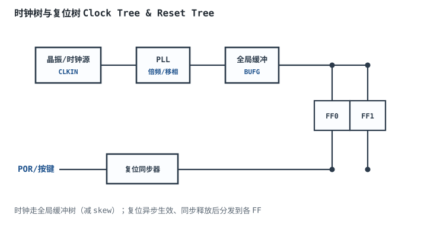
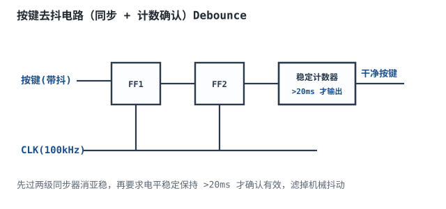
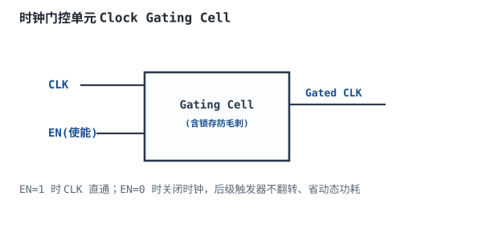

# 数字系统时钟与复位设计

## 1. 设计动机

::: motivation 为什么时钟和复位是系统的"地基"
数字系统所有触发器都靠同一个节拍器（时钟）驱动。时钟偏一点、复位释放错一点，整个系统就可能跑飞：时钟到达各 FF 的时刻差（skew）直接决定最高频率；复位释放沿如果不规范，触发器亚稳、状态机跑飞。

很多"偶发死机"既不是程序错也不是硬件坏，而是**时钟/复位设计不规范**。本章讲：时钟怎么走、复位怎么发、按键怎么去抖、怎么门控省电。
:::

## 2. 原理与逻辑图

### 2.1 时钟树

时钟源（晶振）→ PLL 倍频 → 全局缓冲（BUFG）→ 时钟树分发到所有触发器。走专用时钟路径，不走普通 IO，保证偏斜（skew）最小。



### 2.2 复位树

复位要"异步生效、同步释放"：按下复位立刻清所有寄存器（不等时钟），但释放要在目标时钟域打拍后才释放，避免释放沿亚稳。

### 2.3 去抖与门控

- 按键有机械抖动，直接当时钟/数据会误触发，要去抖。
- 不工作的模块把门控时钟关掉，省动态功耗。

## 3. 静态分析（时钟/复位规范）

时钟设计红线：
- 一个设计尽量一个主时钟域；跨域必经同步器/FIFO。
- 时钟走专用全局时钟引脚，不走普通 IO。
- 不要用组合逻辑产生时钟（门控时钟走专用使能端/门控单元）。

复位设计红线：
- 异步置位、同步释放。
- 复位后所有寄存器有确定初值。
- 慢边沿/毛刺复位源先经施密特整形。

## 4. 动态分析（抖动与偏斜）

时钟偏斜（skew）：同一时钟沿到达不同 FF 的时刻差。skew 越大，可用建立时间越短，最高频率越低。

```echarts
{
  "tooltip": {"trigger": "axis"},
  "legend": {"data": ["理想CLK(到达FF0)", "实际CLK(到达FF1, skew=0.5ns)"], "bottom": 0, "textStyle": {"fontSize": 12}},
  "grid": {"left": 60, "right": 30, "top": 30, "bottom": 60},
  "xAxis": {"type": "category", "name": "时间(ns)", "data": ["0","1","2","3","4","5","6","7","8"], "axisLabel": {"fontSize": 11}},
  "yAxis": {"type": "value", "min": 0, "max": 1.4, "interval": 1, "axisLabel": {"fontSize": 11}},
  "series": [
    {"name": "理想CLK(到达FF0)", "type": "step", "step": "middle", "showSymbol": false, "lineStyle": {"width": 2.4, "color": "#1a4f8b"}, "data": [0,0,1,1,0,0,1,1,0]},
    {"name": "实际CLK(到达FF1, skew=0.5ns)", "type": "step", "step": "middle", "showSymbol": false, "lineStyle": {"width": 2.6, "color": "#b5642e"}, "data": [0,0,0,1,1,0,0,1,1]}
  ]
}
```

观察：FF1 看到的时钟沿比 FF0 晚 0.5ns（skew），这 0.5ns 吃掉了可用建立时间。高速设计看时序报告 slack，而不是只算理论公式。

## 5. 时钟域与复位约束

- **单时钟域优先**：跨时钟域是亚稳和死锁的最大来源。
- **异步复位同步释放**：复位立刻生效，但释放沿对齐到时钟。
- **多时钟域**：每个域自己的时钟和复位，跨域信号走同步器/FIFO。
- **时钟使能 CE**：不需要门控时钟，用时钟使能端让某些 FF 这拍不翻转。

## 6. 元件取值与工程权衡

- **晶振 vs RC 振荡**：精度高、要稳用晶振；低成本粗略用 RC/内部 RC。
- **PLL 倍频**：低频晶振 + PLL 倍出高频时钟，省高速晶振成本。
- **去抖时间**：机械抖动典型 5~20ms，计数器设 20ms 确认窗口。
- **门控粒度**：大模块不工作时整体门控，省电；别用组合逻辑拼门控（毛刺）。

## 7. 完整设计示例

::: example 设计一个按键控制 LED 的最小系统
1. **需求**：MCU 100kHz 时钟，按键按一次 LED 翻转一次。
2. **时钟**：内部 RC 振荡出 100kHz，走全局时钟路径。
3. **复位**：上电 POR 经 RC + 施密特整形，进复位同步器（异步置位、同步释放）。
4. **按键**：按键信号先过两级同步器消亚稳，再用计数器确认稳定 20ms 才判有效，产生一个干净脉冲。
5. **翻转**：干净脉冲作为 T 触发器使能，每个有效脉冲 Q 翻转，Q 接 LED。
6. **验算**：按下抖动 < 20ms，去抖电路滤掉；稳定 20ms 后产生一个沿，LED 翻转一次。
7. **注意**：按键不能直接当时钟——抖动会产生多个沿，LED 乱跳。
:::

## 8. 仿真与实验

在开发板/Logisim 上：

- 用示波器测晶振输出频率、占空比。
- 写 Verilog 按键去抖模块，仿真观察抖动信号被滤成干净脉冲。
- 故意把按键直接接时钟沿，仿真看 LED 翻转多次（抖动）。
- 对比门控时钟前后模块的动态功耗（功耗分析工具）。

## 扩展与变种电路

### 扩展1：按键去抖电路 Debounce

机械按键按下/松开时触点抖动几毫秒，产生多个沿；去抖电路把它变成一个干净脉冲。



::: example 工作原理与参数
- 第一步：异步按键过两级 FF 同步器，消亚稳。
- 第二步：计数器记录电平稳定时间，>20ms 才确认有效，滤掉 5~20ms 抖动。
- 输出是干净的单脉冲，可安全当 T 触发器使能或中断。
- 典型参数：采样时钟 100kHz，确认窗口 20ms。
:::

设计要点：去抖 = 同步 + 时间确认。取值/对比：RC 硬件去抖 vs 数字去抖——RC 简单但占元件；数字去抖灵活、省外部元件。适用：所有机械按键；不适用：已经干净的数字信号（无需去抖）。

::: pitfall 按键直接接时钟沿
- **现象**：按一次 LED 翻转多次，或偶发不翻转。
- **原因**：机械抖动产生多个时钟沿，触发器被连续采样多次。
- **解决**：按键先去抖（同步 + 20ms 确认），干净后再当使能/时钟。
:::

### 扩展2：时钟门控单元 Clock Gating Cell

不工作的模块把时钟关掉，省动态功耗；门控单元内部带锁存防止毛刺。



::: example 工作原理与说明
- EN=1：CLK 直通到后级。
- EN=0：CLK 关闭，后级 FF 不翻转，动态功耗趋近零。
- 门控单元内含一个低电平透明锁存，保证 EN 只在 CLK 低时变化，避免产生毛刺时钟。
- 用途：低功耗设计，空闲模块断电。
:::

设计要点：门控时钟用专用单元，别用与门拼。取值/对比：门控时钟 vs 时钟使能 CE——门控更省电但走专用路径；CE 简单但 FF 仍在翻转。适用：低功耗、大模块；不适用：小逻辑（CE 更简单）。

::: pitfall 用与门拼门控时钟产生毛刺
- **现象**：门控切换瞬间时钟出现毛刺，后级 FF 误触发。
- **原因**：用普通与门做门控，EN 在 CLK 高时变化会产生窄毛刺。
- **解决**：用专用门控单元（内含锁存），或用时钟使能 CE 端让 FF 这拍不翻转，不直接门控时钟。
:::

## 9. 常见坑与故障现象

::: pitfall 常见坑
- **复位直接全局异步释放**：释放沿亚稳，上电后偶发跑飞。要异步置位、同步释放。
- **组合逻辑当时钟**：门控时钟用与门拼，产生毛刺时钟。时钟只走专用路径/门控单元。
- **按键直接接时钟**：抖动产生多沿，计数器多跳。按键必须去抖。
- **跨时钟域不同步**：异步信号直接进快域，亚稳。单 bit 过两级同步器。
:::

## 10. 自测题

<details><summary>为什么复位要"异步置位、同步释放"？</summary>

复位按下时希望立刻生效（不等时钟），所以异步置位。但复位释放时如果也异步，释放沿可能落在触发器建立/保持窗口内，导致亚稳。所以释放要在目标时钟域打拍同步后才释放——按下立刻清，松开等时钟沿再放，两头都安全。
</details>

<details><summary>时钟偏斜 skew 为什么会降低最高工作频率？</summary>

同一时钟沿到达两个 FF 的时刻不同。按最坏情况：收端 FF 的时钟比发端**早到** 0.5ns——发端 FF 的时钟沿还没到、数据尚未发出（或刚出发还在路径上），收端 FF 的采样沿已经来了，数据未稳就被采样，建立裕量被吃掉 0.5ns。skew 双向不确定，按"收端最早、发端最晚"的最坏情况算，留给数据路径的可用时间最少，最高频率最低。
</details>

<details><summary>按键去抖电路为什么要先过两级同步器再做时间确认？</summary>

按键是异步信号，直接进 FF 可能违反建立/保持时间导致亚稳。两级同步器先把它对齐到时钟域、消亚稳。然后时间确认（20ms）滤掉机械抖动。两步缺一不可：只同步不确认，抖动还是多沿；只确认不同步，亚稳没解决。
</details>

## 11. 参考资料

- sources/notes/metastability-clockreset.md
- AMD/Xilinx 时钟与复位设计应用指南
