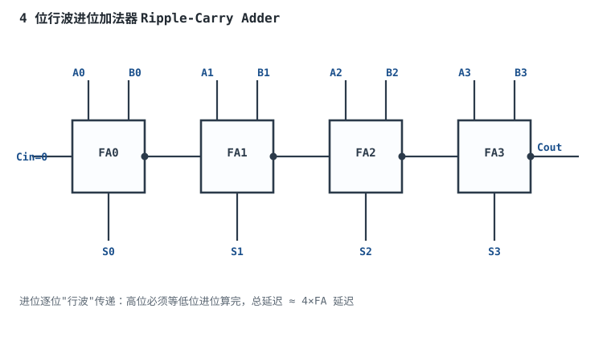
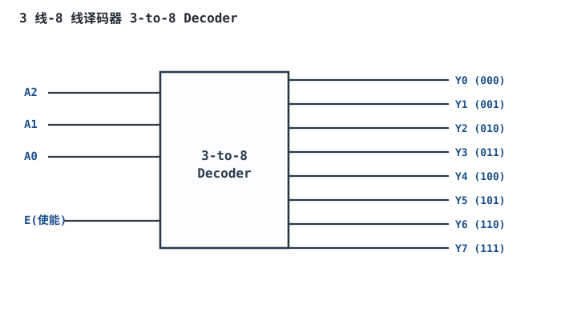
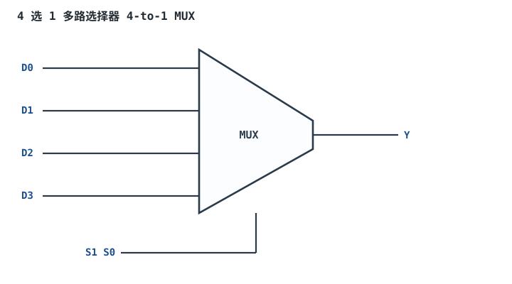
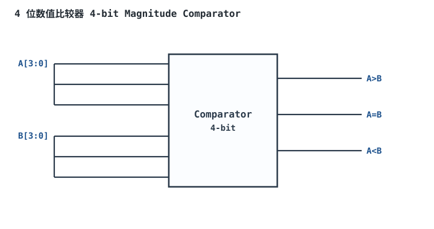

# 组合逻辑：译码、编码、选择与加法

“组合逻辑（Combinational Logic）”指输出只由当前输入决定、不含记忆的电路。工程里反复出现五类需求：**地址→选通某一路（译码）、多路数据→挑一路送出去（MUX）、两数比大小（比较）、两数相加（加法）、把独热输入压成二进制编号（编码）**。每次都从门开始搭太累，芯片厂把这些常用结构做成标准模块；理解它们的内部结构、延迟和资源权衡，是画任何数字系统框图的基础。

本章的重点不是“记住 74 系列型号”，而是三件事：**第一，看到需求能选对模块；第二，能算出它的门数、位宽和延迟；第三，知道它的输出为什么不能直接当时钟。** 布尔化简与卡诺图见[逻辑门、布尔代数与卡诺图](logic-gates-boole.md)；补码、BCD 与定点格式见[数制、编码、补码与格雷码](number-systems.md)；输出被时钟采样后的时序问题见[触发器 RS / D / JK](flip-flops.md)和[时序分析：建立/保持时间与亚稳态](timing-analysis-metastability.md)。

**本章约定**：$n$ 是位宽；$A_i,B_i$ 是第 $i$ 位；$C_i$ 是第 $i$ 位向高位的进位；$S_i$ 是和位；$t_g$ 是归一化门延迟（s）；$t_{pd}$ 是传播延迟（s）；$2^n:1$ MUX 表示 $2^n$ 路数据、$n$ 位选择。器件延迟和驱动电流都标“典型量级，以数据手册为准”。

## 1. 设计动机

::: motivation 四个真实场景
**场景一：32 位加法器的进位链决定主频。** 行波进位加法器的最坏延迟约 $2n+2$ 个门延迟；$n=32$、$t_g=0.1\ \text{ns}$ 时是 6.6 ns，最高约 151 MHz。换成两级超前进位，延迟压到约 10 个门延迟，即 1.0 ns，主频可到 1 GHz 量级。**同一个功能，结构不同，速度差 6 倍以上。**

**场景二：3-8 译码器的使能接错，两片同时选中。** 74HC138 有三条使能：一条高有效、两条低有效。做 4-16 扩展时，若把最高地址位直接接到两片的同一条使能，A3=0 和 A3=1 时可能两片都工作，两条外设的片选同时拉低，总线打架。正确做法是让两片的使能互斥，未选中的那片所有输出保持无效。

**场景三：4 位 BCD 转七段，用 19 个门还是 1 颗芯片。** 用门搭，7 段一共要 9 个与项、7 个或项，按多输入门算 19 个门、约 126 个晶体管；用一颗 7447/7448 只要 16 个引脚。**小批量、教学、FPGA 内部用门级；量产、分立显示用专用译码器。** 选型不是“越集成越好”，而是看批量、功耗、供货和可维修性。

**场景四：组合输出直接当时钟，计数器多计。** 3 输入与门的三个输入到达时间分别是 2 ns、4 ns、6 ns，输出在 4~6 ns 之间出现一个 2 ns 的窄脉冲。触发器的最小时钟脉宽可能只有 1~2 ns，这个毛刺完全够被当成一个有效沿，计数器多走一步。**时钟必须是干净、单调、有明确频率的边沿；组合逻辑的输出不保证这三点。**
:::

| 你遇到的问题 | 先算/先查 | 判据 |
|---|---|---|
| 加法器跑不到目标频率 | 进位链结构、$t_{carry}$、位数 | 最坏路径延迟小于周期的 70% |
| 地址译码选中两片 | 使能极性、地址高位、片选互斥 | 任一地址只有一片有效 |
| 七段显示笔画错/暗 | 共阳/共阴、段码极性、限流电阻 | 段电流在 5~15 mA 量级，极性正确 |
| 多路数据切换时输出毛刺 | 选择端变化顺序、各路到达时间 | 输出后接寄存器，或先稳定数据再切换 |
| 比较器把负数判大 | 有符号/无符号、最高位处理 | 比较前统一符号语义 |
| 编码器输出编号错 | 优先级、输入有效电平 | 最高优先级输入决定编号 |

**不算会摔在哪**，三个带数字的代价：

1. **行波进位没算完就采样。** 32 位、每级进位 2 ns，最坏 64 ns 才稳定；100 MHz 时钟周期 10 ns，寄存器在结果还在“行波”时就采样，读到中间错值。要么降频，要么换超前进位/流水线。
2. **译码器使能悬空。** CMOS 使能输入悬空可能被噪声随机拉低，两片外设同时被选中；总线冲突电流可能到几十 mA，长期损坏驱动管。
3. **七段限流电阻按“典型亮度”拍脑袋。** 5 V、LED 正向压降约 2.0 V、目标 5 mA，电阻应是 $(5-2)/0.005=600\ \Omega$，取 620 $\Omega$；直接接 5 V 会瞬间过流，烧段或烧驱动管。

## 2. 定义与直观

### 2.1 组合逻辑的边界

组合逻辑的 output 只取决于当前 input，数学上是一个布尔函数 $Y=f(X)$。它没有记忆，也没有时钟；输入变化后，输出经过一段传播延迟 $t_{pd}$ 到达新的稳定值。**“稳定值”是组合逻辑的关键限定**：在输入变化的瞬间，输出可能经过多个中间状态，这些中间状态就是毛刺的来源。

与组合逻辑相对的是时序逻辑（sequential logic），输出还取决于过去的状态，必须用触发器/寄存器存储。触发器见[触发器 RS / D / JK](flip-flops.md)；本章只讨论“没有记忆”的部分。

### 2.2 加法器：从半加到超前进位

**半加器（Half Adder）** 只加两个 1 位数：

$$S=A\oplus B,\qquad C_{out}=AB$$

**全加器（Full Adder, FA）** 再加一个低位进位 $C_{in}$：

$$S_i=A_i\oplus B_i\oplus C_i,\qquad C_{i+1}=A_iB_i+(A_i\oplus B_i)C_i$$

其中 $A_iB_i$ 叫**生成项（generate）** $g_i$，$A_i\oplus B_i$ 叫**传播项（propagate）** $p_i$。进位可以写成

$$C_{i+1}=g_i+p_iC_i$$

这个形式是理解所有快速加法器的钥匙：$g_i=1$ 时本位一定向上进位；$p_i=1$ 时本位把低位进位“传”上去；两者都不成立时进位被“杀死”。

把 $n$ 个全加器串起来，低位进位接高位进位，就是**行波进位加法器（Ripple-Carry Adder, RCA）**。它省门，但进位要逐位传递，延迟与位数成正比。



**超前进位加法器（Carry-Lookahead Adder, CLA）** 不等待进位逐位传，而是用额外的逻辑提前算出进位。对 4 位一组：

$$P^*=p_3p_2p_1p_0,\qquad G^*=g_3+p_3g_2+p_3p_2g_1+p_3p_2p_1g_0$$

$$C_{i+4}=G^*+P^*C_i$$

$G^*$ 是“这一组一定产生进位”，$P^*$ 是“这一组一定传播进位”。把 32 位分成 8 个 4 位组，再用第二级 lookahead 算组间进位，就把 $O(n)$ 的进位链压成 $O(\log n)$。

**减法**复用加法器：$A-B=A+\overline{B}+1$，把 $B$ 逐位异或 SUB、进位输入接 SUB 即可。**BCD 加法**还要在每位十进制结果大于 9 或产生半字节进位时加 6 校正，详见[数制、编码、补码与格雷码](number-systems.md)。

### 2.3 译码器与编码器

**译码器（Decoder）** 把 $n$ 位二进制码翻译成 $2^n$ 条输出，同一时刻只有一条有效（**独热，one-hot**）。3-8 译码器的每个输出对应一个最小项：

$$Y_i=\prod_{j=0}^{2}L_j,\qquad L_j=\begin{cases}A_j, & i\text{ 的第 }j\text{ 位为 }1\\ \overline{A_j}, & i\text{ 的第 }j\text{ 位为 }0\end{cases}$$

以 74HC138 为例：三条使能是 $G_1$（高有效）、$G_2A$、$G_2B$（低有效），8 条输出 $Y_0\sim Y_7$ **低有效**。也就是说，被选中的那条输出拉低，未选中的保持高。读其他厂商的数据手册时，使能可能写成 $E_1/E_2/E_3$，**看名字上有没有横线/低有效标记，不要只看序号**。



**编码器（Encoder）** 是译码器的逆操作：$2^n$ 条输入中有一条有效，输出它的二进制编号。实际芯片多是**优先编码器（priority encoder）**，多条输入同时有效时输出编号最大的那条。8-3 优先编码器（输入 $I_7$ 优先级最高）的方程是：

$$A_2=I_4+I_5+I_6+I_7,\qquad A_1=I_2+I_3+I_6+I_7,\qquad A_0=I_1+I_3+I_5+I_7$$

有效标志 $V=I_0+I_1+\cdots+I_7$。验证：$I_3=1$ 其余为 0，$A_2=0,A_1=1,A_0=1$，输出 3；$I_6=1$，$A_2=1,A_1=1,A_0=0$，输出 6。74HC148 是常见的 8-3 优先编码器，但它的输入和输出都是低有效，使用时要注意极性。

### 2.4 多路选择器

**多路选择器（Multiplexer, MUX）** 从 $2^n$ 路数据中选一路送到输出：

$$Y=\sum_{i=0}^{2^n-1}D_i\cdot m_i(S)$$

其中 $m_i(S)$ 是选择码 $S$ 的第 $i$ 个最小项。4 选 1：

$$Y=D_0\overline{S_1}\,\overline{S_0}+D_1\overline{S_1}S_0+D_2S_1\overline{S_0}+D_3S_1S_0$$

MUX 有两个身份：**数据开关**（多路数据选一路）和**函数发生器**（把真值表填在 D 输入上）。一个 $2^n:1$ MUX，选择端接 $n$ 个变量，数据端接 0/1，就能实现任意 $n$ 变量函数——这正是 FPGA LUT 的原理。要实现 $n+1$ 变量函数，数据端不能只接 0/1，而要接第 $n+1$ 个变量或其反相（香农展开）。



### 2.5 比较器

**比较器（Comparator）** 比较两个 $n$ 位数，输出 $A>B$、$A=B$、$A<B$。相等比较用同或（XNOR）：

$$EQ=(A_3\odot B_3)(A_2\odot B_2)(A_1\odot B_1)(A_0\odot B_0)$$

大小比较从最高位开始：高位分出胜负就直接定结果，高位相等才看低位：

$$GT=A_3\overline{B_3}+(A_3\odot B_3)A_2\overline{B_2}+(A_3\odot B_3)(A_2\odot B_2)A_1\overline{B_1}+\cdots$$



**有符号比较**不能直接套无符号比较器。补码的最高位是符号位，$-1$ 的 `1111` 按无符号读是 15，会被判成最大。正确做法是：先比符号位，符号不同时负数小；符号相同时再按无符号比其余位。或者把所有数的最高位取反后再按无符号比——这叫“偏移二进制（offset binary）”转换。

## 3. 定量关系

### 3.1 全加器的延迟模型

设一个 2 输入与/或门延迟为 $1t_g$，异或门为 $2t_g$。全加器从输入到进位的路径是：

$$g_i=A_iB_i\ (1t_g),\qquad p_i=A_i\oplus B_i\ (2t_g)$$

$$C_{i+1}=g_i+p_iC_i\ (1t_g+1t_g=2t_g)$$

所以从 $C_i$ 到 $C_{i+1}$ 约 $2t_g$；从 $A_i,B_i$ 到 $C_{i+1}$ 约 $2t_g$（$p_i$ 与 $g_i$ 并行，进位与或再 2）。和位 $S_i=A_i\oplus B_i\oplus C_i$ 在 $C_i$ 到达后再要 $2t_g$。

$n$ 位行波加法器的最坏延迟：

$$t_{ripple}\approx(n-1)\cdot2t_g+2t_g+2t_g=(2n+2)t_g$$

其中第一项是进位逐位传递，第二项是最后一位进位，第三项是最高位和位的异或。32 位：

$$t_{ripple}=(2\times32+2)t_g=66t_g$$

### 3.2 超前进位的延迟

4 位一组的组生成项 $G^*$ 用与或树实现，约 $3t_g$；组传播项 $P^*$ 用 2 级与门，约 $2t_g$；组间进位 $C_{i+4}=G^*+P^*C_i$ 约 $2t_g$。32 位分 8 组，两级 lookahead 的关键路径约为

$$t_{CLA}\approx3t_g+2t_g+2t_g+2t_g+1t_g\approx10t_g$$

其中依次是组生成、组间进位、组内进位、和位、布线余量。这个估算是数量级，实际综合结果要看工艺库、扇入、布线；但“66 降到 10”这个比例是对的。若 $t_g=0.1\ \text{ns}$：

$$t_{ripple}=66\times0.1=6.6\ \text{ns},\qquad t_{CLA}=10\times0.1=1.0\ \text{ns}$$

对应最高时钟约 $1/6.6\ \text{ns}=151.5\ \text{MHz}$ 和 $1/1.0\ \text{ns}=1.0\ \text{GHz}$（忽略触发器建立/保持和布线）。

### 3.3 译码器的门数与扇出

$n$ 输入译码器有 $2^n$ 条输出，每条输出是一个 $n$ 输入与门（或与非门）。若输入只提供原变量，还要 $n$ 个反相器。3-8 译码器（高有效输出）的门数：

$$G_{3-8}=2^3\ \text{个 3 输入与门}+3\ \text{个反相器}=8+3=11\ \text{个门}$$

按 CMOS 晶体管算，3 输入与门是 $2\times3+2=8$ 个，反相器 2 个：

$$Q_{3-8}=8\times8+3\times2=70\ \text{个晶体管}$$

如果输出低有效，把与门换成与非门，每个 3 输入与非门 6 个晶体管，总数降到 $8\times6+3\times2=54$ 个，但输出极性反了。**译码器的扇出很大**：8 条输出每条都要驱动片选/使能，PCB 电容和负载要按最坏情况算；必要时加缓冲器。

### 3.4 MUX 的门数与晶体管数

4 选 1 MUX 的与或实现：4 个 2 输入与门 + 1 个 4 输入或门。按 CMOS：

$$Q_{4:1}=4\times6+(2\times4+2)=24+10=34\ \text{个晶体管}$$

用传输门（transmission gate）实现：每个 2:1 MUX 是 2 个 NMOS + 2 个 PMOS = 4 个晶体管，4:1 用 3 个 2:1 树形级联：

$$Q_{4:1,TG}=3\times4=12\ \text{个晶体管}$$

传输门省晶体管，但会有导通电阻、电荷注入和双向导通问题；数字标准单元里两种实现都有，选型看库。

### 3.5 比较器的延迟

$n$ 位相等比较的 XNOR 并行产生，再用与树合并，延迟约 $2t_g+\lceil\log_2 n\rceil t_g$；大小比较要从最高位逐级传递“高位相等”信号，行波式延迟约 $2nt_g$。32 位比较器若用行波，延迟与 32 位加法器同量级；用树形/并行前缀可降到 $O(\log n)$。**比较器和加法器一样，位宽一大，关键路径就从“门”变成“进位/传递链”。**

### 3.6 毛刺与“组合输出不能当时钟”

组合逻辑的毛刺来自“同一信号的多条路径延迟不同”。以三输入与门 $Y=ABC$ 为例，设 $A$ 在 2 ns 到、$B$ 在 4 ns 到、$C$ 在 6 ns 到，且初态 $A=0,B=1,C=1$。在 2~4 ns 之间 $A=1,B=1,C=1$，输出出现一个 1；等 $B$ 或 $C$ 到达后可能又变回 0。毛刺宽度是

$$t_{glitch}=t_{arrive,2}-t_{arrive,1}$$

本例为 $4-2=2\ \text{ns}$。如果这个输出接到触发器时钟端，而触发器最小时钟脉宽是 1 ns，它就会被当成一个有效沿。

**为什么不能当时钟**，三条硬理由：

1. **边沿不单调。** 组合输出可能 0→1→0→1 多次，触发器会看到多个沿，状态多走。
2. **边沿不够快。** 组合门的 $t_r/t_f$ 随负载变化，可能几 ns 到几十 ns；时钟输入要求边沿在规定范围内，慢边沿会在阈值附近停留，增加亚稳态风险。
3. **频率不确定。** 组合输出的脉冲宽度由路径延迟差决定，随温度、电压、批次变化，无法做时序约束。

正确做法：时钟用晶振/锁相环/专用时钟树；组合逻辑的输出接触发器数据端，在下一个时钟沿采样；必须门控时钟时用专用的 clock-gating cell，不用普通与门。

## 4. 典型计算

### 4.1 算例一：32 位行波进位 vs 超前进位

**需求**：比较 32 位 RCA 和两级 CLA 的延迟与最高频率，设 $t_g=0.1\ \text{ns}$。

**步骤 1：RCA 延迟。**

$$t_{ripple}=(2n+2)t_g=(2\times32+2)\times0.1=6.6\ \text{ns}$$

**步骤 2：CLA 延迟。**

$$t_{CLA}\approx10t_g=10\times0.1=1.0\ \text{ns}$$

**步骤 3：最高频率。**

$$f_{max,RCA}=\frac{1}{6.6\times10^{-9}}=151.5\ \text{MHz}$$

$$f_{max,CLA}=\frac{1}{1.0\times10^{-9}}=1.0\ \text{GHz}$$

**步骤 4：面积代价。** CLA 的每个 4 位组要多一组 $G^*/P^*$ 逻辑，32 位约多 8 组、每组十几个门；按 2 输入门折算，面积约增加 30%~50%。**速度换面积，是否值得看瓶颈在不在加法器。**

**步骤 5：结论。** 6.6 倍延迟差、约 1.5 倍面积差，这是数据通路设计里最经典的折中。实际芯片还会用进位选择（carry-select）、进位跳过（carry-skip）、多米诺逻辑等变体，但“提前算进位”的思想不变。

### 4.2 算例二：4 位 BCD 转七段译码器

**需求**：输入 4 位 BCD（0000~1001），输出七段 a~g 的亮灭；共阴接法，高电平点亮。要求写真值表、化简、算门数，并说明共阳/共阴差别。

**步骤 1：段定义。** 七段排列为：

```
  aaa
 f   b
 f   b
  ggg
 e   c
 e   c
  ddd
```

**步骤 2：真值表。** 输入 $A B C D$（A 为最高位），1 表示该段亮：

| 数字 | A B C D | a | b | c | d | e | f | g |
|---|---|---|---|---|---|---|---|---|
| 0 | 0000 | 1 | 1 | 1 | 1 | 1 | 1 | 0 |
| 1 | 0001 | 0 | 1 | 1 | 0 | 0 | 0 | 0 |
| 2 | 0010 | 1 | 1 | 0 | 1 | 1 | 0 | 1 |
| 3 | 0011 | 1 | 1 | 1 | 1 | 0 | 0 | 1 |
| 4 | 0100 | 0 | 1 | 1 | 0 | 0 | 1 | 1 |
| 5 | 0101 | 1 | 0 | 1 | 1 | 0 | 1 | 1 |
| 6 | 0110 | 1 | 0 | 1 | 1 | 1 | 1 | 1 |
| 7 | 0111 | 1 | 1 | 1 | 0 | 0 | 0 | 0 |
| 8 | 1000 | 1 | 1 | 1 | 1 | 1 | 1 | 1 |
| 9 | 1001 | 1 | 1 | 1 | 1 | 0 | 1 | 1 |
| 10~15 | 1010~1111 | × | × | × | × | × | × | × |

1010~1111 不会出现在合法 BCD 输入里，当作无关项 ×，用来扩大圈组。

**步骤 3：段 a 的卡诺图。** 段 a 在 0、2、3、5、6、7、8、9 为 1。按 $AB$ 行、$CD$ 列排：

| AB \ CD | 00 | 01 | 11 | 10 |
|---|---|---|---|---|
| 00 | 1 | 0 | 1 | 1 |
| 01 | 0 | 1 | 1 | 1 |
| 11 | × | × | × | × |
| 10 | 1 | 1 | × | × |

圈组：

- 列 $CD=11$ 和 $10$ 全为 1 或 ×，圈成 8 格，$C=1$ 不变，得 $C$。
- 四角 $m_0,m_2,m_8,m_{10}$，$B=0,D=0$ 不变，得 $\overline{B}\,\overline{D}$。
- 中央 $m_5,m_7,m_{13},m_{15}$，$B=1,D=1$ 不变，得 $BD$。
- 行 $AB=10$（$m_8\sim m_{11}$），$A=1$ 不变，得 $A$。

所以

$$a=C+\overline{B}\,\overline{D}+BD+A$$

**步骤 4：段 e 的卡诺图。** 段 e 只在 0、2、6、8 为 1：

| AB \ CD | 00 | 01 | 11 | 10 |
|---|---|---|---|---|
| 00 | 1 | 0 | 0 | 1 |
| 01 | 0 | 0 | 0 | 1 |
| 11 | × | × | × | × |
| 10 | 1 | 0 | × | × |

圈组：$CD'$（$m_2,m_6$ 加 $m_{10},m_{14}$ 的 ×）和 $\overline{B}\,\overline{D}$（$m_0,m_2,m_8,m_{10}$），得

$$e=C\overline{D}+\overline{B}\,\overline{D}$$

**步骤 5：其余五段。** 用同样的卡诺图法（或直接查标准译码器数据手册的段码表）化简，得到一组共用项较少的方程：

$$b=\overline{B}+\overline{C}\,\overline{D}+CD$$

$$c=B+\overline{C}+D$$

$$d=A+C\overline{D}+\overline{B}\,\overline{D}+\overline{B}C+B\overline{C}D$$

$$f=A+\overline{C}\,\overline{D}+B\overline{D}+B\overline{C}$$

$$g=A+C\overline{D}+\overline{B}C+B\overline{C}$$

这组方程覆盖全部 10 个数字，10~15 的 × 已用于化简。**注意**：不同教材的七段编号（a 在上还是在下）和共阳/共阴极性不同，方程会整体取反或段序不同；抄公式前先确认段定义。

**步骤 6：验算两个数字。**

- 数字 3（0011）：$a=C+\overline{B}\,\overline{D}+BD+A=1+1+0+0=1$；$b=\overline{B}+\overline{C}\,\overline{D}+CD=1+0+1=1$；$c=B+\overline{C}+D=0+0+1=1$；$d=A+C\overline{D}+\overline{B}\,\overline{D}+\overline{B}C+B\overline{C}D=0+0+0+1+0=1$；$e=C\overline{D}+\overline{B}\,\overline{D}=0+0=0$；$f=A+\overline{C}\,\overline{D}+B\overline{D}+B\overline{C}=0+0+0+0=0$；$g=A+C\overline{D}+\overline{B}C+B\overline{C}=0+1+0+0=1$。段码 a~g 为 `1111001`，和真值表一致。
- 数字 8（1000）：$a=1$（$A=1$），$b=1$（$\overline{B}=1$），$c=1$（$\overline{C}=1$），$d=1$（$A=1$），$e=0+1=1$，$f=1$（$A=1$），$g=1$（$A=1$），全亮，正确。

**步骤 7：门数。** 7 段方程共用 3 个反相器（$\overline{B},\overline{C},\overline{D}$）、9 个与项（其中 $\overline{B}\,\overline{D}$、$C\overline{D}$、$\overline{B}C$、$B\overline{C}$ 被多段共用）和 7 个或门。按多输入门算：

- 反相器 3 个；
- 与门 9 个（8 个二输入 + 1 个三输入）；
- 或门 7 个（a 4 输入、b 3 输入、c 3 输入、d 5 输入、e 2 输入、f 4 输入、g 4 输入）。

共 $3+9+7=19$ 个门。按 CMOS 晶体管估算：

$$Q=3\times2+8\times6+1\times8+(10+8+8+12+6+10+10)=6+48+8+64=126$$

约 126 个晶体管（不含输出驱动）。如果只允许 2 输入门，要把 4/5 输入或门拆成树，门数升到约 31 个。实际工程不会用 126 个晶体管搭七段译码，而是用 7447/7448 或 MCU 的段码表；这个算例的价值是练习“真值表→卡诺图→方程→门数”的完整链路。

**步骤 8：共阳/共阴。** 共阴（common cathode）把七段 LED 的阴极连在一起接地，段阳极经限流电阻接译码器输出；输出高电平点亮，用上面的高有效方程。共阳（common anode）把阳极连在一起接 VCC，段阴极经电阻接译码器输出；输出低电平点亮，段码要整体取反（或用 7447 一类低有效驱动器）。限流电阻按

$$R=\frac{V_{CC}-V_F}{I_F}$$

取 $V_{CC}=5\ \text{V}$、$V_F=2.0\ \text{V}$（典型红色 LED，以数据手册为准）、$I_F=5\ \text{mA}$：

$$R=\frac{5-2}{0.005}=600\ \Omega\rightarrow620\ \Omega\ \text{（E24 标称值）}$$

电阻功耗 $P=(5-2)\times0.005=0.015\ \text{W}$，选 1/8 W 即可。共阳接法同样串这个电阻，只是电流方向相反、驱动器灌电流。**共阳/共阴不是“哪个更亮”，而是电流路径和输出极性不同；接反了要么全亮要么全灭。**

### 4.3 算例三：两片 3-8 译码器扩成 4-16

**需求**：用两片 74HC138 扩成 4-16 译码器，输出低有效，地址 $A_3A_2A_1A_0$。

**步骤 1：确认使能。** 74HC138 的 $G_1$ 高有效，$G_2A$、$G_2B$ 低有效。正常工作时 $G_2A=G_2B=0$，用 $G_1$ 做片选。

**步骤 2：接地址。** 低 3 位 $A_2A_1A_0$ 并联到两片的地址输入。

**步骤 3：接片选。** 第 0 片（输出 $Y_0\sim Y_7$）的 $G_1$ 接 $\overline{A_3}$；第 1 片（输出 $Y_8\sim Y_{15}$）的 $G_1$ 接 $A_3$。两片的 $G_2A,G_2B$ 都接 0。

**步骤 4：验证互斥。**

- $A_3=0$：第 0 片 $G_1=1$ 使能，第 1 片 $G_1=0$ 禁止；只有第 0 片能拉低 $Y_0\sim Y_7$。
- $A_3=1$：第 0 片禁止，第 1 片使能；只有第 1 片能拉低 $Y_8\sim Y_{15}$。

未选中的译码器所有输出保持高，不会和选中的那片冲突。**如果两片同时使能，同一地址会在两条输出上同时产生低电平，形成片选竞争。**

### 4.4 算例四：用 MUX 实现逻辑函数

**需求**：用 8 选 1 MUX 实现三变量函数 $F(A,B,C)=\sum m(1,2,4,7)$。

**步骤 1：把变量接选择端。** $S_2S_1S_0=ABC$。

**步骤 2：把真值表填到数据端。** $D_0=0,D_1=1,D_2=1,D_3=0,D_4=1,D_5=0,D_6=0,D_7=1$。

**步骤 3：验证。** $ABC=010$ 时选择 $D_2=1$，$F=1$；$ABC=011$ 时选择 $D_3=0$，$F=0$。MUX 直接“查表”，不需要额外门。

**步骤 4：扩展到四变量。** 8 选 1 MUX 只有 3 个选择端，要实现 $F(A,B,C,D)$，把 $A,B,C$ 接选择端，$D_0\sim D_7$ 不再只接 0/1，而是接 $D$、$\overline{D}$、0、1 四种可能之一——这就是香农展开：

$$F(A,B,C,D)=\sum_{i=0}^{7}m_i(ABC)\cdot F(i,D)$$

每个 $F(i,D)$ 是 $D$ 的 1 变量函数，只有 0、1、$D$、$\overline{D}$ 四种。**一个 8:1 MUX 加少量反相器，能实现任意 4 变量函数；这正是 LUT 的思路。**

## 5. 工程含义

**加法器：先看关键路径在不在进位链。** 8 位以下行波进位通常够用；16 位以上、频率超过几十 MHz 就要考虑 CLA、进位选择或流水线。FPGA 里的加法器由专用进位链（carry chain）实现，综合工具会自动映射，不要手写门级 CLA；ASIC 里则看标准单元库的 FA/CLA 宏。位宽每增加一倍，行波延迟约增加一倍，CLA 只增加一级 lookahead 逻辑。

**译码器：使能和极性是头号坑。** 74HC138 的输出低有效，意味着“选中=低”；后级使能如果是高有效，中间要加反相器。做地址译码时，先画一张“地址范围→片选”的表，再核对每条使能的极性和互斥性。未用的地址线要参与译码，否则会出现镜像地址（aliasing），同一外设被多个地址选中。

**编码器：优先级的顺序要写进需求。** 8-3 优先编码器默认最高编号优先；如果中断源 0 优先级最高，要么把输入顺序反接，要么用可编程优先级逻辑。74HC148 的输入/输出低有效，读数据手册时注意“有效电平”和“优先级”是两件事。

**MUX：切换瞬间的毛刺。** MUX 在切换选择端时，旧路先断、新路后通，输出可能出现窄脉冲；如果后级是时钟/复位/中断，必须加寄存器。数据通路里，MUX 的输出在下一个时钟沿被采样，毛刺通常无害，但要保证在采样窗口前稳定。宽 MUX 的传播延迟随级数增加，4:1 树形是 2 级，16:1 是 4 级。

**比较器：有符号/无符号要在接口处统一。** 传感器原始码、ADC 码、PID 输出可能是无符号、补码、偏移二进制三种；比较前先转成同一种语义。阈值比较还要考虑噪声，单阈值会抖，加迟滞（见[比较器与迟滞比较器](../opamp/comparator-hysteresis.md)）。

**七段显示：限流、极性、刷新。** 每段必须串限流电阻，不能靠驱动器内阻；共阳/共阴决定段码极性；多位数码管用扫描时，峰值电流是平均值的位数倍，驱动器要按峰值选。刷新率低于 50 Hz 会闪，高于几百 Hz 时开关损耗和 EMI 增加，典型取 100~1000 Hz。

**组合逻辑不能当时钟，也不能当异步复位。** 除了毛刺，组合输出的边沿速率、电平、抖动都不符合时钟输入规格；异步复位还要求“异步生效、同步释放”，否则释放沿可能违反建立时间。需要门控时钟时用专用 clock-gating cell；需要复位时用复位同步器。详见[时钟、复位与去抖设计](clock-reset-design.md)和[时序分析：建立/保持时间与亚稳态](timing-analysis-metastability.md)。

## 6. 常见坑

::: pitfall 行波加法器没算完就采样
- **现象**：高速时钟下加法结果偶尔错，低频正常；错误值与“进位没传到位”的中间值吻合。
- **原因**：行波进位延迟与位数成正比，时钟周期没有覆盖最坏进位链。
- **解决**：降频、换超前进位/进位选择、或在加法器后加流水线寄存器；按数据手册最坏 $t_{pd}$ 核算，不按典型值。
:::

::: pitfall 译码器使能极性接反
- **现象**：该选中的外设不响应，不该选中的乱响应；两片同时选中时总线发热。
- **原因**：把低有效使能当成高有效，或 74HC138 的 $G_1$ 与 $G_2$ 混接。
- **解决**：画出“地址→使能电平→选中片”的表；低有效加反相器/上拉；两片扩展时保证使能互斥。
:::

::: pitfall MUX 输出直接接时钟或复位
- **现象**：切换选择端时计数器多计、状态机跑飞；示波器可见窄毛刺。
- **原因**：MUX 切换瞬间旧路断开、新路未通，输出出现竞争脉冲；组合输出边沿不单调。
- **解决**：MUX 输出只接数据端，后级加触发器采样；时钟用专用时钟树/clock-gating cell；复位用同步器。
:::

::: pitfall 有符号比较套无符号比较器
- **现象**：两个负数比较，−1 被判成最大；温度、电流的负值排序全反。
- **原因**：补码最高位是符号位，无符号比较把它当数值位。
- **解决**：先比符号位；或把最高位取反转成偏移二进制再按无符号比；或使用带符号比较 IP。
:::

::: pitfall 七段译码共阳/共阴接反
- **现象**：数码管全亮、全灭，或显示“反码”图案（该亮的灭、该灭的亮）。
- **原因**：共阳需要低有效段码，共阴需要高有效；驱动器极性与接法不匹配。
- **解决**：确认公共端接 VCC 还是 GND；共阳用低有效驱动（7447），共阴用高有效（7448）；每段串限流电阻。
:::

::: pitfall BCD 加法忘记加 6 校正
- **现象**：27+15 显示 3C 或 42 的十六进制乱码；9+8 显示 11。
- **原因**：4 位二进制加法器把 10~15 当合法数字，BCD 只允许 0~9。
- **解决**：每个半字节和大于 9 或产生半字节进位时加 0110；多位 BCD 按半字节串行进位。
:::

## 7. 自测题

<details><summary>32 位行波进位加法器，$t_g=0.1\ \text{ns}$，最坏延迟和最高频率是多少？超前进位大约是多少？</summary>

$t_{ripple}=(2n+2)t_g=(64+2)\times0.1=6.6\ \text{ns}$，$f_{max}=1/6.6\ \text{ns}=151.5\ \text{MHz}$。两级 CLA 约 $10t_g=1.0\ \text{ns}$，$f_{max}\approx1.0\ \text{GHz}$。实际值要看工艺库、布线和触发器时序。
</details>

<details><summary>3-8 译码器（高有效输出）需要多少个门、多少个晶体管？</summary>

8 个 3 输入与门 + 3 个反相器 = 11 个门。按 CMOS，3 输入与门 8 个晶体管、反相器 2 个，共 $8\times8+3\times2=70$ 个晶体管。若输出低有效，换成与非门，约 $8\times6+3\times2=54$ 个。
</details>

<details><summary>用两片 74HC138 扩 4-16，最高位 A3 应该怎么接？</summary>

74HC138 的 $G_1$ 高有效、$G_2A/G_2B$ 低有效。低 3 位并联到两片地址；第 0 片 $G_1$ 接 $\overline{A_3}$，第 1 片 $G_1$ 接 $A_3$，两片 $G_2A=G_2B=0$。这样 A3=0 只使能第 0 片，A3=1 只使能第 1 片，输出低有效且互斥。
</details>

<details><summary>4 位 BCD 转七段的段 a 方程是什么？用了哪几个圈组？</summary>

$a=C+\overline{B}\,\overline{D}+BD+A$。圈组：列 $CD=11,10$ 全圈得 $C$；四角 $m_0,m_2,m_8,m_{10}$ 得 $\overline{B}\,\overline{D}$；中央 $m_5,m_7,m_{13},m_{15}$ 得 $BD$；行 $AB=10$ 得 $A$。
</details>

<details><summary>共阳和共阴七段数码管有什么区别？限流电阻怎么算？</summary>

共阴公共端接地，段输出高电平点亮，用高有效段码；共阳公共端接 VCC，段输出低电平点亮，段码取反或用低有效驱动器。限流电阻 $R=(V_{CC}-V_F)/I_F$，5 V、$V_F=2.0$ V、5 mA 时 $R=600\ \Omega$，取 620 $\Omega$。
</details>

<details><summary>为什么组合逻辑的输出不能直接当时钟？</summary>

组合输出在输入变化时可能产生毛刺（多次跳变）、边沿速率随负载变化、脉冲宽度由路径延迟差决定，不满足时钟输入对单调性、边沿时间、频率稳定性的要求。触发器会把毛刺当成多个时钟沿，导致多计/跑飞。时钟应来自晶振/PLL/专用时钟树；需要门控时用专用 clock-gating cell。
</details>

## 8. 参考资料

- M. Morris Mano, Michael D. Ciletti, *Digital Design* (6th ed.), Chapter 4 Combinational Logic — 二进制加减法器、十进制加法器、数值比较器、译码器、编码器与多路选择器
- Neil H. E. Weste, David Money Harris, *CMOS VLSI Design* (4th ed.), Chapter 11 Datapath Subsystems — 加法器进位链、比较器与数据通路
- David A. Patterson, John L. Hennessy, *Computer Organization and Design* (RISC-V ed.), Chapter 3 Arithmetic for Computers — 行波进位、超前进位与 ALU
- Texas Instruments, *SN74HC138 3-to-8 Line Decoder Datasheet* — 使能极性、输出有效电平与传播延迟
- Texas Instruments, *SN74HC85 4-Bit Magnitude Comparator Datasheet* — 级联输入与比较输出
- Texas Instruments, *SN74HC153 Dual 4-to-1 Multiplexer Datasheet* — 选择端、使能与传输延迟
- Texas Instruments, *BCD-to-7-Segment Decoder/Driver Datasheets (7447/7448)* — 共阳/共阴接法与段驱动电流
