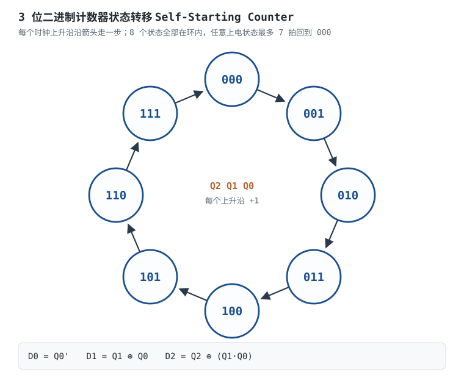

# 触发器 RS / D / JK

组合逻辑没有记忆，输出随输入即时变。但计数器、寄存器、状态机都需要“记住上一拍是什么”——这就是**时序逻辑（Sequential Logic）**。触发器（Flip-Flop，FF）是最基本的 1 位记忆元件：它在时钟沿把输入“记住”到输出，并保持到下一个时钟沿。没有触发器，就没有寄存器、没有 CPU、没有 FPGA。

本章讲四种记忆元件：**SR 锁存器（Latch）、D 触发器、JK 触发器、T 触发器**，重点在“什么样的输入、在什么时刻、记住什么”。然后回答三个工程问题：**建立/保持时间到底在约束什么；异步复位和同步复位怎么选；触发器和时钟树为什么是功耗大头。** 最后用 D 触发器设计一个 3 位二进制计数器，验证自启动。数制与编码见[数制、编码、补码与格雷码](number-systems.md)，门级化简与毛刺机理见[逻辑门、布尔代数与卡诺图](logic-gates-boole.md)，组合逻辑与数据通路见[组合逻辑：译码、编码、选择与加法](combinational-logic.md)，时序裕量的完整推导见[时序分析：建立/保持时间与亚稳态](timing-analysis-metastability.md)。

**本章约定**：$Q(n)$ 是当前状态，$Q(n+1)$ 是下一个时钟沿后的状态；$t_{su}$ 是建立时间（s），$t_h$ 是保持时间（s），$t_{cq}$ 是时钟到输出延迟（s），$t_{skew}$ 是时钟偏斜（s）；$f$ 是时钟频率（Hz），$V$ 是电源电压（V），$C$ 是电容（F），$\alpha$ 是翻转活动因子。器件参数标“典型量级，以数据手册为准”。

## 1. 设计动机

::: motivation 四个真实场景
**场景一：按键直接当时钟，按一次 LED 跳好几次。** 机械按键在按下/松开时抖动 1~10 ms，抖动期间产生多个上升沿。如果把按键直接接到 T 触发器的时钟端，T=1 时每个沿都翻转，按一次可能翻转 3 次、5 次，LED 看起来“随机”。正确做法是用 100 Hz 时钟采样、计数去抖（10 ms 周期，连续 2 次相同即确认），产生一个单周期脉冲，再把脉冲接到 T 端、系统时钟接 CLK。

**场景二：异步复位释放太快，状态机上电跑飞。** 异步复位拉低时立刻生效，这很好；但释放沿如果恰好落在时钟沿附近，触发器的复位恢复时间（recovery time）被违反，可能进入亚稳态，状态机在第一个周期处于非法状态。标准做法是“异步置位、同步释放”：复位信号经过两级触发器同步后再释放，让释放沿与时钟对齐。

**场景三：100 万个触发器，光时钟输入就吃掉 5 W。** 每个触发器时钟输入约 10 fF，100 万个就是 10 nF；1.0 V、500 MHz 下时钟动态功耗 $P=C V^2 f=10\times10^{-9}\times1^2\times5\times10^8=5\ \text{W}$（含时钟树会更高）。这就是为什么低功耗设计要先做时钟门控、再谈数据翻转率。

**场景四：跨时钟域直接采样，偶发错一位。** 慢时钟域的信号在快时钟域看来是异步的，若在建立/保持窗口内变化，第一级触发器可能进入亚稳态，输出在 0/1 之间停留不确定时间。两级同步器把“不确定时间”留给第二级，MTBF 指数级提升（具体值取决于工艺、频率和同步器级数）；但多比特总线不能只加两级同步器，要用格雷码、握手或异步 FIFO。
:::

| 你遇到的问题 | 先算/先查 | 判据 |
|---|---|---|
| 按键一次跳多次 | 抖动时间、采样 clock、去抖计数 | 去抖后只产生一个单周期脉冲 |
| 上电状态不确定 | 复位来源、复位释放是否同步 | 异步置位、同步释放，每个时钟域一套 |
| 时序违例、偶发错 | $t_{cq}$、$t_{comb}$、$t_{su}$、$t_{skew}$ | $T\ge t_{cq}+t_{comb,max}+t_{su}+t_{skew}$ |
| 保持违例、上电就错 | $t_{comb,min}$、$t_h$、$t_{skew}$ | $t_{cq}+t_{comb,min}\ge t_h+t_{skew}$ |
| 芯片发热、待机电流大 | 时钟树电容、翻转率、漏电 | 时钟功耗在预算内，空闲模块时钟关断 |
| 跨时钟域偶发错 | 同步器级数、信号宽度 | 单比特两级同步，多比特用格雷码/握手/FIFO |

**不算会摔在哪**，三个带数字的代价：

1. **建立时间不够。** $t_{cq}=1.0\ \text{ns}$、$t_{comb}=4.0\ \text{ns}$、$t_{su}=0.5\ \text{ns}$、$t_{skew}=0.2\ \text{ns}$，最小周期 $5.7\ \text{ns}$，最高约 175 MHz。若组合逻辑实际 6 ns，最高频率降到约 130 MHz；不降频就偶发采错。
2. **异步复位释放违例。** 释放沿落在 100 ps 窗口内的概率是 $100\ \text{ps}/10\ \text{ns}=1\%$；1000 个触发器同时释放，期望 10 个进入亚稳态。加两级同步器后，每个事件仍可能发生，但“第一级在 10 ns 后仍未收敛”的概率按 $e^{-T/\tau}$ 指数下降。
3. **时钟树功耗。** 100 万个 FF、每个 10 fF、1.0 V、500 MHz，仅触发器时钟输入就 5 W；时钟门控关掉一半，省 2.5 W。**触发器本身的动态功耗常常小于把时钟送到它的功耗。**

## 2. 定义与直观

### 2.1 锁存器与触发器：电平敏感 vs 边沿敏感

**锁存器（Latch）** 是电平敏感的：使能有效时输出随输入透明变化，使能无效时锁住最后的值。**触发器（Flip-Flop）** 是边沿敏感的：只在时钟上升沿（或下降沿）采样一次，其余时间输入怎么变都不影响输出。同步系统里一律用边沿触发器，因为“只在确定时刻采样”才能做时序分析。

最早的边沿触发器用**主从结构（Master-Slave）**：两个锁存器级联，时钟反相。这里有一个容易被说反的细节：**对上升沿主从 D 触发器，主锁存器在 CLK 低电平时透明采样，从锁存器在 CLK 高电平时透明输出；CLK 上升沿到来时主锁存器先关闭、保存沿前的 D 值，从锁存器随后透明，把该值送到 Q。** 所以输出在上升沿更新。若说成“主锁存器在 CLK 高电平采样、从锁存在下降沿输出”，就变成下降沿触发了，和器件命名正好相反。

主从 JK 还有一个“一次变化（one's catching）”现象：J=K=1 时，主从结构通过反馈让主锁存器在一个时钟周期内只接受一次变化，因此输出每周期只翻转一次，不会像电平触发的 JK 那样在时钟有效电平期间连续振荡。这是主从结构的特性，不是故障。现代 CMOS 边沿触发器（如 74HC74、传输门结构）用内部反馈和传输门实现真正的边沿采样，主从结构多见于老器件和教材。

### 2.2 SR 锁存器

最原始的记忆元件是两个 NOR 门交叉耦合：

$$Q=\overline{R+\overline{Q}},\qquad \overline{Q}=\overline{S+Q}$$

| $S$ | $R$ | $Q(n+1)$ | 动作 |
|---|---|---|---|
| 0 | 0 | $Q(n)$ | 保持 |
| 1 | 0 | 1 | 置 1 |
| 0 | 1 | 0 | 置 0 |
| 1 | 1 | 非法 | 两输出都为 0，撤销后状态不定 |

特性方程是 $Q(n+1)=S+\overline{R}Q(n)$，约束 $SR=0$。$S=R=1$ 时两个 NOR 输出都被强制为 0，违反 $Q$ 与 $\overline{Q}$ 互补；同时撤销后，两个门谁先翻转取决于延迟和噪声，状态不可预测。**这就是 JK 触发器要解决的问题：把“非法”定义成“翻转”。**

### 2.3 D 触发器

D 触发器只有一个数据输入，特性方程最简单：

$$Q(n+1)=D$$

| CLK | $D$ | $Q(n+1)$ | 动作 |
|---|---|---|---|
| 上升沿 | 0 | 0 | 置 0 |
| 上升沿 | 1 | 1 | 置 1 |
| 非沿 | × | $Q(n)$ | 保持 |

D 触发器是同步设计的绝对主力：寄存器、移位寄存器、计数器、状态机都用它。很多标准 D 触发器（如 74HC74）还带**异步 Preset（置 1）和 Clear（清 0）**，优先级高于时钟；这两个端子的电平一旦有效，Q 立刻被强制，不用等时钟沿。

### 2.4 JK 触发器

JK 把 SR 的非法输入变成翻转：

$$Q(n+1)=J\overline{Q(n)}+\overline{K}Q(n)$$

| $J$ | $K$ | $Q(n+1)$ | 动作 |
|---|---|---|---|
| 0 | 0 | $Q(n)$ | 保持 |
| 0 | 1 | 0 | 置 0 |
| 1 | 0 | 1 | 置 1 |
| 1 | 1 | $\overline{Q(n)}$ | 翻转 |

J=K=1 时每个时钟沿翻转一次，输出频率是时钟的一半，天然是二分频器。**注意：这是“每个时钟沿翻转”，不是“无时钟自激振荡”**；没有时钟，它不会自己振。把 J=K=1 叫“自由振荡”是常见误称，准确说法是“翻转模式/二分频”。

### 2.5 T 触发器

T 触发器只有“保持/翻转”两种动作：

$$Q(n+1)=T\oplus Q(n)$$

| $T$ | $Q(n+1)$ | 动作 |
|---|---|---|
| 0 | $Q(n)$ | 保持 |
| 1 | $\overline{Q(n)}$ | 翻转 |

T 触发器可以由 D 触发器加异或反馈实现：$D=Q\oplus T$。T 恒接 1 就是二分频器；T 接计数使能就是可控计数器的最低位。FPGA 内部没有原生 T 触发器，综合工具会用 D + 异或/使能实现。

## 3. 定量关系

### 3.1 特性方程与激励表

设计时序电路时，常从“希望 $Q$ 怎么变”反推“输入该给什么”，这就是**激励表（excitation table）**：

| 目标 $Q(n)\to Q(n+1)$ | D | T | J | K | S | R |
|---|---|---|---|---|---|---|
| 0 → 0 | 0 | 0 | 0 | × | 0 | × |
| 0 → 1 | 1 | 1 | 1 | 0 | 1 | 0 |
| 1 → 0 | 0 | 1 | 0 | 1 | 0 | 1 |
| 1 → 1 | 1 | 0 | × | 0 | × | 0 |

D 的激励就是“下一状态”；T 的激励是 $T=Q\oplus Q(n+1)$；JK 的“×”表示该输入可任意（0 或 1 都不影响动作）；SR 的“×”配合 $SR=0$ 约束使用。**用 D 触发器设计最省脑：下一状态是什么，D 就接什么。**

### 3.2 建立时间、保持时间与时钟到输出

触发器只在时钟沿采样，但数据不能在沿上才变化。定义三个参数：

- **建立时间 $t_{su}$**：数据必须在捕获沿**之前**稳定的最短时间。
- **保持时间 $t_h$**：数据在捕获沿**之后**必须继续保持的最短时间。
- **时钟到输出 $t_{cq}$**：时钟沿到 Q 端稳定的延迟。

对两个触发器之间的组合逻辑，建立约束是

$$T_{clk}\ge t_{cq}+t_{comb,max}+t_{su}+t_{skew}$$

保持约束是

$$t_{cq}+t_{comb,min}\ge t_h+t_{skew}$$

其中 $T_{clk}$ 是时钟周期，$t_{comb,max/min}$ 是组合逻辑的最大/最小延迟，$t_{skew}$ 是时钟到达两个触发器的偏斜。**建立违例可以靠降频解决，保持违例不能**——保持违例与频率无关，上电就错，必须改逻辑或加延迟。完整推导、裕量计算和亚稳态 MTBF 见[时序分析：建立/保持时间与亚稳态](timing-analysis-metastability.md)。

### 3.3 亚稳态与异步复位释放

如果数据在 $t_{su}+t_h$ 的窗口内变化，触发器的内部正反馈可能停在中间电平，输出既不是 0 也不是 1，经过不确定时间才随机落到某一态——这就是**亚稳态（metastability）**。它不是“永远卡住”，而是“收敛时间不确定”；收敛时间超过一个时钟周期，后级就可能采到不同值。

异步复位的**置位**是立即生效的，没有问题；问题在**释放**。释放沿相对于时钟是异步的，如果落在复位恢复/移除窗口内，触发器可能亚稳态。定量地看：

- 释放沿均匀分布时，落在宽度 $t_w$ 的窗口内的概率是 $p\approx t_w/T_{clk}$。$t_w=100\ \text{ps}$、$T_{clk}=10\ \text{ns}$ 时 $p=1\%$。
- 若有 $N$ 个触发器同时释放，期望的亚稳态事件数是 $Np$。$N=1000$ 时约 10 个。
- 第一级触发器在时间 $t_r$ 后仍未收敛的概率按 $e^{-t_r/\tau}$ 下降，$\tau$ 是器件的亚稳态时间常数（典型几十 ps，以数据手册/工艺为准）。两级同步器给第一级整整一个周期 $T_{clk}=10\ \text{ns}$ 收敛，$\tau=50\ \text{ps}$ 时 $e^{-10/0.05}=e^{-200}\approx1.4\times10^{-87}$。

**结论**：异步复位要“异步置位、同步释放”。具体做法是复位信号先直接进触发器的异步 Clear/Preset 端（保证无时钟也能复位），释放时经过两级触发器同步到目标时钟域，再把同步后的复位送到各触发器的异步端。每个时钟域一套同步器；复位树要平衡，避免不同触发器释放时刻差太多。

### 3.4 触发器的功耗与时钟树

触发器的功耗分两部分：

**动态功耗**来自时钟和数据翻转：

$$P_{dyn}=\alpha C V^2 f$$

其中 $\alpha$ 是活动因子（时钟通常 $\alpha\approx1$，数据取决于翻转率），$C$ 是节点电容（F），$V$ 是电源（V），$f$ 是频率（Hz）。触发器内部时钟管每次沿都要充放电，即使 D 不变，时钟功耗也照付。整棵时钟树的功耗近似

$$P_{clk}\approx C_{tree}V^2f+\sum_i C_{clk,i}V^2f$$

第一项是时钟树走线和缓冲器，第二项是每个触发器时钟输入电容。**时钟树是芯片里翻转率最高、扇出最大的网络，低功耗设计的第一刀通常砍在时钟门上。**

**静态功耗**来自漏电：

$$P_{leak}=VI_{leak}$$

先进工艺下漏电随温度指数上升；待机时时钟停了，动态功耗接近 0，但漏电还在。多阈值电压（HVT/LVT）选型、电源门控（power gating）就是对付漏电的。

### 3.5 计数器的下一状态方程

$n$ 位二进制计数器的状态是 $Q_{n-1}\dots Q_0$，每个时钟加 1。用 D 触发器实现时，第 $i$ 位的下一状态是“低位全 1 时翻转，否则保持”：

$$D_i=Q_i\oplus\left(\prod_{j=0}^{i-1}Q_j\right)$$

最低位 $D_0=\overline{Q_0}$。3 位展开：

$$D_0=\overline{Q_0},\qquad D_1=Q_1\oplus Q_0,\qquad D_2=Q_2\oplus(Q_1Q_0)$$

这组方程只用异或和与门，延迟随位数增加；位数多时改用超前进位/并行前缀计数逻辑。

## 4. 典型计算

### 4.1 算例一：用 D 触发器做 3 位二进制计数器

**需求**：用 3 个上升沿 D 触发器设计 000→001→…→111→000 的二进制计数器，画状态转移，验证自启动。

**步骤 1：列状态表。** 当前状态 $Q_2Q_1Q_0$ 和下一状态：

| 当前 | $Q_2Q_1Q_0$ | 下一状态 | $D_2D_1D_0$ |
|---|---|---|---|
| 0 | 000 | 001 | 001 |
| 1 | 001 | 010 | 010 |
| 2 | 010 | 011 | 011 |
| 3 | 011 | 100 | 100 |
| 4 | 100 | 101 | 101 |
| 5 | 101 | 110 | 110 |
| 6 | 110 | 111 | 111 |
| 7 | 111 | 000 | 000 |

**步骤 2：写下一状态方程。** 按 §3.5：

$$D_0=\overline{Q_0}$$

$$D_1=Q_1\oplus Q_0$$

$$D_2=Q_2\oplus(Q_1Q_0)$$

**步骤 3：逐状态验算。**

- 000：$D_0=1,D_1=0,D_2=0$ → 001。
- 001：$D_0=0,D_1=1,D_2=0$ → 010。
- 010：$D_0=1,D_1=1,D_2=0$ → 011。
- 011：$D_0=0,D_1=0,D_2=1$ → 100。
- 100：$D_0=1,D_1=0,D_2=1$ → 101。
- 101：$D_0=0,D_1=1,D_2=1$ → 110。
- 110：$D_0=1,D_1=1,D_2=1$ → 111。
- 111：$D_0=0,D_1=0,D_2=0$ → 000。

8 个状态全部对得上。

**步骤 4：自启动验证。** 自启动（self-starting）指无论上电落在哪个状态，经过有限个时钟都能进入主循环。本例 3 个触发器共有 $2^3=8$ 个状态，主循环正好包含 8 个状态，没有未用状态；任意上电状态都在环内，最多 7 个时钟回到 000。所以它**自然自启动**，不需要额外逻辑。

如果做模 6 计数器（只用了 000~101，未用 110、111），就要检查未用状态的下一状态：若把 110、111 的下一状态设计成 000（或任意合法状态），就能自启动；若设计成互相循环（110→111→110），就会锁死。**“有未用状态”才需要专门验证自启动；全状态计数器没有这个问题。**

**步骤 5：门数。** 3 个 D 触发器 + 1 个异或门（$Q_1\oplus Q_0$）+ 1 个与门（$Q_1Q_0$）+ 1 个异或门（$Q_2\oplus(Q_1Q_0)$）+ 1 个反相器（$\overline{Q_0}$）。按 2 输入门算约 4 个组合门加 3 个触发器。若用 T 触发器，$T_0=1,T_1=Q_0,T_2=Q_1Q_0$，组合逻辑更少，但 FPGA 里没有原生 T，仍会综合成 D + 异或。

### 4.2 算例二：时序裕量

**需求**：某同步路径 $t_{cq}=1.0\ \text{ns}$、$t_{comb,max}=4.0\ \text{ns}$、$t_{su}=0.5\ \text{ns}$、$t_{skew}=0.2\ \text{ns}$，求最高时钟频率；保持路径 $t_{comb,min}=1.5\ \text{ns}$、$t_h=0.3\ \text{ns}$，检查保持裕量。

**步骤 1：建立约束。**

$$T_{clk}\ge t_{cq}+t_{comb,max}+t_{su}+t_{skew}=1.0+4.0+0.5+0.2=5.7\ \text{ns}$$

$$f_{max}=\frac{1}{5.7\times10^{-9}}=175.4\ \text{MHz}$$

**步骤 2：保持约束。**

$$t_{cq}+t_{comb,min}=1.0+1.5=2.5\ \text{ns}$$

$$t_h+t_{skew}=0.3+0.2=0.5\ \text{ns}$$

$2.5\ \text{ns}\ge0.5\ \text{ns}$，保持裕量 $2.0\ \text{ns}$，通过。

**步骤 3：如果组合逻辑变成 6 ns。**

$$T_{clk}\ge1.0+6.0+0.5+0.2=7.7\ \text{ns}\rightarrow f_{max}=129.9\ \text{MHz}$$

要么降频到 130 MHz 以下，要么把组合逻辑拆成两级流水线。**建立裕量是“速度”问题，保持裕量是“正确性”问题；前者可以降频，后者不能。**

### 4.3 算例三：时钟树功耗

**需求**：100 万个 D 触发器，每个时钟输入电容 $C_{clk}=10\ \text{fF}$，电源 1.0 V，时钟 500 MHz，求仅触发器时钟输入的动态功耗；若时钟门控关掉一半，省多少？

**步骤 1：总电容。**

$$C_{total}=10^6\times10\times10^{-15}=1.0\times10^{-8}\ \text{F}=10\ \text{nF}$$

**步骤 2：动态功耗。**

$$P=C_{total}V^2f=10\times10^{-9}\times1.0^2\times500\times10^6=5.0\ \text{W}$$

**步骤 3：门控一半。**

$$P_{gated}=5.0\times50\%=2.5\ \text{W}$$

节省 2.5 W。实际还要加时钟树走线/缓冲器电容，总功耗更高；这里的 10 fF 是典型量级，具体看工艺库和数据手册。

**步骤 4：静态功耗。** 若每个 FF 漏电 10 nA、共 100 万个、1.0 V：

$$P_{leak}=10^6\times10\times10^{-9}\times1.0=0.01\ \text{W}=10\ \text{mW}$$

动态功耗是静态的几百倍；但待机时钟停掉后，漏电就成了主角。

### 4.4 算例四：异步复位释放的亚稳态风险

**需求**：10 ns 时钟周期，复位释放窗口 $t_w=100\ \text{ps}$，1000 个触发器同时释放；估算单级释放的亚稳态事件数，并说明两级同步器的作用。

**步骤 1：单触发器落入窗口的概率。**

$$p=\frac{t_w}{T_{clk}}=\frac{100\times10^{-12}}{10\times10^{-9}}=0.01=1\%$$

**步骤 2：1000 个触发器的期望事件数。**

$$N_p=1000\times0.01=10\ \text{个}$$

**步骤 3：两级同步器的收敛概率。** 第一级有 10 ns 时间收敛，$\tau=50\ \text{ps}$：

$$P_{fail}\approx e^{-T_{clk}/\tau}=e^{-10/0.05}=e^{-200}\approx1.4\times10^{-87}$$

每个亚稳态事件在 10 ns 后仍未收敛的概率低到可以忽略；但“事件会发生”和“事件导致系统出错”是两件事，前者靠同步器减少，后者还要靠状态机编码、错误检测和复位策略。**数量级估算，实际 MTBF 要用器件的 $\tau$、$T_0$ 和时钟/数据频率计算，见时序分析章。**

**步骤 4：正确接法。** 复位源 → 异步 Clear/Preset（立即生效）；同一信号 → 两级 D 触发器（D 接 1，CLK 为目标时钟）→ 同步后的释放信号 → 各触发器异步端。注意：两级同步器的第一级本身也可能亚稳态，但第二级有一整个周期采样，把风险指数压低。

## 5. 工程含义

**选 D，不选 JK/T。** 现代同步设计 99% 用 D 触发器：行为最简单，综合工具映射最好，时序分析最直接。JK/T 多用于分立计数器、分频器和教学；FPGA 内部只有 D 触发器，JK/T 都是综合出来的。需要“翻转”时用 D + 异或（T 触发器），需要“保持”时用带时钟使能（CE）的 D 触发器，不要专门找 JK。

**锁存器只在必须透明时用。** 锁存器在使能期间透明，输入毛刺直接传到输出，时序分析要按“透明窗口”算，比边沿触发器复杂得多。同步数据通路一律用触发器；只有在异步接口、时钟门控单元、低功耗保持寄存器等场景才用锁存器。Verilog 里 `always @(*)` 的 `if` 不写 `else` 会推断出锁存器，这是最常见的综合 bug 之一。

**异步复位 vs 同步复位。** 取舍如下：

| 维度 | 异步复位 | 同步复位 |
|---|---|---|
| 无时钟时能否复位 | 能，复位源一到就生效 | 不能，必须有时钟 |
| 释放是否安全 | 释放沿异步，可能违反 recovery/removal | 释放与时钟同步，天然安全 |
| 数据路径 | 不占组合逻辑 | 复位信号要参与每个 D 的与/或，增加逻辑 |
| 复位树 | 要平衡偏斜，每个时钟域一套同步释放 | 复位树偏斜仍要管，但没有释放亚稳态 |
| 推荐用法 | 异步置位、同步释放 | 单时钟域、复位源本来就同步时可用 |

**最佳实践**：复位源先异步拉到所有触发器的异步端（保证上电/掉电立即复位），释放路径经过两级同步器再送回异步端；每个时钟域独立同步；复位信号不要用组合逻辑产生，不要悬空。FPGA 里用全局复位网络 + 复位同步器；ASIC 里用复位树 + 同步释放。

**时钟树不是“画一根线”。** 时钟要平衡到达每个触发器的延迟（skew），要控制边沿速率，要避免和數據线并行过长导致串扰。时钟树通常用 H 树或网格，插入缓冲器；缓冲器本身也吃功耗、占面积。时钟频率越高，时钟树功耗占比越大；低功耗设计先做时钟门控，再做多时钟域划分，最后才考虑降频。

**跨时钟域不是“加两级触发器就完事”。** 单比特电平信号可以用两级同步器；多比特总线同时变化会被采成任意组合，必须用格雷码（每次只变一位）、握手（req/ack）或异步 FIFO。格雷码计数器见[数制、编码、补码与格雷码](number-systems.md)；异步 FIFO 的指针同步见[FPGA 与 Verilog 设计](fpga-verilog.md)。

**未用输入、异步端子要接死。** Preset/Clear 不用时接无效电平（通常是高，低有效时），不能悬空；JK 的 J/K 不用时接 0；D 的输入不要浮空。CMOS 输入悬空会让内部节点停在阈值附近，增加漏电和误翻转。

## 6. 常见坑

::: pitfall Verilog 组合逻辑推断出锁存器
- **现象**：仿真行为正常，综合报告警告“inferred latch”，上板后输出在某个输入组合下保持旧值。
- **原因**：`always @(*)` 里 `if` 没有 `else`，或 `case` 没有覆盖所有分支，综合工具推断出电平锁存器。
- **解决**：组合逻辑所有分支都给输出赋值；在 `always_comb` 开头给默认值；需要存储时显式用 `always_ff` 或实例化触发器。
:::

::: pitfall 按键直接接时钟
- **现象**：按一次 LED 翻转多次，或者计数器跳好几个数。
- **原因**：机械按键抖动 1~10 ms，产生多个上升沿；触发器把每个沿都当成一次有效时钟。
- **解决**：按键接数据/使能端，不接时钟；用系统时钟采样 + 计数去抖，产生单周期脉冲；或 RC + 施密特整形后再同步。
:::

::: pitfall 异步复位只做“异步”，不做“同步释放”
- **现象**：上电偶尔跑飞，复位释放后状态机进入非法状态；换批次/换温度更明显。
- **原因**：复位释放沿相对时钟异步，落在 recovery/removal 窗口内，触发器亚稳态。
- **解决**：异步置位、同步释放；每个时钟域一套两级同步器；复位树平衡；释放后先进入已知状态。
:::

::: pitfall 把锁存器当触发器用
- **现象**：使能高电平期间输出跟着输入变，中间的任何毛刺都传到后级；时序分析结果和仿真对不上。
- **原因**：锁存器是电平敏感，透明窗口内没有“采样时刻”的概念。
- **解决**：同步数据通路只用边沿触发器；必须用锁存器时，按透明窗口做时序分析，并保证使能信号干净。
:::

::: pitfall JK 的 J=K=1 说成“自由振荡”
- **现象**：以为不接时钟也会振，或者把二分频输出当成“故障”。
- **原因**：J=K=1 的定义是“每个时钟沿翻转”，不是“无时钟自激”。
- **解决**：要二分频就接时钟、J=K=1；要停止翻转就把 J、K 拉低；不要用“自由振荡”描述它。
:::

::: pitfall 跨时钟域多比特直接打两拍
- **现象**：单比特同步器工作正常，多比特总线偶尔错一个码，且错误值每次不同。
- **原因**：多比特同时变化，各级触发器采样时刻有微小差异，采到“半新半旧”的组合。
- **解决**：多比特用格雷码、握手或异步 FIFO；单比特才用两级同步器；同步器后不要再做组合逻辑再采样。
:::

## 7. 自测题

D 触发器 D=1，CLK 上升沿后 Q=？之后 D 一直为 1，再过两个时钟沿 Q 变几次？

上升沿后 Q=1。之后 D 一直为 1，每个沿都采到 1，Q 保持 1；从第一个沿之后算起，**变 0 次**（只在第一个沿从 0→1 变了一次）。

JK 触发器 J=1、K=1，初始 Q=0，连续 4 个上升沿后 Q 的序列是什么？

J=K=1 是翻转模式：0→1→0→1→0。4 个沿后 Q=0，输出频率是时钟的一半，即二分频。

某路径 $t_{cq}=1.0\ \text{ns}$、$t_{comb}=4.0\ \text{ns}$、$t_{su}=0.5\ \text{ns}$、$t_{skew}=0.2\ \text{ns}$，最高频率是多少？

$T\ge1.0+4.0+0.5+0.2=5.7\ \text{ns}$，$f_{max}=1/5.7\ \text{ns}=175.4\ \text{MHz}$。若组合逻辑 6 ns，则 $T\ge7.7\ \text{ns}$，$f_{max}=129.9\ \text{MHz}$。

为什么异步复位要“异步置位、同步释放”？

置位异步才能在没有时钟时立即复位；释放异步则可能落在 recovery/removal 窗口内，导致亚稳态。用两级触发器把释放同步到目标时钟域，让释放沿与时钟对齐，第一级即使亚稳态也有一整个周期收敛。

3 位二进制计数器用 D 触发器实现，$D_0,D_1,D_2$ 的方程是什么？它需要验证自启动吗？

$D_0=\overline{Q_0}$，$D_1=Q_1\oplus Q_0$，$D_2=Q_2\oplus(Q_1Q_0)$。8 个状态全在主循环内，没有未用状态，任意上电状态都在环内，所以自然自启动；只有模 $N<2^n$ 的计数器有未用状态时才需要专门验证。

100 万个触发器，每个时钟输入 10 fF，1.0 V、500 MHz，时钟动态功耗是多少？

$C=10^6\times10\times10^{-15}=10\ \text{nF}$；$P=C V^2 f=10\times10^{-9}\times1^2\times500\times10^6=5\ \text{W}$。门控关掉一半省 2.5 W；实际还要加时钟树走线和缓冲器电容。

## 8. 参考资料

- M. Morris Mano, Michael D. Ciletti, *Digital Design* (6th ed.), Chapter 5 Synchronous Sequential Logic — §5.3 Storage Elements — Latches、§5.4 Storage Elements — Flip-Flops、§5.5 Analysis of Clocked Sequential Circuits
- M. Morris Mano, Michael D. Ciletti, *Digital Design* (6th ed.), Chapter 6 Registers and Counters — 寄存器、同步计数器与自启动
- John F. Wakerly, *Digital Design: Principles and Practices* (4th ed.), Chapter 7 Sequential Logic Design Practices — 时钟偏移、异步复位与亚稳态
- Texas Instruments, *SN74HC74 Dual D-Type Flip-Flop Datasheet* — 建立/保持时间、时钟到输出延迟与异步 Preset/Clear
- Texas Instruments, *SN74HC112 Dual J-K Flip-Flop Datasheet* — JK 特性表、边沿触发与异步控制
- Clifford E. Cummings, *Synthesis and Scripting Techniques for Designing Multi-Asynchronous Clock Designs* (SNUG 2001) — 异步复位同步释放与跨时钟域同步器
- IEEE Std 1800-2017, *SystemVerilog* — Clause 9 Processes（always_ff、always_latch 的建模语义）

