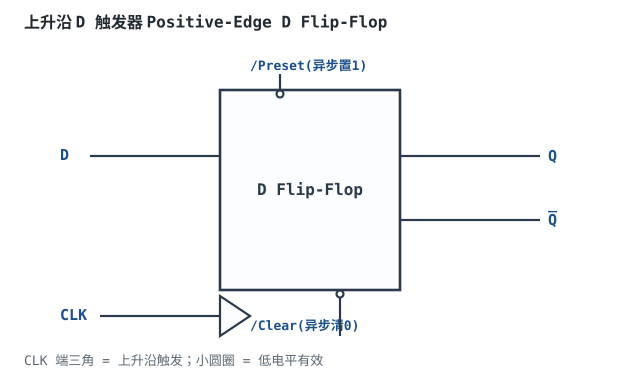
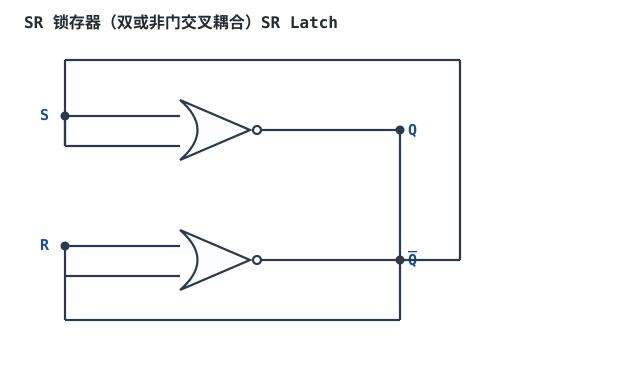
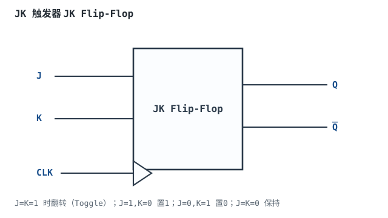
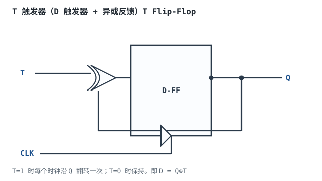

# 触发器 RS / D / JK

## 1. 设计动机

::: motivation 为什么需要"记忆"元件
组合逻辑没有记忆，输出随输入即时变。但计数器、寄存器、状态机都需要"记住上一拍是什么"——这就是**时序逻辑（Sequential Logic）**。触发器（Flip-Flop）是最基本的 1 位记忆元件：它有一个时钟输入，每个时钟沿把 D 端的值"记住"到 Q 端，输出保持到下一个时钟沿。

没有触发器，就没有寄存器、没有 CPU、没有 FPGA。本章是时序逻辑的地基。
:::

本章讲四种记忆元件：**SR 锁存器（Latch）、D 触发器、JK 触发器、T 触发器**。核心区别在于"什么样的输入、在什么时刻、记住什么"。

## 2. 原理与逻辑图

### 2.1 D 触发器（最常用）

D 触发器在**时钟上升沿**把 D 端的值复制到 Q，其余时间 Q 保持不变。它有异步置位（Preset，直接强制 Q=1）和异步清零（Clear，直接强制 Q=0），优先级高于时钟。



### 2.2 触发器 vs 锁存器

- **锁存器（Latch）**：电平敏感。使能=高时输出随输入透明变化，使能变低时锁存住。
- **触发器（Flip-Flop）**：边沿敏感。只在时钟上升沿（或下降沿）采样一次，其余时间输入变化不影响输出。同步系统里一律用触发器。

### 2.3 JK 与 T 触发器

- **JK**：J=K=0 保持；J=1,K=0 置 1；J=0,K=1 置 0；J=K=1 翻转。解决了 SR 的"不允许输入"问题。
- **T**：T=1 每个时钟沿翻转一次，T=0 保持。由 D 触发器加异或反馈得到（见扩展图）。

## 3. 静态分析（特性表）

D 触发器特性表：

| CLK | D | Q(n+1) | 动作 |
|---|---|---|---|
| ↑ | 0 | 0 | 置 0 |
| ↑ | 1 | 1 | 置 1 |
| 非沿 | × | Q(n) | 保持 |

JK 触发器特性表：

| J | K | Q(n+1) | 动作 |
|---|---|---|---|
| 0 | 0 | Q(n) | 保持 |
| 0 | 1 | 0 | 置 0 |
| 1 | 0 | 1 | 置 1 |
| 1 | 1 | Q̅(n) | 翻转 |

SR 锁存器特性表（NOR 型，高有效）：

| S | R | Q(n+1) | 动作 |
|---|---|---|---|
| 0 | 0 | Q(n) | 保持 |
| 1 | 0 | 1 | 置 1 |
| 0 | 1 | 0 | 置 0 |
| 1 | 1 | 非法 | 不允许 |

## 4. 动态分析（建立/保持与采样窗口）

触发器只在时钟上升沿采样 D。但 D 不能恰好在沿上变化——必须在沿**之前**稳定（建立时间 $t_{SU}$）、沿**之后**继续保持一会儿（保持时间 $t_H$）。下面是 D、CLK、Q 的时序：

```echarts
{
  "tooltip": {"trigger": "axis"},
  "legend": {"data": ["CLK", "D", "Q"], "bottom": 0, "textStyle": {"fontSize": 13}},
  "grid": {"left": 60, "right": 30, "top": 30, "bottom": 60},
  "xAxis": {"type": "category", "name": "时间", "data": ["0","1","2","3","4","5","6","7","8","9","10","11"], "axisLabel": {"fontSize": 11}},
  "yAxis": {"type": "value", "min": 0, "max": 1.4, "interval": 1, "axisLabel": {"fontSize": 11}},
  "series": [
    {"name": "CLK", "type": "step", "step": "middle", "showSymbol": false, "lineStyle": {"width": 2.4, "color": "#1a4f8b"}, "data": [0,0,1,1,0,0,1,1,0,0,1,1]},
    {"name": "D", "type": "step", "step": "middle", "showSymbol": false, "lineStyle": {"width": 2.4, "color": "#b5642e"}, "data": [0,0,0,1,1,0,0,1,1,0,0,1]},
    {"name": "Q", "type": "step", "step": "middle", "showSymbol": false, "lineStyle": {"width": 2.6, "color": "#2a7a4a"}, "data": [0,0,0,0,1,1,1,0,0,1,1,0]}
  ]
}
```

观察：Q 在每个 CLK 上升沿（t=2,6,10）才更新为当时 D 的值，D 提前一拍变化、沿后保持。如果 D 在建立/保持窗口内翻转，就可能进入亚稳态（详见时序分析章）。

## 5. 触发器结构与异步控制

- **主从结构（Master-Slave）**：两个锁存器级联，主锁存器在 CLK 高电平时采数据、从锁存在 CLK 下降沿输出，避免"透明期间输入直通输出"。这是最早的边沿触发器实现（经典如 74 系列主从 JK），但存在"一次变化（ones-catching）"问题——CLK 高电平期间输入只能变一次；现代 CMOS 边沿触发器（如 74HC74、传输门结构）已改成真正的边沿采样，主从结构多见于老器件与教材。
- **异步 Preset/Clear**：优先级最高，立刻改 Q，不用等时钟。上电时用 Clear 把所有寄存器清零。
- **触发沿**：上升沿（positive-edge）最常见；下降沿用输出端小圆圈标识。

## 6. 元件取值与工程权衡

- **选 D 还是 JK**：99% 的同步设计用 D 触发器（行为最简单）。JK/T 多用于计数器、分频器，且 FPGA 内部只有 D 触发器，JK/T 都是综合出来的。
- **锁存器 vs 触发器**：同步设计一律用触发器；锁存器透明期容易产生毛刺和竞争，Verilog 里 `if` 不写 `else` 会意外生成锁存器，是常见 bug。
- **异步控制**：Preset/Clear 不要接慢边沿/毛刺信号，要经过同步器或施密特整形。
- **建立保持**：选触发器时看数据手册 $t_{SU}$、$t_H$，高速设计还要算到下一章的时序裕量。

## 7. 完整设计示例

::: example 设计一个"按键按下 LED 翻转"电路
1. **需求**：每按一次按键，LED 状态翻转一次。
2. **选触发器**：T 触发器——T 端恒为 1，每来一个时钟沿 Q 翻转。
3. **时钟**：按键直接当时钟沿？不行，按键有抖动。用 100Hz 时钟 + 按键同步器，或把按键经 RC+施密特整形后当 T 的使能。
4. **接法**：T=1 接高电平，CLK 接整形后的按键，Q 接 LED。
5. **验算**：每按一次 → 一个干净上升沿 → Q 翻转一次 → LED 亮灭切换。
6. **注意**：按键抖动会产生多个沿，LED 会乱跳；必须去抖（见时钟复位章）。
:::

## 8. 仿真与实验

在 Logisim 中：

- 放一个 D 触发器，D 接拨码开关，CLK 接手动时钟脉冲，Q 接 LED。观察：只有按脉冲（上升沿）时 LED 才变。
- 改接 JK 触发器，验证 J=K=1 时每个沿翻转。
- 用 SR 锁存器（双 NOR）搭一个消抖电路：按键接 S/R，输出 Q，观察按下/松开一次锁存一次。
- 故意在 CLK 上升沿同时拨 D 开关，观察 Logisim 提示的建立/保持违例（时序图里）。

## 扩展与变种电路

### 扩展1：SR 锁存器（双或非门）SR Latch

最原始的记忆元件，由两个或非门交叉耦合而成，是一切触发器的内核。



::: example 工作原理与真值
- $Q=\overline{R+\overline{Q}}$，$\overline{Q}=\overline{S+Q}$。
- S=1,R=0 → Q=1（置位）；S=0,R=1 → Q=0（复位）；S=R=0 → 保持；S=R=1 → Q=Q̄=0（非法，两个输出不互补）。
- 用途：按键消抖、开关去抖、简单记忆。
:::

设计要点：SR 锁存器是电平敏感、无时钟。取值/对比：SR 锁存器 vs D 触发器——锁存器透明期直通、触发器只采沿。适用：消抖、简单控制；不适用：同步数据通路（必须用边沿触发器）。

::: pitfall SR 锁存器 S=R=1 同时有效
- **现象**：两个输出都变成 0，不再互补；S、R 同时撤回后状态不确定。
- **原因**：NOR 型锁存器 S=R=1 强制两输出为 0，违反 Q/Q̄ 互补，且恢复后取决于门延迟差异。
- **解决**：设计上禁止 S=R=1 同时出现；这也是 JK 触发器出现的原因（J=K=1 定义为翻转而非非法）。
:::

### 扩展2：JK 触发器 JK Flip-Flop

把 SR 的"非法输入"改成"翻转"，功能更全，常用于计数器。



::: example 工作原理与真值
- J=K=0 保持；J=1,K=0 置 1；J=0,K=1 置 0；J=K=1 翻转。
- 相比 SR：没有非法输入，J=K=1 时 Q 逐拍翻转，天然构成 T 触发器/二分频。
- 用途：二进制计数器、分频器、状态机。
:::

设计要点：JK 是分立时代的万能触发器；FPGA 里没有原生 JK，都综合成 D。取值/对比：JK vs D——JK 功能多但时序分析复杂；同步设计优先 D。适用：分立计数、教学；不适用：现代 FPGA 数据通路。

::: pitfall JK 触发器 J=K=1 接成自由振荡
- **现象**：时钟一接上去，输出一直翻转，无法停在某个状态。
- **原因**：J=K=1 定义就是翻转，这是设计本身，不是故障。
- **解决**：需要"保持"时把 J、K 同时拉低；要计数才让 J=K=1。
:::

### 扩展3：T 触发器 T Flip-Flop

D 触发器加一个异或反馈，T=1 时每拍翻转，是最简的二分频电路。



::: example 工作原理与真值
- $D=Q\oplus T$。T=0 时 D=Q，时钟沿后 Q(n+1)=Q(n) 保持；T=1 时 D=Q̅，Q(n+1)=Q̅(n) 翻转。
- T 恒接 1 就是二分频器：输出 Q 的频率是 CLK 的一半。
- 用途：分频器、二进制计数器低位。
:::

设计要点：T 触发器在 FPGA 里由 D+异或综合。取值/对比：T 触发器 vs 计数使能——现代设计更常用"D 触发器加 CE 使能"，T=CE 等效。适用：二分频、计数器；不适用：需要保持/置数的寄存器（用 D）。

::: pitfall 把 T 触发器当寄存器用
- **现象**：每个时钟沿输出都翻转，无法写入指定值。
- **原因**：T 触发器只有"翻转/保持"两态，没有"写入 0/1"能力。
- **解决**：需要并行加载数据时用带 Load 使能的 D 寄存器，而不是 T 触发器。
:::

## 9. 常见坑与故障现象

::: pitfall 常见坑
- **Verilog 里生成了意外锁存器**：组合逻辑 `always @(*)` 中 `if` 没写 `else`，综合工具推断出锁存器，仿真和上板行为不一致。组合逻辑所有分支都要给输出赋值。
- **按键直接接时钟**：机械抖动产生多个沿，触发器被连续采样多次，计数器多跳。按键必须先去抖再当时钟/数据。
- **异步复位没同步释放**：复位释放沿本身可能违反建立时间，导致触发器亚稳（详见时序分析章）。复位要异步置位、同步释放。
- **把锁存器当触发器用**：使能高电平时输出直通输入，中间任何毛刺都会传到后级。同步数据通路只用边沿触发器。
:::

## 10. 自测题

<details><summary>D 触发器 D=1，CLK 上升沿后 Q=？过两个时钟沿、D 一直为 1，Q 变几次？</summary>

上升沿后 Q=1。之后 D 一直为 1，每个沿 Q 都采到 1，Q 保持 1，**变 0 次**（只在第一个沿从 0→1 变一次，之后不变）。
</details>

<details><summary>JK 触发器 J=1、K=1，CLK 连续 4 个上升沿，初始 Q=0，画出 Q 的序列。</summary>

J=K=1 是翻转模式：Q 逐拍 0→1→0→1→0。4 个沿后 Q=0。输出频率是 CLK 的一半，即二分频。
</details>

<details><summary>为什么同步系统里基本不用锁存器而用触发器？</summary>

锁存器在使能高电平时是"透明"的，输入变化直接透传到输出，中间任何毛刺都会传到后级，且整个透明窗口都违反了"只在时钟沿采样一次"的同步约定。触发器只在时钟沿采样一个瞬间，其余时间输入怎么变都不影响输出，时序可预测、可分析。
</details>

## 11. 参考资料

- M. Morris Mano, *Digital Design*，锁存器与触发器章节
- sources/notes/metastability-clockreset.md（异步输入与同步器）
