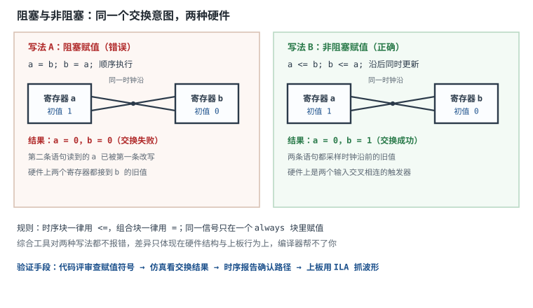

# FPGA/CPLD 与 Verilog 入门

## 1. 设计动机：为什么"仿真通过"不等于"能上板"

专用集成电路（ASIC）流片一次要数百万元级的一次性工程费用（NRE，含掩模），改一版等半年。产品批量只有几千台时，这笔钱摊不平；可又需要比 MCU 强得多的并行处理能力——于是有了**现场可编程门阵列**（Field-Programmable Gate Array，FPGA）：出厂后由配置文件决定内部连线和逻辑功能，改需求只需重新下载配置。

但 FPGA 开发有一套与软件完全不同的思维：

- **代码描述的是硬件，不是指令序列**。写 `a = b; b = a;` 在 C 里是交换，在 Verilog 时序块里可能是"两个都变成 b 的旧值"。
- **并行是默认的**，`always` 块之间同时工作；先后顺序只由时钟沿和赋值语义决定。
- **仿真通过不代表能跑**：没写时序约束，工具不知道你要 100MHz；组合逻辑漏了 `else`，综合出锁存器；跨时钟域没同步，概率性亚稳。

工程上最典型的翻车顺序是：仿真波形全对 → 上板功能时好时坏 → 换一块板又好了 → 最后发现是没写约束、或者时序块用了阻塞赋值。本章把 FPGA 的物理结构、可综合子集、阻塞与非阻塞的语义、时序约束的意义串起来，并用一个 8 位计数器把资源与时序算一遍。

## 2. 定义与直观：LUT、触发器与布线

### 2.1 FPGA 里到底有什么

现代 FPGA 的骨架是四样东西：

1. **可配置逻辑块**（Configurable Logic Block，CLB）：每个 CLB 含若干 slice，每个 slice 含查找表（LUT）、触发器（FF）、进位链和多路选择器。LUT 实现组合逻辑，FF 实现时序。
2. **可编程互连**：大量开关与线段，把 LUT 和 FF 按配置文件连起来。互连延迟往往比逻辑延迟还大。
3. **硬核资源**：块存储器（BRAM）、数字信号处理块（DSP）、时钟管理（PLL/MMCM）、高速收发器（SerDes）。
4. **可编程 IO**（IOB）：每个 bank 有独立的供电电压，决定它支持 1.2V、1.8V、2.5V 还是 3.3V 的 LVCMOS/LVDS 标准（电平细节见[逻辑电平标准](logic-levels.md)）。


配置数据存在片外 SPI Flash（SRAM 型 FPGA）或片内 Flash（Flash 型 FPGA）。上电时把配置比特流装入，LUT 的配置位、互连开关的通断、IO 的电平标准才生效。JTAG（IEEE 1149.1）既用于下载配置，也用于边界扫描测试。

### 2.2 CPLD 是另一种做法

CPLD（Complex Programmable Logic Device）用**宏单元**（macrocell）：每个宏单元是一个"与或阵列 + 触发器 + 反馈"的结构，互连是全局的、规则的。差异如下：

| 维度 | FPGA | CPLD |
|---|---|---|
| 逻辑实现 | LUT + 触发器阵列 | 与或阵列 + 宏单元 |
| 容量 | 万到百万级 LUT | 百到千级宏单元 |
| 延时 | 受布线影响，不规则 | 规则、可预测，引脚到引脚固定 |
| 配置存储 | SRAM 型需外挂 Flash，掉电丢 | 多为 Flash/EEPROM，非易失 |
| 上电 | 需要配置时间（毫秒级） | 上电即工作（微秒级） |
| 适用 | 复杂并行、高速、带硬核 | 胶合逻辑、上电即用的控制 |

选型判断：**要"上电立刻工作、逻辑简单、延时确定"选 CPLD；要"算力、存储、高速接口"选 FPGA**。

### 2.3 LUT：一个 16 位的查找表

一个 4 输入 LUT 的内部结构是 16 个配置位（SRAM 单元）加一棵 4 级 2 选 1 多路器树：

- 4 个输入作为地址，选中 16 个配置位中的一个送到输出；
- 多路器树的开关数：$8+4+2+1=15$ 个 2 选 1；
- 想实现什么函数，就把真值表写进这 16 位。


由此得到本章第一个必须纠正的常见说法：**"任意 n 输入组合逻辑都能塞进一个 LUT"只在 $n\le K$ 时成立**（$K$ 为 LUT 输入数，常见 4 或 6）。$n>K$ 时必须拆成多级 LUT 级联，级数增加、延迟累积，这才是"逻辑写太深导致频率上不去"的物理原因。

### 2.4 触发器与"寄存器即边界"

LUT 输出可以：

- 直接连到互连（纯组合逻辑），或
- 先过一级 D 触发器再连出去（时序逻辑）。

FPGA 里的触发器只有 D 型，附带时钟使能（CE）、同步/异步复位（SR）等专用端口。JK、T 触发器都由 D 加逻辑综合出来。**每个触发器就是一个时序边界**：跨过它，信号被重新对齐到时钟沿，组合逻辑的毛刺被隔离。

### 2.5 一张图看懂"综合"

综合（synthesis）做三件事：把 Verilog 的运算翻译成 LUT 真值表；把 `always @(posedge clk)` 里的赋值映射成 FF；按约束做初步优化。实现（implementation）再做布局布线，把 LUT 和 FF 放到具体位置并连起来。最终能不能跑目标频率，由**时序分析**回答，而不是由代码"看起来对"回答。

## 3. 定量关系：LUT 数、时序裕量与可综合性

### 3.1 LUT 数量估算

对"把 $n$ 个信号归约成一个"的函数（与、或、异或、比较的归约树），每个 $K$ 输入 LUT 能把 $K$ 个信号并成 1 个，因此：

$$N_{LUT}=\left\lceil\frac{n-1}{K-1}\right\rceil$$

符号与单位：$n$ 为输入个数，$K$ 为 LUT 输入数，$N_{LUT}$ 为所需 LUT 个数（取整向上）。级数为：

$$L=\left\lceil\log_{K}n\right\rceil$$

符号与单位：$L$ 为逻辑级数，无量纲。

例：$K=4$、$n=8$ 时 $N_{LUT}=\lceil7/3\rceil=3$，$L=\lceil\log_4 8\rceil=2$；$n=16$ 时 $N_{LUT}=\lceil15/3\rceil=5$，$L=2$。

### 3.2 时序方程与裕量

同步数据通路必须满足：

$$T_{clk}\ \ge\ t_{co}+t_{logic}+t_{route}+t_{su}-t_{skew}$$

$$slack = T_{clk}-\left(t_{co}+t_{logic}+t_{route}+t_{su}-t_{skew}\right)$$

符号与单位：$T_{clk}$ 为时钟周期（ns），$t_{co}$ 为发端触发器时钟到输出的延迟，$t_{logic}$ 为组合逻辑延迟，$t_{route}$ 为布线延迟，$t_{su}$ 为收端建立时间，$t_{skew}$ 为时钟偏斜（收端晚到为正），全部单位 ns；$slack$ 为裕量（ns），必须为正。

$slack<0$ 叫建立违例：数据没在下一个时钟沿之前稳定。工具在时序报告里逐条路径列出 slack，最差的那条决定最高频率：

$$f_{max}=\frac{1}{T_{clk,min}}=\frac{1}{t_{co}+t_{logic}+t_{route}+t_{su}-t_{skew}}$$

### 3.3 计数器位宽与输出频率

$N$ 位二进制计数器每个时钟加 1，最低位每拍翻转，最高位的频率是时钟除以 $2^N$：

$$f_{out}=\frac{f_{clk}}{2^{N}}$$

$$T_{period}=\frac{2^{N}}{f_{clk}}$$

符号与单位：$f_{clk}$ 单位 Hz，$N$ 为位宽，$f_{out}$ 单位 Hz，$T_{period}$ 为计满一圈的时间（s）。

### 3.4 硬核资源：BRAM 与 DSP

一块 18Kb BRAM 的容量是 $18\times1024=18{,}432$ bit。推断一块深度 $D$、位宽 $W$ 的存储器需要：

$$N_{BRAM}=\left\lceil\frac{D\cdot W}{18{,}432}\right\rceil$$

符号与单位：$D$ 为深度，$W$ 为位宽（bit），$N_{BRAM}$ 为块数。注意工具会按"最接近的配置"打包，实际占用可能比公式多。

DSP 块做乘加：一个 18×25 的乘法器占一块 DSP，乘加树按吞吐率排流水。用 LUT 搭乘法器又慢又费资源，这是"该用硬核就用硬核"的典型。

### 3.5 可综合子集：哪些写法能变成硬件

IEEE 1364.1 定义了 Verilog 的可综合子集（RTL 子集）。工程上记住三类即可：

| 类别 | 可以综合 | 不可综合或慎用 | 原因 |
|---|---|---|---|
| 结构 | `module`、端口、`assign`、例化、`generate` | 层次化跨模块引用 | 综合器只认端口边界 |
| 时序 | `always @(posedge clk)`、非阻塞赋值 | `#10` 延时、`wait` | 没有"延时元件"可映射 |
| 组合 | `always @(*)`、`if/case`、位运算、拼接、`for`（静态展开） | `while`、`forever`、动态循环边界 | 无法静态展开成固定电路 |
| 数据 | `reg`/`wire`、常数、参数、一维数组（推断 RAM） | `real`、动态数组、队列、类 | 无对应的物理存储 |
| 仿真 | — | `display`/`finish` 系统任务、`initial`（综合时被忽略） | 只作用于仿真器 |

`initial` 在 FPGA 上有一点例外：它可用于给寄存器/ROM 赋初值（配置比特流里带初值），但不能用来描述"上电后延时 10ns 再做某事"这种时序行为。

### 3.6 阻塞与非阻塞：语义差别就是硬件差别

- **阻塞赋值 `=`**：语句按书写顺序立即执行，后面的语句看到前面已更新的值。语义像软件的顺序执行。
- **非阻塞赋值 `<=`**：先把所有右值采样下来，等这个时间步结束时统一更新左值。语义对应"时钟沿同时更新所有触发器"。

用交换两个寄存器为例，初始 $a=1$、$b=0$：

```verilog
// 写法 A：阻塞
always @(posedge clk) begin
    a = b;   // a 立刻变成 0
    b = a;   // 此时 a 已是 0，b 也变成 0
end
// 结果：a=0, b=0 —— 交换失败

// 写法 B：非阻塞
always @(posedge clk) begin
    a <= b;  // 右值 b=0 被采样
    b <= a;  // 右值 a=1 被采样（旧值）
end
// 结果：a=0, b=1 —— 交换成功
```

写成硬件：写法 B 是两个触发器，输入交叉相连；写法 A 综合出的是"b 的值同时驱动两个触发器"，功能上根本不是交换。**综合工具通常不会报错**，仿真和上板的差异就在这里。



## 4. 典型计算：一个 8 位同步复位计数器

### 4.1 需求与代码

**需求**：100MHz 时钟，8 位计数器，低有效同步复位，带计数使能，输出频率可预测。

```verilog
module counter8 (
    input  wire       clk,
    input  wire       rst_n,   // 低有效，同步复位
    input  wire       en,      // 计数使能
    output reg  [7:0] q
);
    always @(posedge clk) begin
        if (!rst_n)
            q <= 8'd0;         // 同步复位：只在时钟沿生效
        else if (en)
            q <= q + 8'd1;     // 非阻塞赋值
    end
endmodule
```

三点说明：

1. **同步复位**把 `rst_n` 放在 `posedge clk` 块内，复位在时钟沿采样，不需要异步复位树，也不会在释放时产生"不同触发器不同拍退出复位"的问题（复位策略见[数字系统时钟与复位设计](clock-reset-design.md)）。
2. **`en` 用 `else if`**，综合成触发器的时钟使能端（CE），不额外产生门控时钟。
3. **`q + 8'd1`** 综合成进位链加法器，不是通用加法器，资源与延迟都小。

### 4.2 资源估算

以 7 系列 FPGA 的量级为例（具体数字以综合报告为准）：

- 触发器：8 个（每位一个）；
- LUT：每位一个半加逻辑，共 8 个；进位用专用进位链（每 4 位一块，共 2 块），不占 LUT；
- 使能与同步复位：走 FF 自带的 CE/SR 端口，不额外占 LUT；
- 时钟：1 个全局时钟缓冲（BUFG）；
- BRAM/DSP：0。

合计约 **8 个 FF + 8 到 10 个 LUT + 2 个进位块**。若换成 iCE40 这类每逻辑单元 1 个 LUT4 + 1 个 FF 的器件，8 位计数器约占 8 个逻辑单元。

**为什么估算给的是 8 到 10 个，而不是精确 8 个**：`q + 1` 的进位链虽然专用，但每一位的"和"仍要一个 LUT；若再加同步装载、三态输出等功能，还会各加一个 LUT 级。资源估算的意义在于判断"这个设计能不能塞进选定的器件"，而不是精确到个位。

### 4.3 时序估算与约束

按 3.2 的方程，取量级参数 $t_{co}=0.4\text{ns}$、进位链每级 $0.12\text{ns}$（8 位共 0.96ns）、$t_{route}=1.2\text{ns}$、$t_{su}=0.2\text{ns}$、$t_{skew}=0$：

$$T_{min}=0.4+0.96+1.2+0.2=2.76\text{ns}$$

$$f_{max}=\frac{1}{2.76\text{ns}}\approx362\text{MHz}$$

100MHz 对应 $T_{clk}=10\text{ns}$：

$$slack=10-2.76=7.24\text{ns}$$

正裕量 7.24ns，说明这条路径在 100MHz 下很轻松。但**这个结论只有在写了约束之后才成立**。约束文件里至少要有：

```tcl
create_clock -name sys_clk -period 10.000 [get_ports clk]
```

没有 `create_clock`，工具不知道 `clk` 是时钟、周期是多少，这条路径就是"未约束路径"：不参与时序分析、不参与优化，时序报告里看不到它，$f_{max}$ 无从谈起。上板后能不能跑，只能靠试。

### 4.4 输出频率验算

8 位计数器在 100MHz 下：

$$T_{period}=\frac{2^{8}}{100\text{MHz}}=\frac{256}{10^{8}}=2.56\mu\text{s}$$

最高位 $q[7]$ 的频率：

$$f_{out}=\frac{100\text{MHz}}{256}=390.625\text{kHz}$$

用示波器测 $q[7]$，应当是 390.6kHz 方波，占空比 50%。如果测到 781kHz，说明位宽接错或时钟是 200MHz——这是一个能立刻验证的"数字对得上"检查点。

### 4.5 阻塞赋值的竞争算例（完整推演）

把 3.6 节的交换电路放到计数器场景：两个 8 位寄存器 `cnt_a`、`cnt_b` 需要每拍交换，主循环还要用它们的值做比较。

```verilog
// 错误写法：阻塞赋值
always @(posedge clk) begin
    cnt_a = cnt_b;
    cnt_b = cnt_a;
end
```

设当前 `cnt_a=8'd5`、`cnt_b=8'd9`：

| 步骤 | 执行后 cnt_a | 执行后 cnt_b |
|---|---|---|
| 初始 | 5 | 9 |
| `cnt_a = cnt_b` | 9 | 9 |
| `cnt_b = cnt_a` | 9 | 9 |

结果两值都是 9，交换失败，且原来的 5 丢失。

```verilog
// 正确写法：非阻塞赋值
always @(posedge clk) begin
    cnt_a <= cnt_b;
    cnt_b <= cnt_a;
end
```

| 步骤 | 采样到的右值 | 时钟沿后 cnt_a | 时钟沿后 cnt_b |
|---|---|---|---|
| 初始 | — | 5 | 9 |
| 两条语句 | `cnt_b=9`、`cnt_a=5` | 9 | 5 |

结果正确交换。

**为什么综合工具不报错**：两种写法都是合法的 Verilog，综合器按语义各建各的电路。错误写法建出来的是"两个寄存器都接 `cnt_b`"，功能不同但语法无误。这类 bug 只能靠**代码评审 + 仿真 + 上板验证**发现，编译器帮不了你。

**一条实用规则**：时序块（`always @(posedge clk)`）里全用 `<=`；组合块（`always @(*)`）里全用 `=`；同一个信号不要在两个 `always` 块里赋值（多驱动，综合报错或行为不确定）。

### 4.6 BRAM 容量算例

**需求**：一个 1024 深、32 位宽的缓冲。

$$D\cdot W=1024\times32=32{,}768\ \text{bit}$$

$$N_{BRAM}=\left\lceil\frac{32{,}768}{18{,}432}\right\rceil=\lceil1.78\rceil=2$$

即占 2 块 18Kb BRAM，利用率约 $32{,}768/(2\times18{,}432)=88.9\%$。

若改成 1024×8：

$$1024\times8=8192\ \text{bit},\qquad N_{BRAM}=\left\lceil\frac{8192}{18{,}432}\right\rceil=1$$

一块就够，利用率 44.4%。**同样的深度，位宽从 8 加到 32，BRAM 从 1 块变 2 块**——这是选型时要预留的余量。

## 5. 工程含义：约束、风格与验证

### 5.1 时序约束到底约束了什么

约束是"设计意图"的数字化表达，工具据此判断实现结果是否合格。必写的几类：

- **主时钟**：`create_clock` 给出周期与端口，工具才知道哪些路径要按 100MHz 分析。
- **生成时钟**：PLL/MMCM 输出、分频器输出，用 `create_generated_clock` 声明。
- **输入/输出延迟**：`set_input_delay`/`set_output_delay` 描述外部器件相对时钟的时序，否则工具只保证"芯片内部"，接口处可能错拍。
- **异步/伪路径**：`set_false_path`、`set_clock_groups -asynchronous` 告诉工具哪些跨域路径不必按同步分析（但**必须另有同步器保证功能**，标 false path 不等于安全）。
- **多周期路径**：`set_multicycle_path` 用于"几拍才稳定一次"的路径，放宽分析。

不写约束的后果按严重程度排：

1. 未约束路径不分析、不优化，上板靠运气；
2. 工具默认按最松的假设优化，换工具版本或换器件后结果漂移；
3. 跨时钟域被当成同步路径误分析，或者完全漏掉；
4. 无法给出可信的 $f_{max}$，无法做设计评审。

### 5.2 编码风格清单

- **三段式状态机**：状态寄存器（时序块）、次态逻辑（组合块）、输出逻辑（时序块或组合块）分开写，避免"状态和输出混在一个 always 里"导致的毛刺与难维护。
- **组合块写全分支**：`if` 要有 `else`，`case` 要有 `default`，否则推断出锁存器（latch）。
- **参数化**：位宽、深度用 `parameter`，不要到处写魔数。
- **一位一信号**：不要用 `reg [31:0] tmp` 兼做多种用途；跨时钟域信号加 `_sync` 后缀。
- **命名区分时钟域**：`clk_sys`、`clk_pix`，复位 `rst_n_sys`。
- **不用逻辑产生时钟**：分频要用时钟使能（CE）或 PLL，不要 `assign clk_div = q[0];` 当时钟用。
- **复位**：FPGA 上电配置完成后 FF 已有初值，复位主要用于把控制路径拉到已知状态、与外部器件对齐；数据通路可以不复位以省资源（异步复位同步释放的做法见[数字系统时钟与复位设计](clock-reset-design.md)）。

### 5.3 跨时钟域：两级同步器只对单 bit 有效

单 bit 控制信号跨域：两级触发器同步（第一级可能亚稳，第二级采样时已稳定）。多 bit 总线跨域：**不能逐位同步**，因为各位到达时刻不同，会拼出中间态；必须用异步 FIFO、握手（req/ack）或格雷码编码的计数器。

### 5.4 验证手段

1. **仿真**：iverilog/Verilator + 波形，覆盖复位、边界、随机激励；
2. **形式验证**：对状态机、FIFO 做性质检查（不死锁、不溢出）；
3. **时序报告**：实现后看 WNS（最差建立裕量）、WHS（最差保持裕量）、未约束路径数；
4. **上板**：用片内逻辑分析仪（ILA）抓真实波形，配合示波器看接口。

四步缺一不可，尤其第 3 步——它是"代码 → 硬件"唯一权威的验收。

### 5.5 选型：不只看 LUT 数量

- **LUT/FF 比例**：时序密集（大量寄存器、流水线）选 FF 多的器件；组合密集选 LUT 多的。
- **BRAM/DSP**：有存储和乘加需求先数块数，别等综合完才发现不够。
- **IO bank 电压**：接 3.3V 外设的 bank 必须供 3.3V，接 1.8V 的另供一组；混接会烧 IO（见[逻辑电平标准](logic-levels.md)）。
- **配置存储器**：SRAM 型 FPGA 要外挂 SPI Flash 存比特流，容量与启动时间要算（见[存储器](memory.md)）。

## 6. 常见坑：现象、原因与解决

::: pitfall 坑一：时序块里用阻塞赋值
- **现象**：仿真波形正确，上板后寄存器交换、移位、状态跳转行为不对；换综合工具版本表现又变。
- **原因**：阻塞赋值按书写顺序立即生效，后面的语句看到前面已更新的值，综合出的电路与"时钟沿同时更新"的意图不符。
- **解决**：时序块一律 `<=`，组合块一律 `=`；同一信号只在一个 `always` 块里赋值；代码评审时专门查这一条。
:::

::: pitfall 坑二：组合逻辑漏写 else，综合出锁存器
- **现象**：综合报告出现 latch 警告，上板后输出在输入不变时"记住"了上一次的值，仿真与实测不一致。
- **原因**：`always @(*)` 中某些分支没有给输出赋值，工具只能推断"保持原值"，即锁存器。
- **解决**：组合块开头给所有输出赋默认值，`if` 配 `else`，`case` 配 `default`；把 latch 警告当错误处理。
:::

::: pitfall 坑三：不写时序约束
- **现象**：同一份代码在不同版本工具、不同批次的板子上时好时坏；时序报告里大量"unconstrained path"。
- **原因**：没有 `create_clock`，工具不知道时钟周期，路径不参与分析与优化，$f_{max}$ 不可知。
- **解决**：每个时钟域写 `create_clock`，接口写 input/output delay，跨域写 clock groups；把"未约束路径数 = 0"作为实现完成的判据。
:::

::: pitfall 坑四：用逻辑产生时钟或门控时钟
- **现象**：分频后的逻辑时好时坏，跨到该时钟域的数据偶发错位；时序报告无法分析这条"时钟"。
- **原因**：用 LUT/计数器输出当时钟，走的是普通布线，偏斜大、有毛刺，工具也不把它当时钟树处理。
- **解决**：用 PLL/MMCM 产生时钟，用时钟使能（CE）实现"降速"，门控用专用单元；时钟只走专用时钟网络。
:::

::: pitfall 坑五：多 bit 总线逐位过同步器
- **现象**：跨时钟域后总线偶尔出现非法组合（例如 8 位数据里高低字节来自不同时刻）。
- **原因**：每位经过两级同步器的延迟略有差异，采样时刻不同，拼出"半新半旧"的值。
- **解决**：多 bit 用异步 FIFO 或握手；确需连续变化的数据用格雷码（每次只变 1 位）。
:::

::: pitfall 坑六：把仿真语句写进可综合代码
- **现象**：综合报错或综合结果与仿真完全不同；代码里 `#10`、display 打印、`initial` 混在 RTL 中。
- **原因**：延时、打印、过程式初始化不属于 RTL 子集，综合器要么忽略要么报错。
- **解决**：仿真代码放 testbench，RTL 只写可综合子集；需要上电初值时用复位或 `initial` 给存储器赋初值（并确认工具支持）。
:::

## 7. 自测题

<details><summary>4 输入 LUT 里有多少个配置位、多少个 2 选 1 多路器？为什么 $n>4$ 的函数一个 LUT 装不下？</summary>

16 个配置位（$2^4$），15 个 2 选 1（$8+4+2+1$）。LUT 的本质是"输入当地址、查 16 项真值表"，只能表示 4 个变量的函数；$n>4$ 时必须拆成多级，前一级的输出作为后一级的输入，级数增加带来额外延迟。
</details>

<details><summary>8 输入与门用 4 输入 LUT 实现，需要几个 LUT、几级？16 输入呢？</summary>

8 输入：$\lceil(8-1)/3\rceil=3$ 个 LUT，2 级（4+4 归约成 2，再归约成 1）。16 输入：$\lceil(16-1)/3\rceil=5$ 个 LUT，2 级（16→4→1）。级数按 $\lceil\log_4 n\rceil$ 算。
</details>

<details><summary>时序块里写 `a = b; b = a;`（初始 a=1,b=0），一个时钟沿后两个寄存器各是多少？为什么？</summary>

都是 0。阻塞赋值按顺序执行：`a = b` 让 a 立刻变成 0；`b = a` 读到的已经是更新后的 a（0），所以 b 也变 0。要交换必须用非阻塞 `<=`，两条语句都采样旧值，沿后 a=0、b=1。
</details>

<details><summary>8 位计数器在 100MHz 下，最高位输出频率是多少？计满一圈多久？</summary>

$f_{out}=100\text{MHz}/2^8=390.625\text{kHz}$；一圈 $2^8/100\text{MHz}=2.56\mu\text{s}$。若示波器测到 781.25kHz，说明实际是 7 位计数或时钟为 200MHz。
</details>

<details><summary>不写 `create_clock` 会发生什么？为什么"上板能跑"不能替代约束？</summary>

工具不知道哪个端口是时钟、周期多少，该路径成为未约束路径：不做建立/保持分析、不参与时序优化，时序报告里没有它，$f_{max}$ 不可知。上板能跑只说明"这块板、这个温度、这批器件"碰巧满足，换批次、升版本、降温升压都可能失效，且无法定位。
</details>

<details><summary>为什么组合逻辑 `always @(*)` 里漏写 `else` 会生成锁存器？怎么避免？</summary>

漏写分支意味着"条件不满足时输出保持原值"，这正是电平敏感锁存器的行为；综合器只能插入 latch 来实现。避免方法：块首给所有输出赋默认值，分支写全，`case` 加 `default`，并把 latch 警告当错误。
</details>

<details><summary>1024 深、32 位宽的缓冲要几块 18Kb BRAM？1024 深、8 位呢？</summary>

32 位：$1024\times32=32{,}768$ bit，$32768/18432=1.78$，向上取整 2 块，利用率 88.9%。8 位：8192 bit，1 块，利用率 44.4%。位宽翻 4 倍，块数翻倍，选型时要留余量。
</details>

## 8. 参考资料

- IEEE 1364-2005，*IEEE Standard for Verilog Hardware Description Language*：语言语义（含阻塞/非阻塞赋值的定义）。
- IEEE 1364.1-2002，*IEEE Standard for Verilog Register Transfer Level Synthesis*：可综合子集的权威定义，判断"这种写法能不能综合"的最终依据。
- IEEE 1800-2017，*IEEE Standard for SystemVerilog*：`always_comb`、`logic`、`typedef enum` 等语法（老工具只支持 Verilog-2001 时需改写）。
- AMD UG901，*Vivado Design Suite User Guide: Synthesis*：综合支持的语法、推断规则（RAM/ROM/DSP/锁存器）与编码建议。
- AMD UG903，*Vivado Design Suite User Guide: Using Constraints*：`create_clock`、`set_input_delay`、`set_false_path`、`set_clock_groups` 的写法与时序报告解读。
- IEEE 1149.1-2013，*IEEE Standard for Test Access Port and Boundary-Scan Architecture*：JTAG 下载配置与边界扫描的协议基础。

延伸阅读：[数字系统时钟与复位设计](clock-reset-design.md) 讲约束背后的时钟与复位策略，[存储器](memory.md) 讲配置 Flash 与 BRAM 的容量核算，[逻辑电平标准](logic-levels.md) 讲 IO bank 电压与接口电平。
