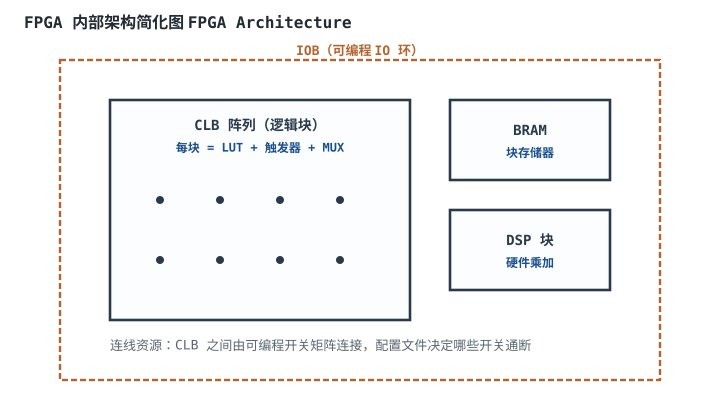
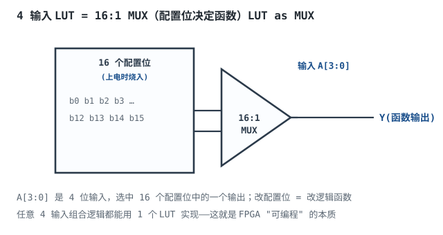
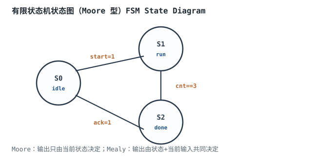

# FPGA/CPLD 与 Verilog 入门

## 1. 设计动机

::: motivation 为什么需要可编程逻辑
专用 ASIC 芯片性能高但流片成本几百万、改版周期半年。很多产品数量不够 ASIC、又需要比 MCU 灵活得多的并行硬件逻辑——这就是 FPGA/CPLD 的市场：**现场可编程门阵列（Field-Programmable Gate Array）**，芯片出厂后你可以反复"烧录"配置，让它变成你想要的数字电路。

Verilog 是描述这种硬件的语言。本章讲 FPGA 内部怎么实现逻辑、Verilog 怎么写可综合的小例子。
:::

## 2. 原理与逻辑图

### 2.1 FPGA 内部结构

FPGA 四周是可编程 IO（IOB），中间是可配置逻辑块（CLB）阵列，还有块存储器（BRAM）和硬件乘加（DSP）块，以及大量可编程连线开关。配置文件决定每个 LUT 实现什么逻辑、每个开关通断。



### 2.2 LUT：FPGA 的"逻辑原子"

每个 CLB 的核心是一个 4~6 输入查找表（LUT）。它本质是一个 $2^n:1$ MUX，由 $2^n$ 个配置位决定输出函数。**任何 n 输入组合逻辑都能塞进一个 LUT**——改配置位 = 改逻辑函数，这就是"可编程"。

### 2.3 FPGA vs CPLD

| | FPGA | CPLD |
|---|---|---|
| 结构 | LUT+触发器阵列 | 与或阵列宏单元 |
| 容量 | 大（万~百万 LUT） | 小（百~千宏单元） |
| 延时 | 连线延迟、不规则 | 规则、可预测 |
| 掉电 | 配置丢，需外挂 Flash | 非易失 |
| 适用 | 复杂并行、高速 | 简单胶合逻辑、上电即跑 |

## 3. 静态分析（Verilog 模块结构）

一个可综合 Verilog 模块三要素：**模块端口、内部逻辑、时序块**。以 2 选 1 MUX 为例：

```verilog
module mux2(
    input  wire a, b, sel,
    output wire y
);
    assign y = sel ? b : a;   // 组合逻辑：一行
endmodule
```

可综合组合逻辑用 `assign` 或 `always @(*)`；时序逻辑用 `always @(posedge clk)`。

## 4. 动态分析（时序）

FPGA 上所有逻辑最终落在 LUT + 触发器上，最高时钟频率由最慢路径决定（见时序分析章）。Verilog 写得好，综合工具能把它映射成合理的 LUT 链；写得差会推出意外锁存器或超长逻辑链。

## 5. LUT 与状态机实现

- **LUT 实现组合逻辑**：4 输入函数 1 个 LUT，多输入函数用多级 LUT 级联。
- **触发器**：每个 CLB 自带 1~2 个寄存器，配套 LUT 使用。
- **状态机**：状态寄存器 + 组合逻辑（次态逻辑 + 输出逻辑），见扩展图。

## 6. 元件取值与工程权衡

- **LUT 大小**：4 输入 LUT 最常见；6 输入 LUT 能塞更复杂函数、减少级数。
- **触发器 vs LUT 配比**：时序密集型设计要选触发器多的器件；纯组合用 LUT 多的。
- **BRAM vs Distributed RAM**：大块存储用 BRAM（省 LUT），小量用分布式 RAM（LUT 当 RAM）。
- **DSP 块**：乘加运算直接用硬件 DSP，别用 LUT 搭乘法器（慢且占资源）。

## 7. 完整设计示例

::: example 可综合 4 位计数器（Verilog）
```verilog
module counter4(
    input  wire       clk,      // 时钟
    input  wire       rst_n,    // 异步复位，低有效
    output reg  [3:0] q         // 计数输出
);
    always @(posedge clk or negedge rst_n) begin
        if (!rst_n)
            q <= 4'd0;          // 复位清零
        else
            q <= q + 4'd1;      // 每个时钟沿加 1
    end
endmodule
```
1. **模块端口**：clk、rst_n 输入，q 输出。
2. **异步复位**：`or negedge rst_n` 让复位立刻生效，不用等时钟沿。
3. **时序逻辑**：`posedge clk` 块里用非阻塞赋值 `<=`。
4. **可综合性**：这段能被综合成 4 个 D 触发器 + 加法器，是标准写法。
5. **验算**：复位后 q=0；每个 clk 沿 q 加 1，从 0000 数到 1111 循环。
:::

## 8. 仿真与实验

- 用 iverilog + GTKWave 仿真上面的 counter4：写 testbench 产生 clk 和 rst_n，观察 q 波形。
- 综合到具体 FPGA（如 iCE40/Artix-7），看资源报告（用了多少 LUT、触发器）。
- 把 `assign y = sel ? b : a;` 综合后，看它映射成 1 个 LUT。
- 故意写 `always @(*)` 里 `if` 不写 `else`，看综合报告是否出现 latch。

## 扩展与变种电路

### 扩展1：LUT 即查找表 LUT as MUX

4 输入 LUT 本质是 16:1 MUX，配置位决定函数——这就是 FPGA 可编程的物理本质。



::: example 工作原理与说明
- 4 个输入 A[3:0] 是地址，选中 16 个配置位中的一个输出。
- 想实现什么函数，就把真值表烧进配置位。
- 任意 4 输入组合逻辑 = 1 个 LUT；超过 4 输入用多级 LUT 级联。
- 触发器配套在 LUT 旁边，组成完整的时序单元。
:::

设计要点：LUT 是 FPGA 逻辑的原子。取值/对比：LUT(4输入) vs LUT(6输入)——6 输入能塞更复杂函数、级数少。适用：所有组合逻辑；不适用：存储（用 BRAM）、乘加（用 DSP）。

::: pitfall 把大块逻辑塞进一个 LUT 导致级数爆炸
- **现象**：综合后逻辑级数多、最高频率上不去。
- **原因**：超过 LUT 输入数的函数被拆成多级 LUT 链，延迟累积。
- **解决**：复杂逻辑插寄存器打流水，或利用 FPGA 的进位链/DSP 专用资源。
:::

### 扩展2：有限状态机 Moore/Mealy FSM

状态机是数字控制的核心：状态寄存器记当前状态，组合逻辑算次态和输出。



::: example 工作原理与 Verilog 框架
```verilog
typedef enum logic [1:0] {S0, S1, S2} state_t;
state_t cs, ns;
// 状态寄存器
always @(posedge clk or negedge rst_n)
  if (!rst_n) cs <= S0; else cs <= ns;
// 次态逻辑（组合）
always_comb begin
  ns = cs;
  case (cs)
    S0: if (start) ns = S1;
    S1: if (cnt==3) ns = S2;
    S2: if (ack)    ns = S0;
  endcase
end
```
- Moore：输出只由当前状态决定；Mealy：输出由状态+当前输入共同决定。
- 三段式写法：状态寄存器、次态逻辑、输出逻辑分开，清晰好维护。
- 注：上面的 `typedef enum logic` 与 `always_comb` 是 **SystemVerilog（IEEE 1800）** 语法；若综合工具只支持 Verilog-2001，改用 `reg [1:0]` + `parameter` 定义状态、组合块写 `always @(*)` 即可，逻辑等价。
:::

设计要点：状态机用三段式。取值/对比：Moore vs Mealy——Moore 输出稳定但慢一拍；Mealy 响应快但输出跟输入毛刺。适用：控制流、协议解析；不适用：纯数据流（用数据通路）。

::: pitfall 状态机写组合输出出现毛刺
- **现象**：Mealy 输出在组合逻辑里随输入毛刺，后级误触发。
- **原因**：Mealy 输出直接来自组合逻辑，输入抖动直接传到输出。
- **解决**：Mealy 输出后加一级寄存器同步，或改用 Moore 型（输出只在时钟沿变）。
:::

## 9. 常见坑与故障现象

::: pitfall 常见坑
- **`always @(*)` 里 if 没写 else**：综合工具推断出锁存器，仿真上板不一致。组合逻辑所有分支都要给输出赋值。
- **时序逻辑里用阻塞赋值 `=`**：应该用非阻塞 `<=`，否则仿真和综合行为不一致。时序块一律 `<=`。
- **组合逻辑里直接当复位/时钟**：生成毛刺时钟。时钟和复位只接专用引脚/寄存器输出。
- **跨时钟域不同步**：异步信号直接进快时钟域触发器，亚稳。加两级同步器（见时序分析章）。
:::

## 10. 自测题

<details><summary>为什么说 FPGA 的 LUT 能实现任意组合逻辑？</summary>

一个 n 输入 LUT 是 $2^n:1$ MUX，$2^n$ 个配置位对应真值表的每一行。把逻辑函数的真值表烧进配置位，LUT 的输出就等于该函数。任何 n 输入组合逻辑的真值表都能这样表示，所以 1 个 LUT 实现 1 个 n 输入函数；更复杂的函数用多级 LUT 级联。
</details>

<details><summary>时序逻辑 always 块里为什么用 `<=`（非阻塞）而不是 `=`（阻塞）？</summary>

阻塞赋值 `=` 在块内立即生效，会导致多个寄存器之间出现隐含的串联顺序，仿真和综合结果不一致。非阻塞 `<=` 在块结束时统一更新所有右边表达式，符合"时钟沿同时更新所有寄存器"的硬件语义。时序块一律 `<=`，组合块用 `=`。
</details>

<details><summary>Moore 型和 Mealy 型状态机输出有什么区别？</summary>

Moore 输出只由当前状态决定，输出在时钟沿更新、不会随输入毛刺，但响应慢一拍（要等状态翻转）。Mealy 输出由当前状态+当前输入共同决定，输入一变输出立刻变、响应快，但输入毛刺会直接传到输出。稳定输出选 Moore，快速响应选 Mealy。
</details>

## 11. 参考资料

- IEEE 1364 Verilog HDL 标准
- sources/notes/metastability-clockreset.md（跨时钟域与同步器）
