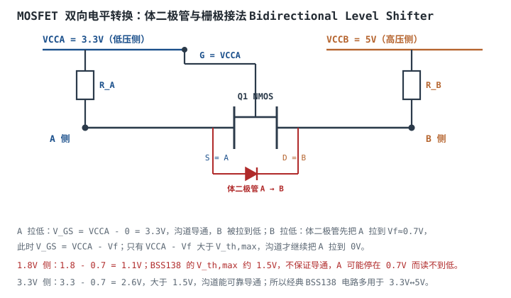
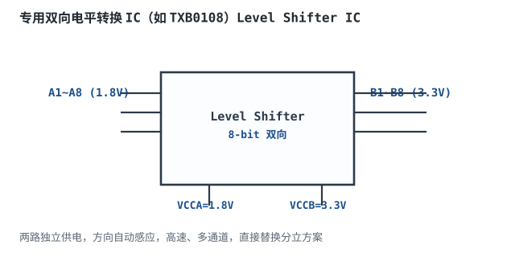
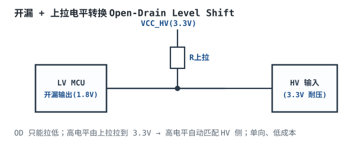

# 电平转换与总线缓冲

一颗 1.8V 的 MCU 要接 3.3V 的传感器，中间只隔一根 SDA。有人图省事，直接把 1.8V 的 GPIO 配成开漏、上拉到 3.3V——高电平确实到了 3.3V，但低电平释放时，3.3V 会经上拉和传感器内部结构倒灌进 1.8V 引脚；也有人用两个电阻分压，把 5V 降到 2.0V，正好等于 3.3V CMOS 的 $V_{IH}$，噪声一大就误判。**电平转换不是“把电压变小”，而是要在两个电源域之间同时满足直流电平、方向、速度、耐压和共地五个约束。**

这一章先把电平参数（$V_{IH}$、$V_{IL}$、绝对最大值、5V 容忍）讲清楚，再比较四种转换方式：电阻分压、MOSFET 双向、专用 IC、光耦/隔离；重点讲 MOSFET 双向转换的体二极管与栅极接法，以及速度为什么被上拉电阻和总线电容卡住。最后用一个 3.3V↔5V 的 I²C 算例，算上拉、最大速率，并说明为什么电阻分压不能用于 I²C。三态、开漏和上拉的基础见[三态门、总线与上拉下拉](tri-state-bus-pull.md)，逻辑电平标准见[逻辑电平](logic-levels.md)。

## 1. 设计动机

::: motivation 三个现场
**现场一：3.3V 推挽直接进 1.8V 引脚。** 3.3V 传感器输出高时，1.8V MCU 的输入引脚上出现 3.3V。引脚内部的 ESD 钳位二极管（从引脚到 VDD）正向导通，电流灌进 1.8V 电源轨；轻则把 1.8V 轨抬高、影响其他电路，重则烧毁钳位二极管或触发闩锁。**“引脚标 3.3V 容忍”才有资格直连；没有标注的，一律按不耐压处理。**

**现场二：1.8V 高电平进 3.3V CMOS。** 3.3V CMOS 的 $V_{IH}$ 按 $0.7V_{DD}$ 是 2.31V（2.0V 是 3.3V LVTTL 的旧门槛），1.8V 高电平差 0.51V，理论上读不到高；但有些器件在 1.8V 附近刚好翻转，实验室“能用”，温度/批次一变就失败。**电平转换要留噪声容限，不能卡在门槛上。**

**现场三：I²C 跨 3.3V/5V，用电阻分压。** 分压只能把 5V 侧的高电平降到 3.3V 侧，反过来 3.3V 侧拉低时，5V 侧仍然是高——I²C 是双向的，分压直接失效。**双向总线必须用双向转换：MOSFET、专用 IC 或开漏+上拉。**
:::

四种常见方案的能力边界：

| 方案 | 方向 | 速度 | 共地 | 典型场景 | 主要限制 |
|---|---|---|---|---|---|
| 电阻分压 | 单向（高→低） | 低（RC 限制） | 需要 | 低速单向、高阻负载 | 无驱动、无双向、持续功耗 |
| MOSFET 双向 | 双向 | 中（上拉+电容限制） | 需要 | I²C、SMBus、低速双向 | $V_{GS(th)}$、体二极管、上拉 |
| 专用 IC | 单向/双向 | 高（推挽几十~几百 Mbps） | 需要 | SPI、UART、并行总线 | 成本、方向控制、开漏限制 |
| 光耦/数字隔离 | 单向（双向需两路） | 中~高（受 CTR/隔离器限制） | 不需要 | 隔离、长线、不同地 | 成本、功耗、速度、CTR 退化 |

## 2. 定义与直观

### 2.1 电平参数

数字接口的直流电平由四个参数描述：

- **$V_{IH}$**：输入判为高的最小电压；
- **$V_{IL}$**：输入判为低的最大电压；
- **$V_{OH}$**：输出高电平的最小保证值；
- **$V_{OL}$**：输出低电平的最大保证值。

以 3.3V LVCMOS 为例，$V_{IH}=0.7V_{DD}=2.31\text{V}$、$V_{IL}=0.3V_{DD}=0.99\text{V}$、$V_{OH}\ge2.4\text{V}$、$V_{OL}\le0.4\text{V}$（$V_{IH}/V_{IL}$ 按 JESD8C；写成 2.0/0.8V 的是 3.3V **LVTTL**）；1.8V LVCMOS 的 $V_{IH}$ 约为 $0.65V_{DD}=1.17\text{V}$、$V_{IL}$ 约为 $0.35V_{DD}=0.63\text{V}$。**这些是“保证值”，不是“典型值”；设计要用最坏值，且以具体器件数据手册为准。**

除了直流电平，还要看：

- **绝对最大输入电压**：超过可能损坏 ESD 二极管/栅氧；
- **5V 容忍（5V Tolerant）**：引脚在 VDD=3.3V 时能承受 5V 输入，通常靠特殊 ESD 结构；不是所有“3.3V 引脚”都容忍 5V；
- **钳位二极管**：多数 CMOS 输入有到 VDD 和 GND 的 ESD 二极管，输入高于 VDD 时二极管导通，电流灌入电源；
- **电源时序**：一侧先上电、另一侧后上电时，未上电侧可能被反灌。

### 2.2 电阻分压

两个电阻串联，把高电压按比例降到低电压：

$$
V_{out}=V_{in}\frac{R_2}{R_1+R_2}
$$

优点是简单、零芯片；缺点是**单向、输出阻抗高、有持续功耗、没有驱动能力**。它适合“高电压→低电压、低速、后级输入阻抗很高”的场合，比如把 5V 信号送给 3.3V MCU 的 GPIO 做状态检测；不适合 I²C、SPI 这类双向或需要边沿的接口。

### 2.3 MOSFET 双向转换

用一只 N 沟道 MOSFET（经典如 BSS138）做双向转换：

- **源极（S）接低压侧 A**；
- **漏极（D）接高压侧 B**；
- **栅极（G）接低压侧电源 VCCA**；
- A、B 两侧各有一个上拉电阻，分别接到 VCCA、VCCB。

它的工作过程分三种情况：

1. **A 侧拉低**：$V_G=VCCA$，$V_S\approx0$，$V_{GS}=VCCA>V_{th}$，沟道导通，B 通过沟道被拉到低。此时 MOSFET 是“双向开关”，电流可以从 B 流回 A。
2. **B 侧拉低**：B 先通过**体二极管**（阳极在 A、阴极在 B）把 A 拉到 $V_f\approx0.7\text{V}$；此时 $V_{GS}=VCCA-V_f$。如果这个电压大于 $V_{th,max}$，沟道继续导通，把 A 拉到接近 0V；如果不够，A 就停在 0.7V 附近，低电平可能不合法。
3. **两侧都释放（高电平）**：$V_{GS}=VCCA-V_A$。当 A 被上拉到 VCCA 时，$V_{GS}=0$，MOSFET 截止；B 被 R_B 拉到 VCCB，A 被 R_A 拉到 VCCA。体二极管反偏（A 低于 B），不导通。两侧高电平各自等于自己的电源，自动匹配。

**关键点：这个电路不是“对称”的。** 源极固定在 A，体二极管方向固定（A→B），所以 B→A 的低电平要靠体二极管“起步”，再靠沟道完成；A→B 的低电平直接靠沟道。**栅极必须接低压侧 VCCA，不能接高压侧 VCCB**：如果栅极接 5V，A 侧输出高 3.3V 时 $V_{GS}=5-3.3=1.7\text{V}$，可能一直导通，A、B 被错误地连在一起；接 VCCA 才能保证“高电平时 $V_{GS}=0$ 关断”。

### 2.4 专用电平转换 IC

专用 IC 内部集成电平翻译、方向控制、驱动和 ESD，常见两类：

- **自动方向感应（Auto-Direction）**：如 TI TXB 系列，内部比较两侧电压/电流方向，自动决定驱动方向；推挽输出，速度快，适合 SPI、UART、并行总线。但它**不适合带强上拉的开漏总线**（如 I²C）：自动方向 + 推挽驱动会和上拉“打架”，数据手册通常明确限制。
- **方向控制/开漏型**：如 TXS 系列（带内部上拉、支持开漏/推挽）、PCA9306（I²C 专用双向无源翻译）；适合 I²C、SMBus、低速双向。

专用 IC 的优点是省心、速度快、通道多；缺点是要看方向、开漏/推挽、上拉、电源时序、$I_{off}$ 等一堆条件，不是“接上就能用”。

### 2.5 光耦与数字隔离

当两侧**不共地**、或需要安全隔离（市电、医疗、长线、不同地电位）时，MOSFET/IC 这类“共地转换”不适用，要用**光耦（Optocoupler）**或**数字隔离器（Digital Isolator）**：

- **光耦**：LED + 光敏三极管/二极管，靠光传递，输入输出电气隔离；速度受 LED 结电容、光敏管存储时间、CTR 限制；普通光耦几十 kHz~几 Mbps，高速光耦可达 10~50Mbps；CTR 随时间和温度退化。
- **数字隔离器**：变压器/电容耦合 + 编码，速度快（几十~几百 Mbps）、功耗低、共模瞬态抗扰度（CMTI）高；需要两侧供电，成本高于光耦。

隔离器不是“电平转换”的默认选择：同地、同系统内的 1.8V↔3.3V，用 MOSFET/IC 更便宜、更快；只有“地不同/安全隔离”才用隔离。

### 2.6 开漏 + 上拉：零芯片的单向/双向用法

还有一种最常见的“零芯片”方案：低压侧配成**开漏输出**，上拉电阻接到高压侧电源。低压侧只能拉低，高电平由高压侧上拉拉高，自动匹配高压侧的门槛。

这张图画的是**单向**用法（低压 MCU → 高压输入）。但开漏 + 上拉本身并不限定方向：I²C 的 SDA/SCL 就是两端都开漏、共用上拉，谁都能拉低，所以是双向的。**“开漏=单向”是一个常见误解；准确的说法是“开漏只能主动拉低，方向由谁拉低决定”。** 单向/双向要看总线两端是否都允许拉低，以及上拉接在哪一侧。

## 3. 定量关系

### 3.1 电阻分压的定量约束

分压输出：

$$
V_{out}=V_{in}\frac{R_2}{R_1+R_2}
$$

输出阻抗（戴维南电阻）：

$$
R_{th}=R_1\parallel R_2=\frac{R_1R_2}{R_1+R_2}
$$

后级输入阻抗 $R_{in}$ 与 $R_2$ 并联，会拉低输出：

$$
V_{out}'=V_{in}\frac{R_2\parallel R_{in}}{R_1+(R_2\parallel R_{in})}
$$

所以 $R_{in}\gg R_2$ 是分压的前提。分压的持续功耗：

$$
P=\frac{V_{in}^2}{R_1+R_2}
$$

上升时间（后级电容 $C$）：

$$
t_r=0.8473\,R_{th}C
$$

**一些资料里的例子有一个明确错误**：写“5V→3.3V，取 R1=30k、R2=20k”，但代入公式：

$$
V_{out}=5\times\frac{20}{30+20}=2.0\ \text{V}
$$

2.0V 不只是"不是 3.3V"：它比 3.3V LVCMOS 的 $V_{IH}=2.31\text{V}$ 还低 0.31V，噪声容限是负的。**这是把“刚好达到门槛”误当成“转换到 3.3V”。** 如果目标是 3.3V，分压比应为 $3.3/5=0.66$，例如 R1=5.1k、R2=10k：

$$
V_{out}=5\times\frac{10}{5.1+10}=3.31\ \text{V}
$$

但 3.31V 已经贴近 3.3V 电源，噪声/容差余量很小；如果 3.3V 侧电源偏低或输入有瞬态，可能超过输入绝对最大值。更稳妥的目标是 2.5~3.0V，例如 R1=R2=10k：

$$
V_{out}=5\times\frac{10}{10+10}=2.5\ \text{V}
$$

比 $V_{IH}=2.31\text{V}$ 高 0.19V，才留出噪声容限。代价是戴维南电阻 5kΩ，配 100pF 负载：

$$
t_r=0.8473\times5000\times100\times10^{-12}=423.7\ \text{ns}
$$

只适合低速。**分压的目标不是“正好 3.3V”，而是“高于 $V_{IH}$ 且低于钳位电压，并留余量”。**

### 3.2 MOSFET 双向转换的定量条件

设低压侧电源 $V_{CCA}$，高压侧 $V_{CCB}$，MOSFET 阈值 $V_{th}$，体二极管正向压降 $V_f$。三个条件必须同时满足：

**条件一：A 侧拉低时能导通。**

$$
V_{CCA}>V_{th,max}
$$

**条件二：B 侧拉低时，体二极管起步后沟道能接管。**

$$
V_{CCA}-V_f>V_{th,max}
$$

**条件三：低电平要低于接收端的 $V_{IL,max}$。**

$$
V_{OL,A}\le V_{IL,max}
$$

其中 $V_{OL,A}$ 是 A 侧实际低电平，V；$V_{IL,max}$ 是 A 侧接收器的最坏低电平门槛，V。条件二不满足时，A 侧会停在 $V_f\approx0.7\text{V}$ 附近，可能大于 $V_{IL,max}$，读不到低。

以 BSS138 为例，$V_{th,max}$ 约 1.5V（**典型量级，以数据手册为准**），$V_f\approx0.7\text{V}$：

- **3.3V↔5V**：$V_{CCA}-V_f=3.3-0.7=2.6\text{V}>1.5\text{V}$，条件二满足；A 侧拉低时 $V_{GS}=3.3\text{V}$，也满足。
- **1.8V↔3.3V**：$V_{CCA}-V_f=1.8-0.7=1.1\text{V}<1.5\text{V}$，条件二**不满足**；B 拉低时 A 可能停在 0.7V。1.8V CMOS 的 $V_{IL,max}$ 约 $0.35\times1.8=0.63\text{V}$，0.7V 大于它，**低电平不合法**。所以 BSS138 不能可靠用于 1.8V 侧；要用 $V_{th,max}\le0.9\text{V}$ 的低阈值器件，或专用 IC（PCA9306/TXS0102）。

**这就是“BSS138 万能”说法的边界。** 它在 3.3V↔5V 很经典，在 1.8V↔3.3V 却可能失效；选型时必须看 $V_{th,max}$ 和 $V_f$，不能只看“N 沟道、双向”。

MOSFET 的导通电阻 $R_{DS(on)}$ 和两侧上拉共同决定上升/下降时间；体二极管还带来一个方向上的 $V_f$ 偏移。速度的定量估算在 3.5 节。

### 3.3 专用 IC 的定量约束

专用 IC 的关键参数：

- **电源范围**：VCCA、VCCB 各自的范围，不能超；
- **方向**：自动感应还是 DIR 引脚；
- **输出类型**：推挽还是开漏/支持上拉；
- **数据率**：与负载电容、上拉、电压有关，不是孤立的 MHz 数；
- **$I_{off}$/部分掉电**：一侧掉电时是否反灌；
- **使能/上电时序**：谁先上电、使能何时有效。

以 TXB0108 为例（**以数据手册为准**）：8 位自动方向、推挽输出，A 侧 1.2~3.6V、B 侧 1.65~5.5V，数据率可达 100Mbps 量级；但它靠内部驱动强行推挽，**不适合 I²C 这类带强上拉的开漏总线**——上拉和内部驱动器会互相拉扯，边沿和电平都可能异常。I²C 应选 PCA9306、TXS 系列或 MOSFET 方案。

### 3.4 光耦/隔离的定量约束

光耦的 LED 电流：

$$
I_F=\frac{V_{DD1}-V_F}{R_{LED}}
$$

其中 $V_{DD1}$ 是输入侧电源，V；$V_F$ 是 LED 正向压降（典型 1.1~1.4V），V；$R_{LED}$ 是限流电阻，$\Omega$。输出侧集电极电流：

$$
I_C=CTR\cdot I_F
$$

其中 CTR 是电流传输比（百分比），$I_C$ 是光敏管集电极电流，A。输出低电平由 $I_C$ 和上拉 $R_L$ 决定：

$$
V_{OL}=V_{DD2}-I_C R_L
$$

（忽略 $V_{CE(sat)}$ 时；实际还要看输出管的饱和压降。）

以 $V_{DD1}=3.3\text{V}$、$V_F=1.2\text{V}$、$R_{LED}=330\Omega$ 为例：

$$
I_F=\frac{3.3-1.2}{330}=6.36\ \text{mA}
$$

CTR=50% 时：

$$
I_C=0.5\times6.36=3.18\ \text{mA}
$$

取 $R_L=1\text{k}\Omega$，输出管导通时：

$$
V_{OL}\approx3.3-3.18\times10^{-3}\times1000=0.12\ \text{V}
$$

能拉到低。如果 CTR 退化到 20%：

$$
I_C=0.2\times6.36=1.27\ \text{mA}
$$

$$
V_{OL}\approx3.3-1.27=2.03\ \text{V}
$$

可能已经不被判为低。**光耦设计要按 CTR 最小值（含老化）算，不能按典型 CTR；必要时减小 $R_L$ 或增大 $I_F$，但要注意 LED 寿命和功耗。**

### 3.5 速度限制来自哪里

电平转换的速度由三个环节共同决定：

1. **上拉电阻 + 总线电容**：上升沿 $t_r=0.8473RC$；这是开漏/MOSFET 方案的主要限制。
2. **MOSFET 的 $R_{DS(on)}$ 和栅极驱动**：下降沿由沟道/外部器件驱动，$R_{DS(on)}$ 越大、电容越大，下降越慢；低 $V_{GS}$ 下 $R_{DS(on)}$ 显著变大。
3. **专用 IC 的内部驱动/方向感应**：推挽 IC 的边沿由内部驱动器决定，速度快；但自动方向感应需要时间，负载电容大时也会变慢。

对 I²C/MOSFET 方案，最大速率的粗略估算：先按协议定 $t_{r,max}$，算 $R_{max}$，再验证 $I_{OL}$、$V_{OL}$、MOSFET 的 $V_{GS}$ 条件；最后看整个周期的裕量。**“MOSFET 能到 400kHz”不是器件属性，而是“这个上拉、这个电容、这个 $V_{CCA}$ 下能到 400kHz”。**

### 3.6 方案选型表

| 需求 | 首选 | 理由 |
|---|---|---|
| 单向、低速、高阻负载 | 电阻分压 | 最简单、成本最低 |
| I²C/SMBus 双向、3.3V↔5V | MOSFET（BSS138 类）或 PCA9306 | 双向、便宜、够 400kHz |
| I²C 双向、1.8V↔3.3V | 低阈值 MOSFET 或 PCA9306/TXS | BSS138 的 $V_{GS}$ 余量不够 |
| SPI/UART 推挽、高速 | TXB/专用推挽 IC | 速度快、方向自动 |
| 不共地/安全隔离 | 光耦/数字隔离器 | 电气隔离，共地转换不适用 |
| 5V 信号进 3.3V 耐压引脚 | 分压/限流+钳位/专用 IC | 先确认引脚是否 5V 容忍 |

## 4. 典型计算

### 4.1 3.3V↔5V 的 I²C 电平转换

**需求**：3.3V MCU 与 5V 传感器共用 I²C，400kHz 快速模式；两侧总线电容各约 100pF；$V_{OL}=0.4\text{V}$，$I_{OL}=3\text{mA}$，$t_{r,max}=300\text{ns}$。用 BSS138 双向转换，求上拉电阻并验算。

**第一步，确定接法**：A 侧（3.3V）为源极，B 侧（5V）为漏极，栅极接 3.3V；A 侧上拉 3.3V，B 侧上拉 5V。

**第二步，算 3.3V 侧上限**：

$$
R_{max,A}=\frac{300\times10^{-9}}{0.8473\times100\times10^{-12}}=3540.7\ \Omega
$$

**第三步，算 5V 侧下限**：

$$
R_{min,B}=\frac{5-0.4}{3\times10^{-3}}=1533.3\ \Omega
$$

3.3V 侧下限：

$$
R_{min,A}=\frac{3.3-0.4}{3\times10^{-3}}=966.7\ \Omega
$$

合并窗口：

$$
1533.3\ \Omega\le R\le3540.7\ \Omega
$$

**第四步，取 2.2kΩ 验算**：

$$
t_r=0.8473\times2200\times100\times10^{-12}=186.4\ \text{ns}<300\ \text{ns}
$$

低电平电流必须**两侧合起来算**：A 侧被拉低时沟道导通，B 侧 5V 上拉电流也经沟道灌进 A 侧驱动器，单看一侧会漏掉那一路。

$$
I_{OL,A}=\frac{3.3-0.4}{2200}+\frac{5-0.4}{2200}=1.318+2.091=3.41\ \text{mA}>3\ \text{mA}
$$

所以 2.2kΩ 在这里**不满足** 3 mA 的灌电流预算。要满足需

$$
R\ge\frac{(3.3-0.4)+(5-0.4)}{3\ \text{mA}}=2.5\ \text{k}\Omega
$$

取 2.5kΩ 时 $t_r=211.8$ ns 仍在 300 ns 内，**2.5kΩ~3.5kΩ 才是这组参数（3.3V↔5V、100pF、400kHz）下的合适窗口**。

**第五步，验证 MOSFET 条件**：

$$
V_{CCA}-V_f=3.3-0.7=2.6\ \text{V}>V_{th,max}\approx1.5\ \text{V}
$$

B 侧拉低时，体二极管先把 A 钳到约 $V_f+V_{OL,B}=0.7+0.4=1.1\text{V}$，$V_{GS}=3.3-1.1=2.2\text{V}$，沟道可靠导通，A 被拉到接近 0V。A 侧拉低时 $V_{GS}=3.3\text{V}$，更没问题。

**第六步，看电容变大时**。如果两侧各 200pF，$R_{max}=1770\Omega$，而 5V 侧 $R_{min}=1533\Omega$，窗口只剩 1533~1770Ω；取 1.6kΩ：

$$
t_r=0.8473\times1600\times200\times10^{-12}=271.1\ \text{ns}<300\ \text{ns}
$$

$$
I_{OL,A}=\frac{(3.3-0.4)+(5-0.4)}{1600}=1.813+2.875=4.69\ \text{mA}>3\ \text{mA}
$$

**1.6kΩ 不满足**：两侧电流合起来已经 4.69 mA，远超 3 mA。而灌电流要求 $R\ge(2.9+4.6)/3\text{mA}=2.5\text{k}\Omega$，上升时间要求 $R\le1770\Omega$——**窗口闭合，这组参数（3.3V↔5V、两侧各 200pF）下无解**。要么减小总线电容，要么换专用电平转换器/带更大灌电流的驱动器。**总之一句话：灌电流必须按两侧合计核，只核一侧一定漏。**

**第七步，最大速率**。400kHz 周期 2.5µs，$t_r=186\text{ns}$，占 7.4%；上升沿不是瓶颈。如果提到 1MHz，Fm+ 的 $t_{r,max}=120\text{ns}$、$C_b$ 上限 550pF、$I_{OL}$ 可能要求 20mA，不能直接套 400kHz 的 2.2kΩ；要按 Fm+ 参数重算，通常需要更小的上拉或专用 IC。**“400kHz 能跑”不等于“1MHz 能跑”。**

### 4.2 1.8V↔3.3V：为什么 BSS138 不行

**需求**：1.8V MCU 与 3.3V 传感器 I²C，仍想用 BSS138。判断是否可行。

**第一步，算 B 侧拉低时的 $V_{GS}$**：

$$
V_{GS}=V_{CCA}-V_f=1.8-0.7=1.1\ \text{V}
$$

**第二步，和 $V_{th,max}$ 比较**：BSS138 的 $V_{th,max}\approx1.5\text{V}$，$1.1\text{V}<1.5\text{V}$，沟道**不保证**导通。A 侧可能停在 $V_f\approx0.7\text{V}$。

**第三步，和 $V_{IL,max}$ 比较**：1.8V CMOS 的 $V_{IL,max}\approx0.35\times1.8=0.63\text{V}$，0.7V 大于 0.63V，低电平不合法。即使某些器件 $V_{IL}$ 宽松到 0.4×VDD=0.72V，0.7V 也在边缘，没有余量。

**结论**：BSS138 不能可靠用于 1.8V 侧。可选：

- **低阈值 MOSFET**：$V_{th,max}\le0.9\text{V}$，使 $1.8-0.7=1.1\text{V}>V_{th,max}$；但低 $V_{GS}$ 下 $R_{DS(on)}$ 较大，速度更慢，要查数据手册的 $R_{DS(on)}@V_{GS}=1.1\text{V}$；
- **PCA9306/TXS0102 等 I²C 专用双向 IC**：按数据手册的 $V_{ref}$ 和上拉取值；
- **1.8V 侧用推挽缓冲器 + 方向控制**：适合单向/已知方向，不适合 I²C 双向。

### 4.3 为什么电阻分压不能用于 I²C

**需求**：5V I²C 总线要接到 3.3V MCU，能不能用两个电阻分压？

**第一步，算分压**。取 R1=R2=10k：

$$
V_{out}=5\times\frac{10}{10+10}=2.5\ \text{V}
$$

2.5V 高于 3.3V CMOS 的 $V_{IH}=2.0\text{V}$，直流上“看起来可以”。

**第二步，看双向**。I²C 的 SDA 是双向的：3.3V 侧拉低时，5V 侧也必须变低。分压网络的 5V 端接在 5V 总线上，3.3V 侧拉低只是把中点拉到 0V，5V 端仍然是 5V（只多灌一点电流）：

$$
I_{5V}=\frac{5-0.4}{10\times10^{3}}=0.46\ \text{mA}
$$

5V 总线不会被拉低，5V 侧的器件读到的仍是高。**分压只能高→低，不能低→高，所以 I²C 直接失效。**

**第三步，看速度**。分压的戴维南电阻：

$$
R_{th}=10\text{k}\parallel10\text{k}=5\ \text{k}\Omega
$$

配 100pF：

$$
t_r=0.8473\times5000\times100\times10^{-12}=423.7\ \text{ns}
$$

400kHz 要求 ≤300ns，分压本身就超限；如果电容 200pF，$t_r=847\text{ns}$，更不行。

**第四步，看低电平**。3.3V 侧拉低时，分压网络仍从 5V 灌入 0.46mA，低电平由 3.3V 侧驱动器的 $R_{on}$ 和分压网络共同决定，可能抬高到不合法；而且 5V 侧的高电平被分压器持续拉低，功耗 $5^2/20\text{k}=1.25\text{mW}$ 一直存在。

**结论**：I²C 不能用电阻分压；用 MOSFET 双向、PCA9306/TXS 或专用 I²C 转换器。

### 4.4 光耦隔离：LED 电流与 CTR 余量

**需求**：3.3V 信号经光耦传到 5V 侧，LED 限流 330Ω，$V_F=1.2\text{V}$，CTR 最小 20%，上拉 1kΩ。判断能否拉到低。

**第一步，算 LED 电流**：

$$
I_F=\frac{3.3-1.2}{330}=6.36\ \text{mA}
$$

**第二步，按最小 CTR 算集电极电流**：

$$
I_C=0.20\times6.36=1.27\ \text{mA}
$$

**第三步，算输出低电平**：

$$
V_{OL}\approx5-1.27\times10^{-3}\times1000=3.73\ \text{V}
$$

3.73V 远高于 5V CMOS 的 $V_{IL}=0.8\text{V}$，**根本拉不低**。要可靠工作，要么增大 $I_F$（减小 $R_{LED}$），要么减小 $R_L$，要么选 CTR 更大的光耦。例如把 $R_L$ 降到 470Ω：

$$
V_{OL}\approx5-1.27\times10^{-3}\times470=4.40\ \text{V}
$$

仍然不够；问题在 $I_C$ 太小，不是 $R_L$ 太大。把 $R_{LED}$ 降到 150Ω：

$$
I_F=\frac{3.3-1.2}{150}=14.0\ \text{mA}
$$

$$
I_C=0.20\times14.0=2.80\ \text{mA}
$$

$$
V_{OL}\approx5-2.80\times10^{-3}\times1000=2.20\ \text{V}
$$

仍高于 0.8V；需要 $I_C$ 至少 4.2mA 才能把 1k 上拉拉到 0.8V 以下，对应 $I_F=21\text{mA}$（CTR=20%）。**光耦设计要按最小 CTR 反算 $I_F$ 和 $R_L$，不能拿“典型 CTR=100%”当设计值。** 高速/低功耗场合，数字隔离器比光耦更合适。

### 4.5 专用 IC 的选型验算

**需求**：3.3V↔5V、8 路推挽信号、20Mbps。选 TXB0108 还是 MOSFET？

- **MOSFET**：每路要两只上拉、一只 MOSFET，20Mbps 下上升沿靠 RC，100pF、2.2k 的 $t_r=186\text{ns}$，对应带宽约 $0.35/186\text{ns}=1.9\text{MHz}$，远不够 20Mbps；**MOSFET 方案不适合高速推挽**。
- **TXB0108**：8 路、自动方向、推挽，数据率可达 100Mbps 量级（以数据手册和负载条件为准），20Mbps 有裕量；但要注意负载电容、上拉、电源时序，且**不能用于 I²C 开漏**。
- 结论：高速推挽选 TXB/专用 IC；低速双向 I²C 选 MOSFET/PCA9306。**不要用“能不能双向”作为唯一选型标准，速度/输出类型/上拉才是决定性的。**

## 5. 工程含义

### 5.1 共地与隔离

- **共地转换**（分压、MOSFET、专用 IC）：两侧必须共地；如果两地之间有电位差/噪声，信号参考会漂移，甚至超过绝对最大值。
- **不共地/安全隔离**：用光耦/数字隔离器；隔离器两侧各自供电，地分开，注意隔离耐压、爬电距离、CMTI。
- **“地不同”不是“加一个 0Ω 电阻”就能解决**：0Ω 会把两地强行连在一起，可能形成地环路/大电流；要么共地设计，要么真正隔离。

### 5.2 反灌与电源时序

- **未上电侧被反灌**：MOSFET 的体二极管、IC 的 ESD 二极管、I²C 上拉都可能把电流灌进未上电的电源域。查器件是否有 **$I_{off}$/部分掉电保护**；没有的话，加串联电阻/理想二极管/电源开关，或保证上电顺序。
- **一侧先上电**：自动方向 IC 可能把先上电侧的状态传到后上电侧，造成误动作；按数据手册的上电时序/使能要求设计。
- **5V 容忍**：只有数据手册明确标注“5V tolerant”的引脚才能直接接 5V；否则用转换器。“3.3V 系统”不等于“所有引脚都 3.3V 容忍”，更不等于 5V 容忍。

### 5.3 上拉与总线电容

- **上拉接哪一侧的电源**：A 侧接 VCCA，B 侧接 VCCB；不能把两侧都接到 5V，否则低压侧被过压。
- **上拉取值**：按 3.5 节和[三态门、总线与上拉下拉](tri-state-bus-pull.md)的窗口算；MOSFET 方案的两侧上拉可以不同，但都要满足各自的 $I_{OL}$ 和 $t_r$。
- **总线电容**：引脚、走线、连接器、探头都算；MOSFET 的漏/源电容、IC 的输入电容也会加。
- **上拉位置**：I²C 可以集中一个上拉，也可以分段；分段会降低等效电阻、加快上升，但增加低电平电流，要重算 $I_{OL}$。

### 5.4 PCB 与保护

- **走线短、少过孔**：电平转换器靠近连接器/低压侧，减少 stubs 和电容。
- **地平面连续**：转换器下方不要分割地；两侧地要在器件下方低阻抗连接（非隔离方案）。
- **ESD/浪涌**：外露接口加 TVS/ESD 保护，注意保护器件的电容对高速信号的影响；I²C 的 ESD 保护要选低电容型号。
- **热插拔**：插入瞬间可能同时驱动/反灌，用隔离缓冲器/热插拔控制器，或先接地再上电。
- **测试点**：两侧都留测试点，方便同时测 A/B 电平和上升时间；探头电容要算进 $C_b$。

### 5.5 测量与排故

- **直流**：万用表/示波器测两侧 $V_{OH}$、$V_{OL}$，确认高电平等于各自电源、低电平接近 0；如果低电平停在 0.7V，查 MOSFET 的 $V_{GS}$ 条件。
- **上升沿**：测 30%~70%，算 $0.8473RC$，和实测对比；如果明显更慢，查电容/上拉/探头。
- **方向**：I²C 双向时，分别让两侧拉低，确认另一侧跟随；只测一个方向会漏掉体二极管/阈值问题。
- **反灌**：断开一侧电源，测另一侧是否有电压/电流；查 $I_{off}$ 和二极管路径。
- **隔离**：光耦/隔离器要测 CTR、传输延迟、脉宽失真、CMTI；按数据手册的最坏条件。

## 6. 常见坑

::: pitfall 常见坑
- **3.3V 推挽直接进 1.8V 引脚**：现象——1.8V 电源被抬高、引脚发热、偶发闩锁。原因——3.3V 超过 1.8V 引脚绝对最大值，ESD 钳位二极管导通，电流灌入 1.8V 轨。解决——查数据手册是否 5V/3.3V 容忍；不容忍就用 MOSFET/专用 IC/分压（仅单向）。
- **BSS138 用在 1.8V 侧**：现象——低电平停在 0.7V 左右，接收端读不到低；高温/批次变化时更糟。原因——体二极管起步后 $V_{GS}=1.8-0.7=1.1\text{V}$，小于 BSS138 的 $V_{th,max}\approx1.5\text{V}$，沟道不保证导通。解决——选 $V_{th,max}\le0.9\text{V}$ 的低阈值器件，或 PCA9306/TXS0102；按 $V_{IL,max}$ 验算。
- **用电阻分压做 I²C**：现象——3.3V 侧能收，5V 侧收不到；或者上升沿太慢、丢包。原因——分压只能高→低，低→高时 5V 侧仍被 5V 拉住；戴维南电阻 5kΩ 配 100pF 就有 424ns 上升时间。解决——I²C 用 MOSFET 双向/PCA9306/TXS；分压只用于单向、低速、高阻负载。
- **把 TXB 用在 I²C 上**：现象——通信不稳、边沿异常、偶尔锁死。原因——TXB 是推挽自动方向，和 I²C 的开漏上拉互相拉扯；数据手册通常明确不适合开漏/强上拉。解决——I²C 用 PCA9306/TXS 或 MOSFET；TXB 用于 SPI/UART 等推挽信号。
- **栅极接高压侧**：现象——转换器一直导通，A/B 两侧电平被绑在一起；或者方向反了。原因——栅极接 VCCB 时，A 侧高电平使 $V_{GS}=VCCB-VCCA$ 可能大于 $V_{th}$，MOSFET 不关断。解决——栅极接低压侧 VCCA，保证高电平时 $V_{GS}=0$。
- **上拉接到错误的电源**：现象——低压侧被过压、器件发热、通信异常。原因——A 侧上拉应接 VCCA，B 侧接 VCCB；把 A 侧也接到 5V，1.8V/3.3V 器件被过压。解决——两侧上拉各自接本侧电源；查器件耐压和 5V 容忍。
- **忽略未上电侧的反灌**：现象——一侧断电，另一侧仍能测到电压；系统无法完全掉电/复位。原因——体二极管/ESD 二极管/上拉把电流灌进未上电侧。解决——选带 $I_{off}$/部分掉电保护的器件；加串联电阻/理想二极管/电源开关；按数据手册的上电时序设计。
- **只看“能双向”，不看速度/输出类型**：现象——MOSFET 方案跑不了高速 SPI；或者推挽 IC 带不动 I²C 上拉。原因——双向只是方向能力，速度由 RC/驱动决定，输出类型决定能否接开漏。解决——先列需求（方向、速率、开漏/推挽、共地、耐压），再选方案；按 3.5 节算速度。
:::

## 7. 自测题

3.3V↔5V I²C，两侧各 100pF，400kHz，$V_{OL}=0.4\text{V}$，$I_{OL}=3\text{mA}$。上拉窗口是多少？2.2kΩ 行不行？

3.3V 侧上限：

$$
R_{max,A}=\frac{300\times10^{-9}}{0.8473\times100\times10^{-12}}=3540.7\ \Omega
$$

5V 侧下限：

$$
R_{min,B}=\frac{5-0.4}{3\times10^{-3}}=1533.3\ \Omega
$$

3.3V 侧下限 966.7Ω，合并窗口 1533.3~3540.7Ω。2.2kΩ 在窗口内：

$$
t_r=0.8473\times2200\times100\times10^{-12}=186.4\ \text{ns}<300\ \text{ns}
$$

$$
I_{OL,B}=\frac{5-0.4}{2200}=2.091\ \text{mA}<3\ \text{mA}
$$

可以用。

为什么 BSS138 在 3.3V↔5V 能用，在 1.8V↔3.3V 可能不行？用数字说明。

B 侧拉低时，体二极管先把 A 拉到 $V_f\approx0.7\text{V}$，此时：

$$
V_{GS}=V_{CCA}-V_f
$$

3.3V 侧：$3.3-0.7=2.6\text{V}>V_{th,max}\approx1.5\text{V}$，沟道导通，A 被拉到 0V。

1.8V 侧：$1.8-0.7=1.1\text{V}<1.5\text{V}$，沟道不保证导通，A 可能停在 0.7V；而 1.8V CMOS 的 $V_{IL,max}\approx0.54\text{V}$，0.7V 不合法。所以 1.8V 侧要选 $V_{th,max}\le0.9\text{V}$ 的器件或专用 IC。

5V 信号用 30k/20k 分压到 3.3V MCU，输出是多少？这个设计有什么问题？正确分压比是多少？

$$
V_{out}=5\times\frac{20}{30+20}=2.0\ \text{V}
$$

2.0V 刚好等于 3.3V CMOS 的 $V_{IH}$，噪声容限为 0；它不是 3.3V。正确目标应高于 $V_{IH}$ 并留余量，例如 2.5V：R1=R2=10k，$V_{out}=2.5\text{V}$；或 3.0V 左右。3.3V 分压比是 0.66，例如 5.1k/10k 得 3.31V，但贴近电源、可能触发钳位，通常不必要。

电阻分压为什么不能用于 I²C？至少给出双向和速度两个理由。

双向：I²C 的 SDA 两端都能拉低。3.3V 侧拉低时，分压中点被拉到 0V，但 5V 侧仍通过 R1 接在 5V 上，5V 总线不会被拉低，5V 器件读不到低。分压只能高→低。

速度：10k/10k 的戴维南电阻 5kΩ，配 100pF 的上升时间：

$$
t_r=0.8473\times5000\times100\times10^{-12}=423.7\ \text{ns}
$$

超过 400kHz 的 300ns 上限。所以 I²C 要用 MOSFET/PCA9306/TXS。

光耦 LED 限流 330Ω、$V_F=1.2\text{V}$、3.3V 驱动，CTR 最小 20%，上拉 1kΩ 到 5V。输出能拉到低吗？

$$
I_F=\frac{3.3-1.2}{330}=6.36\ \text{mA}
$$

$$
I_C=0.20\times6.36=1.27\ \text{mA}
$$

$$
V_{OL}\approx5-1.27\times10^{-3}\times1000=3.73\ \text{V}
$$

远高于 5V CMOS 的 $V_{IL}=0.8\text{V}$，拉不低。要增大 $I_F$（减小 $R_{LED}$）或减小 $R_L$，并按最小 CTR 反算；典型 CTR 不能当设计值。

TXB0108 和 PCA9306 都能“双向”，为什么 I²C 选 PCA9306 而不是 TXB0108？

TXB0108 是推挽自动方向转换器，靠内部驱动器主动推高/拉低；I²C 是开漏总线，靠外部上拉拉高。两者一起工作时，TXB 的推挽输出会和上拉/从机开漏互相拉扯，边沿和电平可能异常，数据手册通常明确不适合开漏/强上拉应用。

PCA9306 是 I²C 专用的双向无源翻译器，配合上拉工作，不会和开漏总线打架。TXB 适合 SPI/UART 等推挽信号；I²C 选 PCA9306/TXS 或 MOSFET。

MOSFET 双向转换的栅极为什么必须接低压侧 VCCA，不能接高压侧 VCCB？

栅极接 VCCA 时，A 侧高电平等于 VCCA，$V_{GS}=VCCA-VCCA=0$，MOSFET 关断，两侧高电平各自被上拉到 VCCA/VCCB；只有 A 被拉低时 $V_{GS}=VCCA$ 才导通。

如果栅极接 VCCB，A 侧高电平 VCCA 时：

$$
V_{GS}=VCCB-VCCA
$$

以 3.3V/5V 为例是 1.7V，可能大于 $V_{th}$，MOSFET 一直导通，A/B 被绑在一起，高电平互相倒灌。所以栅极必须接低压侧。

## 8. 参考资料

- **NXP, UM10204 *I2C-bus specification and user manual*, Rev. 6, 2014**：开漏总线、上拉、$V_{IL}/V_{IH}$、总线电容与电平容限；本章 3.1、4.1~4.3 的 I²C 口径以该手册为准。
- **NXP, AN10441 *Level shifting techniques in I2C-bus design*, 2007**：双向 MOSFET 电平转换、上拉取值、速度限制与 I²C 应用；本章 2.3、3.2、4.1 的电路与计算参考该应用笔记。
- **Philips, AN97055 *Bi-directional level shifter for I2C-bus and other systems*, 1997**：体二极管、栅极接法、双向导通条件与 $V_{GS}$ 分析；本章 3.2、4.2 的阈值讨论参考该文档。
- **Texas Instruments, TXB0108 数据手册**：自动方向感应、推挽驱动、数据率与开漏应用限制；本章 2.4、3.3、4.5 的 TXB 口径以该数据手册为准。
- **Texas Instruments, SLVA689 *I2C Bus Pullup Resistor Calculation*, 2015**：上拉上下限、0.8473RC 上升时间与计算示例；本章 3.5、4.1 的上拉窗口计算参考该应用报告。
