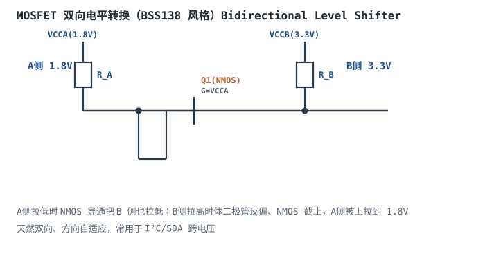
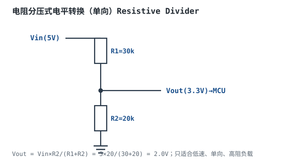

# 电平转换与总线缓冲

## 1. 设计动机

::: motivation 为什么 1.8V MCU 不能直接接 3.3V 传感器
现代系统混用多种电压：MCU 内核 1.8V、外设 3.3V、老传感器 5V。直接互连有两个问题：
1. **高电平不够**：1.8V MCU 输出高 1.8V，3.3V 器件要求高电平 > 2.0V，勉强够但噪声容限小。
2. **耐压不够**：3.3V 传感器输出高 3.3V，1.8V MCU 引脚耐压只有 1.8V，**直接接会烧 IO**。

电平转换（Level Shifting）就是在两个电压域之间做翻译。本章讲三种主流方案：MOSFET 双向转换、电阻分压、专用转换 IC，以及什么时候用哪种。
:::

## 2. 原理与逻辑图

### 2.1 MOSFET 双向电平转换

用一只 NMOS（如 BSS138）做双向转换：栅极接低压侧 VCCA，源极接 A 侧、漏极接 B 侧，两侧各加上拉电阻。A 侧拉低时 NMOS 导通把 B 侧也拉低；B 侧想拉高时体二极管反偏、NMOS 截止，A 侧被自己的上拉拉到 VCCA。方向自适应，天然双向。



### 2.2 电阻分压

两个电阻串联，把高电压按比例降到低电压。最简单，但只能单向、有功耗、且输入阻抗有限。

### 2.3 专用转换 IC

两路独立供电的专用芯片（如 TI TXB0108），方向自动感应，多通道、高速、免外部元件。

## 3. 静态分析（电压换算）

电阻分压：$V_{out}=V_{in}\times R_2/(R_1+R_2)$。5V→3.3V，取 R1=30k、R2=20k：

$$V_{out}=5\times\frac{20}{30+20}=2.0\text{V}$$

注意 2.0V 只是"够 3.3V CMOS 的 VIH=2.0V"，噪声容限为 0，只适合低速、干净环境。

MOSFET 双向转换两侧高电平分别被各自上拉拉到 VCCA/VCCB，低电平都是 0V，电压自动匹配。

## 4. 动态分析（上升沿与速率）

电平转换电路的上升沿由上拉电阻 $R$ 和总线电容 $C$ 决定：$t_r\approx0.7RC$。上拉越小越快但功耗越大。

```echarts
{
  "tooltip": {"trigger": "axis"},
  "legend": {"data": ["OD+10k上拉", "OD+4.7k上拉", "专用IC(主动驱动)"], "bottom": 0, "textStyle": {"fontSize": 12}},
  "grid": {"left": 60, "right": 30, "top": 30, "bottom": 60},
  "xAxis": {"type": "category", "name": "时间(us)", "data": ["0","0.2","0.5","1","2","3","5"], "axisLabel": {"fontSize": 11}},
  "yAxis": {"type": "value", "name": "电压V", "min": 0, "max": 3.3, "interval": 1, "axisLabel": {"fontSize": 11}},
  "series": [
    {"name": "OD+10k上拉", "type": "line", "smooth": true, "showSymbol": false, "lineStyle": {"width": 2.4, "color": "#b5642e"}, "data": [0,0.5,1.2,2.0,2.8,3.1,3.3]},
    {"name": "OD+4.7k上拉", "type": "line", "smooth": true, "showSymbol": false, "lineStyle": {"width": 2.4, "color": "#1a4f8b"}, "data": [0,1.2,2.2,2.9,3.2,3.3,3.3]},
    {"name": "专用IC(主动驱动)", "type": "line", "step": "middle", "showSymbol": false, "lineStyle": {"width": 2.6, "color": "#2a7a4a"}, "data": [0,3.3,3.3,3.3,3.3,3.3,3.3]}
  ]
}
```

观察：上拉电阻越大上升沿越慢；专用 IC 主动驱动、边沿陡，速率最高。

## 5. 方案选型与权衡

- **MOSFET 双向（BSS138）**：成本极低、双向自适应、I²C 友好；速率受上拉限制（~400kHz），需要外部电阻。
- **电阻分压**：最简单最便宜；只能单向、高电平容限差、持续功耗，只适合低速。
- **专用 IC**：高速、多通道、免算电阻；成本高、占面积。
- **开漏 + 上拉**：单向、低成本、I²C/SDA 常用。

## 6. 元件取值与工程权衡

- **上拉电阻**：I²C 标准模式 4.7k，快速模式 2.2k；电阻越小上升越快但功耗越大。
- **MOSFET 选型**：选 $V_{GS(th)}$ 小于低压侧 VCCA 的 NMOS（BSS138 的 $V_{GS(th)}\approx1.5$V，1.8V 侧可用）。
- **方向**：I²C/SDA 双向用 MOSFET 或专用双向 IC；单向控制线用分压或缓冲 IC。
- **耐压**：高侧电压不能超过 MOSFET/IC 的耐压，1.8V MCU 引脚绝对不能直接接 3.3V 信号。

## 7. 完整设计示例

::: example 1.8V MCU 接 3.3V I²C 传感器
1. **需求**：MCU 1.8V，传感器 3.3V，I²C SDA/SCL 双向通信。
2. **方案**：SDA/SCL 各用一只 BSS138 双向转换。
3. **接线**：栅极接 MCU 侧 1.8V，源极接 MCU 侧 SDA，漏极接传感器侧 SDA；MCU 侧上拉到 1.8V，传感器侧上拉到 3.3V。
4. **选上拉**：400kHz 快速模式，两侧各取 4.7k。
5. **验算**：$V_{GS(th)}=1.5V < VCCA=1.8V$，NMOS 能导通；高电平两侧各自被上拉拉到自己的电压。
6. **结论**：通信正常，且 MCU 引脚不会被 3.3V 反灌（高电平时 NMOS 截止）。
:::

## 8. 仿真与实验

在面包板上：

- 用 BSS138 + 两只 4.7k 搭一路 SDA 转换，MCU 1.8V、传感器 3.3V，示波器看两侧电平。
- 用电阻分压把 5V 降到 3.3V，万用表测 Vout，再接 MCU GPIO 读值。
- 对比 OD+上拉 vs 专用 TXB0108 的上升沿速率（示波器）。

## 扩展与变种电路

### 扩展1：电阻分压式电平转换 Resistive Divider

两个电阻把高压降到低压，最简单、零芯片。



::: example 工作原理与取值
- $V_{out}=V_{in}\cdot R_2/(R_1+R_2)$。5V→3.3V：R1=30k, R2=20k，$V_{out}=2.0$V（仅勉强够门槛）。
- 只能单向：高压侧→低压侧；反方向低压推不动高压。
- 持续功耗：$(V_{in})^2/(R_1+R_2)$，电阻太小耗电。
- 负载效应：后级输入阻抗要远大于 R2，否则分压被拉低。
:::

设计要点：只适合低速单向、高阻负载。取值/对比：分压 vs MOSFET——分压简单单向；MOSFET 双向。适用：低速 UART RX、按键读入；不适用：高速/双向。

::: pitfall 分压后高电平容限为 0
- **现象**：通信偶尔出错，噪声一大就失败。
- **原因**：5V 经分压只得到 2.0V，恰好等于 3.3V CMOS 的 VIH=2.0V，没有噪声容限。
- **解决**：分压比设计留余量，或改用专用转换 IC 输出满幅 3.3V。
:::

### 扩展2：专用电平转换 IC Level Shifter IC

两路独立供电的芯片，自动感应方向，多通道高速转换。


::: example 工作原理与特点
- 两路电源 VCCA/VCCB 独立设定两侧电压，芯片内部自动做电平翻译。
- 方向自动感应（如 TXB 系列）或由 DIR 引脚控制（如 TXS）。
- 多通道（8 位）一次转完，适合并行总线、显示接口。
- 主动驱动输出，边沿陡、速率高（十几~几十 Mbps）。
:::

设计要点：高速/多通道用专用 IC。取值/对比：专用 IC vs MOSFET——IC 高速省心但贵；MOSFET 便宜但慢。适用：并行总线、高速接口；不适用：极简 I²C（MOSFET 够用）。

::: pitfall 转换 IC 两侧电源时序错误
- **现象**：芯片锁死或输出不定。
- **原因**：部分 IC 要求 VCCA 先于 VCCB 上电，或有使能时序要求。
- **解决**：查数据手册上电时序要求，必要时加电源 sequencing。
:::

### 扩展3：开漏上拉式电平转换 Open-Drain Level Shift

低压侧开漏输出，上拉电阻接到高压侧，高电平自动匹配高压。


::: example 工作原理与特点
- 低压 MCU 配成开漏模式，只能拉低。
- 上拉电阻接到高压 VCC（3.3V），高电平被拉到 3.3V，自动匹配高压侧输入门槛。
- 低电平两侧都是 0V。
- 单向（低压→高压），低成本，常用于 SDA/复位/中断。
:::

设计要点：开漏+上拉是 I²C 物理层的天然副产品。取值/对比：OD 上拉 vs 主动驱动——OD 慢但省转换芯片；主动驱动快但需转换。适用：I²C、复位、中断单向信号；不适用：高速并行数据。

::: pitfall 推挽输出配上拉到高压
- **现象**：推挽输出高 1.8V，外部上拉到 3.3V，两个驱动打架。
- **原因**：推挽主动推高 1.8V，上拉想拉到 3.3V，电平冲突、功耗大。
- **解决**：上拉转换只用于开漏/OD 输出；推挽输出用专用转换 IC。
:::

## 9. 常见坑与故障现象

::: pitfall 常见坑
- **3.3V 信号直接进 1.8V MCU**：超过引脚耐压，IO 损坏。先查数据手册 $V_{IH,max}$，不耐压必须转换。
- **分压比算完不留噪声容限**：5V 分压到 2.0V 恰好等于门槛，噪声一叠就错。留余量或用满幅转换。
- **MOSFET $V_{GS(th)}$ 太大**：低压侧 VCCA 低于 $V_{GS(th)}$，NMOS 截止不导通，转换失效。选 $V_{GS(th)}<V_{CCA}$ 的管子。
- **上拉电阻过大**：I²C 高速模式上升沿太慢，通信失败。按速率和总线电容算 R 上限。
:::

## 10. 自测题

<details><summary>1.8V MCU 的 3.3V 容忍引脚（5V tolerant?）能不能直接接 3.3V 传感器输出？</summary>

查数据手册的输入耐压（$V_{IN,max}$）。如果标注 "3.3V tolerant" 或 $V_{IH,max}\ge3.3V$，可以直连；否则 3.3V 超过 1.8V 引脚绝对最大值，会损坏 IO。设计时默认假设不耐压，除非手册明确标注。
</details>

<details><summary>BSS138 双向转换电路里，为什么栅极要接低压侧 VCCA 而不是高压侧？</summary>

栅极接低压侧 VCCA，当低压侧（源极）拉低到 0V 时，$V_{GS}=VCCA-0=1.8V>V_{GS(th)}$，NMOS 导通，把高压侧也拉低。如果栅极接高压侧，低压侧输出高 1.8V 时 $V_{GS}=3.3-1.8=1.5V$，可能不足以导通，方向就反了。栅极电压决定哪边是"主导拉低"的一侧。
</details>

<details><summary>电阻分压为什么不能用于双向通信？</summary>

分压是单向网络：高→低靠 R1/R2 分压。反过来低→高时，低压侧推不动高压（低压通过 R2 接到自己 GND，高压侧通过 R1 被分压网络拉住），且分压网络本身会把低压侧驱动电流泄放。所以双向（如 I²C SDA）不能用分压，要用 MOSFET 或专用双向 IC。
</details>

## 11. 参考资料

- TI TXB0108/TXS0108 电平转换 IC 数据手册与应用笔记
- BSS138 NMOS 双向电平转换参考电路（NXP/TI）
