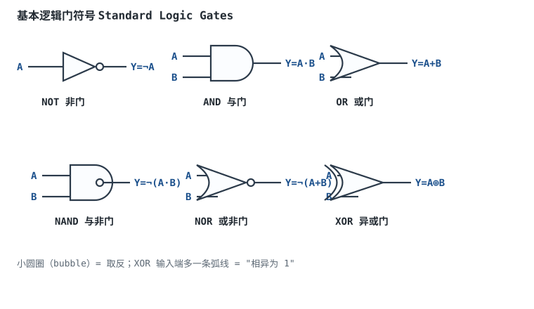
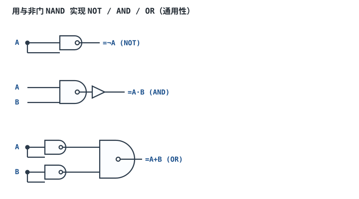
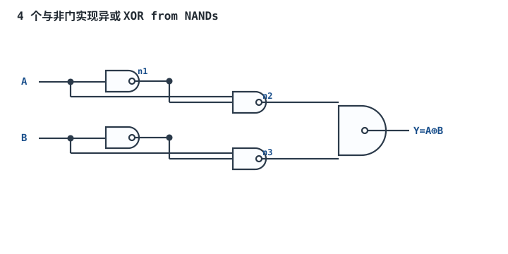

# 逻辑门、布尔代数与卡诺图

## 1. 设计动机

::: motivation 为什么要学门代数与化简
给你一个逻辑需求，比如"当 A 亮、B 不亮、或 C 和 D 同时亮时报警"，你怎么把它变成一张门电路图？直接把每句话翻译成门，往往会得到一堆乱七八糟的门、延迟大、还浪费芯片面积。**布尔代数（Boolean Algebra）** 是描述逻辑的数学，**卡诺图（Karnaugh Map, K-Map）** 是手工把逻辑函数化到最省门的工具。

数字芯片里每一个组合逻辑块最终都要被翻译成门。化简得越狠，用的门越少、延迟越小、越省电。这一章是组合逻辑的"语法"。
:::

逻辑门（Logic Gate）是数字电路的最小积木：它接收 0/1 输入，按固定规则输出 0/1。理解门、会写布尔式、会用卡诺图化简，是后面一切组合/时序设计的前提。

## 2. 原理与逻辑图

### 2.1 六种基本门



| 门 | 逻辑式 | 口诀 |
|---|---|---|
| NOT 非 | $Y=\overline{A}$ | 取反 |
| AND 与 | $Y=A\cdot B$ | 全 1 出 1 |
| OR 或 | $Y=A+B$ | 有 1 出 1 |
| NAND 与非 | $Y=\overline{A\cdot B}$ | 全 1 出 0 |
| NOR 或非 | $Y=\overline{A+B}$ | 有 1 出 0 |
| XOR 异或 | $Y=A\oplus B$ | 相异为 1 |

小圆圈（bubble）永远表示"这里取反"，既可以在输出端（NAND/NOR），也可以移到输入端。

### 2.2 布尔代数基本定律

- 交换律 / 结合律 / 分配律：与普通代数类似，但注意 $A+BC=(A+B)(A+C)$（**逻辑或对与也可分配**，普通代数不行）。
- 重叠律：$A\cdot A=A$，$A+A=A$。
- 互补律：$A\cdot\overline{A}=0$，$A+\overline{A}=1$。
- **德摩根定律（De Morgan）**：$\overline{A\cdot B}=\overline{A}+\overline{B}$，$\overline{A+B}=\overline{A}\cdot\overline{B}$。"与非 = 各取反后或"，"或非 = 各取反后与"。这是门转换的核心。

## 3. 静态分析（真值表）

以二输入为例，六种门的真值表：

| A | B | AND | OR | NAND | NOR | XOR |
|---|---|---|---|---|---|---|
| 0 | 0 | 0 | 0 | 1 | 1 | 0 |
| 0 | 1 | 0 | 1 | 1 | 0 | 1 |
| 1 | 0 | 0 | 1 | 1 | 0 | 1 |
| 1 | 1 | 1 | 1 | 0 | 0 | 0 |

**卡诺图化简**：把真值表里输出为 1 的格子圈成尽可能大的矩形（边长必须是 $2^k$），每圈对应一个与项，圈越少越大则与项越少。例：$Y=\sum m(0,2,4,6)$ 四个最小项的最低位变量 $C$ 都为 0，圈出整列后直接化简为 $Y=\overline{C}$。

::: advanced 进阶：卡诺图圈组规则
圈只能是 1、2、4、8、16…个相邻格；可重复圈、可把边缘 wrap（首尾相邻）；每个输出为 1 的格子至少被圈一次；圈越大消去的变量越多。无关项（don't care，记 ×）可圈可不圈，用来帮忙消项。化简目标：与项最少、每个与项变量最少。
:::

## 4. 动态分析（门延迟与毛刺）

单个门有传输延迟 $t_{pd}$（纳秒~皮秒级）。信号经过的级数越多，总延迟越大。**组合逻辑的"竞争冒险（Race Hazard）"**：一条路径比另一条多一个反相器，两路信号到达门的时刻不同，会在输出端产生一个极窄的毛刺（glitch）。

```echarts
{
  "tooltip": {"trigger": "axis"},
  "legend": {"data": ["A", "A经过反相器", "输出Y=A·¬A（毛刺）"], "bottom": 0, "textStyle": {"fontSize": 13}},
  "grid": {"left": 60, "right": 30, "top": 30, "bottom": 60},
  "xAxis": {"type": "category", "name": "时间", "data": ["t0","t1","t2","t3","t4","t5","t6","t7","t8","t9"], "axisLabel": {"fontSize": 11}},
  "yAxis": {"type": "value", "min": 0, "max": 1.2, "interval": 1, "axisLabel": {"fontSize": 11}},
  "series": [
    {"name": "A", "type": "step", "step": "middle", "showSymbol": false, "lineStyle": {"width": 2.4, "color": "#1a4f8b"}, "data": [0,0,1,1,1,1,0,0,0,0]},
    {"name": "A经过反相器", "type": "step", "step": "middle", "showSymbol": false, "lineStyle": {"width": 2.4, "color": "#5a6672"}, "data": [1,1,1,0,0,0,0,1,1,1]},
    {"name": "输出Y=A·¬A（毛刺）", "type": "step", "step": "middle", "showSymbol": false, "lineStyle": {"width": 2.6, "color": "#b5642e"}, "data": [0,0,1,0,0,0,0,0,0,0]}
  ]
}
```

A 从 0→1 时，A 立刻变高，但经过反相器的 ¬A 还没来得及变低（多一级延迟），于是那一拍 Y 短暂出现 1——稳态应为 0 却冒出 1，这就是静态 0 型冒险。同步电路里靠寄存器在时钟沿采样即可滤掉；异步/组合直接当使能时要小心。

## 5. 逻辑化简与门级实现

- **两级与或**：卡诺图圈出与项后，先 AND 后 OR，延迟最小（两级门）。
- **只用 NAND 或 NOR**：NAND/NOR 是"通用门（Universal Gate）"，任何逻辑都能用它搭出来。CMOS 工艺里 NAND/NOR 比 AND/OR 更省晶体管（AND = NAND+NOT），所以综合工具默认往 NAND 网表里映射。
- **反相泡消去（Bubble Pushing）**：把德摩根定律可视化，把输出端的反相泡"推"到输入端，往往能省掉一级反相器。

## 6. 元件取值与工程权衡

- **门数量 vs 延迟**：两级与或延迟最小但门数可能多；多级共享逻辑门数少但延迟大。FPGA 里逻辑深度直接决定最高时钟频率。
- **NAND vs NOR 实现**：CMOS 中 NAND 上拉是两个并联 PMOS（快）、下拉是两个串联 NMOS；NOR 相反。一般输入多的逻辑优先 NAND。
- **避免毛刺**：组合输出直接接时钟/复位时必须加滤波或同步器；接数据总线则无所谓（下一拍寄存器会重采样）。
- **无关项利用**：未出现的输入组合（如 BCD 的 1010~1111）当 × 圈，能显著化简。

## 7. 完整设计示例

::: example 三人表决器（少数服从多数）
1. **需求**：A/B/C 三人投票，≥2 票同意则通过 Y=1。
2. **写真值表**：输出为 1 的最小项是 011、101、110、111，即 $Y=\sum m(3,5,6,7)$。
3. **卡诺图圈组**：圈 111 与 011、110、101。可圈出 $AB$（110,111）、$AC$（101,111）、$BC$（011,111）三个两变量组。
4. **化简**：$Y=AB+AC+BC$。
5. **验算**：A=1,B=0,C=1 → $AB=0,AC=1,BC=0$ → Y=1 ✓（两票同意通过）；A=1,B=0,C=0 → 三项全 0 → Y=0 ✓。
6. **实现**：3 个 2 输入与门 + 1 个 3 输入或门，两级逻辑。
:::

## 8. 仿真与实验

在 Logisim 中验证：

- 放三个拨码开关 A/B/C，按 $Y=AB+AC+BC$ 接门，输出接 LED。
- 拨动开关，确认 ≥2 个 1 时 LED 亮。
- 把同一函数故意写成没化简的 $Y=ABC+AB\overline{C}+A\overline{B}C+\overline{A}BC$，数门数对比；再用 Logisim 的"分析电路"功能反推真值表，看是否一致。
- 在 A 上加一个阶跃信号，用时序图观察 $Y=A\overline{A}$ 组合的毛刺（需加非门延迟）。

## 扩展与变种电路

### 扩展1：与非门通用性 NAND is Universal

任何逻辑函数都能只用 NAND 实现——NOT 把两输入短接、AND 在 NAND 后加一级 NOT、OR 用三个 NAND 按德摩根搭。



::: example 工作原理与真值
- NOT：NAND 两输入并一起，$Y=\overline{A\cdot A}=\overline{A}$。
- AND：$Y=\overline{\overline{A\cdot B}}=A\cdot B$（两级 NAND）。
- OR：由德摩根 $\overline{A}+\overline{B}=\overline{A\cdot B}$，再取反得 $A+B=\overline{\overline{A}\cdot\overline{B}}$，即三个 NAND。
- 真值与原门完全一致，只是延迟增加。
:::

设计要点：一块 PCB 只备一种 74HC00（四 NAND）就能拼出大部分随机逻辑，省物料种类。取值/对比：用 NAND 搭 OR 要 3 个门、延迟 3 级；直接用 74HC32（OR）只要 1 个门。适用：小批量、物料精简；不适用：性能敏感（级数多延迟大）。

::: pitfall 用 NAND 搭 OR 时漏算取反
- **现象**：搭出来的"OR"实际是 NOR。
- **原因**：德摩根 $A+B=\overline{\overline{A}\cdot\overline{B}}$ 要两级 NAND，第一级是 $\overline{A},\overline{B}$，第二级再 NAND；只搭一级就把 $\overline{A\cdot B}$ 当 OR 用，符号反了。
- **解决**：每搭完用真值表验一遍，或直接用 bubble-pushing 检查反相泡是否成对抵消。
:::

### 扩展2：异或门的 NAND 实现 XOR from NANDs

异或没有现成便宜器件时，可用 4 个 NAND 搭出 $A\oplus B$，面积比 AND/OR/反相混合更省。



::: example 工作原理与真值
- $n_1=\overline{AB}$；
- $n_2=\overline{A\cdot n_1}=\overline{A\cdot\overline{AB}}=\overline{A\cdot\overline B}$（因为 $A\cdot\overline{AB}=A(\overline A+\overline B)=A\overline B$）；
- 同理 $n_3=\overline{\overline A\cdot B}$；
- $Y=\overline{n_2\cdot n_3}=\overline{\overline{A\overline B}\cdot\overline{\overline A\cdot B}}=A\overline B+\overline A B=A\oplus B$。
- 真值表：A,B=00→0；01→1；10→1；11→0。
:::

设计要点：异或常用于奇偶校验、比较器、加法器进位链。取值/对比：直接用 74HC86（四 XOR）延迟 1 级、4 个 NAND 延迟 3 级。适用：FPGA 里 XOR 本就由 LUT 直接出，无需手搭；分立设计优先选专用 XOR。

::: pitfall 4-NAND XOR 里 n1 扇出到两级导致时序偏差
- **现象**：高速下 XOR 输出比预期慢半拍，偶发误判。
- **原因**：n1 同时驱动 N2、N3 两个门，扇出负载大，且 A、B 到 n2/n3 路径不等长。
- **解决**：高速直接用专用 XOR 门；若必须分立，在 n1 后加一级缓冲均衡负载。
:::

## 9. 常见坑与故障现象

::: pitfall 常见坑
- **德摩根定律用反**：把 $\overline{A+B}$ 当成 $\overline{A}+\overline{B}$（那其实是 $\overline{A\cdot B}$）。记住"长非号拆开，与或互换"，长非号一拆，· 变 +、+ 变 ·。
- **卡诺图圈错大小**：圈了 3 个或 6 个格子（不是 $2^k$），化简结果不可靠。圈只能是 1/2/4/8/16。
- **组合输出直接接时钟/复位**：毛刺被当成有效沿，状态机误触发。时钟和复位只允许接干净的寄存器输出。
- **把 NAND 当 AND 用**：NAND 输出多一个反相泡，直接当真值用会全反。
:::

## 10. 自测题

<details><summary>用德摩根定律把 $\overline{A\cdot B + C}$ 化成只用非门和与/或的形式。</summary>

$\overline{A\cdot B + C}=\overline{A\cdot B}\cdot\overline{C}=(\overline{A}+\overline{B})\cdot\overline{C}$。先把整个与或式整体取反拆成"各因子取反再相与"，里面的与项 $A\cdot B$ 再拆成 $\overline{A}+\overline{B}$。
</details>

<details><summary>三人表决 $Y=AB+AC+BC$，若把其中一个与项漏掉会怎样？</summary>

漏一项后变成比如 $Y=AB+AC$，此时 B=C=1、A=0 的情况本该通过（两票）却判 0，表决出错。卡诺图要求每个输出为 1 的格子至少被圈一次，漏圈就是漏了真值。
</details>

<details><summary>为什么 FPGA 综合工具偏爱把逻辑映射成 NAND 网表？</summary>

CMOS 工艺里 NAND/NOR 比 AND/OR 少一级晶体管（AND 内部就是 NAND+反相），且 NAND 上拉并联 PMOS 更快。用 NAND 实现任意逻辑，面积和速度都更优。
</details>

## 11. 参考资料

- M. Morris Mano, *Digital Design*，布尔代数与卡诺图化简章节
- sources/notes/free-textbooks-digest.md
