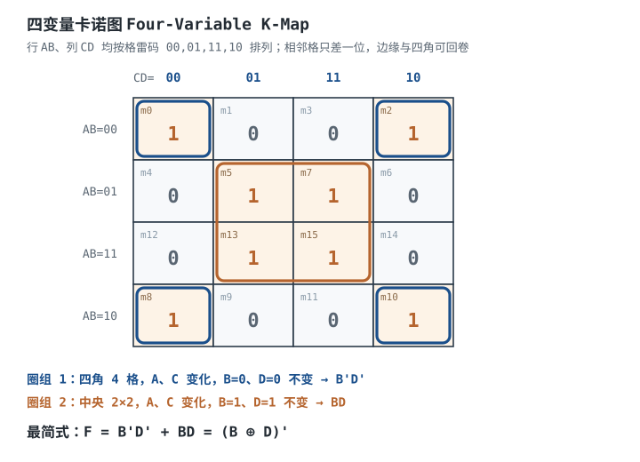

# 逻辑门、布尔代数与卡诺图

逻辑门是数字电路的“字母”，布尔代数是“语法”，卡诺图是“把一句话改写到最短”的工具。工程师拿到一句需求——“A 亮且 B 不亮，或者 C 和 D 同时亮时报警”——最终要把它变成一张门电路图。直接逐句翻译，往往得到一堆门、延迟大、面积浪费，还会在输入变化的瞬间冒出一个窄脉冲，把后级计数器多计一次。

本章要建立三层能力：**第一层，看到真值表能写出布尔式；第二层，用代数法和卡诺图把它化到最省；第三层，知道这个式子在 CMOS 里怎么变成晶体管、能带多少负载、什么时候会出毛刺。** 数制与编码见[数制、编码、补码与格雷码](number-systems.md)；化简后的标准模块见[组合逻辑：译码、编码、选择与加法](combinational-logic.md)；毛刺被时钟采样后的后果见[触发器 RS / D / JK](flip-flops.md)和[时序分析：建立/保持时间与亚稳态](timing-analysis-metastability.md)。

**本章约定**：$A,B,C,D$ 是逻辑变量，取值 0/1；$+$ 表示逻辑或，$\cdot$ 或相邻写表示逻辑与，$\overline{X}$ 表示取反，$\oplus$ 表示异或；$m_i$ 是编号为 $i$ 的最小项；$t_{pd}$ 是传播延迟（s）；$C_L$ 是负载电容（F）；$R_{eq}$ 是门输出等效电阻（$\Omega$）；$t_r$ 是上升时间（s）。所有门延迟与电容值都标“典型量级，以数据手册为准”。

## 1. 设计动机

::: motivation 四个真实场景
**场景一：8 个与项和 2 个与项的区别。** 某报警逻辑的真值表有 8 个最小项，直接写规范与或式要 8 个 4 输入与门加 1 个 8 输入或门；卡诺图把四角圈成一组、中央圈成一组，化简成 $F=\overline{B}\,\overline{D}+BD$，只要 2 个与门、1 个或门。按 2 输入 CMOS 门折算，晶体管从约 194 个降到约 22 个，延迟从 3 级降到 3 级但每级扇入从 4 降到 2，实际更快。**化简不是“写好看”，是直接换面积、换功耗、换速度。**

**场景二：一个 3 ns 的毛刺让计数器多计 1。** $F=AB+\overline{A}C$，当 $B=C=1$、$A$ 从 1 变 0 时，理论上 $F$ 应保持 1；但 $AB$ 支路 2 ns 就关断，$\overline{A}C$ 支路要经过 3 ns 反相器再加 2 ns 与门才建立，中间 3 ns 里 $F=0$。这个窄脉冲接到计数器时钟，计数器就多计一次。加一个冗余项 $BC$（$B=C=1$ 时恒为 1）就能把缺口补上——**冗余项在布尔代数里可被吸收，在时序里却是救命的。**

**场景三：扇出 20 个门，上升时间从 2 ns 变 20 ns。** 某 CMOS 门输出等效电阻约 $100\ \Omega$，带 10 pF 负载时上升时间 $2.2RC=2.2\ \text{ns}$；带 100 pF 时变成 22 ns。时钟频率 50 MHz（周期 20 ns）时，数据还没稳定就到下一个沿，建立时间违例。**CMOS 的扇出限制主要不是直流电流，而是电容负载把边沿拖慢。**

**场景四：把 NAND 当 AND 用。** 74HC00 里四个 NAND 门，每个 4 个晶体管；74HC08 里四个 AND 门，每个 6 个晶体管。同样四门封装，AND 多花 8 个晶体管，延迟还多一级反相器。CMOS 工艺里“与”是“与非 + 非”拼出来的，所以综合工具默认往 NAND/NOR 网表映射。
:::

| 你遇到的问题 | 先算/先查 | 判据 |
|---|---|---|
| 门太多、板子放不下 | 最小项数、卡诺图圈组、共享项 | 与项数和总文字数都最小 |
| 延迟太大、时钟上不去 | 逻辑级数、每级扇入、$t_{pd}$ | 关键路径延迟小于时钟周期的 70% |
| 输出边沿变缓、偶发误触发 | $C_L$、$R_{eq}$、$t_r=2.2RC$ | $t_r$ 小于周期的 1/10 |
| 输入变化时输出冒窄脉冲 | 是否存在 $X+\overline{X}$ 或相邻组 | 关键异步路径加冗余项或加寄存器 |
| 芯片发热、静态电流大 | 是否有悬空 CMOS 输入 | 所有输入都接确定电平 |
| 换一家 74HC 就不工作 | 扇入、输入电容、驱动能力 | 按最坏数据手册值核算，不按“典型” |

**不算会摔在哪**，三个带数字的代价：

1. **卡诺图圈错。** 把 6 个相邻格圈成一组，化简结果少了变量，仿真对、上板错。圈组大小只能是 $1,2,4,8,16$。
2. **忽略扇出电容。** 10 pF 负载、$100\ \Omega$ 输出电阻，$t_r=2.2\times100\times10\times10^{-12}=2.2\ \text{ns}$；加到 100 pF 就是 22 ns。50 MHz 系统里，22 ns 已经超过一个周期。
3. **毛刺当时钟。** 3 ns 的毛刺在 100 MHz 时钟（周期 10 ns）里完全够被当成一个有效沿；计数器、状态机、中断标志都会多走一步。

## 2. 定义与直观

### 2.1 六种基本门

| 门 | 逻辑式 | 口诀 | CMOS 晶体管数（2 输入） |
|---|---|---|---|
| NOT 非 | $Y=\overline{A}$ | 取反 | 2 |
| AND 与 | $Y=A\cdot B$ | 全 1 出 1 | 6（NAND+NOT） |
| OR 或 | $Y=A+B$ | 有 1 出 1 | 6（NOR+NOT） |
| NAND 与非 | $Y=\overline{A\cdot B}$ | 全 1 出 0 | 4 |
| NOR 或非 | $Y=\overline{A+B}$ | 有 1 出 0 | 4 |
| XOR 异或 | $Y=A\oplus B$ | 相异为 1 | 典型 8~12（传输门/复合门） |

小圆圈（bubble）永远表示“这里取反”，既可以在输出端（NAND/NOR），也可以移到输入端。**看懂小圆圈的位置，比背符号重要**：NAND 等于“输入取反后做或”，NOR 等于“输入取反后做与”，这就是德摩根定律的图形化。

### 2.2 布尔代数与德摩根的物理意义

布尔代数把这几个门的行为写成可推导的式子。常用的几条：

- 交换律、结合律：$A+B=B+A$，$AB=BA$，$(A+B)+C=A+(B+C)$。
- 分配律：$A(B+C)=AB+AC$，以及**或对与也可分配** $A+BC=(A+B)(A+C)$。后者在普通代数里不成立，是逻辑代数特有的。
- 重叠律：$A\cdot A=A$，$A+A=A$。
- 互补律：$A\cdot\overline{A}=0$，$A+\overline{A}=1$。
- 吸收律：$A+AB=A$，$A(A+B)=A$。
- 共识律：$AB+\overline{A}C+BC=AB+\overline{A}C$。$BC$ 是前两项的“共识项”，在稳态下可被吸收，但在动态下能消毛刺。
- **德摩根定律**：$\overline{A\cdot B}=\overline{A}+\overline{B}$，$\overline{A+B}=\overline{A}\cdot\overline{B}$。

德摩根不是“公式变形”，它描述的是**门的物理等价**：

$$\text{NAND}(A,B)=\text{OR}(\overline{A},\overline{B}),\qquad \text{NOR}(A,B)=\text{AND}(\overline{A},\overline{B})$$

也就是说，一个二输入 NAND，等价于“把两个输入都取反，再送进一个 OR”。在 CMOS 里，这个等价关系直接对应“上拉网络”和“下拉网络”的对偶：NAND 的上拉是两个并联 PMOS（只要一个输入低，就拉高），下拉是两个串联 NMOS（两个都高才拉低）；把 PMOS 网络和 NMOS 网络对偶交换，就得到 NOR。**德摩根就是把“串联”和“并联”、“与”和“或”、“高有效”和“低有效”互相翻译的定律。**

工程上最常用的是“推泡泡”（bubble pushing）：把输出端的反相泡推到输入端，同时把与/或互换。比如 $F=AB+CD$ 用与或实现要 2 个 AND + 1 个 OR；把它写成

$$F=\overline{\overline{AB}\cdot\overline{CD}}$$

就变成“两个 NAND 再送一个 NAND”，3 个 NAND、2 级。门数一样，但每个 NAND 只要 4 个晶体管，AND/OR 各要 6 个，晶体管从 $6+6+6=18$ 降到 $4+4+4=12$。**同样的逻辑，换一种门，面积少三分之一。**

### 2.3 CMOS 门电路的晶体管实现

CMOS 逻辑门由**上拉网络（PMOS）**和**下拉网络（NMOS）**组成，两者互为对偶，保证输出要么被拉到 VDD，要么被拉到 GND，稳态下没有直流通路（只有漏电）。

- **NAND2**：2 个 PMOS 并联接 VDD，2 个 NMOS 串联接 GND。A、B 全 1 时两个 NMOS 都导通，输出 0；否则至少一个 PMOS 导通，输出 1。
- **NOR2**：2 个 PMOS 串联接 VDD，2 个 NMOS 并联接 GND。A、B 全 0 时两个 PMOS 都导通，输出 1；否则至少一个 NMOS 导通，输出 0。
- **AND2 = NAND2 + NOT**：6 个晶体管；**OR2 = NOR2 + NOT**：6 个晶体管。
- **N 输入 NAND/NOR**：$2N$ 个晶体管；**N 输入 AND/OR**：$2N+2$ 个。

为什么工程上偏爱 NAND？两个原因。第一，NAND 的串联堆叠在 NMOS 侧，NMOS 迁移率大约是 PMOS 的 2~3 倍，同样的串联数，NMOS 堆叠的电阻更小；NOR 的串联堆叠在 PMOS 侧，速度更慢。第二，NAND 上拉是并联 PMOS，只要一个输入低就能快速拉高；NOR 上拉是串联 PMOS，要两个都低才通，边沿更慢。所以**高扇入逻辑优先用 NAND，NOR 尽量少用**。

扇入（fan-in）不是越大越好。N 输入 NAND 的下拉是 N 个 NMOS 串联，等效电阻约 $N R_n$，延迟随 N 近似线性增长；同时输入电容也随 N 增加。工程上单个门扇入通常控制在 3~4 以内，超过就拆成树形；FPGA 的 LUT 输入数也定在 4~6，是同一个折中。

### 2.4 卡诺图：把真值表变成最简与或式

卡诺图（Karnaugh Map，K-Map）是把真值表重新排成**格雷码顺序**的方格图，让“逻辑相邻”的格子在图上也相邻。二变量是 2×2，三变量是 2×4，四变量是 4×4。四变量图的横轴是 $CD$、纵轴是 $AB$，顺序必须是 `00,01,11,10`——注意 `11` 在 `10` 前面，这不是笔误，是为了让相邻格只差一位。

圈组规则：

1. 每组只能包含 $1,2,4,8,16$ 个相邻格，不能是 3、6、10。
2. 可以重叠、可以跨边界回卷（最左和最右相邻，最上和最下相邻，四角相邻）。
3. 每个输出为 1 的格子至少被圈一次；圈越大，消掉的变量越多。
4. 无关项（don't care，记 ×）可圈可不圈，用来把组扩大。
5. 先保证与项最少，再保证每个与项的文字最少。

一个大小为 $2^k$ 的组，消掉 $k$ 个变量，剩下的文字数是 $n-k$（$n$ 是变量总数）。四变量图里四角一组是 4 个格，$k=2$，所以每项只剩 2 个文字；整图 16 格一组就是常数 1。**圈组的本质是“找哪些变量在组内不变”**：不变的写成文字，变的消掉。

### 2.5 竞争冒险：静态冒险与动态冒险

理想门是瞬时翻转的，真实门有 $t_{pd}$。当同一个信号经过两条路径到达同一个门，两条路径延迟不同，输出就可能出现一个窄脉冲，这叫**竞争冒险（race hazard）**。

- **静态 1 型冒险**：输出应保持 1，却短暂变 0。典型式 $F=AB+\overline{A}C$，$B=C=1$ 时 $F=A+\overline{A}=1$；$A$ 从 1 变 0 时，$AB$ 先关断、$\overline{A}C$ 后建立，中间出现 0。
- **静态 0 型冒险**：输出应保持 0，却短暂变 1。典型式 $F=(A+B)(\overline{A}+C)$，$B=C=0$ 时 $F=A\cdot\overline{A}=0$；$A$ 变化时出现 1。它是静态 1 型冒险的对偶。
- **动态冒险**：输出本应只变化一次，却变化多次（如 1→0→1→0）。它通常出现在三级或更多级的逻辑里，因为多个内部节点以不同速度翻转，输出被反复推动。两级与或/或与电路不会产生动态冒险，只会产生静态冒险。

**消除静态冒险的办法**：在卡诺图上，如果两个相邻的 1 格被两个不同的圈覆盖，而这两个圈没有公共圈，就在它们之间加一个冗余圈，对应一个共识项。$F=AB+\overline{A}C$ 的共识项是 $BC$：

$$F=AB+\overline{A}C+BC$$

$B=C=1$ 时 $BC=1$，无论 $A$ 怎么变，或门总有一个输入为 1，缺口被补上。注意 $BC$ 在稳态下可被 $AB+\overline{A}C$ 吸收（共识律），所以它不是“逻辑上必需”，而是“时序上必需”。

**动态冒险**不能靠加冗余项消除，通常靠：把多级逻辑改成两级与或（如果规模允许）、在关键路径加寄存器、或者用格雷码/独热码从编码上保证一次只变一位。同步设计里最常用的办法是**在组合输出后加一级触发器**，让毛刺落在采样窗口之外。

## 3. 定量关系

### 3.1 布尔式、最小项与规范形式

$n$ 个变量的每一个取值组合叫一个最小项，$n$ 变量共有 $2^n$ 个最小项。最小项 $m_i$ 中，变量取 1 写原变量、取 0 写反变量。例如三变量 $A,B,C$ 的 $m_5$ 对应 $101$，写作 $A\overline{B}C$。

**规范与或式（canonical SOP）** 是“输出为 1 的最小项之和”：

$$F=\sum m(i_1,i_2,\ldots)$$

**规范或与式（canonical POS）** 是“输出为 0 的最大项之积”。两种形式逻辑等价，选哪种看哪个更省：与或式适合 NAND-NAND 实现，或与式适合 NOR-NOR 实现。

### 3.2 卡诺图化简的定量规则

设变量数 $n$，某圈组包含 $2^k$ 个格，则该组对应的与项有 $n-k$ 个文字。总文字数越少，门数通常越少。一个实用的估算：

- 每个与项用 $n-k$ 个输入与门（按 2 输入折算需要 $n-k-1$ 个与门）。
- 所有与项再用一个或门合并。
- 反变量需要反相器；多个与项共用同一个反变量时只算一次。

以四变量函数 $F=\sum m(0,2,5,7,8,10,13,15)$ 为例，规范式有 8 个四项与项；卡诺图化简后是 $F=\overline{B}\,\overline{D}+BD$，2 个二项与项。文字数从 $8\times4=32$ 降到 $2\times2=4$，按 2 输入门折算，门数从 35 个降到 5 个（含 2 个反相器），晶体管从约 194 个降到约 22 个。

### 3.3 CMOS 延迟、扇出与负载电容

CMOS 门的输出可以近似成一个电阻 $R_{eq}$ 给负载电容 $C_L$ 充电。上升时间（10%~90%）近似为

$$t_r\approx2.2R_{eq}C_L$$

其中 $R_{eq}$ 是输出等效电阻（$\Omega$，典型 50~200 $\Omega$，随工艺、电源电压、温度变化），$C_L$ 是总负载电容（F）。$C_L$ 由三部分组成：

$$C_L=\sum_{i=1}^{N}C_{in,i}+C_{trace}+C_{probe}$$

$C_{in,i}$ 是第 $i$ 个被驱动门的输入电容（F），$C_{trace}$ 是走线电容（F），$C_{probe}$ 是探头/连接器附加电容（F）。扇出 $N$ 越大，$C_L$ 越大，$t_r$ 越长。**CMOS 的直流扇出可以很大（输入阻抗极高），但交流扇出受 $t_r$ 限制**——这是和 TTL 时代“扇出=电流比”最大的区别。

如果时序预算只允许 $t_{r,max}$，则最大负载电容：

$$C_{L,max}=\frac{t_{r,max}}{2.2R_{eq}}$$

再减去走线和探头电容，除以单个输入电容，就是最大扇出：

$$N_{max}=\frac{C_{L,max}-C_{trace}-C_{probe}}{C_{in}}$$

### 3.4 门转换的晶体管账

用德摩根把与或式转成 NAND-NAND：

$$F=\sum_i P_i=\overline{\prod_i\overline{P_i}}$$

每个 $P_i$ 用一个 NAND 产生 $\overline{P_i}$，再用一个 NAND 把所有 $\overline{P_i}$ 合起来。若共有 $k$ 个与项，则需要 $k+1$ 个 NAND，级数是 2 级（假设与项内部也是一级）。

对比直接与或实现：$k$ 个 AND + 1 个 OR。按 2 输入门、每个与项 $L$ 个文字计算：

- 与或：$k$ 个 AND（每个 $2L+2$ 个晶体管，$L$ 输入） + 1 个 OR（$2k+2$ 个晶体管）。
- NAND-NAND：$k+1$ 个 NAND（每个 $2L$ 或 $2k$ 个晶体管）。

当 $L=2,k=2$ 时，与或是 $6+6+6=18$ 个晶体管，NAND-NAND 是 $4+4+4=12$ 个，省三分之一。门数相同，但 NAND 更小、更快。

### 3.5 冒险的延迟条件

以 $F=AB+\overline{A}C$、$B=C=1$ 为例。设与门延迟 $t_{AND}=2\ \text{ns}$、反相器延迟 $t_{INV}=3\ \text{ns}$。$A$ 从 1 变 0 时：

- $AB$ 支路：$A$ 变 0 后经过 $t_{AND}=2\ \text{ns}$，$AB$ 变 0。
- $\overline{A}C$ 支路：$A$ 变 0 后经过 $t_{INV}=3\ \text{ns}$ 得到 $\overline{A}=1$，再经过 $t_{AND}=2\ \text{ns}$，$\overline{A}C$ 变 1，总计 $5\ \text{ns}$。

两条路径的差是

$$\Delta t=5\ \text{ns}-2\ \text{ns}=3\ \text{ns}$$

这 3 ns 内 $F=0$，就是一个静态 1 型冒险。要消除它，必须让某个项在这段时间内保持 1；$BC$ 在 $B=C=1$ 时恒为 1，所以加 $BC$ 后 $F$ 恒为 1。**冒险的宽度等于两条路径的延迟差，不是门的绝对延迟。**

## 4. 典型计算

### 4.1 算例一：四变量卡诺图化简

**需求**：化简 $F(A,B,C,D)=\sum m(0,2,5,7,8,10,13,15)$，给出卡诺图圈组、布尔式和门数对比。

**步骤 1：列真值表。** 8 个最小项对应输入：

| $m$ | $A B C D$ | $F$ |
|---|---|---|
| 0 | 0000 | 1 |
| 2 | 0010 | 1 |
| 5 | 0101 | 1 |
| 7 | 0111 | 1 |
| 8 | 1000 | 1 |
| 10 | 1010 | 1 |
| 13 | 1101 | 1 |
| 15 | 1111 | 1 |
| 其余 | — | 0 |

**步骤 2：填卡诺图。** 四变量图按 $AB$ 行、$CD$ 列，顺序都是 `00,01,11,10`。把 1 填进去后可以看到两组：

- **四角**：$m_0$（左上）、$m_2$（右上）、$m_8$（左下）、$m_{10}$（右下）。四角经左右、上下回卷可以组成一个 4 格组。组内 $A$ 变、$C$ 变，$B=0$、$D=0$ 不变，所以这一项是 $\overline{B}\,\overline{D}$。
- **中央 2×2**：$m_5,m_7,m_{13},m_{15}$。组内 $A$ 变、$C$ 变，$B=1$、$D=1$ 不变，所以这一项是 $BD$。

**步骤 3：写最简式。**

$$F=\overline{B}\,\overline{D}+BD$$

**步骤 4：代数验算。** 从规范式用代数法也能得到同样结果：$m_0+m_2=A'B'D'$（$C$ 变），$m_8+m_{10}=AB'D'$（$C$ 变），合并为 $\overline{B}\,\overline{D}$；$m_5+m_7=A'BD$，$m_{13}+m_{15}=ABD$，合并为 $BD$。于是

$$F=\overline{B}\,\overline{D}(A'+A)+BD(A'+A)=\overline{B}\,\overline{D}+BD$$

而 $\overline{B}\,\overline{D}+BD$ 就是 $B$ 与 $D$ 的同或（XNOR）：

$$F=(B\oplus D)'=\overline{B\oplus D}$$

取任意一项验证：$m_5=0101$，$B=1,D=1$，$BD=1$，$F=1$；$m_4=0100$，$B=1,D=0$，两项都为 0，$F=0$。8 个 1、8 个 0 全部对上。

**步骤 5：门数对比。** 规范式 $F=\sum m(0,2,5,7,8,10,13,15)$ 有 8 个四项与项：

- 规范与或（按 2 输入门）：每个四项与项要 3 个与门，8 个共 24 个；或门 8 输入要 7 个二输入或门；再加 4 个反相器（$\overline{A},\overline{B},\overline{C},\overline{D}$），共 $24+7+4=35$ 个二输入门。
- 化简后：2 个反相器（$\overline{B},\overline{D}$）、2 个与门、1 个或门，共 5 个二输入门。
- 晶体管估算：规范式约 $24\times6+7\times6+4\times2=194$ 个；化简后 $2\times2+2\times6+6=22$ 个。

门数从 35 降到 5，晶体管从约 194 降到约 22，**这就是卡诺图的实际价值**。

### 4.2 算例二：用 4 个 NAND 实现 XOR

**需求**：只用二输入 NAND 实现 $Y=A\oplus B$，要求给出卡诺图化简、推导和门数对比。

**步骤 1：真值表与最小项。**

| $A$ | $B$ | $Y$ |
|---|---|---|
| 0 | 0 | 0 |
| 0 | 1 | 1 |
| 1 | 0 | 1 |
| 1 | 1 | 0 |

$Y=\sum m(1,2)$，即 $Y=\overline{A}B+A\overline{B}$。

**步骤 2：卡诺图。** 二变量图是 2×2：$m_1$ 和 $m_2$ 在对角，**没有任何两个 1 格相邻**。所以每个 1 只能单独圈成 1 格组，每组消掉 0 个变量，得到两个二文字与项：

$$Y=\overline{A}B+A\overline{B}$$

这就是 XOR 的最简与或式，不能再合并。它的特点是“棋盘格”：1 和 0 交替，任何圈大都只能圈到一个 1。

**步骤 3：转 NAND。** 用德摩根：

$$Y=\overline{\overline{\overline{A}B}\cdot\overline{A\overline{B}}}$$

需要先产生 $\overline{A}B$ 和 $A\overline{B}$ 的“与非”形式。直接用 4 个 NAND：

- $n_1=\overline{AB}$；
- $n_2=\overline{A\cdot n_1}=\overline{A\cdot\overline{AB}}=\overline{A\overline{B}}$；
- $n_3=\overline{B\cdot n_1}=\overline{B\cdot\overline{AB}}=\overline{\overline{A}B}$；
- $Y=\overline{n_2\cdot n_3}=\overline{\overline{A\overline{B}}\cdot\overline{\overline{A}B}}=A\overline{B}+\overline{A}B=A\oplus B$。

**步骤 4：验算。** $A=0,B=1$：$n_1=\overline{0}=1$；$n_2=\overline{0\cdot1}=1$；$n_3=\overline{1\cdot1}=0$；$Y=\overline{1\cdot0}=1$，正确。$A=1,B=1$：$n_1=0$；$n_2=\overline{1\cdot0}=1$；$n_3=\overline{1\cdot0}=1$；$Y=\overline{1}=0$，正确。

**步骤 5：门数对比。**

| 实现 | 门数 | 级数 | 晶体管（2 输入 CMOS） |
|---|---|---|---|
| 与或式（2 NOT + 2 AND + 1 OR） | 5 | 3 | $2\times2+2\times6+6=22$ |
| 4 NAND | 4 | 3 | $4\times4=16$ |
| 专用 XOR 门（74HC86 一类） | 1 | 1 | 典型 8~12 |

4 NAND 比与或少 1 个门、少 6 个晶体管，级数相同（都是 3 级）。如果板上有现成的四 XOR 芯片，直接用专用门最快；没有 XOR 而只有四 NAND 时，4 NAND 是最省的分立方案。**“4 个 NAND 实现 XOR”不是炫技，它是“手头只有一种芯片”时的标准做法。**

### 4.3 算例三：扇出与上升时间

**需求**：某 3.3 V CMOS 门输出等效电阻 $R_{eq}=100\ \Omega$（典型量级，以数据手册为准），走线电容 $C_{trace}=5\ \text{pF}$，每个被驱动门输入电容 $C_{in}=3\ \text{pF}$。时序预算要求 $t_r\le5\ \text{ns}$，求最大扇出。

**步骤 1：算允许的总负载电容。**

$$C_{L,max}=\frac{t_{r,max}}{2.2R_{eq}}=\frac{5\times10^{-9}}{2.2\times100}=2.27\times10^{-11}\ \text{F}=22.7\ \text{pF}$$

**步骤 2：扣除走线电容。**

$$C_{fanout}=22.7-5=17.7\ \text{pF}$$

**步骤 3：算扇出。**

$$N_{max}=\frac{17.7}{3}=5.9\rightarrow5$$

最多带 5 个同类门。若带 10 个门，$C_L=5+10\times3=35\ \text{pF}$，$t_r=2.2\times100\times35\times10^{-12}=7.7\ \text{ns}$，超出 5 ns 预算 54%。

**步骤 4：换更快的门。** 若 $R_{eq}=50\ \Omega$：

$$C_{L,max}=\frac{5\times10^{-9}}{2.2\times50}=45.5\ \text{pF}$$

$$N_{max}=\frac{45.5-5}{3}=13.5\rightarrow13$$

同样的负载，扇出从 5 提到 13。**驱动能力（$R_{eq}$ 小）比“门本身快”更重要**；缓冲器的作用就是把大电容和内部节点隔开。

**步骤 5：动态功耗。** 负载电容每个周期充放电一次，功耗

$$P=C_LV^2f$$

取 $C_L=40\ \text{pF}$、$V=3.3\ \text{V}$、$f=1\ \text{MHz}$：

$$P=40\times10^{-12}\times3.3^2\times1\times10^6=4.36\times10^{-4}\ \text{W}=0.436\ \text{mW}$$

频率升到 10 MHz 就是 4.36 mW。**扇出不仅拖慢边沿，还直接增加功耗**；这也是时钟树要分级缓冲、局部逻辑要少扇出的原因。

### 4.4 算例四：静态冒险的消除

**需求**：$F=AB+\overline{A}C$，在 $B=C=1$、$A$ 从 1 变 0 时消除 3 ns 毛刺。

**步骤 1：确认冒险。** $B=C=1$ 时，$F=A+\overline{A}=1$。$A$ 下降时，$AB$ 在 2 ns 后变 0，$\overline{A}C$ 在 5 ns 后变 1，中间 3 ns $F=0$。

**步骤 2：找共识项。** 两个与项 $AB$ 和 $\overline{A}C$ 的“共识”是 $BC$（把 $A$ 和 $\overline{A}$ 消掉，保留其余因子）。加进表达式：

$$F=AB+\overline{A}C+BC$$

**步骤 3：验证逻辑等价。** $B=C=1$ 时，$BC=1$，$F=1$；$B=0$ 时 $BC=0$，$F=AB+\overline{A}C$ 不变；$C=0$ 时同理。所以加的项不改变真值表。

**步骤 4：验证时序。** 在 $B=C=1$ 的整个过程中 $BC=1$，或门总有一个输入为 1，$F$ 不会出现 0。毛刺消除，代价是多一个与门（2 输入）和或门多一个输入。

**步骤 5：边界。** 冗余项只对**两级与或**的静态 1 型冒险有效。如果电路是多级、或者有动态冒险，加共识项不够；这时要在输出加触发器，或改成格雷码/独热码编码。

## 5. 工程含义

**优先用 NAND/NOR，不要用 AND/OR 堆逻辑。** CMOS 里 AND/OR 是“NAND/NOR + 反相器”，多 2 个晶体管、多一级延迟。分立设计时，一块板只备 74HC00（四 NAND）和 74HC02（四 NOR），大部分随机逻辑都能拼出来；物料种类少，采购和维修都简单。只有在需要驱动能力、施密特输入、开漏输出等特殊功能时，才选专用门。

**扇入控制在 3~4。** 4 输入 NAND 的串联 NMOS 堆叠让下拉电阻变成 4 倍，延迟明显大于 2 输入；8 输入门在标准 CMOS 里几乎不用，都是树形展开。FPGA 的 LUT 定为 4~6 输入，也是面积、延迟、布线三者的折中。

**扇出看电容，不看直流。** CMOS 输入阻抗高，直流扇出可以到几百；但每个输入有几 pF 电容，扇出 50 个就是几百 pF，边沿变成几十 ns。高速总线、时钟、复位必须用缓冲器树，每一级只带 4~8 个负载。74HC 系列的输入电容、输出阻抗、传播延迟都要查数据手册，不能拿“典型值”做最坏情况设计。

**未使用的 CMOS 输入必须接死。** 悬空输入可能被噪声拉到阈值附近，使 PMOS 和 NMOS 同时微导通，静态电流增大、发热，甚至自激振荡。与门多余输入接 VDD，或门多余输入接 GND，或者把多余输入和有用输入并在一起（会增加一点电容）。

**毛刺只在异步接口里是问题。** 同步设计里，组合逻辑的输出在时钟沿前稳定、沿后采样，毛刺落在采样窗口之外，通常不用管；但组合输出直接当时钟、复位、中断、使能时，毛刺就是真事件。规则很简单：**时钟和复位只接寄存器输出或专用时钟树，不接组合逻辑**。如果必须用组合信号做异步使能，加一级触发器同步，或加 RC 滤波 + 施密特整形。

**卡诺图适合 ≤4 变量，5~6 变量还能手工，再多就用工具。** 超过 6 变量，圈组靠人眼很容易漏；用 Quine-McCluskey、Espresso 或综合工具。但卡诺图的价值不在“手算大规模逻辑”，而在**建立“相邻、圈组、消变量”的直觉**——看到综合报告里的 LUT 映射、看到毛刺波形时，这个直觉比公式更快。

**符号标准要统一。** IEC 60617-12 和 IEEE 91 的符号体系不完全一样：IEC 用矩形框 + 内部符号，IEEE 用形状符号 + 反相泡。读进口图纸或旧图纸时，先确认用的是哪套标准；同一张图里混用，最容易把“低有效”看成“高有效”。

## 6. 常见坑

::: pitfall 德摩根定律用反
- **现象**：把 $\overline{A+B}$ 写成 $\overline{A}+\overline{B}$，或者把 $\overline{A\cdot B}$ 写成 $\overline{A}\cdot\overline{B}$，真值表一半不对。
- **原因**：只记得“取反”，忘了“与或互换”。德摩根是“长非号拆开，与变或、或变与”。
- **解决**：拆之前先画一条长横线，拆的时候每跨过一个运算符就换一次；拆完用一组输入（如 $A=1,B=0$）代入验算。
:::

::: pitfall 卡诺图圈了非 2 的幂个格
- **现象**：化简结果少了或多了变量，仿真和真值表对不上。
- **原因**：圈了 3 个、6 个、10 个格，或者圈了一个“L 形”但不是矩形。
- **解决**：圈组只能是 $1,2,4,8,16$，必须是矩形（含回卷）；圈完逐格检查每个 1 是否被覆盖、每个圈是否只含 1 或 ×。
:::

::: pitfall CMOS 输入悬空
- **现象**：板子静态电流偏大、芯片发热，或者逻辑随机翻转；用手一碰就变。
- **原因**：CMOS 栅极是高阻节点，悬空后电平不确定，可能停在阈值附近，PMOS/NMOS 同时导通。
- **解决**：所有未用输入接 VDD 或 GND；总线空闲时加上下拉/上拉；不要把未用输入直接剪掉。
:::

::: pitfall 扇出按“典型”算，不按最坏算
- **现象**：实验室常温常压正常，高低温或换批次后偶发误触发。
- **原因**：$R_{eq}$ 随温度、电压、工艺变化，$C_{in}$ 也有容差；按典型值算出的 $t_r$ 只是“最好情况”。
- **解决**：用数据手册的最大 $t_{pd}$、最大 $C_{in}$、最小驱动电流核算；留 30%~50% 裕量；关键路径加缓冲器。
:::

::: pitfall 把 NAND 当 AND 用
- **现象**：输出逻辑全反，LED 亮灭和预期相反。
- **原因**：NAND 输出比 AND 多一个反相泡；只看“两个输入都为 1 时输出 0”就误以为和 AND 一样。
- **解决**：NAND 后面加反相器才是 AND；或者用德摩根把整个式子改成 NAND-NAND 形式，泡成对消掉。
:::

::: pitfall 组合输出直接当时钟或复位
- **现象**：计数器偶尔多计、状态机偶发跑飞；示波器能看到窄毛刺。
- **原因**：组合逻辑在输入变化时产生竞争冒险，毛刺被当成有效时钟沿或复位脉冲。
- **解决**：时钟/复位只接寄存器输出或专用时钟树；组合信号先过一级触发器同步；必要时加冗余项消静态冒险。
:::

## 7. 自测题

用德摩根把 $\overline{A\cdot B+C}$ 化成只用非门和与/或的形式。

$\overline{A\cdot B+C}=\overline{A\cdot B}\cdot\overline{C}=(\overline{A}+\overline{B})\cdot\overline{C}$。先把整个与或式取反拆成“各因子取反再相与”，里面的与项 $A\cdot B$ 再拆成 $\overline{A}+\overline{B}$。

四变量函数 $F=\sum m(0,2,5,7,8,10,13,15)$ 的最简与或式是什么？用了哪两个圈组？

$F=\overline{B}\,\overline{D}+BD$。四角 $m_0,m_2,m_8,m_{10}$ 圈成 4 格组，$B=0,D=0$ 不变，得 $\overline{B}\,\overline{D}$；中央 $m_5,m_7,m_{13},m_{15}$ 圈成 2×2，$B=1,D=1$ 不变，得 $BD$。

为什么 4 个 NAND 能实现 XOR？比与或式省在哪里？

$n_1=\overline{AB}$，$n_2=\overline{A n_1}=\overline{A\overline{B}}$，$n_3=\overline{B n_1}=\overline{\overline{A}B}$，$Y=\overline{n_2n_3}=A\overline{B}+\overline{A}B$。与或式要 2 个反相器 + 2 个与门 + 1 个或门共 5 个门、22 个晶体管；4 NAND 只要 4 个门、16 个晶体管，级数相同。

某门 $R_{eq}=100\ \Omega$，带 40 pF 负载，上升时间是多少？若预算 5 ns，最多带多少 pF？

$t_r=2.2RC=2.2\times100\times40\times10^{-12}=8.8\ \text{ns}$。预算 5 ns 时 $C_{max}=5\times10^{-9}/(2.2\times100)=22.7\ \text{pF}$。40 pF 已超预算，需要加缓冲器或减少扇出。

$F=AB+\overline{A}C$ 在 $B=C=1$ 时为什么会产生毛刺？怎么消除？

$B=C=1$ 时 $F=A+\overline{A}=1$ 应恒定；$A$ 下降时 $AB$ 先关断、$\overline{A}C$ 后建立，两条路径延迟差形成 0 脉冲。加共识项 $BC$，$B=C=1$ 时 $BC=1$，或门总有一个输入为 1，毛刺被补上。

为什么 CMOS 的扇出限制主要看电容，而不是像 TTL 那样看电流？

CMOS 栅极输入阻抗极高，稳态几乎不取电流，所以直流扇出可以很大；但每个输入有几 pF 电容，扇出越大 $C_L$ 越大，$t_r=2.2RC$ 越长，边沿变缓导致时序违例。TTL 输入需要直流电流，扇出受电流比限制。

## 8. 参考资料

- M. Morris Mano, Michael D. Ciletti, *Digital Design* (6th ed.), Chapter 2 Boolean Algebra and Logic Gates — §2.3 Basic Theorems、§2.4 Boolean Functions、§2.6 Digital Logic Gates
- M. Morris Mano, Michael D. Ciletti, *Digital Design* (6th ed.), Chapter 3 Gate-Level Minimization — §3.1 The Map Method、§3.2 Four-Variable Map、§3.6 NAND and NOR Implementation
- John F. Wakerly, *Digital Design: Principles and Practices* (4th ed.), Chapter 4 Combinational Logic Design Principles — 卡诺图、静态冒险与动态冒险
- IEC 60617-12:1997, *Graphical Symbols for Diagrams* — Part 12 Binary Logic Elements
- IEEE Std 91-1984, *Graphic Symbols for Logic Functions* — 逻辑门符号与极性表示
- Texas Instruments, *CMOS Power Consumption and Cpd Calculation* (SCAA035B) — 负载电容、动态功耗与扇出
- Nexperia, *74HC00 Quad 2-input NAND Gate Datasheet* — 传播延迟、输入电容与输出驱动能力

