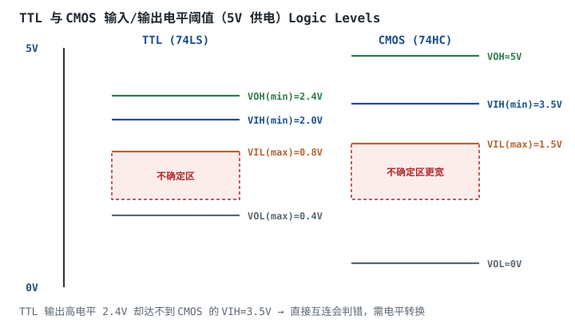
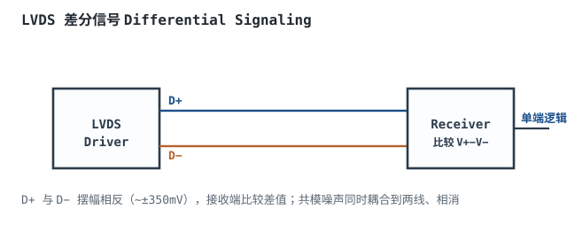
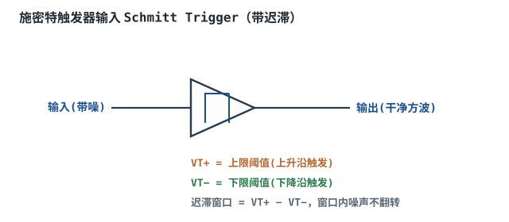

# 逻辑电平标准：TTL / CMOS / LVDS

## 1. 设计动机

::: motivation 为什么不能随便把两个芯片接一起
同样是 5V 供电，TTL（74LS）输出高电平最低只有 2.4V，而 CMOS（74HC）要求输入高电平至少 3.5V。把 TTL 输出直接接 CMOS 输入，CMOS 可能把 2.4V 当成"不确定"，输出乱跳。

更糟的是，现代芯片混用 3.3V、1.8V、1.2V，电平标准五花八门。**搞清楚 VOH/VIH/VIL/VOL 四个阈值和噪声容限**，是避免"接线正确却不工作"的关键。本章讲 TTL、CMOS、LVDS 三种主流电平标准。
:::

数字电路的 0 和 1 不是理想的 0V 和 VCC，而是一个电压范围。每个电平标准都规定了输入要多高才算 1、多低才算 0，以及输出能驱动到多高/多低。这些阈值就是本章的核心。

## 2. 原理与逻辑图

### 2.1 四个关键电平参数

- $V_{OH}$：输出高电平（最小保证值）。
- $V_{OL}$：输出低电平（最大保证值）。
- $V_{IH}$：输入高电平门槛（超过才算 1）。
- $V_{IL}$：输入低电平门槛（低于才算 0）。

输入电压落在 $V_{IL}$ 和 $V_{IH}$ 之间是**不确定区**，输出可能乱跳，要避免。

### 2.2 TTL vs CMOS（5V 供电）



| 参数 | TTL (74LS) | CMOS (74HC, 5V) |
|---|---|---|
| $V_{OH}$ | ≥ 2.4V | ≈ 5V |
| $V_{OL}$ | ≤ 0.4V | ≈ 0V |
| $V_{IH}$ | ≥ 2.0V | ≥ 3.5V |
| $V_{IL}$ | ≤ 0.8V | ≤ 1.5V |

**噪声容限（Noise Margin）**：高电平容限 $NM_H=V_{OH,min}-V_{IH,min}$，低电平容限 $NM_L=V_{IL,max}-V_{OL,max}$。TTL→CMOS 时 $NM_H=2.4-3.5=-1.1$V，**负容限**，必然出错——这就是为什么要电平转换。

### 2.3 LVDS

低压差分信号（Low-Voltage Differential Signaling）用一对互补线传信号，摆幅仅 ±350mV，但抗共模噪声极强，用于高速视频、SerDes。

## 3. 静态分析（电平兼容判定）

判断两个芯片能否直连：发送端 $V_{OH,min}$ 必须 ≥ 接收端 $V_{IH,min}$，发送端 $V_{OL,max}$ 必须 ≤ 接收端 $V_{IL,max}$。

| 发送 → 接收 | 高电平判定 | 低电平判定 | 结论 |
|---|---|---|---|
| CMOS(5V) → TTL | 5V ≥ 2.0V ✓ | 0V ≤ 0.8V ✓ | 直连 OK |
| TTL(5V) → CMOS(5V) | 2.4V < 3.5V ✗ | 0.4V ≤ 1.5V ✓ | 高电平不够，需转换 |
| 3.3V CMOS → 5V TTL | 3.3V ≥ 2.0V ✓ | 0V ≤ 0.8V ✓ | 可直连（注意耐压） |
| 5V CMOS → 3.3V CMOS | 5V > 3.3V 耐压 ✗ | — | 会损坏，需分压/转换 |

## 4. 动态分析（噪声与施密特整形）

输入信号如果边沿慢或叠加噪声，会在不确定区来回抖动，输出多次翻转。**施密特触发器（Schmitt Trigger）**有两个不同阈值：上升沿要超过 $V_{T+}$ 才翻高，下降沿要跌破 $V_{T-}$ 才翻低，中间有个迟滞窗口，窗口内噪声不会引起翻转。

```echarts
{
  "tooltip": {"trigger": "axis"},
  "legend": {"data": ["输入(带噪慢边沿)", "普通门输出", "施密特输出"], "bottom": 0, "textStyle": {"fontSize": 12}},
  "grid": {"left": 60, "right": 30, "top": 30, "bottom": 60},
  "xAxis": {"type": "category", "name": "时间", "data": ["0","1","2","3","4","5","6","7","8","9","10"], "axisLabel": {"fontSize": 11}},
  "yAxis": {"type": "value", "name": "电压V", "min": 0, "max": 5, "interval": 1, "axisLabel": {"fontSize": 11}},
  "series": [
    {"name": "输入(带噪慢边沿)", "type": "line", "smooth": true, "showSymbol": false, "lineStyle": {"width": 2.2, "color": "#b5642e"}, "data": [0,0.3,0.9,1.6,2.3,2.9,3.4,3.1,3.8,4.5,5]},
    {"name": "普通门输出", "type": "step", "step": "middle", "showSymbol": false, "lineStyle": {"width": 2.2, "color": "#5a6672"}, "data": [0,0,0,0,0,0,1,0,1,1,1]},
    {"name": "施密特输出", "type": "step", "step": "middle", "showSymbol": false, "lineStyle": {"width": 2.6, "color": "#2a7a4a"}, "data": [0,0,0,0,0,0,0,0,1,1,1]}
  ]
}
```

观察：普通门在 2.9→3.4→3.1→3.8 之间反复穿越单一阈值，输出多次跳变；施密特靠迟滞窗口（比如 2.5V~3.5V），只有真正升到 3.5V 以上才翻高，中间噪声被滤掉。

## 5. 电平标准与接口选型

- **TTL**：历史悠久，噪声容限小，正在被 CMOS 取代。
- **CMOS (74HC)**：输入阻抗高、功耗低、摆幅近轨到轨，是现代 5V 逻辑主力。
- **LVCMOS 3.3/1.8/1.2**：现代 MCU/FPGA 主流，摆幅随供电降低。
- **LVDS**：高速差分，用于显示屏、相机、背板互连。
- **RS-232/RS-485**：双极性电平，用于长距离通信（见单片机篇）。

## 6. 元件取值与工程权衡

- **电平兼容先查耐压**：3.3V 引脚能不能扛 5V？查数据手册 $V_{IH,max}$（即输入耐压）。不耐压必须加电平转换。
- **上拉提升高电平**：TTL 输出 2.4V 不够 CMOS 的 3.5V，加开漏 + 上拉到 5V 能把高电平拉满（见电平转换章）。
- **慢边沿必用施密特**：按键、RC 复位、长线上的信号，输入缓冲要选施密特型（74HC14）。
- **高速用差分**：单端信号在板级超过 ~50MHz 就容易受干扰，改 LVDS 差分对。

## 7. 完整设计示例

::: example 把 5V TTL 传感器接到 3.3V MCU
1. **需求**：传感器是 5V TTL 输出（VOH=2.4V, VOL=0.4V），MCU 是 3.3V LVCMOS（VIH=2.0V, VIL=0.8V, 输入耐压 3.3V）。
2. **高电平**：2.4V ≥ 2.0V ✓，MCU 能识别为高。
3. **低电平**：0.4V ≤ 0.8V ✓。
4. **耐压检查**：传感器高电平 2.4V < MCU 耐压 3.3V ✓，不会损坏。
5. **结论**：5V TTL → 3.3V MCU 可直连（TTL 高电平 2.4V 恰好满足 3.3V CMOS 的 VIH=2.0V）。
6. **反之**：3.3V MCU → 5V TTL，3.3V ≥ 2.0V ✓，也可直连；但 5V TTL → 5V CMOS 不行（2.4V < 3.5V），需转换。
:::

## 8. 仿真与实验

在面包板/示波器上：

- 用信号发生器输出慢边沿（带噪声）方波，分别接普通反相器（74HC04）和施密特反相器（74HC14），示波器对比输出。
- 用电位器缓慢调高输入电压，万用表测 TTL 输出高电平，再测 CMOS 能否识别。
- 用两路反相器搭简易差分对，观察共模噪声下差分 vs 单端的抗扰差异。

## 扩展与变种电路

### 扩展1：LVDS 差分信号 LVDS

用一对互补线传信号，靠比较差值判决，抗共模噪声极强，摆幅仅 ±350mV。



::: example 工作原理与参数
- Driver 在一对线上输出相反电流，终端 100Ω 电阻上产生 ±350mV 压差。
- Receiver 比较 $V_+-V_-$，差值 > +100mV 判高、< −100mV 判低。
- 共模噪声同时耦合到 D+ 和 D−，相消，所以抗干扰强。
- 速率可达数百 Mbps~Gbps，用于 LCD 屏、相机链路、SerDes。
:::

设计要点：差分对要等长、紧耦合、终端 100Ω。取值/对比：LVDS vs 单端——LVDS 快、抗扰、功耗低；单端简单、省引脚。适用：高速显示/背板；不适用：低速简单 GPIO。

::: pitfall LVDS 差分对不等长
- **现象**：高速下接收端误码率高。
- **原因**：D+ 和 D− 路径不等长，两路信号到达时刻错位，差分眼图闭合。
- **解决**：差分对内等长（差 < 5mil）、紧耦合、完整参考地。
:::

### 扩展2：施密特触发器输入 Schmitt Trigger

带迟滞的缓冲器，把慢边沿/带噪信号整形成干净方波。



::: example 工作原理与取值
- 上升沿：输入升到 $V_{T+}$ 才翻高；下降沿：跌破 $V_{T-}$ 才翻低。
- 迟滞窗口 $V_{T+}-V_{T-}$（如 74HC14 约 0.9V@5V）内噪声不引起翻转。
- 典型用途：按键去抖、RC 振荡、长线接收、慢时钟整形。
:::

设计要点：慢边沿/带噪信号必经施密特。取值/对比：普通缓冲 vs 施密特——普通边沿敏感易抖；施密特抗噪但迟滞引入延迟。适用：按键、复位、RC 振荡；不适用：超高速（迟滞延迟）。

::: pitfall 慢边沿接普通逻辑门导致输出振荡
- **现象**：慢上升沿经过普通反相器，输出在阈值附近来回抖动多次。
- **原因**：边沿在不确定区徘徊，门输出级上下管同时导通，既振荡又穿流发热。
- **解决**：慢边沿输入一律选施密特型缓冲（74HC14），不要用普通 74HC04。
:::

## 9. 常见坑与故障现象

::: pitfall 常见坑
- **TTL 输出接 CMOS 输入**：TTL 高电平 2.4V 不够 CMOS 的 3.5V，输出乱。需要上拉拉高或电平转换。
- **5V 信号直接进 3.3V MCU**：超过引脚耐压，可能损坏 IO。查数据手册输入耐压，不耐压必须分压/转换。
- **慢边沿直接接普通门**：在不确定区振荡、穿流发热。慢边沿必经施密特整形。
- **不查噪声容限就直连**：理论上高电平"够了"，但噪声一叠加就跌穿门槛。设计要留噪声容限。
:::

## 10. 自测题

<details><summary>TTL 输出高电平 2.4V，CMOS（5V）输入高电平门槛 3.5V，为什么不能直连？</summary>

TTL 输出高电平最低 2.4V，而 CMOS 要求输入至少 3.5V 才算高。2.4V 落在 CMOS 的不确定区（1.5V~3.5V），CMOS 可能判成高、也可能判成低，甚至振荡。噪声容限 $NM_H=2.4-3.5=-1.1$V，是负的，必然出错。需要电平转换或上拉。
</details>

<details><summary>施密特触发器为什么能滤掉慢边沿上的噪声？</summary>

普通门只有一个阈值，信号在阈值附近抖动就反复翻转。施密特有两个阈值：上升沿要超过 $V_{T+}$ 才翻高，下降沿要跌破 $V_{T-}$ 才翻低，中间的迟滞窗口（比如 2.5V~3.5V）内无论怎么抖都不翻转，所以能把带噪慢边沿整形成干净方波。
</details>

<details><summary>LVDS 为什么抗共模噪声强？</summary>

LVDS 传的是 D+ 和 D− 的差值。外界共模噪声同时耦合到两根线上，接收端做减法时噪声相消。单端信号没有这个补偿，噪声直接叠加在信号上。所以 LVDS 在高速、恶劣环境下误码率远低于单端。
</details>

## 11. 参考资料

- TI 逻辑电平与接口应用笔记（VOH/VIH 兼容性指南）
- NXP/TI LVDS 接口规范与用户手册
