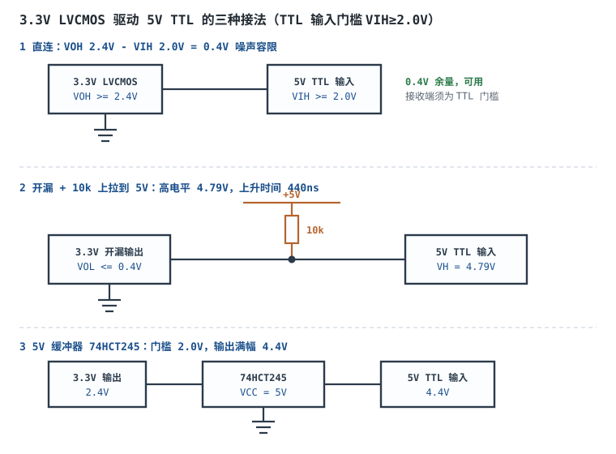

# 逻辑电平标准：TTL / CMOS / LVDS

## 1. 设计动机：为什么"接线正确却不工作"

一块板子上，3.3V 的 MCU、5V 的老传感器、1.8V 的 FPGA bank、LVDS 的显示屏排线同时存在。原理图连线一根不差，上电却不工作——这类故障十有八九不是"接错"，而是**电平标准不匹配**：

- 5V TTL 输出高电平保证 2.4V，5V CMOS 输入要求至少 3.5V 才算高。电压落在两者之间，接收端既不判 0 也不判 1，输出随机抖动。
- CMOS 输入悬空，栅极停在电源中点，上管和下管同时半导通，芯片发烫、逻辑乱跳，还会把噪声拾取进来放大成振荡。
- 3.3V 输出直接灌进不耐 5V 的引脚，逻辑上"能识别高电平"，物理上却在用 ESD 二极管泄放电流，几个月后 IO 漏电变大。

这三类问题的共同点是：**它们都不在原理图的连通性里，而在数据手册的四个阈值、两个电流和一条绝对最大额定里**。读完本章你应当能：

1. 拿到两颗芯片的数据手册，用 $V_{OH}$/$V_{OL}$/$V_{IH}$/$V_{IL}$ 在 5 分钟内判定能否直连；
2. 算出噪声容限的毫伏数，并判断这点余量够不够量产；
3. 算直流扇出与交流负载，知道"能带几个门"和"能跑多快"是两回事；
4. 说清 CMOS 输入为什么不能悬空，并给出 10kΩ 上拉/下拉的取值依据；
5. 对"3.3V 驱动 5V TTL"和"5V 驱动 3.3V"给出一个有数字、有前提的结论。

本章只讲**直流与低频**的电平问题。边沿、建立保持、时钟偏斜属于时序范畴，见[时序分析与亚稳态](timing-analysis-metastability.md)；两个电压域之间的翻译电路见[电平转换与总线缓冲](level-shifter.md)。

## 2. 定义与直观：四个阈值与不确定区

### 2.1 四个阈值都是"保证值"，不是"典型值"

数字电路把电压区间映射成逻辑 0 和 1，映射规则由四个参数描述：

- $V_{OH}$：输出高电平的**最小保证值**。数据手册在指定负载电流（如 $I_{OH}=-4\text{mA}$）下保证 $V_{out}\ge V_{OH}$。
- $V_{OL}$：输出低电平的**最大保证值**。
- $V_{IH}$：输入判为高的**最低**门槛。输入电压 $\ge V_{IH}$ 时，器件保证识别为 1。
- $V_{IL}$：输入判为低的**最高**门槛。输入电压 $\le V_{IL}$ 时，器件保证识别为 0。

关键在"保证"二字：$V_{OH}$ 是满载、最坏温度、最低电源电压下的下限，不是空载实测的 3.29V。用典型值做兼容性判定，是实验室能过、量产翻车的典型原因。

$V_{IL}$ 与 $V_{IH}$ 之间的区间叫**不确定区**（forbidden zone）。输入落在其中时，输出既可能判 1 也可能判 0，还可能振荡——这不是器件缺陷，是标准允许的行为。


图里两条竖轴分别是 TTL 与 CMOS 的电平分布。注意 CMOS 的不确定区（1.5V 到 3.5V）比 TTL 的（0.8V 到 2.0V）宽得多——这正是 TTL 输出容易"喂不饱" CMOS 输入的原因。

### 2.2 噪声容限：留给干扰的预算

把发送端保证值和接收端门槛相减，得到**噪声容限**（Noise Margin）：

$$NM_H = V_{OH,min} - V_{IH,min}$$

$$NM_L = V_{IL,max} - V_{OL,max}$$

符号与单位：$V_{OH,min}$、$V_{IH,min}$、$V_{IL,max}$、$V_{OL,max}$ 单位均为 V；$NM_H$、$NM_L$ 单位也是 V。$NM_H>0$ 且 $NM_L>0$ 是直连的**必要条件**（不是充分条件，还要看耐压与动态负载）。

物理意义：连线上最多允许叠加多大的正向噪声（$NM_H$）或负向噪声（$NM_L$）而不误判。$NM=0$ 意味着理论刚好，实际一定出错；$NM<0$ 意味着即使零噪声也可能判错。

### 2.3 主流标准的电平定义

单端标准（数值为常见器件手册的保证值，具体型号以数据手册为准）：

| 标准 | 供电 | $V_{OH,min}$ | $V_{OL,max}$ | $V_{IH,min}$ | $V_{IL,max}$ | 备注 |
|---|---|---|---|---|---|---|
| 5V TTL（74LS） | 5V | 2.4V | 0.4V | 2.0V | 0.8V | 部分手册在 $I_{OH}=-0.4\text{mA}$ 给 2.7V |
| 5V CMOS（74HC） | 5V | 4.4V | 0.1V | 3.5V | 1.5V | 门槛为 $0.7V_{DD}$ 与 $0.3V_{DD}$ |
| 5V TTL 兼容 CMOS（74HCT） | 5V | 4.4V | 0.1V | 2.0V | 0.8V | 输入门槛照抄 TTL |
| 3.3V LVTTL | 3.3V | 2.4V | 0.4V | 2.0V | 0.8V | JEDEC JESD8C 的 TTL 兼容档 |
| 3.3V LVCMOS | 3.3V | 2.4V（重载） | 0.4V | 2.31V | 0.99V | 门槛 $0.7V_{DD}$ 与 $0.3V_{DD}$ |
| 1.8V LVCMOS | 1.8V | 1.35V | 0.45V | 1.17V | 0.63V | 门槛 $0.65V_{DD}$ 与 $0.35V_{DD}$ |

差分标准：

| 标准 | 差分摆幅 | 共模/偏置 | 接收门限 | 端接 |
|---|---|---|---|---|
| LVDS（TIA/EIA-644-A） | 250mV 到 450mV（典型 350mV） | 约 1.2V | 差分 $\pm100\text{mV}$ | 100Ω 跨接在 D+ 与 D- 之间 |
| LVPECL（3.3V） | 单端约 0.77V，差分约 1.5V | $V_{BB}\approx2.0\text{V}$ | 差分约 300mV 量级 | 50Ω 到 $V_{CC}-2\text{V}$ 或戴维南等效 |

差分标准的噪声容限不按 $V_{OH}-V_{IH}$ 算，而是按**差分摆幅减去接收门限**算：LVDS 典型 $350-100=250\text{mV}$。

这里要纠正一个流传很广的错误：不少资料把 3.3V 输入的 $V_{IH}$ 统一写成 2.0V。2.0V 是 **LVTTL（TTL 兼容）**门槛；**3.3V LVCMOS** 的门槛是 $0.7\times3.3=2.31\text{V}$。两者差 0.31V，恰好决定一个 $V_{OH}=2.4\text{V}$ 的 3.3V 输出接上去是高枕无忧（0.4V 余量）还是几乎为零（0.09V 余量）。同理，$V_{IH}$ 只有最小值、没有"最大值"；引脚能承受多高电压看的是绝对最大额定 $V_{IN,max}$，不是 $V_{IH}$——把这两个概念混用，是"查了手册还是烧 IO"的常见原因。

### 2.4 直觉：阈值是"投票线"，不是"电压值"

::: analogy 把噪声容限想成"投票通过线"
接收端像一场投票：$V_{IH}$ 是"通过线"，$V_{IL}$ 是"否决线"，两条线之间是弃权区。发送端保证的最低票数（$V_{OH}$）必须高过通过线，才叫"稳过"；只高一点点，来一阵噪声（几个人改主意）就掉进弃权区。

CMOS 的投票线定在电源的 70% 和 30%，所以电源一变，线跟着变；TTL 的线死钉在 2.0V 和 0.8V，电源降到 3.3V 时同样钉住——这就是 3.3V 系统里 TTL 门槛"占比变高"的根源。
:::

## 3. 定量关系：噪声容限、扇出与上拉

### 3.1 噪声容限的百分比形式

工程上更关心"容限占电源的比例"，因为干扰幅度通常也按电源比例缩放：

$$NM_H^{rel} = \frac{V_{OH,min}-V_{IH,min}}{V_{DD}}$$

$$NM_L^{rel} = \frac{V_{IL,max}-V_{OL,max}}{V_{DD}}$$

符号与单位：分子单位 V，分母 $V_{DD}$ 单位 V，结果为无量纲比例，乘 100% 即百分数。

对 CMOS，$V_{IH}=0.7V_{DD}$、$V_{IL}=0.3V_{DD}$，若输出接近轨到轨（$V_{OH}\approx V_{DD}$、$V_{OL}\approx0$），则两种容限都约为 $0.3V_{DD}$，即 30%。对 TTL，$V_{IH}=2.0\text{V}$ 固定不变，3.3V 系统里它占 $2.0/3.3=60.6\%$，只剩 39.4% 的"高电平余量"给输出与噪声——这就是 TTL 门槛不能简单照搬到低压系统的原因。

### 3.2 直流扇出：电流决定的"能带几个"

扇出（Fan-out）分直流与交流两层。直流扇出由**输入电流**决定：

$$N_{DC} = \min\left(\frac{I_{OH}}{I_{IH}},\ \frac{I_{OL}}{I_{IL}}\right)$$

符号与单位：$I_{OH}$ 为输出高电平时能提供的电流（mA），$I_{IH}$ 为每个负载输入在高电平下吸入的电流（mA，取绝对值）；$I_{OL}$、$I_{IL}$ 同理。$N_{DC}$ 为无量纲个数。

两个比值取小，是因为高电平与低电平两个方向都必须成立；任一方向超载，输出就会越过 $V_{OH}$/$V_{OL}$ 的保证边界。

### 3.3 交流扇出：电容决定的"能跑多快"

每个输入都有输入电容，走线也有电容。容性负载不消耗直流电流，却拖慢边沿。用恒流近似估算边沿时间：

$$t_r \approx \frac{C_L\,\Delta V}{I_{OH}}$$

$$C_L = n\,C_{in} + C_{trace}$$

符号与单位：$C_L$ 为总负载电容（F），$\Delta V$ 为摆幅（V），$I_{OH}$ 为拉高电流（A），$t_r$ 为上升时间（s）。严格解是指数充电 $t_r\approx2.2RC$，恒流近似在饱和驱动下更接近实际。

数字电路的经验判据是 $t_r\le0.1T$（$T$ 为信号周期），否则边沿在不确定区停留过久，既增加功耗又放大串扰。

### 3.4 悬空输入为什么会耗电、会振荡

CMOS 输入是互补对（PMOS 上管 + NMOS 下管）的栅极。输入被拉到 $V_{DD}$ 或 0 时，一对管子只有一个导通；输入悬空停在 $V_{DD}/2$ 附近时，**两个管子同时半导通**，电源到地出现直流通路：

$$P_{float} = V_{DD}\,I_{DD,float}$$

符号与单位：$V_{DD}$ 单位 V，$I_{DD,float}$ 为单个悬空输入引起的额外电源电流（A），$P_{float}$ 单位 W。

更麻烦的是悬空栅极是**高阻节点**：它与走线电感、附近信号构成 unintended 的放大与反馈路径，可能自激振荡在几十 MHz，输出乱跳，后级计数器跟着乱计。所以"未用输入接固定电平"不是可选项，是必选项。

### 3.5 上拉电阻的取值

用上拉把高电平抬到接收端门槛之上时，电阻有上下两个约束：

$$R_{pu} \le \frac{V_{CC}-V_{IH,min}}{I_{IH,max}+I_{leak}}$$

$$t_r \approx 2.2\,R_{pu}\,C_{line}$$

符号与单位：$V_{CC}$ 为上拉电源（V），$I_{IH,max}$ 为负载输入高电平漏电流（A），$I_{leak}$ 为驱动器高阻漏电流（A），$R_{pu}$ 单位 Ω；$C_{line}$ 为节点总电容（F），$t_r$ 单位 s。

上限定的是"能不能拉到位"，下限定的是"拉得多快"（以及低电平时灌入驱动器的电流）。两个约束冲突时，说明单靠无源上拉解决不了，要换有源缓冲或电平转换器。

### 3.6 差分摆幅与功耗

LVDS 驱动器是一个约 3.5mA 的电流源，靠开关切换电流方向；终端电阻把电流转成电压：

$$V_{OD} = I_{OS}\,R_T$$

符号与单位：$I_{OS}$ 为差分输出电流（A），$R_T$ 为终端电阻（Ω，标准 100Ω），$V_{OD}$ 为差分摆幅（V）。

驱动器自身功耗约 $P=V_{CC}I_{OS}$，终端上还有 $I_{OS}^2R_T$。因为电流恒定、摆幅小，LVDS 的功耗几乎与速率无关，这是它能跑到 Gbps 的物理原因。

## 4. 典型计算：从负容限到 3.3V 驱动 5V TTL

### 4.1 算例一：74LS 驱动 74HC，负容限是怎么来的

**已知**：发送端 74LS，$V_{OH,min}=2.4\text{V}$（保守取值，手册在 $-0.4\text{mA}$ 处给 2.7V）；接收端 74HC（5V），$V_{IH,min}=3.5\text{V}$。

**代入**：

$$NM_H = 2.4\text{V}-3.5\text{V} = -1.1\text{V}$$

若改用 74LS 手册值 2.7V：

$$NM_H = 2.7\text{V}-3.5\text{V} = -0.8\text{V}$$

**结论**：两种取值都是负的。负容限意味着即使零噪声，接收端也不保证识别为高——这是"必须电平转换"的硬结论，不是"余量小一点"。

**换成 74HCT**（输入门槛 $V_{IH,min}=2.0\text{V}$）：

$$NM_H = 2.4\text{V}-2.0\text{V}=0.4\text{V},\qquad NM_H = 2.7\text{V}-2.0\text{V}=0.7\text{V}$$

低电平方向：$NM_L=0.8\text{V}-0.4\text{V}=0.4\text{V}$（74HC 的 $V_{IL,max}=1.5\text{V}$ 时更宽裕，为 1.1V）。

**验证**：同一颗 74LS 输出，接 74HC 是 $-1.1\text{V}$，接 74HCT 是 $+0.4\text{V}$。差别不在发送端，只在接收端门槛从 3.5V 降到 2.0V。所以"TTL 带不动 CMOS"这句话要加限定：带不动的是**标准 CMOS 输入**，带得动 **TTL 兼容 CMOS（HCT/AHCT/LVTH）**。

```echarts
{
  "tooltip": {"trigger": "axis"},
  "grid": {"left": 64, "right": 30, "top": 30, "bottom": 70},
  "xAxis": {"type": "category", "name": "连接组合", "data": ["74LS→74HC", "74LS→74HCT", "3.3V LVCMOS→5V TTL", "3.3V LVCMOS→3.3V LVCMOS"], "axisLabel": {"fontSize": 11, "interval": 0}},
  "yAxis": {"type": "value", "name": "NM_H (V)", "min": -1.4, "max": 0.8, "axisLabel": {"fontSize": 11}},
  "series": [
    {"name": "高电平噪声容限", "type": "bar", "barWidth": 34, "data": [
      {"value": -1.1, "itemStyle": {"color": "#b02a2a"}},
      {"value": 0.4, "itemStyle": {"color": "#2a7a4a"}},
      {"value": 0.4, "itemStyle": {"color": "#2a7a4a"}},
      {"value": 0.09, "itemStyle": {"color": "#b5642e"}}
    ], "label": {"show": true, "position": "top", "fontSize": 11}}
  ]
}
```

四根柱子的数值分别来自 4.1、4.4 两节的代入结果；最后一根 0.09V 是 3.3V LVCMOS 输出接 3.3V LVCMOS 输入（$2.4-2.31=0.09$），已经接近"不可用"。

### 4.2 算例二：直流扇出 10 个，交流只到 1.7MHz

**已知**：驱动端 74HC，$I_{OH}=4\text{mA}$、$I_{OL}=4\text{mA}$；负载为 74LS 输入，$I_{IH}=20\mu\text{A}$、$I_{IL}=0.4\text{mA}$。

**直流**：

$$N_{DC}=\min\left(\frac{4\text{mA}}{0.02\text{mA}},\ \frac{4\text{mA}}{0.4\text{mA}}\right)=\min(200,\ 10)=10$$

即直流最多带 10 个 74LS 输入。

**交流**：取每个 74LS 输入电容 5pF（典型量级，以手册为准），走线电容 20pF，10 个负载：

$$C_L = 10\times5\text{pF}+20\text{pF}=70\text{pF}$$

$$t_r \approx \frac{70\times10^{-12}\text{F}\times3.3\text{V}}{4\times10^{-3}\text{A}}=57.75\times10^{-9}\text{s}=57.8\text{ns}$$

按 $t_r\le0.1T$ 反推：

$$T\ge10\times57.8\text{ns}=578\text{ns}\ \Rightarrow\ f\le\frac{1}{578\text{ns}}\approx1.73\text{MHz}$$

**结论**：这块电路"带 10 个门"在直流上成立，但**只能在 1.7MHz 以下工作**。想跑 10MHz 只能减少负载或加缓冲器。很多"扇出够、速率上不去"的问题就出在这一步：只查了电流，没查电容。

### 4.3 算例三：8 个悬空 CMOS 输入吃掉多少电

**已知**：5V 系统，单个悬空输入引起的额外电流取 0.3mA（典型量级，随工艺与温度变化，以实测为准），悬空 8 个。

$$P_{float}=5\text{V}\times0.3\text{mA}=1.5\text{mW（单个）}$$

$$P_{total}=8\times1.5\text{mW}=12\text{mW}$$

折算成 5V 电源上的电流：

$$I=\frac{12\text{mW}}{5\text{V}}=2.4\text{mA}$$

对一个 10Wh 的电池组，这点电流对应的续航：

$$t=\frac{10\text{Wh}}{0.012\text{W}}=833\text{h}\approx35\text{天}$$

**结论**：8 个悬空输入就能把待机时间从"几个月"打到"一个月"。这还没算振荡带来的额外功耗和误动作。解决办法是每个未用输入经 10kΩ 接 $V_{DD}$ 或 GND，或直接与同封装内已用输入并联——静态电流从 0.3mA 降到漏电级别（nA 到 µA）。

### 4.4 算例四（完整）：3.3V LVCMOS 输出驱动 5V TTL 输入

这是本章要求完整走一遍的算例。

**① 需求与器件**

- 发送端：3.3V MCU 的 GPIO，数据手册给 $V_{OH}\ge2.4\text{V}$（$I_{OH}=-8\text{mA}$）、$V_{OL}\le0.4\text{V}$（$I_{OL}=8\text{mA}$），绝对最大输入电压 $V_{IN,max}=V_{DD}+0.3\text{V}=3.6\text{V}$。
- 接收端：5V 供电的 74LS 系列输入，$V_{IH,min}=2.0\text{V}$、$V_{IL,max}=0.8\text{V}$、$I_{IH,max}=20\mu\text{A}$、$I_{IL,max}=0.4\text{mA}$、输入绝对最大 7V。
- 信号速率：100kHz 低速控制线。

**② 阈值判定**

高电平：

$$NM_H = 2.4\text{V}-2.0\text{V}=0.4\text{V}$$

低电平：

$$NM_L = 0.8\text{V}-0.4\text{V}=0.4\text{V}$$

两个方向都为正，**逻辑上可以直连**。但 0.4V 只占 3.3V 电源的 $0.4/3.3=12.1\%$，而 TTL 系统本身的噪声容限设计值就是 0.4V——等于"刚好用掉全部预算"，没有额外余量。

**③ 电流校验**

$$I_{OH}=8\text{mA}\gg I_{IH}=20\mu\text{A}\ \text{（高电平轻松）}$$

$$I_{OL}=8\text{mA}\gg I_{IL}=0.4\text{mA}\ \text{（低电平 20 倍余量）}$$

**④ 关键的第二个判定：如果接收端其实是 3.3V LVCMOS**

很多"5V TTL 兼容"的板子，接收端实际是 3.3V MCU 的普通 GPIO，$V_{IH,min}=0.7\times3.3=2.31\text{V}$。此时：

$$NM_H = 2.4\text{V}-2.31\text{V}=0.09\text{V}$$

0.09V 不到电源的 3%，任何一点地弹或串扰都会击穿。**同一个 3.3V 输出，接 5V TTL 是 0.4V 余量，接 3.3V LVCMOS 只剩 0.09V**——这就是为什么必须逐个查接收端的门槛，不能按"都是 3.3V 应该没问题"想当然。

**⑤ 上拉方案与验算**

在信号线上加 10kΩ 上拉到 5V：

高电平（驱动器输出高阻或开漏时）：

$$V_H = 5\text{V}-10\text{k}\Omega\times(20\mu\text{A}+1\mu\text{A})=5\text{V}-0.21\text{V}=4.79\text{V}$$

$$NM_H = 4.79\text{V}-2.0\text{V}=2.79\text{V}$$

低电平（驱动器拉低时，灌入电流）：

$$I_{sink}=\frac{5\text{V}-0.4\text{V}}{10\text{k}\Omega}=0.46\text{mA}<I_{OL}=8\text{mA}\ \text{（安全）}$$

上升时间（节点电容取 20pF）：

$$t_r\approx2.2\times10\text{k}\Omega\times20\text{pF}=440\text{ns}$$

按 $t_r\le0.1T$，最高约 $f\le1/(10\times440\text{ns})=227\text{kHz}$。本例信号 100kHz，刚好够；若要跑 1MHz，10kΩ 上拉就不够了，得降到 2.2kΩ（$t_r=97\text{ns}$）并重算低电平灌流。

**⑥ 上拉的一个前提：驱动器必须是开漏/高阻**

如果驱动器是**推挽**输出，输出高时它主动把节点钉在 3.3V，上拉电阻想把节点拉到 5V，两者"打架"：电流经 3.3V 引脚内部的 ESD 二极管灌进 3.3V 电源轨，节点被钳在约 $3.3+0.7=4.0\text{V}$：

$$I_{clamp}=\frac{5\text{V}-4.0\text{V}}{10\text{k}\Omega}=100\mu\text{A}$$

100µA 通常不会立刻损坏，但属于"数据手册没保证"的工作状态；长期注入会影响可靠性，且低压轨被抬高可能影响其他器件。**所以正确顺序是：先把 GPIO 配成开漏，再上拉**；不能配开漏就换方案。

**⑦ 三种可行方案对比**

| 方案 | 高电平 | 余量 | 速率 | 代价 | 适用 |
|---|---|---|---|---|---|
| 直连 | 2.4V | 0.4V | 高 | 零 | 接收端确为 TTL 门槛、环境干净 |
| 开漏 + 10kΩ 上拉 | 4.79V | 2.79V | 约 200kHz | 一个电阻 | 低速控制线、中断、复位 |
| 74HCT245（5V 供电缓冲） | 4.4V | 2.4V | 数十 MHz | 一颗芯片 | 多路、需要整形与驱动 |
| 74LVC1T45（双电源收发） | 5V 侧满幅 | 2.4V 以上 | 数十 MHz 以上 | 一颗芯片 | 双向、单路、板面积紧 |

**⑧ 结论**

3.3V LVCMOS 驱动 5V TTL **可以直连**，条件是接收端确实是 TTL 门槛（$V_{IH}=2.0\text{V}$）且噪声环境可控；余量只有 0.4V，属于"能用但不宽裕"。要求更高余量或更长线时，用 74HCT 缓冲或双电源收发器；只在低速线上用开漏加 10kΩ 上拉。若接收端实际是 3.3V LVCMOS 输入（2.31V 门槛），直连余量只有 0.09V，**不可接受**。



### 4.5 算例五：LVDS 与单端 CMOS 的功耗对比

**LVDS**：$I_{OS}=3.5\text{mA}$，$R_T=100\Omega$，

$$V_{OD}=3.5\text{mA}\times100\Omega=350\text{mV}$$

接收门限 $\pm100\text{mV}$，差分噪声容限：

$$NM_{diff}=350\text{mV}-100\text{mV}=250\text{mV}$$

驱动器功耗（3.3V 供电）：

$$P=3.3\text{V}\times3.5\text{mA}=11.55\text{mW}$$

终端功耗：

$$P_T=(3.5\text{mA})^2\times100\Omega=1.225\text{mW}$$

**单端 LVCMOS**：负载 10pF、3.3V、50MHz，

$$P=C_LV_{DD}^2f=10\text{pF}\times(3.3\text{V})^2\times50\text{MHz}=5.45\text{mW（每根线）}$$

100MHz 时翻倍到 10.9mW/线。

**对比**：50MHz 时单端 5.45mW/线 与 LVDS 11.55mW/对（两根线）大致相当，但 LVDS 的边沿更陡、抗共模噪声强、EMI 低；到几百 MHz 后单端功耗随频率线性上涨，LVDS 几乎不变。这是高速链路选差分的经济原因，不只是"抗干扰好"。

## 5. 工程含义：选型、耐压与布线

### 5.1 直连判定的三步法

拿到两颗芯片，按顺序做三步，任何一步不过就不能直连：

1. **阈值**：算 $NM_H$ 与 $NM_L$，两者都为正且余量可接受（经验上不低于电源的 10%，关键信号不低于 20%）。
2. **耐压**：查接收端的绝对最大输入电压 $V_{IN,max}$（不是 $V_{IH}$），确认发送端最高电平不超过它。
3. **电流与电容**：算 $N_{DC}$ 与 $t_r$，确认带得动、跑得动。

### 5.2 3.3V 驱动 5V TTL：能，但余量只有 0.4V

结论如 4.4 节：逻辑上成立，工程上要评估噪声环境。三个注意点：

- 5V TTL 输入的 $V_{IH}$ 是固定的 2.0V，不会因为"系统是 3.3V"而降低；
- 长线、背板、电机附近的线，0.4V 余量不够，加缓冲；
- 若接收端是 5V **CMOS**（$V_{IH}=3.5\text{V}$），3.3V 输出绝对不够，必须转换。

### 5.3 5V 驱动 3.3V：为什么不能（真正的原因是耐压，不是阈值）

很多人以为"5V 高电平 5V 大于 3.3V 输入的 2.31V 门槛，所以能识别"。逻辑上确实能识别，**物理上却超压**：

- 3.3V 器件的绝对最大输入电压通常为 $V_{DD}+0.3\text{V}=3.6\text{V}$，5V 超出 1.4V；
- 超出后，引脚内部的 ESD 二极管（从引脚指向 $V_{DD}$）正偏导通，电流灌进 3.3V 电源轨；
- 串联 1kΩ 时注入电流约 $(5-3.6)/1\text{k}=1.4\text{mA}$，多数器件能"扛住"但不保证参数；串联 10kΩ 约 140µA，漏电与闩锁风险仍在；
- 长期注入会让 IO 漏电增大、阈值漂移，甚至触发 CMOS 闩锁（latch-up）。

**例外**：数据手册明确标注 "5V tolerant" 的引脚（$V_{IN,max}=5.5\text{V}$），可以直接接 5V 信号，但通常要求 $V_{DD}$ 已上电（未上电时无耐受能力）。

**正确做法**，按成本从低到高：

1. 电阻分压：5V 经 10kΩ/11kΩ 分压得 $5\times11/21=2.62\text{V}$，高于 2.31V 门槛约 0.31V，只适合低速单向信号；
2. 串限流电阻 + 依赖 5V tolerant 引脚（仅在手册保证时）；
3. 专用电平转换器（见[电平转换与总线缓冲](level-shifter.md)）；
4. 换 3.3V 版器件，从根上消除两个电压域。

### 5.4 未用引脚怎么处理

- **未用输入**：一律接固定电平。同一封装内可与已用输入并联（共用驱动），或经 10kΩ 上拉/下拉。不要悬空，不要只焊一个测试点。
- **未用输出**：可以悬空，CMOS 输出悬空不会损坏；但不要把两个输出直接并联（推挽对推挽会形成电源到地的直通），除非是三态或开漏。
- **未用双向口**：按数据手册建议接上拉或下拉，不要浮空。
- **总线保持（bus hold）**：部分器件内置弱保持电路，可省外部电阻，但保持电流只有几十 µA，长线仍需外部上拉。

### 5.5 布线与端接

- **单端高速线**：源端串 22Ω 到 33Ω 抑制过冲，阻抗按 50Ω 走线设计；
- **差分对**：100Ω 差分阻抗、对内等长（偏差控制在 5mil 量级）、紧耦合、完整参考地；
- **回流路径**：信号换层时旁边放地过孔，否则回流绕路，环路面积变大，共模噪声与 EMI 都上来；
- **长线**：超过 0.1 个波长就要按传输线处理，不能当集总节点。100MHz 在 FR4 上（$v\approx1.5\times10^{8}\text{m/s}$）波长约 1.5m，0.1 个波长约 15cm。

### 5.6 选型速查

| 场景 | 选择 | 理由 |
|---|---|---|
| 板内低速控制 | 3.3V LVCMOS 直连 | 简单、无需转换 |
| 5V TTL 外设、低速 | 3.3V 直连或开漏上拉 | 余量 0.4V，需评估噪声 |
| 5V CMOS 外设 | 74HCT/AHCT 缓冲或专用转换 | 3.5V 门槛直连必失败 |
| 高速显示/相机 | LVDS | 差分、低功耗、抗共模 |
| 高速时钟/SerDes | LVPECL/LVDS/CML | 边沿陡、抖动低 |
| 长距离工业 | RS-485/CAN 收发器 | 差分、共模范围宽（见 [RS-485 与 CAN](../mcu/rs485-can.md)） |

## 6. 常见坑：现象、原因与解决

::: pitfall 坑一：只算典型值，不算保证值
- **现象**：实验室样机全部正常，小批量生产后约 1% 的单板间歇性误码，换芯片就好。
- **原因**：用空载实测的 3.29V 当 $V_{OH}$，忽略了数据手册在满载、低温、低压角下只保证 2.4V；批量器件的参数分布落到了余量之外。
- **解决**：一律用 $V_{OH,min}$/$V_{OL,max}$ 与 $V_{IH,min}$/$V_{IL,max}$ 判定，并按最坏温度与最低电源复算；余量低于电源 10% 就加缓冲或转换。
:::

::: pitfall 坑二：CMOS 输入悬空
- **现象**：板子上电后某颗逻辑芯片发烫，输出乱跳，附近计数器乱计；用示波器看悬空引脚上有几十 MHz 的摆动。
- **原因**：悬空栅极停在 $V_{DD}/2$，互补对上下管同时半导通，形成直流通路；高阻节点又拾取噪声形成正反馈振荡。
- **解决**：所有未用输入经 10kΩ 接 $V_{DD}$ 或 GND（同封装内可并联到已用输入）；改板时加测试点便于复查。
:::

::: pitfall 坑三：TTL 直连标准 CMOS
- **现象**：5V 系统里 74LS 输出接 74HC 输入，常温能工作，低温或电源偏低时误动作，且换一片 74LS 有时又好。
- **原因**：$NM_H=2.4-3.5=-1.1\text{V}$ 为负，器件处在"靠典型值碰运气"的状态，批次差异决定成败。
- **解决**：换 74HCT/74AHCT（门槛 2.0V），或加上拉到 5V，或用专用转换器；不要靠"实测能过"放行。
:::

::: pitfall 坑四：只算直流扇出，不算电容
- **现象**：低频测试全对，一提高速率波形就塌陷、过冲、后级误触发；减少负载数量后恢复正常。
- **原因**：扇出按电流算够 10 个，但 10 个输入加走线共 70pF，4mA 驱动下上升时间 58ns，只支持约 1.7MHz。
- **解决**：按 $t_r\approx C_L\Delta V/I$ 算边沿，据此定最高频率；不够就减负载、加缓冲器或提高驱动电流。
:::

::: pitfall 坑五：5V 信号直连 3.3V 引脚，靠"能识别"放行
- **现象**：功能正常但 IO 漏电逐渐变大，几个月后该引脚失效；或整机在高温下死机。
- **原因**：5V 超过 $V_{IN,max}=V_{DD}+0.3\text{V}$，ESD 二极管长期导通注入电流，形成闩锁或栅氧损伤。
- **解决**：查绝对最大额定；用分压、5V tolerant 引脚（需手册保证且 $V_{DD}$ 已上电）或电平转换器。
:::

::: pitfall 坑六：上拉电阻取太大，边沿变成"慢坡"
- **现象**：I²C 或中断线上拉 100kΩ，波形上升沿明显变圆，通信偶发 NACK。
- **原因**：$t_r=2.2RC$，100kΩ 配 100pF 得 22µs，远超协议允许的上升时间。
- **解决**：按 $t_r\le0.1T$ 与总线电容反算 $R_{pu}$ 上限，I²C 快速模式通常取 2.2kΩ 到 4.7kΩ，并核算低电平灌流。
:::

## 7. 自测题

<details><summary>某 3.3V 输出 $V_{OH,min}=2.4\text{V}$，接收端是 3.3V LVCMOS，$V_{IH,min}=2.31\text{V}$。噪声容限是多少？能不能直连？</summary>

$NM_H=2.4-2.31=0.09\text{V}$，只占 3.3V 的 2.7%，远低于工程上常用的 10% 下限。逻辑上"能识别"，工程上不可接受，应改用门槛 2.0V 的 TTL 兼容输入、或加缓冲/转换器。
</details>

<details><summary>74LS 输出接 74HC 输入，$NM_H$ 是 $-1.1\text{V}$。为什么换 74HCT 就解决了？</summary>

因为问题在接收端门槛，不在发送端。74HC 的 $V_{IH,min}=0.7\times5=3.5\text{V}$，74LS 的 $V_{OH,min}=2.4\text{V}$，差 $-1.1\text{V}$；74HCT 的输入级按 TTL 设计，$V_{IH,min}=2.0\text{V}$，同一颗 74LS 输出就变成 $2.4-2.0=0.4\text{V}$ 正容限。换接收端器件比提高发送端电平更省事。
</details>

<details><summary>扇出算出 $N_{DC}=10$，是不是一定能带 10 个负载跑到 10MHz？</summary>

不一定。$N_{DC}=10$ 只保证直流电平不越界；交流上 10 个输入约 50pF，加走线 20pF，4mA 驱动下 $t_r=70\text{pF}\times3.3\text{V}/4\text{mA}=57.8\text{ns}$，按 $t_r\le0.1T$ 只能到约 1.7MHz。要跑 10MHz 必须减少负载、加缓冲或提高驱动能力。
</details>

<details><summary>CMOS 输入悬空为什么会耗电？给出 8 个悬空输入的估算。</summary>

悬空栅极停在 $V_{DD}/2$，输入级 PMOS 与 NMOS 同时半导通，电源到地形成直流通路，单个约 0.3mA（典型量级）。8 个即 $8\times5\text{V}\times0.3\text{mA}=12\text{mW}$，在 5V 上折合 2.4mA，能把 10Wh 电池的待机时间压到约 35 天。另外高阻节点会拾取噪声自激振荡。解决：10kΩ 接固定电平。
</details>

<details><summary>5V 输出接 3.3V 输入，逻辑上门槛够（5V 远大于 2.31V），为什么仍然不允许？</summary>

因为限制不在逻辑阈值，而在绝对最大额定。3.3V 引脚通常规定 $V_{IN,max}=V_{DD}+0.3\text{V}=3.6\text{V}$，5V 超出后 ESD 二极管正偏，电流注入电源轨，长期导致漏电增大、阈值漂移甚至闩锁。只有手册明确标注 5V tolerant（$V_{IN,max}=5.5\text{V}$）且 $V_{DD}$ 已上电时才可以直连。
</details>

<details><summary>LVDS 的 $V_{OD}$ 典型 350mV，接收门限 $\pm100\text{mV}$，噪声容限怎么算？为什么它比 3.3V 单端抗干扰强？</summary>

差分噪声容限 $=350-100=250\text{mV}$。抗干扰强的原因不是摆幅大（它比单端小得多），而是：(1) 干扰以共模形式同时叠加到 D+ 与 D-，接收端做减法时相消；(2) 差分对紧耦合、回路面积小，本身拾取的磁通就少；(3) 电流驱动加终端匹配，反射小、边沿干净。
</details>

<details><summary>上拉电阻 10kΩ 把 5V 拉到 74LS 输入，高电平是多少？如果换成 100kΩ 呢？</summary>

74LS 输入高电平漏电流 $I_{IH}=20\mu\text{A}$，驱动器高阻漏电约 1µA。10kΩ 时 $V_H=5-10\text{k}\times21\mu=4.79\text{V}$；100kΩ 时 $V_H=5-100\text{k}\times21\mu=2.9\text{V}$，虽然仍高于 2.0V，但边沿时间变成 $2.2\times100\text{k}\times20\text{pF}=4.4\mu\text{s}$，只能跑约 23kHz。上拉不是越大越省电，要同时满足电平和边沿两个约束。
</details>

## 8. 参考资料

- JEDEC JESD8C.01，*Interface Standard for Nominal 3 V/3.3 V Supply Digital Integrated Circuits*：3.3V LVTTL/LVCMOS 的 $V_{IH}$/$V_{IL}$/$V_{OH}$/$V_{OL}$ 定义与测试条件。
- JEDEC JESD8-7A，1.8V 低压 CMOS 接口标准：$V_{IH}=0.65V_{DD}$、$V_{IL}=0.35V_{DD}$ 的来源。
- TIA/EIA-644-A，*Electrical Characteristics of Low Voltage Differential Signaling (LVDS) Interface Circuits*：差分摆幅 250mV 到 450mV、接收门限 $\pm100\text{mV}$、共模范围。
- IEEE 1596.3-1996，LVDS 用于可扩展 coherent 接口的电气标准，可与 TIA/EIA-644-A 对照阅读。
- Wakerly, *Digital Design: Principles and Practices*，逻辑家族与噪声容限一节：噪声容限的教科书定义与 TTL/CMOS 门槛对比。
- TI SN74LS00、SN74HC00、SN74HCT245、SN74LVC1T45 数据手册的直流参数表（$V_{OH}$/$V_{OL}$ 的测试电流、$I_{IH}$/$I_{IL}$、输入电容）：本章所有器件级数字的取值依据，具体型号请以对应版本手册为准。

延伸阅读：[时序分析与亚稳态](timing-analysis-metastability.md) 讲边沿与建立保持，[电平转换与总线缓冲](level-shifter.md) 讲两个电压域之间的具体电路，[FPGA/CPLD 与 Verilog 入门](fpga-verilog.md) 里 IO bank 电压的选择与本章直接相关，[存储器](memory.md) 里 SPI Flash 的接口电平与本章的直连判定同源，[数字系统时钟与复位设计](clock-reset-design.md) 讲时钟信号的摆幅、端接与抖动。
