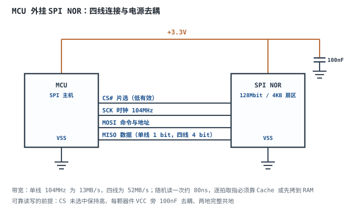

# 存储器：SRAM / DRAM / Flash / EEPROM

## 1. 设计动机：选错存储器，三种死法

一个带联网功能的采集器，硬件上跑起来了，却在三个地方翻车：

- **断电丢参数**：校准系数存在 SRAM 里，每次换电池都要重新标定——易失性选错。
- **一年写坏 Flash**：把"累计运行秒数"每秒写一次片内 Flash，两年后设备批量返修，读出来全是 0xFF——寿命预算没算。
- **读不动代码**：为了省钱用 NAND 存固件并试图就地执行，上电卡死，因为 NAND 不支持细粒度随机读——访问方式选错。

这三件事的共同点是：存储器的差别不在"容量大小"，而在**易失性、擦写粒度、擦写寿命、保持时间、随机访问能力**五个维度。选型不看这五项，只看价格和容量，一定会在这三处摔跤。

本章的目标是三件事：说清五类存储单元各自的物理机制；把"写多少次、存多久、读多快"变成可复算的公式；最后用一个 MCU 外挂 SPI NOR 的完整算例，把容量、寿命、启动时间一次算完。

## 2. 定义与直观：五种存储单元

存储器的本质是"用一个物理量记住 1 bit"。不同的物理量决定了它的一切取舍。

### 2.1 SRAM：六个晶体管锁住一个比特

SRAM（Static Random Access Memory，静态随机存储器）的单元是 6 个晶体管：4 个构成交叉耦合的反相器对（锁存），2 个是访问管。只要不断电，锁存环就一直保持状态，**不需要刷新**。

写：拉高字线，访问管导通，位线对（BL/BLB）加上互补电平，强行把锁存环翻到目标状态。读：先预充位线到中间电平，再拉高字线，单元通过访问管把位线往一侧拉，灵敏放大器放大微小压差。

代价是面积：6 个晶体管一个 bit，是所有存储器里最贵的。所以 SRAM 只用在"必须快、容量小"的地方：CPU 寄存器堆、Cache、MCU 片内 RAM、FIFO。

### 2.2 DRAM：一个晶体管加一个电容

DRAM（Dynamic Random Access Memory，动态随机存储器）的单元是 1 个晶体管加 1 个电容（1T1C）。信息以电荷形式存在电容 $C_S$ 上：有电荷为 1，无电荷为 0。

- **写**：字线拉高，晶体管导通，位线电平给电容充电或放电。
- **读**：字线拉高，电容电荷分享到位线，产生毫伏级压差，灵敏放大器放大成满幅。**读是破坏性的**——电荷被分享掉，必须立刻写回。
- **刷新**：电容通过晶体管漏电、介质漏电，电荷按指数衰减。必须在电荷衰减到无法分辨之前，把每一行都"读一遍再写回"（内部行激活 + 重写，等价于一次刷新）。

1T1C 的面积只有 6T 的约 1/4 到 1/6（量级，随工艺变化），所以 DRAM 能做到 GB 级、每 bit 成本最低。代价是必须刷新，且读写有行激活开销。

### 2.3 Flash 与 EEPROM：浮栅上的电荷

Flash 和 EEPROM 都用**浮栅晶体管**（floating-gate transistor）：一个被氧化层完全包围的导体层，电荷进去后没有直流通路，断电也跑不掉。

- **写（编程）**：控制栅加高压，电子隧穿进浮栅，阈值电压升高，读出来是 0。
- **擦除**：反向高压把电子拉出浮栅，阈值电压降低，读出来是 1。
- **读**：加一个介于两种阈值之间的栅压，看管子导不导通。

两者区别在**擦除粒度**：

- **EEPROM**：每个字节独立擦写，灵活但单元大（每 bit 要两个晶体管加隧道窗口），密度低、贵、慢（毫秒级）。
- **Flash**：按扇区/块擦除，单元小、密度高、便宜；代价是"改一个字节也要擦掉整块"。
- **NOR Flash**：单元并联在位线上，可随机读，支持就地执行（XIP）；擦除按 4KB 扇区。
- **NAND Flash**：单元串联成串，只能按页读（2KB 到 4KB）、按块擦（128KB 级），密度最高、最便宜，但需要 ECC 与坏块管理。

### 2.4 FRAM：铁电电容，写得又快又耐久

FRAM（Ferroelectric RAM，铁电存储器）用铁电材料的极化方向存数据：加电场让偶极子朝一个方向排列记 1，反向记 0。极化翻转是物理位移，不需要高电压隧穿，所以：

- **写速度快**：与读同量级，不需要"擦除—编程"两步，也不需要 5ms 等待；
- **寿命极高**：典型 $10^{14}$ 次读写，比 EEPROM 高 8 个数量级；
- **保持时间有限**：铁电材料会退极化，典型 10 年（85 摄氏度），比 Flash 的 20 年短；
- **密度低、贵**：容量通常几十 KB 到几 MB，用于参数、计量、事件记录。

### 2.5 一张表看清五类存储器

| 类型 | 单元 | 易失性 | 擦写粒度 | 写前要擦 | 擦写寿命 | 保持时间 | 典型读出 | 典型写入 |
|---|---|---|---|---|---|---|---|---|
| SRAM | 6T 锁存 | 易失 | 字节 | 否 | 无擦写寿命限制 | 断电即失 | 10ns 量级 | 10ns 量级 |
| DRAM | 1T1C | 易失 | 字节 | 否 | 无擦写寿命限制 | 需 64ms 内刷新 | 50ns 量级 | 50ns 量级 |
| NOR Flash | 浮栅 | 非易失 | 4KB 扇区 | 是 | 10 万次 | 20 年 | 70ns 到 120ns 随机 | 0.7ms/页 |
| NAND Flash | 浮栅 | 非易失 | 页读块擦 | 是 | 1 千到 10 万次 | 10 年量级 | 25µs/页 | 0.3ms/页 |
| EEPROM | 浮栅 | 非易失 | 字节 | 是 | 100 万次 | 厂家标称 200 年 | 微秒级 | 5ms |
| FRAM | 铁电极化 | 非易失 | 字节 | 否 | $10^{14}$ 次 | 10 年（85 摄氏度） | 70ns 量级 | 70ns 量级 |

表中数值为常见器件的典型量级，具体型号以数据手册为准（本章参考资料列出了取值来源）。

有两个流传很广的说法需要纠正。第一，把 SRAM/DRAM 说成"可无限擦写"不准确：它们确实没有 Flash 那种擦写寿命限制，但 SRAM 受器件寿命与数据保持约束，DRAM 的数据只能保持到下一次刷新之前（典型 64ms 量级），自刷新模式下也有毫安级电流在消耗电池。第二，把 NOR Flash 的寿命统一写成 1 万次也不准确：主流 SPI NOR（百 Mbit 级）通常标 10 万次擦写，1 万次是部分小容量或老工艺器件的量级——两者差 10 倍，直接决定日志区能设计多大。

## 3. 定量关系：容量、带宽、寿命、刷新

### 3.1 容量、地址与页/扇区

存储容量有两种写法，混用会差 8 倍：

$$C_{B} = \frac{C_{b}}{8}$$

符号与单位：$C_b$ 为厂商标注的位数（bit），$C_B$ 为字节数（Byte）。128Mbit 的芯片是 $128\times1024\times1024/8=16\text{MiB}$，不是 128MB。

地址空间与容量一一对应：

$$N_{addr} = 2^{n}$$

符号与单位：$n$ 为地址线位数，$N_{addr}$ 为可寻址单元数。24 位地址对应 $2^{24}=16{,}777{,}216$ 字节，正好覆盖 16MiB。

页与扇区是擦写的最小单位：

$$N_{page} = \frac{C_B}{S_{page}},\qquad N_{sector} = \frac{C_B}{S_{sector}}$$

符号与单位：$S_{page}$、$S_{sector}$ 为页、扇区大小（B），$N_{page}$、$N_{sector}$ 为个数。

### 3.2 读写带宽

SPI NOR 的带宽由时钟频率和每时钟传输的位数决定：

$$BW = \frac{f_{SCK}\cdot w}{8}$$

符号与单位：$f_{SCK}$ 为 SPI 时钟（Hz），$w$ 为每时钟位数（单线 1、双线 2、四线 4），$BW$ 为字节带宽（B/s）。104MHz 单线为 13MB/s，四线为 52MB/s。

页编程与扇区擦除的"写入速率"要用时间算：

$$BW_{write} = \frac{S_{page}}{t_{PP}},\qquad BW_{erase}=\frac{S_{sector}}{t_{SE}}$$

符号与单位：$t_{PP}$ 为页编程时间（s），$t_{SE}$ 为扇区擦除时间（s），结果为 B/s。

### 3.3 寿命模型：每天写多少次，能用多少年

Flash 的寿命单位是**擦写次数**（endurance，记为 $E$），不是"写入字节数"。同一地址每擦一次消耗一次寿命，所以寿命取决于"同一扇区被擦多频繁"：

$$N_{erase,per\_day} = \frac{W_{day}}{N_{sector}}$$

$$Y = \frac{E\cdot N_{sector}}{W_{day}\cdot 365}$$

符号与单位：$W_{day}$ 为每天触发的擦写次数（次/天），$N_{sector}$ 为参与轮换的扇区数，$E$ 为擦写寿命（次），$Y$ 为年数。这个式子假设磨损均衡把擦写均匀摊到所有扇区；没有均衡时 $N_{sector}=1$，寿命按最坏情况骤降。

写放大（write amplification）是另一个隐形杀手：

$$WA = \frac{S_{erase}}{S_{write}}$$

符号与单位：$S_{erase}$ 为一次擦除覆盖的字节数，$S_{write}$ 为一次实际要改的字节数。改 256B 却擦 4KB，$WA=16$，等于每次写入都消耗 16 倍的擦写预算。

### 3.4 保持时间与温度

浮栅的电荷靠氧化层绝缘，漏电随温度指数上升。厂家通常标"85 摄氏度下 20 年"，到 125 摄氏度会显著缩短（以数据手册的保持曲线为准）。工程含义：

- 高温环境（发动机舱、户外机箱）要按 105 摄氏度或 125 摄氏度降额选型；
- 长期不通电的设备，首次上电要做数据校验（CRC），不能假设数据还在；
- 写入前若发现该块已接近寿命，先迁移再写。

### 3.5 DRAM 刷新：$t_{REFI}$ 是怎么来的

DRAM 标准规定：整个阵列必须在 $t_{REF}=64\text{ms}$ 内刷新一遍。每条刷新命令刷新每个 bank 的一行，所以若每个 bank 有 $N_{row}$ 行，平均每条命令的间隔为：

$$t_{REFI} = \frac{t_{REF}}{N_{row}}$$

符号与单位：$t_{REF}$ 单位 s，$N_{row}$ 为行数，$t_{REFI}$ 单位 s。8192 行时：

$$t_{REFI}=\frac{64\text{ms}}{8192}=7.8125\mu\text{s}$$

刷新要占用总线带宽：

$$\eta_{refresh}=\frac{t_{RFC}}{t_{REFI}}$$

符号与单位：$t_{RFC}$ 为一条刷新命令占用总线的时间（s），$\eta_{refresh}$ 为带宽占比。350ns 的 $t_{RFC}$ 对应 $350/7812.5=4.48\%$。

平均刷新电流与功耗：

$$I_{avg}=I_{burst}\,\eta_{refresh},\qquad P_{refresh}=V_{DD}\,I_{avg}$$

符号与单位：$I_{burst}$ 为刷新期间的瞬时电流（A），$I_{avg}$ 为平均电流（A），$V_{DD}$ 单位 V，$P_{refresh}$ 单位 W。

### 3.6 时序参数：$t_{AA}$、$t_{RC}$ 与页编程时间

设计者真正要关心的是这几个数，因为它们决定等待周期和能不能 XIP：

- $t_{AA}$（address access time）：地址有效到数据有效的延迟。异步 SRAM 典型 10ns 到 55ns；并行 NOR 的 $t_{AA}$ 典型 70ns 到 120ns，而 SPI NOR 的一次随机读还要加上命令、地址与输出延迟（见 4.4 的估算）。
- $t_{RC}$（row cycle time）：DRAM 同一 bank 两次行激活之间的最小间隔，$t_{RC}=t_{RAS}+t_{RP}$，典型几十 ns。它决定随机访问的吞吐上限。
- $t_{RCD}$（RAS to CAS delay）：行激活到列读写的延迟，DDR4 典型 13ns 到 16ns。
- $t_{PP}$（page program time）：NOR 一页（256B）编程时间，典型 0.7ms。
- $t_{SE}$（sector erase time）：4KB 扇区擦除时间，典型 45ms。
- $t_{WR}$（write time）：EEPROM 一次字节写完成时间，典型 5ms。

工程含义：$t_{AA}=70\text{ns}$ 远大于 100MHz MCU 的 10ns 周期，所以**不能指望每次取指都直接读 NOR**，必须靠 Cache、预取或把代码拷到 RAM。

## 4. 典型计算：从容量到启动时间

### 4.1 算例一：128Mbit SPI NOR 的容量换算

**已知**：型号标 128Mbit，页 256B，扇区 4KB，块 64KB，地址 24 位。

**容量**：

$$C_B=\frac{128\times1024\times1024}{8}=16{,}777{,}216\text{B}=16\text{MiB}$$

**页/扇区/块数**：

$$N_{page}=\frac{16\text{MiB}}{256\text{B}}=65{,}536$$

$$N_{sector}=\frac{16\text{MiB}}{4\text{KiB}}=4096$$

$$N_{block}=\frac{16\text{MiB}}{64\text{KiB}}=256$$

**地址校验**：$2^{24}=16{,}777{,}216$ B，与容量一致，说明 24 位地址刚好够（不带扩展地址）。

**结论**：这颗芯片有 4096 个可独立擦除的 4KB 扇区。做磨损均衡时，"4096"就是可分配的资源池大小。

### 4.2 算例二：DRAM 刷新电流与功耗

**已知**（量级示例，具体型号以手册为准）：$N_{row}=8192$，$t_{REF}=64\text{ms}$，$t_{RFC}=350\text{ns}$，刷新瞬时电流 $I_{burst}=150\text{mA}$，$V_{DD}=1.35\text{V}$。

**刷新间隔**：

$$t_{REFI}=\frac{64\text{ms}}{8192}=7.8125\mu\text{s}$$

**占空比**：

$$\eta_{refresh}=\frac{350\text{ns}}{7.8125\mu\text{s}}=0.0448=4.48\%$$

**平均电流**：

$$I_{avg}=150\text{mA}\times0.0448=6.72\text{mA}$$

**刷新功耗**：

$$P_{refresh}=1.35\text{V}\times6.72\text{mA}=9.07\text{mW}$$

**单条刷新能量**：

$$E_{cmd}=1.35\text{V}\times150\text{mA}\times350\text{ns}=70.9\text{nJ}$$

**自刷新对比**：若自刷新电流 2mA，则功耗 $1.35\times2=2.7\text{mW}$；一块 11.1Wh 的电池（3000mAh、3.7V）理论可撑：

$$t=\frac{11.1\text{Wh}}{0.0027\text{W}}=4111\text{h}\approx171\text{天}$$

**结论**：刷新不是"顺手做一下"，它固定吃掉约 4.5% 的带宽和毫瓦级功耗。移动设备待机时必须进自刷新，否则电池撑不过一周。温度超过 85 摄氏度时标准要求加倍刷新（$t_{REFI}$ 减半），功耗与带宽占用同步翻倍——这是高温下 DRAM 变慢、变热的物理原因。

### 4.3 算例三：每秒写一次，Flash 能撑多久

**场景**：把运行计数器每秒写入片内 Flash 的同一个 4KB 扇区，寿命 $E=10^5$ 次。

**每天擦写次数**：

$$W_{day}=1\times86400=86{,}400\ \text{次/天}$$

**寿命**：

$$Y=\frac{10^5}{86{,}400}=1.157\text{天}$$

**结论**：不到两天就写坏。换成 EEPROM（$E=10^6$、按字节写、不擦整扇区）：

$$Y=\frac{10^6}{86{,}400}=11.57\text{天}$$

仍然撑不过两周。换成 FRAM（$E=10^{14}$）：

$$Y=\frac{10^{14}}{86{,}400\times365}=3.17\times10^{6}\ \text{年}$$

**这就是"高频小量写"必须用 FRAM（或带电池/超级电容的 SRAM + 掉电保存）的原因**。很多设计在这里犯错，是因为只看了"10 万次"这个数字，没除以每天的实际写入次数。

### 4.4 算例四（完整）：MCU 外挂 SPI NOR 的选型

**① 需求**

- 固件 512KB，要求 A/B 双备份（升级失败可回滚）；
- 参数区 64KB，每天修改 10 次，掉电保存；
- 运行日志 200 条/天、每条 256B，要求保留 6 个月；
- 上电到应用启动不超过 50ms；
- 工作温度 -40 到 85 摄氏度。

**② 容量核算**

固件：

$$C_{fw}=512\text{KB}\times2=1\text{MB}$$

参数：

$$C_{par}=64\text{KB}\times2=128\text{KB}$$

日志（6 个月按 182 天）：

$$C_{log}=200\times256\text{B}\times182=9{,}318{,}400\text{B}=8.89\text{MiB}$$

合计：

$$C_{total}=1+0.125+8.89=10.02\text{MiB}$$

选 16MiB（128Mbit）的 NOR：占用 62.6%，余下 6MiB 用于坏块替换、磨损均衡元数据与首次上电的日志擦除。

**③ 寿命核算**

日志：每天 200 次写入，落在 4096 个扇区上轮换，每个扇区平均每

$$\frac{4096}{200}=20.48\ \text{天}$$

被擦一次，一年约 $365/20.48=17.8$ 次。10 年共 178 次，对比 $10^5$ 次寿命，消耗 0.18%，可以忽略。

参数：64KB 参数区 = 16 个扇区，每天 10 次写，每扇区每年

$$\frac{10\times365}{16}=228\ \text{次/年}$$

10 年 2280 次，消耗 2.3%，也安全。

但若参数改成每秒写一次（例如实时保存累计流量）：

$$Y=\frac{10^5\times16}{86{,}400}=18.5\ \text{天}$$

16 个扇区轮换也只撑 18.5 天。**所以参数区必须按"每天十次"设计，绝不能做成"每秒落盘"**。

**④ 启动时间核算**

512KB 固件从 NOR 读到 RAM，单线 104MHz：

$$t_{read}=\frac{512\text{KB}}{13\text{MB/s}}=\frac{524{,}288}{13{,}000{,}000}=40.3\text{ms}$$

四线模式：

$$t_{read}=\frac{512\text{KB}}{52\text{MB/s}}=10.1\text{ms}$$

拷到 RAM 后执行 512KB 代码（100MHz、32 位总线，理想无等待）：

$$t_{run}=\frac{512\text{KB}}{400\text{MB/s}}=1.31\text{ms}$$

合计：单线 $40.3+1.3=41.6\text{ms}$，四线 $10.1+1.3=11.4\text{ms}$。两者都小于 50ms 指标，但单线方案只剩 8.4ms 余量，温度、时钟偏差、Flash 初始化都会吃掉它——**建议选四线模式**。

**⑤ 为什么不能直接 XIP**

NOR 随机读一次要发命令、地址、等 $t_{AA}$ 量级的时间；即使按 104MHz 算，命令加地址约 8 个时钟即 77ns，再加输出延迟，等效随机访问约 80ns 一次。而 100MHz MCU 每 10ns 就要取一次指：

$$\frac{10\text{ns}}{80\text{ns}}=0.125$$

即只有 12.5% 的取指需求能被满足。所以必须靠 Cache（命中率 95% 以上时等效等待可接受）或"上电拷到 RAM"，不能假设 NOR 能像 SRAM 一样被逐拍访问。

**⑥ 选型结论**

选 128Mbit（16MiB）SPI NOR、4KB 扇区、10 万次擦写、20 年保持、支持 104MHz 与四线模式；日志区做环形缓冲 + 磨损均衡；参数区每天写不超过 10 次，高频计数放 FRAM 或"RAM + 掉电检测"；启动用四线 DMA 拷贝到 RAM，实测约 11ms。若日志必须保留 10 年（约 187MB），单颗 NOR 不够，要外挂 eMMC/SD 或提高压缩比。

## 5. 工程含义：选型、NOR 与 NAND、掉电

### 5.1 选型矩阵

| 需求 | 首选 | 备选 | 关键判据 |
|---|---|---|---|
| 片内高速缓存、FIFO | SRAM | — | 速度第一，容量其次 |
| 大容量主存 | DRAM | — | 每 bit 成本最低，接受刷新 |
| 固件存储、需 XIP | NOR Flash | FRAM（小容量） | 随机读能力 |
| 大容量数据、文件系统 | NAND/eMMC/SD | — | 每 bit 成本、需 ECC |
| 参数、校准值 | EEPROM | FRAM | 按字节改、写次数少 |
| 高频小量写（每秒级） | FRAM | SRAM + 掉电保存 | 寿命 $10^{14}$ 对 $10^5$ |

### 5.2 NOR 与 NAND 的取舍

| 维度 | NOR | NAND |
|---|---|---|
| 读粒度 | 字节随机读，可 XIP | 页（2KB 到 4KB） |
| 写粒度 | 页（256B） | 页 |
| 擦除粒度 | 4KB 扇区 | 128KB 级块 |
| 读速度 | 随机读快，顺序读一般 | 顺序读快，随机读慢 |
| 写速度 | 慢（0.7ms/页） | 较快（0.3ms/页） |
| 寿命 | 10 万次 | 1 千到 10 万次（随类型） |
| 坏块 | 出厂基本无坏块 | 出厂即有坏块，需管理 |
| 纠错 | 通常不需要 | 必须 ECC |
| 成本 | 高 | 低（约为 NOR 的 1/3 到 1/10） |

判断方法很简单：**要"就地执行代码"或"按字节随机读"选 NOR；要"大容量顺序存数据"选 NAND**。用 NAND 存固件必须配合"上电搬到 RAM"或"带 Cache 的控制器"，否则性能惨不忍睹。

### 5.3 磨损均衡与日志结构

- **动态磨损均衡**：写新数据时挑擦写次数最少的空闲块，把旧块标记为待擦。
- **静态磨损均衡**：定期把长期不动的冷数据搬走，让它的块也参与轮换，避免"冷块永远不用、热块先死"。
- **日志结构（log-structured）**：顺序写满一整页/整扇区再擦，写放大从 $S_{erase}/S_{write}$ 降到接近 1。

对 MCU 级应用，最实用的做法是：**日志区按扇区顺序轮转，写满一圈再回头擦最老的一圈**，同时记录每扇区的擦除计数。这套逻辑几十行代码就能实现。

### 5.4 掉电与写中断

Flash 擦除要几十毫秒，这段时间掉电会让扇区停在"半擦除"状态：有的位是 1、有的位是 0，读出来既不是旧数据也不是新数据。

应对：

1. **双备份 + 序号 + CRC**：A/B 两份参数，写完新的并校验通过后才更新"有效标志"；上电读两份，取序号大且 CRC 正确的那份。
2. **掉电检测（BOR/PVD）**：电源跌到阈值前产生中断，留出几毫秒把关键数据写完；配合大电容（几百 µF）撑住这段时间。
3. **写前记录意图**：在另一个扇区写"正在更新 X"，完成后清除；上电发现未清除的意图就知道上次写被打断。

### 5.5 纠错与坏块（NAND 专属）

NAND 的位翻转率随擦写次数上升，出厂就有坏块。必须做：

- **ECC**：SLC 常用 BCH（如 4 bit/512B 到 8 bit/512B），TLC 用 LDPC；
- **坏块表**：出厂坏块标记在 OOB 区，使用中新增坏块要记录并跳过；
- **预留空间（over-provisioning）**：留 5% 到 20% 的块做替换，否则坏块一多容量就掉。

NOR 通常不需要 ECC，但高可靠场景（汽车、医疗）也会加 CRC 校验整段固件。

### 5.6 时序对数字设计的影响

- **异步 SRAM/NOR 接 MCU**：按 $t_{AA}$ 与 MCU 总线周期算等待周期。$t_{AA}=55\text{ns}$、MCU 周期 10ns，至少要 5 个等待周期（共 6 个总线周期）。
- **SPI NOR**：靠提高时钟和线宽（1/2/4 线）提带宽，靠 Cache 掩盖随机访问延迟；DMA 搬运时 CPU 可以并行处理别的任务。
- **DRAM**：$t_{RCD}$、$t_{RP}$、$t_{RC}$ 决定随机访问效率；连续访问同一行（row hit）最快，跨行要重新激活，性能差一个量级。所以数据结构要尽量"顺序访问"。
- **EEPROM**：$t_{WR}=5\text{ms}$ 期间不响应，写操作要放后台任务或用中断，不能阻塞主循环。

### 5.7 电源与信号完整性

- 每颗存储器电源脚旁 100nF 去耦，电源入口再加 4.7µF 到 10µF；
- SPI 时钟超过 50MHz 时按传输线处理，串联 22Ω 到 33Ω 抑制过冲；
- 多片 SPI 器件共总线时，未选中的 CS 必须为高，避免误响应；
- 地平面完整，返回电流路径短——Flash 编程瞬间的电流尖峰最容易在弱地上造成复位。

## 6. 常见坑：现象、原因与解决

::: pitfall 坑一：把每秒更新的计数器写进 Flash
- **现象**：设备用一两天后参数区读回全 0xFF，或写入无效，换芯片后复发。
- **原因**：同一扇区每秒擦一次，$10^5$ 次寿命只够 $10^5/86400=1.16$ 天。
- **解决**：高频数据放 RAM 或 FRAM，Flash 只做"每小时/每天"级批量落盘；用磨损均衡把写摊到多个扇区。
:::

::: pitfall 坑二：没擦除就写 Flash
- **现象**：写入返回成功，读回却是旧值与新值的按位与，某些位永远改不回 1。
- **原因**：NOR/NAND 编程只能把 1 写成 0，要把 0 变回 1 必须先按扇区擦除。
- **解决**：写前擦扇区（4KB），或改用按字节可写的 EEPROM/FRAM；日志结构写入可减少擦除次数。
:::

::: pitfall 坑三：擦写过程中掉电
- **现象**：上电后参数区 CRC 失败，设备恢复出厂设置；严重时整块固件区被擦成 0xFF，无法启动。
- **原因**：擦除耗时几十毫秒，掉电时扇区处于半擦除状态，旧数据已破坏、新数据未写完。
- **解决**：A/B 双备份 + 序号 + CRC；加掉电检测与大电容撑住写窗口；升级时保留 bootloader 区不被擦。
:::

::: pitfall 坑四：把 NAND 当 NOR 用
- **现象**：代码放在 NAND 上直接执行，上电卡死或运行极慢；换成 NOR 后一切正常。
- **原因**：NAND 只能按页读、有坏块、需要 ECC，不支持细粒度随机取指。
- **解决**：代码放 NOR（XIP）或上电搬到 RAM；NAND 只存数据，配合 ECC 与坏块管理。
:::

::: pitfall 坑五：NAND 不做 ECC 与坏块管理
- **现象**：新板全部正常，运行几个月后偶发读出错、文件损坏，重新格式化又好了。
- **原因**：擦写次数增加后位翻转率上升，且坏块未被跳过，数据落在不可靠块上。
- **解决**：硬件 ECC 或软件 BCH，建立坏块表并预留替换块；定期巡检与数据搬移。
:::

::: pitfall 坑六：容量单位看错（Mbit 当 MB）
- **现象**：按 128MB 设计日志空间，实际只有 16MB，几个月后日志覆盖了固件区。
- **原因**：厂商标的是 128Mbit，除以 8 才是 16MiB；地址空间也算错。
- **解决**：容量核算统一用字节，写清 MiB 与 MB；分区表按实际容量分配并留 20% 余量。
:::

## 7. 自测题

128Mbit 的 SPI NOR 是多少字节？有多少个 4KB 扇区？

$128\times1024\times1024/8=16{,}777{,}216$ B，即 16MiB。扇区数 $16\text{MiB}/4\text{KiB}=4096$ 个。24 位地址刚好覆盖 16MiB。

DRAM 有 8192 行、要求在 64ms 内刷新一遍，刷新命令间隔是多少？若 $t_{RFC}=350\text{ns}$，刷新占多少带宽？

$t_{REFI}=64\text{ms}/8192=7.8125\mu\text{s}$。占空比 $350\text{ns}/7.8125\mu\text{s}=4.48\%$，即约 4.5% 的总线时间被刷新占用，这部分带宽不能用于读写。

一颗 10 万次擦写寿命的 NOR，每秒往同一扇区写一次，能用多久？换 FRAM 呢？

每天 86400 次，$10^5/86400=1.16$ 天。EEPROM（$10^6$）也就 11.6 天。FRAM（$10^{14}$）约 $10^{14}/(86400\times365)=3.2\times10^6$ 年。高频小量写必须用 FRAM 或 RAM + 掉电保存。

为什么 NOR 能 XIP 而 NAND 不能？

NOR 的单元并联在位线上，可以按字节随机读出，接口支持"给地址、直接出数据"；NAND 的单元串联成串，读出以 2KB 到 4KB 页为单位，且存在坏块、需要 ECC，无法按指令周期逐次取指。所以 NAND 存代码必须上电搬到 RAM。

$t_{AA}=70\text{ns}$ 的 NOR，接 100MHz（10ns 周期）的 MCU，直接逐拍取指行不行？

不行。每次取指要等约 70ns，而每 10ns 就产生一次取指需求，能满足的比例只有 $10/70\approx14\%$。必须靠 Cache（命中时无等待）或把代码拷到 RAM；按 4 字节取指计算，直接读的有效带宽会被延迟压到很低。

参数区 64KB（16 个 4KB 扇区），每天写 10 次，10 万次寿命够用多少年？如果改成每秒写一次呢？

每天 10 次：每扇区每年 $10\times365/16=228$ 次，$10^5/228=438$ 年。每秒写一次：每天 86400 次，每扇区每天 5400 次，$10^5/5400=18.5$ 天。同样的硬件，写入频率决定寿命，所以"多久落盘一次"是设计参数，不是实现细节。

写放大 16 是什么意思？怎么降低？

改 256B 却要擦 4KB，$4\text{KB}/256\text{B}=16$，等于每次改动消耗 16 倍擦写预算。降低办法：把多次小写攒满一页再写（日志结构）、按扇区顺序轮转、用 FRAM/EEPROM 承接高频小写。

## 8. 参考资料

- JEDEC JESD79-4，DDR4 SDRAM 标准：8192 行阵列、$t_{REF}=64\text{ms}$、$t_{REFI}=7.8\mu\text{s}$ 与高温加倍刷新的规定。
- JEDEC JESD216，*Serial Flash Discoverable Parameters*：SPI NOR 的容量、扇区、时序参数如何由器件自描述，选型时可直接读 SFDP 表。
- Winbond W25Q128JV 数据手册：128Mbit、256B 页、4KB 扇区、64KB 块、10 万次擦写、20 年保持、104MHz 与四线模式的时序参数。
- ST M24C64 数据手册：64Kbit I2C EEPROM、100 万次擦写、200 年保持、5ms 写周期。
- Infineon FM25V05 FRAM 数据手册：$10^{14}$ 次读写寿命、85 摄氏度下 10 年保持、无写延迟。
- Rabaey, *Digital Integrated Circuits*，存储器与阵列结构一章：6T 与 1T1C 单元的面积、灵敏放大器与刷新原理。

延伸阅读：[逻辑电平标准](logic-levels.md) 解释 SPI 总线的电平兼容，[FPGA/CPLD 与 Verilog 入门](fpga-verilog.md) 讲 FPGA 的配置存储器与 BRAM，[数字系统时钟与复位设计](clock-reset-design.md) 讲 SPI 时钟与上电时序。
