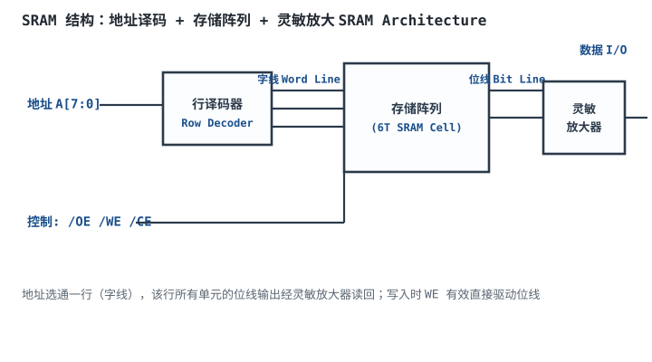
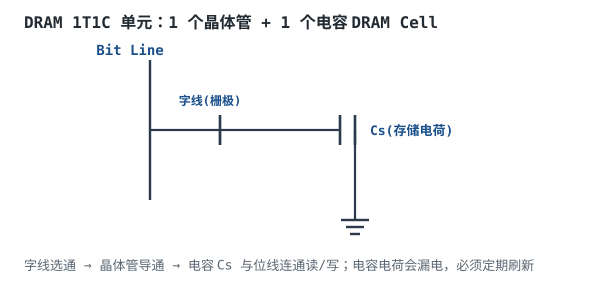
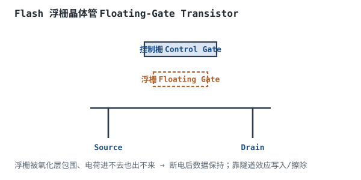

# 存储器：SRAM / DRAM / Flash / EEPROM

## 1. 设计动机

::: motivation 为什么要区分这么多种存储器
MCU 跑程序要取指、变量要暂存、固件要断电保存、参数要按字节改——每种需求对应不同存储器：

- **快但贵、断电丢**：SRAM，当寄存器堆/缓存。
- **密度高但要刷新、断电丢**：DRAM，当台式机/手机主存。
- **断电不丢、整块擦写**：Flash，存固件/文件。
- **断电不丢、按字节擦写慢**：EEPROM，存小参数/校准值。

选错存储器，要么断电丢数据、要么写太慢、要么成本爆炸。本章对比这四类存储器的结构、速度、密度和使用寿命。
:::

## 2. 原理与逻辑图

### 2.1 SRAM（静态 RAM）

SRAM 每个单元用 6 个晶体管（6T）交叉耦合锁存，**只要不断电就一直保持数据**，不需要刷新。结构：地址译码器选通一行（字线），该行所有单元的位线信号经灵敏放大器读回。



### 2.2 DRAM（动态 RAM）

DRAM 每个单元只用 1 个晶体管 + 1 个电容（1T1C），密度极高、成本低。但电容会漏电，**必须定期刷新（refresh）**，否则数据丢失。

### 2.3 Flash 与 EEPROM

都用**浮栅晶体管**存储电荷：浮栅被绝缘氧化层包围，电荷进去后断电也跑不掉，实现非易失。区别在擦写粒度：
- **Flash**：按扇区/块擦写，密度高、便宜，存固件/文件。
- **EEPROM**：按字节擦写，灵活但密度低、慢，存小参数。

## 3. 静态分析（参数对比）

四类存储器对比：

| 类型 | 单元结构 | 易失性 | 擦写粒度 | 速度 | 密度 | 典型用途 |
|---|---|---|---|---|---|---|
| SRAM | 6T 锁存 | 易失 | 读/写 | 最快(ns) | 低 | CPU 缓存、寄存器 |
| DRAM | 1T1C | 易失(需刷新) | 读/写 | 快(ns~百ns) | 高 | 主存 |
| NOR Flash | 浮栅 | 非易失 | 块擦写 | 中(读快写慢) | 中 | 代码执行(XIP) |
| NAND Flash | 浮栅 | 非易失 | 块擦写 | 中(页读写) | 最高 | U 盘/SSD |
| EEPROM | 浮栅 | 非易失 | 字节擦写 | 慢(ms) | 低 | 小参数/校准 |

## 4. 动态分析（刷新与寿命）

DRAM 必须定期刷新（典型 64ms 内把所有行读一遍再写回），否则电容漏电丢数据。Flash/EEPROM 有擦写次数限制：

```echarts
{
  "tooltip": {"trigger": "axis"},
  "legend": {"data": ["擦写寿命(次)", "读取速度(相对)"], "bottom": 0, "textStyle": {"fontSize": 12}},
  "grid": {"left": 70, "right": 40, "top": 30, "bottom": 60},
  "xAxis": {"type": "category", "data": ["SRAM", "DRAM", "EEPROM", "NOR Flash", "NAND Flash"], "axisLabel": {"fontSize": 11}},
  "yAxis": [
    {"type": "log", "name": "擦写次数", "min": 1, "max": 1e6, "axisLabel": {"fontSize": 10}},
    {"type": "value", "name": "相对速度", "min": 0, "max": 10, "axisLabel": {"fontSize": 10}}
  ],
  "series": [
    {"name": "擦写寿命(次)", "type": "bar", "yAxisIndex": 0, "itemStyle": {"color": "#b5642e"}, "data": [1e8, 1e8, 1e5, 1e4, 1e5]},
    {"name": "读取速度(相对)", "type": "line", "yAxisIndex": 1, "itemStyle": {"color": "#1a4f8b"}, "data": [10, 6, 2, 4, 3]}
  ]
}
```

观察：SRAM/DRAM 理论上可无限擦写；EEPROM ~10 万次；NOR Flash ~1 万次；NAND ~10 万次（SLC）/几千次（TLC）。Flash 写多了会坏，所以有磨损均衡（Wear Leveling）。

## 5. 存储层次与选型

- **寄存器/缓存**：SRAM，最快最贵，片内。
- **主存**：DRAM，大容量中等速度。
- **固件/程序**：NOR Flash（可 XIP 直接运行）或 NAND + 缓存加载。
- **参数/校准**：EEPROM（按字节改，不掉电）。
- **大容量存储**：NAND Flash（SSD、eMMC、U 盘）。

## 6. 元件取值与工程权衡

- **容量 vs 成本**：SRAM 贵（$/GB 最高），NAND 最便宜。小量高速用 SRAM，大量便宜用 NAND。
- **擦写粒度**：要按字节改参数（如校准系数）用 EEPROM；按块存固件用 Flash。
- **寿命预算**：频繁改写的变量别放 Flash（写一万次就坏），放 SRAM，定期落盘。
- **掉电保持**：参数必须掉电不丢 → EEPROM/Flash；运行时变量 → SRAM/DRAM。
- **XIP（就地执行）**：MCU 代码要直接在 Flash 上跑，用 NOR Flash（随机读快），NAND 不行。

## 7. 完整设计示例

::: example 设计一个数据采集设备的存储方案
1. **需求**：MCU 采集传感器数据，存固件 + 运行变量 + 掉电保留的校准系数 + 历史数据。
2. **固件**：MCU 内置 NOR Flash，存程序，XIP 直接运行。
3. **运行变量/缓冲区**：MCU 内置 SRAM，几十 KB~几百 KB，掉电丢。
4. **校准系数**：用 EEPROM（或 MCU 内置 Flash 的一个页），按字节改，掉电保留。
5. **历史数据**：外挂 NAND Flash/eMMC，大容量按块写。
6. **验算寿命**：校准系数每小时写一次，EEPROM 寿命 10 万次 ≈ 11 年，够用；历史数据每天写几 MB，NAND 靠磨损均衡。
7. **注意**：频繁改写的计数器放 SRAM，别放 Flash（写一万次就坏）。
:::

## 8. 仿真与实验

在 Logisim / 开发板上：

- 用 Logisim SRAM 模型，地址拨码 + 数据开关，写一个地址再读出来，验证保持。
- MCU 上读写片内 EEPROM：写一个值，断电重启读回，验证非易失。
- 用示波器看 DRAM 的刷新信号（如果有 DRAM 接口）。
- 对比 NOR Flash 随机读 vs NAND 顺序读的速度差异。

## 扩展与变种电路

### 扩展1：DRAM 1T1C 单元 DRAM Cell

一个晶体管 + 一个电容，密度极高，但电容漏电必须刷新。



::: example 工作原理与说明
- 写入：字线选通 → 晶体管导通 → 位线电平对电容 Cs 充电/放电。
- 读出：字线选通 → 电容电荷分享到位线 → 灵敏放大器检测微小压差。
- 刷新：电容漏电，每 64ms 内必须把所有行读一遍再写回。
- 密度：1T1C 比 6T SRAM 小 6 倍以上，所以主存用 DRAM。
:::

设计要点：DRAM 密度高但要刷新。取值/对比：DRAM vs SRAM——DRAM 便宜大容量但需刷新；SRAM 快但贵。适用：台式机/手机主存；不适用：片内紧耦合缓存（用 SRAM）。

::: pitfall DRAM 刷新被关掉导致数据逐渐丢失
- **现象**：长时间运行后 DRAM 数据随机翻转。
- **原因**：刷新逻辑停了，电容漏电，电荷随时间流失。
- **解决**：保证刷新定时器正常工作；低功耗自刷新模式要确认退出后数据正确。
:::

### 扩展2：Flash 浮栅晶体管 Floating-Gate Cell

浮栅被氧化层包围，电荷断电不跑，实现非易失存储。



::: example 工作原理与说明
- 写入：高电压通过隧道效应把电子打进浮栅。
- 擦除：反向高压把电子拉出浮栅。
- 浮栅电荷改变晶体管阈值电压，读出时判断阈值高低即 0/1。
- 断电后浮栅电荷保持 10 年以上。
- 区别：NOR Flash 随机读快、按块擦；NAND Flash 按页读、密度更高。
:::

设计要点：Flash 非易失但擦写次数有限。取值/对比：NOR vs NAND——NOR 可 XIP、贵；NAND 大容量、需文件系统。适用：固件/大容量存储；不适用：频繁小量改写（用 EEPROM）。

::: pitfall 把频繁改写的变量放 Flash
- **现象**：设备用一两年后 Flash 某块写坏、固件崩溃。
- **原因**：Flash 擦写次数有限（几千~几万次），频繁写同一地址很快磨损。
- **解决**：高频改写变量放 SRAM，定期（如每小时）批量写 Flash；用磨损均衡分散写入。
:::

## 9. 常见坑与故障现象

::: pitfall 常见坑
- **掉电后参数丢失**：把校准系数放在了 SRAM，掉电即失。必须放 EEPROM/Flash。
- **Flash 写穿了**：频繁写同一页，擦写次数耗尽。高频变量放 SRAM + 定期落盘 + 磨损均衡。
- **DRAM 不刷新**：电容漏电，数据慢慢丢。确认刷新逻辑正常。
- **NOR/NAND 选错**：要 XIP 直接执行代码却用了 NAND，无法随机读。代码用 NOR，数据用 NAND。
:::

## 10. 自测题

<details><summary>SRAM 和 DRAM 都是易失存储器，为什么主存用 DRAM 而不用 SRAM？</summary>

SRAM 每单元 6 个晶体管，密度低、贵；DRAM 每单元 1 晶体管 + 1 电容，密度高、成本低。主存需要 GB 级容量，用 SRAM 成本高到无法接受。代价是 DRAM 要定期刷新，但控制器自动做，用户无感。SRAM 只用在小容量高速的缓存/寄存器。
</details>

<details><summary>EEPROM 和 Flash 都能掉电保存，什么场景选 EEPROM？</summary>

需要按字节/按小量灵活改写、且改写不频繁的场景，比如设备校准系数、MAC 地址、参数配置。Flash 按块擦写，改一个字节也要擦掉整个块（KB 级），不合适；EEPROM 按字节擦写，灵活但密度低、慢，只存小量关键参数。
</details>

<details><summary>为什么 Flash 不能无限次写？</summary>

Flash 靠隧道效应把电子打进/打出浮栅，每次擦写都会磨损氧化层，次数多了氧化层绝缘失效、电荷泄漏，单元坏掉。典型 SLC NAND 寿命约 10 万次擦写，TLC 只有几千次。所以高频改写要用磨损均衡分散到不同块。
</details>

## 11. 参考资料

- TI/JEDEC 存储器器件手册与应用笔记
- sources/notes/free-textbooks-digest.md
