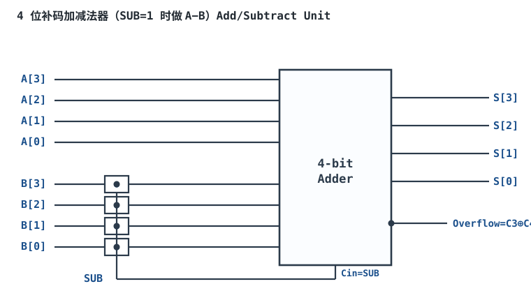
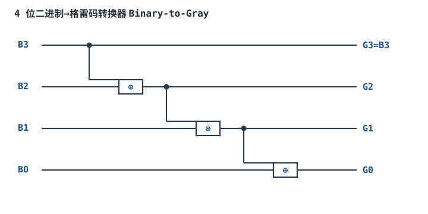

# 数制、编码、补码与格雷码

## 1. 设计动机

::: motivation 为什么先学数制与编码
数字电路里只有 0 和 1，但工程师要表达的是电压、电流、温度、时间、有符号数、地址、指令。**用一串 0/1 表示什么意思，就是"编码"**。如果编码规则选错，硬件再贵也会算出错结果：有符号数用原码会出现 +0/−0 两个零、加减电路要分开两套；机械位置用普通二进制编码，相邻两位同时翻转会出现瞬时的"错码"毛刺。

补码（Two's Complement）让加法器天然支持减法；格雷码（Gray Code）让相邻状态只差一位。这两个约定是后面所有算术电路、计数器、总线协议的地基。
:::

数字系统只用两种稳定电平（高/低），记为逻辑 1 与逻辑 0。多位并排的 0/1 就是一个二进制数。本章解决三件事：**怎么把人用的十进制翻译成二进制、怎么表示负数、怎么让相邻状态只变一位。**

## 2. 原理与逻辑图

### 2.1 位权与进制

任何进制数都是"位权展开"。二进制（Base-2）每一位权值是 $2^k$：

$$(1011)_2 = 1\cdot2^3+0\cdot2^2+1\cdot2^1+1\cdot2^0 = 8+0+2+1 = (11)_{10}$$

- **十六进制（Hex, Base-16）**：4 位二进制压成 1 位十六进制（0–9, A–F），是书写二进制最紧凑的方式，如 `0x2F = 0010 1111`。
- **BCD 码（Binary-Coded Decimal）**：每 1 位十进制数字单独用 4 位二进制表示，如 `135 = 0001 0011 0101`。它让十进制显示/接口直观，但不是真正的二进制加法（`1001+0001` 要校正）。

### 2.2 有符号数的三种表示

| 表示法 | +5 (4位) | −5 (4位) | 零的个数 | 加减硬件 |
|---|---|---|---|---|
| 原码 Sign-Magnitude | `0101` | `1101` | 两个（`0000`/`1000`） | 加减要分开 |
| 反码 1's Complement | `0101` | `1010` | 两个 | 加减要循环进位 |
| **补码 2's Complement** | `0101` | `1011` | 唯一（`0000`） | **加减同一套加法器** |

补码求负：**按位取反再加 1**。$-(0101)$ = $\overline{0101}+1$ = $1010+1$ = $1011$。$n$ 位补码范围是 $-2^{n-1}\sim +(2^{n-1}-1)$，4 位即 $-8\sim+7$。

### 2.3 补码加减法器硬件

补码的最大红利：**减法就是"加负数的补码"**。下图用一个 SUB 控制端决定做 A+B 还是 A−B：SUB=1 时，每一位 B 先经过异或门按位取反，同时把进位输入 Cin 置 1（相当于"取反加 1"），加法器照常用。



## 3. 静态分析（真值表与位运算）

补码加法按位相加、丢弃最高位进位，结果自动正确。以 4 位、$A=+3(0011)$、$B=+5(0101)$ 为例：

| 运算 | 竖式 | 结果 | 真值 |
|---|---|---|---|
| $3+5$ | `0011+0101` | `1000` | $-8$（溢出） |
| $3+(-5)$ | `0011+1011` | `1110` | $-2$ ✓ |
| $(-3)+(-5)$ | `1101+1011` | `1000`（丢进位） | $-8$ ✓ |

**溢出判据**：两个正数相加却得到负数、或两个负数相加却得到正数，即为溢出。硬件上用**最高位进位与次高位进位异或**判断：$Overflow=C_{n-1}\oplus C_n$。上例 $3+5=8$ 在 4 位补码里其实已经溢出（$+8$ 超出 $+7$），$C_3=1$、$C_4=0$，异或得 1，正是溢出。

::: advanced 进阶：为什么补码能"自动"正确
补码的本质是"模 $2^n$ 计数"：把 $-x$ 定义为 $2^n-x$，于是 $a-b \equiv a+(2^n-b) \pmod{2^n}$。加法器天然做模 $2^n$ 运算（最高位进位被丢弃），所以加减统一。这也是为什么补码只有一个零、范围不对称（多一个最小负数 $-2^{n-1}$）。
:::

## 4. 动态分析（计数波形与过渡毛刺）

普通二进制计数器从 `0111` 加 1 到 `1000` 时，4 位**同时翻转**。由于每位翻转延迟不同，过渡瞬间会短暂出现 `0110`、`0011` 等中间态——如果被外部逻辑采样就成了毛刺。格雷码让相邻两个码之间**只变一位**，从根本上消除这个过渡窗口。下面是 3 位二进制 vs 格雷码的计数波形：

```echarts
{
  "tooltip": {"trigger": "axis"},
  "legend": {"data": ["二进制 B2B1B0", "格雷码 G2G1G0"], "bottom": 0, "textStyle": {"fontSize": 13}},
  "grid": {"left": 60, "right": 30, "top": 30, "bottom": 60},
  "xAxis": {"type": "category", "name": "计数", "data": ["000","001","010","011","100","101","110","111"], "axisLabel": {"fontSize": 11}},
  "yAxis": {"type": "value", "name": "格雷码值", "min": 0, "max": 7, "interval": 1, "axisLabel": {"fontSize": 11}},
  "series": [
    {"name": "二进制 B2B1B0", "type": "line", "step": "middle", "showSymbol": true, "lineStyle": {"width": 2.6, "color": "#b5642e"}, "data": [0,1,2,3,4,5,6,7]},
    {"name": "格雷码 G2G1G0", "type": "line", "step": "middle", "showSymbol": true, "lineStyle": {"width": 2.6, "color": "#1a4f8b"}, "data": [0,1,3,2,6,7,5,4]}
  ]
}
```

观察：二进制序列相邻值差可达 4（`0111→1000`），格雷码相邻只差 1，且首尾 `000` 与 `100` 也只差一位（环形）。

## 5. 编码转换与运算规则

- **二进制→格雷码**：最高位不变，其余每位 $G_i = B_{i+1}\oplus B_i$（见扩展图）。
- **格雷码→二进制**：最高位不变，其余 $B_i = B_{i+1}\oplus G_i$（从高位向低位逐位异或还原）。
- **符号扩展（Sign Extension）**：把 $n$ 位补码扩到 $m>n$ 位时，**高位全部复制原符号位**，不是补零。如 $-5$ 的 4 位 `1011` 扩到 8 位是 `11111011`，不是 `00001011`。

::: advanced 进阶：为什么 BCD 不是直接相加
BCD 用 4 位表示 `0000~1001`，但 4 位二进制加法器会把 `1010~1111` 也当成合法进位。当某一位相加结果 $\ge 10$（或产生进位）时，必须手动加 `0110`(6) 校正。所以 BCD 加法器比纯二进制多一级"校正逻辑"，只在必须和十进制显示直接对接时才值得用。
:::

## 6. 元件取值与工程权衡

- **位数选择**：范围 $-2^{n-1}\sim 2^{n-1}-1$，按量程选 $n$。如 12 位 ADC 采样值是无符号 $0\sim 4095$；带符号电流采样常用 16 位补码。
- **BCD vs 二进制**：要和数码管/十进制键盘直连用 BCD；要做乘除、滤波、运算一律用二进制（BCD 没有简单乘法规则）。
- **格雷码用在哪**：机械旋转编码器、相邻状态不能出错的状态机、跨时钟域单灰码总线。普通计数器用二进制即可。
- **补码范围不对称**：最小负数 $-2^{n-1}$ 没有对应正数，取负会溢出（$-\,(-2^{n-1})=-2^{n-1}$ 仍成立），固件里要单独判。

## 7. 完整设计示例

::: example 设计一个 8 位补码温度差计算
1. **需求**：两路温度传感器各输出 8 位补码（单位 0.1°C，范围 −12.8~+12.7°C），求温差 $T_{diff}=T_A-T_B$。
2. **定编码**：8 位补码范围 $-128\sim+127$，对应 −12.8~+12.7°C，正好覆盖需求。
3. **做减法**：复用上面的加减法器，SUB=1，硬件自动算 $T_A+\overline{T_B}+1$。
4. **判溢出**：两路温度都在量程内，最坏温差 $\pm25.5^\circ$，仍落在 8 位补码 $-12.8\sim+12.7$ 之外的风险存在——把结果扩成 9 位再存，或用 16 位寄存器避免溢出。
5. **验算**：$T_A=+25(00011001)$，$T_B=-10(11110110)$。$T_A-T_B = T_A+\overline{T_B}+1 = 00011001+00001001+1 = 00100011 = +35$，即 $+3.5^\circ$ ✓。本例结果 $+35$ 落在 8 位补码量程 $-128\sim+127$ 内，不溢出。
:::

## 8. 仿真与实验

在 Logisim 中验证补码加减：

- 拖出两个 4 位拨码开关接 A、B，一个开关接 SUB；
- 用 4 个异或门把 B 的每一位与 SUB 相连，异或输出接 4 位行波进位加法器，Cin 接 SUB；
- 输出接 4 个 LED（带七段译码）；
- 测试用例：A=3, B=5, SUB=0 应得 8；SUB=1 应得 −2（LED 显示补码 `1110`）。
- 故意输入 A=7, B=1, SUB=0，观察溢出标志 Overflow=1。

## 扩展与变种电路

### 扩展1：二进制↔格雷码转换器 Binary-to-Gray Converter

机械旋转编码器最怕相邻位同时翻转产生的过渡毛刺，格雷码相邻只变一位，是位置反馈的标准编码。



::: example 工作原理与真值表
- 规则 $G_3=B_3$，$G_i=B_{i+1}\oplus B_i$，只需 3 个异或门，延迟一级。
- 4 位对照表（节选）：

| 二进制 B | 格雷码 G |
|---|---|
| 0000 | 0000 |
| 0001 | 0001 |
| 0010 | 0011 |
| 0011 | 0010 |
| 0100 | 0110 |
| 0111 | 0100 |
| 1000 | 1100 |
- 反变换：$B_3=G_3$，$B_i=B_{i+1}\oplus G_i$，从高位向低位逐级异或还原。
:::

设计要点：格雷码位数 = 编码器码道数；同轴转一圈读 $2^n$ 个位置。取值/对比：二进制计数器用普通同步二进制即可，**机械/旋转位置反馈必须用格雷码**，否则振动或采样时刻落在翻转窗口会读出错位位置。

::: pitfall 把格雷码当二进制直接送七段译码
- **现象**：格雷码输出送 BCD→七段译码后显示乱跳。
- **原因**：格雷码不是普通加权二进制，`0110` 在格雷码里代表 4，在二进制里代表 6，直接译码必然错。
- **解决**：先加一级"格雷→二进制"异或链还原成普通二进制，再送显示/计算。
:::

## 9. 常见坑与故障现象

::: pitfall 常见坑
- **符号扩展补零而不是补符号位**：把 8 位补码 `11110110`(−10) 截成 16 位时写成 `00000000_11110110`，瞬间变成 +246。高位必须复制符号位（全 1）。
- **负数取负忘记"加 1"**：只做按位取反得到的是反码，不是补码，差一个 LSB。−5 的反码是 `1010`，补码才是 `1011`。
- **溢出不判**：两个正数相加结果变负却没人管，固件把"−8"当成温度读数，输出乱跳。有符号运算必须挂溢出标志或扩位。
- **BCD 直接当二进制乘除**：BCD 没有加权乘法，`0001 0101`(15) 当二进制乘 2 得 `0010 1010`(42)，而不是 30。BCD 只用于十进制接口。
:::

## 10. 自测题

<details><summary>4 位补码 `1011` 表示的十进制是多少？范围是多少？</summary>

最高位为 1 是负数，求补：$\overline{1011}+1=0100+1=0101=5$，所以 `1011` = **−5**。4 位补码范围 $-8\sim+7$。
</details>

<details><summary>为什么补码加法器能同时做加法和减法？</summary>

减法 $A-B$ 等价于 $A+(-B)$，而 $-B$ 的补码就是 $\overline{B}+1$。用 SUB 控制端让 B 逐位取反、Cin 置 1，同一个加法器自动完成 $A+\overline{B}+1=A-B$，不需要单独的减法器。
</details>

<details><summary>机械旋转编码器为什么优先用格雷码而不是普通二进制？</summary>

普通二进制相邻状态可能多位同时翻转，机械转动有抖动、采样有先后，过渡瞬间会读到错误的中间码。格雷码相邻状态只变一位，无论何时采样，读错最多差 1 格，不会出现"跳一大格"。
</details>

## 11. 参考资料

- M. Morris Mano, *Digital Design*，数制与补码章节
- sources/notes/free-textbooks-digest.md（数电经典教材摘要）
