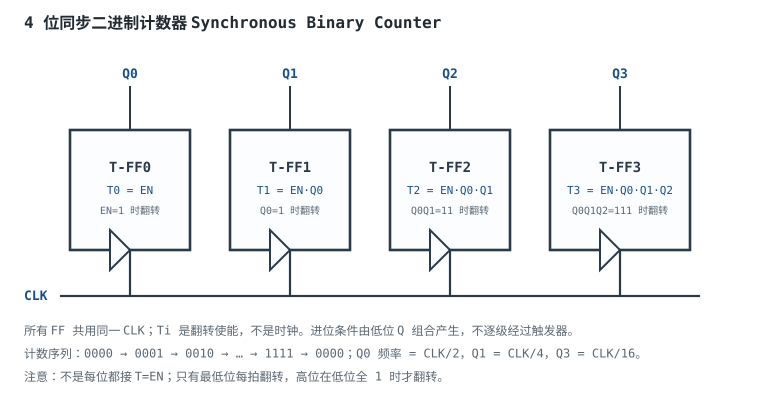
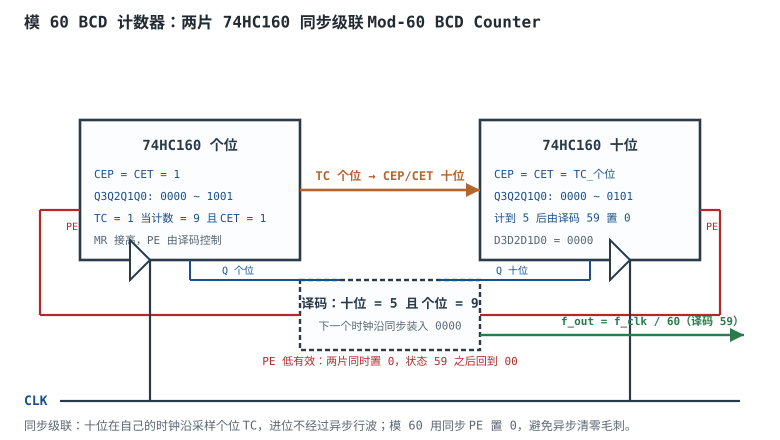

# 寄存器、计数器与分频

50MHz 晶振要变成 1Hz 的 LED 闪烁、115200 的 UART 波特率、1ms 的定时中断，靠的都是同一套东西：**寄存器记住状态，计数器数节拍，分频器把频率降下来，移位寄存器把数据一位一位搬进搬出。** 这四件套看起来简单，但真到工程里，问题往往出在“模值差一”“行波延迟没算”“分频占空比不对”“移位寄存器跨了时钟域”这些细节上。

这一章从 D 触发器的两种基本用法讲起：并行寄存器（一次锁存多位）和移位寄存器（逐位搬移）；再把计数器分成同步、异步、BCD、约翰逊、环形几类，用逐级延迟和进位链把“能跑多快”算清楚；最后用两片 74HC160 做一个模 60 的 BCD 计数器，把分频比、最高频率、进位延迟和复位方式走一遍完整设计。时钟本身的产生、偏斜和复位策略见[时钟与复位设计](clock-reset-design.md)，触发器的建立/保持与亚稳态见[时序分析：建立/保持时间与亚稳态](timing-analysis-metastability.md)。

## 1. 设计动机

::: motivation 三个现场
**现场一：CPU 的“暂存”到底存在哪。** 一个 32 位 CPU 有 32 个通用寄存器，每个 32 位，加起来 1024 个触发器。取指、译码、执行、写回，每个流水级之间都要把中间结果锁存一拍；如果没有寄存器，组合逻辑的毛刺会直接传到下一级，流水线根本没法工作。**寄存器的本质不是“存储”，而是“在时钟沿上把一段时间内的组合逻辑结果冻结成一个稳定状态”。**

**现场二：50MHz 分频到 1Hz，灯闪得不对。** 有人直接用 26 位计数器的最高位当输出，得到 $50\text{MHz}/2^{26}=0.745\text{Hz}$，灯“差不多”1 秒闪一次，但不精确；有人用“计到 50 000 000 清零”，结果多数了一个状态，输出变成 0.99999998Hz；还有人把复位做成异步清零，计数器在 59→00 的瞬间出现窄毛刺，后级状态机被误触发。**分频比、位宽、复位方式，任何一个差一，输出就不对。**

**现场三：12 位行波计数器接 MCU 总线，读到的值乱跳。** 行波计数器的 Q0 先翻，Q11 最后一个翻，12 级延迟累加起来可能上百纳秒。MCU 在时钟沿同时采样 12 位，正好采在过渡过程中，读到 0x7FF、0x800、0xFFF 之间的随机值。**行波计数器不是“不能用”，而是“不能在过渡期间并行采样”；要并行读，就得用同步计数器或加锁存器。**
:::

把时序逻辑的常用件列成一张表，先建立全局印象：

| 器件 | 状态数 | 主要用途 | 关键时序 | 典型实现 |
|---|---|---|---|---|
| 并行寄存器 | $2^n$ | 暂存、流水线、寄存器堆 | $T_{co}+T_{logic}+T_{su}$ | n 个 D-FF 共用 CLK |
| 移位寄存器 | $2^n$ | 串并转换、延时、序列检测 | 每级一拍，延迟 $nT_{clk}$ | D-FF 首尾相连 |
| 二进制计数器 | $2^n$ | 计时、地址、分频 | 进位链/使能逻辑 | T-FF + AND 链 |
| BCD 计数器 | 10 | 十进制显示、计时 | 每级 10 状态 | 4 位 + 反馈清零/装载 |
| 约翰逊计数器 | $2n$ | 分频、相位、低毛刺译码 | 每拍一位变化 | 移位寄存器 + 反相反馈 |
| 环形计数器 | $n$ | 顺序控制、one-hot | 每拍一位移动 | 移位寄存器 + 固定初值 |

## 2. 定义与直观

### 2.1 寄存器

**寄存器（Register）**是一组共享时钟的 D 触发器，在时钟沿上同时锁存 $n$ 位输入。按功能分：

- **并行输入/并行输出寄存器**：每个 D 接一位数据，CLK 沿一次写入全部位；带**装载使能（Load Enable）**的版本在 EN=0 时保持、EN=1 时写入。
- **移位寄存器（Shift Register）**：每级 Q 接下一级 D，数据每拍移动一位；可串入并出、并入串出、串入串出。
- **通用移位寄存器**：兼具保持、左移、右移、并行装载，典型如 74HC194；由两个选择端决定操作。
- **流水线寄存器（Pipeline Register）**：放在两级组合逻辑之间，把长路径切成短路径，提高时钟频率；代价是增加一拍延迟。
- **寄存器堆（Register File）**：多个寄存器 + 读写译码，CPU 的通用寄存器就是这种结构；读口通常是组合输出，写口在时钟沿更新。

寄存器的“保持”不是把时钟停掉，而是让 D 端在选择器里回接 Q：EN=0 时 D=Q，时钟沿来了也只把 Q 写回 Q。**用时钟门控去“停时钟”来实现保持，会引入时钟偏斜、毛刺和测试困难，同步设计里优先用时钟使能（Clock Enable）。**

### 2.2 计数器

**计数器（Counter）**是状态按固定顺序循环的寄存器。它的“模（Modulus）”是循环长度：模 10 的计数器有 10 个状态（0~9），模 60 有 60 个状态（00~59）。按结构分：

- **二进制计数器**：状态按二进制递增，$n$ 位有 $2^n$ 个状态；
- **BCD 计数器**：每 4 位只数 0~9，方便十进制显示；
- **加/减计数器**：有 U/D 控制端，可正计数或倒计数；
- **同步计数器**：所有触发器共用时钟，进位条件由组合逻辑预先算好；
- **异步/行波计数器**：前一级 Q 当后一级时钟，逐级翻转；
- **约翰逊计数器**：移位寄存器末级反相后反馈到首级，$n$ 位有 $2n$ 个状态；
- **环形计数器**：移位寄存器末级直接反馈首级，$n$ 位有 $n$ 个状态（one-hot）；
- **LFSR**：线性反馈移位寄存器，$n$ 位可产生 $2^n-1$ 个伪随机状态，用于 CRC、扰码、测试图案。

### 2.3 分频器

**分频器（Divider）**是把输入时钟频率除以整数 $N$ 的电路。最直接的做法是计数器：计满 $N$ 个输入周期，输出一个周期。输出频率：

$$
f_{out}=\frac{f_{clk}}{N}
$$

其中 $f_{clk}$ 是输入时钟频率，Hz；$N$ 是分频比（正整数）；$f_{out}$ 是输出频率，Hz。

如果输出是“计到终值”的窄脉冲，占空比约为 $1/N$；如果要 50% 占空比的方波，常用**翻转触发器**：每计满 $N$ 个输入周期，输出 FF 翻转一次，输出周期是 $2N$ 个输入周期，频率 $f_{clk}/(2N)$。所以“分频比”要区分“输出脉冲每 N 拍一次”和“输出方波每 2N 拍一个完整周期”，这是常见的差二错误。

### 2.4 移位寄存器

**移位寄存器**把 $n$ 个 D 触发器首尾相连，每个时钟沿数据向右（或向左）移动一位：

$$
Q_0 \leftarrow D_{in},\quad Q_1 \leftarrow Q_0,\quad \dots,\quad Q_{n-1} \leftarrow Q_{n-2}
$$

它有三个基本用途：

1. **串并转换（Serial-to-Parallel）**：串行输入 $n$ 位，$n$ 拍后从 $Q_0\dots Q_{n-1}$ 并行读出；UART 接收、SPI 输入都用它。
2. **并串转换（Parallel-to-Serial）**：并行装入 $n$ 位，然后每拍移出一位；UART 发送、SPI 输出用它。
3. **延时线（Delay Line）**：$n$ 级移位寄存器在时钟域内提供 $nT_{clk}$ 的确定延迟；用于对齐、流水线、序列检测。

**关于“环形振荡”的纠正。** 一些资料把“移位寄存器”的用途列为“串并转换、延时、环形振荡”，这个说法不准确。移位寄存器是**时钟驱动**的：每个沿移动一位，输出频率由时钟决定，不会自己振荡。把末级反相后反馈到首级，得到的是**约翰逊计数器（Johnson Counter）**，它把时钟除以 $2n$，不是振荡器。真正的**环形振荡器（Ring Oscillator）**是奇数个反相器首尾相连、不加时钟，靠门延迟自激，频率约为：

$$
f_{osc}\approx\frac{1}{2n\,t_{pd}}
$$

其中 $n$ 是反相器级数（奇数），$t_{pd}$ 是每级传播延迟，s；$f_{osc}$ 是振荡频率，Hz。例如 5 级反相器、每级 1ns，$f_{osc}=1/(2\times5\times1\text{ns})=100\text{MHz}$。它常用于时钟源、PVT 监测和 TRNG，但频率随电压/温度漂移大，不能当精确时钟。**移位寄存器可以做分频、延时、序列检测，不做“环形振荡”；两者不要混为一谈。**

### 2.5 约翰逊与环形计数器

**约翰逊计数器（Johnson Counter，扭环计数器）**把移位寄存器的末级反相后反馈到首级：

$$
D_0 = \overline{Q_{n-1}}
$$

$n$ 位约翰逊计数器有 $2n$ 个状态。以 4 位为例：

$$
0000 \to 1000 \to 1100 \to 1110 \to 1111 \to 0111 \to 0011 \to 0001 \to 0000
$$

共 8 个状态，所以它同时是**8 分频器**。每个状态只改变一位，译码时用 2 输入与门即可，不会像二进制计数器那样在多位同时翻转时产生译码毛刺；每个 Q 的占空比是 50%（$n$ 拍高、$n$ 拍低），适合做对称时钟。

**环形计数器（Ring Counter）**把末级直接反馈首级：

$$
D_0 = Q_{n-1}
$$

$n$ 位环形计数器有 $n$ 个状态，任意时刻只有一位为 1（one-hot）。以 4 位为例：

$$
1000 \to 0100 \to 0010 \to 0001 \to 1000
$$

它是 4 分频器，输出是四相非重叠时钟，常用于顺序控制、状态机 one-hot 编码、电荷泵相位。环形计数器的缺点是**不能自启动**：如果初值是 0000，反馈也是 0，永远停在 0000。所以必须加**自启动逻辑**：检测全 0 时强制置入 1000，或者用复位预置初值。约翰逊计数器则天然自启动（0000 的下一状态是 1000），这是它的一个实用优势。

## 3. 定量关系

### 3.1 寄存器的时序

并行寄存器的时序与普通触发器相同：数据在时钟沿前 $T_{su}$ 稳定、沿后 $T_h$ 保持，时钟沿到 Q 的延迟为 $T_{co}$。如果寄存器前面有组合逻辑，建立约束为：

$$
T_{clk} \ge T_{co} + T_{logic,max} + T_{su} + T_{skew} + T_{jitter}
$$

这就是[时序分析：建立/保持时间与亚稳态](timing-analysis-metastability.md)里的建立方程。寄存器本身不改变这个式子，它只是把“组合逻辑的终点”切成一段一段。**流水线的本质，就是把一个大的 $T_{logic}$ 拆成 $k$ 个小段，用 $k-1$ 组寄存器换频率；代价是 $k-1$ 拍延迟和寄存器面积/功耗。**

### 3.2 模值、位宽与复位

$n$ 位二进制计数器最多有 $2^n$ 个状态。要实现模 $N$ 计数（状态 $0\sim N-1$），所需最小位宽：

$$
n_{min}=\left\lceil \log_2 N \right\rceil
$$

其中 $N$ 是模值，$n_{min}$ 是位宽（整数），$\lceil\cdot\rceil$ 是向上取整。例如模 60：$\log_2 60=5.907$，向上取整为 6 位；6 位二进制可以表示 0~63，用反馈清零/装载跳过 60~63。

**模值的“差一”是计数器最常见的错误。** 如果计数器从 0 开始计，要计 $N$ 个状态，终值应该是 $N-1$，不是 $N$：

- 计到 $N-1$ 时产生 TC，下一个沿回到 0：周期 $N$ 拍，$f_{out}=f_{clk}/N$；
- 计到 $N$ 时产生 TC，下一个沿回到 0：实际经过了 $N+1$ 个状态，$f_{out}=f_{clk}/(N+1)$。

对 50MHz 分 1Hz，$N=50\,000\,000$，终值是 $49\,999\,999$，不是 $50\,000\,000$。这一个数的差别，在 1 秒的时间尺度上是 20ns 的误差，长期累积会明显。

复位方式分两种：

- **异步复位（Asynchronous Reset）**：复位信号一到立刻清零，不等时钟；优点是快、上电可靠；缺点是释放沿相对时钟异步，可能违反建立/保持，且复位脉冲太窄时可能清不干净。
- **同步复位（Synchronous Reset）**：复位在时钟沿生效；优点是释放沿对齐时钟、时序干净；缺点是复位脉冲必须足够宽，且复位路径要满足建立时间。

工程上常用**异步置位、同步释放**：复位有效时异步清零，释放时经两级触发器同步到时钟域。这样既有异步复位的快速响应，又有同步释放的时序安全。具体结构见[时钟与复位设计](clock-reset-design.md)。

### 3.3 同步计数器

以 4 位二进制同步计数器为例。设最低位为 Q0，计数使能为 EN。**正确的翻转条件是：第 $i$ 位在 EN=1 且所有低位 $Q_0\dots Q_{i-1}$ 全为 1 时翻转。**

用 T 触发器实现：

$$
T_0 = EN,\qquad T_i = EN\cdot Q_0\cdot Q_1\cdots Q_{i-1}\quad(i\ge1)
$$

其中 $T_i=1$ 表示第 $i$ 位在下一个时钟沿翻转；$\cdot$ 是与运算。对应的 D 端：

$$
D_i = Q_i \oplus T_i
$$

其中 $\oplus$ 是异或。这个式子说明：**只有最低位每个使能周期都翻转；高位要等低位全 1 才翻转。** 计数序列是 0000→0001→0010→0011→…→1111→0000，和二进制加法一致。

这里要纠正一个常见写法：**$D_i=Q_i\oplus EN$ 是错的。** 这个式子会让所有位在 EN=1 的每个沿同时翻转：0000→1111→0000→…，这不是二进制计数器，而是“所有位一起翻转”的分频器。一些资料中的序列表是对的，但逻辑式写错了；两者必须一致，否则综合出来的电路和波形对不上。

同步计数器的关键路径是“低位 Q → 进位与链 → 高位 T/D → 高位触发器建立”。对 $n$ 位行波进位（Ripple Carry）结构：

$$
T_{clk} \ge T_{co} + (n-1)T_{AND} + T_{su}
$$

其中 $T_{AND}$ 是与门/进位逻辑的单级延迟，s；$n$ 是位数；$T_{co}$、$T_{su}$ 是触发器参数。位数越多，进位链越长，频率越低。实际芯片（如 74HC161）内部做了进位优化，关键路径不是简单的 $n$ 级与门，但“位数越多越慢”的趋势不变。

### 3.4 异步计数器

异步（行波）计数器把前一级的 Q 当后一级的时钟。每个触发器接成 T=1（每来一个时钟沿翻转），所以：

$$
f_{Q0}=\frac{f_{clk}}{2},\quad f_{Q1}=\frac{f_{clk}}{4},\quad \dots,\quad f_{Q_{n-1}}=\frac{f_{clk}}{2^n}
$$

第 $i$ 级输出相对输入时钟的延迟，是 $i$ 级触发器延迟的累加：

$$
t_{pd,total}(i)=i\,t_{pd}
$$

其中 $t_{pd}$ 是单级触发器的传播延迟，s；$i$ 是从 0 开始的级数。$n$ 位行波计数器最后一位的延迟是 $n\,t_{pd}$。如果后级要在每个时钟周期并行采样全部 $n$ 位，必须等最后一位稳定后再加建立时间：

$$
T_{clk} \ge n\,t_{pd} + T_{su}
$$

对应的“可并行采样”最高频率：

$$
f_{max,sample}=\frac{1}{n\,t_{pd}+T_{su}}
$$

注意这个频率**不是**行波计数器第一级能翻转的最高频率。第一级只受单级触发器速度限制，通常可以很高；限制来自“所有位都稳定”的并行采样需求。如果只是取最后一级做分频输出，不要求中间位同时有效，那么输入时钟可以远高于 $f_{max,sample}$，只是输出相位延迟大、中间位有过渡态。**“行波计数器能跑多快”要看你用它的哪一位、怎么采样，不能只看一个数。**

同步与异步的对比：

| 项目 | 同步计数器 | 异步/行波计数器 |
|---|---|---|
| 时钟 | 所有 FF 共用 | 前级 Q 当前级时钟 |
| 进位 | 组合逻辑预先算好 | 逐级翻转 |
| 并行输出 | 同一沿更新，稳定 | 逐位延迟，过渡态多 |
| 最高频率 | 受进位链限制 | 第一级可很高，但并行采样受 $n t_{pd}$ 限制 |
| 面积/功耗 | 较大 | 较小 |
| 适用 | 高速、总线、状态机 | 低速分频、极简、不需要并行采样 |

### 3.5 分频器与占空比

模 $N$ 计数器直接产生 TC 脉冲，输出频率 $f_{clk}/N$，占空比：

$$
D=\frac{t_{high}}{T_{out}}=\frac{1}{N}
$$

其中 $t_{high}$ 是 TC 脉冲宽度（通常一个输入周期），$T_{out}=N/f_{clk}$ 是输出周期，s。要得到 50% 占空比，有两种常用方法：

1. **翻转触发器**：每计满 $N$ 个输入周期，输出 FF 翻转一次。输出完整周期是 $2N$ 个输入周期，频率 $f_{clk}/(2N)$，占空比 50%。如果目标频率是 $f_{clk}/N$，则每 $N/2$ 个输入周期翻转一次（$N$ 必须为偶数）。
2. **对称比较**：计数器在 $N/2$ 时置高、在 $N-1$ 时置低，输出高低各 $N/2$ 拍；$N$ 为偶数时可得 50%。

对奇数 $N$，用单沿计数器很难得到严格 50%；可以用双沿（上下沿都计数）或先倍频再分频。**“占空比 50%”不是分频器的默认属性，要专门设计。**

### 3.6 移位寄存器的定量关系

$n$ 级移位寄存器的延迟：

$$
t_{delay}=n\,T_{clk}
$$

其中 $n$ 是级数，$T_{clk}$ 是时钟周期，s。串并转换的吞吐：每 $n$ 拍处理 $n$ 位，等效位率等于时钟频率（1 bit/拍）；但“每字节”需要 $n$ 拍，所以字节率是 $f_{clk}/n$。

以 8 位 UART 接收为例：波特率 115200，每位 8.68µs；移位寄存器在每位中间采样，8 位需要 8 个位周期，加上起始/停止位共 10 位，一帧 86.8µs，最大帧率约 11.5k 帧/s。这个数字和“115200/10=11520 帧/s”一致，说明串并转换的吞吐由协议帧长决定，不是由移位寄存器本身决定。

移位寄存器的建立/保持与普通触发器相同；级联时，前一级的 $T_{co}$ 加后一级的 $T_{su}$ 必须小于时钟周期。**如果级间插了组合逻辑（比如多路选择器做并串转换），要按最坏路径重算。**

### 3.7 约翰逊与环形计数器的分频比

$n$ 位约翰逊计数器有 $2n$ 个状态，所以分频比：

$$
N_{Johnson}=2n
$$

$n$ 位环形计数器有 $n$ 个状态，分频比：

$$
N_{ring}=n
$$

约翰逊计数器的每个 Q 在 $2n$ 个状态中高 $n$ 拍、低 $n$ 拍，占空比 50%；译码任意一个状态只需 2 输入与门（因为相邻状态只差一位）。环形计数器是 one-hot，每个 Q 高 1 拍、低 $n-1$ 拍，占空比 $1/n$；译码一个状态只需看一位，但必须保证初值非零。

约翰逊计数器的状态数不是 $2^n$，而是 $2n$；环形计数器的状态数不是 $2^n$，而是 $n$。**这两个“非二进制”计数器常常被误当成 $2^n$ 分频，设计前先数状态。**

## 4. 典型计算

### 4.1 50MHz 晶振产生 1Hz 闪烁

**需求**：50MHz 晶振，LED 每秒亮灭一次（1Hz 方波，即每 0.5s 翻转一次）。用二进制计数器实现。

**第一步，算分频比**。1Hz 方波的完整周期是 1s，包含两个半周期；如果用一个输出 FF 每 0.5s 翻转一次，翻转间隔是 0.5s。50MHz 在 0.5s 内的周期数：

$$
N_{toggle}=0.5\times50\times10^{6}=25\,000\,000
$$

所以每计满 25 000 000 个输入周期，输出 FF 翻转一次，得到 1Hz 方波。如果直接用“计满 50 000 000 个周期输出一个脉冲”，得到的是 1Hz 窄脉冲，不是 50% 方波。

**第二步，选位宽**。25 000 000 介于 $2^{24}=16\,777\,216$ 和 $2^{25}=33\,554\,432$ 之间，需要 25 位。如果按 50 000 000 的窄脉冲方案，需要 26 位（$2^{25}<50\,000\,000<2^{26}$）。

**第三步，写比较值**。25 位计数器从 0 计到 $24\,999\,999$，共 25 000 000 个状态；计到终值时产生一个使能，让输出 FF 翻转，然后计数器回 0。终值不是 25 000 000，否则会多计一个状态，输出频率变成：

$$
f_{out}=\frac{50\times10^{6}}{2\times25\,000\,001}=0.99999996\ \text{Hz}
$$

误差约 $4\times10^{-8}$，短期看不出来，长期（比如一天）累积约 3.5ms；对 LED 无所谓，对时间基准就不能忽略。

**第四步，验算**。25 位计数器最大计数值 $2^{25}-1=33\,554\,431$，足够覆盖 24 999 999。输出 FF 每 25 000 000 个输入周期翻转一次，完整周期 50 000 000 个输入周期：

$$
f_{out}=\frac{50\times10^{6}}{50\,000\,000}=1.000\ \text{Hz}
$$

**第五步，讨论精度**。如果晶振本身是 ±20ppm，1Hz 输出的频率误差也是 ±20ppm，即每天 ±1.7s；分频器只能保证“分频比精确”，不能修正晶振误差。要高精度，得用 TCXO/OCXO 或 GPS 驯服，分频器本身不是误差来源。

### 4.2 模 60 BCD 计数器：两片 74HC160 级联

**需求**：用两片 74HC160 做一个 00~59 的 BCD 计数器，输入时钟 10MHz，输出每 60 个时钟一个脉冲；计算最高频率和进位延迟。

**第一步，确定结构**。74HC160 是同步 BCD 十进制计数器，带异步清零（MR）、同步并行装载（PE）、计数使能（CEP/CET）和进位输出（TC）。两片级联：

- **个位**：CEP=CET=1，每个时钟沿计数 0~9；计到 9 且 CET=1 时 TC=1。
- **十位**：CEP=CET=个位 TC；个位从 9 回 0 时，十位在同一个时钟沿加 1；十位计数 0~5。
- **模 60**：用译码器检测“十位=5 且个位=9”（即 59），在下一个时钟沿让两片同时同步装载 0000，状态从 59 回到 00。这样 00~59 共 60 个状态，没有 60 这个瞬态。

**第二步，验证计数序列**：

| 个位 | 十位 | 十进制 | 下一个状态 |
|---|---|---|---|
| 0~8 | 0~5 | 00~58 | 个位加 1 |
| 9 | 0~4 | 09~49 | 个位回 0，十位加 1 |
| 9 | 5 | 59 | 下一个沿两片装 0 → 00 |

注意 59 的译码必须在时钟沿之前稳定，PE 是同步输入，所以在 59 这个状态期间 PE 有效，下一个沿装载 0；不会出现 60 的计数状态。**这比“检测到 60 再异步清零”干净：异步清零会让 60 短暂出现，且清零脉冲宽度只有门延迟，容易出毛刺。**

**第三步，算最高频率**。取 74HC 系列 5V 下的典型量级（**具体以数据手册为准**）：

- $T_{co}=12\text{ns}$：时钟到 Q 的延迟；
- $T_{TC}=12\text{ns}$：个位 TC 的组合延迟；
- $T_{su}=6\text{ns}$：十位 CEP/CET 的建立时间；
- $T_{decode}=8\text{ns}$：译码 59 的两级门延迟。

个位 TC 到十位 CEP 的路径：

$$
T_{carry}=T_{co}+T_{TC}+T_{su}=12+12+6=30\ \text{ns}
$$

$$
f_{max,carry}=\frac{1}{30\times10^{-9}}=33.33\ \text{MHz}
$$

译码 59 到 PE 的路径：

$$
T_{pe}=T_{co}+T_{decode}+T_{su}=12+8+6=26\ \text{ns}
$$

$$
f_{max,pe}=\frac{1}{26\times10^{-9}}=38.46\ \text{MHz}
$$

两条路径取较小值，最高频率约 **33.33MHz**，由进位路径决定。10MHz 输入（周期 100ns）下，建立裕量：

$$
Slack=100-30=70\ \text{ns}
$$

非常充裕。把译码 59 的信号寄存一拍（或直接取译码脉冲）作为每 60 拍的输出脉冲，频率：

$$
f_{out}=\frac{10\times10^{6}}{60}=166.67\ \text{kHz}
$$

注意：十位计数器只数 0~5，十位自己的 TC 在模 60 中永远不会有效（TC 要求计数=9）；输出脉冲必须来自“59”的译码，不能接十位的 TC。

**第四步，算进位延迟**。从个位时钟沿到个位 TC 有效：

$$
t_{TC}=T_{co}+T_{TC}=12+12=24\ \text{ns}
$$

十位在下一个时钟沿采样 TC，所以十位 Q 的更新还要再加一个周期和它自己的 $T_{co}$。在 $f_{max}=33.33\text{MHz}$（周期 30ns）下，从个位时钟沿算起，十位 Q 大约在：

$$
t_{Q,tens}=30+12=42\ \text{ns}
$$

后才更新。这个 42ns 不是限制频率的路径（限制频率的是 30ns 的建立约束），但它影响后级在什么时刻可以采样十位输出。如果后级要在同一个周期内用十位 Q，必须按 42ns 的延迟留裕量；如果只是看最终计数，等到下一个周期即可。

**第五步，讨论异步清零方案**。如果不译码 59，而是译码 60（十位=6、个位=0）后异步清零，计数到 60 时 MR 拉低，两片立刻清零。问题是：

- 60 这个状态会短暂出现，宽度约为译码门延迟 + MR 响应时间，典型 20~30ns；
- 在 33MHz（周期 30ns）下，这个瞬态几乎占满一个周期，后级可能采到 60；
- 异步清零脉冲太窄时，触发器可能清不干净；太宽时又会影响下一个周期。

所以模 60 用**同步装载 0** 更稳；如果只能用异步清零，要保证译码和清零脉冲宽度足够，并在后级加“计数值有效”的使能。一些资料中的 N 分频器图用的是“计到 N 复位”，对模 60 的 BCD 方案来说，**同步 PE 比异步 MR 更可取**。

### 4.3 12 位行波计数器 vs 同步计数器

**需求**：12 位二进制计数器，输入时钟 10MHz，后级要在每个时钟周期并行采样全部 12 位。比较行波与同步两种实现的可用最高频率。

取 74HC 系列典型量级（**以数据手册为准**）：单级 $t_{pd}=14\text{ns}$，同步计数器 $T_{co}=12\text{ns}$、$T_{TC}=12\text{ns}$、$T_{su}=6\text{ns}$。

**行波方案**：12 级逐级翻转，最后一位 Q11 的延迟：

$$
t_{pd,total}=12\times14=168\ \text{ns}
$$

后级并行采样还要加建立时间 6ns：

$$
T_{clk,min}=168+6=174\ \text{ns}
$$

$$
f_{max,sample}=\frac{1}{174\times10^{-9}}=5.75\ \text{MHz}
$$

也就是说，10MHz 输入下行波计数器的 Q11 还没稳定，后级就采样了，会读到过渡值。**行波计数器可以用 10MHz 时钟让 Q0 翻转，但不能让后级每 100ns 并行读 12 位。**

**同步方案**：用三片 4 位 74HC161 级联，TC 进位链经过两级片间 TC：

$$
T_{clk,min}=T_{co}+2T_{TC}+T_{su}=12+2\times12+6=42\ \text{ns}
$$

$$
f_{max}=\frac{1}{42\times10^{-9}}=23.81\ \text{MHz}
$$

10MHz 下 slack=58ns，轻松满足。同步方案比行波方案的可用频率高：

$$
\frac{23.81}{5.75}=4.14\ \text{倍}
$$

如果不用 74HC161 的内部进位优化，而是用“12 位 + 11 级与门”的行波进位同步计数器，关键路径：

$$
T_{clk,min}=12+11\times7+6=95\ \text{ns}
$$

$$
f_{max}=\frac{1}{95\times10^{-9}}=10.53\ \text{MHz}
$$

仍然比行波方案的 5.75MHz 高约 1.83 倍，但不如片内进位优化的 23.81MHz。**“同步”不是魔法，进位链的实现方式决定它能跑多快；FPGA 里的进位链是专用快速路径，ASIC 里则要看标准单元的进位结构。**

### 4.4 约翰逊/环形计数器的分频比与译码

**需求**：用 4 位约翰逊计数器产生 8 分频、50% 占空比的方波，并用 2 输入与门译码状态 1100。

**第一步，数状态**。4 位约翰逊计数器有 $2n=8$ 个状态：

$$
0000,1000,1100,1110,1111,0111,0011,0001
$$

分频比 $N=8$，输出频率 $f_{clk}/8$。

**第二步，看占空比**。以 Q2 为例，在 8 个状态中 Q2=1 的状态是 1100、1110、1111、0111，共 4 个，占空比 $4/8=50\%$。每个 Q 都是 50%，且相邻 Q 之间相位差 1 拍。

**第三步，译码**。状态 1100 的译码：

$$
Y=Q_3\cdot Q_2\cdot\overline{Q_1}\cdot\overline{Q_0}
$$

这是 4 输入与门；但约翰逊计数器的相邻状态只差一位，可以用 2 输入与门译码“边沿”：

$$
Y_{1100}=Q_3\cdot Q_2
$$

在约翰逊序列中，$Q_3Q_2=11$ 只出现在 1100、1110、1111、0111 四个连续状态，持续 4 拍；如果要窄脉冲，还要结合其他位。**约翰逊译码的优点不是“一定只要 2 输入”，而是“相邻状态只差一位，译码不会出现多位竞争毛刺”**；具体需要几位，取决于你要多宽的脉冲。

**第四步，环形对比**。4 位环形计数器有 4 个状态（1000、0100、0010、0001），分频比 4，每个 Q 占空比 25%。译码 1000 只需 $Q_3$ 一位，但必须保证初值非零；如果上电是 0000，它永远不动。约翰逊计数器 0000 的下一状态是 1000，天然自启动；这是它比环形计数器更适合“上电即用”的原因。

## 5. 工程含义

### 5.1 同步还是行波

选择规则可以总结成三句话：

1. **要并行采样、要接总线、要进状态机**：用同步计数器。行波的过渡态会让后级读到错值，且延迟随位数线性增加。
2. **只要最后一级分频、频率不高、成本极敏感**：可以用行波。比如 32.768kHz 晶振分频到 1Hz，行波 15 级，延迟几百纳秒，但 1Hz 的周期是 1 秒，完全不在乎；而且行波省面积、省功耗。
3. **要低毛刺译码、要 50% 占空比、要相位**：优先约翰逊计数器；要 one-hot 顺序控制，用环形计数器，但必须加自启动。

### 5.2 复位与使能

- **复位**：优先“异步置位、同步释放”；复位脉冲宽度要满足触发器的最小复位宽度；复位树要平衡，避免不同触发器释放时刻差太多。
- **使能**：用时钟使能（CE）而不是时钟门控；CE 的建立/保持要满足触发器要求；多个使能信号合并时注意毛刺（用寄存器打一拍）。
- **装载**：同步装载（PE）比异步清零干净；装载值要在 PE 有效前稳定；如果装载源是另一时钟域，先做 CDC。
- **初值**：环形计数器、LFSR 必须有非零初值；FPGA 上电时触发器初值由配置决定，ASIC 要靠复位；不要依赖“上电随机值”。

### 5.3 位宽、模值与编码

- **位宽**：按 $n_{min}=\lceil\log_2 N\rceil$ 选，不要“多留几位无所谓”——多余位会增加翻转功耗和布线资源，还会让比较逻辑变宽。
- **模值**：终值是 $N-1$；用同步装载/清零时，译码 $N-1$；用异步清零时，译码 $N$，但要接受一个瞬态。
- **BCD vs 二进制**：要十进制显示/计时用 BCD；要地址/计数用二进制；BCD 的 4 位只用了 10 个状态，面积效率低，但译码到七段数码管方便。
- **格雷码**：跨时钟域的计数器/指针用格雷码，每次只变一位；二进制跨域可能一次变多位，逐位同步会拼出错值。具体见[时序分析：建立/保持时间与亚稳态](timing-analysis-metastability.md)。

### 5.4 FPGA/ASIC 实现差异

- **FPGA**：计数器通常综合成“LUT + 进位链”，进位链是专用快速路径，频率可以很高；但工具可能把宽计数器拆成多个进位链，要注意时序报告。分布式 RAM/块 RAM 可以实现大容量计数器/移位寄存器。
- **ASIC**：标准单元触发器 + 与门/或门；进位链的延迟由标准单元决定，位数多时要手动做超前进位（Carry Lookahead）或分组进位；时钟树和复位树要规划。
- **功耗**：计数器每个沿只有部分位翻转（二进制）或全部位翻转（约翰逊/环形每拍一位），动态功耗不同；高频计数器要考虑时钟树功耗和使能门控。

### 5.5 测试与验证

- **仿真**：跑满一个完整周期（模 N 的 N 个状态），检查回卷、进位、复位、装载；对行波计数器检查过渡态和并行采样时刻。
- **形式验证**：对模值、复位、装载做等价性检查；对 FIFO 指针做格雷码检查。
- **实测**：用逻辑分析仪看 Q0~Qn 的到达时刻差（行波延迟）；用频率计看分频输出；用示波器看占空比和复位释放沿。
- **边界**：上电初值、复位释放、时钟停止/恢复、使能毛刺、跨时钟域，都是计数器容易出问题的地方。

## 6. 常见坑

::: pitfall 常见坑
- **把行波计数器当同步计数器用**：现象——高速时钟下后级并行采样，读到 0x7FF、0x800、0xFFF 之间的随机值。原因——行波各位逐级翻转，Q11 比 Q0 晚 $11t_{pd}$，并行采样正好采在过渡区。解决——要并行采样就用同步计数器；确实要用行波，就在输出加一级锁存器，等所有位稳定后再锁存。
- **模值差一**：现象——分频输出频率比设计值低 $1/N$，或者计时每月慢几秒。原因——从 0 开始计 N 个状态，终值应是 N−1，却写了 N；或者“计到 N 清零”多算了一个状态。解决——画状态表，数清 0~N−1 共 N 个状态；用同步装载时译码 N−1，用异步清零时译码 N 并接受瞬态。
- **分频占空比不对**：现象——想要 50% 方波，得到的是窄脉冲，后级触发器只在脉冲沿动作。原因——直接把 TC 脉冲当输出，占空比 1/N。解决——用翻转触发器（每 N/2 拍翻转）或对称比较；注意翻转方案的输出频率是 $f_{clk}/(2N)$。
- **异步复位释放沿亚稳**：现象——上电/按键复位后系统偶尔不启动，或进入错误状态。原因——复位释放相对时钟异步，可能落在建立/保持窗口。解决——异步置位、同步释放；复位释放经两级触发器同步；复位脉冲宽度满足数据手册。
- **环形计数器停在 0000**：现象——上电后输出一直不变，所有 Q 都是 0。原因——环形计数器全 0 是吸收态，反馈 0 让它永远出不来。解决——加自启动逻辑（检测全 0 置 1000），或用复位预置非零初值；约翰逊计数器天然自启动，可优先考虑。
- **移位寄存器跨时钟域**：现象——慢时钟域数据经移位链传到快时钟域，采到错位/中间值。原因——移位链每级延迟不同，数据在链上移动时各位不在同一时刻稳定；跨域没有同步器。解决——单 bit 用两级同步器；多 bit 用握手/异步 FIFO；不要用移位寄存器直接跨域。
- **用时钟门控做使能**：现象——功能仿真正常，时序/硅片上出现毛刺、偏斜、时钟树问题。原因——门控时钟引入了组合逻辑毛刺和时钟延迟，工具难以分析。解决——用触发器自带的时钟使能（CE），或使用专用集成时钟门控单元（ICG），不要用与门直接切时钟。
:::

## 7. 自测题

50MHz 时钟要得到 1kHz 方波，分频比和计数器位宽是多少？如果只要 1kHz 窄脉冲呢？

1kHz 方波周期 1ms，半周期 0.5ms。翻转间隔的输入周期数：

$$
N_{toggle}=0.5\times10^{-3}\times50\times10^{6}=25\,000
$$

计数器需要能计到 24 999，$2^{14}=16\,384<25\,000<2^{15}=32\,768$，**15 位**。输出 FF 每 25 000 个输入周期翻转一次，完整周期 50 000 个输入周期，频率 $50\text{MHz}/50\,000=1\text{kHz}$。

如果只要 1kHz 窄脉冲，分频比 $N=50\,000$，计数器计到 49 999 产生一个输入周期宽的脉冲；位宽需要 16 位（$2^{15}<50\,000<2^{16}$）。占空比 $1/50\,000=0.002\%$。

4 位同步二进制计数器，EN=1 时从 0111 到 1000，哪些位翻转？用 $T_i$ 表达式说明。

0111 → 1000：Q0 从 1→0，Q1 从 1→0，Q2 从 1→0，Q3 从 0→1，四位都翻转。

翻转条件：

$$
T_0=EN=1
$$

$$
T_1=EN\cdot Q_0=1\cdot1=1
$$

$$
T_2=EN\cdot Q_0\cdot Q_1=1\cdot1\cdot1=1
$$

$$
T_3=EN\cdot Q_0\cdot Q_1\cdot Q_2=1\cdot1\cdot1\cdot1=1
$$

所以四位同时翻转。注意这不是“每个沿所有位都翻转”：只有在 0111 这个特定状态、且 EN=1 时，高位条件才同时满足。下一个状态 1000 时，$T_1=EN\cdot Q_0=0$，Q1 不再翻转。

12 位行波计数器，单级 $t_{pd}=14\text{ns}$，后级并行采样加 6ns 建立时间。最高采样频率是多少？如果只用 Q11 做 2^12 分频，输入时钟能到多少？

并行采样：

$$
T_{clk,min}=12\times14+6=174\ \text{ns}
$$

$$
f_{max,sample}=\frac{1}{174\times10^{-9}}=5.75\ \text{MHz}
$$

只用 Q11 做分频输出、不要求中间位同时有效时，输入时钟的上限由第一级触发器的翻转速度决定（典型 74HC 可达几十 MHz，具体看数据手册），不是 5.75MHz。但 Q11 的相位延迟是 $12\times14=168\text{ns}$，且中间位在过渡，不能并行采样。**“能输入多快”和“能并行读多快”是两个问题。**

用两片 74HC160 做模 60，$T_{co}=12\text{ns}$、$T_{TC}=12\text{ns}$、$T_{su}=6\text{ns}$。最高频率是多少？10MHz 下输出频率是多少？

进位路径：

$$
T_{carry}=12+12+6=30\ \text{ns}
$$

$$
f_{max}=\frac{1}{30\times10^{-9}}=33.33\ \text{MHz}
$$

10MHz 输入下：

$$
f_{out}=\frac{10\times10^{6}}{60}=166.67\ \text{kHz}
$$

10MHz 周期 100ns，slack=100−30=70ns。如果译码 59 的路径是 $12+8+6=26\text{ns}$，对应 38.46MHz，不构成瓶颈；最高频率由 30ns 的进位路径决定。

4 位约翰逊计数器和 4 位环形计数器各有多少状态、分频比多少？哪个能自启动？

4 位约翰逊：$2n=8$ 个状态，分频比 8，每个 Q 占空比 50%；0000 的下一状态是 1000，**能自启动**。

4 位环形：$n=4$ 个状态，分频比 4，每个 Q 占空比 25%；0000 是吸收态，**不能自启动**，必须预置非零初值或加自启动逻辑。

为什么“移位寄存器 + 反相反馈”不是环形振荡器？真正的环形振荡器频率怎么算？

移位寄存器是时钟驱动的，每个时钟沿移动一位；末级反相反馈到首级，构成的是约翰逊计数器，输出状态按 $2n$ 循环，频率是 $f_{clk}/(2n)$，由外部时钟决定，不会自激。

真正的环形振荡器是奇数个反相器首尾相连，不加时钟，靠每级门延迟自激：

$$
f_{osc}\approx\frac{1}{2n\,t_{pd}}
$$

$n$ 为奇数，$t_{pd}$ 是单级延迟。例如 5 级、每级 1ns，$f_{osc}=1/(2\times5\times1\text{ns})=100\text{MHz}$。它的频率随 PVT 漂移，不能当精确时钟源。

一个模 60 的计数器，用异步清零检测 60，会有什么问题？改用同步装载 59→0 为什么更好？

异步清零检测 60 时，计数到 60 的瞬间 MR 拉低，两片立刻清零。问题：60 这个状态会短暂出现（约译码门延迟 + MR 响应，典型 20~30ns），后级可能采到 60；清零脉冲宽度只有门延迟，太窄可能清不干净；如果时钟很快（周期接近这个宽度），清零和下一个计数沿可能竞争。

同步装载 59→0 时，在 59 状态期间译码 PE，下一个时钟沿两片同时装入 0000；没有 60 瞬态，PE 是同步输入，脉冲宽度为一个完整周期，时序干净。代价是需要译码 59 而不是 60，且 PE/装载值要在沿前稳定。

## 8. 参考资料

- **M. Morris Mano & Michael D. Ciletti, *Digital Design*, 5th ed., Chapter 6 Registers and Counters**：寄存器、移位寄存器、行波/同步计数器、环形与约翰逊计数器的定义与状态分析；本章 2.1~2.5、3.3~3.4 的体系参考该章。
- **M. Morris Mano & Michael D. Ciletti, *Digital Design*, 5th ed., Chapter 5 Synchronous Sequential Logic**：触发器时序、同步状态机与时钟偏斜；本章 3.1、3.2 的时序与复位口径与该章一致。
- **NXP, 74HC160/74HC161/74HC162/74HC163 数据手册**：BCD/二进制同步计数器、TC 进位输出、CEP/CET 使能、MR 异步清零、PE 同步装载的引脚与时序；本章 4.2 的 74HC160 级联与参数取值以该数据手册为准。
- **NXP, 74HC393 数据手册**：双 4 位二进制行波计数器、逐级时钟与传播延迟；本章 3.4、4.3 的行波延迟量级参考该数据手册。
- **Clifford E. Cummings, “Synthesis and Scripting Techniques for Designing Multi-Asynchronous Clock Designs”, SNUG 2001**：计数器/指针跨时钟域的格雷码、同步器与编码风格；本章 5.3 的跨域计数器建议参考该文。
