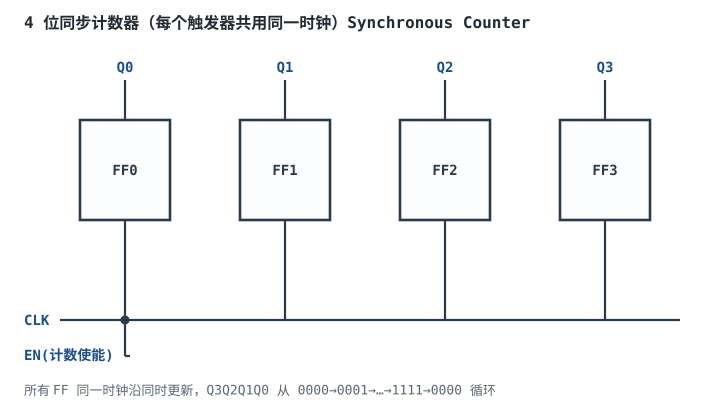
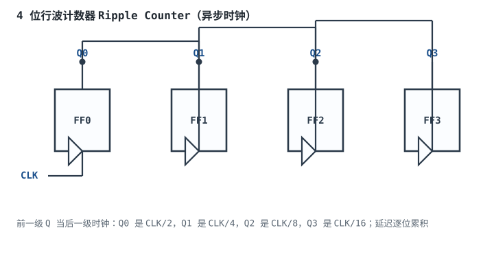
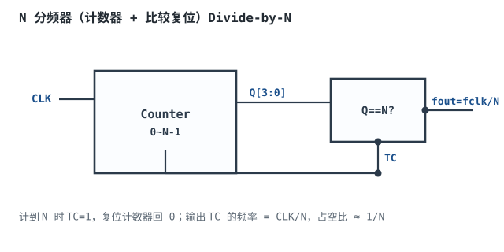
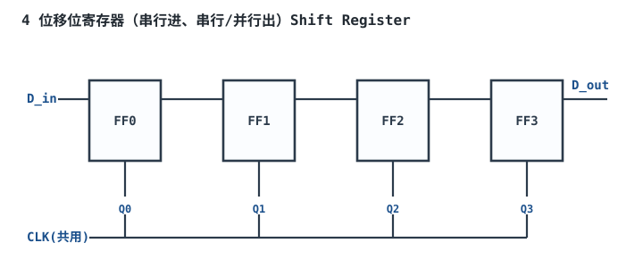

# 寄存器、计数器与分频

## 1. 设计动机

::: motivation 为什么需要寄存器和计数器
D 触发器记住 1 位；把 8 个 D 触发器并在一起，就记住了 1 个字节——这就是**寄存器（Register）**，CPU 里所有"暂存"都靠它。把触发器的输出按规律接回输入，它就能自动加 1——这就是**计数器（Counter）**，是计时、分频、地址生成的核心。

晶振给的是 50MHz 方波，要得到 1Hz 的 LED 闪烁、UART 的 115200 波特率，都要靠**分频器（Divider）**把高频时钟降下来。这三件套是数字系统的"节拍器"。
:::

本章讲：寄存器（并行存数据）、计数器（自动加/减）、分频器（降频率）、移位寄存器（逐位移动）。

## 2. 原理与逻辑图

### 2.1 寄存器

$n$ 个 D 触发器共用同一时钟，每个 D 接一位输入，CLK 上升沿把 $n$ 位数据同时锁存到 $Q$。带并行加载（Load）端的寄存器可在指定拍把数据写入。

### 2.2 同步计数器

把每个 D 接成"$D_i=Q_i\oplus EN$"（T 触发器结构），所有 FF 共用同一 CLK，EN=1 时每个沿所有位同时翻转。



### 2.3 行波计数器

最低位 FF 用外部时钟，它的 Q 输出接下一级的时钟，像"行波"一样逐位传递。电路简单，但延迟逐位累积，且各位不在同一时刻翻转。

### 2.4 分频器

计数器计到 $N$ 时产生一个脉冲并复位，输出脉冲频率就是输入时钟的 $1/N$。

## 3. 静态分析（计数序列）

4 位同步计数器输出序列（EN=1）：

| 拍 | Q3 | Q2 | Q1 | Q0 | 十进制 |
|---|---|---|---|---|---|
| 0 | 0 | 0 | 0 | 0 | 0 |
| 1 | 0 | 0 | 0 | 1 | 1 |
| 2 | 0 | 0 | 1 | 0 | 2 |
| 3 | 0 | 0 | 1 | 1 | 3 |
| … | | | | | |
| 14 | 1 | 1 | 1 | 0 | 14 |
| 15 | 1 | 1 | 1 | 1 | 15 |
| 16 | 0 | 0 | 0 | 0 | 0（回卷） |

## 4. 动态分析（波形与分频）

同步计数器所有位同时更新，Q0 频率 = CLK/2，Q1 = CLK/4，Q2 = CLK/8，Q3 = CLK/16。下面是 4 位计数器各位的分频波形：

```echarts
{
  "tooltip": {"trigger": "axis"},
  "legend": {"data": ["CLK", "Q0(/2)", "Q1(/4)", "Q2(/8)", "Q3(/16)"], "bottom": 0, "textStyle": {"fontSize": 12}},
  "grid": {"left": 60, "right": 30, "top": 30, "bottom": 60},
  "xAxis": {"type": "category", "name": "CLK 拍", "data": ["0","1","2","3","4","5","6","7","8","9","10","11","12","13","14","15"], "axisLabel": {"fontSize": 10}},
  "yAxis": {"type": "value", "min": 0, "max": 1.4, "interval": 1, "axisLabel": {"fontSize": 11}},
  "series": [
    {"name": "CLK", "type": "step", "step": "middle", "showSymbol": false, "lineStyle": {"width": 2.0, "color": "#5a6672"}, "data": [0,1,0,1,0,1,0,1,0,1,0,1,0,1,0,1]},
    {"name": "Q0(/2)", "type": "step", "step": "middle", "showSymbol": false, "lineStyle": {"width": 2.2, "color": "#1a4f8b"}, "data": [0,1,1,0,0,1,1,0,0,1,1,0,0,1,1,0]},
    {"name": "Q1(/4)", "type": "step", "step": "middle", "showSymbol": false, "lineStyle": {"width": 2.2, "color": "#2a7a4a"}, "data": [0,0,1,1,1,1,0,0,0,0,1,1,1,1,0,0]},
    {"name": "Q2(/8)", "type": "step", "step": "middle", "showSymbol": false, "lineStyle": {"width": 2.2, "color": "#b5642e"}, "data": [0,0,0,0,1,1,1,1,1,1,1,1,0,0,0,0]},
    {"name": "Q3(/16)", "type": "step", "step": "middle", "showSymbol": false, "lineStyle": {"width": 2.4, "color": "#8a3a8a"}, "data": [0,0,0,0,0,0,0,0,1,1,1,1,1,1,1,1]}
  ]
}
```

观察：每高一位，频率减半、周期加倍。这就是二进制计数器天然的分频能力。

## 5. 同步 vs 异步计数器

- **同步计数器**：所有 FF 共用同一 CLK，同时更新，无行波延迟，最高频率高；但内部要加使能/进位逻辑。
- **异步（行波）计数器**：前级 Q 当后级时钟，电路最简；但延迟逐位累积，最高频率低，且各位不在同一时刻稳定（外部同时采样多位会读到过渡值）。
- **工程选择**：同步系统一律用同步计数器；行波只在极简分频/低速场合用。

## 6. 元件取值与工程权衡

- **分频比 $N$**：要 1Hz 闪烁，50MHz 时钟需 $N=50\,000\,000$，计数器至少 26 位（$2^{25}=33.5\text{M}<50\text{M}<2^{26}=67\text{M}$）。
- **占空比**：N 分频若用"计到 N 复位"，输出占空比 ≈ $1/N$（窄脉冲）；要 50% 占空比需对称分频或取上下沿。
- **计数器位宽**：按最大计数量程选，多余位浪费翻转功耗。
- **行波 vs 同步**：高频选同步；极简低速可选行波，但不要用行波输出同时做多位总线采样。

## 7. 完整设计示例

::: example 用 50MHz 晶振产生 1Hz LED 闪烁
1. **需求**：50MHz 晶振，让 LED 每秒亮灭一次（0.5Hz 翻转，1Hz 闪烁周期）。
2. **算分频比**：每秒需要 0.5 次翻转，即每 $50\,000\,000$ 个时钟翻转一次。$N=50\,000\,000$。
3. **选位宽**：$2^{25}=33{,}554{,}432<50\text{M}$，$2^{26}=67{,}108{,}864>50\text{M}$，用 26 位计数器。
4. **实现**：26 位计数器计到 $49\,999\,999$ 时，把某个 FF 的 Q 作为翻转使能（或直接比较输出 1Hz 方波）。
5. **验算**：50MHz / 50M = 1Hz，LED 每秒翻转一次，肉眼看到约 1Hz 闪烁。
6. **注意**：直接用计数器高位 Q3 只能得到 50MHz/$2^{26}\approx0.75$Hz，不够精确；要精确 1Hz 必须用 N 分频比较复位。
:::

## 8. 仿真与实验

在 Logisim 中：

- 搭 4 位同步计数器，输出接七段数码管，验证从 0 数到 F 循环。
- 改行波计数器，用逻辑分析仪看各位 Q 的到达时刻差（行波延迟）。
- 搭 N 分频器：计数器计到 5 时复位，观察输出频率 = CLK/5。
- 搭 4 位移位寄存器，串行输入一个 4 位数，4 个时钟后从 Q3 串行移出、并行从 Q0~Q3 读出。

## 扩展与变种电路

### 扩展1：行波计数器 Ripple Counter

电路最简的计数器：前级 Q 直接当后级时钟，无需额外进位逻辑。



::: example 工作原理与波形
- 每个 FF 接成 T=1（翻转模式），外部时钟只接 FF0。
- Q0 是 CLK/2，Q1 是 Q0/2=CLK/4，依此类推。
- 代价：FF1 要等 Q0 翻转后才被时钟，延迟 = FF0 的 $t_{pd}$；$n$ 位总延迟 = $n\cdot t_{pd}$。
:::

设计要点：行波计数器是异步时序，不适合高速。取值/对比：行波 vs 同步——行波省门、慢；同步费门、快。适用：低速分频、极简；不适用：高速数据通路、同时采样多位总线。

::: pitfall 行波计数器输出同时采样得到过渡错值
- **现象**：计数器从 0111→1000 时，外部逻辑采样到 0110 或 0011。
- **原因**：行波各位逐位翻转，Q3 比 Q0 晚 $3t_{pd}$，中间瞬间各位不一致。
- **解决**：同步计数器，或在采样前用一级寄存器把行波输出"对齐"锁存。
:::

### 扩展2：N 分频器 Divide-by-N

计数器 + 比较器，计到 N 就复位，输出固定分频比的时钟。



::: example 工作原理与公式
- 计数器从 0 计到 N−1，比较器检测 Q==N−1（或 N）时产生复位/使能脉冲。
- 输出脉冲频率 $f_{out}=f_{clk}/N$。
- 占空比 ≈ $1/N$（窄脉冲）；要 50% 占空比用 $N$ 偶数并取上下沿，或用约翰逊计数器。
:::

设计要点：分频比 N 由比较值设定，改 N 即可改频率。取值/对比：二进制高位直接分频（N=2^k）vs N 分频（任意整数）——前者省比较器、后者精确。适用：UART 波特率、定时中断；不适用：需要 50% 占空比的精确时钟（除非对称设计）。

::: pitfall 复位是组合逻辑，产生窄毛刺
- **现象**：计到 N 的瞬间复位脉冲太窄，触发器可能来不及复位。
- **原因**：比较器组合输出直接接复位，一计到 N 立刻清 0，比较条件消失，复位脉冲只有门延迟宽。
- **解决**：复位用同步释放，或用"计到 N 时停止计数一拍再清"，保证复位脉冲宽度足够。
:::

### 扩展3：移位寄存器 Shift Register

把 D 触发器首尾相连，数据每拍向右移一位，用于串并转换、延时线。



::: example 工作原理与波形
- 每个 CLK 沿：$Q_0\leftarrow D_{in}$，$Q_1\leftarrow Q_0$，$Q_2\leftarrow Q_1$，$Q_3\leftarrow Q_2$。
- 串行输入 4 位，4 拍后从 Q0~Q3 并行读出——这就是"串入并出"，UART 接收的核心。
- 反向用就是"并入串出"，UART 发送。
:::

设计要点：移位寄存器位数 = 延时拍数。取值/对比：移位寄存器 vs FIFO——移位寄存器固定延时、FIFO 可变深度。适用：串并转换、延时、总线同步链；不适用：任意深度缓冲（用 FIFO）。

::: pitfall 移位寄存器链太长导致跨时钟域问题
- **现象**：慢时钟域数据经移位寄存器传到快时钟域，采到错误中间值。
- **原因**：移位寄存器每级延迟不同，数据在链上移动时各位不在同一时刻稳定。
- **解决**：跨时钟域单 bit 用两级同步器（一种特殊的移位寄存器），多 bit 用握手或异步 FIFO。
:::

## 9. 常见坑与故障现象

::: pitfall 常见坑
- **行波计数器当同步计数器用**：高速时钟下行波各位还没稳定就被采样，输出随机错值。同步设计一律用同步计数器。
- **分频占空比不对**：直接用计数器高位输出得到窄脉冲，后级以为是 50% 方波。需要 50% 占空比要专门对称设计。
- **计数器位宽不够**：50MHz 分 1Hz 只用 24 位，$2^{24}=16.7\text{M}<50\text{M}$，分频比不对。按 $N$ 算位宽，不是拍脑袋。
- **移位寄存器没共用时钟**：某一级 CLK 接错，数据卡在某一级不动。所有 FF 必须同一时钟沿。
:::

## 10. 自测题

<details><summary>50MHz 时钟要得到 1kHz 信号，分频比 N 是多少？计数器至少几位？</summary>

$N=50\,000\,000/1000=50\,000$。$2^{15}=32768<50000<2^{16}=65536$，计数器至少 **16 位**。
</details>

<details><summary>同步计数器和行波计数器哪个最高工作频率高？为什么？</summary>

同步计数器高。行波计数器的进位要逐位经过每个触发器的 $t_{pd}$，$n$ 位总延迟 $n\cdot t_{pd}$，时钟周期必须大于这个延迟；同步计数器所有位同时更新，关键路径只是一级触发器 + 使能逻辑，频率高得多。
</details>

<details><summary>4 位移位寄存器串行输入 `1011`，4 个时钟后 Q3Q2Q1Q0 是什么？</summary>

逐拍移入：第1拍 Q0=1；第2拍 Q0=0,Q1=1；第3拍 Q0=1,Q1=0,Q2=1；第4拍 Q0=1,Q1=1,Q2=0,Q3=1。即 Q3Q2Q1Q0 = **1011**（原数原样右移进入寄存器）。
</details>

## 11. 参考资料

- M. Morris Mano, *Digital Design*，寄存器与计数器章节
- sources/notes/free-textbooks-digest.md
