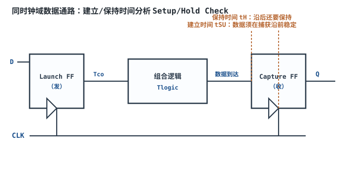
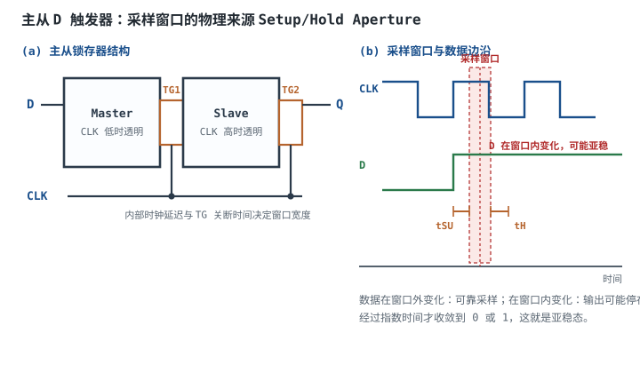
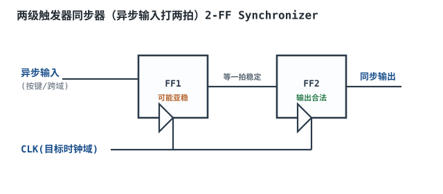
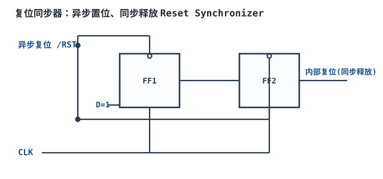

# 时序分析：建立/保持时间与亚稳态

一颗标称 100MHz 的 FPGA，周期 10ns。数据从发端触发器出来，经过 $T_{co}=2\text{ns}$、组合逻辑 $T_{logic}=5\text{ns}$，收端触发器要求 $T_{su}=1.5\text{ns}$，时钟偏斜 0.8ns，抖动 0.5ns。五项一加是 9.8ns，只剩 0.2ns 裕量。常温、标称电压下它“能跑”；温度升高、电压跌到下限、或者换一批芯片，这 0.2ns 就可能被吃掉，于是出现“实验室一切正常、现场偶发死机”的经典故障。时序分析的价值，就是在上板之前把这 0.2ns 算清楚，而不是靠示波器碰运气。

这一章讲三件事：建立/保持时间从哪里来、怎么用一个不等式判断系统能不能跑多快；亚稳态为什么无法根除、只能用概率和 MTBF 管理；跨时钟域为什么必须用同步器，以及两级触发器、握手、异步 FIFO 各自适合什么场合。读完之后，你应该能拿到一组器件参数，独立算出一个时钟域的最高频率、判断保持时间是否安全、并给出一套可验收的 CDC 方案。

## 1. 设计动机

::: motivation 三个现场
**现场一：常温通过，低温失败。** 一块 100MHz 的板子在 25°C 老化房里跑 72 小时不出错，装到户外设备里，冬天早晨第一次上电就死机。复现后发现，低温下触发器 $T_{co}$ 变慢、组合逻辑变慢，建立裕量从 +0.2ns 变成 −0.4ns。**建立时间违例不是“坏了”，而是“在某个 PVT 角上不够快”。**

**现场二：平均几小时死机一次，示波器抓不到。** 一个异步按键信号直接进状态机的 D 端，没有同步器。按键动作相对 100MHz 时钟是随机的，落在建立/保持窗口内的概率极小，但一旦落入，第一级触发器进入亚稳态，输出在 0 和 1 之间停留几十到几百皮秒，后级逻辑可能采到非法电平。**亚稳态窗口通常只有几十皮秒，普通示波器触发不到，但概率会累积成“平均几小时一次”的故障。**

**现场三：多 bit 总线跨域，偶发拼错值。** 8 位数据从慢时钟域送到快时钟域，设计者给每一位都加了两级同步器。大部分时间没问题，偶尔读到一个从未出现过的值。原因是各位的到达时刻和同步器延迟不同，逐位同步会把“旧字节”和“新字节”的位拼在一起。**多 bit 数据不能逐位同步，必须用握手或异步 FIFO 保证整组数据的原子性。**
:::

时序问题可以分成四类，症状和手段完全不同：

| 问题 | 本质 | 典型症状 | 主要手段 |
|---|---|---|---|
| 建立违例 | 数据到得太晚 | 高频/低压/高温下偶发错误，降频可缓解 | 缩短逻辑、流水线、降频、换更快器件 |
| 保持违例 | 数据来得太早 | 上电就错，与频率无关，降温/升压可能更糟 | 加延迟、调整时钟偏斜、换器件 |
| 亚稳态 | 异步采样落入窗口 | 概率性死机、状态机跑飞、复位异常 | 同步器、握手、异步 FIFO、格雷码 |
| 偏斜/抖动 | 时钟到达时刻不确定 | 裕量随位置/时间变化，批次差异大 | 时钟树、约束、PLL 滤波、留裕量 |

本章的主线是：**先把建立/保持变成一个可计算的不等式，再把亚稳态变成一个可计算的概率，最后把跨时钟域变成一个可验收的结构。** 触发器本身的行为见[触发器](flip-flops.md)，时钟产生与复位策略见[时钟与复位设计](clock-reset-design.md)，寄存器和计数器的实现见[寄存器、计数器与分频](registers-counters.md)。

## 2. 定义与直观

### 2.1 建立时间与保持时间

**建立时间（Setup Time, $T_{su}$）**是数据在采样时钟沿到来之前必须保持稳定的最短时间。**保持时间（Hold Time, $T_h$）**是数据在采样时钟沿之后必须继续保持稳定的最短时间。两者合起来构成一个以时钟沿为中心的**采样窗口（Aperture）**：数据在窗口内变化，触发器就可能采样到不确定的值。

这两个参数不是制造出来的“规定”，而是触发器内部结构的直接结果。下面用主从结构解释它们的物理来源。

### 2.2 物理来源：主从锁存器与采样窗口

一个边沿触发的 D 触发器，内部通常是两个背靠背的锁存器：**主锁存器（Master）**和**从锁存器（Slave）**，中间用传输门（Transmission Gate, TG）隔开。时钟为低时，主锁存器透明，D 端的值传到主锁存器的内部节点；时钟为高时，主锁存器断开，从锁存器把主锁存器的值送到 Q。

建立时间来自“主锁存器必须在时钟沿之前完成对输入的学习”。时钟沿并不是瞬间到达传输门的：时钟缓冲器有延迟，传输门的关断也需要时间，主锁存器内部的反相器对还要把节点电容充放电到足够好的电平。如果 D 端在时钟沿前太晚才变化，主锁存器内部节点还没来得及建立足够的压差，时钟沿一到，传输门关断，主锁存器就把一个“半成品”锁在里面。这个“提前量”就是 $T_{su}$。

保持时间来自“时钟沿之后传输门不能立刻关死”。时钟沿到来后，主锁存器的传输门需要一段时间才完全关断；在这段时间里，D 端如果变化，仍能通过尚未关断的传输门耦合进主锁存器，破坏刚刚锁存的值。这个“沿后不能变”的时间就是 $T_h$。

把这两个过程放到一张图上，就是一个以时钟沿为中心的禁区：左边 $T_{su}$，右边 $T_h$。数据在禁区外变化，触发器能可靠采样；数据在禁区内变化，触发器可能采样正确，也可能进入亚稳态。**关键点是：这不是一个“过了线就必然错”的硬 cliff，而是一个概率随数据边沿位置连续变化的窗口。** 数据正好落在窗口正中间，失败概率最高；落在窗口边缘，失败概率很低但仍非零。这正是 MTBF 存在的意义。

$T_{su}$ 和 $T_h$ 也不是永远不变的常数。它们随电源电压、温度、输入边沿速率、输出负载变化：电压越低、温度越高、边沿越慢，内部节点越难在窗口内建立，$T_{su}$ 通常越大。数据手册给的是某个测试条件下的保证值，时序分析必须用最坏角（slow corner）的参数，不能拿典型值当保证值。

### 2.3 亚稳态

**亚稳态（Metastability）**是指触发器在采样窗口内采样时，内部正反馈环路没有获得足够大的初始压差，输出停在逻辑阈值附近、既不满足 $V_{OH}$ 也不满足 $V_{OL}$ 的状态。它不是稳定的第三态，而是一个**不稳定的平衡点**：任何微小的噪声或热扰动都会让它向 0 或 1 收敛，但收敛时间不确定。

可以把亚稳态想成一枚竖着立在桌面上的硬币：它能短暂保持直立，但最终一定会倒向某一面；倒下的时间取决于是哪一边先受到扰动。触发器的正反馈环路类似：初始压差 $\Delta V_0$ 越小，需要的时间越长；这个时间近似按指数规律增长。2.5 节会给出定量式子。

亚稳态有两个工程后果：

1. **输出电平非法**：后级组合逻辑可能把中间电平同时判成 0 和 1，产生毛刺、短路电流或错误状态。
2. **收敛时间不确定**：即使最终落到合法电平，什么时候落到也不确定，后级如果采得太早，会采到还在变化的输出。

所以亚稳态不能靠“等一等”解决，必须靠**结构**：在异步输入和同步逻辑之间插入同步器，让第一级去承受亚稳态，第二级在下一个时钟沿再采样，给第一级留出一整个周期去收敛。

### 2.4 偏斜、抖动与裕量

**时钟偏斜（Clock Skew, $T_{skew}$）**是同一个时钟沿到达不同触发器的时刻差。它是空间上的、静态的：由时钟树长度、缓冲器延迟、负载差异决定，同一块板子上基本固定。**时钟抖动（Clock Jitter, $T_{jitter}$）**是同一个时钟沿在不同周期之间的时间波动，是时间上的、动态的：由 PLL 相位噪声、电源噪声、温度漂移、串扰引起。

**时序裕量（Slack）**是“允许的最长时间”减去“实际需要的时间”。建立裕量为正，说明数据在收端窗口打开前已经稳定；为负，说明数据到晚了。保持裕量为正，说明数据在收端窗口关闭后才变化；为负，说明数据变早了。

工程上还要区分**周期抖动（Period Jitter）**、**周期间抖动（Cycle-to-Cycle Jitter）**和**长期抖动（Long-Term Jitter）**。对建立时间最相关的是：在目标误码率下，时钟周期可能缩短多少。对保持时间，因为发端和收端用的是同一个沿，同一沿的共模抖动大部分会抵消；真正影响保持的是偏斜、占空比失真和不同时钟路径上的差分抖动。这一点在 3.6 节展开。

### 2.5 同步设计与跨时钟域

**同步设计（Synchronous Design）**指系统中所有触发器都由同一个时钟（或由同一 PLL 产生的、有确定相位关系的时钟）驱动，数据从一个触发器到另一个触发器的延迟可以在统一的时间基准上计算。同步设计的前提是：所有时钟域之间的数据传递都经过**同步器（Synchronizer）**。

**跨时钟域（Clock Domain Crossing, CDC）**指数据从一个时钟域传到另一个没有固定相位关系的时钟域。CDC 的风险不是“延迟大”，而是“采样时刻相对数据是随机的”：数据可能在任意时刻变化，接收端可能在任意时刻采样，两者没有共同的时间基准。这就是亚稳态的温床。

跨时钟域有三种基本结构，后面 3.7 节会给出取舍表：

- **两级触发器同步器（2-FF Synchronizer）**：适合单 bit、电平型或慢变信号。
- **握手（Handshake）**：适合多 bit、低频、可以接受往返延迟的数据块。
- **异步 FIFO（Asynchronous FIFO）**：适合多 bit、高速、连续流的数据。

## 3. 定量关系

### 3.1 建立时间方程

设发端触发器和收端触发器由同一个时钟驱动，时钟周期为 $T_{clk}$。数据从发端时钟沿出发，经过 $T_{co}$ 到达发端 Q，再经过组合逻辑 $T_{logic}$ 到达收端 D。收端要求数据在捕获沿前 $T_{su}$ 稳定。把偏斜和抖动作为不确定量加进去：

$$
T_{clk} \ge T_{co} + T_{logic,max} + T_{su} + T_{skew} + T_{jitter}
$$

其中：

- $T_{clk}$：时钟周期，s；
- $T_{co}$：发端触发器从时钟沿到 Q 有效的最大延迟（clock-to-Q），s；
- $T_{logic,max}$：组合逻辑的最大延迟，s；
- $T_{su}$：收端触发器的建立时间，s；
- $T_{skew}$：最坏情况下使建立变差的时钟偏斜绝对值，s；
- $T_{jitter}$：在目标误码率下，时钟周期的峰峰值抖动，s。

这个式子的符号约定很重要：这里把 $T_{skew}$ 定义为“对建立最不利的偏斜绝对值”，所以它总是加在右边。如果收端时钟比发端晚到（正偏斜），对建立有利；如果收端早到（负偏斜），对建立不利。工程上最稳妥的做法是：**建立分析用“收端最早、发端最晚”的角，保持分析用“收端最晚、发端最早”的角。** 不要用一个带符号的 $T_{skew}$ 同时套两个式子，否则很容易把方向搞反。

抖动的处理同理：建立分析要用“周期可能最短”的抖动，即把 $T_{jitter}$ 加到需求侧；保持分析因为发端和收端是同一个沿，周期抖动大部分抵消，但占空比失真和不同路径的抖动仍要单独考虑。

把不等式移项，得到**建立裕量（Setup Slack）**：

$$
Slack_{setup} = T_{clk} - \left(T_{co} + T_{logic,max} + T_{su} + T_{skew} + T_{jitter}\right)
$$

$Slack_{setup} \ge 0$ 表示建立时间满足；小于 0 表示违例。注意 slack 的单位是秒，工程上常用 ns 或 ps 表示。

### 3.2 保持时间方程

保持检查看的是**同一个时钟沿**：发端在沿上把新数据打出来，收端也在同一个沿上采样旧数据。新数据不能来得太快，否则收端还没保持住旧数据，就被新数据冲掉了。

$$
T_{co,min} + T_{logic,min} \ge T_h + T_{skew}
$$

其中：

- $T_{co,min}$：发端触发器从时钟沿到 Q 有效的最小延迟，s；
- $T_{logic,min}$：组合逻辑的最小延迟，s；
- $T_h$：收端触发器的保持时间，s；
- $T_{skew}$：最坏情况下使保持变差的偏斜绝对值，s。

保持裕量：

$$
Slack_{hold} = T_{co,min} + T_{logic,min} - T_h - T_{skew}
$$

保持违例的可怕之处在于它**与时钟周期无关**：降频不会让 $T_{co,min}+T_{logic,min}$ 变大，所以降频也修不好。它通常在“快角”（fast corner，低温度、高电压、快工艺）最严重，因为那时 $T_{co,min}$ 和 $T_{logic,min}$ 都更小。很多团队只盯 setup slack，结果样机在常温下正常，一到低温或换快片就上电即错。

保持违例的常见修法不是“加逻辑”，而是**加延迟**：在数据路径上串缓冲器/延迟单元，或者调整时钟树让收端时钟晚一点到（但这样会吃建立裕量）。在 FPGA 里，工具通常会自动插入延迟来修 hold；在 ASIC 里，hold fix 是后端流程的固定步骤。对设计者来说，最重要的是**在时序报告里同时看 setup 和 hold**，不要只看一个。

### 3.3 最高频率与利用率

把建立方程按周期解出来，就得到这个时钟域的最高频率：

$$
f_{max} = \frac{1}{T_{co} + T_{logic,max} + T_{su} + T_{skew} + T_{jitter}}
$$

这个式子是“组合路径 + 触发器”的一条龙预算。它假设：

1. 时钟周期稳定，抖动已折算成峰峰值；
2. 偏斜已按最坏方向取绝对值；
3. 组合逻辑延迟是最大延迟，不含毛刺/串扰的额外裕量；
4. 触发器参数取最坏 PVT 角。

实际工程还要留**设计裕量（Design Margin）**：不能把 $f_{max}$ 当成“一定能跑”的频率。常见的做法是让目标频率不超过计算值的 90%~95%，或者让 slack 至少为周期的 5%~10%。3.3 节的算例会展示：0.2ns 的 slack 在 10ns 周期里只有 2%，看起来“过了”，但经不起 PVT 和批次波动。

### 3.4 亚稳态的指数收敛与 MTBF

亚稳态的收敛可以用正反馈环路的一阶模型描述。设触发器内部节点在采样后的初始压差为 $\Delta V_0$，环路的时间常数为 $\tau$，则压差随时间近似为：

$$
\Delta V(t) = \Delta V_0 \, e^{t/\tau}
$$

当 $\Delta V(t)$ 增长到逻辑阈值附近，触发器就完成判决。初始压差越小，需要的时间越长；这就是“亚稳态持续时间不确定”的数学来源。时间常数 $\tau$ 与节点电容 $C$ 和环路跨导 $g_m$ 有关，量级上：

$$
\tau \approx \frac{C}{g_m}
$$

其中 $C$ 是内部节点电容，F；$g_m$ 是正反馈环路的等效跨导，S；$\tau$ 是秒。现代 CMOS 工艺的 $\tau$ 通常在几十皮秒量级，具体随工艺、电压、温度变化，**典型量级，以器件表征/数据手册为准**。

工程上不直接算“某一次会不会亚稳”，而是算**平均无故障时间（Mean Time Between Failures, MTBF）**：

$$
MTBF = \frac{e^{t_r/\tau}}{T_0 \, f_{clk} \, f_{data}}
$$

其中：

- $t_r$：留给第一级触发器收敛的时间，s；
- $\tau$：亚稳态收敛时间常数，s；
- $T_0$：采样窗口宽度，约等于 $T_{su}+T_h$，s；
- $f_{clk}$：接收时钟频率，Hz；
- $f_{data}$：异步数据事件的平均频率，Hz；
- $MTBF$：平均无故障时间，s。

这个式子的物理意义很清楚：分母是“单位时间内落入窗口的机会”，分子是指数小的“收敛失败概率”。$t_r$ 越大，MTBF 指数上升；$f_{clk}$、$f_{data}$ 越大，MTBF 线性下降。**这就是为什么时钟越快、异步事件越多，越需要更多级同步器。**

对两级同步器，第一级从时钟沿到第二级采样之间有一整个周期可用，所以：

$$
t_r = T_{clk} - T_{co} - T_{su}
$$

这里假设第一级触发器的 $T_{co}$ 和第二级的 $T_{su}$ 是最坏值，且两级之间没有组合逻辑。如果中间插了组合逻辑，$t_r$ 要减掉逻辑延迟，MTBF 会指数下降——这就是“同步器两级之间不能插组合逻辑”的定量理由。

MTBF 公式的适用条件必须说清楚：

1. 异步数据边沿相对时钟是均匀分布的；
2. $\tau$ 和 $T_0$ 来自器件表征，不随数据图案剧烈变化；
3. 只考虑单级触发器的亚稳态，不考虑后级逻辑的毛刺传播；
4. 没有考虑老化、辐照、电源噪声导致的参数漂移。

所以 MTBF 是**统计量**，不是“保证不会坏”的承诺。$10^{20}$ 年的 MTBF 不代表“永远不会坏”，只代表在模型假设下故障率极低；如果电源噪声、温度或工艺角超出模型，实际 MTBF 会变差。

### 3.5 两级同步器为什么有效

假设第一级触发器在时钟沿采样到异步数据，落入窗口，进入亚稳态。它需要在第二级采样之前收敛到合法电平。两级同步器给了它一整个周期 $t_r=T_{clk}-T_{co}-T_{su}$。第二级触发器在下一个沿采样时，第一级输出已经以 $1-e^{-t_r/\tau}$ 的概率收敛；只要没收敛，第二级就可能采到亚稳态，但第二级自己又有一整个周期去收敛。**级联把“一次采样失败”变成“连续两次都失败”，概率按指数相乘。**

定量地看，两级同步器的 MTBF 近似为：

$$
MTBF_{2FF} \approx \frac{e^{t_r/\tau}}{T_0 \, f_{clk} \, f_{data}}
$$

而单级同步器（第一级输出直接进组合逻辑/状态机）留给收敛的时间只有：

$$
t_{r,1FF} = T_{clk} - T_{co} - T_{logic} - T_{su}
$$

通常比一整个周期小得多，甚至为负。$t_r$ 每减少一个 $\tau$，MTBF 就下降 $e\approx2.718$ 倍；减少几个 $\tau$，MTBF 就掉几个数量级。4.2 节会用具体数字展示：同样 100MHz，单级 $t_r=0.5\text{ns}$ 的 MTBF 只有约 0.11s，两级 $t_r=6.5\text{ns}$ 的 MTBF 可以到 $10^{51}$ 秒量级。

两级同步器的代价是**延迟**：数据要经过两个时钟沿才稳定，通常算 2 个周期（如果算上发端和收端的寄存器，系统延迟可能 3 个周期）。对控制信号（使能、复位、中断）这通常可以接受；对高速数据流，就要用异步 FIFO 或握手来隐藏/分摊延迟。

三级同步器在以下情况使用：

- 时钟频率很高（例如 > 300MHz），单级 $t_r$ 仍然不够；
- 异步事件率很高（例如高速串行数据的恢复时钟）；
- 对 MTBF 要求极高（例如医疗、汽车、航天）；
- 第一级触发器靠近异步输入，布线延迟/噪声较大。

代价是再多一拍延迟和面积。**不是级数越多越好**：如果第一级本身已经满足 MTBF 目标，多加一级只是增加延迟；如果第一级的 $t_r$ 为负（时钟周期小于 $T_{co}+T_{su}$），加级也救不了，因为触发器本身已经不能正常工作了。

### 3.6 时钟偏斜与抖动的影响

偏斜和抖动对 setup/hold 的影响方向不同，必须分开算：

| 因素 | 来源 | 对建立 | 对保持 | 处理 |
|---|---|---|---|---|
| 静态偏斜 | 时钟树长度、缓冲器、负载 | 收端晚到有利，早到不利 | 收端晚到不利，早到有利 | 时钟树综合、useful skew、约束 |
| 周期抖动 | PLL 相位噪声、电源噪声 | 周期变短时不利 | 同沿大部分抵消 | 留 jitter 裕量、PLL 滤波、去耦 |
| 占空比失真 | 时钟缓冲器不对称、PLL | 高/低半周期不等，影响建立/保持 | 影响保持 | 时钟整形、占空比校正 |
| 串扰/噪声 | 相邻走线、电源地弹 | 等效为抖动/延迟变化 | 等效为偏斜 | 间距、屏蔽、回流 |

一个常见的误区是“偏斜越小越好”。实际上，**有用的偏斜（Useful Skew）**可以救建立：如果某条路径组合逻辑特别长，让收端时钟晚到一点，建立裕量会增加；代价是同一路径的保持裕量减少。后端工具会做这种权衡，但设计者要给它留出空间，不能把时钟树约束死。

抖动的处理要区分“峰峰值”和“RMS”。数据手册常给 RMS 抖动，而时序分析要的是在目标误码率下的峰峰值；两者之间用倍数换算（例如随机抖动按 BER 查高斯尾），不能直接把 RMS 当峰峰值加进去。对大多数同步数字设计，用 PLL 数据手册的 period jitter 峰峰值，再加 20%~30% 余量，是保守的起点；对高速 SerDes，要按 RJ/DJ 分解和 BER 目标算。

### 3.7 跨时钟域的三种同步器

| 方案 | 适用 | 延迟 | 吞吐 | 关键约束 | 典型场景 |
|---|---|---|---|---|---|
| 两级触发器 | 单 bit 电平/慢变信号 | 2~3 个目的时钟周期 | 每个事件一次 | 源信号必须稳定足够长；两级间不能插逻辑 | 按键、使能、中断、复位释放 |
| 握手 | 多 bit 数据块，低频 | 往返 4~6 个周期 | 低 | 数据必须在 req 有效期间保持稳定；ack 要同步 | 配置寄存器、状态字、低速采集 |
| 异步 FIFO | 多 bit 连续流 | 写入/读出各 2~3 周期 | 每周期 1 字 | 指针用格雷码；深度覆盖同步延迟；满/空标志 | 采样数据流、总线桥、视频/音频 |

**两级触发器同步器**只能处理单 bit。对脉冲信号，不能直接把脉冲送进同步器（脉冲可能比目的时钟周期窄，被完全漏掉），要用**翻转同步器（Toggle Synchronizer）**：源域每来一个事件翻转一次，目的域用两级触发器同步这个翻转电平，再做边沿检测，恢复出一个目的域的脉冲。这样脉冲宽度由目的时钟决定，不会漏掉。

**握手**的核心是“数据先稳定，再发请求”：源域把数据放到总线，等待至少一个建立时间，然后拉高 req；req 经过两级同步器到目的域；目的域采样数据，处理完后拉高 ack；ack 再经过两级同步器回源域；源域收到 ack 后才改数据。数据总线本身不需要同步器，因为它在整个握手期间保持稳定。握手的问题是往返延迟大，吞吐低；适合“偶尔传一个寄存器”的场景，不适合连续数据流。

**异步 FIFO** 的核心是“双端口存储 + 格雷码指针”：写指针和读指针分别在各自的时钟域递增，指针跨域时用两级同步器；因为格雷码每次只变一位，即使采样到正在变化的指针，最多只差一个 counts，不会出现“指针跳到完全错误的位置”。空/满标志由读写指针比较产生，必须留够同步延迟的余量，否则会出现“看起来空/满，实际还有空间”或反之。FIFO 的深度要按“同步延迟 × 数据速率”估算，具体在 4.3 节算。

多 bit 二进制计数器跨域是经典陷阱：二进制计数从 0111 变到 1000 时 4 位同时变化，逐位同步可能采到 1111（=15）或 0000（=0），误差可以到半个量程。格雷码每次只变一位，采样误差最多 1 个 counts。**所以跨时钟域的计数器/指针要用格雷码，不能用二进制。**

## 4. 典型计算

### 4.1 100MHz 系统能否跑

**需求**：时钟 100MHz，周期 $T_{clk}=10\text{ns}$；发端 $T_{co}=2\text{ns}$；组合逻辑 $T_{logic}=5\text{ns}$；收端 $T_{su}=1.5\text{ns}$；最坏偏斜 0.8ns；峰峰值抖动 0.5ns。判断建立/保持是否满足，并给出最高频率。

**第一步，算建立需求**：

$$
T_{req} = T_{co} + T_{logic} + T_{su} + T_{skew} + T_{jitter}
$$

$$
T_{req} = 2 + 5 + 1.5 + 0.8 + 0.5 = 9.8\ \text{ns}
$$

**第二步，算建立裕量**：

$$
Slack_{setup} = 10 - 9.8 = 0.2\ \text{ns}
$$

$0.2\text{ns} > 0$，建立时间满足。**结论：100MHz 能跑，但裕量只有 0.2ns，占周期的 2%。**

**第三步，算最高频率**：

$$
f_{max} = \frac{1}{T_{req}} = \frac{1}{9.8\times10^{-9}} = 1.0204\times10^{8}\ \text{Hz} = 102.04\ \text{MHz}
$$

也就是说，理论上这个路径最高跑到约 102MHz。100MHz 对应 10ns，比 9.8ns 多 0.2ns；102.04MHz 对应 9.8ns，刚好用满。**“最高频率”不是“安全频率”**：它只说明在标称参数下刚好不违例，没有给 PVT、批次、老化留任何余量。

**第四步，做敏感性分析**。如果组合逻辑比估计慢 0.2ns（5.2ns），则 $T_{req}=10.0\text{ns}$，slack=0，正好卡在边界；如果慢 0.3ns，slack=−0.1ns，违例。如果偏斜从 0.8ns 增加到 1.5ns，$T_{req}=10.5\text{ns}$，最高频率降到：

$$
f_{max} = \frac{1}{10.5\times10^{-9}} = 95.24\ \text{MHz}
$$

连 100MHz 都跑不到。如果抖动从 0.5ns 增加到 1.0ns，$T_{req}=10.3\text{ns}$，$f_{max}=97.09\text{MHz}$。**0.2ns 的裕量，经不起任何一项的 0.2ns 恶化。**

**第五步，判断工程上能不能接受**。如果目标频率是 100MHz，建议至少留 5% 周期（0.5ns）的裕量，即要求 $T_{req}\le9.5\text{ns}$。当前 9.8ns 不满足，有三条路：

1. **降频**：目标降到 95MHz（周期 10.53ns），slack=0.73ns，满足 5% 裕量；
2. **缩短逻辑**：把 5ns 组合逻辑拆成两级流水线，每级 2.5ns，中间加寄存器。新周期为 $2+2.5+1.5+0.8+0.5=7.3\text{ns}$，$f_{max}=136.99\text{MHz}$，100MHz 下 slack=2.7ns；代价是增加一拍延迟；
3. **换器件/优化布局**：降低 $T_{co}$、$T_{su}$ 或偏斜，但收益通常不如流水线直接。

**第六步，保持检查**。设最坏快角下 $T_{co,min}=1.2\text{ns}$，$T_{logic,min}=3.0\text{ns}$，$T_h=0.5\text{ns}$，偏斜 0.8ns：

$$
Slack_{hold} = 1.2 + 3.0 - 0.5 - 0.8 = 2.9\ \text{ns}
$$

保持裕量 2.9ns，远大于 0，保持安全。注意这里的偏斜方向和建立分析相反：保持分析要假设收端时钟“晚到”，即 $T_{skew}$ 对保持不利的方向。如果实际偏斜方向相反，保持裕量会更大；工程上取最坏方向即可。

### 4.2 两级同步器的 MTBF

**需求**：100MHz 时钟，异步数据事件率 $f_{data}=1\text{MHz}$，采样窗口 $T_0=T_{su}+T_h=1.5+0.5=2.0\text{ns}$，亚稳态时间常数 $\tau=50\text{ps}$。用两级同步器，第一级 $T_{co}=2\text{ns}$，第二级 $T_{su}=1.5\text{ns}$。求 MTBF，并和单级同步器对比。

**第一步，算第一级的收敛时间**：

$$
t_r = T_{clk} - T_{co} - T_{su} = 10 - 2 - 1.5 = 6.5\ \text{ns}
$$

**第二步，算指数项**：

$$
e^{t_r/\tau} = e^{6.5/0.05} = e^{130} \approx 2.87\times10^{56}
$$

**第三步，算分母**：

$$
T_0 f_{clk} f_{data} = 2.0\times10^{-9}\times1.0\times10^{8}\times1.0\times10^{6} = 2.0\times10^{5}\ \text{s}^{-1}
$$

**第四步，算 MTBF**：

$$
MTBF = \frac{2.87\times10^{56}}{2.0\times10^{5}} = 1.44\times10^{51}\ \text{s}
$$

换算成年（1 年约 $3.156\times10^{7}$ 秒）：

$$
MTBF = \frac{1.44\times10^{51}}{3.156\times10^{7}} \approx 4.55\times10^{43}\ \text{年}
$$

这个数字远大于宇宙年龄，说明在模型假设下，两级同步器在 100MHz、1MHz 异步事件率下几乎不可能因亚稳态失效。**注意：这不是“绝对不会坏”，而是“亚稳态导致的平均故障间隔极长”；电源、复位、时序违例、软件 bug 仍可能让系统出错。**

**第五步，和单级对比**。如果第一级输出直接进组合逻辑，留给它的收敛时间只有：

$$
t_{r,1FF} = T_{clk} - T_{co} - T_{logic} - T_{su} = 10 - 2 - 5 - 1.5 = 1.5\ \text{ns}
$$

MTBF：

$$
MTBF_{1FF} = \frac{e^{1.5/0.05}}{2.0\times10^{5}} = \frac{e^{30}}{2.0\times10^{5}} = \frac{1.07\times10^{13}}{2.0\times10^{5}} = 5.34\times10^{7}\ \text{s} \approx 1.69\ \text{年}
$$

如果是更短的组合逻辑，比如 0.5ns 收敛时间：

$$
MTBF_{1FF} = \frac{e^{0.5/0.05}}{2.0\times10^{5}} = \frac{e^{10}}{2.0\times10^{5}} = \frac{22026}{2.0\times10^{5}} = 0.110\ \text{s}
$$

**0.11 秒**，意味着平均每 0.11 秒就可能发生一次亚稳态失效——这就是“单级同步器不可用”的定量证据。两级把 $t_r$ 从 0.5ns 提到 6.5ns，MTBF 提升了约 $10^{52}$ 倍。

**第六步，看 $\tau$ 的影响**。$\tau$ 不是常数，随工艺/电压/温度变化。同样 $t_r=6.5\text{ns}$：

| $\tau$ | $e^{t_r/\tau}$ | MTBF | 换算年 |
|---|---|---|---|
| 50ps | $2.87\times10^{56}$ | $1.44\times10^{51}$ s | $4.55\times10^{43}$ 年 |
| 100ps | $1.70\times10^{28}$ | $8.47\times10^{22}$ s | $2.68\times10^{15}$ 年 |
| 200ps | $1.30\times10^{14}$ | $6.51\times10^{8}$ s | 20.6 年 |

如果 $\tau$ 从 50ps 退化到 200ps，MTBF 从 $10^{43}$ 年掉到 20 年——仍然可用，但已经不是“天文数字”。**所以 MTBF 计算必须用最坏角的 $\tau$，不能拿典型值交差。** 如果目标是 100 年 MTBF，需要的收敛时间：

$$
t_r = \tau \ln\left(MTBF \cdot T_0 f_{clk} f_{data}\right) = 0.05 \ln\left(3.156\times10^{9}\times2.0\times10^{5}\right) \approx 1.70\ \text{ns}
$$

100MHz 下可用 6.5ns，够；但如果时钟升到 500MHz（$T_{clk}=2\text{ns}$），$t_r=2-2-1.5=-1.5\text{ns}$，触发器本身已经不满足 $T_{co}+T_{su}$，加同步器级数也没用，必须先解决触发器/时钟结构。

### 4.3 多 bit 跨域：二进制与格雷码

**需求**：一个 12 位二进制计数器在 100MHz 域连续计数，要跨到另一个异步域读取。比较“逐位同步二进制”和“格雷码同步”的最坏误差。

二进制计数器从 2047（0111 1111 1111）变到 2048（1000 0000 0000）时，12 位全部翻转。逐位同步时，每一位的采样结果可能是旧值也可能是新值，拼起来可以是 0000 0000 0000 到 1111 1111 1111 之间的任意值，最坏误差：

$$
2047 - 0 = 2047\ \text{个 counts}
$$

或

$$
4095 - 2048 = 2047\ \text{个 counts}
$$

也就是说，读到的值可能偏离真实值半个量程。对控制环路、位置反馈、时间戳，这是不可接受的。

格雷码每次只变一位。逐位同步时，只有那一位可能采到旧值或新值，其他位都稳定，所以最坏误差：

$$
1\ \text{个 count}
$$

**结论：跨时钟域的计数器/指针用格雷码，误差从半个量程降到 1 个 counts。** 异步 FIFO 的读写指针正是这个道理；但注意格雷码只保证“指针值不会离谱”，不保证“数据已经稳定”，数据仍然要靠 FIFO 的读写时序和满/空标志来保护。

## 5. 工程含义

### 5.1 裕量政策

时序预算不是“算到刚好不违例”就结束。工程上建议：

- **建立裕量**：至少 5% 周期，或 0.2ns（取较大者）；高速设计（>500MHz）建议 10%；
- **保持裕量**：至少 0.1ns，且必须在快角检查；
- **抖动**：用 PLL 数据手册的 period jitter 峰峰值，加 20%~30% 余量；
- **偏斜**：用时钟树综合后的最坏值，不要用估计值；
- **PVT**：至少覆盖 slow/slow、fast/fast、low-voltage、high-temperature 四个角；安全/汽车/医疗要加老化与辐照余量。

0.2ns 的 slack 在 10ns 周期里是 2%，在 2ns 周期里是 10%——**同样的绝对裕量，在不同频率下意义完全不同**。所以裕量政策要按“周期百分比”和“绝对时间”双门槛，不能只看一个。

### 5.2 约束怎么写

在 FPGA/ASIC 时序约束里，至少要写清楚：

- **主时钟**：`create_clock -period 10.000 -name clk [get_ports clk]`，周期单位与工具一致；
- **时钟不确定性**：`set_clock_uncertainty`，把偏斜、抖动、留量合并成一个值；不要把 jitter 和 skew 重复加；
- **输入/输出延迟**：`set_input_delay` / `set_output_delay`，告诉工具外部数据相对时钟的到达/要求时刻；
- **多周期路径**：`set_multicycle_path`，只用于确实每 N 拍才稳定一次的路径，不能拿来掩盖真实违例；
- **伪路径**：`set_false_path`，只用于异步时钟域之间或确实不分析的路径；**它不会修 CDC，只是告诉 STA “别查”**，同步器仍然要自己加；
- **CDC 约束**：对同步器第一级用 `set_max_delay -datapath_only` 限制布线延迟，或用厂商的 CDC 约束模板；两级之间不能有组合逻辑。

约束的正确性比约束的数量重要。一个常见的错误是：为了“让时序过了”，把一条真实路径设成 false path，结果工具不再检查，硅片上照样违例。**约束是设计意图的声明，不是让报告变绿的工具。**

### 5.3 时钟树与 CDC 实现

- **时钟树**：用平衡树/H 树/时钟网格降低偏斜；把同频同相的时钟合并；避免时钟经过组合逻辑（毛刺、占空比失真）；时钟 gating 要用专用单元，不要让工具综合出毛刺。
- **同步器放置**：两级触发器放在同一个模块、同一时钟域、彼此相邻；中间不插组合逻辑、不插 LUT；在 FPGA 里给第一级加 `ASYNC_REG` 属性，让工具把它放在相邻的触发器上，减少布线延迟和亚稳态传播。
- **复位**：异步置位、同步释放；复位释放沿也要同步，否则释放时刻可能落在时钟窗口里。具体结构见[时钟与复位设计](clock-reset-design.md)。

- **多 bit 数据**：用握手或异步 FIFO；不要逐位同步；不要用“多 bit 一起过两级触发器”冒充同步器（各位仍然可能采到不同步的值）。
- **格雷码**：计数器/指针跨域用格雷码；格雷码转二进制、二进制转格雷码的组合逻辑要在各自域内完成，不要跨域。

### 5.4 验证与测量

- **静态时序分析（STA）**：跑 setup/hold、min/max、OCV/AOCV；看 worst negative slack（WNS）、total negative slack（TNS）、violating paths；不要只看一个数。
- **CDC 检查**：用厂商 CDC 工具或 lint 检查跨域路径、同步器结构、格雷码、握手协议；工具会报“unsynchronized crossing”“combinational logic between synchronizers”等问题。
- **形式验证**：对握手/FIFO 的协议做形式检查（无死锁、无溢出、无下溢）；对复位序列做检查。
- **硬件测试**：在最高频率、最低电压、最高温度下跑长时间压力测试；用异步激励（随机按键、外部时钟源）提高亚稳态触发概率；用示波器/逻辑分析仪看同步器输出是否有中间电平（注意探头负载会影响电路）。
- **不能靠 RTL 仿真发现亚稳态**：RTL 仿真里触发器要么 0 要么 1，不会出现中间电平；要门级仿真带 SDF 延迟，或者用厂商的亚稳态模型。**“仿真跑通了”不等于“硅片上不会亚稳态”。**

## 6. 常见坑

::: pitfall 常见坑
- **只查 setup，不查 hold**：现象——常温、标称电压下正常，低温或快片第一次上电就错，降频也不管用。原因——保持违例与周期无关，快角下 $T_{co,min}+T_{logic,min}$ 变小，数据来得太早。解决——时序报告同时看 setup/hold，保持分析用快角，必要时在数据路径加延迟或调整时钟偏斜。
- **异步信号直接进组合逻辑/状态机**：现象——按键、外部中断、UART 起始位导致状态机偶发跑飞，平均几小时一次。原因——异步边沿落在采样窗口内，第一级触发器亚稳态，后级组合逻辑把中间电平放大成毛刺。解决——单 bit 先过两级同步器；脉冲用翻转同步器；多 bit 用握手/FIFO。
- **多 bit 总线逐位同步**：现象——跨域后读到从未出现过的值，比如 0111 和 1000 之间拼出 1111。原因——各位到达时刻和同步器延迟不同，逐位采样把新旧位拼在一起。解决——多 bit 用异步 FIFO 或握手；计数器/指针用格雷码。
- **同步器两级之间插组合逻辑**：现象——MTBF 比计算值低很多，偶发亚稳态传播。原因——组合逻辑吃掉了第一级的收敛时间 $t_r$，MTBF 随 $t_r$ 指数下降。解决——两级触发器直接相连，中间不插任何逻辑；需要译码就放到第二级之后。
- **复位异步释放**：现象——上电/按键复位后系统偶发不启动，或启动到错误状态。原因——复位释放沿相对时钟是异步的，可能落在建立/保持窗口内，触发器进入亚稳态。解决——异步置位、同步释放；用两级复位同步器，释放沿对齐到时钟。
- **用 false path 掩盖真实 CDC**：现象——STA 报告全绿，硬件仍偶发错误。原因——false path 只是让工具不分析，并没有加同步器；真实路径仍然亚稳态。解决——先加同步器/握手/FIFO，再用 CDC 约束和工具检查；false path 只用于确实不需要分析的路径。
- **忽略时钟不确定性与 PVT**：现象——按典型参数算 slack 为正，量产批次/高低温出现违例。原因——$T_{co}$、$T_{logic}$、$T_{su}$ 随 PVT 变化，抖动和偏斜被低估。解决——用最坏角参数，留 5%~10% 周期裕量，做 PVT 角分析。
:::

## 7. 自测题

某路径 $T_{co}=1.8\text{ns}$、$T_{logic}=4.2\text{ns}$、$T_{su}=1.2\text{ns}$、偏斜 0.6ns、抖动 0.4ns，时钟 125MHz。建立裕量是多少？最高频率是多少？

周期 $T_{clk}=1/125\text{MHz}=8\text{ns}$。

$$
T_{req}=1.8+4.2+1.2+0.6+0.4=8.2\ \text{ns}
$$

$$
Slack=8-8.2=-0.2\ \text{ns}
$$

建立违例。最高频率：

$$
f_{max}=\frac{1}{8.2\times10^{-9}}=121.95\ \text{MHz}
$$

要跑 125MHz，需要把 $T_{req}$ 至少降到 8ns；可以缩短 0.2ns 逻辑、降低偏斜/抖动，或者把时钟降到 120MHz 以下并留裕量。

为什么保持违例“降频修不好”？如果保持 slack 为 −0.3ns，有哪些修法？

保持检查的式子是 $T_{co,min}+T_{logic,min}\ge T_h+T_{skew}$，里面没有 $T_{clk}$。降频只改变周期，不改变数据从发端沿到收端 D 的最短延迟，所以保持违例依然存在。修法：在数据路径串延迟单元/缓冲器增加 $T_{logic,min}$；调整时钟树让收端时钟更晚到（增加对保持有利的偏斜，但会吃建立裕量）；换 $T_{co,min}$ 更大的触发器；在后端做 hold fix。不能靠降频或加流水线（流水线可能让保持更糟）。

两级同步器，$T_{clk}=10\text{ns}$、$T_{co}=2\text{ns}$、$T_{su}=1.5\text{ns}$、$T_0=2\text{ns}$、$f_{data}=1\text{MHz}$、$\tau=50\text{ps}$。MTBF 是多少？如果把 $\tau$ 改成 100ps 呢？

$t_r=10-2-1.5=6.5\text{ns}$。

$$
MTBF=\frac{e^{6.5/0.05}}{2\times10^{-9}\times10^{8}\times10^{6}}
=\frac{e^{130}}{2\times10^{5}}
=\frac{2.87\times10^{56}}{2\times10^{5}}
=1.44\times10^{51}\ \text{s}
$$

约 $4.55\times10^{43}$ 年。

$\tau=100\text{ps}$：

$$
MTBF=\frac{e^{65}}{2\times10^{5}}
=\frac{1.70\times10^{28}}{2\times10^{5}}
=8.47\times10^{22}\ \text{s}
$$

约 $2.68\times10^{15}$ 年。$\tau$ 翻倍，MTBF 从 $10^{51}$ 秒掉到 $10^{22}$ 秒，说明最坏角 $\tau$ 的选择非常关键。

一个 8 位异步 FIFO 的写时钟 100MHz、读时钟 80MHz，同步器延迟按 2 个读周期算。FIFO 深度至少多少才能不溢出（假设写连续、读连续）？

写速率 100M 字/s，读速率 80M 字/s，净堆积速率：

$$
100-80=20\ \text{M 字/s}
$$

同步延迟按 2 个读周期：

$$
t_{sync}=\frac{2}{80\times10^{6}}=25\ \text{ns}
$$

在这段时间内多写入：

$$
\Delta N=(100-80)\times10^{6}\times25\times10^{-9}=0.5\ \text{字}
$$

理论上 1 个字就够覆盖同步延迟；但实际还要考虑读侧空标志延迟、时钟抖动、突发、以及“满”判断的保守性。工程上按 2~4 倍余量取 4~8 个字，再按协议最大突发长度加余量。这个例子说明：**FIFO 深度不是拍脑袋，要按速率差和同步延迟算，再留突发余量。**

为什么“两级同步器之间不能插组合逻辑”？如果插了一个 2ns 的译码器，MTBF 会怎么变？

两级同步器的第一级需要一整个周期 $t_r=T_{clk}-T_{co}-T_{su}$ 来收敛；中间插组合逻辑会把第二级看到第一级的时间推后，等效 $t_r$ 减少 2ns。以 100MHz、$T_{co}=2\text{ns}$、$T_{su}=1.5\text{ns}$、$\tau=50\text{ps}$ 为例，原来 $t_r=6.5\text{ns}$，插 2ns 后 $t_r=4.5\text{ns}$：

$$
\frac{MTBF_{new}}{MTBF_{old}}=e^{-2/0.05}=e^{-40}\approx4.25\times10^{-18}
$$

MTBF 下降约 17 个数量级。所以同步器两级必须直接相连；译码、比较、选择等逻辑放到第二级之后。

时钟偏斜对建立和保持的影响为什么相反？举一个“有用偏斜”的例子。

设收端时钟比发端晚到 $\delta>0$。建立检查中，收端捕获沿也晚了 $\delta$，数据多出 $\delta$ 时间到达，建立裕量增加；保持检查中，收端捕获沿晚了 $\delta$，新数据相对捕获沿来得更早，保持裕量减少。所以正偏斜“救建立、害保持”。

有用偏斜的例子：某条路径组合逻辑很长，建立 slack 为 −0.3ns，但保持 slack 有 1.0ns。让收端时钟晚到 0.5ns，建立 slack 变成 +0.2ns，保持 slack 变成 0.5ns，两个都满足。这种偏斜是后端工具刻意做的，但必须确保同一时钟域内其他路径不被拖坏，且保持仍有正裕量。

## 8. 参考资料

- **Howard Johnson & Martin Graham, *High Speed Digital Design*, Chapter 11 Clock Distribution**：时钟偏斜、抖动、时钟树与同步器的工程口径；本章 2.4、3.6 的偏斜/抖动分类参考该章。
- **Thomas J. Chaney & Charles E. Molnar, “Anomalous Behavior of Synchronizer and Arbiter Circuits”, *IEEE Transactions on Computers*, Vol. C-22, No. 4, 1973**：亚稳态窗口、指数收敛与 MTBF 的经典分析；本章 3.4、3.5 的模型来自该文。
- **Clifford E. Cummings, “Clock Domain Crossing (CDC) Design & Verification Techniques Using SystemVerilog”, SNUG 2008**：两级同步器、翻转同步器、握手、异步 FIFO 与格雷码的实现细节；本章 3.7、4.3 的 CDC 结构参考该文。
- **AMD/Xilinx, UG949 *UltraFast Design Methodology Guide for FPGAs and SoCs*, Timing Closure 一章**：建立/保持约束、时钟不确定性、CDC 约束与 `ASYNC_REG` 的工程做法；本章 5.2、5.3 的约束示例参考该文档。
- **M. Morris Mano & Michael D. Ciletti, *Digital Design*, 5th ed., Chapter 5 Synchronous Sequential Logic**：触发器时序参数、同步时序分析与时钟偏斜的基础定义；本章 2.1、3.1 的符号体系与该教材一致。
