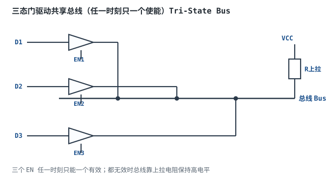
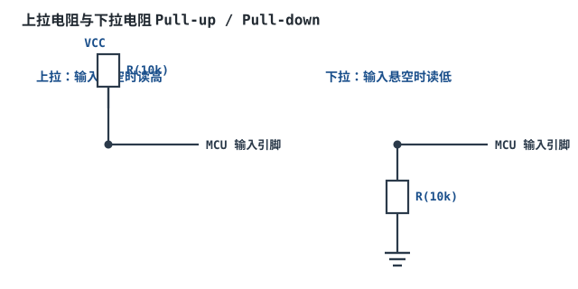
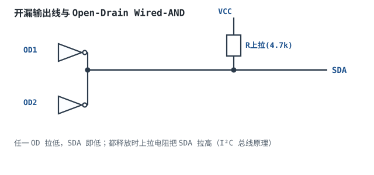
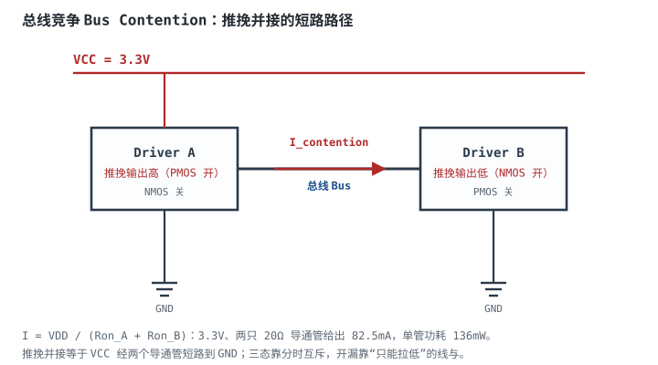

# 三态门、总线与上拉下拉

一根 I²C 总线上挂着 4 个器件，总线电容 200pF，上拉电阻 4.7kΩ。400kHz 快速模式下，上升时间 $0.847\times4.7\text{k}\times200\text{p}=796\text{ns}$，而规范要求不超过 300ns——通信偶尔丢包，逻辑分析仪看到的波形“圆角”很明显。把上拉换成 1.5kΩ，上升时间降到 254ns，通信恢复；但低电平灌电流从 0.62mA 涨到 1.93mA，功耗和驱动能力又要重新核算。**上拉电阻不是一个“经验值”，而是一个由上升时间、低电平电流、总线电容和功耗共同夹出来的窗口。**

这一章讲四件事：三态门怎么实现“断开”、多个驱动器同时使能为什么会烧芯片、上拉/下拉电阻怎么用 RC 和电流算出可用范围、开漏与推挽的本质区别以及 I²C 为什么必须开漏。最后用一个 400kHz、200pF 的 I²C 算例，把上拉电阻的上下限和可用窗口完整走一遍。电平转换的细节见[电平转换与总线缓冲](level-shifter.md)，逻辑电平标准见[逻辑电平](logic-levels.md)，总线反射和端接的 PCB 视角见[信号完整性](../pcb/signal-integrity.md)。

## 1. 设计动机

::: motivation 三个现场
**现场一：两个推挽输出并接，芯片发烫。** 一块板子把两个 MCU 的 GPIO 直接并在一起，想“谁有空谁驱动”。两个 GPIO 都配成推挽输出，一个输出高、一个输出低，瞬间电流 $3.3\text{V}/(20\Omega+20\Omega)=82.5\text{mA}$，远超 74HC 系列单脚 ±25mA 的绝对最大值。芯片不一定立刻冒烟，但会发热、长期可靠性下降，甚至触发闩锁。**推挽输出不能并接；要共享总线，必须用三态（分时）或开漏（线与）。**

**现场二：总线空闲时电平乱飘。** 三个三态门都关闭，总线高阻，没人驱动。示波器上是一根“毛刺带”，后级 CMOS 输入被噪声来回触发，状态机乱跳。**高阻不等于 0V，也不等于 VCC；总线空闲必须由上拉/下拉或总线保持器给一个确定电平。**

**现场三：I²C 用 10kΩ 上拉，100kHz 能用，400kHz 就丢包。** 10kΩ 配 200pF，上升时间约 1.69µs，而 400kHz 快速模式要求 ≤300ns。波形上升沿还没到高电平，下一个时钟沿就来了，从机把“1”读成“0”。**上拉电阻太大，上升沿慢；太小，低电平电流大、功耗高，还可能超过器件的 I_OL。选值必须算。**
:::

总线设计要同时满足四个目标，它们经常互相冲突：

| 目标 | 要控制什么 | 典型手段 | 失效后果 |
|---|---|---|---|
| 电气安全 | 竞争电流、绝对最大值 | 三态互斥、开漏、先关后开 | 发热、闩锁、引脚损坏 |
| 电平确定 | 空闲电平、噪声容限 | 上拉/下拉、总线保持器 | 误触发、状态机跑飞 |
| 速度 | 上升/下降时间、总线电容 | 减小 R、减小 C、缓冲器 | 丢包、时序违例 |
| 功耗/驱动 | 低电平电流、静态功耗 | 增大 R、占空比管理、分段 | 超 I_OL、电池寿命短 |

## 2. 定义与直观

### 2.1 三态门

**三态缓冲器（Tri-State Buffer）**有数据输入 D、使能 EN、输出 Y。EN 有效时，Y 等于 D（同相或反相）；EN 无效时，输出进入**高阻态（High-Impedance, Hi-Z）**，相当于从总线断开。

| EN | D | Y |
|---|---|---|
| 1 | 0 | 0 |
| 1 | 1 | 1 |
| 0 | 0 或 1 | Hi-Z（高阻） |

高阻不是“输出 0V”，也不是“输出 VCC”，而是输出级的上管和下管都关断，只剩漏电流（典型 µA 量级）。多个三态门可以并接在同一根总线上，只要**任一时刻只有一个 EN 有效**，其余高阻，就不会冲突。



三态门的实现通常是在推挽输出级前面加使能门：EN=0 时，上管和下管的栅极都被拉到“关断”电平，输出高阻。使能和关断都需要时间（$t_{EN}$、$t_{DIS}$），切换方向时要留**死区（Dead Time）**，否则两个驱动器会短暂同时导通。

### 2.2 上拉与下拉

**上拉电阻（Pull-up Resistor）**把节点通过电阻接到 VCC，空闲时读高；**下拉电阻（Pull-down Resistor）**接到 GND，空闲时读低。它们的作用是给高阻节点一个确定的默认电平，并在外部器件释放总线时把电平拉回空闲态。

上拉/下拉的取值要同时满足：

1. **对输入漏电流**：电阻上的压降不能把电平拉出合法范围；
2. **对总线电容**：RC 上升时间要满足协议/时序；
3. **对驱动能力**：低电平时灌电流不能超过驱动器的 $I_{OL}$；
4. **对功耗**：低电平期间 $V_{DD}^2/R$ 的功耗要可接受。



按键是最常见的例子，但接法容易搞混：

- **按键一端接 GND、一端接 GPIO，用上拉**：松开时上拉读高，按下时接地读低。这是最常见的“低有效”接法。
- **按键一端接 VCC、一端接 GPIO，用下拉**：松开时下拉读低，按下时接 VCC 读高。这是“高有效”接法。
- **按键接 GND 却用下拉**：按下和松开都读低，按键无效；这不会短路，只是电路不工作。
- **按键接 VCC 却用上拉**：按下和松开都读高，按键同样无效，也不会短路。
- **真正的短路**发生在按键直接跨接 VCC 与 GND，或 GPIO 被配成输出、驱动方向与按键所接电源相反时；输入模式下接错上/下拉，通常只是“按键无效”。

现稿写“按键按下接地，别用下拉（按下读高会短路 VCC）”，这句话把两种接法混在一起了：按下接地时用下拉，读到的仍是低，不会短路；按键接 VCC 配下拉也不会短路。**先确定按键另一端接哪，再选上拉还是下拉，不能只看“按下读高/低”。**

### 2.3 开漏与推挽

**推挽（Push-Pull）**输出级有上下两个晶体管：输出高时上管导通、下管关断，主动把线拉到 VCC；输出低时下管导通、上管关断，主动拉到 GND。推挽的上升/下降沿都由有源器件驱动，速度快、驱动能力强，但**不能把两个推挽输出并接**。

**开漏（Open-Drain, OD）**输出级只有下管（NMOS），没有上管：输出低时下管导通，把线拉到 GND；输出高时下管关断，输出高阻，靠外部上拉电阻把线拉到 VCC。开漏**只能主动拉低，不能主动拉高**，但多个开漏输出可以并接，形成“线与/线或”：

- 任一器件拉低，总线就是低；
- 所有器件都释放，上拉电阻把总线拉高。



“线与”这个名字来自**负逻辑**：如果把“拉低”定义为有效（asserted），那么总线有效 = 任意一个器件有效，逻辑上是“或”；如果把高电平定义为 1，总线 = 所有器件“不拉低”的与。**名字怎么叫不重要，记住行为：任一拉低即低，全部释放才高。** I²C 的 SDA/SCL 就是开漏 + 上拉，多主设备同时发送也不会短路，只会“一起拉低”。

### 2.4 总线电容与反射

总线不是理想导线：每个器件的引脚有输入电容（典型 5~10pF），走线有分布电容（约 1~2pF/cm），连接器、过孔、探头都会加电容。总线电容 $C_b$ 与上拉电阻 $R$ 构成 RC，决定上升时间。

当总线长度接近信号边沿的“电气长度”时，还要考虑**传输线效应**：信号沿在线上传播，遇到阻抗不连续会反射，造成过冲、振铃、误触发。判断标准是：

$$
t_r \gtrsim 2t_{pd}
$$

其中 $t_r$ 是信号上升时间，s；$t_{pd}$ 是总线单程传播延迟，s。满足这个条件时，总线可以按**集总 RC** 处理；不满足时，要按**传输线**处理，加端接/阻抗匹配。I²C 的 300ns 上升沿对应几十米的电气长度，普通板子远小于它，所以 I²C 是集总 RC 总线；高速并行总线（上升沿 1ns 量级）则必须端接。

## 3. 定量关系

### 3.1 三态门的高阻与漏电

三态门关闭时，输出漏电流 $I_{OZ}$ 典型在 1~10µA 量级（具体以数据手册为准）。如果总线上有 $n$ 个关闭的驱动器，总漏电流：

$$
I_{leak}=n\,I_{OZ}
$$

上拉电阻上的压降：

$$
V_{drop}=I_{leak}R
$$

以 $n=10$、$I_{OZ}=5\mu\text{A}$、$R=100\text{k}\Omega$ 为例：

$$
V_{drop}=10\times5\times10^{-6}\times100\times10^{3}=5\ \text{V}
$$

5V 压降足以把高电平拉到 0V——这就是“弱上拉 + 多器件漏电”导致高电平失效的原因。**上拉电阻不是越大越省电；它要和漏电流、输入漏电、噪声容限一起算。** 10 个 5µA 的漏电已经 50µA，100kΩ 上拉根本撑不住；换成 10kΩ，压降只有 0.5V，才能保证高电平。

### 3.2 总线竞争的电流与温升

两个推挽输出同时使能，一个输出高、一个输出低，电流从 VCC 经上管、总线、下管流到 GND。忽略走线电阻，竞争电流：

$$
I_{cont}=\frac{V_{DD}}{R_{on,A}+R_{on,B}}
$$

其中 $R_{on,A}$、$R_{on,B}$ 是两个驱动器导通管的等效电阻，$\Omega$；$V_{DD}$ 是电源电压，V；$I_{cont}$ 是竞争电流，A。每个驱动器的功耗：

$$
P_A=I_{cont}^2 R_{on,A},\qquad P_B=I_{cont}^2 R_{on,B}
$$

结温升：

$$
\Delta T=P\cdot R_{thJA}
$$

其中 $R_{thJA}$ 是封装到环境的热阻，°C/W；$P$ 是功耗，W；$\Delta T$ 是温升，°C。

以 3.3V、两只 20Ω 导通管为例：

$$
I_{cont}=\frac{3.3}{20+20}=0.0825\ \text{A}=82.5\ \text{mA}
$$

$$
P=0.0825^2\times20=0.136\ \text{W}=136\ \text{mW}
$$

取 $R_{thJA}=200\ ^\circ\text{C/W}$：

$$
\Delta T=0.136\times200=27.2\ ^\circ\text{C}
$$

27°C 的温升看起来不致命，但 82.5mA 已经超过很多逻辑门单脚 ±25mA 的绝对最大值 3 倍多。**真正的风险不只是温升，还有电流密度、键合线、长期电迁移和闩锁（Latch-up）。** 5V、25Ω 的驱动器更严重：

$$
I_{cont}=\frac{5}{25+25}=0.10\ \text{A}=100\ \text{mA}
$$

$$
P=0.10^2\times25=0.25\ \text{W}=250\ \text{mW}
$$

$$
\Delta T=0.25\times200=50\ ^\circ\text{C}
$$

如果环境温度 70°C，结温就到 120°C，接近很多塑封器件的上限。**竞争不是“数据错一下”，而是热、电、可靠性三重问题。**



避免竞争的三条规则：

1. **三态总线**：软件/硬件保证任一时刻只有一个 EN 有效；切换时“先关后开”，留死区。
2. **开漏总线**：所有器件只能拉低，不会出现“一个推高、一个推低”的短路；高电平由上拉提供。
3. **热插拔/背板**：插入瞬间引脚可能同时驱动，要用总线开关、隔离缓冲器或先上电再使能；不能靠“软件应该不会同时开”来保证。

### 3.3 上拉/下拉的 RC 与电流窗口

上拉电阻 $R$ 和总线电容 $C$ 构成一阶 RC。电容从 0 充电到 $V_{DD}$：

$$
V(t)=V_{DD}\left(1-e^{-t/(RC)}\right)
$$

从 30% 到 70% 的上升时间：

$$
t_r=RC\ln\frac{0.7}{0.3}=0.847RC
$$

从 10% 到 90%：

$$
t_r=2.2RC
$$

从 0 到 50%：

$$
t_r=0.693RC
$$

**I²C 规范定义上升/下降时间为 30%~70% 的 $V_{DD}$，所以用 0.847RC，不是 0.7RC。** 现稿写“上升沿时间约 0.7RC”，把 0→50% 的 0.693RC 和 30→70% 的 0.847RC 混在一起了；0.7RC 既不等于 10→90% 的 2.2RC，也不等于 I²C 的 0.847RC，算出来的上拉会偏大或偏小。**做 I²C 计算时统一用 0.8473RC；做通用数字沿时先确认定义的是哪一段。**

由上升时间上限反推上拉上限：

$$
R_{max}=\frac{t_{r,max}}{0.8473\,C_b}
$$

由低电平灌电流反推上拉下限：

$$
R_{min}=\frac{V_{DD}-V_{OL}}{I_{OL}}
$$

其中 $t_{r,max}$ 是协议允许的最大上升时间，s；$C_b$ 是总线电容，F；$V_{OL}$ 是低电平电压，V；$I_{OL}$ 是低电平灌电流，A。**上拉电阻必须同时满足 $R_{min}\le R\le R_{max}$；如果 $R_{min}>R_{max}$，说明这个速率/电容组合无解，要减小电容、加缓冲器或换更大的 $I_{OL}$。**

低电平期间的功耗：

$$
P_{low}=\frac{V_{DD}^2}{R}
$$

平均功耗还要乘低电平占空比。I²C 的 SDA 在传输中大约一半时间低、一半时间高（取决于数据），可以按 50% 粗算；SCL 的占空比接近 50%。**上拉越小，上升越快，但低电平电流和功耗越大；这是同一个电阻的两面。**

### 3.4 开漏与推挽的取舍

| 项目 | 推挽 Push-Pull | 开漏 Open-Drain |
|---|---|---|
| 高电平驱动 | 有源上拉，强 | 靠外部上拉，弱 |
| 低电平驱动 | 有源下拉，强 | 有源下拉，强 |
| 上升沿 | 快，由晶体管驱动 | 慢，由 RC 决定 |
| 能否并接 | 不能（会竞争） | 能（线与） |
| 多主仲裁 | 不能 | 能 |
| 时钟拉伸 | 不能 | 能（从机拉低 SCL） |
| 电平转换 | 需要专用 IC | 上拉接目标电压即可（注意耐压） |
| 功耗 | 静态低，翻转有短路电流 | 低电平时有静态电流 |
| 典型用途 | 点对点、高速、强驱动 | I²C、SMBus、1-Wire、中断、复位 |

**I²C 为什么必须开漏？** 三个原因：

1. **多主仲裁**：两个主机同时发送，A 发 1（释放 SDA），B 发 0（拉低 SDA），总线为 0。A 读回 0，知道自己输了，立刻停止驱动；B 继续。整个过程没有大电流。如果 A 是推挽输出高、B 推挽输出低，就是 3.2 节的短路。
2. **时钟拉伸**：从机处理不过来时，可以把 SCL 拉低，强制主机等待。只有开漏允许从机“只拉低、不驱动高”，不会和主机的推挽高电平打架。
3. **电平转换/多电压**：开漏器件只负责拉低，高电平由目标侧的上拉决定；不同电压域的器件可以共享总线，只要耐压允许。具体见[电平转换与总线缓冲](level-shifter.md)。

开漏的代价是上升沿慢、功耗随上拉减小而增加。**推挽适合“点对点、高速、确定方向”；开漏适合“共享、双向、多主、需要仲裁”**。不要把开漏当万能，也不要把推挽直接并接。

### 3.5 总线电容与反射

总线电容的组成：

$$
C_b=C_{pin}+C_{trace}+C_{conn}+C_{probe}
$$

其中 $C_{pin}$ 是器件引脚电容（每个 5~10pF），$C_{trace}$ 是走线电容（约 1~2pF/cm），$C_{conn}$ 是连接器/过孔，$C_{probe}$ 是探头电容（10~15pF）。**调试时把探头挂上去，总线电容可能瞬间增加 10pF 以上，原本刚够的上升时间就不够了。** 这也是“实验室能通、现场不通”的一个常见原因。

传输线判断：信号在 FR4 上的传播速度约 $2\times10^{8}\ \text{m/s}$，即 20cm/ns。若总线长 10cm，单程延迟：

$$
t_{pd}=\frac{0.10}{2\times10^{8}}=0.5\ \text{ns}
$$

如果上升时间 1ns，$2t_{pd}=1\text{ns}$，正好在临界点，需要端接；如果上升时间 300ns（I²C），$2t_{pd}=1\text{ns}\ll300\text{ns}$，按集总 RC 处理即可。端接的反射系数：

$$
\Gamma=\frac{Z_L-Z_0}{Z_L+Z_0}
$$

其中 $Z_L$ 是负载阻抗，$\Omega$；$Z_0$ 是线特征阻抗，$\Omega$。$Z_L=Z_0$ 时 $\Gamma=0$，无反射；开路（$Z_L=\infty$）时 $\Gamma=1$，全反射。高速总线常用源端串联 22~33Ω 或末端并联 50Ω 端接；I²C 不需要端接，但可以在源端串 22~100Ω 抑制振铃，代价是增加 RC。

### 3.6 I²C 上拉窗口

把 3.3 节的公式用在 I²C 上，得到上拉电阻的可用窗口：

$$
R_{min}=\frac{V_{DD}-V_{OL}}{I_{OL}},\qquad
R_{max}=\frac{t_{r,max}}{0.8473\,C_b}
$$

I²C 规范的关键参数（具体以 UM10204 和数据手册为准）：

| 模式 | 速率 | $t_{r,max}$ | $C_b$ 上限 | $V_{OL}$ | $I_{OL}$ |
|---|---|---|---|---|---|
| 标准模式 | 100kHz | 1000ns | 400pF | 0.4V | 3mA |
| 快速模式 | 400kHz | 300ns | 400pF | 0.4V | 3mA |
| 快速模式+ | 1MHz | 120ns | 550pF | 0.4V | 20mA |

以 3.3V、$V_{OL}=0.4\text{V}$、$I_{OL}=3\text{mA}$ 为例：

$$
R_{min}=\frac{3.3-0.4}{3\times10^{-3}}=966.7\ \Omega
$$

对 400kHz、$C_b=200\text{pF}$：

$$
R_{max}=\frac{300\times10^{-9}}{0.8473\times200\times10^{-12}}=1770\ \Omega
$$

窗口是 $967\Omega\le R\le1770\Omega$。取标准值 **1.5kΩ**：

$$
t_r=0.8473\times1500\times200\times10^{-12}=254.2\ \text{ns}<300\ \text{ns}
$$

$$
I_{OL}=\frac{3.3-0.4}{1500}=1.93\ \text{mA}<3\ \text{mA}
$$

低电平功耗：

$$
P_{low}=\frac{3.3^2}{1500}=7.26\ \text{mW}
$$

如果取 1.8kΩ：

$$
t_r=0.8473\times1800\times200\times10^{-12}=305.0\ \text{ns}>300\ \text{ns}
$$

刚好超限，400kHz 下可能丢包。如果取 1.2kΩ：

$$
t_r=0.8473\times1200\times200\times10^{-12}=203.4\ \text{ns}
$$

上升沿满足，但低电平电流：

$$
I_{OL}=\frac{3.3-0.4}{1200}=2.42\ \text{mA}
$$

仍在 3mA 以内，功耗 9.08mW。**1.2kΩ 和 1.5kΩ 都在窗口内；1.8kΩ 已经出窗。** 选值要按最坏电容（含探头、连接器、批次）算，不能按典型 100pF。

## 4. 典型计算

### 4.1 400kHz、200pF 的 I²C 上拉

**需求**：3.3V I²C，快速模式 400kHz，总线电容 200pF，$V_{OL}=0.4\text{V}$，$I_{OL}=3\text{mA}$，$t_{r,max}=300\text{ns}$。求上拉电阻的可用窗口，并选一个标准值验算。

**第一步，算下限**：

$$
R_{min}=\frac{3.3-0.4}{3\times10^{-3}}=966.7\ \Omega
$$

**第二步，算上限**：

$$
R_{max}=\frac{300\times10^{-9}}{0.8473\times200\times10^{-12}}=1770.3\ \Omega
$$

**第三步，写窗口**：

$$
966.7\ \Omega\le R\le1770.3\ \Omega
$$

**第四步，选 1.5kΩ 验算**：

$$
t_r=0.8473\times1500\times200\times10^{-12}=2.542\times10^{-7}\ \text{s}=254.2\ \text{ns}
$$

$$
I_{OL}=\frac{3.3-0.4}{1500}=1.933\times10^{-3}\ \text{A}=1.93\ \text{mA}
$$

两项都满足，且留了约 15% 的上升时间余量、35% 的电流余量。**1.5kΩ 是可用的中心值。**

**第五步，看边界**：

- 1.8kΩ：$t_r=305.0\text{ns}$，超 300ns，不可用；
- 1.2kΩ：$t_r=203.4\text{ns}$，$I_{OL}=2.42\text{mA}$，可用，但功耗比 1.5kΩ 高 25%；
- 1.0kΩ：$t_r=169.5\text{ns}$，$I_{OL}=2.90\text{mA}$，接近 3mA 上限，余量太小，不推荐。

**第六步，考虑最坏电容**。如果实际电容是 250pF（多一个连接器/探头），1.5kΩ 的上升时间：

$$
t_r=0.8473\times1500\times250\times10^{-12}=317.7\ \text{ns}>300\ \text{ns}
$$

超限。此时要么把上拉降到 1.3kΩ（$t_r=275.4\text{ns}$，$I_{OL}=2.23\text{mA}$），要么减小电容/加缓冲器。**设计时要用最大电容，不是典型电容。**

```echarts
{
  "tooltip": {"trigger": "axis"},
  "legend": {"data": ["C=100pF", "C=200pF", "C=400pF", "300ns 上限"], "bottom": 0, "textStyle": {"fontSize": 12}},
  "grid": {"left": 70, "right": 30, "top": 30, "bottom": 60},
  "xAxis": {"type": "category", "name": "上拉电阻 R (kΩ)", "data": ["0.5", "1.0", "1.5", "2.2", "3.3", "4.7"], "axisLabel": {"fontSize": 11}},
  "yAxis": {"type": "value", "name": "上升时间 tr (ns)", "min": 0, "max": 1200, "interval": 200, "axisLabel": {"fontSize": 11}},
  "series": [
    {"name": "C=100pF", "type": "line", "showSymbol": true, "symbolSize": 5, "lineStyle": {"width": 2.2, "color": "#2a7a4a"}, "data": [42.4, 84.7, 127.1, 186.4, 279.6, 398.2]},
    {"name": "C=200pF", "type": "line", "showSymbol": true, "symbolSize": 5, "lineStyle": {"width": 2.2, "color": "#1a4f8b"}, "data": [84.7, 169.5, 254.2, 372.8, 559.2, 796.5]},
    {"name": "C=400pF", "type": "line", "showSymbol": true, "symbolSize": 5, "lineStyle": {"width": 2.2, "color": "#b5642e"}, "data": [169.5, 338.9, 508.4, 745.6, 1118.4, 1592.9]},
    {"name": "300ns 上限", "type": "line", "showSymbol": false, "lineStyle": {"width": 2.0, "color": "#b02a2a", "type": "dashed"}, "data": [300, 300, 300, 300, 300, 300]}
  ]
}
```

### 4.2 100kHz、400pF 与 1MHz 的窗口

**100kHz、200pF**：$t_{r,max}=1000\text{ns}$：

$$
R_{max}=\frac{1000\times10^{-9}}{0.8473\times200\times10^{-12}}=5901\ \Omega
$$

窗口 967Ω~5.90kΩ，取 4.7kΩ：

$$
t_r=0.8473\times4700\times200\times10^{-12}=796.5\ \text{ns}<1000\ \text{ns}
$$

$$
I_{OL}=\frac{3.3-0.4}{4700}=0.617\ \text{mA}
$$

低功耗，适合标准模式。

**400kHz、400pF**：

$$
R_{max}=\frac{300\times10^{-9}}{0.8473\times400\times10^{-12}}=885.2\ \Omega
$$

而 $R_{min}=966.7\Omega$。**$R_{max}<R_{min}$，没有可用窗口。** 这说明在 400pF、3mA 的条件下，400kHz 快速模式无法用单个上拉电阻同时满足上升时间和低电平电流；需要减小总线电容、加 I²C 缓冲器/中继器，或选 $I_{OL}$ 更大的器件。**规范允许 400pF 不等于“任何上拉都能跑 400kHz”，具体要看 RC 和 I_OL 的联合约束。**

**1MHz、550pF、$I_{OL}=20\text{mA}$**：

$$
R_{min}=\frac{3.3-0.4}{20\times10^{-3}}=145\ \Omega
$$

$$
R_{max}=\frac{120\times10^{-9}}{0.8473\times550\times10^{-12}}=257.5\ \Omega
$$

窗口 145Ω~257Ω，取 200Ω：

$$
t_r=0.8473\times200\times550\times10^{-12}=93.2\ \text{ns}<120\ \text{ns}
$$

$$
I_{OL}=\frac{3.3-0.4}{200}=14.5\ \text{mA}<20\ \text{mA}
$$

$$
P_{low}=\frac{3.3^2}{200}=54.5\ \text{mW}
$$

1MHz 下窗口很窄，功耗也明显增大；这就是高速 I²C 常用缓冲器/有源上拉的原因。

### 4.3 按键上拉：10kΩ 还是 4.7kΩ

**需求**：3.3V MCU，按键一端接 GND，用上拉；输入电容 10pF，要求按下/松开可靠，抖动由软件消抖。比较 10kΩ 和 4.7kΩ。

**10kΩ**：

$$
t_r=0.8473\times10^4\times10\times10^{-12}=8.47\times10^{-8}\ \text{s}=84.7\ \text{ns}
$$

$$
I_{high}=\frac{3.3}{10^4}=0.33\ \text{mA}
$$

**4.7kΩ**：

$$
t_r=0.8473\times4700\times10\times10^{-12}=39.8\ \text{ns}
$$

$$
I_{high}=\frac{3.3}{4700}=0.70\ \text{mA}
$$

两者上升时间都远小于机械按键的毫秒级抖动，速度不是问题；区别在**触点湿电流（Wetting Current）**和抗噪。10kΩ 只给 0.33mA，氧化/污染环境下触点可能接触不良；4.7kΩ 给 0.70mA，更可靠，但多耗 0.37mA。**按键上拉不是“10k 万能”：干燥环境 10k~100k 够用，潮湿/工业环境要用 1k~4.7k 保证湿电流，具体按按键数据手册和现场经验。**

### 4.4 总线竞争：3.3V 与 5V 的对比

**3.3V、两只 20Ω 导通管**：

$$
I_{cont}=\frac{3.3}{40}=82.5\ \text{mA}
$$

$$
P=0.0825^2\times20=136\ \text{mW}
$$

$$
\Delta T=0.136\times200=27.2\ ^\circ\text{C}
$$

**5V、两只 25Ω**：

$$
I_{cont}=\frac{5}{50}=100\ \text{mA}
$$

$$
P=0.10^2\times25=250\ \text{mW}
$$

$$
\Delta T=0.25\times200=50\ ^\circ\text{C}
$$

如果两个驱动器的导通电阻不对称，比如高侧 50Ω、低侧 20Ω：

$$
I_{cont}=\frac{3.3}{70}=47.1\ \text{mA}
$$

高侧功耗 $47.1^2\times50=111\text{mW}$，低侧 $47.1^2\times20=44.4\text{mW}$；总功耗还是 $155\text{mW}$，但分布不均，高侧更热。**竞争电流由总电阻决定，热量分布由各自的 $R_{on}$ 决定；不要只算总功耗。**

### 4.5 反射：10cm 总线要不要端接

**需求**：一条 10cm 的 FR4 总线，信号上升时间 1ns，特征阻抗 50Ω，负载高阻。判断是否需要端接。

**第一步，算传播延迟**：

$$
t_{pd}=\frac{0.10}{2\times10^{8}}=0.5\ \text{ns}
$$

**第二步，比较上升时间**：

$$
2t_{pd}=1.0\ \text{ns}\approx t_r
$$

处于临界点，反射会产生明显过冲/振铃，建议端接。

**第三步，算反射系数**（负载开路，$Z_L\to\infty$）：

$$
\Gamma=\frac{\infty-50}{\infty+50}\approx1
$$

全反射，入射波和反射波叠加，负载端电压可能接近 2 倍。源端串 33Ω 后，源阻抗接近 50Ω，反射系数接近 0；或者末端并 50Ω 到地，让 $Z_L=Z_0$。

**第四步，I²C 对比**：400kHz、$t_r=300\text{ns}$，$2t_{pd}=1\text{ns}\ll300\text{ns}$，按集总 RC 处理，不需要端接；但可以在源端串 22~100Ω 抑制振铃。**“总线要不要端接”取决于 $t_r$ 和 $t_{pd}$ 的比值，不是取决于“是不是总线”。**

## 5. 工程含义

### 5.1 上拉/下拉取值速查

| 场景 | 典型值 | 依据 |
|---|---|---|
| I²C 100kHz、200pF | 4.7kΩ | $t_r\le1000\text{ns}$，$I_{OL}\le3\text{mA}$ |
| I²C 400kHz、200pF | 1.5kΩ | $t_r\le300\text{ns}$，$I_{OL}\le3\text{mA}$ |
| I²C 1MHz、550pF | 200Ω | $t_r\le120\text{ns}$，$I_{OL}\le20\text{mA}$ |
| 按键/GPIO 默认高 | 4.7k~10k | 湿电流、功耗、抗噪 |
| 未用 CMOS 输入 | 10k~100k | 漏电、噪声容限 |
| 三态总线空闲保持 | 1k~10k 或总线保持器 | 漏电、电容、噪声 |
| 开漏中断/复位 | 4.7k~10k | 上升沿、功耗 |

**这张表是起点，不是保证值。** 实际取值要按总线电容（含探头）、$I_{OL}$、$V_{OL}$、电源电压、温度和最坏器件参数重算。

### 5.2 总线电容预算

- **器件引脚**：每个 5~10pF，按数据手册的 $C_{in}$；
- **走线**：约 1~2pF/cm，短、粗、少过孔；
- **连接器/过孔**：每个 1~5pF；
- **探头**：10~15pF，调试时要把探头算进去；
- **ESD/保护器件**：每个几 pF，选低电容型号。

把最坏值加起来，留 20%~30% 余量。**如果 $C_b$ 超过规范上限（I²C 400pF/550pF），不是“换个更小的上拉”就能解决，可能需要缓冲器/中继器。**

### 5.3 三态总线的设计规则

- **使能互斥**：任一时刻只有一个 EN 有效；用译码器/状态机保证，不要靠软件“应该不会”。
- **先关后开**：切换方向时先关旧 EN，等 $t_{DIS}$ 后再开新 EN；死区时间按数据手册的最大关断时间留。
- **空闲电平**：所有 EN 都关时，总线上加弱上拉/下拉或总线保持器，不要让 CMOS 输入悬空。
- **漏电预算**：多个三态门并联，$I_{OZ}$ 相加；上拉要能压住漏电，不能只按单个器件算。
- **热插拔**：插入瞬间可能同时驱动，用总线开关/隔离缓冲器，或先上电再使能；不要依赖连接器先接地的“顺序”。

### 5.4 开漏总线的设计规则

- **上拉电压**：接目标侧电源；如果器件不耐 5V，不能把上拉接到 5V。
- **上拉位置**：可以集中一个，也可以分段多个；分段时总等效电阻变小，上升变快，但低电平电流变大，要重新算 $I_{OL}$。
- **多主仲裁**：所有主机必须能读回总线；仲裁失败的主机要立即停止驱动，不能继续推高。
- **时钟拉伸**：主机要检测 SCL 被拉低，并等待；超时要复位总线。
- **总线恢复**：从机卡住拉低 SDA 时，主机发 9 个时钟脉冲，让从机释放；这是 I²C 的常见恢复流程。
- **电平转换**：用 MOSFET/专用 IC，不要用电阻分压（见[电平转换与总线缓冲](level-shifter.md)）。

### 5.5 测量与排故

- **上升时间**：用示波器测 30%~70%，探头电容要算进 $C_b$；不要用长地线，否则测到的是探头振铃。
- **竞争电流**：用电流探头/串联小电阻测总线电流；竞争时电流是 mA 到百 mA 级，平均电流不一定大，但峰值很高。
- **空闲电平**：所有驱动器关闭，测总线电压；如果飘在中间，检查上拉/下拉和漏电。
- **反射**：看负载端过冲/振铃；用源端串联电阻或末端端接；先确认 $t_r$ 和 $t_{pd}$ 的关系，不要盲目加端接。
- **I²C 波形**：看 SDA/SCL 的上升沿、低电平、ACK 位；如果上升沿圆角，先算 $R\times C$，再换电阻。

## 6. 常见坑

::: pitfall 常见坑
- **两个推挽输出并接**：现象——芯片发烫、功耗异常、偶发死机；严重时引脚损坏。原因——一个推高、一个拉低，VCC 经两个导通管短路，3.3V/40Ω 就是 82.5mA，超过单脚绝对最大值。解决——共享总线用三态（分时互斥）或开漏（线与）；推挽只用于点对点。
- **三态使能切换不留死区**：现象——总线切换瞬间出现大电流毛刺，数据错乱。原因——旧驱动器还没关断，新驱动器已经打开，两个 EN 同时有效。解决——先关后开，按 $t_{DIS}$ 留死区；用硬件状态机保证互斥，不要只靠软件顺序。
- **上拉电阻按“经验 4.7k”拍脑袋**：现象——100kHz 能用，400kHz 丢包；或者低电平超 $I_{OL}$。原因——没有按 $C_b$ 和 $t_{r,max}$ 算上限，也没有按 $V_{OL}/I_{OL}$ 算下限。解决——用 $R_{max}=t_r/(0.8473C_b)$ 和 $R_{min}=(V_{DD}-V_{OL})/I_{OL}$ 夹出窗口，取标准值并验算。
- **上升时间用 0.7RC 算 I²C**：现象——算出来的上拉偏大，400kHz 上升沿不够。原因——0.7RC 是 0→50% 的时间常数，I²C 规范用 30%~70%，应为 0.8473RC；10%~90% 则是 2.2RC。解决——先确认协议定义的是哪一段，再套对应系数；I²C 统一用 0.8473RC。
- **忽略探头/连接器电容**：现象——实验室用短线能通，接上探头或延长线就丢包。原因——探头 10~15pF、连接器几 pF，把 $C_b$ 推过窗口。解决——按最坏 $C_b$ 设计，留 20%~30% 余量；调试时把探头电容算进去。
- **未用 CMOS 输入悬空**：现象——输入乱跳、输出级穿通电流、芯片发热。原因——CMOS 输入阻抗极高，悬空电平不定，停在阈值附近会让上下管同时导通。解决——未用输入接上拉/下拉或固定电平，不能悬空；总线空闲加总线保持器。
- **按键接法跟上下拉不匹配**：现象——按键按下没反应（读值不变），或输出配置下电流异常。原因——按键接 GND 却用下拉、接 VCC 却用上拉，输入始终不变；如果 GPIO 配成输出且驱动方向与按键电源相反，按下会形成大电流。解决——按键接 GND 用上拉、接 VCC 用下拉；按键作输入时不要配成输出，必要时串电阻限流。
- **把开漏当“单向输出”**：现象——双向总线（I²C SDA）只用一只开漏驱动，读回时高电平不对，或者从机不能拉低。原因——开漏本身是“只拉低”，双向总线需要两端都能拉低，且高电平由上拉提供；不是“单向”。解决——I²C 的 SDA/SCL 两端都接开漏，共用上拉；单向信号才按单向处理。
:::

## 7. 自测题

<details><summary>3.3V I²C，400kHz，总线电容 150pF，$V_{OL}=0.4\text{V}$，$I_{OL}=3\text{mA}$。上拉窗口是多少？选 2.2kΩ 行不行？</summary>

$$
R_{min}=\frac{3.3-0.4}{3\times10^{-3}}=966.7\ \Omega
$$

$$
R_{max}=\frac{300\times10^{-9}}{0.8473\times150\times10^{-12}}=2360.5\ \Omega
$$

窗口 967Ω~2.36kΩ。2.2kΩ 在窗口内：

$$
t_r=0.8473\times2200\times150\times10^{-12}=279.6\ \text{ns}<300\ \text{ns}
$$

$$
I_{OL}=\frac{3.3-0.4}{2200}=1.32\ \text{mA}<3\ \text{mA}
$$

可以用，但上升时间余量只有 6.8%；如果电容可能到 170pF，$t_r=317\text{ns}$ 就超了。工程上更稳的选择是 1.8kΩ（$t_r=228.8\text{ns}$，$I_{OL}=1.61\text{mA}$）。

</details>

<details><summary>两个 5V 推挽驱动器并接，导通电阻各 25Ω。竞争电流、每个驱动器功耗、200°C/W 下的温升是多少？</summary>

$$
I_{cont}=\frac{5}{25+25}=0.10\ \text{A}=100\ \text{mA}
$$

$$
P=0.10^2\times25=0.25\ \text{W}=250\ \text{mW}
$$

$$
\Delta T=0.25\times200=50\ ^\circ\text{C}
$$

每个驱动器 250mW、温升 50°C；两个加起来 500mW。100mA 也远超多数逻辑门单脚 ±25mA 的绝对最大值，即使温升可接受，也不应长期工作。

</details>

<details><summary>为什么 I²C 必须用开漏，不能把两个主机的 SDA 都配成推挽？</summary>

推挽输出高时主动把 SDA 拉到 VCC，输出低时主动拉到 GND。两个主机同时发送，一个发 1（推高）、一个发 0（拉低），就是 VCC 经两个导通管短路，电流可达几十到上百 mA，可能损坏引脚或触发闩锁。

开漏只能拉低，高电平由上拉提供。两个主机同时发送时，任一拉低总线就是低；发 1 的主机读回低，知道自己仲裁失败并停止驱动，不会短路。开漏还允许从机拉低 SCL 做时钟拉伸，这是 I²C 协议的基础。

</details>

<details><summary>I²C 规范写 400kHz 快速模式支持 400pF，为什么 400pF、3mA 下可能找不到上拉电阻？</summary>

400kHz 要求 $t_r\le300\text{ns}$，400pF 下：

$$
R_{max}=\frac{300\times10^{-9}}{0.8473\times400\times10^{-12}}=885.2\ \Omega
$$

而 3mA、$V_{OL}=0.4\text{V}$ 要求：

$$
R_{min}=\frac{3.3-0.4}{3\times10^{-3}}=966.7\ \Omega
$$

$R_{max}<R_{min}$，没有电阻同时满足。规范给的是总线上限，不代表任意上拉/任意器件都能跑；实际要按 $R_{min}\le R\le R_{max}$ 检查，必要时减小电容、加缓冲器或选 $I_{OL}$ 更大的器件。

</details>

<details><summary>按键一端接 GND，另一端接 MCU GPIO。应该用上拉还是下拉？如果按键一端接 VCC 呢？</summary>

按键接 GND：用**上拉**。松开时上拉读高，按下时接地读低；如果用下拉，按下和松开都读低，按键无效（不会短路，只是不工作）。

按键接 VCC：用**下拉**。松开时下拉读低，按下时接 VCC 读高；如果用上拉，按下和松开都读高，按键无效（不会短路；短路只在按键直接跨电源或输出驱动与按键电源相反时发生）。

所以先看按键另一端接哪，再选上拉/下拉；不能只看“按下读高还是读低”。

</details>

<details><summary>10cm 总线、上升时间 1ns、特征阻抗 50Ω、负载开路。需要端接吗？如果上升时间 300ns 呢？</summary>

10cm FR4 的传播延迟：

$$
t_{pd}=\frac{0.10}{2\times10^{8}}=0.5\ \text{ns}
$$

$2t_{pd}=1\text{ns}$，与 $t_r=1\text{ns}$ 相当，处于传输线临界区，负载开路时 $\Gamma\approx1$，会有明显过冲/振铃，建议源端串 33Ω 或末端并 50Ω 端接。

如果 $t_r=300\text{ns}$（I²C 快速模式），$2t_{pd}=1\text{ns}\ll300\text{ns}$，按集总 RC 处理，不需要端接；上拉电阻和总线电容决定上升沿。

</details>

<details><summary>三态总线所有 EN 都关闭时，总线是什么状态？为什么不能让它悬空？</summary>

所有 EN 关闭时，所有驱动器输出高阻，总线只剩漏电流和电容，电平由外部上拉/下拉、总线保持器或残余电荷决定；如果没有上拉/下拉，电平不定，会像天线一样拾取噪声。

后级 CMOS 输入悬空时可能停在阈值附近，上下管同时导通，产生穿通电流和发热；数字输入还可能来回翻转，导致状态机误触发。所以三态总线空闲时必须加弱上拉/下拉或总线保持器，不能悬空。

</details>

## 8. 参考资料

- **NXP, UM10204 *I2C-bus specification and user manual*, Rev. 6, 2014**：开漏总线、上拉电阻、$t_r/t_f$、$C_b$、$V_{OL}/I_{OL}$ 与多主仲裁；本章 3.4、3.6、4.1~4.2 的 I²C 参数与窗口计算以该手册为准。
- **Texas Instruments, SLVA689 *I2C Bus Pullup Resistor Calculation*, 2015**：上拉电阻上下限、0.8473RC 上升时间公式与计算示例；本章 3.3、4.1 的公式与口径参考该应用报告。
- **Howard Johnson & Martin Graham, *High Speed Digital Design*, Chapter 4 Transmission Line Terminations**：总线反射、反射系数、源端/末端端接与临界长度；本章 3.5、4.5 的传输线判断参考该章。
- **NXP, 74HC125/74HC126 数据手册**：三态缓冲器的使能/高阻、输出电流、传播延迟与绝对最大值；本章 2.1、3.1、3.2 的器件量级以该数据手册为准。
- **Texas Instruments, SN74LVC1G125 数据手册**：单路三态缓冲器的 $I_{OZ}$、驱动能力与使能时序；本章 3.1 的漏电与高阻讨论参考该数据手册。
