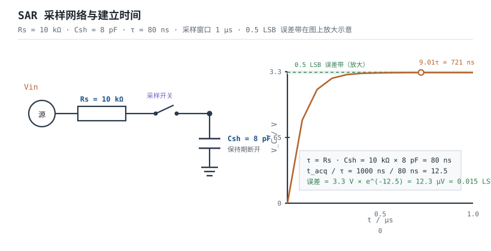

# ADC 原理、参数与参考电压 ADC

现实世界的电压是连续的，MCU 只认识离散的数字码。把两者接起来的那颗器件就是**模数转换器（Analog-to-Digital Converter，ADC）**。它看起来只是"读一个电压"，实际却同时受三件事约束：采样网络能不能在采样窗口内把电容充到足够准、参考电压够不够稳、进入 ADC 的频谱有没有超出奈奎斯特带。三条里任何一条没算，读数就会表现为"偏低、跳动、通道串扰、高频干扰变成了低频噪声"。

本章按"建立预算 → 参考预算 → 频带预算"的顺序展开，最后用一个 12 位 SAR 的完整算例把三条预算串起来。ADC 前面的调理电路见[模拟信号与信号链概述](../opamp/analog-signal-chain.md)，噪声的谱密度与带宽口径见[噪声：电压噪声、电流噪声与计算](../opamp/noise.md)；把数字码再变回电压的相反过程见[DAC 与模拟输出](dac.md)，用 PWM 做等效模拟输出的路线见[定时器与 PWM 原理](timer-pwm.md)，低功耗场景下 ADC 的唤醒节奏见[看门狗、RTC 与低功耗硬件](watchdog-rtc-lowpower.md)。

## 1. 设计动机

::: motivation 三个现场
**现场一：10 kΩ 源、8 pF 采样电容、1 µs 采样窗口，够不够？** 很多人凭"源阻抗小于 10 kΩ 就行"的经验直接接上。算一遍：时间常数 $\tau=10^4\times8\times10^{-12}=80\ \text{ns}$，12 位要建立到 0.5 LSB 需要 $13\ln2=9.01$ 个时间常数，即 721 ns，1 µs 够；换成 20 kΩ 就变成 1.44 µs，不够，读数会系统性偏低，而且偏低量随信号幅度变化，表现为非线性。**"10 kΩ 规则"不是常数，它随采样电容、采样时间和位数一起变。**

**现场二：参考电压直接取 3.3 V 电源。** 一颗初始精度 1% 的 LDO，满量程就带 1% 的增益误差，折合 12 位是 $0.01\times4096=41$ LSB；电源上 10 mV 的开关纹波，折合 $10\ \text{mV}/805.7\ \mu\text{V}=12.4$ LSB，会在读数上直接看到开关频率的包络。**参考电压的误差不是"最后再校准"就能完全解决的，因为纹波是时变的。**

**现场三：5.3 kHz 干扰、10 kSPS 采样。** 奈奎斯特频率是 5 kHz，5.3 kHz 在带外，但它会折叠到 $|5.3-10|=4.7$ kHz，正好落在带内，而且幅度一点没小。没有抗混叠滤波器时，ADC 分不清 4.7 kHz 和 5.3 kHz。**混叠不是"采样率不够高"这么简单，它是频域上的搬移，滤波必须在采样之前做。**
:::

| 你想确认 | 先算 | 判据（工程经验值） |
|---|---|---|
| 采样网络建立够不够 | $(N+1)\ln2\cdot R_sC_{sh}$ | 小于采样窗口，留 20% 余量 |
| 源阻抗上限 | $t_{acq}/[(N+1)\ln2\,C_{sh}]$ | 再减去开关导通电阻 |
| 参考够不够稳 | $\Delta V_{REF}/V_{REF}\times2^N$ | 折合误差小于 1 LSB |
| 有效位数够不够 | $(SINAD-1.76)/6.02$ | 按实测 SINAD，不按标称位数 |
| 抗混叠够不够 | $20n\lg(f_{int}/f_c)$ | 大于干扰折合 0.5 LSB 所需的衰减 |
| 过采样能补几位 | $0.5\log_2 OSR$ | 只补量化噪声，不补 INL 和参考误差 |

**不算会摔在哪**，四个带数字的代价：

1. **采样窗口不够。** 20 kΩ、8 pF、1 µs 时建立误差约 7.9 LSB（后文算例），读数偏低且随输入幅度变，校准也校不掉。
2. **参考用电源。** 1% 初始误差就是 41 LSB；如果电源纹波 10 mV，再叠加 12.4 LSB 的时变误差。
3. **没有抗混叠。** 1 V 的 5.3 kHz 干扰在 10 kSPS 下折叠到 4.7 kHz，按 0.5 LSB 判据需要 67.9 dB 衰减，一阶 RC 在 5.3 kHz 只有 14.6 dB，等于没滤。
4. **只看标称位数。** 12 位理想 SNR 是 74.0 dB；实测 SINAD 68.2 dB 时 ENOB 只有 11.0 位，剩下 1 位被噪声、失真和参考吃掉了。

## 2. 定义与直观

### 2.1 三种架构：闪速、SAR、ΔΣ

ADC 的架构决定了它"用多少硬件换多少速度、多少精度"。工程上最常见的是下面三类，另有一类流水线（Pipelined）是闪速与 SAR 的折中，不在本章展开。

| 架构 | 一次转换的比较次数 | 典型速度 | 典型分辨率 | 延迟 | 主要限制 |
|---|---|---|---|---|---|
| 闪速 Flash | $2^N-1$ 个比较器并行 | GSPS 量级 | 6~8 位 | 1 个时钟 | 比较器数量随 $2^N$ 爆炸，输入电容大 |
| SAR | $N$ 次逐次比较 | kSPS~MSPS | 10~18 位 | $N$ 个时钟 | 采样保持建立、参考稳定、电荷注入 |
| ΔΣ | 过采样 + 数字滤波 | 几 SPS~kSPS | 16~24 位 | 几十~几千个周期 | 延迟大、带宽窄、数字滤波器功耗 |

**闪速 ADC** 把 $2^N-1$ 个比较器并排摆开，每个比较器对应一个阈值，一次时钟就能出码。8 位需要 255 个比较器，10 位需要 1023 个，面积和功耗随位数指数上升，所以它通常停在 6~8 位，用在该快的地方：示波器前端、高速串行接收、雷达采样。它的输入电容是所有比较器输入电容的并联，驱动起来并不轻松。

**SAR ADC** 只用一个比较器和一个内部 DAC，从最高位开始逐位"猜"：先试半量程，比较器说大了就把这一位清 0，说小了就保留，然后试下一位。$N$ 位需要 $N$ 个比较周期，速度比闪速慢，但硬件随位数线性增长，12~16 位很常见。它的问题是**转换期间输入必须保持不动**，所以前面必须有一个采样保持开关和电容 $C_{sh}$；采样开关一闭合，外部源就要在采样窗口内给 $C_{sh}$ 充电，这就是本章最重要的建立时间问题。

**ΔΣ ADC** 不直接量化电压，而是用远高于信号带宽的采样率把输入"过采样"，再用积分器/比较器构成的环路把量化噪声推向高频，最后用数字滤波器把带外噪声滤掉。它用速度换分辨率，1 位量化器加 64 倍过采样就能做到 9 位以上，二阶环路可以到 13 位以上；代价是延迟大、带宽窄，适合温度、压力、称重、音频这类慢变量。


### 2.2 采样保持与输入阻抗：ADC 的输入不是电阻

SAR 的输入端在采样期等效为"一个开关 + 一个电容"，在保持期开关断开，电容上的电压被比较。对外部源来说，它看到的是一个**周期性被接通的电容**，不是一只固定的电阻。由此产生三个后果：

1. **建立时间**：每次开关闭合，$C_{sh}$ 都要从上一拍的电压充到这一拍的新电压，误差按指数衰减，时间常数 $\tau=(R_s+R_{on})C_{sh}$。
2. **平均输入电流**：每次采样搬移电荷 $C_{sh}\Delta V$，平均电流是 $C_{sh}\Delta V f_s$。输入信号变化越快、采样率越高、通道切换幅度越大，平均电流越大。
3. **电荷注入与回踢（kickback）**：开关断开时会把一小撮电荷注入 $C_{sh}$，内部 DAC 切换时也会通过寄生电容往输入端回踢一个台阶。前者靠外部电容吸收，后者靠驱动源的低输出阻抗快速恢复。

所以"ADC 输入阻抗 1 MΩ"这类数据手册参数，通常只是**直流漏电**意义下的阻抗；真正决定驱动难度的是采样电容、采样时间和采样率。高阻源必须加缓冲，缓冲的位置和取值见[模拟信号与信号链概述](../opamp/analog-signal-chain.md)。



### 2.3 量化：码、LSB 与 0.5 LSB

ADC 把 $0\sim V_{REF}$ 切成 $2^N$ 个区间，每个区间对应一个码。相邻码之间的电压间隔叫**最低有效位（Least Significant Bit，LSB）**：

$$1\ \text{LSB}=\frac{V_{REF}}{2^N}$$

12 位、3.3 V 时 $1\ \text{LSB}=3.3/4096=805.7\ \mu\text{V}$。理想 ADC 的量化误差在 $\pm0.5$ LSB 以内，所以工程上常把"建立到 0.5 LSB"作为精度判据，而不是"建立到 1 LSB"。

::: analogy 采样像用桶接水
把采样开关想成水龙头，$C_{sh}$ 是一只桶，$R_s$ 是水管阻力。打开龙头的瞬间水流最大，桶越满水流越小，最后几滴水最难等。要把水位灌到"离目标只差 1/8192 桶高"（12 位、0.5 LSB），需要等 9 个时间常数，而不是"差不多满"就关龙头。

类比的边界：水管里的水是连续的，桶里的电荷是离散的；桶本身还有热噪声，哪怕灌得无限准，$C_{sh}$ 上的噪声也有 $kT/C$ 的下限。所以"灌得够久"只能消掉建立误差，消不掉热噪声和参考噪声。
:::

## 3. 定量关系

### 3.1 码、满量程与量化误差

输入电压到码的映射：

$$D=\operatorname{round}\left(\frac{V_{in}}{V_{REF}}2^N\right)$$

反推：

$$V_{in}=D\frac{V_{REF}}{2^N}$$

符号与单位：$D$ 是输出码（0~$2^N-1$ 的整数）；$V_{in}$ 是输入电压（V）；$V_{REF}$ 是参考电压（V）；$N$ 是位数。满量程输入是 $V_{REF}(2^N-1)/2^N$，比 $V_{REF}$ 低 1 LSB；输入达到或超过 $V_{REF}$ 时码会饱和在 $2^N-1$，所以量程要留余量。

量化误差：

$$\varepsilon_q=V_{in}-D\frac{V_{REF}}{2^N},\qquad |\varepsilon_q|\leq\frac{1}{2}\text{LSB}=\frac{V_{REF}}{2^{N+1}}$$

**注意 0.5 LSB 与 1 LSB 的差别。** 建立判据用 0.5 LSB 时，指数项的要求是 $2^{-(N+1)}$；用 1 LSB 时是 $2^{-N}$。两者相差 $\ln2\approx0.693$ 个时间常数（即 $0.693\tau$），12 位下是 55 ns，正好是"刚好够"和"差一点"的分界。

### 3.2 采样建立：时间常数与源阻抗上限

采样开关闭合后，$C_{sh}$ 上的电压按一阶指数上升：

$$V_C(t)=V_{in}\left(1-e^{-t/\tau}\right),\qquad \tau=(R_s+R_{on})C_{sh}$$

符号与单位：$V_C(t)$ 是电容电压（V）；$V_{in}$ 是目标电压（V）；$t$ 是采样时间（s）；$R_s$ 是源阻抗（$\Omega$）；$R_{on}$ 是采样开关导通电阻（$\Omega$）；$C_{sh}$ 是采样保持电容（F）。这个式子假设源是纯电阻、开关是理想阶跃、寄生电感可忽略；高频下引线电感会让波形振铃，需要另算。

误差是"还差多少"：

$$\varepsilon(t)=V_{in}e^{-t/\tau}$$

最坏情况 $V_{in}=V_{REF}$，要求 $\varepsilon(t_{acq})\leq V_{REF}/2^{N+1}$：

$$e^{-t_{acq}/\tau}\leq2^{-(N+1)}\quad\Rightarrow\quad t_{acq}\geq(N+1)\ln2\cdot\tau$$

**纠正一处常见写法**一些资料写的是 $t_{sample}\geq R_sC_{sh}\ln(2^n)=n\ln2\cdot\tau$，那是"建立到 1 LSB"的判据；本章按 0.5 LSB 判据，指数项是 $2^{-(N+1)}$，所以是 $(N+1)\ln2$。12 位下两者差 $\ln2\cdot\tau=0.693\tau$，本算例是 55 ns，正好是"刚好够"和"差一点"的分界。

$(N+1)\ln2$ 的数值：

| 位数 $N$ | 8 | 10 | 12 | 14 | 16 | 20 | 24 |
|---|---|---|---|---|---|---|---|
| $(N+1)\ln2$ | 6.24 | 7.62 | 9.01 | 10.40 | 11.78 | 14.56 | 17.33 |

由 $t_{acq}$ 反解源阻抗上限：

$$R_{s,max}=\frac{t_{acq}}{(N+1)\ln2\,C_{sh}}-R_{on}$$

**这个式子是本章最该记住的一条。** 它说明源阻抗上限与采样电容、采样时间、位数三者绑定：电容减半，上限翻倍；采样时间翻倍，上限翻倍；位数每加 1 位，上限降 5%~7%。

### 3.3 平均输入电流：输入阻抗随采样率变

每次采样搬移的电荷：

$$Q_{s}=C_{sh}\Delta V$$

平均输入电流：

$$I_{in}=C_{sh}\Delta V f_s$$

等效输入电阻：

$$R_{eq}=\frac{\Delta V}{I_{in}}=\frac{1}{C_{sh}f_s}$$

符号与单位：$Q_s$ 是每次采样的电荷（C）；$\Delta V$ 是相邻两次采样的电压差（V）；$f_s$ 是采样率（Hz）；$I_{in}$ 是平均电流（A）；$R_{eq}$ 是等效电阻（$\Omega$）。

以 $C_{sh}=8\ \text{pF}$、$f_s=1\ \text{MSPS}$ 为例：$R_{eq}=1/(8\times10^{-12}\times10^6)=125\ \text{k}\Omega$。同样是 8 pF，采样率降到 10 kSPS，等效电阻就是 12.5 MΩ。**数据手册若写"输入阻抗 125 kΩ"，它隐含的是某个采样率；换个采样率，这个数就变了。**

::: advanced 平均电流的两个实用估算
**多通道满幅切换。** 8 pF 电容在 3.3 V 和 0 V 两个通道之间来回切，$f_s=1$ MSPS：$I_{in}=8\times10^{-12}\times3.3\times10^6=26.4\ \mu\text{A}$。这个电流流过 10 kΩ 源阻抗，平均压降 $26.4\ \mu\text{A}\times10^4=0.264\ \text{V}$，折合 328 LSB——不是小数目。多通道扫描时，要么每通道加缓冲，要么降低扫描速率，要么在切换后丢弃第一次读数。

**单通道正弦。** 输入是 1 kHz、3.3 V 峰峰值正弦，$f_s=1$ MSPS：相邻采样最大电压差约 $2\pi fA/f_s=2\pi\times1000\times1.65/10^6=10.4\ \text{mV}$，平均电流 $8\times10^{-12}\times10.4\times10^{-3}\times10^6=83\ \text{nA}$，在 10 kΩ 上产生 0.83 mV，约 1.03 LSB。这个误差随信号幅度和频率变，表现为增益压缩和失真；要高精度就得缓冲。

两个估算都假设"平均电流全部流过源阻抗"，实际还有源端电容、走线电感和 ADC 内部寄生，精确值以仿真/实测为准。但量级足够判断"要不要加缓冲"。
:::

### 3.4 参考电压、INL/DNL 与 ENOB

**参考误差直接变成增益误差。** 设参考有相对误差 $\delta_{REF}=\Delta V_{REF}/V_{REF}$，读数的码误差：

$$\Delta D=2^N\delta_{REF}$$

12 位、$\delta_{REF}=0.05\%$ 时 $\Delta D=4096\times5\times10^{-4}=2.048$ LSB。参考的温漂、长期漂移按同样方式折算：$5\ \text{ppm}/^{\circ}\text{C}\times40^{\circ}\text{C}=200\ \text{ppm}=0.02\%$，折合 0.819 LSB。

**INL 与 DNL 描述"码台阶有多歪"。** 积分非线性（Integral Nonlinearity，INL）是实际转换曲线偏离端点拟合直线的最大偏差，单位 LSB；微分非线性（Differential Nonlinearity，DNL）是实际码宽与 1 LSB 的偏差：

$$\text{码宽}_k=1\ \text{LSB}+\text{DNL}_k\cdot1\ \text{LSB}$$

DNL = -1 LSB 时码宽为 0，这个码永远不会出现，叫**失码**；DNL = +1.5 LSB 时码宽 2.5 LSB，说明这个台阶特别宽。INL = 2 LSB 意味着最大偏差 $2\times805.7\ \mu\text{V}=1.611\ \text{mV}$，占满量程 $1.611/3300=0.0488\%$。

**理想 SNR 与 ENOB。** 量化噪声近似均匀分布在 $\pm0.5$ LSB 内，其 rms 为：

$$V_{q,rms}=\frac{q}{\sqrt{12}},\qquad q=1\ \text{LSB}$$

满量程正弦的 rms：

$$V_{FS,rms}=\frac{2^Nq}{2\sqrt2}$$

两者相除：

$$SNR_{ideal}=20\lg\frac{2^Nq/(2\sqrt2)}{q/\sqrt{12}}=20\lg\left(2^N\sqrt{\frac32}\right)=6.02N+1.76\ \text{dB}$$

有效位数用**信号与噪声加失真比（SINAD）**定义，而不是 SNR：

$$ENOB=\frac{SINAD-1.76}{6.02}$$

符号与单位：$SINAD$ 单位 dB；$ENOB$ 单位 bit。用 SNR 代替 SINAD 会得到一个偏乐观的上界，因为 SNR 不计谐波失真。数据手册若只给 SNR，算出来的"ENOB"要标注为"仅噪声口径"。

### 3.5 采样定理、混叠与抗混叠阶数

采样率必须大于信号最高频率的两倍：

$$f_s>2f_{max}$$

不满足时，高于 $f_s/2$ 的分量会折叠回基带，折叠后的频率：

$$f_{alias}=|f_{in}-kf_s|,\qquad k=\operatorname{round}\left(\frac{f_{in}}{f_s}\right)$$

符号与单位：$f_{in}$ 是干扰频率（Hz）；$f_s$ 是采样率（Hz）；$k$ 是最近的整数倍；$f_{alias}$ 是折叠后的频率（Hz）。这个式子是"取绝对值"，所以 5.3 kHz 在 10 kSPS 下折到 4.7 kHz，9.2 kHz 折到 0.8 kHz，12.3 kHz 折到 2.3 kHz。

抗混叠滤波器要在 $f_s/2$ 之前把干扰压到 0.5 LSB 以下。所需衰减：

$$A(f_{int})=20\lg\frac{V_{int}}{V_{allow}},\qquad V_{allow}=\frac{V_{REF}}{2^{N+1}}$$

$n$ 阶巴特沃斯低通的幅频响应：

$$|H(f)|=\frac{1}{\sqrt{1+(f/f_c)^{2n}}}$$

当 $f\gg f_c$ 时近似为：

$$A_n(f)\approx20n\lg\frac{f}{f_c}$$

反解所需阶数：

$$n\geq\frac{A(f_{int})}{20\lg(f_{int}/f_c)}$$

这个近似在 $f/f_c>3$ 时误差小于 0.5 dB；$f$ 靠近 $f_c$ 时要用完整式子核对。**滤波器的截止频率不是"等于奈奎斯特"就好**：$f_c$ 越接近 $f_s/2$，同样阶数在 $f_s/2$ 附近的衰减越少，所需阶数越高。

### 3.6 过采样与噪声整形

过采样把量化噪声摊到更宽的频带上，带内噪声功率下降。设过采样比：

$$OSR=\frac{f_s}{2f_B}$$

其中 $f_B$ 是信号带宽（Hz）。带内量化噪声：

$$P_q=\frac{q^2}{12}\frac{1}{OSR}$$

信噪比改善：

$$\Delta SNR=10\lg OSR,\qquad \Delta ENOB=\frac{10\lg OSR}{6.02}=0.5\log_2 OSR$$

**过采样只改善量化噪声，不改善 INL、DNL、参考误差和电路热噪声。** 12 位 ADC 过采样 16 倍，理论上多 2 位，但如果 INL 只有 10 位，结果还是 10 位。

ΔΣ 在此基础上再加**噪声整形**：环路把量化噪声的频谱推向高频，带内噪声按更高阶下降。一阶 ΔΣ 的带内噪声：

$$P_{q,1}=\frac{q^2}{12}\frac{\pi^2}{3}\frac{1}{OSR^3}$$

对应的信噪比改善：

$$\Delta SNR_1=30\lg OSR-5.17\ \text{dB}$$

二阶 ΔΣ：

$$P_{q,2}=\frac{q^2}{12}\frac{\pi^4}{5}\frac{1}{OSR^5}$$

$$\Delta SNR_2=50\lg OSR-12.9\ \text{dB}$$

符号与单位：$OSR$ 无量纲；$P_q$ 单位 $\text{V}^2$；$\Delta SNR$ 单位 dB。两式都假设 $OSR\gg1$（工程上 $OSR\geq16$ 才比较准），且只算量化噪声，不含运放热噪声和时钟抖动。$30\lg OSR$ 的意思是过采样每翻一倍，一阶 ΔΣ 改善 9.03 dB（约 1.5 位）；二阶是 15.05 dB（约 2.5 位）。

### 3.7 适用条件与失效边界

1. **纯电阻源假设**：建立公式假设源是电阻；源是电容/电感/运放输出时，要按实际阻抗和相位重算，运放还可能因容性负载振铃。
2. **开关理想假设**：$R_{on}$ 随输入电压和温度变，数据手册给的是典型/最大值；高压/低压端附近 $R_{on}$ 可能明显变大。
3. **单极点假设**：$C_{sh}$ 的充电是一阶；如果外部有 RC 滤波，采样瞬间是二阶或更高阶，建立曲线会变慢甚至振铃。
4. **量化噪声均匀假设**：$q/\sqrt{12}$ 假设输入在码之间均匀分布；直流或周期性信号可能让量化误差不是白噪声，SNR 公式会偏乐观。
5. **参考静态假设**：参考源有输出阻抗和有限带宽，ADC 转换时的电荷需求会让参考瞬间跌落；参考去耦和缓冲要按数据手册的 $C_{REF}$ 要求配。
6. **混叠公式假设**：只对单一频率分量成立；宽带干扰要按频谱密度积分，不能只算一个点。

## 4. 典型计算

### 4.1 完整算例：12 位 SAR、3.3 V、1 µs、10 kΩ、8 pF

**已知**：$N=12$，$V_{REF}=3.3\ \text{V}$，$t_{acq}=1\ \mu\text{s}$，$R_s=10\ \text{k}\Omega$，$C_{sh}=8\ \text{pF}$，$R_{on}$ 先忽略（典型几十欧，以数据手册为准）。求：建立误差是否小于 0.5 LSB；若不够，源阻抗上限是多少。

**第 1 步：LSB 与 0.5 LSB。**

$$1\ \text{LSB}=\frac{3.3}{2^{12}}=\frac{3.3}{4096}=8.057\times10^{-4}\ \text{V}=805.7\ \mu\text{V}$$

$$0.5\ \text{LSB}=402.8\ \mu\text{V}$$

**第 2 步：时间常数。**

$$\tau=R_sC_{sh}=10\times10^3\times8\times10^{-12}=8.0\times10^{-8}\ \text{s}=80\ \text{ns}$$

**第 3 步：所需时间常数个数。**

$$(N+1)\ln2=13\times0.6931=9.011$$

$$t_{req}=9.011\tau=9.011\times80\ \text{ns}=720.9\ \text{ns}$$

$720.9\ \text{ns}<1\ \mu\text{s}$，**建立够，余量 279 ns（约 28%）。**

**第 4 步：实际误差。** 采样时间与时间常数之比：

$$\frac{t_{acq}}{\tau}=\frac{1000\ \text{ns}}{80\ \text{ns}}=12.5$$

$$\varepsilon=3.3\times e^{-12.5}=3.3\times3.727\times10^{-6}=1.230\times10^{-5}\ \text{V}=12.30\ \mu\text{V}$$

$$\frac{\varepsilon}{1\ \text{LSB}}=\frac{12.30\ \mu\text{V}}{805.7\ \mu\text{V}}=0.0153\ \text{LSB}$$

**远小于 0.5 LSB**，这一项不是瓶颈。

**第 5 步：源阻抗上限。** 由 $t_{acq}=9.011R_sC_{sh}$ 反解：

$$R_{s,max}=\frac{1\times10^{-6}}{9.011\times8\times10^{-12}}=\frac{1\times10^{-6}}{7.209\times10^{-11}}=1.387\times10^4\ \Omega=13.87\ \text{k}\Omega$$

若 $R_{on}=100\ \Omega$，上限变成 $13.87\ \text{k}\Omega-0.1\ \text{k}\Omega=13.77\ \text{k}\Omega$；留 20% 余量取 **11.0 kΩ**。也就是说，10 kΩ 刚好在安全区内，20 kΩ 则超出约 45%。

**第 6 步：热噪声下限。** 采样电容上的热噪声是 $kT/C$，其中 $k=1.380649\times10^{-23}\ \text{J/K}$ 是玻尔兹曼常数，$T=300\ \text{K}$ 是绝对温度：

$$V_{n,kTC}=\sqrt{\frac{kT}{C_{sh}}}=\sqrt{\frac{1.380649\times10^{-23}\times300}{8\times10^{-12}}}=\sqrt{5.177\times10^{-10}}=2.275\times10^{-5}\ \text{V}=22.75\ \mu\text{V}$$

$$\frac{22.75\ \mu\text{V}}{805.7\ \mu\text{V}}=0.0282\ \text{LSB}$$

把建立误差和热噪声按 RSS 合成：

$$\varepsilon_{total}=\sqrt{0.0153^2+0.0282^2}=\sqrt{0.000234+0.000797}=0.0321\ \text{LSB}$$

仍远小于 0.5 LSB。**结论：这组参数下 10 kΩ 可以直连；真正的瓶颈是参考和抗混叠，不是建立。**

**第 7 步：换成 20 kΩ 会怎样。** $\tau=160\ \text{ns}$，$t/\tau=6.25$：

$$\varepsilon=3.3\times e^{-6.25}=3.3\times1.930\times10^{-3}=6.37\times10^{-3}\ \text{V}=6.37\ \text{mV}$$

$$\frac{6.37\ \text{mV}}{805.7\ \mu\text{V}}=7.91\ \text{LSB}$$

**7.9 LSB，远超 0.5 LSB。** 这就是"10 kΩ 规则"在 8 pF/1 µs 下的真实边界：上限约 13.9 kΩ，不是无限大。

```echarts
{
  "animation": false,
  "tooltip": {"trigger": "axis"},
  "grid": {"left": 72, "right": 30, "top": 30, "bottom": 58},
  "xAxis": {"type": "category", "name": "源阻抗 R_s / kΩ", "nameLocation": "middle", "nameGap": 36, "data": ["10", "13.9", "20", "30", "50"], "axisLabel": {"fontSize": 11}},
  "yAxis": {"type": "value", "name": "建立误差 / LSB", "nameLocation": "middle", "nameGap": 52, "type": "log", "min": 0.01, "max": 1000, "axisLabel": {"fontSize": 11}},
  "series": [
    {"name": "建立误差", "type": "line", "symbolSize": 7, "lineStyle": {"width": 2.6, "color": "#b5642e"},
     "itemStyle": {"color": "#b5642e"},
     "markLine": {"silent": true, "symbol": "none", "lineStyle": {"color": "#2e7d4f", "type": "dashed"}, "label": {"formatter": "0.5 LSB", "fontSize": 11}, "data": [{"yAxis": 0.5}]},
     "data": [0.0153, 0.5, 7.91, 63.5, 336]}
  ]
}
```

上图按 $C_{sh}=8\ \text{pF}$、$t_{acq}=1\ \mu\text{s}$ 计算：横轴是源阻抗，纵轴是建立误差（对数）。13.9 kΩ 处正好 0.5 LSB；50 kΩ 处 336 LSB，已经不能用了。

### 4.2 参考、INL/DNL 与 ENOB 算例

**已知**：12 位、3.3 V，参考初始精度 0.05%，温漂 5 ppm/°C，工作温升 40°C，长期漂移 50 ppm/1000 h；ADC 的 INL = ±2 LSB，DNL = +1.5 LSB；实测 SINAD = 68.2 dB。

**参考误差分项：**

$$\Delta D_{init}=2^{12}\times0.0005=4096\times5\times10^{-4}=2.048\ \text{LSB}$$

$$\Delta D_{temp}=2^{12}\times(5\times10^{-6}\times40)=4096\times2\times10^{-4}=0.819\ \text{LSB}$$

$$\Delta D_{long}=2^{12}\times50\times10^{-6}=4096\times5\times10^{-5}=0.205\ \text{LSB}$$

按 RSS 合成：

$$\Delta D_{REF}=\sqrt{2.048^2+0.819^2+0.205^2}=\sqrt{4.194+0.671+0.042}=2.215\ \text{LSB}$$

按最坏情况直接相加是 $2.048+0.819+0.205=3.072\ \text{LSB}$。**预算里要同时给这两个数：RSS 用于典型评估，最坏和用于保证指标。**

**INL/DNL 折算：**

$$V_{INL}=2\times805.7\ \mu\text{V}=1.611\ \text{mV},\qquad \frac{1.611\ \text{mV}}{3.3\ \text{V}}=0.0488\%$$

$$\text{码宽}=1\ \text{LSB}+1.5\ \text{LSB}=2.5\ \text{LSB}=2.014\ \text{mV}$$

**ENOB：**

$$ENOB=\frac{SINAD-1.76}{6.02}=\frac{68.2-1.76}{6.02}=\frac{66.44}{6.02}=11.04\ \text{bit}$$

理想 12 位 SNR 是 $6.02\times12+1.76=74.0\ \text{dB}$，实测 68.2 dB，差 5.8 dB，相当于丢了约 0.96 位。这 5.8 dB 来自量化噪声之外的电路噪声、谐波失真和参考纹波，**标称 12 位只保证码的位数，不保证有效位数。**

### 4.3 混叠与抗混叠阶数算例

**已知**：$f_s=10\ \text{kSPS}$，$N=12$，$V_{REF}=3.3\ \text{V}$，干扰幅度 1 V。求：5.3 kHz 干扰折到哪；要把它的折叠分量压到 0.5 LSB 以下，一阶/二阶 RC 够不够。

**折叠频率：**

$$f_{alias}=|5300-1\times10000|=4700\ \text{Hz}=4.7\ \text{kHz}$$

它落在 0~5 kHz 的基带内，幅度和带内信号一样大，ADC 无法区分。

**所需衰减：**

$$V_{allow}=0.5\ \text{LSB}=402.8\ \mu\text{V}$$

$$A=20\lg\frac{1}{402.8\times10^{-6}}=20\lg2482=67.9\ \text{dB}$$

**取 $f_c=1\ \text{kHz}$：**

$$A_1=20\lg\sqrt{1+(5.3)^2}=20\lg5.394=14.6\ \text{dB}$$

$$A_2=10\lg\left[1+(5.3)^4\right]=10\lg789.0=29.0\ \text{dB}$$

$$A_5\approx100\lg5.3=72.4\ \text{dB}$$

一阶差 53 dB，二阶差 38.9 dB，**要五阶才够**。这就是"干扰刚好在奈奎斯特外面一点"的麻烦：它离带内太近，滤波器斜率再陡也要很多阶。

**把 $f_c$ 降到 100 Hz：**

$$A_2=10\lg\left[1+(53)^4\right]=10\lg(7.89\times10^6)=69.0\ \text{dB}$$

二阶就够了，代价是信号带宽被压到 100 Hz。**抗混叠的设计杠杆不是"加阶数"，而是"把 $f_c$ 压到干扰频率的足够远处"；阶数只是补救。**

如果干扰在 100 kHz（开关电源的典型频段），同样 $f_c=1\ \text{kHz}$：

$$A_2=10\lg\left[1+(100)^4\right]=10\lg(1.0001\times10^8)=80.0\ \text{dB}$$

二阶就够。**同样是 1 V 干扰，频率位置差 20 倍，所需阶数差 3 阶。**

### 4.4 过采样与噪声整形算例

**过采样 16 倍**：$OSR=16$，

$$\Delta SNR=10\lg16=12.04\ \text{dB},\qquad \Delta ENOB=\frac{12.04}{6.02}=2.00\ \text{bit}$$

12 位加 2 位，理论 14 位；但如果 INL 只有 11 位，实际还是 11 位。

**一阶 ΔΣ，1 位量化器，$OSR=64$：**

$$\Delta SNR_1=30\lg64-5.17=30\times1.806-5.17=54.19-5.17=49.02\ \text{dB}$$

1 位量化器的理想 SNR 是 $6.02\times1+1.76=7.78\ \text{dB}$，总 SNR：

$$SNR=7.78+49.02=56.80\ \text{dB}$$

$$ENOB=\frac{56.80-1.76}{6.02}=9.14\ \text{bit}$$

**二阶 ΔΣ，1 位量化器，$OSR=64$：**

$$\Delta SNR_2=50\lg64-12.9=50\times1.806-12.9=90.31-12.9=77.41\ \text{dB}$$

$$SNR=7.78+77.41=85.19\ \text{dB},\qquad ENOB=\frac{85.19-1.76}{6.02}=13.86\ \text{bit}$$

**同样的 1 位量化器和 64 倍过采样，二阶环路比一阶多 4.7 位。** 这就是 ΔΣ 用"环路阶数"换分辨率的定量含义。实际芯片还受运放热噪声、时钟抖动和输出码率限制，13.9 位是量化噪声上限，不是保证值。

## 5. 工程含义

### 5.1 参考电压：别拿电源当基准

- **初始精度**：0.05% 对应 2.05 LSB，0.1% 对应 4.10 LSB，1% 对应 41 LSB。12 位测量至少要 0.05% 级基准。
- **温漂**：5 ppm/°C 在 40°C 温升下是 200 ppm（0.82 LSB）；50 ppm/°C 的基准在同样温升下是 2000 ppm（8.2 LSB），后者会毁掉 12 位。
- **噪声**：基准的 0.1~10 Hz 噪声和宽带噪声要小于 0.5 LSB；100 µV rms 的基准噪声折合 0.124 LSB，可以接受；1 mV rms 就是 1.24 LSB，不行。
- **去耦与缓冲**：按数据手册要求就近放 $C_{REF}$（常见 100 nF + 1~10 µF，具体以数据手册为准）；参考输入是开关电容负载时，还要加基准缓冲运放。
- **开尔文接法**：大电流路径的地和参考地分开，在 ADC 的 AGND 单点汇合；否则地电流会在参考回路上产生压降。接地细节见[模拟信号与信号链概述](../opamp/analog-signal-chain.md)与 PCB 的接地章节。

### 5.2 驱动与抗混叠：先缓冲，再滤波，再进 ADC

高阻源的正确顺序是"传感器 → 缓冲/放大 → 抗混叠 RC → ADC"，而不是"传感器 → 大 RC → ADC"。原因：大 RC 的电阻会直接变成 ADC 的源阻抗，把建立时间拖垮；缓冲器的低输出阻抗则让 ADC 的采样电流有地方去。


- **缓冲器选型**：单位增益稳定、能驱动容性负载、输出摆幅覆盖 0~$V_{REF}$、压摆率满足建立时间。运放的噪声和带宽要按信号带宽选，见[噪声：电压噪声、电流噪声与计算](../opamp/noise.md)。
- **RC 取值**：$R$ 要小到不影响建立（通常几十~几百 $\Omega$），$C$ 要大到能吸收电荷注入（通常几百 pF~几 nF）；截止频率按干扰频率和所需阶数定，不能只按信号带宽。
- **多通道**：每通道的源阻抗可能不同，切换后第一读要丢弃；高阻通道单独缓冲。

### 5.3 量程、校准与布局

- **量程**：输入必须落在 0~$V_{REF}$ 内；超过就分压/衰减，低于 0 要加偏置或负电源。分压电阻的等效源阻抗要代入 3.2 节的公式核对。
- **校准**：偏移和增益可以两点校准；INL 不能靠两点校准消除，只能选更好的器件或做查表。参考的温漂要用温度传感器补偿，或者把整机放在恒温环境。
- **布局**：模拟输入远离数字线和开关电源；参考引脚就近去耦；AGND 与 DGND 单点汇合；高阻节点加保护环。具体做法见 PCB 的模拟/数字分区与接地章节。
- **选型顺序**：先定信号带宽和分辨率 → 选架构（SAR/ΔΣ/闪速）→ 算建立预算 → 选参考 → 算抗混叠阶数 → 最后看价格和封装。

### 5.4 与其他三章的分工

ADC 是"模拟进数字"的入口；[DAC 与模拟输出](dac.md)是反方向，二者共用参考、接地和重建/抗混叠的概念；[定时器与 PWM 原理](timer-pwm.md)提供采样时钟、触发信号和用 PWM 做等效模拟输出的另一条路；[看门狗、RTC 与低功耗硬件](watchdog-rtc-lowpower.md)决定 ADC 多久醒一次、醒多久，直接影响平均电流和电池寿命。四章的共同点是：**都要先把时间/频率/阻抗的量级算出来，再谈器件选型。**

## 6. 常见坑

::: pitfall 常见坑
- **现象**：读数系统性偏低，且采样率越高偏低越多。**原因**：采样窗口内 $C_{sh}$ 没充到 0.5 LSB，误差与 $e^{-t/\tau}$ 成正比；源阻抗大、采样时间短、通道切换幅度大都会加重。**解决**：按 $(N+1)\ln2\,R_sC_{sh}$ 核对；加长采样时间、降低源阻抗、加缓冲，或在多通道扫描时丢弃首读。
- **现象**：读数随电源负载和开关频率跳动。**原因**：VREF 直接取 3.3 V 电源，电源纹波和负载调整率直接进入量化结果。**解决**：用专用基准，就近去耦，参考加缓冲；高精度时模拟电源与数字电源分开。
- **现象**：通道切换后第一次读数明显偏离，后面几次正常。**原因**：前一通道的电荷残留在 $C_{sh}$ 和外部电容上，开关闭合瞬间发生电荷共享；多路开关的 $R_{on}$ 还会和源阻抗分压。**解决**：切换后加延时、丢弃首读、每通道加缓冲或 RC；必要时选带 PGIA 的 ADC。
- **现象**：低频读数里出现开关电源频率的"拍频"或固定低频纹波。**原因**：高频干扰没有抗混叠，折叠回基带；折叠频率 $|f_{in}-kf_s|$ 可能很低。**解决**：采样前加抗混叠低通，按 $20n\lg(f/f_c)$ 算阶数；提高 $f_s$ 让干扰落到更远处；屏蔽/缩短引线。
- **现象**：标称 12 位，实测有效位数只有 10~11 位。**原因**：只算了量化噪声，没算参考噪声、运放噪声、INL 和失真；SINAD 而不是 SNR 才是 ENOB 的输入。**解决**：按 SINAD 算 ENOB，做噪声/误差预算，逐项找主导；参考和前端按 0.5 LSB 目标设计。
- **现象**：输入超过 $V_{REF}$ 后读数卡在满码，甚至芯片发热/闩锁。**原因**：输入超过参考或低于地，内部保护二极管导通，大电流注入衬底。**解决**：分压/限幅/钳位，输入串限流电阻，保证任何时刻 $0\leq V_{in}\leq V_{REF}$；上电顺序也要核对。
:::

## 7. 自测题

<details><summary>12 位、$V_{REF}=3.3\ \text{V}$，1 LSB 和 0.5 LSB 各是多少？如果参考有 0.1% 误差，折合多少 LSB？</summary>

$$1\ \text{LSB}=\frac{3.3}{4096}=805.7\ \mu\text{V},\qquad 0.5\ \text{LSB}=402.8\ \mu\text{V}$$

参考 0.1% 误差：

$$\Delta D=2^{12}\times0.001=4.096\ \text{LSB}$$

也就是约 4 个码的增益误差。

</details>

<details><summary>$R_s=10\ \text{k}\Omega$、$C_{sh}=8\ \text{pF}$、$t_{acq}=1\ \mu\text{s}$、12 位、3.3 V。建立误差是多少 LSB？源阻抗上限是多少？</summary>

$$\tau=10^4\times8\times10^{-12}=80\ \text{ns}$$

$$t/\tau=1000/80=12.5,\qquad \varepsilon=3.3\times e^{-12.5}=12.30\ \mu\text{V}$$

$$\frac{12.30\ \mu\text{V}}{805.7\ \mu\text{V}}=0.0153\ \text{LSB}$$

远小于 0.5 LSB，够用。上限：

$$R_{s,max}=\frac{10^{-6}}{9.011\times8\times10^{-12}}=13.87\ \text{k}\Omega$$

留 20% 余量约 11.0 kΩ。

</details>

<details><summary>$f_s=10\ \text{kSPS}$，干扰在 5.3 kHz 和 9.2 kHz，分别折到多少？为什么 5.3 kHz 更难滤？</summary>

$$f_{alias,1}=|5300-10000|=4700\ \text{Hz},\qquad f_{alias,2}=|9200-10000|=800\ \text{Hz}$$

5.3 kHz 折到 4.7 kHz，离奈奎斯特 5 kHz 只有 300 Hz，抗混叠滤波器在 5.3 kHz 处的衰减很小；9.2 kHz 折到 800 Hz，虽然也在带内，但干扰频率离 $f_c$ 更远，同样阶数能提供更多衰减。**折叠后的频率低不代表好滤，关键看干扰原始频率离 $f_c$ 有多远。**

</details>

<details><summary>实测 SINAD = 68.2 dB，ENOB 是多少？和理想 12 位差多少？</summary>

$$ENOB=\frac{68.2-1.76}{6.02}=11.04\ \text{bit}$$

理想 12 位 SNR：

$$6.02\times12+1.76=74.0\ \text{dB}$$

差 $74.0-68.2=5.8\ \text{dB}$，约 0.96 位。**标称位数是码的位数，ENOB 才是有效分辨率。**

</details>

<details><summary>12 位 ADC 过采样 16 倍，理论 ENOB 提高多少？如果 INL 只有 10 位，实际能到多少？</summary>

$$\Delta SNR=10\lg16=12.04\ \text{dB},\qquad \Delta ENOB=\frac{12.04}{6.02}=2.00\ \text{bit}$$

理论上 12+2=14 位；但过采样只压量化噪声，不改善 INL。如果 INL 只有 10 位，实际有效位数仍被 INL 限制在 10 位左右。**过采样不是"免费加位数"。**

</details>

<details><summary>一阶 ΔΣ、1 位量化器、$OSR=64$，理论 ENOB 是多少？二阶呢？</summary>

一阶：

$$\Delta SNR_1=30\lg64-5.17=49.02\ \text{dB}$$

$$SNR=6.02\times1+1.76+49.02=56.80\ \text{dB},\qquad ENOB=9.14\ \text{bit}$$

二阶：

$$\Delta SNR_2=50\lg64-12.9=77.41\ \text{dB}$$

$$SNR=7.78+77.41=85.19\ \text{dB},\qquad ENOB=13.86\ \text{bit}$$

二阶比一阶多约 4.7 位，代价是环路稳定性设计更难。

</details>

<details><summary>DNL = -1 LSB 意味着什么？INL = 2 LSB 折合多少毫伏？</summary>

DNL = -1 LSB 时码宽 $=1+(-1)=0$ LSB，这个码永远不会出现，叫失码。INL = 2 LSB 时最大偏差：

$$2\times805.7\ \mu\text{V}=1.611\ \text{mV}$$

占满量程 $1.611/3300=0.0488\%$。INL 是"曲线弯了多少"，DNL 是"每个台阶宽窄差多少"，两者不能互相替代。

</details>

## 8. 参考资料

- **Analog Devices, MT-021 *ADC Architectures II — Successive Approximation ADCs***：SAR 的逐次逼近结构、采样保持开关、转换时序与输入建立要求；本章 2.1、2.2、3.2 节的结构与建立模型按该文口径。
- **Analog Devices, MT-022 *ADC Architectures III — Sigma-Delta ADC Basics***：过采样、量化噪声整形、一阶/二阶环路与数字滤波；本章 3.6 节的 $OSR$ 与噪声整形公式按该文。
- **Analog Devices, MT-020 *ADC Architectures I — The Flash Converter***：比较器阵列、温度计码编码器与闪速 ADC 的面积/功耗代价；本章 2.1 节的闪速结构说明参考该文。
- **IEEE Std 1241-2010 *Terminology and Test Methods for Analog-to-Digital Converters***：LSB、INL、DNL、SINAD、ENOB 的定义、测试条件与统计口径；本章 3.4、4.2 节的参数定义以该标准为准。
- **Analog Devices, *Data Conversion Handbook*（2005），Sampling Theory 章节**：采样定理、混叠、抗混叠滤波器阶数与噪声带宽；本章 3.5、4.3 节的混叠与阶数计算按该章方法。
- **STMicroelectronics, RM0008 *STM32F10xxx 参考手册*，ADC 章节**：采样时间寄存器、外部触发、校准、参考电压引脚与输入阻抗模型；本章 3.2、5.1 节的工程取值以该手册的寄存器定义为参照。
