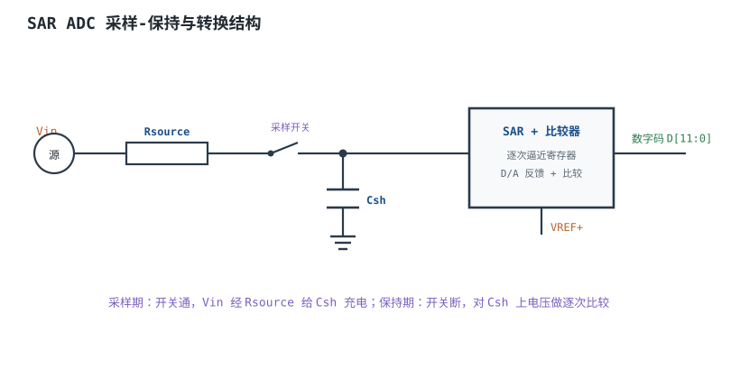
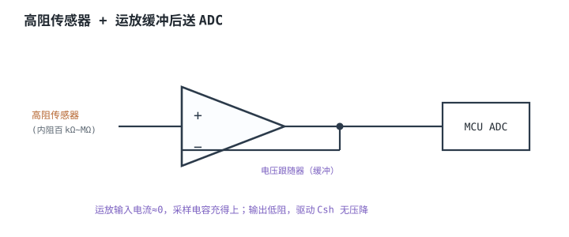
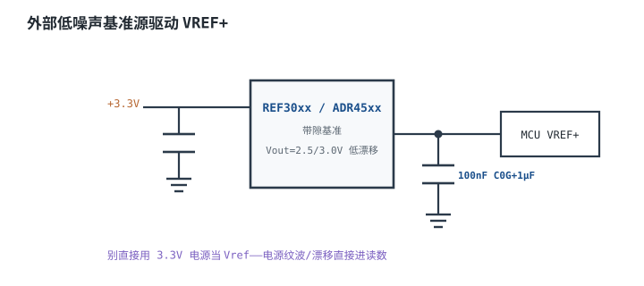
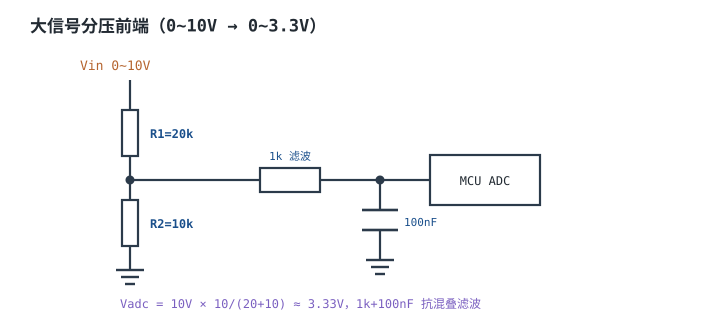

# ADC 原理、参数与参考电压 ADC

## 1. 设计动机

::: motivation 为什么 ADC 读数总是"不准又跳"
现实世界是连续的电压，MCU 只认数字码。**模数转换器（Analog-to-Digital Converter，ADC）**负责把模拟电压量化成 0~$2^n-1$ 的整数码。硬件工程师最常踩的坑不是"不会用 ADC"，而是：读数偏低、跳得厉害、通道串扰、量程超了。

这些几乎都不是软件 bug，而是**模拟前端**没配好：源阻抗太大采样电容充不满、参考电压纹波大、没加抗混叠滤波、量程超过 VREF。本章从 SAR 结构讲起，把分辨率、SNR、参考电压、采样时间都算清楚。
:::

## 2. 原理图

MCU 内置最常见的是 **SAR（Successive Approximation Register，逐次逼近）**ADC。每次转换前先闭合采样开关，让外部信号经源阻抗给内部采样保持电容 $C_{sh}$ 充电；随后断开开关，对 $C_{sh}$ 上保持的电压逐次比较出数字码。



## 3. 静态分析（DC）

量化本质是把 $0\sim V_{REF}$ 映射成 $2^n$ 个码：

$$1\text{ LSB}=\frac{V_{REF}}{2^n}$$

- 12bit、$V_{REF}=3.3\text{V}$：$1\text{ LSB}=3.3/4096\approx 0.806\text{mV}$。
- 静态读数 $D=\text{round}(V_{in}/V_{REF}\cdot 2^n)$，反推 $V_{in}=D\cdot V_{REF}/2^n$。
- **绝对精度**受 INL/DNL、参考电压误差、温度漂移共同限制；标称 12bit 不代表能分辨 0.8mV，实际有效位数（ENOB）更低。

## 4. 动态分析（AC / 瞬态）

采样开关闭合时，外部信号要在**采样时间 $t_{sample}$** 内把 $C_{sh}$ 充到 Vin 的精度内。源阻抗 $R_{source}$ 与 $C_{sh}$ 构成 RC，按指数充电：

$$V_{Csh}(t)=V_{in}\bigl(1-e^{-t/(R_{source}C_{sh})}\bigr)$$

要充到 $n$ 位精度内，需 $t_{sample}\ge R_{source}C_{sh}\ln(2^n)$。源阻抗越大，需要的采样时间越长；否则采样电容充不到位，读数系统性偏低。

```echarts
{
  "tooltip": {"trigger": "axis"},
  "legend": {"data": ["源阻抗 1kΩ", "源阻抗 50kΩ"], "bottom": 0, "textStyle": {"fontSize": 13}},
  "grid": {"left": 56, "right": 24, "top": 26, "bottom": 56},
  "xAxis": {"type": "category", "name": "采样时间 µs", "data": [0,0.5,1,2,5,10,20,50], "axisLabel": {"fontSize": 11}},
  "yAxis": {"type": "value", "name": "相对 Vin", "min": 0, "max": 1.05, "axisLabel": {"fontSize": 11}},
  "series": [
    {"name": "源阻抗 1kΩ", "type": "line", "smooth": true, "showSymbol": false, "lineStyle": {"width": 2.6, "color": "#2e7d4f"},
     "data": [0.1,0.63,0.86,0.986,1,1,1,1]},
    {"name": "源阻抗 50kΩ", "type": "line", "smooth": true, "showSymbol": false, "lineStyle": {"width": 2.6, "color": "#b5642e"},
     "data": [0,0.01,0.02,0.04,0.1,0.18,0.32,0.63]}
  ]
}
```

## 5. 环路分析

::: advanced 进阶：SNR、ENOB 与抗混叠
理想 $n$ bit ADC 的信噪比 $SNR=6.02n+1.76\text{ dB}$。实际电路有热噪声、量化噪声、参考抖动，故**有效位数 ENOB=(SNR−1.76)/6.02**，常比标称位数低 1~2 位。采样率须 ≥ 2×最高信号频率（奈奎斯特），工程留 5~10 倍余量，并在前级加抗混叠低通滤波，否则高于 $f_s/2$ 的分量会折叠回基带造成混叠。
:::

## 6. 元件取值与工程权衡

- **参考电压 VREF**：决定满量程与精度。优先用专用低噪声基准源，别直接拿 3.3V 电源当 VREF。
- **源阻抗**：SAR ADC 规则 $R_{source}\ll t_{sample}/(C_{sh}\ln 2^n)$；高阻传感器必须加运放缓冲。
- **采样时间**：默认最短采样时间往往只够低阻源；高阻源要手动拉长采样周期。
- **抗混叠**：输入串小电阻 + 对地电容（如 1kΩ + 100nF）做一阶 RC。
- **量程匹配**：被测电压必须落在 $0\sim V_{REF}$ 内；超过就先分压/衰减。

## 7. 完整设计示例

::: example 测 0~10V 电压，12bit 精度
1. **需求**：测 0~10V，MCU ADC 参考 3.3V、12bit。
2. **分压**：取 R1=21k、R2=10k，$V_{adc}=10\times 10/31\approx 3.23\text{V}$（留约 5% 余量，不超 VREF=3.3V），满量程对应 10V。
3. **分辨率**：$1\text{ LSB}=3.3/4096=0.806\text{mV}$（ADC 端），折算到原边 ×3.1 ≈ 2.5mV。
4. **滤波**：分压节点串 1kΩ、对地 100nF，截止 $f_c=1/(2\pi\cdot 1\text{k}\cdot 100\text{nF})\approx 1.6\text{kHz}$。
5. **源阻抗核对**：分压等效输出阻抗 ≈ 21k∥10k ≈ 6.8kΩ，配 1k 滤波 ≈ 7.8kΩ，选较长采样时间让 $C_{sh}$ 充饱。
6. **验算**：读回码 $D$，反推 $V_{in}=D\cdot 3.3/4096\cdot 3.1$。
:::

## 8. 仿真与实验

- 电位器分压给 ADC，改采样时间，观察源阻抗大时读数是否偏低——缩短采样时间会掉码。
- 把 VREF 接到开关电源 3.3V，与外接基准源对比，看读数抖动差别。
- 通道切换后立即读，观察到前一通道残留值（channel charge injection），加采样延时/丢弃首读。

## 扩展与变种电路

### 扩展1：高阻源运放缓冲 Op-Amp Buffer

定位：传感器内阻太高，采样电容充不到位。



::: example 工作原理
- 电压跟随器增益 1、输入电流≈0、输出低阻。高阻源接运放同相端，输出直接驱动 ADC。
- 采样开关闭合时，$C_{sh}$ 由运放低阻输出瞬间充满，读数不再偏低。
- 选压摆率、带宽够的运放；注意运放输出要能在采样时间内稳定到 1LSB 内。
:::

取值对比：

| 前端 | 适用源阻抗 | 读数精度 |
|---|---|---|
| 直连 ADC | <10kΩ | 一般 |
| 运放缓冲 | MΩ 级 | 高 |
| 大采样时间 | 中阻 | 可用但慢 |

::: pitfall 高阻源直连却靠拉长采样时间硬撑
- **现象**：高速采样时读数偏低且随采样率变化。
- **原因**：源阻抗大，$C_{sh}$ 充不满；拉长采样又拖慢吞吐率。
- **解决**：高阻源加运放缓冲，从根上降低驱动阻抗。
:::

### 扩展2：外部基准源 External VREF

定位：3.3V 电源纹波/漂移直接污染读数。



::: example 工作原理
- 专用基准（REF30xx/ADR45xx）温漂低（几 ppm/℃）、输出噪声小。
- VREF 引脚就近 100nF（C0G）+ 1µF 去耦；负载电容帮助稳定。
- 提高 VREF 到刚好满量程（如测 0~2.5V 就用 2.5V 基准），可提高等效分辨率。
:::

取值对比：

| VREF 来源 | 初始精度 | 温漂 | 适用 |
|---|---|---|---|
| 直接用 VDD | ~3~5% | 大 | 粗略监测 |
| 专用基准 | 0.1% | 5~20ppm | 精密测量 |
| 外部高基准 | 0.05% | 1ppm | 计量级 |

::: pitfall 拿 3.3V LDO 输出当 VREF
- **现象**：读数随电源纹波、负载电流一起跳。
- **原因**：VREF 误差直接 ×增益进读数，电源纹波全被量化。
- **解决**：用专用基准 + VREF 去耦；高精度测量还需独立模拟电源。
:::

### 扩展3：大信号分压前端 Attenuator Front-End

定位：被测电压超过 ADC 量程。



::: example 工作原理与时序
- 分压比 $k=R_2/(R_1+R_2)$，满量程对应 $V_{in,max}=V_{REF}/k$。
- 10V→3.3V：$k=0.33$，取 R1=20k、R2=10k。
- 分压输出阻抗 = R1∥R2，它和后级 RC 一起决定采样要求。
- 反推原边：$V_{in}=D\cdot V_{REF}/2^n\cdot(1+R_1/R_2)$。
:::

取值对比：

| 量程 | R1:R2 | 等效阻抗 | 说明 |
|---|---|---|---|
| 10V→3.3V | 21k:10k（3.23V，留 ~2% 余量） | 6.8kΩ | 通用；用 20k:10k 会到 3.33V，超 VREF |
| 30V→2.97V | 91k:10k | ~9kΩ | 高压（留 10% 余量）；需 3.3V 满量程则用 80.6k:10k |

::: pitfall 分压电阻取值太小导致传感器被拉低
- **现象**：传感器输出被分压网络拽偏。
- **原因**：分压电阻太小，从信号源取电流；或电阻太大、与采样时间不匹配。
- **解决**：取百 kΩ 级平衡功耗与阻抗，并核对源阻抗+采样时间；高压场合注意电阻耐压。
:::

## 9. 常见坑与故障现象

::: pitfall 常见坑
- **读数系统性偏低**：源阻抗太大、采样时间太短，$C_{sh}$ 没充饱。加长采样时间或加缓冲。
- **读数跳动大**：VREF 噪声/纹波。换基准源 + VREF 去耦。
- **通道切换后第一遍读不准**：前一通道电荷残留。加延时或丢弃首读。
- **信号超量程削顶**：输入 >VREF 时码值卡在满量程。先分压衰减。
- **高频信号被混叠**：没加抗混叠滤波，>$f_s/2$ 分量折回基带。前级加低通。
:::

## 10. 自测题

<details><summary>12bit ADC、VREF=3.3V，1 LSB 是多少毫伏？</summary>
$1\text{ LSB}=3.3/4096\approx 0.806\text{ mV}$。
</details>

<details><summary>为什么高阻传感器不能直接接 SAR ADC？怎么办？</summary>
SAR 每次采样从内部 Csh 抽电荷，源阻抗大时 Csh 充不到位，读数偏低。应加运放缓冲（电压跟随器）降低输出阻抗，或大幅拉长采样时间。
</details>

<details><summary>想测 0~10V，VREF=3.3V，分压比取多少？</summary>
$k=3.3/10=0.33$，即 R2/(R1+R2)=0.33，取 R1:R2≈2:1（如 20k:10k）。
</details>

## 11. 参考资料

- TI Precision Labs – ADCs（采样保持、参考电压、抗混叠）
- ADI MT-031/MT-034 模拟工程师手册（ADC 参数）
- STM32 ADC 应用笔记（采样时间计算）
