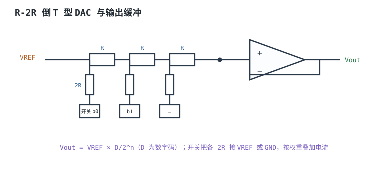
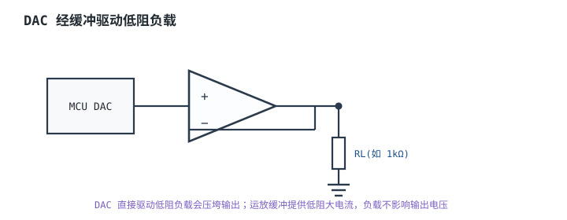
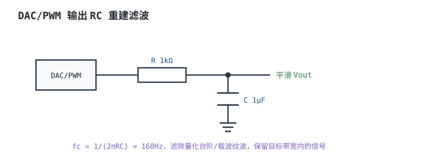

# DAC 与模拟输出 DAC

## 1. 设计动机

::: motivation 为什么需要 DAC
MCU 输出的是数字量，而真实世界很多地方需要**连续可调电压**：设一个可调电源的设定值、产生偏置电压、输出一段任意波形、做比例阀驱动。**数模转换器（Digital-to-Analog Converter，DAC）**把数字码变回模拟电压。

硬件上要注意：MCU 内置 DAC 输出阻抗不低、驱动能力弱，直接带低阻负载会被拉偏；输出还有量化台阶和毛刺。理解 R-2R 结构、建立时间和缓冲接法，才能得到干净准确的模拟电压。
:::

## 2. 原理图

MCU 内置 DAC 多为 **R-2R 倒 T 型电阻网络**：数字码 $D$ 的每一位控制一只开关，把对应 2R 支路接到 VREF 或地，按二进制权重叠加成电流，再经输出缓冲变成电压：

$$V_{out}=V_{REF}\cdot\frac{D}{2^n}$$



## 3. 静态分析（DC）

- 输出 $V_{out}=V_{REF}\cdot D/2^n$。12bit、$V_{REF}=3.3\text{V}$ 时 1 LSB ≈ 0.806mV。
- DAC 输出带片内缓冲时，直流输出阻抗很小；无缓冲（直接从电阻网络输出）时输出阻抗 ≈ R，带载会分压。
- 静态误差：偏移误差、增益误差、INL/DNL，决定输出离理想直线多远。

## 4. 动态分析（AC / 瞬态）

数字码跳变后，输出要经过**建立时间（Settling Time）**才能稳定到新值的 ±1 LSB 内——内部缓冲压摆、电阻网络寄生都限制速度。下图是输出从 0 跳到中间码再到满幅的瞬态。

```echarts
{
  "tooltip": {"trigger": "axis"},
  "legend": {"data": ["Vout"], "bottom": 0, "textStyle": {"fontSize": 13}},
  "grid": {"left": 56, "right": 24, "top": 26, "bottom": 56},
  "xAxis": {"type": "category", "name": "µs", "data": [0,1,2,3,4,6,8,12], "axisLabel": {"fontSize": 11}},
  "yAxis": {"type": "value", "name": "V", "min": 0, "max": 3.5, "axisLabel": {"fontSize": 11}},
  "series": [
    {"name": "Vout", "type": "line", "smooth": true, "showSymbol": false, "lineStyle": {"width": 2.6, "color": "#1a4f8b"},
     "data": [0,1.5,1.65,1.65,1.65,1.65,1.65,1.65]}
  ]
}
```

## 5. 环路分析

::: advanced 进阶：输出缓冲的稳定性
片内缓冲或外加运放缓冲 DAC 输出，都构成一个反馈环路。容性负载（长走线、滤波电容）会引入额外相移，可能使缓冲振荡。外加缓冲时按运放稳定性要求选反馈网络、加小容量补偿；必要时在输出串一小电阻隔离容性负载。
:::

## 6. 元件取值与工程权衡

- **驱动低阻负载**：DAC 直推只适合高阻负载；低阻（如 <1kΩ）必须加运放缓冲。
- **输出滤波**：量化台阶/毛刺用 RC 低通压平，截止频率取目标带宽的 2~5 倍。
- **VREF**：与 ADC 共用时要保证基准干净；DAC 精度同样受 VREF 限制。
- **建立时间 vs 速度**：高速任意波形要选快建立的缓冲/外置 DAC，片内 DAC 多为 µs 级。

## 7. 完整设计示例

::: example 用 DAC 设 0~2.5V 可调偏置
1. **需求**：给某传感器提供 0~2.5V 可调偏置。
2. **VREF**：用 3.3V。
3. **算码**：目标 2.0V → $D=2.0/3.3\times4096\approx 2482$。
4. **缓冲**：负载约 10kΩ，片内缓冲够用；若要驱动 1kΩ 则外加运放跟随。
5. **滤波**：输出加 1kΩ + 1µF（fc≈160Hz）压平台阶。
6. **验算**：写 D=2482，量输出 ≈2.0V。
:::

## 8. 仿真与实验

- 写不同码值，用万用表量 DAC 输出，核对 $V_{out}=V_{REF}D/2^n$。
- 快速扫一遍码，示波器看输出台阶与毛刺，体会建立时间。
- 接低阻负载（如 1kΩ），观察无缓冲时输出被拉低。

## 扩展与变种电路

### 扩展1：缓冲驱动低阻负载 Buffered Output

定位：DAC 直推低阻负载会压垮输出。



::: example 工作原理
- 跟随器增益 1、输出低阻，负载电流由运放提供，不经过 DAC 电阻网络。
- 选压摆率、带宽够的运放；驱动容性负载注意稳定性。
- 高阻负载（几 kΩ 以上）可省缓冲。
:::

取值对比：

| 负载 | 接法 | 结果 |
|---|---|---|
| 10kΩ+ | DAC 直出 | 可接受 |
| 1kΩ | 直出 | 输出被拉偏 |
| 1kΩ | 加缓冲 | 准确 |

::: pitfall DAC 直接驱动 50Ω/扬声器
- **现象**：输出电压远低于设定、发热。
- **原因**：DAC 输出电流能力有限，低阻负载取电流太大，输出被拉低。
- **解决**：加运放/功放缓冲；扬声器还要功率级。
:::

### 扩展2：RC 重建滤波 Reconstruction Filter

定位：压平量化台阶与载波纹波。



::: example 工作原理与时序
- 一阶 RC：$f_c=1/(2\pi RC)$，把高于信号带宽的量化噪声/载波纹波滤掉。
- $R=1\text{k}\Omega$、$C=1\mu\text{F}$ 时 $f_c\approx 160\text{Hz}$。
- 截止不能太低，否则目标信号也被衰减；按信号带宽选。
:::

取值对比：

| R | C | fc | 用途 |
|---|---|---|---|
| 1k | 1µF | 160Hz | 慢直流偏置 |
| 1k | 100nF | 1.6kHz | 一般波形 |
| 100 | 100nF | 16kHz | 较快信号 |

::: pitfall 滤波电容太大把信号也滤没了
- **现象**：输出很平滑但响应迟钝。
- **原因**：fc 取得比信号带宽还低，有用信号被衰减/延迟。
- **解决**：按信号最高频率选 fc，留 2~5 倍余量。
:::

## 9. 常见坑与故障现象

::: pitfall 常见坑
- **带载输出偏低**：DAC 直推低阻负载。解决：加缓冲。
- **输出有台阶/纹波**：没加重建滤波。解决：RC 低通。
- **输出建立慢**：缓冲压摆率不够或容性负载太大。解决：选快运放/隔离容性。
- **精度不够**：VREF 噪声/漂移。解决：用干净基准。
:::

## 10. 自测题

<details><summary>12bit DAC、VREF=3.3V，写码 2048，输出约多少伏？</summary>
$V_{out}=3.3\times2048/4096=1.65\text{V}$。
</details>

<details><summary>为什么 DAC 不能直接驱动 8Ω 扬声器？怎么办？</summary>
DAC 输出电流能力弱，8Ω 取电流太大，输出被拉低。应加缓冲/功放级，DAC 只给小信号设定。
</details>

## 11. 参考资料

- TI Precision Labs – DACs
- ADI MT-017/MT-020 模拟工程师手册
- STM32 DAC 数据手册与应用笔记
