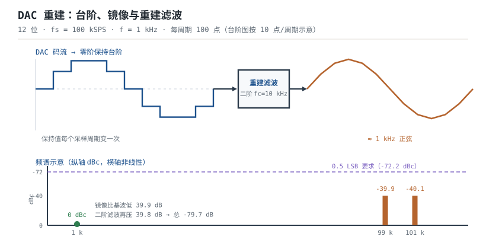

# DAC 与模拟输出 DAC

**数模转换器（Digital-to-Analog Converter，DAC）**做的事和 ADC 相反：把一个整数码变回电压。它看起来比 ADC 简单——没有采样保持，也没有逐次比较——但工程上真正难的是三件事：**电阻网络能不能做到足够单调、输出缓冲能不能在下一个码到来之前建立到 0.5 LSB、重建滤波器能不能把采样留下的镜像压到足够低。** 只把码写进去、用万用表量一个直流，往往一切正常；一旦输出波形，毛刺、台阶、镜像和建立时间就全出来了。

本章按"结构 → 缓冲/建立 → 量化/信噪比 → 重建滤波"的顺序展开，最后用一个 12 位 DAC 生成 1 kHz 正弦的完整算例，把 SNR、镜像衰减、滤波器阶数和 DDS 调谐字一次算清。ADC 侧的对应问题见[ADC 原理、参数与参考电压](adc.md)，用 PWM 加滤波器做"廉价 DAC"的路线见[定时器与 PWM 原理](timer-pwm.md)，低功耗设备里 DAC 的偏置与唤醒见[看门狗、RTC 与低功耗硬件](watchdog-rtc-lowpower.md)。

## 1. 设计动机

::: motivation 三个现场
**现场一：12 位 DAC 直接驱 1 kΩ 负载。** 无缓冲的 R-2R 输出阻抗约等于单位电阻 $R$。设 $R=10\ \text{k}\Omega$，接 1 kΩ 负载，分压比 $10/(10+1)=0.909$，设定 2.000 V 只剩 1.818 V，相对设定值误差 9.1%，折合 $182\ \text{mV}/805.7\ \mu\text{V}=226$ LSB。**"输出阻抗约 R"不是小数，它直接把负载变成分压器。**

**现场二：1 kHz 正弦、100 kSPS、12 位，输出看起来很"台阶"。** 采样把频谱以 $f_s$ 为周期复制，1 kHz 的镜像落在 99 kHz 和 101 kHz。零阶保持（ZOH）的 sinc 包络在 99 kHz 处把镜像压了 39.9 dB，但 12 位要求镜像低于 0.5 LSB，也就是相对基波 72.2 dB。**还差 32.3 dB，必须靠重建滤波器补。**

**现场三：DDS 写了一个"看起来对"的频率。** 32 位相位累加器、100 kSPS、目标 1 kHz，调谐字算成 42,949,673，实际输出 1000.00000093 Hz，误差不到 1 µHz——这没问题；但如果累加器只有 16 位，调谐字 655，实际输出 999.39 Hz，误差 0.61 Hz，做音频或锁相环就不够了。**DDS 的频率精度由累加器位宽决定，不由"目标频率"决定。**
:::

| 你想确认 | 先算 | 判据（工程经验值） |
|---|---|---|
| 输出带载会不会被拉偏 | 输出阻抗与负载的分压 | 负载 $\geq100\times$ 输出阻抗，否则加缓冲 |
| 建立够不够 | $(N+1)\ln2\cdot\tau$ | 小于码更新周期，留 20% 余量 |
| 缓冲器够不够快 | $GBW\geq(N+1)\ln2/(2\pi t_s)$ | 再留 5~10 倍余量 |
| 理论 SNR 多少 | $6.02N+1.76$ | 实测 SINAD 才算 ENOB |
| 镜像压到哪 | ZOH sinc + 滤波器 | 镜像低于 0.5 LSB |
| 滤波器几阶 | $n\geq A_{req}/[20\lg(f_{img}/f_c)]$ | 用完整巴特沃斯式子复核 |

**不算会摔在哪**，四个带数字的代价：

1. **无缓冲直驱低阻。** 10 kΩ 输出阻抗带 1 kΩ 负载，误差 9.1%，约 226 LSB；带 50 Ω 负载只剩 0.5%，基本不能用。
2. **建立时间不够。** 12 位、0.5 LSB 要 9.01 个时间常数；码更新周期 10 µs 时，时间常数必须小于 1.11 µs，否则高位跳变还没稳，下一个码就来了，输出码间干扰。
3. **没有重建滤波。** 1 kHz 的镜像在 99 kHz，幅度只比基波低 39.9 dB；如果后级是宽带放大器或 ADC，镜像会被放大/再次混叠。
4. **只看标称位数。** 12 位理想 SNR 74.0 dB；实测 SINAD 68.2 dB 时 ENOB 只有 11.0 位，毛刺、参考噪声、时钟抖动和缓冲失真各占一部分。

## 2. 定义与直观

### 2.1 三种结构：权电阻、R-2R、ΔΣ

| 结构 | 电阻种类 | 12 位所需匹配 | 速度 | 典型分辨率 | 主要问题 |
|---|---|---|---|---|---|
| 权电阻 | $R,2R,4R,\dots,2^{N-1}R$ | 最大/最小电阻比 2048:1 | 快 | 6~10 位 | 大电阻比难匹配，温漂不同步 |
| R-2R | 只有 $R$ 和 $2R$ | 2:1，靠相对匹配 | 快 | 10~16 位 | 开关寄生、输出阻抗随码略变 |
| ΔΣ | 1 位或少量权重 | 不靠电阻匹配 | 慢 | 16~24 位 | 延迟大、数字滤波功耗 |

**权电阻 DAC** 用 $N$ 只按二进制加权的电阻，每位开关决定该支路接参考还是地，电流相加。它的缺点是电阻比达到 $2^{N-1}$：12 位是 2048:1，片上很难同时保证绝对值和高频匹配，所以现在多用于分立/台式仪器，或低位数场合。

**R-2R DAC** 只用两种阻值，靠 $R$ 和 $2R$ 的相对比例形成二进制权重。以倒 T 型为例，每位开关把 2R 支路接到 $V_{REF}$ 或地，节点电流按 2 的幂相加，再经运放缓冲成电压：

$$V_{out}=V_{REF}\frac{D}{2^N}$$

R-2R 的优点是匹配压力小、速度快、功耗低；缺点是开关的导通电阻和电荷注入会引入误差，输出阻抗约等于 $R$（随码略有变化），所以**片内通常带缓冲，片外低阻负载必须再加一级**。

**ΔΣ DAC** 先用数字插值把采样率抬高，再用 ΔΣ 调制器把码变成 1 位（或多位）的高频流，最后用模拟低通滤出带内信号。它不依赖电阻匹配，能做到 16~24 位，但延迟大、带宽窄，适合音频、精密偏置和慢速波形。它的重建滤波器同时也是环路的一部分，设计时要把调制器噪声整形和模拟滤波一起看。


### 2.2 输出缓冲与建立时间

DAC 的输出级有两种：

- **无缓冲（电压输出型 R-2R 直接出）**：输出阻抗约 $R$，带载能力弱，负载会直接分压；优点是速度快、没有缓冲器的稳定性问题。
- **带片内缓冲**：输出阻抗降到欧姆级，能驱动几 kΩ 到几十 kΩ 的负载；代价是缓冲器有失调、压摆率、有限带宽和容性负载稳定性问题。

建立时间定义为"码跳变后，输出进入新值 $\pm0.5$ LSB 误差带所需的时间"。它由两部分组成：**压摆率限制的大信号段**和**指数建立的小信号段**。前者决定"能不能跟上跳变"，后者决定"最后几个 LSB 要多快"。



### 2.3 重建：台阶、镜像与 sinc 包络

DAC 每个采样周期输出一个保持值，形成**零阶保持（Zero-Order Hold，ZOH）**的台阶波。台阶波的频谱是基波加上以 $f_s$ 为周期的镜像，镜像幅度被 sinc 包络调制：

$$H_{ZOH}(f)=\frac{\sin(\pi f/f_s)}{\pi f/f_s}$$

在 $f=kf_s$ 处 sinc 为零，所以镜像不是均匀的：靠近 $f_s$ 的镜像被压得最多，靠近直流的镜像几乎不衰减。这就是为什么"采样率越高，重建滤波器越好做"——镜像被推得更远，sinc 也已经压了一部分。

::: analogy 马赛克与退后一步
DAC 的台阶像马赛克：近看是一块块方块，退后几步（低通滤波）才看成连续的画。重建滤波器就是"退后几步"的数学版本：它去掉人眼（或后级电路）不需要的高频方块边缘。

类比的边界：马赛克退后只是视觉平均，DAC 的滤波器是线性时不变系统，会带来相位延迟和通带衰减；而且滤波只能去掉镜像，不能恢复采样时已经丢失的带内信息。**"看起来平滑"不等于"频谱干净"。**
:::

## 3. 定量关系

### 3.1 传递函数、LSB 与码

$$V_{out}=V_{REF}\frac{D}{2^N},\qquad 1\ \text{LSB}=\frac{V_{REF}}{2^N}$$

$$D=\operatorname{round}\left(\frac{V_{out}}{V_{REF}}2^N\right)$$

符号与单位：$V_{out}$ 是输出电压（V）；$V_{REF}$ 是参考电压（V）；$D$ 是输入码（0~$2^N-1$）；$N$ 是位数。满量程输出是 $V_{REF}(2^N-1)/2^N$，比 $V_{REF}$ 低 1 LSB；码 0 输出 0 V，码 $2^N-1$ 输出 $V_{REF}-1\ \text{LSB}$。

### 3.2 量化误差与理论 SNR

理想 DAC 的输出只能落在 $2^N$ 个电平上，量化误差在 $\pm0.5$ LSB 内，rms 为：

$$V_{q,rms}=\frac{q}{\sqrt{12}},\qquad q=1\ \text{LSB}$$

满量程正弦的 rms 是 $2^Nq/(2\sqrt2)$，所以：

$$SNR_{ideal}=20\lg\frac{2^Nq/(2\sqrt2)}{q/\sqrt{12}}=6.02N+1.76\ \text{dB}$$

这个式子和 ADC 侧完全一样，因为量化误差的统计模型相同。12 位是 $6.02\times12+1.76=74.0\ \text{dB}$。**它是理想上限，不是数据手册的保证值。** 实际 SINAD 还会被 DNL、毛刺、参考噪声、时钟抖动和缓冲失真拉低；用 SINAD 算 ENOB：

$$ENOB=\frac{SINAD-1.76}{6.02}$$

**时钟抖动（jitter）的定量影响。** 对 $V(t)=A\sin(2\pi ft)$，采样时刻的抖动 $t_j$ 变成电压误差，误差 rms 与信号 rms 之比为：

$$SNR_j=-20\lg(2\pi f t_{j,rms})$$

符号与单位：$f$ 是输出频率（Hz）；$t_{j,rms}$ 是时钟抖动的 rms（s）；$SNR_j$ 单位 dB。1 kHz、1 ns 抖动时 $SNR_j=104.0\ \text{dB}$，可以忽略；100 ns 抖动时降到 64.0 dB，已经低于 12 位的 74.0 dB，成为瓶颈。**低频时抖动不敏感，高频/高速时它是主角。**

### 3.3 建立时间、压摆率与缓冲器 GBW

一阶建立：

$$V_{out}(t)=V_{final}\left(1-e^{-t/\tau}\right)$$

其中 $V_{final}$ 是目标电压（V）；$t$ 是时间（s）；$\tau$ 是输出缓冲的时间常数（s）。建立到 0.5 LSB 需要：

$$t_s=(N+1)\ln2\cdot\tau$$

12 位是 $9.011\tau$。若要求 $t_s\leq1\ \mu\text{s}$，则 $\tau\leq111\ \text{ns}$。对单位增益缓冲器，$\tau\approx1/(2\pi GBW)$，其中 $GBW$ 是缓冲器的增益带宽积（Hz），所以：

$$GBW\geq\frac{(N+1)\ln2}{2\pi t_s}$$

12 位、1 µs 时：

$$GBW\geq\frac{9.011}{2\pi\times10^{-6}}=1.434\ \text{MHz}$$

工程上留 5 倍余量，选 7~10 MHz。压摆率要求：

$$SR\geq\frac{\Delta V}{t_s}$$

其中 $SR$ 是压摆率（V/s）；$\Delta V$ 是输出电压跳变幅度（V）。3.3 V 跳变、1 µs 建立，$SR\geq3.3\ \text{V}/\mu\text{s}$；实际选 10 V/µs 以上，给大信号段留余量。

**缓冲器的容性负载。** 输出串一个小电阻 $R_{iso}$ 隔离容性负载，形成极点：

$$f_{p,iso}=\frac{1}{2\pi R_{iso}C_L}$$

其中 $R_{iso}$ 是隔离电阻（$\Omega$）；$C_L$ 是负载电容（F）。$R_{iso}=50\ \Omega$、$C_L=1\ \text{nF}$ 时 $f_{p,iso}=3.18\ \text{MHz}$；如果运放的闭环带宽接近这个频率，相位裕度会被吃掉，输出振铃。$R_{iso}$ 太大会在负载上分压，$R_{iso}\ll R_L$ 是前提。

### 3.4 重建滤波器：镜像位置与阶数

采样后镜像落在 $kf_s\pm f$。最靠近基波的两个镜像在 $f_s-f$ 和 $f_s+f$，幅度被 ZOH 的 sinc 衰减：

$$A_{ZOH}(f)=20\lg\left|\frac{\sin(\pi f/f_s)}{\pi f/f_s}\right|$$

要把镜像压到 0.5 LSB 以下，相对基波所需的衰减：

$$A_{req}=20\lg\frac{A_{fund}}{0.5\ \text{LSB}}=20\lg\frac{V_{REF}/2}{V_{REF}/2^{N+1}}=20\lg2^N=6.02N\ \text{dB}$$

12 位是 $20\lg4096=72.25\ \text{dB}$。滤波器要补的衰减：

$$A_{filter}=A_{req}-|A_{ZOH}(f_s-f)|$$

$n$ 阶巴特沃斯在 $f\gg f_c$ 处的衰减约为 $20n\lg(f/f_c)$，所以：

$$n\geq\frac{A_{filter}}{20\lg(f_{img}/f_c)}$$

**注意这里的分母是 $f_{img}/f_c$，不是 $f_{img}/f_s$。** 截止频率越低，同样阶数越容易达标，但通带也被压窄；这是一个"信号带宽换滤波器阶数"的权衡。

### 3.5 DDS：相位累加器与频率分辨率

直接数字合成（Direct Digital Synthesis，DDS）用相位累加器产生正弦查表地址：

$$\Delta\phi=\operatorname{round}\left(\frac{f_{out}}{f_s}2^M\right)$$

$$f_{out,actual}=f_s\frac{\Delta\phi}{2^M}$$

$$\Delta f_{min}=\frac{f_s}{2^M}$$

符号与单位：$M$ 是累加器位宽（bit）；$\Delta\phi$ 是每个采样周期的相位增量（整数）；$f_{out}$ 是目标频率（Hz）；$f_s$ 是更新率（Hz）；$\Delta f_{min}$ 是最小频率步进（Hz）。32 位、100 kSPS 时 $\Delta f_{min}=100\times10^3/2^{32}=23.3\ \mu\text{Hz}$，频率精度远高于任何晶振；真正限制输出质量的是相位截断、DAC 位数和重建滤波器。

### 3.6 适用条件与失效边界

1. **理想电阻匹配假设**：R-2R 的公式假设 $R$ 和 $2R$ 精确匹配；实际失配产生 DNL/INL，12 位以上通常要激光修调或分段校准。
2. **输出无载假设**：传递函数假设输出开路；带载时按输出阻抗分压，必须先缓冲或把负载算进传递函数。
3. **单极点建立假设**：缓冲器有第二极点、压摆率限制和容性负载时，建立曲线不是简单指数，要按数据手册的建立时间曲线核对。
4. **量化噪声白噪声假设**：$q/\sqrt{12}$ 假设码间均匀分布；周期性码、DDS 的相位截断会产生离散杂散，SNR 公式不适用，要看 SFDR。
5. **ZOH 假设**：sinc 包络假设每个码保持整个采样周期；如果 DAC 有毛刺、建立不足或去毛刺电路，实际频谱会多出杂散。
6. **参考静态假设**：DAC 的参考输入在码跳变时也有瞬态电流，参考去耦和缓冲不足会把码间干扰变成失真。

## 4. 典型计算

### 4.1 完整算例：12 位 DAC 生成 1 kHz 正弦，100 kSPS

**已知**：$N=12$，$V_{REF}=3.3\ \text{V}$，$f_s=100\ \text{kSPS}$，$f_{out}=1\ \text{kHz}$，满量程正弦。求：理论 SNR、镜像位置与幅度、重建滤波器阶数与截止频率、DDS 调谐字。

**第 1 步：LSB 与量化噪声。**

$$1\ \text{LSB}=\frac{3.3}{4096}=805.7\ \mu\text{V}$$

$$V_{q,rms}=\frac{805.7\ \mu\text{V}}{\sqrt{12}}=232.6\ \mu\text{V}$$

**第 2 步：理论 SNR。**

$$SNR_{ideal}=6.02\times12+1.76=72.24+1.76=74.0\ \text{dB}$$

验算：满量程正弦 rms $=3.3/(2\sqrt2)=1.167\ \text{V}$，$20\lg(1.167/232.6\times10^{-6})=20\lg5017=74.0\ \text{dB}$。

**第 3 步：每个周期的采样点数。**

$$N_{samp}=\frac{f_s}{f_{out}}=\frac{100\times10^3}{1\times10^3}=100$$

100 个点/周期，台阶很明显，必须滤波。

**第 4 步：镜像位置。**

$$f_{img,1}=f_s-f_{out}=100-1=99\ \text{kHz},\qquad f_{img,2}=f_s+f_{out}=101\ \text{kHz}$$

**第 5 步：ZOH 对 99 kHz 镜像的衰减。**

$$\frac{f}{f_s}=\frac{99}{100}=0.99$$

$$|H_{ZOH}|=\left|\frac{\sin(0.99\pi)}{0.99\pi}\right|=\frac{0.03141}{3.110}=0.01010$$

$$A_{ZOH}=20\lg0.01010=-39.91\ \text{dB}$$

**第 6 步：所需总衰减与滤波器负担。**

$$A_{req}=20\lg2^{12}=20\lg4096=72.25\ \text{dB}$$

$$A_{filter}=72.25-39.91=32.34\ \text{dB}$$

**第 7 步：滤波器阶数。** 取 $f_c=10\ \text{kHz}$，$f_{img}/f_c=9.9$：

$$n\geq\frac{32.34}{20\lg9.9}=\frac{32.34}{19.91}=1.62$$

取 $n=2$。二阶巴特沃斯在 99 kHz 的衰减：

$$A_2=10\lg\left[1+(9.9)^4\right]=10\lg9607=39.83\ \text{dB}$$

总衰减 $39.91+39.83=79.74\ \text{dB}$，比 72.25 dB 多 7.49 dB 余量。**一阶只有 $10\lg[1+(9.9)^2]=19.96\ \text{dB}$，总衰减 59.87 dB，不够；二阶刚好够。**

如果取 $f_c=20\ \text{kHz}$：

$$A_2=10\lg\left[1+(4.95)^4\right]=10\lg601.9=27.79\ \text{dB}$$

总衰减 67.70 dB，不够；三阶是 $10\lg[1+(4.95)^6]=41.68\ \text{dB}$，总衰减 81.59 dB，够。**截止频率从 10 kHz 放宽到 20 kHz，阶数从 2 升到 3——这就是"通带换阶数"。**

**第 8 步：二阶 Sallen-Key 取值。** 取 $R_1=R_2=1.6\ \text{k}\Omega$、$C_1=15\ \text{nF}$、$C_2=6.8\ \text{nF}$：

$$f_c=\frac{1}{2\pi R\sqrt{C_1C_2}}=\frac{1}{2\pi\times1600\times\sqrt{15\times10^{-9}\times6.8\times10^{-9}}}=9.85\ \text{kHz}$$

$$Q=\frac{\sqrt{R_1R_2C_1C_2}}{C_2(R_1+R_2)}=\frac{\sqrt{2.56\times10^6\times1.02\times10^{-16}}}{6.8\times10^{-9}\times3200}=0.743$$

其中 $Q$ 是二阶节的品质因数（无量纲）。$Q\approx0.743$ 接近巴特沃斯的 0.707，通带平坦；1 kHz 处衰减仅 0.008 dB。99 kHz 处按完整二阶式子算是 $-40.08\ \text{dB}$，总衰减 79.99 dB，比理想巴特沃斯的 79.74 dB 还多 0.25 dB。

**第 9 步：DDS 调谐字。** 32 位累加器：

$$\Delta\phi=\operatorname{round}\left(\frac{1000}{100000}\times2^{32}\right)=\operatorname{round}(42949672.96)=42949673$$

$$f_{out,actual}=100000\times\frac{42949673}{4294967296}=1000.00000093\ \text{Hz}$$

频率误差 $0.93\ \mu\text{Hz}$，频率分辨率 $100000/2^{32}=23.3\ \mu\text{Hz}$。**在 1 kHz 这个点上，DDS 的精度远远够；真正的杂散来自 12 位 DAC 的量化、相位截断和重建滤波器。**

**第 10 步：抖动与实测差距。** 1 kHz、1 ns rms 抖动：

$$SNR_j=-20\lg(2\pi\times1000\times10^{-9})=-20\lg(6.283\times10^{-6})=104.0\ \text{dB}$$

不构成瓶颈。若实测 SINAD 68.2 dB，按 4.3 节的预算，主要缺口来自失真（约 70 dB）和参考/毛刺，而不是抖动。

```echarts
{
  "animation": false,
  "tooltip": {"trigger": "axis"},
  "legend": {"data": ["一阶 fc=10k", "二阶 fc=10k", "三阶 fc=20k"], "bottom": 0, "textStyle": {"fontSize": 11}},
  "grid": {"left": 70, "right": 30, "top": 30, "bottom": 58},
  "xAxis": {"type": "category", "name": "频率 / kHz", "nameLocation": "middle", "nameGap": 36, "data": ["1", "10", "20", "50", "99", "101"], "axisLabel": {"fontSize": 11}},
  "yAxis": {"type": "value", "name": "衰减 / dB", "nameLocation": "middle", "nameGap": 46, "min": -100, "max": 0, "axisLabel": {"fontSize": 11}},
  "series": [
    {"name": "一阶 fc=10k", "type": "line", "symbolSize": 6, "lineStyle": {"width": 2.2, "color": "#1a4f8b"}, "data": [-0.0, -3.2, -7.6, -18.1, -59.9, -60.2]},
    {"name": "二阶 fc=10k", "type": "line", "symbolSize": 6, "lineStyle": {"width": 2.2, "color": "#2e7d4f"}, "data": [-0.0, -3.2, -12.9, -31.9, -79.7, -80.3]},
    {"name": "三阶 fc=20k", "type": "line", "symbolSize": 6, "lineStyle": {"width": 2.2, "color": "#b5642e"}, "data": [-0.0, -0.2, -3.6, -27.8, -81.6, -82.3]}
  ]
}
```

上图是各方案在关键频点的总衰减（ZOH + 滤波器），不是单独滤波器响应；1 kHz 处接近 0 dB，99 kHz 处二阶/三阶都超过 72.25 dB 的要求。数据与第 7、8 步的公式一致。

### 4.2 建立时间与缓冲器算例

**已知**：12 位、3.3 V、码更新周期 $T=1\ \mu\text{s}$，要求建立到 0.5 LSB；负载 10 kΩ 并联 100 pF。

**第 1 步：时间常数上限。**

$$t_s=9.011\tau\leq1\ \mu\text{s}\quad\Rightarrow\quad\tau\leq\frac{1\ \mu\text{s}}{9.011}=111\ \text{ns}$$

**第 2 步：缓冲器 GBW。**

$$GBW\geq\frac{1}{2\pi\tau}=\frac{1}{2\pi\times111\times10^{-9}}=1.434\ \text{MHz}$$

留 5 倍余量，选 7.2 MHz 以上；实际选 10 MHz 更稳。

**第 3 步：压摆率。**

$$SR\geq\frac{3.3\ \text{V}}{1\ \mu\text{s}}=3.3\ \text{V}/\mu\text{s}$$

留 3 倍余量选 10 V/µs。

**第 4 步：容性负载隔离。** 取 $R_{iso}=50\ \Omega$：

$$f_{p,iso}=\frac{1}{2\pi\times50\times100\times10^{-12}}=31.8\ \text{MHz}$$

远高于 10 MHz 的闭环带宽，不会明显吃相位裕度；如果负载电容是 1 nF，极点降到 3.18 MHz，就要重新评估稳定性或加大 $R_{iso}$。

**第 5 步：无缓冲会怎样。** 设 R-2R 的单位电阻 $R=10\ \text{k}\Omega$，输出阻抗约 10 kΩ，接 10 kΩ 负载：

$$V_{load}=V_{out}\frac{10}{10+10}=0.5V_{out}$$

误差 50%，折合 $0.5\times4096=2048$ LSB。**这就是"必须缓冲"的最直接算法。**

### 4.3 理论 SNR 与实测差距的预算

**已知**：12 位、3.3 V、1 kHz、100 kSPS；实测 SINAD = 68.2 dB。把缺口拆成四项（示例预算，具体以器件数据手册为准）：

| 误差项 | 等效 SINAD | 功率占比 |
|---|---|---|
| 量化噪声 | 74.0 dB | $3.98\times10^{-8}$ |
| 参考噪声 | 80.0 dB | $1.00\times10^{-8}$ |
| 时钟抖动（1 ns） | 104.0 dB | $3.98\times10^{-11}$ |
| 失真/毛刺 | 70.0 dB | $1.00\times10^{-7}$ |

总噪声功率按倒数相加：

$$\frac{1}{SINAD_{total}}=10^{-7.40}+10^{-8.00}+10^{-10.40}+10^{-7.00}$$

$$=3.98\times10^{-8}+1.00\times10^{-8}+3.98\times10^{-11}+1.00\times10^{-7}=1.538\times10^{-7}$$

$$SINAD_{total}=-10\lg(1.538\times10^{-7})=68.13\ \text{dB}$$

$$ENOB=\frac{68.13-1.76}{6.02}=11.03\ \text{bit}$$

**失真项只比量化噪声低 4 dB（70 dB 对 74 dB），却把总 SINAD 从 74.0 dB 拉到 68.5 dB；再叠加参考噪声，才是 68.1 dB。** 这说明"换更高位数的 DAC"不一定有用：如果毛刺和缓冲失真不解决，16 位 DAC 也只能拿到 11 位。**先找主导项，再换器件。**

### 4.4 权电阻与 R-2R 的匹配算例

**权电阻 12 位**：最大电阻 $2^{11}R=2048R$，最小 $R$，比值 2048:1。若 $R=1\ \text{k}\Omega$，最大电阻 2.048 MΩ；两者温漂系数不同，比值随温度变，INL 很难做到 1 LSB 以内。

**R-2R 12 位**：只有 $R$ 和 $2R$，比值 2:1。设 $R$ 的匹配误差 0.1%，最坏情况下高位权重误差约 0.1%，折合 $0.001\times2048=2.05$ LSB（高位贡献）；低位权重误差更小。**R-2R 的优势不是"电阻更准"，而是"只需要两种阻值、匹配压力小"。**

## 5. 工程含义

### 5.1 缓冲、负载与布局

- **先看负载**：负载 $\geq100\times$ 输出阻抗才考虑直出；否则加跟随器。跟随器要选单位增益稳定、能驱动容性负载、输出摆幅覆盖 0~$V_{REF}$ 的运放。
- **隔离电阻**：输出串 22~100 Ω 隔离容性负载，位置靠近运放输出；负载电容很大时，先算 $f_{p,iso}$ 和相位裕度。
- **反馈取点**：尽量在负载端取反馈（开尔文接法），把走线电阻和接插件电阻包进环路；大电流时尤其重要。
- **布局**：DAC 的参考、输出和地分开走；输出走线远离数字线和时钟；参考去耦就近放置。接地与分区见 PCB 的模拟/数字布局章节。

### 5.2 参考与毛刺

- **参考**：DAC 的参考输入在码跳变时有瞬态电流，参考源要能吸收；参考噪声按 $V_{out}/V_{REF}$ 的比例传到输出。12 位、0.05% 参考对应 2.05 LSB 的增益误差。
- **毛刺（glitch）**：码跳变时开关不同步，输出会出现窄脉冲，面积用 nV·s 表示。毛刺会被后级采样/放大，低速高精度场合要加去毛刺电路（采样保持或 RC）。
- **码间干扰**：高位跳变（如 0111→1000）时所有位同时动，毛刺最大；DDS 或音频应用要选低毛刺 DAC，或改用温度计码/分段结构。

### 5.3 重建滤波器的工程取舍

- **截止频率**：不能只看信号带宽，要看镜像位置和所需衰减；$f_c$ 越低，阶数越少，但通带越窄、相位延迟越大。
- **阶数与相位**：巴特沃斯幅频平坦但相位非线性；音频/控制环路对相位敏感时，要考虑贝塞尔或线性相位 FIR（ΔΣ DAC 内部）。
- **无源 vs 有源**：无源 RC 简单但阶数低、输出阻抗高；有源 Sallen-Key/MFBs 能做得更陡，但运放带宽和噪声要算。
- **后级影响**：滤波器后面如果接 ADC，滤波器的输出阻抗要满足 ADC 的建立要求；否则前功尽弃。

### 5.4 与其他三章的分工

本章与 [ADC 原理、参数与参考电压](adc.md) 共用参考、量化、SNR 和重建/抗混叠的概念；[定时器与 PWM 原理](timer-pwm.md) 提供另一种"用时间换电压"的方案——PWM 加 RC 就是低成本 DAC，但分辨率和纹波要用本章的滤波器方法算；[看门狗、RTC 与低功耗硬件](watchdog-rtc-lowpower.md) 决定 DAC 的更新率和休眠策略，低功耗波形输出的平均电流要用"每次更新电荷 × 更新率"估算。

## 6. 常见坑

::: pitfall 常见坑
- **现象**：设定 2.000 V，实测只有 1.8 V，且随负载变。**原因**：无缓冲 R-2R 的输出阻抗约 $R$，负载直接分压；输出阻抗还随码略变，所以误差不是常数。**解决**：加运放跟随器/缓冲，或把负载提高到 $100R$ 以上；缓冲后按运放输出摆幅和负载电流核对。
- **现象**：输出正弦上有台阶和毛刺，后级 ADC 采样时读到尖峰。**原因**：没有重建滤波器，ZOH 镜像和码跳变毛刺直接进入后级；毛刺面积在容性负载上变成电压尖峰。**解决**：加二阶以上重建滤波；必要时加去毛刺采样保持；DAC 输出串隔离电阻并靠近滤波器。
- **现象**：输出建立慢、振铃，快速跳变时码间干扰。**原因**：缓冲器 GBW/压摆率不够，或容性负载吃掉相位裕度；12 位需要 9.01 个时间常数。**解决**：按 $GBW\geq9.011/(2\pi t_s)$ 选运放，留 5 倍余量；输出串 $R_{iso}$ 隔离容性负载；必要时降低更新率。
- **现象**：标称 12 位，实测 ENOB 只有 10~11 位。**原因**：只算量化噪声，忽略参考噪声、毛刺、时钟抖动和缓冲失真；SINAD 才是 ENOB 的输入。**解决**：按 4.3 节做误差预算，找主导项；低毛刺 DAC、干净参考、低抖动时钟、线性缓冲逐项优化。
- **现象**：DDS 输出频率有偏差或杂散大。**原因**：累加器位宽不够、调谐字取整误差、相位截断、DAC 位数不足；频率分辨率是 $f_s/2^M$。**解决**：按 $\Delta f_{min}$ 选位宽；调谐字用四舍五入并核对实际频率；相位截断用抖动/更高位宽；杂散看 SFDR 而不是 SNR。
- **现象**：输出端接长线/容性负载后自激。**原因**：运放驱动容性负载，输出阻抗与 $C_L$ 形成额外极点，相位裕度不足。**解决**：串 $R_{iso}$、加反馈电容、选容性负载能力强的运放；用网络分析仪/阶跃响应看振铃。
:::

## 7. 自测题

<details><summary>12 位、$V_{REF}=3.3\ \text{V}$，写码 2048，输出多少伏？1 LSB 是多少？</summary>

$$V_{out}=3.3\times\frac{2048}{4096}=1.650\ \text{V}$$

$$1\ \text{LSB}=\frac{3.3}{4096}=805.7\ \mu\text{V}$$

码 2048 正好是半量程，输出 1.650 V。

</details>

<details><summary>12 位 DAC 的理想 SNR 是多少？实测 SINAD 68.2 dB 时 ENOB 是多少？</summary>

$$SNR_{ideal}=6.02\times12+1.76=74.0\ \text{dB}$$

$$ENOB=\frac{68.2-1.76}{6.02}=\frac{66.44}{6.02}=11.04\ \text{bit}$$

差 5.8 dB，约 0.96 位；缺口来自毛刺、参考噪声、抖动和失真。

</details>

<details><summary>1 kHz 正弦、100 kSPS、12 位，镜像在哪？ZOH 把 99 kHz 镜像压了多少？还需要滤波器补多少？</summary>

镜像在 $100-1=99\ \text{kHz}$ 和 $100+1=101\ \text{kHz}$。

ZOH：

$$|H_{ZOH}(99\ \text{k})|=\left|\frac{\sin(0.99\pi)}{0.99\pi}\right|=0.01010$$

$$A_{ZOH}=20\lg0.01010=-39.91\ \text{dB}$$

12 位要求：

$$A_{req}=20\lg2^{12}=72.25\ \text{dB}$$

滤波器补：

$$72.25-39.91=32.34\ \text{dB}$$

</details>

<details><summary>接上题，$f_c=10\ \text{kHz}$ 时需要几阶滤波器？一阶为什么不够？</summary>

一阶在 99 kHz：

$$10\lg\left[1+(9.9)^2\right]=19.96\ \text{dB}$$

总衰减 $39.91+19.96=59.87\ \text{dB}<72.25\ \text{dB}$，不够。

二阶：

$$10\lg\left[1+(9.9)^4\right]=39.83\ \text{dB}$$

总衰减 $39.91+39.83=79.74\ \text{dB}$，够，余量 7.49 dB。所以取二阶。

</details>

<details><summary>12 位、3.3 V、1 µs 建立到 0.5 LSB，缓冲器 GBW 至少多少？压摆率至少多少？</summary>

$$t_s=9.011\tau\leq1\ \mu\text{s}\Rightarrow\tau\leq111\ \text{ns}$$

$$GBW\geq\frac{1}{2\pi\tau}=\frac{1}{2\pi\times111\times10^{-9}}=1.434\ \text{MHz}$$

留 5 倍余量约 7.2 MHz。压摆率：

$$SR\geq\frac{3.3\ \text{V}}{1\ \mu\text{s}}=3.3\ \text{V}/\mu\text{s}$$

实际取 10 V/µs 以上。

</details>

<details><summary>32 位相位累加器、100 kSPS，目标 1 kHz。调谐字是多少？实际频率和频率分辨率是多少？</summary>

$$\Delta\phi=\operatorname{round}\left(\frac{1000}{100000}\times2^{32}\right)=42949673$$

$$f_{actual}=100000\times\frac{42949673}{4294967296}=1000.00000093\ \text{Hz}$$

$$\Delta f_{min}=\frac{100000}{2^{32}}=23.3\ \mu\text{Hz}$$

误差 0.93 µHz，远小于 1 Hz；限制输出质量的是 DAC 位数、相位截断和滤波器，不是频率分辨率。

</details>

<details><summary>无缓冲 R-2R（$R=10\ \text{k}\Omega$）直接带 10 kΩ 负载，输出误差多少？</summary>

输出阻抗约 10 kΩ，与 10 kΩ 负载分压：

$$V_{load}=V_{out}\frac{10}{10+10}=0.5V_{out}$$

误差 50%，折合 $0.5\times4096=2048$ LSB。必须加缓冲。

</details>

## 8. 参考资料

- **Analog Devices, MT-015 *Basic DAC Architectures II — Binary DACs***：权电阻、R-2R 的开关、权重、输出阻抗与匹配要求；本章 2.1、4.4 节的结构与匹配分析按该文。
- **Analog Devices, MT-014 *Basic DAC Architectures I — String DACs and Thermometer DACs***：温度计码/字符串 DAC 的单调性与译码；本章 2.1 节的结构对比参考该文。
- **Analog Devices, MT-017 *Oversampling Interpolating DACs***：过采样、数字插值、ΔΣ 调制与重建滤波；本章 2.1、3.4 节的 ΔΣ 与重建说明按该文。
- **IEEE Std 1658-2011 *Standard for Terminology and Test Methods of Digital-to-Analog Converter Devices***：LSB、INL、DNL、毛刺、建立时间与 SINAD 的定义和测试条件；本章 3.2、3.3 节的参数口径以该标准为准。
- **Analog Devices, *Data Conversion Handbook*（2005），DAC Architectures 与 Reconstruction Filter 章节**：DAC 架构、ZOH sinc 包络、重建滤波器阶数与相位；本章 3.4、4.1 节的镜像与滤波器计算按该章方法。
- **STMicroelectronics, RM0008 *STM32F10xxx 参考手册*，DAC 章节**：12 位 DAC、输出缓冲、触发源、建立时间与参考引脚；本章 2.2、5.1 节的工程取值以该手册的寄存器与电气参数表为参照。
