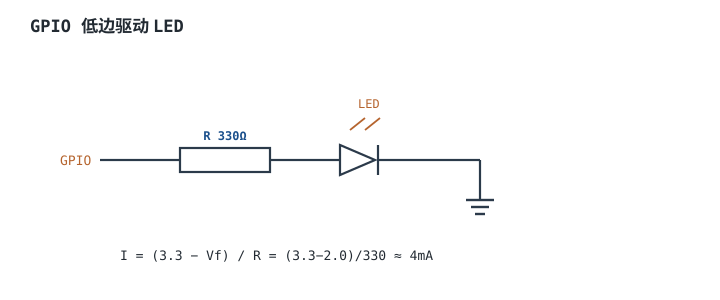

# GPIO 原理与驱动能力 GPIO Drive Strength

## 1. 设计动机

::: motivation 为什么不能把引脚"直接接上就完事"
GPIO（General Purpose Input/Output，通用输入输出脚）是 MCU 与外部世界的门窗。硬件上它不是一根理想导线，而是一对 MOS 管组成的**输出级**，加上输入施密特触发器和可选的上下拉电阻。

直接接负载最常见的错误：拿一颗 MCU 脚直接驱动 LED/继电器/蜂鸣器，电流超了把脚烧了；或者把 3.3V 的脚直接接到 5V 信号上，把输入栅击穿。理解输出级的硬件结构和**每脚能灌/拉多少电流**，才能决定要不要加三极管、上拉、限流电阻。
:::

## 2. 原理图

下图是最常见的**推挽输出级（Push-Pull / Totem-Pole）**：上方 PMOS 接 VDD，下方 NMOS 接 VSS，由控制逻辑互补地开/关。输出 1 时 PMOS 通、引脚被拉到 VDD；输出 0 时 NMOS 通、引脚被拉到 VSS。


## 3. 静态分析（DC）

- **输出高电平**：PMOS 导通，引脚经 PMOS 的导通电阻 $R_{on,p}$ 上拉到 VDD。带载时 $V_{OH}=V_{DD}-I_{source}\cdot R_{on,p}$，电流越大电压越低。
- **输出低电平**：NMOS 导通，引脚经 $R_{on,n}$ 下拉到 VSS。$V_{OL}=I_{sink}\cdot R_{on,n}$。
- **输入模式**：输出级两管都关断，引脚高阻，仅施密特缓冲器采样电平；有弱上拉/下拉时，引脚经 ≈30~50kΩ 电阻接 VDD/VSS。
- **驱动能力**：多数 MCU 单脚 source/sink 标称 ±8~±20mA，但**整颗芯片总电流**有限（如 ±100mA 包络），多脚同时大电流时要算总账。

## 4. 动态分析（AC / 瞬态）

输出脚带容性负载时，电压沿按 RC 指数爬升：

$$t_r \approx 2.2\, R_{on}\, C_L$$

引脚翻转越快、$C_L$ 越大，边沿越慢；同时瞬间充放电电流 $I=C_L dv/dt$ 在电源上形成尖峰。下图是带 100pF 负载时，推挽输出从 0 到 3.3V 的上升沿。

```echarts
{
  "tooltip": {"trigger": "axis"},
  "legend": {"data": ["引脚电压"], "bottom": 0, "textStyle": {"fontSize": 13}},
  "grid": {"left": 56, "right": 24, "top": 26, "bottom": 56},
  "xAxis": {"type": "category", "name": "ns", "data": [0,2,4,6,8,10,15,20,30,40], "axisLabel": {"fontSize": 11}},
  "yAxis": {"type": "value", "name": "V", "min": 0, "max": 3.5, "axisLabel": {"fontSize": 11}},
  "series": [
    {"name": "引脚电压", "type": "line", "smooth": true, "showSymbol": false,
     "lineStyle": {"width": 2.6, "color": "#1a4f8b"},
     "data": [0,0.4,1.0,1.6,2.1,2.4,2.9,3.1,3.25,3.3]}
  ]
}
```

## 5. 环路分析

::: advanced 进阶：为什么有"驱动能力"这个折中
推挽级的 $R_{on}$ 由 MOS 管宽长比决定：管子做大 $R_{on}$ 小、驱动强，但栅极电容大、开关慢、占面积；管子做小则相反。所以"驱动强度"常可配置（2/4/8/12mA 档位）。高速信号选大驱动强度减短上升沿，但同时增大 $di/dt$ 与 EMI；低速 LED 选小档位省电。
:::

## 6. 元件取值与工程权衡

- **直接驱动 LED**：串限流电阻 $R=(V_{DD}-V_f)/I_{LED}$，$V_f\approx 2\text{V}$，目标 2~5mA。
- **上拉/下拉电阻**：开漏总线取 4.7kΩ~10kΩ（兼顾速度与功耗）；输入固定电平取 10kΩ~100kΩ。
- **别超单脚电流**：连续 >20mA 或总电流超包络，会导致压降低、温升、甚至锁死。
- **5V 容忍**：只有标 FT/5V-tolerant 的脚才能接 5V，否则加电平转换或限流。

## 7. 完整设计示例

::: example 用一只 GPIO 点亮一颗 LED
1. **需求**：MCU 3.3V，红 LED $V_f=2.0\text{V}$，目标 4mA。
2. **算电阻**：$R=(3.3-2.0)/0.004=325\Omega$，取标准 330Ω。
3. **接法**：GPIO → 330Ω → LED 阳极 → LED 阴极 → GND（低边驱动）。
4. **验算**：$I=1.3/330\approx 3.9\text{mA}$，远低于单脚限额，安全。
5. **注意**：若 LED 要由 5V 供电、GPIO 控制开关，则用高边/低边三极管，不要让 GPIO 承受 5V。
:::

## 8. 仿真与实验

- 把 GPIO 配成推挽输出，用示波器看空脚和带 100pF 时的上升沿，体会 $t_r$。
- 串一只电流表驱动 LED，改不同限流电阻，量实际电流，对照 $(V_{DD}-V_f)/R$。
- 把脚配成输入并悬空，读回值会乱跳；接上拉电阻后读回稳定。

## 扩展与变种电路

### 扩展1：开漏输出做电平转换 Open-Drain Level Shift

定位：3.3V MCU 要和 5V 器件通信，又不想加专用电平转换芯片。


::: example 工作原理
- 开漏模式只保留 NMOS：管通时拉低到 ≈0V；管断时引脚高阻，由外部上拉拉到任意电压。
- 上拉到 +5V 时，输出高电平就是 5V——3.3V MCU 借此输出 5V 逻辑，常用于 I²C、单向电平转换。
- 速度与上拉电阻权衡：$t_r\approx R_{pullup} C_{bus}$，线容大时上拉不能太大。
:::

取值对比：

| 上拉电阻 | 上升沿 | 空闲功耗 | 适用 |
|---|---|---|---|
| 1kΩ | 快 | 大（灌电流大） | 高速/重载 |
| 4.7kΩ | 中 | 中 | I²C 标准 |
| 10k~100k | 慢 | 小 | 低速、长休眠 |

::: pitfall 上拉到 5V 却把脚配成推挽
- **现象**：一输出就短路/烧脚。
- **原因**：推挽输出 3.3V 与外部 5V 上拉对顶，PMOS 导通时 5V 经上拉倒灌进 MCU。
- **解决**：开漏上拉时脚必须配置为开漏，绝不能推挽。
:::

### 扩展2：GPIO 低边驱动 LED Low-Side Drive

定位：最常见的负载驱动，串一只限流电阻。



::: example 工作原理
- GPIO 输出高 → 电流经 R、LED 到地，LED 亮；$I=(V_{DD}-V_f)/R$。
- 阴极接地、阳极经电阻接 GPIO 叫低边（low-side）；反之为高边。
- 3.3V 下 LED 电流 2~5mA 足够可见，不必追求 10~20mA。
:::

取值对比：

| R | 电流(3.3V,Vf=2V) | 亮度 |
|---|---|---|
| 220Ω | 5.9mA | 较亮 |
| 330Ω | 3.9mA | 适中 |
| 1kΩ | 1.3mA | 微亮 |

::: pitfall 忘了算 Vf 直接用 LED 当指示
- **现象**：LED 很暗或很烫。
- **原因**：没串限流电阻直接接 3.3V，电流只受 LED 自身限制；或电阻取太大。
- **解决**：永远串限流电阻，按 $I=(V_{DD}-V_f)/R$ 算。
:::

### 扩展3：开漏线与 Wired-AND

定位：多个开漏节点共用一条中断线，省译码逻辑。


::: example 工作原理
- 所有节点都是开漏 + 总线共一只上拉。逻辑上是**与**：只要任一地节点拉低，总线就低；全释放才高。
- 典型用途：I²C SDA/SCL、多设备共享中断线（INT）。
- 上拉电阻按总线电容与节点数折中。
:::

取值对比：

| 节点数 | 建议上拉 | 说明 |
|---|---|---|
| 2~4 | 4.7kΩ | I²C 标准 |
| 多/长线 | 2.2~3.3kΩ | 加快上升沿 |

::: pitfall 推挽输出并联做"线与"
- **现象**：一节点输出高、另一输出低，瞬间大电流、烧脚。
- **原因**：两个推挽级对顶，PMOS/NMOS 直通。
- **解决**：线与/共享线必须用开漏，绝不能并联推挽输出。
:::

## 9. 常见坑与故障现象

::: pitfall 常见坑
- **单脚电流超限**：直接驱动蜂鸣器/继电器，压降低、脚发烫。解决：加三极管/MOS 驱动，GPIO 只控栅极。
- **3.3V 脚接 5V**：击穿输入栅。解决：用 5V-tolerant 脚或加电平转换。
- **输出对顶短路**：两只 MCU 推挽脚接一起，一高一低形成直通。解决：线与用开漏。
- **输入悬空**：读回乱跳、额外耗电。解决：加确定电平或弱上下拉。
:::

## 10. 自测题

<details><summary>GPIO=3.3V，LED Vf=2.0V，要 5mA，限流电阻取多少？</summary>
$R=(3.3-2.0)/0.005=260\Omega$，取标准 270Ω。
</details>

<details><summary>开漏输出为什么能做 3.3V→5V 电平转换？</summary>
开漏 NMOS 断时引脚高阻，外部上拉拉到 5V，输出高电平即为 5V；通时拉低到 0V。因为高电平由外部上拉决定，不受 MCU 电源限制。
</details>

<details><summary>多个推挽输出直接并联会怎样？</summary>
若一个输出高、另一个输出低，两者经 PMOS/NMOS 形成低阻直通，产生大电流，可能烧脚。共享线必须改开漏。
</details>

## 11. 参考资料

- STM32 GPIO 应用笔记与数据手册（电气特性表）
- NXP/STM 输入输出端口章节
- ARM《Cortex-M 设备通用用户指南》
