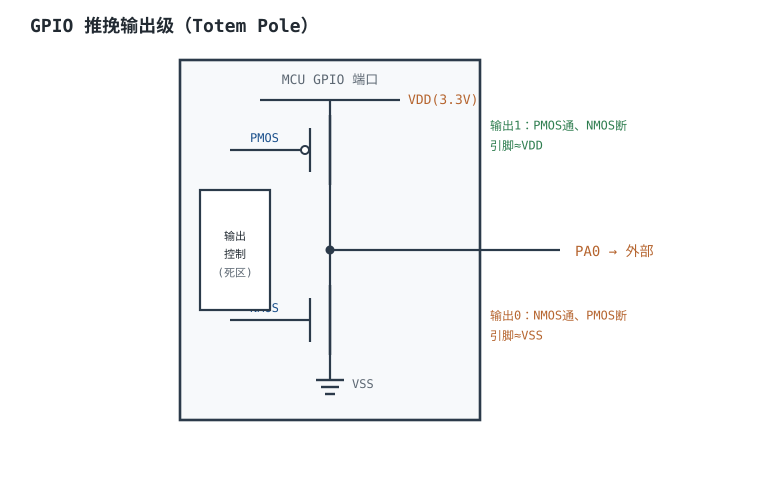
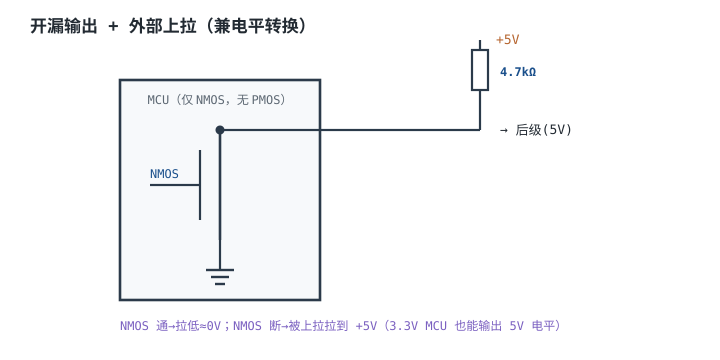
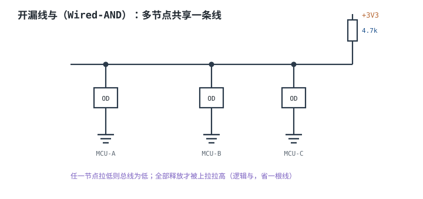

# GPIO 原理与驱动能力 GPIO Drive Strength

GPIO（General Purpose Input/Output，通用输入输出）是 MCU 与外部世界之间的门。原理图上它只是一根线，电气上却是一对 MOS 管、一个施密特触发器、几只可切换的上下拉和一层 ESD 保护。把它当"理想开关"用，最常见的结局是：LED 亮度不对、继电器不吸合、5V 信号把引脚打坏、按键按一次进好几次中断、待机电流比手册大一个数量级。

本章把 GPIO 拆成四件事：**四种模式的电气差异、灌电流与拉电流的能力差异、输入阈值与施密特、边沿中断的抖动与去抖**；然后用两个完整算例——20mA LED 和 5V 继电器——把限流电阻、三极管基极电阻、功耗与温升算清楚，并回答"不用驱动级直接接会怎样"。所有器件参数写"典型量级，以数据手册为准"，算例中的 $R_{on}$、$V_f$、$\beta$ 都是明确假设，方便逐项复算。

本章与[最小系统](minimum-system.md)衔接：最小系统保证 MCU 活着，GPIO 决定它能不能可靠地驱动外部；中断的向量、优先级与延迟见[中断机制（硬件视角）](interrupts.md)；引脚复用与接口电平的整体规划见[常用外设接口设计](peripheral-design.md)；MCU 选型时的 IO 数量与封装见[MCU 概览](mcu-overview.md)。

## 1. 设计动机

::: motivation 四个"直接接上"的现场
**现场一：3.3V 引脚直接驱动 20mA LED，亮度随批次跳。** 工程师按 $R=(3.3-2.0)/0.02=65\Omega$ 选了 68Ω，理论 19.1mA，看起来很稳。实际这批 LED 的 $V_f$ 从 1.8V 到 2.2V，电流从 22.1mA 到 16.2mA，亮度差 36%；更糟的是，引脚输出高电平时并不是 3.3V，而是被 PMOS 的导通电阻拉低了 0.4~1.0V，实际电流又少了一截。**LED 是电流器件，限流电阻要按"最坏 $V_f$ + 最坏 $V_{OH}$"算，不能按标称值算。**

**现场二：5V 继电器直接接 GPIO，线圈不吸合。** 5V 线圈 70mA、电阻 71.4Ω，接在 3.3V 引脚上只能拿到 46mA；引脚 PMOS 的 $R_{on}$ 再吃掉 2.3V，线圈上只剩 1.0V，远低于吸合电压。工程师以为是"继电器坏了"，换了三个都一样。**不是继电器坏，是 GPIO 既没有 5V，也没有 70mA。**

**现场三：开漏上拉到 5V，引脚却不耐 5V。** 3.3V MCU 的引脚配成开漏，外部 4.7kΩ 上拉到 5V，想和 5V 器件通信。引脚关断时，5V 通过上拉加到引脚上；如果这颗引脚不是 5V 容忍（5V-tolerant），5V 会经 ESD 钳位二极管向 3.3V 电源轨注入电流，通信异常、电平被抬高，长期还会退化甚至闩锁。**开漏能输出 5V 的前提是引脚耐 5V，不是"开漏"本身。**

**现场四：按键不消抖，按一次进五次中断。** 机械按键抖动 5~20ms，边沿中断把每个毛刺都当成一次按下；状态机在"按下/松开"之间来回跳，显示数字乱加。**边沿中断只告诉你"有变化"，不告诉你"变化稳定了没有"。**
:::

| 你遇到的问题 | 先查 | 判据（本手册建议值，非标准强制） |
|---|---|---|
| LED 亮度不对、批次差异大 | $V_f$ 分档、$V_{OH}$、限流电阻 | 最坏 $V_f$ 下电流不超过绝对最大值 |
| 继电器/蜂鸣器不动作 | 线圈电压、电流、驱动级 | 驱动级饱和压降后仍高于吸合电压 |
| 引脚发烫、芯片复位 | 是否超过 IIO、是否 5V 灌入、感性负载 | 单脚与总电流都在绝对最大值内 |
| 输入读回乱跳 | 是否悬空、上下拉、阈值 | 输入有确定电平，噪声容限 ≥0.2V |
| 按键一次触发多次 | 抖动时间、去抖电路/算法 | 确认窗口 ≥20ms |
| 开漏上升沿太慢 | 上拉电阻、总线电容 | $t_r\leq$ 协议要求，且 $I_{sink}$ 不超限 |

**不算会摔在哪，三个带数字的代价：**

1. **20mA LED 直接驱动，最坏电流 23.1mA。** 若引脚绝对最大 20mA，已经超了 15%；短时间可能看不出，长期会加速 IO 老化。按 5V + 三极管方案，最坏 20.0mA，且不受 $V_{OH}$ 影响。
2. **5V 继电器直接接 3.3V 引脚，线圈只有 1.0V。** 吸合电压典型 3.75V（75% 额定），差 2.75V，继电器根本不动作；同时引脚瞬时 46mA，超过 20mA 额定 2.3 倍。
3. **开漏上拉到 5V，灌入电流可能远超预期。** 若负载是 71.4Ω 的继电器线圈，5V 被 ESD 二极管钳到约 4.0V 时，灌入电流约 $(5-4.0)/71.4=14\text{mA}$；若只是 4.7kΩ 上拉，约 $(5-4.0)/4.7\text{k}=0.21\text{mA}$。前者会明显发热、甚至闩锁，后者虽小但持续注入仍不允许。**"电流小"不等于"可以接"，绝对最大额定值看的是引脚电压与注入电流，不是负载大小。**

## 2. 定义与直观

### 2.1 四种模式：推挽、开漏、浮空输入、上下拉输入

| 模式 | 输出级 | 高电平 | 低电平 | 外部元件 | 典型用途 | 主要风险 |
|---|---|---|---|---|---|---|
| 推挽输出 | PMOS + NMOS | 主动拉到 VDD | 主动拉到 VSS | 通常不需要 | LED、时钟、SPI、普通数字输出 | 两个推挽对顶会大电流 |
| 开漏输出 | 只有 NMOS | 高阻，靠外部上拉 | 主动拉到 VSS | 必须外部上拉 | I²C、共享中断、电平转换 | 上拉过高/过低；5V 容忍 |
| 浮空输入 | 两管都关 | 高阻 | 高阻 | 外部必须给电平 | 模拟输入、外部已驱动 | 悬空导致振荡、耗电 |
| 上拉/下拉输入 | 两管都关 + 弱电阻 | 内部拉到 VDD | 内部拉到 VSS | 按键、开关 | 确定电平、省外部电阻 | 电阻太弱，噪声大 |

**推挽（Push-Pull）** 的输出高、低都是低阻，能主动拉、主动灌，速度快、驱动强；但两个推挽输出不能直接并在一起，否则一个输出高、一个输出低时，PMOS 与 NMOS 形成低阻直通，电流只受两个 $R_{on}$ 限制。

**开漏（Open-Drain）** 只有下拉 NMOS，输出高时是高阻，必须靠外部上拉；好处是"高电平由外部上拉决定"，可以做电平转换和线与；坏处是上升沿由 $R_{pull}\times C$ 决定，速度慢、功耗随上拉电流增加。

**浮空输入** 是高阻，电平完全由外部决定；如果外部也不驱动，引脚电压会漂在阈值附近，CMOS 输入级上下管同时微导通，产生直通电流，还会被噪声反复触发。**未用的引脚不要悬空：设成模拟输入、固定电平或弱上下拉。**

### 2.2 输出级是一对 MOS，不是一个理想开关

推挽输出高时，PMOS 导通，引脚经 $R_{on,p}$ 接到 VDD；输出低时，NMOS 导通，引脚经 $R_{on,n}$ 接到 VSS。于是：

$$V_{OH}=V_{DD}-I_{source}R_{on,p},\qquad V_{OL}=I_{sink}R_{on,n}$$

其中 $V_{OH}$ 是输出高电平（V）；$V_{OL}$ 是输出低电平（V）；$I_{source}$ 是拉电流（A，从引脚流向负载）；$I_{sink}$ 是灌电流（A，从负载流入引脚）；$R_{on,p}$、$R_{on,n}$ 是 PMOS/NMOS 的导通电阻（Ω）。

**关键点：$V_{OH}$ 和 $V_{OL}$ 随电流变化，不是常数。** 数据手册的 $V_{OH}$ 是在规定测试电流下保证的最小值；超过这个电流，$V_{OH}$ 可能跌出逻辑高电平范围。很多设计只看"最大 20mA"，却没看"20mA 时 $V_{OH}$ 只有 2.3V"：对 $V_{IH}=2.0\text{V}$ 的接收器只剩 0.3V 余量，长线、温度、批次变化一来就可能识别不到高电平。

### 2.3 输入级是施密特触发器，不是比较器

GPIO 的输入通常经过一个**施密特触发器（Schmitt Trigger）**：它有上、下两个阈值，输入从低到高要越过 $V_{IH}$ 才变高，从高到低要越过 $V_{IL}$ 才变低，两者之差叫**迟滞（Hysteresis）**。迟滞的作用是抗噪声：输入在阈值附近抖动时，只要抖动幅度小于迟滞，输出就不会反复翻转。

但施密特不是万能的：如果输入边沿很慢、噪声幅度大于迟滞，输出仍会多次翻转；如果输入悬空，任何耦合噪声都能让它翻转。**施密特解决"阈值附近的噪声"，不解决"没有确定电平"。**

### 2.4 开漏、线与与电平转换

多个开漏输出可以挂在同一根线上，共用一个上拉：只要有一个节点拉低，总线就是低；全部释放才高。逻辑上是**线与（Wired-AND）**，I²C 的 SDA/SCL、共享中断线都靠这个。

::: advanced 技术勘误：开漏上拉到 5V 不等于"引脚可以接 5V"
常见的开漏电平转换讲法写"开漏输出上拉到 +5V，3.3V MCU 借此输出 5V 逻辑"，这句话漏了一个前提：**该引脚必须是 5V 容忍（5V-tolerant）的**。开漏只决定"输出高时是高阻"，不改变引脚对 VDD 的 ESD 钳位结构。若引脚不是 5V 容忍，关断时 5V 会经上拉加到引脚，再经 ESD 二极管灌入 3.3V 轨；轻则通信异常、电平被抬高，重则闩锁损坏。

正确表述：**开漏 + 外部上拉到 5V，可以做 3.3V→5V 的电平转换，但前提是数据手册明确标注该引脚为 5V 容忍（如 STM32 的 FT 引脚），且模拟引脚、BOOT 引脚等特殊引脚不在此列。** 若不是 5V 容忍，应使用专用电平转换器、分压电阻或隔离器件。

另一个要纠正的说法是"3.3V 引脚接 5V 会击穿输入栅"。多数 CMOS 输入的栅氧击穿电压远高于 5V，真正先发生的是 ESD 钳位二极管导通、注入电流过大、闩锁或长期退化。**不是"一接就击穿"，而是"接了就灌电流，能不能活取决于限流与持续时间"**——但这不意味着可以接，绝对最大额定值仍然不能超。
:::

::: analogy 推挽像两个人推拉门，开漏像一个人拉门加弹簧
- **推挽**：门里一个人推、门外一个人拉，开和关都很快；但两个人同时用力方向相反，门框（芯片）会受很大的力——这就是推挽对顶。
- **开漏**：只有一个人能拉门，关门靠弹簧（外部上拉）。弹簧越硬（电阻越小），关门越快，但拉门的人（NMOS）要更用力，功耗更大。
- **线与**：多个开漏节点像多个人都只能拉门、不能推门；只要有一个人拉，门就关；所有人松手，弹簧才把门打开。
- **浮空输入**：门没装弹簧、也没人拉，风一吹就动——这就是悬空引脚。

类比的边界：门是机械的，弹簧不会"谐振"；开漏上拉与总线电容会形成 RC，电阻太小还会让 NMOS 灌电流超限。所以"弹簧越硬越好"是错的，要按速度和电流折中。
:::

## 3. 定量关系

### 3.1 输出电平、功耗与温升

输出高/低电平：

$$V_{OH}=V_{DD}-I_{source}R_{on,p},\qquad V_{OL}=I_{sink}R_{on,n}$$

引脚 MOS 上的功耗：

$$P_{pin}=I^2R_{on}$$

结温：

$$T_j=T_a+\theta_{JA}P_{pin}$$

其中 $P_{pin}$ 是单脚功耗（W）；$\theta_{JA}$ 是封装结到环境热阻（°C/W）；$T_j$ 是结温（°C）。**单脚 20mA、$R_{on}=50\Omega$ 时 $P=0.02^2\times50=20\text{mW}$，$\theta_{JA}=100^{\circ}\text{C/W}$ 时温升只有 2°C——单脚功耗通常不是立即烧毁的主因；真正的硬约束是绝对最大额定值、总电流、键合线与长期可靠性。** 但这不意味着可以超：超额定值会让 $V_{OH}$ 跌出逻辑范围、加速电迁移，并把风险留给量产。

### 3.2 灌电流与拉电流：为什么 NMOS 通常更强

在同样的芯片面积下，NMOS 的载流子迁移率约为 PMOS 的 2~3 倍，所以 $R_{on,n}$ 通常比 $R_{on,p}$ 小。典型量级：$R_{on,n}=25\Omega$、$R_{on,p}=50\Omega$（具体以数据手册为准）。于是：

| 电流 | $V_{OH}=3.3-I\times50$ | $V_{OL}=I\times25$ | 说明 |
|---|---|---|---|
| 4mA | 3.10V | 0.10V | 逻辑余量充足 |
| 8mA | 2.90V | 0.20V | 多数 3.3V 接口可接受 |
| 12mA | 2.70V | 0.30V | 开始接近 $V_{OH}$ 下限 |
| 16mA | 2.50V | 0.40V | $V_{OH}$ 余量变小 |
| 20mA | 2.30V | 0.50V | 很多型号已不保证 $V_{OH}$ |

**"灌电流比拉电流强"不是绝对的**：有些 MCU 数据手册把 source/sink 都标 ±8mA 或 ±20mA，但测试条件不同；真正要看的是**在目标电流下的 $V_{OL}$/$V_{OH}$ 是否满足后级阈值**。对 LED 这类负载，灌电流（低边驱动）通常更有利，因为 NMOS 更强、$V_{OL}$ 更低；对高边驱动，PMOS 的 $V_{OH}$ 跌落更大。

### 3.3 输入阈值与噪声容限

直流噪声容限：

$$NM_H=V_{OH,min}-V_{IH,min},\qquad NM_L=V_{IL,max}-V_{OL,max}$$

其中 $NM_H$、$NM_L$ 是高/低噪声容限（V）；$V_{OH,min}$、$V_{OL,max}$ 是驱动器保证的输出电平（V）；$V_{IH,min}$、$V_{IL,max}$ 是接收器的输入阈值（V）。

按 JEDEC JESD8C.01 的 3.3V LVCMOS 口径（典型值）：$V_{OH,min}=2.4\text{V}$、$V_{OL,max}=0.4\text{V}$、$V_{IH,min}=2.0\text{V}$、$V_{IL,max}=0.8\text{V}$。于是：

$$NM_H=2.4-2.0=0.4\text{V},\qquad NM_L=0.8-0.4=0.4\text{V}$$

只有 0.4V 的噪声容限，意味着地弹、串扰、长线反射很容易把它吃掉。**这也是为什么高速或长线接口要用差分、终端或电平转换，而不是裸 GPIO 直连。**

### 3.4 容性负载与上升时间

输出带容性负载时，电压按 RC 上升：

$$t_r\approx2.2R_{on}C_L$$

其中 $t_r$ 是 10%~90% 上升时间（s）；$R_{on}$ 是输出级导通电阻（Ω）；$C_L$ 是负载电容（F）。瞬间充放电电流：

$$I=C_L\frac{dV}{dt}$$

**算例：** $C_L=100\text{pF}$、$R_{on}=50\Omega$，$t_r=2.2\times50\times100\times10^{-12}=11\text{ns}$；若 $C_L=1\text{nF}$，$t_r=110\text{ns}$，边沿变慢、功耗和地弹增加。**驱动大电容负载时，不要只提高驱动档位，先看边沿是否超过协议允许、地弹是否可接受。**

### 3.5 开漏上拉：上升时间与灌电流的双向约束

开漏的上升沿由上拉电阻和总线电容决定：

$$t_r\approx0.8R_{pull}C_{bus}$$

其中 $R_{pull}$ 是上拉电阻（Ω）；$C_{bus}$ 是总线电容（F）；$t_r$ 是上升时间（s）。上拉电阻的下限由 NMOS 灌电流决定：

$$R_{pull,min}=\frac{V_{DD}-V_{OL}}{I_{sink,max}}$$

上限由上升时间决定：

$$R_{pull,max}=\frac{t_r}{0.8C_{bus}}$$

**算例：** 3.3V I²C、$C_{bus}=100\text{pF}$、400kHz 要求 $t_r\leq300\text{ns}$、$I_{sink,max}=4\text{mA}$、$V_{OL}=0.4\text{V}$：

$$R_{pull,min}=\frac{3.3-0.4}{0.004}=725\Omega,\qquad R_{pull,max}=\frac{300\times10^{-9}}{0.8\times100\times10^{-12}}=3.75\text{k}\Omega$$

取 2.2kΩ，落在区间内；若取 10kΩ，$t_r=0.8\times10\text{k}\times100\text{p}=800\text{ns}$，超过 300ns，400kHz 通信会失败。**上拉不是"越大越省电"，要同时满足速度和灌电流。**

### 3.6 去抖：RC 与数字计数

RC 去抖的时间常数：

$$\tau=RC,\qquad t_{settle}\approx5\tau$$

其中 $R$ 是上拉/下拉电阻（Ω），$C$ 是电容（F），$t_{settle}$ 是电平稳定到 99% 的时间（s）。数字去抖按采样计数：

$$N_{cnt}=\lceil t_{debounce}f_{samp}\rceil,\qquad W=\lceil\log_2 N_{cnt}\rceil$$

其中 $t_{debounce}$ 是确认窗口（s）；$f_{samp}$ 是采样频率（Hz）；$N_{cnt}$ 是计数值；$W$ 是计数器位宽（bit）。

**算例：** 按键抖动 20ms，采样 1kHz：$N=20\text{ms}\times1\text{kHz}=20$，$W=\lceil\log_2 20\rceil=5$ bit。若采样 10kHz，$N=200$，$W=8$ bit。**确认窗口不能小于最大抖动时间，否则一次按下会被判成多次；也不能太大，否则响应迟钝。**

### 3.7 三极管驱动级的取值

NPN 低边驱动：

$$I_B=\frac{V_{IO}-V_{BE}}{R_B},\qquad I_C=\beta I_B,\qquad P_{Q}=V_{CE(sat)}I_C+V_{BE}I_B$$

其中 $V_{IO}$ 是 GPIO 高电平（V）；$V_{BE}$ 是基极-发射极压降（V，典型 0.7V）；$R_B$ 是基极电阻（Ω）；$I_B$ 是基极电流（A）；$I_C$ 是集电极电流（A）；$\beta$ 是电流放大倍数（无量纲）；$V_{CE(sat)}$ 是饱和压降（V）；$P_Q$ 是三极管功耗（W）。

**工程做法**：先按负载电流 $I_C$ 和需要的饱和深度取 $I_B=I_C/(\beta/3)$（即强制 $\beta$ 取 1/3 的 $h_{FE}$），再算 $R_B$。**不要按 $\beta$ 的典型值直接算 $I_B$**，否则批量里 $\beta$ 偏低的管子会退出饱和，$V_{CE}$ 升高、发热。

## 4. 典型计算

### 4.1 算例一：20mA LED——直接驱动与三极管驱动

**假设（典型量级，以数据手册为准）：** $V_{DD}=3.3\text{V}$、$R_{on,p}=50\Omega$、LED $V_f=2.0\text{V}$（分档 1.8~2.2V）、目标 $I_{LED}=20\text{mA}$、引脚绝对最大 20mA。

**方案 A：GPIO 直接拉高驱动（高边驱动，GPIO 拉电流）**

限流电阻：

$$R=\frac{V_{DD}-V_f}{I_{LED}}-R_{on,p}=\frac{3.3-2.0}{0.020}-50=65-50=15\Omega$$

取 15Ω，实际电流：

$$I=\frac{3.3-2.0}{15+50}=20.0\text{mA}$$

输出高电平：

$$V_{OH}=3.3-0.020\times50=2.3\text{V}$$

引脚功耗：

$$P_{pin}=0.020^2\times50=20\text{mW}$$

**问题 1：$V_f$ 分档。** 若 $V_f=1.8\text{V}$，$I=(3.3-1.8)/65=23.1\text{mA}$，超过 20mA 绝对最大 15%；若 $V_f=2.2\text{V}$，$I=(3.3-2.2)/65=16.9\text{mA}$，亮度低 15%。同一批 LED 亮度差 36%，且最坏情况超额定。

**问题 2：$V_{OH}$ 不是 3.3V。** 20mA 时 $V_{OH}=2.3\text{V}$，已经低于很多 3.3V 接口的 $V_{OH,min}=2.4\text{V}$；如果后级是 5V TTL（$V_{IH}=2.0\text{V}$）还能勉强识别，如果是 3.3V CMOS（$V_{IH}=2.0\text{V}$）也只剩 0.3V 余量。**结论：直接驱动只适合 ≤8mA 的指示 LED；20mA 应加驱动级。**

**方案 B：5V 供电 + NPN 低边驱动**

限流电阻（取 $V_{CE(sat)}=0.2\text{V}$）：

$$R=\frac{5-2.0-0.2}{0.020}=140\Omega$$

取 150Ω：

$$I_C=\frac{5-2.0-0.2}{150}=18.7\text{mA}$$

$V_f=1.8\text{V}$ 时 $I_C=(5-1.8-0.2)/150=20.0\text{mA}$；$V_f=2.2\text{V}$ 时 $I_C=17.3\text{mA}$，仍在安全范围。

基极电阻：设 $\beta=100$，$I_C=18.7\text{mA}$，按强制 $\beta=33$ 取 $I_B=18.7/33=0.567\text{mA}$：

$$R_B=\frac{3.3-0.7}{0.000567}=4.59\text{k}\Omega$$

取 3.9kΩ，实际 $I_B=(3.3-0.7)/3.9\text{k}=0.667\text{mA}$，强制 $\beta=18.7/0.667=28$，饱和良好。

三极管功耗：

$$P_Q=0.2\times0.0187+0.7\times0.000667=3.74+0.467=4.21\text{mW}$$

远低于 SOT-23 的 200mW 级额定。限流电阻功耗：

$$P_R=I_C^2R=0.0187^2\times150=52.4\text{mW}$$

0603 电阻额定 100mW，70°C 降额后约 50mW，**刚好踩线，建议用 0805**。**结论：20mA LED 用 5V + NPN，限流 150Ω、基极 3.9kΩ，电流受 $V_f$ 影响从 17.3mA 到 20.0mA，比直接驱动稳得多。**

### 4.2 算例二：5V 继电器——基极电阻、功耗与续流

**假设：** 5V 继电器线圈 70mA、线圈电阻 $5/0.07=71.4\Omega$、吸合电压典型 75% 额定即 3.75V；NPN $\beta=100$、$V_{BE}=0.7\text{V}$、$V_{CE(sat)}=0.2\text{V}$；GPIO 高电平 3.3V。

**第 1 步：集电极电流与基极电流。**

$$I_C=70\text{mA},\qquad I_B=\frac{I_C}{\beta/2.5}=\frac{70}{40}=1.75\text{mA}$$

**第 2 步：基极电阻。**

$$R_B=\frac{3.3-0.7}{0.00175}=1.486\text{k}\Omega$$

取 1.5kΩ，实际 $I_B=(3.3-0.7)/1.5\text{k}=1.733\text{mA}$，强制 $\beta=70/1.733=40.4$，饱和深度足够。

**第 3 步：线圈电压与吸合判断。**

$$V_{coil}=5-0.2=4.8\text{V}>3.75\text{V}$$

满足吸合电压，且有 1.05V 余量。若三极管压降因批次升到 0.5V，$V_{coil}=4.5\text{V}$，仍大于 3.75V。

**第 4 步：三极管功耗与温升。**

$$P_Q=0.2\times0.07+0.7\times0.001733=0.014+0.00121=15.2\text{mW}$$

SOT-23 的 $\theta_{JA}$ 取 250°C/W，温升 $250\times0.0152=3.8^{\circ}\text{C}$，安全。

**第 5 步：续流二极管。** 线圈电感取 0.5H（示例），储能：

$$E=\frac{1}{2}LI^2=\frac{1}{2}\times0.5\times0.07^2=1.225\text{mJ}$$

若不加续流二极管，开关断开时电流在 1µs 内降到 0，理想感应电压：

$$V=L\frac{di}{dt}=0.5\times\frac{0.07}{1\times10^{-6}}=35\text{kV}$$

实际会被寄生电容、线圈自身电容和钳位限制，但几十到几百伏很常见，足以超过三极管 $V_{CEO}$（典型 40V）和 GPIO 绝对最大额定值。加 1N4007 续流，二极管把电压钳在约 0.7V，电流按 $L/R=0.5/71.4=7\text{ms}$ 衰减，续流初期约 70mA、平均约 35mA，1N4007 的 1A 额定足够。**续流二极管不是"可选优化"，是感性负载的必需件。**

**第 6 步：不用驱动级直接接会怎样？**

- **接 3.3V 引脚（高边）**：$I=3.3/71.4=46.2\text{mA}$，是 20mA 额定的 2.3 倍；$V_{OH}=3.3-0.0462\times50=1.0\text{V}$，线圈只有 1.0V，远低于 3.75V，继电器不吸合；引脚功耗 $0.0462^2\times50=107\text{mW}$，是 20mA 时的 5.4 倍。
- **接 5V、引脚低边灌电流**：关断时引脚经线圈看到 5V，若引脚不耐 5V，5V 经 ESD 二极管灌入 3.3V 轨，电流约 $(5-4.0)/71.4=14\text{mA}$；导通时要灌 70mA，$V_{OL}=0.07\times25=1.75\text{V}$，线圈只剩 3.25V，低于 3.75V，可能吸合不住或抖动；引脚功耗 $0.07^2\times25=122.5\text{mW}$。
- **感性反冲**：无论哪种接法，断开瞬间的几十到几百伏会直接加在引脚或三极管上，可能永久损坏。

**结论：5V 继电器必须用三极管/MOSFET 驱动，GPIO 只负责基极/栅极；基极 1.5kΩ、续流 1N4007，线圈 4.8V、70mA，三极管 15mW。**

### 4.3 算例三：输入阈值与 3.3V/5V 互连

**3.3V CMOS 驱动 5V TTL：** 5V TTL 的 $V_{IH,min}=2.0\text{V}$、$V_{IL,max}=0.8\text{V}$；3.3V CMOS 的 $V_{OH,min}=2.4\text{V}$、$V_{OL,max}=0.4\text{V}$。高电平余量 $2.4-2.0=0.4\text{V}$，低电平余量 $0.8-0.4=0.4\text{V}$，**可以驱动**，但余量只有 0.4V，长线要加缓冲。

**3.3V CMOS 驱动 5V CMOS：** 5V CMOS 的 $V_{IH,min}$ 通常 0.7VDD=3.5V，3.3V 的 $V_{OH}$ 最高 3.3V，**不够**，必须电平转换。

**5V 输出接 3.3V 非容忍输入：** 5V 高于 $V_{DD}+0.3=3.6\text{V}$，ESD 二极管导通；若没有限流，注入电流可能超过 IIO 绝对最大值。用电阻分压：

$$V_{in}=5\times\frac{R_2}{R_1+R_2}$$

取 $R_1=10\text{k}\Omega$、$R_2=15\text{k}\Omega$：

$$V_{in}=5\times\frac{15}{25}=3.0\text{V}$$

5.25V 时 $V_{in}=3.15\text{V}$，低于 3.3V，安全。分压器输入阻抗 $10\text{k}\parallel15\text{k}=6\text{k}\Omega$，与 10pF 输入电容形成 $\tau=60\text{ns}$，1Mbps 以下可用；代价是 5V/25kΩ=200µA 的静态电流。**分压只适合低速、低功耗场合；高速或长线用专用电平转换器。**

**5V 容忍引脚：** 只有数据手册明确标 FT（Five-volt Tolerant）的引脚才允许 5V 输入；模拟引脚、BOOT 引脚、NRST 等通常不是 FT。**"开漏"不等于"耐 5V"，"FT"也不等于"可以输出 5V"——FT 只说明输入耐压，输出高电平仍是 3.3V。**

### 4.4 算例四：按键去抖

**硬件 RC：** 取 $R=47\text{k}\Omega$、$C=100\text{nF}$：

$$\tau=47\times10^3\times100\times10^{-9}=4.7\text{ms},\qquad 5\tau=23.5\text{ms}>20\text{ms}$$

满足 20ms 抖动要求。输入漏电 1µA 在 47kΩ 上产生 47mV 误差，仍远低于 $V_{IL,max}=0.8\text{V}$；若用 1MΩ，漏电产生 1V，可能误判。

**软件去抖：** 1kHz 采样、20ms 确认窗口，$N=20$，$W=5$ bit；10kHz 采样则 $N=200$，$W=8$ bit。**硬件 RC 负责把毛刺压掉，软件计数负责确认"稳定了多久"，两者可以叠加，但不能互相替代。**

**边沿中断不消抖的代价：** 20ms 抖动、1kHz 采样，最多产生 20 次边沿；每次 ISR 2µs，共 40µs。看起来不多，但状态机可能被推进 20 次，显示数字乱跳；若抖动期间还有更高优先级中断，延迟会进一步放大。**边沿中断必须配去抖，或者在 ISR 里只置标志、由主循环按确认窗口处理。**

### 4.5 算例五：多脚同时驱动的总电流与地弹

设 8 个引脚同时以 20mA、5ns 边沿驱动 LED：

$$I_{total}=8\times20=160\text{mA}$$

超过很多 MCU 的 100mA 总电流包络；即使单脚没超，总电流也超了。地弹：

$$V_{gnd}=L_{gnd}\frac{di}{dt}=5\times10^{-9}\times\frac{8\times0.02}{5\times10^{-9}}=5\times10^{-9}\times3.2\times10^{7}=0.16\text{V}$$

160mV 的地弹足以让输入阈值 0.4V 的噪声容限明显缩水，甚至误触发。**多脚同时大电流时，要分开时序、加串阻、降低驱动档位，或改用专用驱动器。**

## 5. 工程含义

### 5.1 引脚分配：先看电气，再看功能

同一个引脚可能同时是 GPIO、ADC 输入、UART、SPI、定时器通道。分配时按这个顺序检查：

1. **电气**：是否 5V 容忍？是否模拟引脚？最大灌/拉电流多少？有没有特殊上电状态？
2. **复用**：需要的外设能不能映射到该脚？有没有冲突？调试口是否被占用？
3. **启动**：BOOT、NRST、JTAG/SWD 引脚在上电时是否有特殊要求？
4. **布局**：高速信号、模拟信号、大电流负载是否分开？地回流是否顺畅？

**先画 Pin Map，再画原理图。** 引脚冲突发现得越晚，返工成本越高；见[MCU 概览](mcu-overview.md)的选型算例。

### 5.2 驱动级选型：BJT、MOSFET 还是专用驱动器

| 方案 | 适用电流 | 优点 | 缺点 | 典型场景 |
|---|---|---|---|---|
| GPIO 直接 | ≤8mA（保守） | 最简单、零成本 | 驱动弱、$V_{OH}$ 跌落 | 指示 LED、数字输入 |
| NPN/PNP 三极管 | 10mA~500mA | 便宜、饱和压降低 | 需要基极电阻、有 $I_B$ 损耗 | 继电器、蜂鸣器、LED |
| N 沟道 MOSFET | 100mA~数 A | 栅极几乎不耗电、$R_{DS(on)}$ 低 | 需要足够 $V_{GS}$、栅极电容 | 电机、大功率 LED |
| 专用驱动器/高边开关 | 数百 mA~数 A | 保护全、诊断功能 | 成本高 | 汽车、工业负载 |

**低边驱动**（负载接电源、开关管接负载到地）最常用，因为 NPN/NMOS 便宜、驱动简单；**高边驱动**需要 PNP/PMOS 或专用高边开关，适合负载必须接地的场合。继电器、LED、蜂鸣器大多用低边。

### 5.3 电平转换：四种做法与边界

1. **5V 容忍引脚 + 开漏上拉**：最简单，但要求引脚 FT，且速度受上拉 RC 限制；只适合低速信号。
2. **电阻分压**：便宜，但输入阻抗低、速度慢、静态电流大；只适合低速、单向。
3. **专用电平转换器**：双向、速度快、带保护；成本高，适合 I²C/SPI/UART 等。
4. **光耦/隔离器**：需要电气隔离时用；速度、功耗、成本都要权衡。

**不要用"串一只电阻再靠 ESD 二极管钳位"作为量产方案**：钳位电流、功耗、可靠性都不可控；调试时可以临时用，量产必须用正规电平转换。

### 5.4 EMI、地弹与边沿控制

GPIO 翻转产生 $di/dt$ 与 $dv/dt$，是板级 EMI 的常见源头。控制手段：

- **降低驱动档位**：很多 MCU 可配 2/4/8/12mA 档，低速信号用小档；
- **串电阻**：22~100Ω，减缓边沿、抑制振铃；
- **减小环路**：负载与地回流路径尽量短；
- **分开时序**：多脚不要在同一纳秒翻转；
- **加磁珠/滤波**：对长线、外接线缆有效。

### 5.5 保护：过流、过压、ESD、感性负载

- **过流**：串限流电阻、PPTC、保险丝；不要依赖 GPIO 的绝对最大额定值当保护。
- **过压**：5V 容忍、分压、TVS、专用电平转换；注意 ESD 二极管的持续注入电流能力很有限。
- **ESD**：接口连接器旁加 TVS，走线短、地回路低阻。
- **感性负载**：继电器、电机、蜂鸣器必须加续流二极管或 TVS；否则断开瞬间的高压会打坏驱动管。
- **热插拔**：先接地、后接信号，或加隔离/限流；避免带电插拔时电流从 IO 灌入。

## 6. 常见坑

::: pitfall 常见坑
- **开漏上拉到 5V，但引脚不耐 5V。** 现象：通信异常、电平被抬高、偶发闩锁。原因：开漏只让输出高阻，不改变 ESD 钳位；5V 经钳位二极管灌入 3.3V 轨。解决：确认数据手册标 FT；否则用专用电平转换器或分压。
- **两个推挽输出并联做线与。** 现象：一个输出高、一个输出低时瞬间大电流，芯片发热甚至烧脚。原因：PMOS/NMOS 对顶，形成低阻直通。解决：共享线一律用开漏，不要并联推挽。
- **20mA LED 直接接 GPIO。** 现象：亮度随批次跳、最坏电流超绝对最大、引脚发热。原因：$V_f$ 分档和 $V_{OH}$ 跌落没算。解决：按最坏 $V_f$ 算，超过 8mA 加三极管/MOSFET 驱动。
- **5V 继电器直接接 GPIO。** 现象：继电器不吸合、引脚发烫、断开时打坏 IO。原因：3.3V 引脚既没有 5V，也没有 70mA；感性反冲没有续流。解决：三极管低边驱动 + 续流二极管，基极电阻按强制 $\beta$ 算。
- **输入悬空。** 现象：读回值乱跳、待机电流大、误触发中断。原因：CMOS 输入在阈值附近，上下管同时微导通。解决：设模拟输入、固定电平或 10k~100k 上下拉。
- **上拉电阻取 10k 跑 400kHz I²C。** 现象：上升沿超过 300ns，通信失败。原因：$t_r\approx0.8RC$，10k×100pF 已经 800ns。解决：按 $R_{max}=t_r/(0.8C)$ 算，400kHz 常用 2.2~4.7kΩ。
- **按键边沿中断不消抖。** 现象：按一次进多次中断，状态机乱跳。原因：机械抖动 5~20ms，每个毛刺都是一个边沿。解决：RC + 软件确认窗口，或 ISR 只置标志、主循环去抖。
- **把模拟引脚当 5V 容忍。** 现象：ADC 读数漂移、引脚漏电。原因：模拟引脚通常不是 FT，5V 会经保护二极管注入。解决：查引脚表，模拟输入只接 0~VDDA 范围。
:::

## 7. 自测题

推挽、开漏、浮空输入、上下拉输入四种模式，各适合什么场景？开漏为什么能做线与？

推挽适合普通数字输出和 LED；开漏适合 I²C、共享中断和电平转换；浮空输入适合外部已驱动或模拟输入；上下拉输入适合按键、开关。开漏输出高时是高阻，多个节点共用一个上拉，任一节点拉低总线就低，全部释放才高，所以逻辑上是线与。

3.3V、$R_{on,p}=50\Omega$、$R_{on,n}=25\Omega$。8mA 和 20mA 时 $V_{OH}$、$V_{OL}$ 各是多少？20mA 时单脚功耗多少？

8mA：$V_{OH}=3.3-0.008\times50=2.9\text{V}$，$V_{OL}=0.008\times25=0.2\text{V}$。20mA：$V_{OH}=3.3-0.02\times50=2.3\text{V}$，$V_{OL}=0.02\times25=0.5\text{V}$。单脚功耗 $0.02^2\times50=20\text{mW}$（拉电流）或 $0.02^2\times25=10\text{mW}$（灌电流）。20mA 时 $V_{OH}$ 已低于很多 3.3V 接口的 2.4V 下限。

LED $V_f=2.0\text{V}$、目标 20mA、$V_{DD}=3.3\text{V}$、$R_{on,p}=50\Omega$。直接驱动的限流电阻是多少？若 $V_f$ 实际 1.8V，电流多少？

$R=(3.3-2.0)/0.02-50=15\Omega$。实际 $I=(3.3-2.0)/(15+50)=20\text{mA}$。若 $V_f=1.8\text{V}$，$I=(3.3-1.8)/65=23.1\text{mA}$，超过 20mA 绝对最大 15%。所以 20mA LED 应加驱动级。

5V 继电器线圈 70mA、$\beta=100$、$V_{BE}=0.7\text{V}$、GPIO 3.3V。按强制 $\beta=40$ 取基极电流，基极电阻多少？三极管功耗多少？

$I_B=70/40=1.75\text{mA}$，$R_B=(3.3-0.7)/0.00175=1.486\text{k}\Omega$，取 1.5kΩ。$P_Q=V_{CE(sat)}I_C+V_{BE}I_B=0.2\times0.07+0.7\times0.001733=15.2\text{mW}$。线圈电压 $5-0.2=4.8\text{V}$，高于 3.75V 吸合电压。

3.3V I²C、总线电容 100pF、400kHz 要求 $t_r\leq300\text{ns}$、灌电流上限 4mA。上拉电阻的允许范围是多少？取 10kΩ 会怎样？

$R_{min}=(3.3-0.4)/0.004=725\Omega$，$R_{max}=300\text{ns}/(0.8\times100\text{pF})=3.75\text{k}\Omega$，取 2.2kΩ。10kΩ 时 $t_r=0.8\times10\text{k}\times100\text{pF}=800\text{ns}>300\text{ns}$，400kHz 通信失败。

按键抖动 20ms，软件 1kHz 采样，去抖计数器要几位？若 10kHz 呢？

1kHz：$N=20\text{ms}\times1\text{kHz}=20$，$W=\lceil\log_2 20\rceil=5$ bit。10kHz：$N=200$，$W=\lceil\log_2 200\rceil=8$ bit。

为什么开漏上拉到 5V 时，必须确认引脚是 5V 容忍？如果不是，会发生什么？

开漏只让输出高时高阻，引脚对 VDD 仍有 ESD 钳位二极管。若引脚不耐 5V，关断时 5V 经上拉加到引脚，再经钳位二极管灌入 3.3V 轨，造成通信异常、电平被抬高、闩锁或长期退化。只有数据手册明确标 FT 的引脚才允许这样用；模拟、BOOT、NRST 等特殊引脚通常不行。

## 8. 参考资料

- STMicroelectronics DS5319，*STM32F103x8/xB Datasheet*：Section 5.3 I/O port characteristics 给出 $V_{IL}/V_{IH}$、$V_{OL}/V_{OH}$、$R_{PU}/R_{PD}$、$I_{IO}$ 绝对最大额定值与总注入电流；本章的 8mA/20mA 算例按该类参数的量级设定，具体数值以所选型号为准。
- STMicroelectronics RM0008，*STM32F101/102/103/105/107 Reference Manual*：Chapter 9 General-purpose and alternate-function I/Os（GPIO 与 AFIO）给出推挽/开漏/上下拉的配置与复用表，是本章四种模式与引脚分配的寄存器级依据。
- JEDEC JESD8C.01，*Interface Standard for Nominal 3 V/3.3 V Supply Digital Integrated Circuits*：定义 3.3V LVCMOS 的 $V_{IL}/V_{IH}/V_{OL}/V_{OH}$，是本章 3.3 节噪声容限计算的依据。
- NXP/Philips AN97055，*Bi-directional level shifter for I²C-bus and other systems*：开漏上拉做电平转换的原理、上拉取值与限制，是本章 2.4、5.3 节的依据。
- NXP UM10204，*I²C-bus specification and user manual*：Electrical characteristics 与 Bus speeds 章节给出总线电容、上升时间与灌电流要求，是本章 3.5 节上拉范围计算的依据。
- STMicroelectronics AN4899，*GPIO hardware settings and low-power consumption*：GPIO 模式、上下拉与低功耗配置建议，用于本章 2.1、5.5 节的工程做法。

延伸阅读：[最小系统](minimum-system.md) 讲电源、复位、时钟与去耦；[中断机制（硬件视角）](interrupts.md) 讲边沿中断、去抖与延迟；[MCU 概览](mcu-overview.md) 讲 IO 数量与选型；[常用外设接口设计](peripheral-design.md) 讲接口电平与保护的整体规划；[I²C 与 SPI 总线时序](i2c-spi.md) 讲开漏上拉与总线时序的完整计算。
