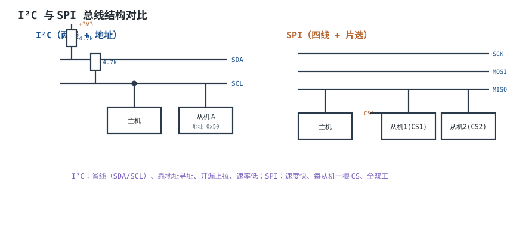
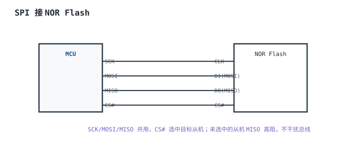
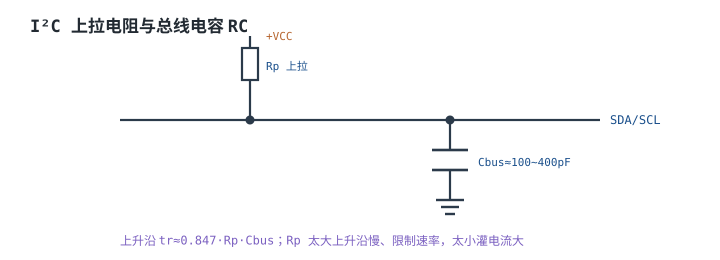

# I²C 与 SPI 总线时序 I²C & SPI

一条 3.3V 的 I²C 总线挂了 8 个器件，总线电容 200pF，上拉 4.7kΩ。400kHz 快速模式下，上升时间 $0.8473\times4700\times200\text{pF}=796\text{ns}$，而规范要求不超过 300ns；逻辑分析仪上 SDA 的上升沿明显“圆角”，通信偶尔 NACK。把上拉换成 1.5kΩ，上升时间降到 254ns，通信恢复，但低电平灌电流从 0.62mA 涨到 1.93mA，功耗和驱动余量又要重算。**I²C 的上拉不是“4.7k 万能”，SPI 的时序也不是“接上就能跑”；两条总线各有各的定量边界。**

这一章先讲 I²C 的开漏、仲裁、时钟延展和多主，再讲 SPI 的四线与 CPOL/CPHA 四模式；然后把上拉窗口、总线电容、器件数量、建立/保持时间全部算成可复算的数字。最后用两个算例收尾：400kHz、8 器件、200pF 的 I²C 上拉与器件数上限，以及 20MHz SPI 的走线长度和时序余量。开漏与三态的基础见[三态门、总线与上拉下拉](../digital/tri-state-bus-pull.md)，跨电压域见[电平转换与总线缓冲](../digital/level-shifter.md)，UART 的异步时序见[UART 与 RS-232 物理层](uart-rs232.md)，差分长线见[RS-485 与 CAN 总线硬件](rs485-can.md)，高速差分接口见[USB 与以太网物理层概览](usb-ethernet.md)，接口保护见[常用外设接口设计](peripheral-design.md)。

## 1. 设计动机

::: motivation 三个现场
**现场一：4.7k 上拉跑 400kHz，偶发 NACK。** 100kHz 时一切正常，改成 400kHz 后读 EEPROM 偶尔失败。示波器看 SDA 上升沿约 800ns，而快速模式要求 ≤300ns；从机在 SCL 第 9 个时钟采样 ACK 时，SDA 还没到高电平，读回的值就不对。**上拉太大，上升沿慢；上拉太小，灌电流和功耗又超标——取值是一个窗口，不是经验值。**

**现场二：SPI 读回的数据整体错一位。** 读 NOR Flash 的 ID，手册上是 0xEF，读回来是 0xDF 或 0x7F。接线、片选、时钟都正常，最后发现主从的 CPHA 配反了：主机在第一个沿采样，从机在第一个沿移位，采到的是上一位。**SPI 没有 ACK、没有地址，配错模式不会有任何报错，只会安静地错。**

**现场三：两个主机同时发 I²C。** 一块板上有 MCU 和一颗带 I²C 主机的传感器 hub，同时访问同一个从机。因为 SDA/SCL 是开漏，两个主机一个发 1、一个发 0 时，总线是 0；发 1 的主机读回 0，知道自己仲裁失败，立刻停止驱动。**如果 SDA 是推挽，这一下就是两个晶体管对顶，几十 mA 的短路电流。开漏不是“省引脚”，而是多主仲裁的物理前提。**
:::

两条总线的能力边界完全不同：

| 维度 | I²C | SPI |
|---|---|---|
| 线数 | 2（SDA/SCL） | 4（SCK/MOSI/MISO/CS） |
| 输出级 | 开漏 + 上拉 | 推挽 |
| 拓扑 | 多主多从，共享总线 | 单主多从，每从机一根 CS |
| 寻址 | 7 位/10 位地址 | 片选线，无地址 |
| 双工 | 半双工 | 全双工 |
| 速率 | 100k/400k/1M/3.4MHz | 几 MHz 到几百 MHz |
| 流控 | 时钟延展 | 无（靠主机降速/延时） |
| 错误检测 | ACK/NACK | 无（可加 CRC/回读） |
| 仲裁 | 支持，无损 | 不支持 |

## 2. 定义与直观

### 2.1 I²C 物理层：两根开漏线

**I²C（Inter-Integrated Circuit）**用两根线：**SDA（Serial Data）**和 **SCL（Serial Clock）**。所有器件的 SDA/SCL 都是开漏输出，各自通过上拉电阻接到电源；任一器件拉低，总线就是低；所有器件都释放，上拉把总线拉高。这就是“线与”。

关键电平与时序：

| 事件 | 条件 | 含义 |
|---|---|---|
| 空闲 | SDA、SCL 都为高 | 总线未被占用 |
| 起始（START） | SCL 高期间，SDA 由高变低 | 一次传输开始 |
| 停止（STOP） | SCL 高期间，SDA 由低变高 | 一次传输结束 |
| 数据有效 | SCL 高期间 SDA 稳定 | 接收方在 SCL 高电平采样 |
| 应答（ACK） | 第 9 个时钟，接收方拉低 SDA | 字节已收到 |
| 非应答（NACK） | 第 9 个时钟，SDA 保持高 | 结束读/从机不存在 |

7 位地址的格式是：起始位 + 7 位地址 + 1 位读/写 + ACK + 数据 + ACK…… + 停止位。地址 0x00 是通用呼叫，0x01~0x07 保留给 CBUS，0x78~0x7F 保留给 10 位地址，实际可用的 7 位地址约 112 个（0x08~0x77）。**“地址空间 128 个”不等于“能挂 128 个器件”**，可用地址、总线电容、上拉窗口三者会先撞上一个。

### 2.2 I²C 协议层：仲裁、时钟延展、多主

**仲裁（Arbitration）**发生在 SDA 上。两个主机同时发送时，每个主机每发一位都读回 SDA：

- 都发 1：总线 1，双方继续；
- 都发 0：总线 0，双方继续；
- 一个发 1、一个发 0：总线被拉低为 0；发 1 的主机读回 0，知道自己输了，立即停止驱动 SDA，退出仲裁；发 0 的主机继续，完全感觉不到冲突。

因为仲裁是逐位进行的，且输家在第一处不同的位就退出，**没有数据被破坏，也不需要重传**——这叫“无损仲裁”。代价是：所有主机必须能读回 SDA，且必须在检测到失败后的当前位内释放 SDA；如果软件仲裁太慢，可能拖到下一个位，破坏数据。

**时钟同步（Clock Synchronization）**也是线与：SCL 的低电平周期由所有主机中最长的低电平决定，高电平周期由最短的高电平决定。多个主机同时发时钟时，总线时钟是“慢者为准、快者等待”。

**时钟延展（Clock Stretching）**是从机的流控手段：从机处理不过来时，可以把 SCL 拉低并保持，主机必须等待 SCL 真正变高后才能继续。主机如果不支持时钟延展（或超时太短），就会在从机还没准备好时发下一个时钟，读回错误数据。**“I²C 能挂很多器件”的前提之一，是主机尊重时钟延展。**

### 2.3 SPI 物理层：四线与片选

**SPI（Serial Peripheral Interface）**用四根线：

- **SCK**：时钟，由主机输出；
- **MOSI**：主机输出、从机输入；
- **MISO**：从机输出、主机输入；
- **CS#**（或 SS#）：片选，低有效，每个从机一根。

SPI 是推挽、全双工：一个时钟沿发送，另一个沿采样；主机拉低某个从机的 CS#，该从机才驱动 MISO，其余从机的 MISO 为高阻。**任一时刻只能有一个 CS# 有效**，否则两个从机的推挽 MISO 会对顶。

SPI 没有地址、没有 ACK、没有仲裁、没有时钟延展；协议层的东西（命令、地址、CRC、忙状态）全靠器件手册定义。**“SPI 快”是因为推挽 + 点对点 + 无协议开销；“SPI 难调”也是因为无协议开销——错了没人告诉你。**

### 2.4 SPI 四模式：CPOL 与 CPHA

SPI 的时序由两个参数决定：

- **CPOL（Clock Polarity，时钟极性）**：空闲时 SCK 是高还是低。CPOL=0 空闲低，CPOL=1 空闲高。
- **CPHA（Clock Phase，时钟相位）**：在第一个沿还是第二个沿采样。CPHA=0 在第一个沿（leading edge）采样、第二个沿（trailing edge）移位；CPHA=1 在第一个沿移位、第二个沿采样。

组合出四种模式：

| 模式 | CPOL | CPHA | 空闲 SCK | 采样沿 | 移位沿 |
|---|---|---|---|---|---|
| Mode 0 | 0 | 0 | 低 | 第一个（上升） | 第二个（下降） |
| Mode 1 | 0 | 1 | 低 | 第二个（下降） | 第一个（上升） |
| Mode 2 | 1 | 0 | 高 | 第一个（下降） | 第二个（上升） |
| Mode 3 | 1 | 1 | 高 | 第二个（上升） | 第一个（下降） |

Mode 0 和 Mode 3 最常用：两者都在上升沿采样，区别只是空闲电平。Mode 0 的时序是：CS# 拉低 → 第一个上升沿采样第一位 → 下降沿移出下一位 → …… → 最后一个下降沿后 CS# 拉高。**主从必须配成同一模式；配错时数据不会“全错”，而是整体移一位或采样到相邻位，看起来像“ID 不对/寄存器值差一倍”。**

## 3. 定量关系

### 3.1 上拉电阻窗口：与三态总线同一套公式

I²C 的高电平由 $R_p$ 把总线电容 $C_b$ 充上去，上升时间按 30%~70% 定义：

$$
t_r=0.8473\,R_p\,C_b
$$

其中 $R_p$ 是上拉电阻，$\Omega$；$C_b$ 是总线总电容，F；$t_r$ 是上升时间，s。这个 0.8473 来自 $\ln(0.7/0.3)$，不是 0.7，也不是 2.2；2.2 是 10%~90% 的系数，别混用。

由上升时间上限反推上拉上限：

$$
R_{p,max}=\frac{t_{r,max}}{0.8473\,C_b}
$$

由低电平灌电流反推上拉下限：

$$
R_{p,min}=\frac{V_{DD}-V_{OL}}{I_{OL}}
$$

其中 $V_{DD}$ 是上拉电源，V；$V_{OL}$ 是器件低电平最大电压，V；$I_{OL}$ 是低电平灌电流，A。上拉必须同时满足：

$$
R_{p,min}\leq R_p\leq R_{p,max}
$$

I²C 规范的关键参数（以 UM10204 Table 10 和具体器件数据手册为准）：

| 模式 | 速率 | $t_{r,max}$ | $C_b$ 上限 | $V_{OL}$ | $I_{OL}$ |
|---|---|---|---|---|---|
| 标准模式 Sm | 100kHz | 1000ns | 400pF | 0.4V | 3mA |
| 快速模式 Fm | 400kHz | 300ns | 400pF | 0.4V | 3mA |
| 快速模式+ Fm+ | 1MHz | 120ns | 550pF | 0.4V | 20mA |

以 3.3V、$V_{OL}=0.4\text{V}$、$I_{OL}=3\text{mA}$ 为例：

$$
R_{p,min}=\frac{3.3-0.4}{3\times10^{-3}}=966.7\ \Omega
$$

400kHz、$C_b=200\text{pF}$：

$$
R_{p,max}=\frac{300\times10^{-9}}{0.8473\times200\times10^{-12}}=1770.3\ \Omega
$$

窗口是 $966.7\Omega\leq R_p\leq1770.3\Omega$。取 1.5kΩ 验算：

$$
t_r=0.8473\times1500\times200\times10^{-12}=2.542\times10^{-7}\ \text{s}=254.2\ \text{ns}<300\ \text{ns}
$$

$$
I_{OL}=\frac{3.3-0.4}{1500}=1.933\times10^{-3}\ \text{A}=1.93\ \text{mA}<3\ \text{mA}
$$

低电平功耗：

$$
P_{low}=\frac{V_{DD}^2}{R_p}=\frac{3.3^2}{1500}=7.26\ \text{mW}
$$

如果取 2.2kΩ：

$$
t_r=0.8473\times2200\times200\times10^{-12}=372.8\ \text{ns}>300\ \text{ns}
$$

**2.2kΩ 在 400kHz、200pF 下已经出窗。** 一些资料写“快速模式总线电容大时取 2.2~3.3kΩ”，这个说法只在电容较小（例如 100pF）时成立：2.2kΩ 配 100pF 的上升时间是 186.4ns，可用；配 200pF 就是 372.8ns，不可用。**上拉取值必须按实际 $C_b$ 算，不能按“快速模式”四个字查表。**

### 3.2 总线负载与速率的关系

总线电容由四部分组成：

$$
C_b=C_{pin}+C_{trace}+C_{conn}+C_{probe}
$$

其中 $C_{pin}$ 是器件引脚电容（每个典型 5~10pF，以数据手册为准），$C_{trace}$ 是走线电容（FR4 上约 1~2pF/cm），$C_{conn}$ 是连接器/过孔（每个 1~5pF），$C_{probe}$ 是探头电容（10~15pF）。**调试时把探头挂上去，$C_b$ 会瞬间增加 10pF 以上；实验室“刚好能跑”的设计，插上探头就丢包。**

给定 $R_p$ 和 $C_b$，总线的时间常数：

$$
\tau=R_pC_b
$$

从 0 充到 95% 需要约 $3\tau$，所以一条 RC 总线的可用速率有一个粗略上界：

$$
f_{max}\approx\frac{1}{3\tau}=\frac{1}{3R_pC_b}
$$

这个式子不是 I²C 规范，而是“3τ 建立到 95%”的工程估算，用来判断“这个上拉/电容组合大概能跑多快”。以 4.7kΩ、200pF 为例：

$$
\tau=4700\times200\times10^{-12}=9.4\times10^{-7}\ \text{s}=0.94\ \mu\text{s}
$$

$$
f_{max}\approx\frac{1}{3\times0.94\ \mu\text{s}}=355\ \text{kHz}
$$

所以 4.7kΩ 配 200pF 连 400kHz 都到不了，和 3.1 节用 $t_r$ 算出的结论一致。**规范的 $t_{r,max}$ 是硬门槛，$1/(3RC)$ 是快速判断；两者不冲突，前者更严格。**

### 3.3 一条总线上能挂多少器件

“能挂多少”由四个上限共同决定，取最小值：

| 限制 | 定量依据 | 典型数量 |
|---|---|---|
| 地址空间 | 7 位可用地址约 112 个 | 112 |
| 总线电容 | $C_b\leq C_{b,max}$ | 与 $C_{pin}$、走线有关 |
| 上拉窗口 | $R_{p,min}\leq R_p\leq R_{p,max}$ | 与速率、$I_{OL}$ 有关 |
| 漏电 | $N\,I_{leak}R_p$ 不超过噪声容限 | 通常远大于前几项 |

地址空间是固定的：7 位地址 128 个，扣掉保留地址，可用约 112 个；10 位地址可到 1024 个，但 10 位地址的器件更少、协议开销更大。

电容上限的算法：

$$
N\leq\frac{C_{b,max}-C_{trace}-C_{conn}}{C_{pin}}
$$

以 $C_{b,max}=400\text{pF}$、走线 100pF、连接器 20pF、每个器件 10pF 为例：

$$
N\leq\frac{400-100-20}{10}=28
$$

地址空间允许 112 个，电容只允许 28 个——**电容先撞上限**。但 28 个是“上拉无穷大”时的理论上限；实际还要满足 $t_r$：

$$
C_{b,max}(R_p)=\frac{t_{r,max}}{0.8473R_p}
$$

取 1.5kΩ、400kHz：

$$
C_{b,max}=\frac{300\times10^{-9}}{0.8473\times1500}=236\ \text{pF}
$$

扣掉走线/连接器 120pF，只剩 116pF，按 10pF/器件只能挂 11 个。取 1.2kΩ：

$$
C_{b,max}=\frac{300\times10^{-9}}{0.8473\times1200}=295\ \text{pF}
$$

可挂 17 个，但 $I_{OL}=(3.3-0.4)/1200=2.42\text{mA}$，仍在 3mA 以内。取 1.0kΩ：

$$
C_{b,max}=354\ \text{pF}
$$

可挂 23 个，但 $I_{OL}=2.90\text{mA}$ 已经贴到 3mA 上限，功耗也升到 10.9mW。**所以“400kHz 能挂多少”没有唯一答案：1.5kΩ 约 11 个，1.2kΩ 约 17 个，1.0kΩ 约 23 个；再往上就要加缓冲器/中继器，或者降速。**

超过 400pF 时，不要靠“把上拉继续减小”硬撑：$R_{p,min}$ 会被 $I_{OL}$ 卡住，而且总线电容本身会让边沿变慢、抗噪变差。正确做法是用 I²C 缓冲器/中继器（如 PCA9515A 类）把总线分段，每段各自满足 400pF；分段后地址空间不变，但每段的上拉和电容要独立核算。

### 3.4 时序参数的核对方法

**第一步：确定采样沿。** 从器件手册的时序图找到“数据被采样”的那个沿，再看它对应 CPOL/CPHA 的哪个模式。不要凭“上升沿采样”的直觉，Mode 1 和 Mode 2 的采样沿都不是上升沿。

**第二步：确定参考电平。** 多数 SPI 器件用 0.3VDD/0.7VDD 或 0.5VDD 作为时序测量点；I²C 用 0.3VDD/0.7VDD。参考电平不同，同一张图算出的裕量会差几十 ns。

**第三步：列预算。** SPI 的建立裕量：

$$
t_{margin,su}=\frac{T_{SCK}}{2}-T_{co,max}-t_{SU,slave}-t_{skew}-t_{jitter}
$$

其中 $T_{SCK}$ 是 SCK 周期，s；$T_{co,max}$ 是主机从时钟沿到数据有效的最大延迟，s；$t_{SU,slave}$ 是从机建立时间，s；$t_{skew}$ 是板级/时钟偏斜，s；$t_{jitter}$ 是抖动，s。保持裕量：

$$
t_{margin,h}=\frac{T_{SCK}}{2}-t_{H,slave}-t_{skew}
$$

因为数据在下一个半周期才改变，保持通常比建立宽松；真正卡住的是建立。

**第四步：把上升时间和走线延迟算进去。** 如果 $t_r$ 已经占了半个周期的很大比例，采样点可能落在边沿上；如果走线延迟接近半个周期，时钟和数据就不再“同时到达”。这两个问题在 20MHz 以上会同时出现。

**I²C 的核对更简单**：SCL 的高/低时间、START/STOP 建立保持、数据建立时间都是规范给死的，主机器件必须满足最小值；从机只看 SCL/SDA 的波形。以快速模式为例（以 UM10204 Table 10 为准）：

| 参数 | 快速模式最小值 | 含义 |
|---|---|---|
| $t_{LOW}$ | 1.3µs | SCL 低电平时间 |
| $t_{HIGH}$ | 0.6µs | SCL 高电平时间 |
| $t_{HD;STA}$ | 0.6µs | 起始条件保持 |
| $t_{SU;STA}$ | 0.6µs | 重复起始建立 |
| $t_{SU;DAT}$ | 100ns | 数据建立 |
| $t_{HD;DAT}$ | 0ns | 数据保持 |
| $t_{BUF}$ | 1.3µs | 停止到下一次起始的空闲 |

400kHz 的周期是 2.5µs，$t_{LOW}+t_{HIGH}$ 最小 1.9µs，剩下 0.6µs 是边沿和余量。如果 $t_r=254\text{ns}$、$t_f$ 也在 200ns 量级，边沿就吃掉了大部分余量；**这就是“能用 400kHz”和“能稳定用 400kHz”的区别。**

一个常被忽略的细节：I²C 的 SDA 和 SCL 通常用同一组上拉、同样的 $C_b$，上升沿几乎同步。主机在“释放 SCL 的同时释放 SDA”时，两条线一起爬升，从机在 SCL 到 70% 时采 SDA，SDA 也才到 70%——数据建立时间接近 0。正确做法是**在 SCL 低电平期间尽早释放 SDA**，让 SDA 有整个低电平时间建立；这也是 $t_{SU;DAT}$ 只有 100ns、但实际设计要留几百 ns 的原因。

## 4. 典型计算

### 4.1 I²C 400kHz、8 个器件、200pF：上拉与器件数

**需求**：3.3V I²C，快速模式 400kHz，8 个器件，总线电容 200pF，$V_{OL}=0.4\text{V}$，$I_{OL}=3\text{mA}$，$t_{r,max}=300\text{ns}$。求上拉窗口、选值，并判断还能加几个器件。

**第一步，电容预算**：

$$
C_b=8\times10+100+20=200\ \text{pF}
$$

8 个器件各 10pF、走线 100pF、连接器 20pF。

**第二步，算窗口**：

$$
R_{p,min}=\frac{3.3-0.4}{3\times10^{-3}}=966.7\ \Omega
$$

$$
R_{p,max}=\frac{300\times10^{-9}}{0.8473\times200\times10^{-12}}=1770.3\ \Omega
$$

**第三步，取 1.5kΩ 验算**：

$$
t_r=0.8473\times1500\times200\times10^{-12}=254.2\ \text{ns}<300\ \text{ns}
$$

$$
I_{OL}=\frac{3.3-0.4}{1500}=1.93\ \text{mA}<3\ \text{mA}
$$

$$
P_{low}=\frac{3.3^2}{1500}=7.26\ \text{mW}
$$

上升时间余量 15.3%，电流余量 35.6%，可用。

**第四步，看还能加几个**。保持 1.5kΩ、400kHz：

$$
C_{b,max}=\frac{300\times10^{-9}}{0.8473\times1500}=236\ \text{pF}
$$

已用 200pF，只剩 36pF，按 10pF/器件还能加 3 个，到 11 个器件时 $C_b=230\text{pF}$，$t_r=292.3\text{ns}$，余量只有 2.6%。**11 个是理论上限，工程上建议停在 10 个以内，留出探头和批次的余量。**

**第五步，看边界**：

- 2.2kΩ：$t_r=372.8\text{ns}$，超 300ns，不可用；
- 1.8kΩ：$t_r=305.0\text{ns}$，刚好超限，不可用；
- 1.2kΩ：$t_r=203.4\text{ns}$，$I_{OL}=2.42\text{mA}$，可用，但功耗升到 9.08mW；
- 1.0kΩ：$t_r=169.5\text{ns}$，$I_{OL}=2.90\text{mA}$，贴限，余量太小，不推荐。

**结论**：8 器件、200pF、400kHz 选 1.5kΩ；想挂更多器件，先减电容（缩短走线、去掉连接器、加缓冲器），不要一味减小上拉。

### 4.2 SPI 20MHz：走线长度与时序余量

**需求**：3.3V SPI，20MHz，Mode 0，主机 $T_{co,max}=8\text{ns}$，从机 $t_{SU}=5\text{ns}$、$t_H=3\text{ns}$，板级偏斜 1ns，抖动 0.5ns，SCK 上升时间 2ns。求时序余量和走线长度上限。

**第一步，算半周期**：

$$
\frac{T_{SCK}}{2}=\frac{1}{2\times20\times10^6}=25\ \text{ns}
$$

**第二步，建立裕量**：

$$
t_{margin,su}=25-8-5-1-0.5=10.5\ \text{ns}
$$

占半周期的 42%，健康。

**第三步，反推最高频率**：

$$
f_{max}=\frac{1}{2\left(T_{co}+t_{SU}+t_{skew}+t_{jitter}\right)}
$$

$$
f_{max}=\frac{1}{2\times(8+5+1+0.5)\times10^{-9}}=34.5\ \text{MHz}
$$

20MHz 有 42% 余量，34.5MHz 是这套参数的极限；再高就要换更快的从机、缩短走线或加流水线。

**第四步，保持裕量**：数据在下一个下降沿才改变，距采样沿 25ns：

$$
t_{margin,h}=25-3-1=21\ \text{ns}
$$

保持不是瓶颈。

**第五步，走线长度**。FR4 微带的传播延迟约 6.83ns/m（$v\approx1.46\times10^8\text{m/s}$）。临界长度按“往返延迟等于上升时间”估算：

$$
l_{crit}=\frac{t_r}{2t_{pd}}=\frac{2\times10^{-9}}{2\times6.83\times10^{-9}}=0.146\ \text{m}=14.6\ \text{cm}
$$

SCK 走线超过约 15cm，就应按传输线处理：源端串 22~33Ω、末端端接，或者降低速率。20MHz 下 15cm 看起来很长，但边沿是 2ns 量级，不能按“20MHz 的波长”算。

**第六步，负载电容**。8 个从机、每个 5pF：

$$
C_{load}=8\times5=40\ \text{pF}
$$

假设驱动电阻 50Ω：

$$
t_r=2.2RC=2.2\times50\times40\times10^{-12}=4.4\ \text{ns}
$$

占 50ns 周期的 8.8%，可以接受。如果负载 200pF：

$$
t_r=2.2\times50\times200\times10^{-12}=22\ \text{ns}
$$

占 44%，边沿已经吃掉半个周期，20MHz 下不可靠。**“SPI 能到 20MHz”不是芯片属性，而是“这个负载、这个走线、这个模式下的 20MHz”。**

### 4.3 SPI 模式配错：数据为什么“移一位”

假设从机在 Mode 0（上升沿采样）下发送 0xAA = 10101010，主机却配成 Mode 1（下降沿采样）。主机在下降沿采到的，是从机在上升沿之后才移出的下一位，相当于整体延迟半个到一个位；读回来可能是 0x55、0xD5 或 0xAA 的循环移位，具体取决于第一位和 CS 的时序。

判断方法：

1. 读一个已知的固定值（器件 ID、状态寄存器）；
2. 如果读回值是原值的循环移位，优先查 CPHA；
3. 如果读回值全 0、全 1 或反相，查 CPOL、CS 极性、MISO 是否接反；
4. 用逻辑分析仪同时抓 SCK、MOSI、MISO、CS，按采样沿对齐看第一位。

**SPI 没有 ACK，配错模式不会报错，只会“安静地错”。** 所以第一次 bring-up 一定要读一个已知寄存器，不要直接读传感器数据。

### 4.4 多主仲裁与时钟延展的时序

**仲裁的定量边界**：仲裁必须在当前位的时间内完成。400kHz 下一位 2.5µs；主机在第 8 个 SCL 下降沿之后读 SDA，如果读回 0 而自己发的是 1，就要在下一个位之前释放 SDA。软件模拟 I²C 时，如果“读回—判断—释放”用了超过一个位的时间，就会破坏总线；硬件 I²C 外设通常在一个位内完成。

**时钟延展的定量边界**：从机拉低 SCL 的时间没有上限（规范只给最小值），主机必须等待。主机如果设了超时（例如 25ms），从机延展超过这个时间就会被复位；这是“EEPROM 写周期后立即读”偶尔失败的原因之一——写周期内从机不响应，主机要么等 ACK 轮询，要么给足延时。

**多主时钟同步的后果**：两个主机同时发时钟，SCL 的低电平取最长、高电平取最短，总线实际周期不会短于较慢的主机。快的主机会自动被“拖慢”，不需要软件协调；但如果快的主机用推挽驱动 SCL，就会和慢的主机对顶——**这就是 I²C 必须开漏的另一个原因。**

## 5. 工程含义

### 5.1 上拉与总线电容的取值流程

1. **列器件**：数出总线上所有器件的 $C_{pin}$，加上走线、连接器、探头、ESD 器件电容；
2. **定速率**：100k/400k/1M，查对应的 $t_{r,max}$、$C_{b,max}$、$I_{OL}$；
3. **算窗口**：$R_{p,min}=(V_{DD}-V_{OL})/I_{OL}$，$R_{p,max}=t_{r,max}/(0.8473C_b)$；
4. **选标准值**：在窗口内选 E24 系列值，优先中间值；
5. **验算**：$t_r$、$I_{OL}$、$P_{low}$ 三项都过，再留 20%~30% 余量；
6. **看边界**：如果 $R_{p,min}>R_{p,max}$，说明这组速率/电容无解，减电容、加缓冲器或降速。

### 5.2 I²C 与 SPI 的选型

| 需求 | 首选 | 理由 |
|---|---|---|
| 引脚少、多个低速器件 | I²C | 两线、地址寻址 |
| 高速、大数据量 | SPI | 推挽、全双工、无协议开销 |
| 多主、需要仲裁 | I²C | 开漏线与、无损仲裁 |
| 需要 ACK/错误检测 | I²C | 每字节 ACK |
| 长线、跨板 | 都不合适 | 用 RS-485/CAN 或差分 |
| 5V/3.3V 混合 | I²C 可上拉到目标电压，SPI 要电平转换 | 开漏天然电平转换；推挽必须转换 |
| 热插拔 | 需要缓冲/保护 | 两者都怕带电插拔的瞬态 |

### 5.3 布线与保护

- **I²C**：SDA/SCL 尽量短、并行走、少过孔；上拉靠近主机或总线中部；长线加缓冲器；外露接口加低电容 ESD；不要用电阻分压做电平转换（见[电平转换与总线缓冲](../digital/level-shifter.md)）。
- **SPI**：SCK 最短、远离模拟/高频；CS 每根独立，避免长分支；MISO 多从机时确认未选中器件高阻；高速时源端串 22~33Ω 抑制振铃；长线用差分 SPI 或降低速率。
- **地**：两条总线都以本地地为参考，跨板时地电位差会直接叠加；超过器件绝对最大值要隔离。

### 5.4 测量与排故

- **I²C 波形**：看 START/STOP 是否在 SCL 高期间、ACK 第 9 位是否被拉低、上升沿是否圆角；先算 $0.8473R_pC_b$，再决定换电阻还是减电容。
- **SPI 波形**：同时抓 CS、SCK、MOSI、MISO；确认采样沿、第一位、CS 建立/保持；用已知寄存器验证模式。
- **总线电容**：用 LCR 表或示波器上升时间反推 $C_b=t_r/(0.8473R_p)$；探头电容要算进去。
- **地址冲突**：逐个器件断开，看 ACK 是否恢复；用 I²C 扫描工具列出所有响应地址。
- **时钟延展**：抓 SCL 被从机拉低的区间；主机超时时间要大于从机最坏处理时间。

## 6. 常见坑

::: pitfall 常见坑（电气与上拉）
- **I²C 没加上拉**：现象——总线恒低，完全不通；示波器上 SDA/SCL 都是 0V。原因——开漏只能拉低，没有上拉就没有高电平。解决——SDA/SCL 各加一只上拉，按 3.1 节窗口取值。
- **4.7kΩ 跑 400kHz**：现象——100kHz 正常，400kHz 偶发 NACK/丢包；上升沿圆角。原因——4.7kΩ 配 200pF 的 $t_r=796\text{ns}$，超过 300ns。解决——按 $C_b$ 重算，200pF 下取 1.5kΩ 左右；或减电容/降速。
- **上拉过小烧器件**：现象——低电平时上拉/器件发热，$V_{OL}$ 抬高。原因——$R_p$ 小于 $R_{p,min}$，灌电流超过 $I_{OL}$。解决——按 $(V_{DD}-V_{OL})/I_{OL}$ 算下限，留 30% 余量。
- **总线电容超 400pF**：现象——多挂几个器件后边沿越来越慢，最后完全不通。原因——$C_b$ 超规范上限，$R_{p,max}$ 被压到低于 $R_{p,min}$。解决——加 I²C 缓冲器/中继器分段，或减少器件/缩短走线。
- **探头一挂就丢包**：现象——实验室不挂探头正常，挂上就错。原因——探头 10~15pF 把 $C_b$ 推过窗口。解决——按含探头的最坏电容设计，留 20%~30% 余量。
:::

::: pitfall 常见坑（协议与时序）
- **SPI 模式配错**：现象——读回值整体移一位、ID 不对；换一个模式就正常。原因——主从 CPOL/CPHA 不一致，采样沿错开。解决——按 2.4 节表核对，主从配同一模式；用已知寄存器验证。
- **多个 CS 同时有效**：现象——MISO 波形出现中间电平、电流变大、数据乱。原因——两个从机同时驱动 MISO，推挽对顶。解决——软件保证任一时刻只拉低一个 CS；CS 译码加互锁。
- **CS 建立/保持不够**：现象——第一位数偶尔错，或最后一位丢失。原因——CS 拉低到第一个 SCK 沿太短，或最后一个 SCK 到 CS 拉高太短。解决——查从机 $t_{CSS}/t_{CSH}$，软件加延时或硬件调整。
- **I²C 地址冲突**：现象——扫描到同一个地址两个器件，读回值随机。原因——两个从机地址相同（固定地址器件常见）。解决——改地址引脚、加 I²C 多路复用器，或分总线。
- **主机不支持时钟延展**：现象——读 EEPROM 写周期后偶发 NACK，重试就好。原因——从机拉低 SCL 等待时，主机超时或继续发时钟。解决——主机开时钟延展支持，或写后延时/ACK 轮询。
- **3.3V 直接挂 5V I²C**：现象——通信时好时坏，或 3.3V 侧被倒灌。原因——上拉到 5V 超过 3.3V 器件耐压。解决——用 MOSFET/专用电平转换，或把上拉接到 3.3V（确认 5V 器件 $V_{IH}$ 够）。
- **长线不加缓冲**：现象——板内正常，接上 1m 排线就丢包。原因——排线电容把 $C_b$ 推高，边沿变慢。解决——缩短/屏蔽、加缓冲器、降速，长线改用差分总线。
:::

## 7. 自测题

3.3V I²C、400kHz、$C_b=200\text{pF}$、$V_{OL}=0.4\text{V}$、$I_{OL}=3\text{mA}$，上拉窗口是多少？2.2kΩ 行不行？

下限：

$$
R_{p,min}=\frac{3.3-0.4}{3\times10^{-3}}=966.7\ \Omega
$$

上限：

$$
R_{p,max}=\frac{300\times10^{-9}}{0.8473\times200\times10^{-12}}=1770.3\ \Omega
$$

窗口 966.7~1770.3Ω。2.2kΩ 超出上限：

$$
t_r=0.8473\times2200\times200\times10^{-12}=372.8\ \text{ns}>300\ \text{ns}
$$

不可用。1.5kΩ 可以：$t_r=254.2\text{ns}$，$I_{OL}=1.93\text{mA}$。

I²C 的 7 位地址有 128 个，为什么一条总线通常挂不到 128 个器件？

三个限制先撞上：可用地址只有约 112 个（0x00~0x07、0x78~0x7F 保留）；总线电容上限 400pF，扣掉走线和连接器后每个器件 10pF 只能挂二三十个；上拉窗口还会把数量压得更低——400kHz、1.5kΩ 时 $C_{b,max}=236\text{pF}$，扣 120pF 固定电容后只能挂 11 个左右。**地址空间不是唯一的限制，电容和上拉窗口通常先到。**

SPI 的 Mode 0 和 Mode 3 有什么区别？为什么两者都常用？

两者都在上升沿采样、下降沿移位，区别是空闲电平：Mode 0 的 CPOL=0，SCK 空闲低；Mode 3 的 CPOL=1，SCK 空闲高。采样沿都是上升沿，所以数据相位相同；空闲电平不同，适合不同从机的时钟极性要求。很多器件同时支持 Mode 0/3，配置时只要采样沿一致，数据就能对上。

SPI 20MHz、Mode 0，主机 $T_{co}=8\text{ns}$、从机 $t_{SU}=5\text{ns}$、偏斜 1ns、抖动 0.5ns。建立裕量多少？最高频率多少？

半周期：

$$
\frac{T}{2}=\frac{1}{2\times20\times10^6}=25\ \text{ns}
$$

建立裕量：

$$
25-8-5-1-0.5=10.5\ \text{ns}
$$

最高频率：

$$
f_{max}=\frac{1}{2\times(8+5+1+0.5)\times10^{-9}}=34.5\ \text{MHz}
$$

20MHz 有 42% 余量；34.5MHz 是这套参数的极限。

SCK 上升时间 2ns，FR4 上传播延迟约 6.83ns/m。走线多长要按传输线处理？

临界长度：

$$
l_{crit}=\frac{t_r}{2t_{pd}}=\frac{2\times10^{-9}}{2\times6.83\times10^{-9}}=0.146\ \text{m}=14.6\ \text{cm}
$$

超过约 15cm 就要考虑源端串阻/端接，或降低速率。这个判据看的是上升时间，不是时钟频率的波长。

I²C 多主仲裁为什么不会损坏数据？输的主机应该怎么做？

SDA 是开漏线与：一个主机发 1（释放）、另一个发 0（拉低），总线为 0。发 1 的主机读回 0，知道自己输，立即停止驱动 SDA 并退出仲裁；发 0 的主机继续，数据不受影响。因为仲裁逐位进行、输家在第一处不同位就退出，所以不需要重传。输家必须在当前位内释放 SDA，否则会拖到下一个位，破坏数据。

一条 I²C 总线挂了 8 个器件、200pF，400kHz 下用 1.5kΩ。还能加几个？加到多少个会出问题？

1.5kΩ、400kHz 的最大电容：

$$
C_{b,max}=\frac{300\times10^{-9}}{0.8473\times1500}=236\ \text{pF}
$$

已用 200pF，剩 36pF，按 10pF/器件还能加 3 个，到 11 个器件时 $C_b=230\text{pF}$，$t_r=292.3\text{ns}$，余量只有 2.6%。工程上建议不超过 10 个；再多要减电容、加缓冲器或降速。

## 8. 参考资料

- **NXP, UM10204 *I2C-bus specification and user manual*, Rev. 6, 2014**：开漏总线、START/STOP、应答、时钟同步（§3.1.9）、仲裁（§3.1.10）、时钟延展（§3.1.11）与 Table 10 的 $t_r/t_f$、$C_b$、$V_{OL}/I_{OL}$；本章 2.1、2.2、3.1、3.4 的 I²C 参数以该手册为准。
- **NXP, AN10216 *I2C Manual*, 2003**：总线电容预算、上拉取值、总线拓扑与中继器/缓冲器的使用条件；本章 3.2、3.3、5.3 的电容与分段讨论参考该应用手册。
- **Texas Instruments, SLVA689 *I2C Bus Pullup Resistor Calculation*, 2015**：上拉电阻上下限、0.8473RC 上升时间公式与计算示例；本章 3.1、4.1 的上拉窗口计算参考该应用报告。
- **Motorola, *SPI Block Guide V03.06*, 2003**：CPOL/CPHA 四种模式、采样沿与移位沿的定义；本章 2.4、4.2、4.3 的 SPI 时序以该文档为准。
- **NXP, PCA9515A 数据手册**：I²C 中继器/缓冲器、分段总线电容与双向电平恢复；本章 3.3、5.3 的总线分段方案参考该数据手册。
