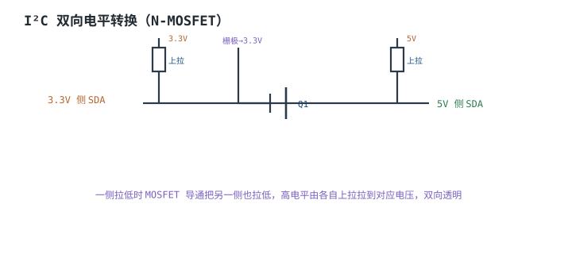

# I²C 与 SPI 总线时序 I²C & SPI

## 1. 设计动机

::: motivation 选 I²C 还是 SPI
两颗芯片之间要交换数据，最常用的就是这两种同步串行总线。**I²C（Inter-Integrated Circuit）**只用两根线（SDA/SCL），靠 7 位地址寻址多个从机，但开漏、速度较慢。**SPI（Serial Peripheral Interface）**用四线（SCK/MOSI/MISO/CS），速度快、全双工，但每多一个从机多一根片选。

硬件上选哪条总线，取决于引脚数、速率、从机数量。更关键的是：**两种总线都有严格的时序约定**——I²C 有起始/停止/应答，SPI 有四种采样模式。配错时序，硬件接线再对也读不出数据。
:::

## 2. 原理图

下图对比两种总线的物理结构：I²C 是两线 + 上拉 + 地址；SPI 是共享 SCK/MOSI/MISO + 每从机一根片选 CS。


## 3. 静态分析（DC）

- **I²C 是开漏**：所有器件只能拉低 SDA/SCL，高电平由上拉拉出。总线上**必须**加上拉电阻，否则没有高电平。
- **SPI 是推挽**：SCK/MOSI/CS 都是推挽输出，无需上拉；MISO 由当前选中的从机驱动。
- **电平匹配**：I²C 上拉到哪个电压，高电平就是哪个电压——这让它天然适合做电平转换。
- **空闲电平**：I²C 空闲时 SDA/SCL 都为高；SPI 空闲时 SCK 电平由 CPOL 决定。

## 4. 动态分析（AC / 瞬态）

I²C 时序：SCL 高电平期间 SDA 由高拉低 = **起始条件**；SCL 高期间 SDA 由低拉高 = **停止条件**。每个字节后第 9 个时钟，接收方拉低 SDA = **应答（ACK）**。

```echarts
{
  "tooltip": {"trigger": "axis"},
  "legend": {"data": ["SCL", "SDA"], "bottom": 0, "textStyle": {"fontSize": 13}},
  "grid": {"left": 56, "right": 24, "top": 26, "bottom": 56},
  "xAxis": {"type": "category", "name": "时间", "data": ["空闲","起始","b0","b1","ACK","b2","b3","ACK2","停止"], "axisLabel": {"fontSize": 10}},
  "yAxis": {"type": "value", "min": -0.3, "max": 3.8, "axisLabel": {"fontSize": 11}},
  "series": [
    {"name": "SCL", "type": "line", "step": "end", "showSymbol": false, "lineStyle": {"width": 2.2, "color": "#7a5fc0"},
     "data": [3.3,3.3,0,3.3,3.3,0,3.3,3.3,3.3]},
    {"name": "SDA", "type": "line", "step": "end", "showSymbol": false, "lineStyle": {"width": 2.6, "color": "#1a4f8b"},
     "data": [3.3,0,0,3.3,0,0,3.3,0,3.3]}
  ]
}
```

SPI 四种模式由 **CPOL（时钟极性）**和 **CPHA（时钟相位）**决定：CPOL 决定空闲电平，CPHA 决定在第几个沿采样。主从必须配成同一模式。

## 5. 环路分析

::: advanced 进阶：SPI 四模式怎么对应
CPOL=0 空闲 SCK 低；CPOL=1 空闲 SCK 高。CPHA=0 在第一个沿采样、第二个沿移位；CPHA=1 反之。组合出 Mode 0~3。最常用 Mode 0（空闲低、第一个沿采样）和 Mode 3（空闲高、第二个沿采样）。配置不匹配时数据看起来"位移了一位"——这是 SPI 调不通的头号原因。
:::

## 6. 元件取值与工程权衡

- **I²C 上拉电阻**：$R_p$ 取 4.7kΩ（标准/快速模式），总线电容大或速率高时减小到 2.2~3.3kΩ。
- **速率**：I²C 标准 100kHz、快速 400kHz、快速+ 1MHz；SPI 可达几十 MHz。
- **从机数**：I²C 靠地址挂多机，但地址冲突要避免；SPI 每机一根 CS。
- **布线**：I²C SDA/SCL 尽量短、等长；SPI 高速时 SCK 走线短。

## 7. 完整设计示例

::: example I²C 接一颗 EEPROM
1. **需求**：MCU 读 I²C EEPROM（地址 0x50），400kHz。
2. **接线**：SDA/SCL 各一只 4.7kΩ 上拉到 3.3V。
3. **时序**：起始 → 发地址 0x50+写 → ACK → 读数据 → ACK/NACK → 停止。
4. **总线电容**：板内短线，4.7k 足够；长线再加小。
5. **验算**：示波器量起始/停止/ACK 位符合规范，读回数据正确。
:::

## 8. 仿真与实验

- 逻辑分析仪抓 I²C：确认起始、地址、ACK、停止。
- SPI 换 Mode 0/3，观察数据是否错位，体会 CPHA 影响。
- 去掉 I²C 上拉电阻，总线永远拉不高，通信失败。

## 扩展与变种电路

### 扩展1：I²C 双向电平转换 Bidirectional Level Shift

定位：3.3V MCU 与 5V I²C 器件互连。



::: example 工作原理
- 利用 I²C 开漏特性：一侧拉低时 MOSFET 导通，把另一侧也拉低；高电平由各自上拉拉到对应电压。
- 栅极接到低压侧（3.3V）上拉。无需方向控制，双向透明。
- 适合 3.3V MCU 接 5V 的 RTC/EEPROM/传感器。
:::

取值对比：

| 方案 | 方向控制 | 适用 |
|---|---|---|
| MOSFET 双向转换 | 无需 | I²C 开漏 |
| 专用电平转换 IC | 自动 | 通用 |
| 串电阻直连 | — | 不可靠 |

::: pitfall 用推挽 SPI 信号套 MOSFET 转换
- **现象**：转换后波形不对。
- **原因**：MOSFET 双向转换专为开漏（I²C）设计，推挽 SPI 高电平时会冲突。
- **解决**：SPI 用电平转换 IC，不要套用 I²C 电路。
:::

### 扩展2：SPI 接 NOR Flash

定位：典型 SPI 从机应用。


::: example 工作原理
- 主机拉低某从机 CS# 选中它，SCK 同步，MOSI 发命令/地址、MISO 收数据。
- 未选中的从机 MISO 高阻，不抢占总线。
- 全双工：一个时钟既发又收。
:::

取值对比：

| 总线 | 线数 | 速率 | 从机选址 |
|---|---|---|---|
| I²C | 2 | ≤1MHz | 7位地址 |
| SPI | 4+ | 数十 MHz | 片选线 |

::: pitfall 多从机忘了各自 CS
- **现象**：两个从机 MISO 对顶。
- **原因**：同时选中两个从机，两个推挽 MISO 打架。
- **解决**：任一时刻只拉低一个 CS#。
:::

### 扩展3：I²C 上拉电阻与总线电容

定位：为什么上拉电阻不能随便取。


::: example 工作原理与时序
- I²C 高电平靠上拉拉出，上升沿由 $R_p C_{bus}$ 决定：$t_r\approx 0.847 R_p C_{bus}$。
- $R_p$ 太大 → 上升沿太慢，快速模式下高电平到不了门限；$R_p$ 太小 → 拉低时灌电流超过器件。
- 标准模式 4.7k、快速模式总线电容大时取 2.2~3.3k。
:::

取值对比：

| Rp | 上升沿 | 灌电流 | 适用 |
|---|---|---|---|
| 10k | 慢 | 小 | 低速/短线 |
| 4.7k | 中 | 中 | 标准 |
| 2.2k | 快 | 大 | 快速/长总线 |

::: pitfall 上拉取 10k 在 400kHz 下通信失败
- **现象**：高电平到不了门限、误码。
- **原因**：Rp 太大 + 总线电容大，上升沿太慢，400kHz 下高电平充不上去。
- **解决**：减小 Rp（2.2~3.3k）或加缓冲器降低总线电容。
:::

## 9. 常见坑与故障现象

::: pitfall 常见坑
- **I²C 没加上拉**：总线恒低，完全不通。必须 4.7k 上拉。
- **SPI 模式配错**：数据错位一位。核对 CPOL/CPHA，主从一致。
- **SPI 多从机同时选中**：MISO 对顶。任一时刻只选一个 CS。
- **I²C 地址冲突**：两从机同地址，通信错乱。查地址。
- **3.3V 接 5V 器件不转换**：烧脚或不通。加电平转换。
:::

## 10. 自测题

<details><summary>I²C 总线为什么必须加上拉电阻？</summary>
I²C 是开漏输出，器件只能拉低，高电平靠上拉拉出；没有上拉就没有高电平，总线恒低无法通信。
</details>

<details><summary>SPI 数据总是错位一位，最可能是什么问题？</summary>
主从 CPHA/CPOL（四种模式）配置不一致，采样沿错开。把主从配成同一模式（如 Mode 0）即可。
</details>

<details><summary>I²C 起始条件和停止条件分别是什么？</summary>
SCL 高电平期间，SDA 由高拉低 = 起始；SCL 高期间 SDA 由低拉高 = 停止。
</details>

## 11. 参考资料

- NXP UM10204《I²C-bus specification and user manual》
- Motorola/NXP SPI 协议文档
- 各 EEPROM/传感器数据手册的 I²C/SPI 时序图
