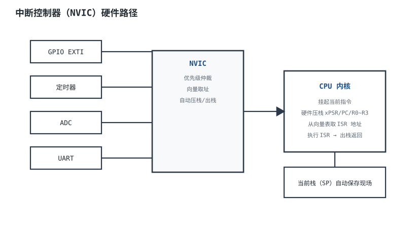
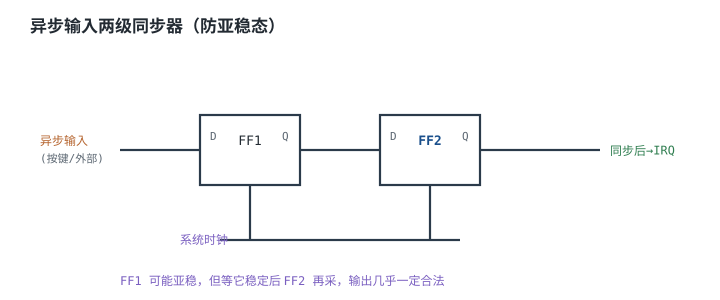

# 中断机制（硬件视角） Interrupt Hardware

## 1. 设计动机

::: motivation 为什么中断是硬件机制不是软件约定
轮询（polling）让 CPU 不停问"按键按下没？串口收到没？"，既慢又费电。**中断（Interrupt）**让外设有事时主动"打断"CPU，硬件自动保存现场、跳去对应服务程序。

硬件工程师要懂的是：中断从外设信号到 CPU 响应，中间经过**中断控制器（NVIC）**做优先级仲裁、自动压栈取向量——这一切在几十个时钟内完成，且全是硬件行为。理解它才能解释"为什么中断里不能写太慢""为什么按键会误触发""为什么多 bit 跨时钟会采错值"。
:::

## 2. 原理图

下图是一次中断从产生到响应的硬件路径：各外设中断信号汇集到 NVIC，由它按优先级仲裁，再通知 CPU；CPU 自动把寄存器压栈、从向量表取中断服务程序（ISR）入口。



## 3. 静态分析（DC）

中断是纯数字逻辑，没有直流偏置问题，但有"电平/沿"的硬件约定：

- **中断触发方式**：高/低电平触发、上升/下降沿触发。电平触发适合需要持续服务的外设（如外部控制器拉低 INT）；沿触发适合按键、帧开始等事件。
- **中断挂起位（pending）**：外设有请求时把一个标志位置起，直到 ISR 里软件清零。即使 CPU 暂时不响应，请求也不丢。
- **使能位与屏蔽**：每条中断有独立使能位；总开关（PRIMASK）可一次性关所有中断。
- **优先级寄存器**：每路中断一个优先级值，数字越小优先级越高；Cortex-M 还分抢占优先级与子优先级，决定能否嵌套。

## 4. 动态分析（AC / 瞬态）

从中断请求到 ISR 第一条指令执行，存在**中断延迟（Interrupt Latency）**，Cortex-M 典型 12~16 个时钟：

1. 当前指令执行完；
2. 硬件自动压栈 xPSR/PC/LR/R0~R3（8 个字）；
3. 从向量表取出 ISR 入口地址；
4. 跳转到 ISR。

```echarts
{
  "tooltip": {"trigger": "axis"},
  "legend": {"data": ["中断请求", "CPU 执行", "ISR"], "bottom": 0, "textStyle": {"fontSize": 13}},
  "grid": {"left": 60, "right": 24, "top": 26, "bottom": 56},
  "xAxis": {"type": "category", "name": "时钟", "data": [0,4,8,12,16,20,30,40], "axisLabel": {"fontSize": 11}},
  "yAxis": {"type": "value", "min": 0, "max": 3, "axisLabel": {"fontSize": 11}},
  "series": [
    {"name": "中断请求", "type": "line", "step": "end", "showSymbol": false, "lineStyle": {"width": 2.2, "color": "#b5642e"},
     "data": [0,0,1,1,1,1,1,1]},
    {"name": "CPU 执行", "type": "line", "step": "end", "showSymbol": false, "lineStyle": {"width": 2.2, "color": "#1a4f8b"},
     "data": [1,1,1,0,0,0,0,0]},
    {"name": "ISR", "type": "line", "step": "end", "showSymbol": false, "lineStyle": {"width": 2.2, "color": "#2e7d4f"},
     "data": [0,0,0,0,1,1,1,1]}
  ]
}
```

## 5. 环路分析

::: advanced 进阶：优先级抢占与嵌套
高优先级中断可以**抢占**正在执行的低优先级 ISR（嵌套）：硬件再次压栈、跳到高优先级 ISR，返回时先出栈回低优先级，再出栈回主程序。子优先级只决定"同时挂起时谁先跑"，不能抢占。设计上把时间关键（如电机 PWM 故障、安全停车）设最高抢占级，慢任务（如串口打印）设最低。
:::

## 6. 元件取值与工程权衡

- **ISR 要短**：ISR 里只做必须立即做的事（读数据/清标志），重活放主循环。ISR 越长，其他中断延迟越大、实时性越差。
- **频率越高越危险**：中断触发频率 × ISR 时长 > 1/CPU 占用比时，CPU 全被中断吃掉，主循环饿死。
- **优先级别全设同级**：否则无法嵌套，紧急中断被慢任务堵住。
- **沿触发 vs 电平触发**：选错会导致重复进中断或漏中断。

## 7. 完整设计示例

::: example 配置一路串口接收中断
1. **需求**：UART 收到一个字节就通知 CPU。
2. **触发**：RXNE（读缓冲非空）中断使能；用电平/标志位方式。
3. **优先级**：设为中等（可被更高优先级的安全中断抢占）。
4. **ISR**：只做读 DR 寄存器取字节、放进环形缓冲、退出；不打印、不延时。
5. **主循环**：从环形缓冲取数据处理。
6. **验算**：每字节中断耗时 µs 级，即使 115200 波特率（约 11.5kB/s）CPU 占用 <5%。
:::

## 8. 仿真与实验

- 在 ISR 里翻转一个 GPIO，用示波器量"请求脚→GPIO 翻转"的时间，实测中断延迟。
- 故意把某路中断优先级设成最高，在低优先级 ISR 里延时，观察高优先级能否抢占打断它。
- 按键不做消抖直接接 EXTI，观察一次按下触发多次中断。

## 扩展与变种电路

### 扩展1：异步输入两级同步器 Async Input Synchronizer

定位：外部异步信号直接进中断线会引发亚稳态，必须先同步。



::: example 工作原理与时序
- 外部按键/总线信号是异步的，可能在触发器建立/保持窗口内翻转，使输出停在逻辑 0/1 之间的**亚稳态（Metastability）**，要花不确定时间才落定。
- 两级触发器：第一级可能亚稳，但等一个时钟它落定后，第二级再采，输出几乎一定是合法电平。
- 时钟越快、数据率越高，需要的级数越多（工具按 MTBF 估算）。
- 多 bit 总线跨时钟**不能逐位同步**（各位到达时刻不一致会拼出错值），要用握手或异步 FIFO。
:::

对比：

| 输入处理 | MTBF | 适用 |
|---|---|---|
| 直接采异步信号 | 偶发死机 | 不可取 |
| 两级同步器 | 很长 | 单 bit 异步事件 |
| 三级/更多 | 极长 | 高频跨域 |

::: pitfall 按键/外部中断不做同步与消抖
- **现象**：偶发死机、状态机跑飞、一次按键进多次中断。
- **原因**：异步沿撞上建立保持窗口产生亚稳态；机械按键抖动产生多沿。
- **解决**：异步单 bit 过两级同步器；按键加 RC 消抖 + 软件滤波。
:::

## 9. 常见坑与故障现象

::: pitfall 常见坑
- **ISR 里写了重活**：主循环被饿死、其他中断延迟暴涨。解决：ISR 只取数，处理放主循环。
- **中断标志没清零**：ISR 一退出立刻又进，看似死循环。解决：按手册正确清挂起位。
- **异步输入不同步**：偶发跑飞、采错值。解决：加两级同步器。
- **优先级乱设**：紧急任务被慢任务堵。解决：按实时性分级。
:::

## 10. 自测题

<details><summary>中断响应时硬件自动做了哪几件事？</summary>
执行完当前指令→自动压栈 xPSR/PC/R0~R3→从向量表取 ISR 入口→跳转；返回时自动出栈。全程硬件完成，软件只需写 ISR 内容。
</details>

<details><summary>为什么异步外部信号不能直接接到中断输入而要先同步？</summary>
信号若在建立/保持窗口内翻转会使触发器进入亚稳态，输出不定、后续逻辑采到错误值甚至状态机跑飞。用两级触发器打拍可把 MTBF 提升到工程可接受。
</details>

## 11. 参考资料

- ARM《Cortex-M3/M4 Generic User Guide》NVIC 与异常模型
- SparkFun《External IO and Metastability》
- AMD/Xilinx 复位与跨时钟域设计讨论
