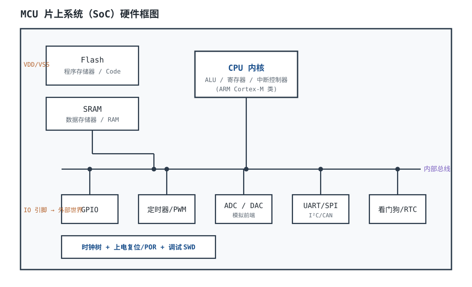
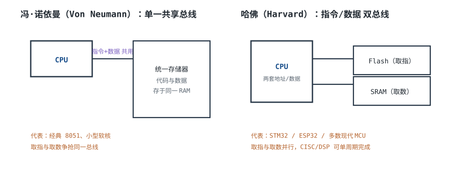

# MCU 概览 MCU Overview

单片机（Microcontroller Unit，MCU）是硬件工程师最常画、也最容易"凭感觉"画的一类芯片：原理图上看起来只是几十根线，真正决定成败的却是几件很具体的事——这颗芯片的 Flash 和 RAM 够不够、要几个引脚、哪些引脚能复用、主频跑不跑得动、封装能不能布出来、供货能不能撑过产品寿命。把这些事算清楚，比背"51、STM32、ESP32 各有什么特点"有用得多。

本章先建立一张整体地图：MCU、MPU（Microprocessor Unit，微处理器）与 SoC（System on Chip，片上系统）的边界在哪里，冯·诺依曼与哈佛两种架构到底差在什么地方；然后把"选型"变成四个可计算的不等式——Flash、RAM、引脚数、CPU 占用；最后用一个"8 路模拟量 + 2 路 UART + 1 路 CAN + 显示"的完整需求，逐项算出资源占用，判断一颗典型型号到底够不够。器件参数一律标"典型量级，以数据手册为准"，算例中的假设都写清楚，方便逐项复算。

本章与[最小系统](minimum-system.md)、[GPIO 原理与驱动能力](gpio.md)、[中断机制（硬件视角）](interrupts.md)构成一条线：这一章决定"选哪颗、够不够"，后三章决定"怎么把它接活、怎么把引脚用好、怎么让事件及时得到响应"。ADC 的精度与采样率细节见[ADC 原理、参数与参考电压](adc.md)，电源与 LDO 的取舍见[LDO 原理、选型与功耗计算](../power/ldo.md)。

## 1. 设计动机

::: motivation 三个"选型时觉得够、量产时不够"的现场
**现场一：程序写到一半发现 Flash 满了。** 需求只写了"采集 8 路模拟量、两路串口、一路 CAN、一个小屏"，工程师按"以前 32KB 够用"选了 32KB Flash 的型号。做完字库、Bootloader 和参数区后，代码 28KB、字库 6KB、Bootloader 8KB、参数区 2KB，还没算 6KB 协议栈就 44KB，占用率 $44/32=137.5\%$；算上协议栈 50KB，占用率 $50/32=156\%$。改双区 OTA 要换 64KB；若所选 64KB 型号的封装/引脚不同，PCB 也要改。

**现场二：RAM 在实验室够，现场偶发死机。** 8 路 ADC 的双缓冲只要 32B，看起来很小；但两路串口的收发环形缓冲 2×512B、CAN 收发队列 384B、128×64 单色屏的显存 1KB、4 个任务栈 4KB、堆 2KB、全局变量 2KB，合计约 12.9KB。选 20KB RAM 的型号占用率 64.5%，实验室没问题；一开 `printf` 浮点、一加中断嵌套，栈高水位冲到 19KB，偶发踩穿。

**现场三：引脚数"差两个"，原理图重画。** 8 路模拟量占了 PA0~PA7，两路 UART 想用 PA2/PA3，结果和模拟量冲突；CAN 又占了 PA11/PA12。把 UART 改到 PB10/PB11、显示改到 I²C 之后，29 个 GPIO 刚好落在 37 个可用 IO 里，只剩 8 个余量（21.6%）。看起来过了，但再加一个 USB、一个 SD 卡或第二路 CAN，立刻不够。
:::

| 你遇到的问题 | 先算/先查 | 判据（本手册建议值，非标准强制） |
|---|---|---|
| 程序放不下、OTA 失败 | 代码+字库+Bootloader+参数区，再除以 Flash 容量 | 占用率 ≤70%，即留 30% 余量 |
| 运行一段时间死机、栈踩穿 | 全局+堆+任务栈+中断栈+缓冲 | RAM 占用率 ≤70%，栈要有高水位实测 |
| 引脚不够、功能复用冲突 | 功能引脚+调试+晶振+启动+电源地 | GPIO 余量 ≥20%，并画完整 Pin Map |
| 主频看起来高但跑不动 | 各任务频率×每次周期数，再除以主频 | CPU 占用率 ≤70%，留 30% 给峰值和中断 |
| 小批量能买到、量产断货 | 生命周期、第二货源、Errata | 量产型号必须有替代料或长期供货承诺 |
| 电池待机远低于计算值 | 运行/休眠占空比、LDO 静态电流、上下拉漏电 | 平均电流按最坏温度与最坏占空比算 |

**不算会摔在哪，三个带数字的代价：**

1. **Flash 少算 8KB 的 Bootloader。** 应用 28KB + 字库 6KB + 协议栈 6KB + 参数 2KB = 42KB；加 Bootloader 8KB 后 50KB。64KB 的 70% 上限是 44.8KB，50KB 超了 5.2KB；若按"除以 0.7"反算，需要 $50/0.7=71.4\text{KB}$，只能上 128KB。
2. **RAM 少算 1KB 的 `printf` 缓冲。** 12.9KB 在 20KB 里占 64.5%，加 1KB 后 13.9KB 占 69.5%，已经贴着 70% 线；再叠一层中断嵌套（每层 104B），就没有安全余量。
3. **引脚少算两个复用冲突。** 29 个 GPIO 在 37 个 IO 里占 78.4%，余量 8 个；看起来有 21.6%，但只要加 USB（2 个）或 SD 卡（4 个），余量立刻掉到 16.2% 或 10.8%，不满足 20% 规则。**引脚余量要按"未来最可能加的那一个功能"倒扣，而不是按当前功能数算。**

## 2. 定义与直观

### 2.1 MCU、MPU 与 SoC 的边界

**MCU** 把处理器内核、程序存储器（通常是 Flash）、数据存储器（SRAM）、时钟与复位、以及 GPIO/定时器/ADC/串口/CAN 等外设集成在一颗芯片里，目标是**单芯片、确定性、低功耗、低成本**地完成控制任务。它通常不带 MMU（Memory Management Unit，内存管理单元），即使带 MPU（Memory Protection Unit，内存保护单元），也只能做区域保护，不能做虚拟内存。程序从片内 Flash 直接执行，上电到跑第一行代码通常是毫秒级。

**MPU** 通常指应用处理器：主频高、带 MMU 和 Cache、需要外接 DRAM、跑 Linux/Android 这类通用操作系统，启动要几百毫秒到几秒，待机电流从毫安到安培级。它强在吞吐量和生态，不强在"上电 5ms 内必须开始控制电机"。

**SoC** 是"把多个子系统集成到一颗芯片"的泛称：CPU + GPU + 图像处理 + 射频 + 电源管理都可能在同一颗 die 上。严格说，一颗 MCU 也是 SoC；产业里把"跑富操作系统、带外部 DRAM 的应用处理器"叫 SoC，是市场习惯，不是电气定义。判断边界时不要看名字，看四个问题：**有没有 MMU、要不要外接 DRAM、启动时间是多少、待机电流是多少。**

| 维度 | MCU | MPU / 应用处理器 | SoC（市场语境） |
|---|---|---|---|
| 典型主频 | 8~200MHz（少数到 400MHz 以上） | 400MHz~3GHz | 1~3GHz |
| 片内程序存储器 | Flash 16KB~2MB | 通常无，靠外部 | 通常无或小容量 |
| 片内 SRAM | 4KB~512KB | 几十 KB 到几 MB Cache | 几百 KB 到几 MB |
| MMU / 虚拟内存 | 通常无（可能有 MPU） | 有 | 有 |
| 外部 DRAM | 很少 | 必需 | 必需 |
| 上电到执行 | 毫秒级 | 几百毫秒到秒级 | 秒级 |
| 待机电流 | 微安到毫安 | 毫安到安培 | 毫安到安培 |
| 封装 | QFN/LQFP 20~144 脚 | BGA 数百脚 | BGA 数百到上千脚 |
| 典型软件 | 裸机、RTOS | Linux、Android | Linux、Android、RTOS 混合 |
| 典型成本 | 低于 5 美元（量大更低） | 5~50 美元 | 10~100 美元 |

> 表中数值是典型量级，不是分类标准；同一档位不同厂家可以差一个数量级。选型时以具体型号的数据手册为准。

::: analogy 一体式厨房、中央厨房与美食城
- **MCU 像一体式厨房**：灶台、冰箱、水槽都在一个小空间里，走两步就能拿到，出菜快、占地小；但你想同时开十条生产线，它放不下。
- **MPU 像中央厨房**：仓库（DRAM）在外，传送带（高速总线）很长，能同时供应很多档口；但开火前要备货、要预热，启动慢，待机也费电。
- **SoC 像美食城**：厨房、餐厅、外卖、收银都在一个建筑里，功能最全；但结构复杂，哪一层出问题都要整栋协调。

类比的边界：厨房再小，也有"切菜"和"炒菜"抢同一块案板的时候——这就是下一节的总线竞争；厨房再大，也可能因为传菜路径设计不好而堵住。
:::



### 2.2 冯·诺依曼与哈佛：差别在"取指和取数能不能同时走"

**冯·诺依曼结构（Von Neumann Architecture）** 用一套地址空间、一套总线同时存放指令和数据。CPU 取指令和读写数据必须分时复用这条总线，所以存在**总线瓶颈**：一条指令还没取完，数据访问就得等；数据访问还没结束，下一条指令又得等。通用计算机用 Cache 和流水线把这个问题掩盖掉，但在没有 Cache 的低端 MCU 上，瓶颈是真实存在的。

**哈佛结构（Harvard Architecture）** 把指令总线和数据总线分开，CPU 可以在执行当前指令的同时预取下一条指令，也可以在取指的同时读写数据。代价是两套存储器接口、两套地址空间，芯片面积和引脚更多。DSP 和大多数现代 MCU 走这条路。

**改进哈佛（Modified Harvard）** 是工程上的折中：地址空间统一（程序员看到的是一个 4GB 线性空间），但在处理器内部用分开的 I-Code、D-Code 和 System 总线，配合总线矩阵让内核、DMA、外设同时访问不同存储区。ARM Cortex-M 系列就是这种结构：指令和数据在同一个地址空间里，但取指与取数走不同的总线接口。



| 维度 | 冯·诺依曼 | 哈佛 / 改进哈佛 |
|---|---|---|
| 地址空间 | 指令与数据统一编址 | 指令与数据分开编址，或统一编址但总线分开 |
| 总线 | 一套，分时复用 | 两套或三套，可并行 |
| 取指与取数 | 不能同时 | 可以同时（受总线矩阵和存储器端口限制） |
| 典型器件 | 早期通用 CPU、部分 8 位机 | DSP、AVR、8051、ARM Cortex-M |
| 优点 | 结构简单、引脚少、成本低 | 吞吐高、实时性好 |
| 代价 | 总线瓶颈、取指等待 | 面积大、地址空间与工具链更复杂 |

三类常见 MCU 的架构与定位对照（典型量级，以数据手册为准）：

| 维度 | 经典 8051 | Cortex-M3 类 | ESP32 类 |
|---|---|---|---|
| 位宽/内核 | 8 位 CISC | 32 位 RISC | 32 位双核 Xtensa/RISC-V |
| 存储器组织 | 哈佛，片内 Flash/ROM | 改进哈佛，片内 Flash/SRAM | 改进哈佛 + 多核 + 射频子系统 |
| 典型主频 | 12~24MHz | 24~72MHz | 160~240MHz |
| 供电与电流 | 5V 或 3.3V，mA 级 | 3.3V，mA 级 | 3.3V，射频发射峰值可达数百 mA |
| 典型用途 | 极简单控制、教学 | 通用工业/消费控制 | Wi-Fi/BLE 物联网、无线网关 |

**不要把"架构"当成性能排名。** 8051 的哈佛结构并不妨碍它在 12MHz 下只有约 1MIPS 的有效吞吐；Cortex-M3 的 72MHz 也不等于所有指令都单周期；ESP32 的双核和射频让它的峰值电流、启动时间和供电设计完全不同于普通 MCU。选型时看"你的任务需要多少周期、多少外设、多少引脚"，而不是看架构标签。

::: advanced 技术勘误：8051 不是冯·诺依曼结构
旧版讲法常把"经典 8051"写成冯·诺依曼结构，这是错的。8051 的程序存储器（Code）与数据存储器（Data）是**两个独立的地址空间**：MOVC 访问程序区，MOVX 访问外部数据区，内部 RAM 与 SFR 又是另一套编址。它在存储器层面是**哈佛结构**，只是外部总线把地址/数据复用在同一组 P0/P2 引脚上，看起来像"一套总线"。把"引脚复用"误当成"地址空间统一"，就会得出错误结论。

同样要纠正另一个常见说法："哈佛结构一定零等待取指"。Cortex-M 的 I-Code 总线也要经过 Flash 控制器；主频高于 Flash 访问速度时，必须插入等待周期（wait state）。72MHz、2 个等待周期时，一次取指是 3 个时钟而不是 1 个，所谓"零等待"只在一定频率以下成立，具体以芯片的 Flash 等待周期表为准。

正确的表述是：**8051 是哈佛存储器结构 + 复用外部总线；Cortex-M 是改进哈佛 + 统一地址空间 + 总线矩阵。** 架构只决定"能不能并行"，实际性能还要看等待周期、总线仲裁和 Cache。
:::

### 2.3 架构对硬件工程师意味着什么

架构不是软件工程师才关心的事，它直接落到原理图上：

- **电源脚更多**：内核、Flash、SRAM、模拟外设、IO 环可能分不同电源域，每个域都要去耦，见[最小系统](minimum-system.md)。
- **时钟树更复杂**：多总线、多外设意味着多个时钟分频器，晶振和 PLL 的配置会直接影响串口、CAN、USB 的时序。
- **调试口更关键**：总线矩阵和外设复用让"哪个引脚是什么功能"变得不直观，必须靠 Pin Map 和调试口验证。
- **DMA 会改变瓶颈位置**：CPU 不再逐字节搬数据，但 DMA 和 CPU 会争总线；选型时不能只看主频，要看总线矩阵和 DMA 通道数。

## 3. 定量关系

### 3.1 Flash：先算"必须放什么"，再算"留多少"

程序占用不是"代码大小"一个数，而是四块之和：

$$S_{flash,req}=S_{code}+S_{const}+S_{boot}+S_{cfg}$$

其中 $S_{flash,req}$ 是需要的 Flash 容量（KB）；$S_{code}$ 是编译后的代码段（KB）；$S_{const}$ 是常量、字库、校准表（KB）；$S_{boot}$ 是 Bootloader 或双区 OTA 的备份区（KB）；$S_{cfg}$ 是参数区、日志区（KB）。全部单位统一用 KB 或全部用字节，不要混用。

工程上留 30% 余量，等价于：

$$S_{flash,min}=\frac{S_{flash,req}}{1-m_{flash}},\qquad m_{flash}=0.30$$

其中 $m_{flash}$ 是预留比例（无量纲），$S_{flash,min}$ 是应选的最小标称容量（KB）。占用率定义为：

$$U_{flash}=\frac{S_{flash,req}}{S_{flash}}\times100\%$$

**算例：** 应用 28KB、字库 6KB、协议栈 6KB、Bootloader 8KB、参数 2KB，则 $S_{flash,req}=28+6+6+8+2=50\text{KB}$。若选 64KB，$U_{flash}=50/64=78.1\%$，超过 70%；按 30% 余量反算，$S_{flash,min}=50/0.7=71.4\text{KB}$，64KB 不够，应选 128KB。若不做 OTA、去掉 8KB Bootloader，则 $S_{flash,req}=42\text{KB}$，$U_{flash}=42/64=65.6\%$，64KB 够用。**OTA 是这组数字里唯一把 64KB 推过线的因素，选型时必须先问"要不要现场升级"。**

### 3.2 RAM：静态、堆、栈、缓冲分开算

RAM 占用由五部分组成：

$$S_{ram,req}=S_{global}+S_{heap}+\sum_{i=1}^{n}S_{stack,i}+S_{isr}+S_{buf}$$

其中 $S_{global}$ 是全局/静态变量（B）；$S_{heap}$ 是堆（B）；$S_{stack,i}$ 是第 $i$ 个任务的栈（B）；$S_{isr}$ 是中断嵌套预留的栈（B）；$S_{buf}$ 是串口、CAN、ADC、显示等缓冲（B）。任务栈不能只按"局部变量"估，要把函数调用深度、浮点运算、`printf` 和中断嵌套都算进去。

同样按 70% 占用率控制：

$$U_{ram}=\frac{S_{ram,req}}{S_{ram}}\times100\%\leq70\%$$

**算例：** ADC 双缓冲 $8\times2\times2=32\text{B}$；两路 UART 环形缓冲 $2\times512=1024\text{B}$；CAN 收 16 帧、发 8 帧，每帧 16B，共 $(16+8)\times16=384\text{B}$；128×64 单色显存 $128\times64/8=1024\text{B}$；协议栈 2048B；4 个任务栈 $4\times1024=4096\text{B}$；堆 2048B；全局 2048B；中断嵌套预留 512B。合计 $32+1024+384+1024+2048+4096+2048+2048+512=13216\text{B}\approx12.9\text{KB}$。20KB RAM 的占用率 $12.9/20=64.5\%$，满足 70%；加 1KB 的 `printf` 缓冲后 $13.9/20=69.5\%$，贴着线，需要实测栈高水位。

### 3.3 引脚数：功能、复用、调试、启动都要占

引脚需求不是"功能数"简单相加，而是：

$$N_{io}=N_{func}+N_{debug}+N_{clock}+N_{boot}+N_{spare}$$

其中 $N_{func}$ 是功能引脚数（含模拟、通信、显示、人机）；$N_{debug}$ 是调试口（SWD 至少 2 根，建议加 GND 与复位）；$N_{clock}$ 是晶振（2 根）；$N_{boot}$ 是启动配置（BOOT0/BOOT1）；$N_{spare}$ 是预留。工程上建议：

$$N_{spare}\geq0.20\,N_{io}$$

**算例：** 8 路模拟 + 2 路 UART（4 根）+ 1 路 CAN（2 根）+ I²C 显示（2 根）+ 4 按键 + 4 LED + 1 继电器 + SWD（2 根）+ 晶振（2 根）+ NRST + BOOT0，共 $8+4+2+2+4+4+1+2+2+1+1=31$ 根信号脚。其中 29 根是 GPIO，2 根是 NRST/BOOT0。37 个可用 IO 时，GPIO 占用率 $29/37=78.4\%$，余量 8 根（21.6%），刚过 20% 线；但只要加一个 USB（2 根）或 SD 卡（4 根），余量就掉到 16.2% 或 10.8%，不满足。**引脚余量要按"下一个最可能加的功能"倒扣。**

**封装也要算。** LQFP48 的 body 典型 7mm×7mm，面积 $7\times7=49\,\text{mm}^2$；LQFP64 典型 10mm×10mm，面积 $10\times10=100\,\text{mm}^2$，面积增加 $(100-49)/49=104\%$。0.5mm pitch 下，48 脚每边 12 个引脚，按每通道 0.4mm（0.2mm 线宽 + 0.2mm 间距）估算，一边约需 $12\times0.4=4.8\text{mm}$，7mm body 够；64 脚每边 16 个，约需 $16\times0.4=6.4\text{mm}$，10mm body 够。但 0.4mm pitch、QFN 底部散热焊盘或 BGA 会把 PCB 从 2 层推到 4 层，板费要算进 $C_{pcb}$。**先用最小封装把功能跑通，只有引脚/散热真的不够时才升封装。**

### 3.4 主频与 DMIPS：算"要多少周期"，不是"要多少 MHz"

CPU 占用率按任务逐项相加：

$$U_{cpu}=\frac{\sum_{i=1}^{n}f_i C_i}{f_{cpu}}\times100\%$$

其中 $f_i$ 是第 $i$ 个任务的触发频率（Hz）；$C_i$ 是每次执行的平均周期数（cycle）；$f_{cpu}$ 是内核主频（Hz）；$U_{cpu}$ 是无量纲的占用率。工程上控制 $U_{cpu}\leq70\%$，留 30% 给峰值、中断嵌套和未来功能。

DMIPS 是另一把尺子：它把 Dhrystone 基准归一化到 VAX 11/780 的 1 MIPS，用"每 MHz 多少 DMIPS"比较不同内核：

$$P_{DMIPS}=f_{cpu}\times\eta_{DMIPS}$$

其中 $\eta_{DMIPS}$ 是每 MHz 的 DMIPS 数（DMIPS/MHz），$f_{cpu}$ 单位 MHz，$P_{DMIPS}$ 单位 DMIPS。Cortex-M0+ 约 0.95、Cortex-M3/M4 约 1.25、Cortex-M7 约 2.14 DMIPS/MHz（ARM 公布典型值，实际受存储器等待周期、编译器和基准版本影响）。

```echarts
{
  "tooltip": {"trigger": "axis"},
  "legend": {"data": ["Cortex-M3（1.25 DMIPS/MHz）", "Cortex-M0+（0.95 DMIPS/MHz）"], "bottom": 0, "textStyle": {"fontSize": 12}},
  "grid": {"left": 64, "right": 24, "top": 30, "bottom": 56},
  "xAxis": {"type": "category", "name": "主频 MHz", "data": [24, 48, 72, 120], "axisLabel": {"fontSize": 11}},
  "yAxis": {"type": "value", "name": "DMIPS", "min": 0, "max": 160, "axisLabel": {"fontSize": 11}},
  "series": [
    {"name": "Cortex-M3（1.25 DMIPS/MHz）", "type": "line", "smooth": true, "symbolSize": 7,
     "lineStyle": {"width": 2.6, "color": "#1a4f8b"}, "itemStyle": {"color": "#1a4f8b"},
     "data": [30, 60, 90, 150]},
    {"name": "Cortex-M0+（0.95 DMIPS/MHz）", "type": "line", "smooth": true, "symbolSize": 7,
     "lineStyle": {"width": 2.6, "color": "#b5642e"}, "itemStyle": {"color": "#b5642e"},
     "data": [22.8, 45.6, 68.4, 114]}
  ]
}
```

图中的每个点都可复算：$24\times1.25=30$、$48\times1.25=60$、$72\times1.25=90$、$120\times1.25=150$；M0+ 同理乘 0.95。**DMIPS 只说明"内核跑 Dhrystone 有多快"，不说明"你的控制循环有多快"**——后者由存储器等待周期、中断延迟、外设和代码质量决定。选型时先算 $U_{cpu}$，再用 DMIPS 做交叉检查；不要反过来。

### 3.5 成本、功耗、供货与生态：四个容易被忽略的变量

**成本**不是单颗价格，而是：

$$C_{total}=C_{mcu}+C_{pcb}+C_{power}+C_{dev}+C_{risk}$$

其中 $C_{mcu}$ 是芯片单价；$C_{pcb}$ 是层数、面积、阻抗控制带来的板费；$C_{power}$ 是 LDO/DC-DC、电容、散热；$C_{dev}$ 是开发工具、调试器、license；$C_{risk}$ 是返工、停产、认证失败的风险成本。小批量产品里，$C_{dev}$ 和 $C_{risk}$ 常常远大于 $C_{mcu}$。

**功耗**分动态和静态：

$$P_{dyn}\approx\alpha C_{eq}V_{DD}^2 f_{cpu}$$

其中 $\alpha$ 是翻转活动因子（无量纲），$C_{eq}$ 是等效电容（F），$V_{DD}$ 是电源电压（V），$f_{cpu}$ 是主频（Hz）。主频翻倍，动态功耗近似翻倍；但待机功耗主要由漏电、LDO 静态电流和上下拉电阻决定，见[最小系统](minimum-system.md)。

**供货**要看生命周期、第二货源和 Errata（勘误）。一个型号如果只有一家、交期 26 周、勘误里有一条"某外设在某条件下会锁死"，那么它再便宜也不适合量产。

**生态**是开发时间：HAL/LL 库、RTOS 支持、参考设计、社区问答、调试器兼容性。对 1 万片以下的项目，工程师一个月的工资往往超过芯片差价，**"生态好"是能算进 BOM 的**。

## 4. 典型计算

### 4.1 算例一：8 路模拟 + 2 路 UART + 1 路 CAN + 显示的完整选型

**需求：**

| 项目 | 要求 |
|---|---|
| 模拟量 | 8 路单端，12 位，每路 1kSPS，0~3.3V |
| 串口 | 2 路：一路 115200（调试/Modbus），一路 9600（GPS） |
| 总线 | 1 路 CAN 2.0B，500kbps |
| 显示 | 128×64 单色 OLED，I²C 接口，10fps |
| 人机 | 4 个按键、4 个 LED、1 个 5V 继电器（线圈 70mA） |
| 其他 | SWD 调试口、8MHz 晶振、NRST、BOOT0 |
| 供电 | 5V 输入，3.3V 系统，-20~70°C |
| 升级 | 需要现场 OTA，Bootloader 8KB |

**第 1 步：外设盘点。** 1 个 12 位 ADC 至少 8 通道；2 个 UART；1 个 CAN；1 个 I²C；定时器至少 3 个（控制节拍、ADC 触发、显示刷新）；GPIO 按第 3.3 节算 29 根。ADC 总采样率 $8\times1000=8000\text{SPS}$，若 ADC 最高 1MSPS，占用 $8000/10^6=0.8\%$；每次扫描 8 通道，转换时间约 $8\times1\,\mu\text{s}=8\,\mu\text{s}$，1kHz 触发时占空比 $8\,\mu\text{s}/1\text{ms}=0.8\%$，余量很大。

**第 2 步：引脚分配。** 选一颗 48 脚、37 个 GPIO 的典型型号（以 STM32F103C8T6 为例，具体以 DS5319 为准），分配如下：

| 功能 | 引脚 | 数量 | 备注 |
|---|---|---|---|
| ADC_IN0~7 | PA0~PA7 | 8 | 8 路模拟输入 |
| USART1_TX/RX | PA9/PA10 | 2 | 115200 |
| USART3_TX/RX | PB10/PB11 | 2 | 9600，避开 PA2/PA3 与 ADC 冲突 |
| CAN_RX/TX | PA11/PA12 | 2 | 不与 USB 同时使用 |
| I2C1_SCL/SDA | PB6/PB7 | 2 | OLED |
| 按键 | PB0/PB1/PB5/PB8 | 4 | 上拉输入 |
| LED | PB12~PB15 | 4 | 推挽输出 |
| 继电器控制 | PB9 | 1 | 经三极管，见 [GPIO](gpio.md) |
| SWDIO/SWCLK | PA13/PA14 | 2 | 调试口 |
| OSC_IN/OSC_OUT | PD0/PD1 | 2 | 8MHz 晶振 |
| NRST | NRST | 1 | 复位 |
| BOOT0 | BOOT0 | 1 | 10k 下拉 |

合计 31 根信号脚，其中 29 根 GPIO。$29/37=78.4\%$，余量 8 根（21.6%），刚好满足 20% 规则。**注意这里没有用 PA2/PA3 做 UART2**：它们与 ADC_IN2/3 冲突；改用 USART3 的 PB10/PB11 才把 8 路模拟量完整保住。这是"先画 Pin Map、再画原理图"的价值。

**第 3 步：Flash。** 应用 28KB、字库 6KB、协议栈 6KB、Bootloader 8KB、参数 2KB，合计 50KB。64KB 的占用率 $50/64=78.1\%$，超过 70%；30% 余量反算 $50/0.7=71.4\text{KB}$，64KB 不够。若去掉 Bootloader，42KB 占用 $42/64=65.6\%$，够用。**结论：不做 OTA 时 64KB 够；做 OTA 必须 128KB。**

**第 4 步：RAM。** 按第 3.2 节算得 12.9KB，20KB 占用 $12.9/20=64.5\%$；加 1KB `printf` 缓冲后 13.9KB，占 69.5%，仍低于 70%，但只剩 0.5 个百分点，必须实测栈高水位。**结论：RAM 够，但没有余量再加大缓冲。**

**第 5 步：CPU。** 按任务逐项算：

| 任务 | 频率 | 每次周期 | 周期/秒 |
|---|---|---|---|
| 1kHz 控制环 | 1kHz | 2000 | $2.00\times10^6$ |
| ADC 中断（8 通道） | 8kSPS | 200 | $1.60\times10^6$ |
| 两路 UART（12.48kB/s） | 12480B/s | 150 | $1.872\times10^6$ |
| CAN（500kbps，130bit/帧） | 3846 帧/s | 200 | $0.769\times10^6$ |
| 显示 I²C（10fps，1024B/帧） | 10240B/s | 50 | $0.512\times10^6$ |
| SysTick | 1kHz | 50 | $0.05\times10^6$ |
| **合计** | | | **$6.803\times10^6$** |

72MHz 时 $U_{cpu}=6.803\times10^6/72\times10^6=9.45\%$；按 2 倍余量 18.9%，满足 70%。48MHz 时 $U_{cpu}=14.2\%$，2 倍余量 28.3%，也满足。按 1.25 DMIPS/MHz 粗略折算，$6.803\times10^6$ 周期/s 约相当于 $6.803\times1.25=8.50$ DMIPS 的运算量；48MHz Cortex-M3 提供 $48\times1.25=60$ DMIPS，余量 $60/8.50=7.1$ 倍。**结论：主频不是瓶颈，48MHz 就够；不要为 CPU 多花钱。**

**第 6 步：外设与总线带宽。** ADC 用 1 个（共 2 个），UART 用 2 个（共 3 个），CAN 用 1 个（共 1 个），I²C 用 1 个（共 2 个），SPI 两个全空。显示总线：$10.24\text{kB/s}\times9\text{bit/B}=92.16\text{kbps}$，加 5% 协议开销约 96.8kbps，400kHz I²C 占用 $96.8/400=24.2\%$；若把刷新率提到 30fps，占用 $72.6\%$，就太挤了。**结论：10fps 的 I²C 显示可以，30fps 应改 SPI 或降分辨率。**

**第 7 步：判断典型型号。** 把结果汇总：

| 项目 | 需求 | 64KB/20KB/48 脚型号 | 判断 |
|---|---|---|---|
| Flash | 50KB（含 OTA） | 64KB，占用 78.1% | **不够**（>70%） |
| Flash（无 OTA） | 42KB | 64KB，占用 65.6% | 够 |
| RAM | 12.9KB | 20KB，占用 64.5% | 够，余量小 |
| GPIO | 29 根 | 37 根，占用 78.4% | 够（余量 21.6%） |
| CPU | 6.803M 周期/s | 72MHz，占用 9.45% | 余量很大 |
| ADC | 8kSPS | 1MSPS | 余量很大 |
| 外设 | 2 UART/1 CAN/1 I²C | 3 UART/1 CAN/2 I²C | UART/I²C 各 1 路 spare；CAN 已用满 |

**结论：** 若不做 OTA，STM32F103C8T6 这一类 64KB/20KB/48 脚型号够用；若做 OTA，Flash 差 5.2KB，应选**同封装 128KB 的型号**（如 STM32F103CBT6，仍为 48 脚、20KB RAM），而不是直接跳到 64 脚。只有当你还需要 USB、SD 卡或第二路 CAN 时，才值得上 64 脚（51 个 GPIO）。这就是"够用就好"的具体做法：**先换容量，不轻易换封装；先解决问题，不为未来用不到的功能付费。**

### 4.2 算例二：48MHz 还是 72MHz？

延续上例。72MHz 的 $U_{cpu}=9.45\%$，48MHz 的 $U_{cpu}=14.2\%$，两者都远低于 70%。若只看 CPU，48MHz 足够。但主频还影响三件事：

1. **中断延迟**：72MHz 下 12 个时钟的异常入口是 $12/72\text{MHz}=167\text{ns}$；48MHz 下是 $12/48\text{MHz}=250\text{ns}$。对 100µs 的控制周期，两者都可接受。
2. **串口/CAN 的时序分辨率**：主频越高，波特率分频的误差通常越小。115200 波特在 48MHz 下的分频误差需要按 USART 的分数波特率寄存器核算；72MHz 通常更容易把误差压小，但必须按 USARTDIV 实际核算，不能只看主频。
3. **功耗**：动态功耗近似与主频成正比。若 72MHz 运行电流 40mA、48MHz 约 28mA（典型量级，以数据手册为准），差 12mA；对电池设备，这 12mA 可能比芯片差价更重要。

**结论：** 如果 48MHz 型号的串口分频误差满足要求、Flash/RAM/引脚也够，就选 48MHz；如果只有 72MHz 型号能满足外设与容量，就选 72MHz，但不要让"主频高"成为唯一理由。**先算资源，再算功耗，最后才看主频。**

### 4.3 算例三：功耗与电池寿命——LDO 的静态电流常常是主角

设设备 10% 时间运行、90% 时间休眠；运行电流 40mA，休眠电流 50µA；2000mAh 电池。平均电流：

$$I_{avg}=D I_{run}+(1-D)I_{sleep}$$

其中 $D$ 是运行占空比（无量纲），$I_{run}$、$I_{sleep}$ 单位 mA，$I_{avg}$ 单位 mA。代入 $D=0.1$：

$$I_{avg}=0.1\times40+0.9\times0.05=4.045\text{mA}$$

续航 $t=2000/4.045=494\text{h}\approx20.6\text{天}$。若 LDO 静态电流 5mA，休眠时它一直流：

$$I_{avg}=0.1\times40+0.9\times(0.05+5)=8.545\text{mA}$$

续航 $2000/8.545=234\text{h}\approx9.75\text{天}$，**少了约 53%**（$9.75/20.6=0.473$）。换 50µA 静态电流的 LDO：

$$I_{avg}=0.1\times40+0.9\times(0.05+0.05)=4.09\text{mA}$$

续航 $2000/4.09=489\text{h}\approx20.4\text{天}$，回到 MCU 本身的水平。**结论：电池设备选 LDO 时，静态电流和关断电流与输出电流能力同等重要；5mA 的 Iq 会把 50µA 的 MCU 休眠优势全部吃掉。**

## 5. 工程含义

### 5.1 选型顺序：外设与引脚 → Flash/RAM → 主频 → 封装/供货

正确的顺序不是"先看主频"，而是：

1. **外设**：需要几路 ADC、UART、CAN、I²C/SPI、定时器？有没有特殊接口（USB、以太网、LCD）？
2. **引脚**：把功能逐条落到具体引脚，画出 Pin Map，检查复用冲突、5V 容忍、模拟引脚、调试口、晶振、BOOT。
3. **Flash/RAM**：按 70% 规则算，先看 OTA 和字库这两个"大头"。
4. **主频**：按任务周期算 $U_{cpu}$，再用 DMIPS 交叉检查。
5. **封装/供货/生态**：封装决定 PCB 层数与面积，供货决定能不能量产，生态决定开发周期。

这个顺序的理由很简单：**外设和引脚是"0/1"约束，缺一个就是缺；Flash/RAM 和主频是"余量"约束，差一点还能优化代码或降频。** 先把硬约束解决，再谈优化。

### 5.2 "够用就好"的五条工程理由

1. **成本**：更大的 Flash、更多的引脚、更高的主频都要付晶圆面积、封装、测试和 PCB 成本。对年产量 10 万台的产品，单颗多 0.2 美元就是 2 万美元；而多出来的资源可能永远用不到。
2. **功耗**：更大的存储器漏电更大，更高的主频动态功耗更高；电池设备上，这会直接变成续航。
3. **供货**：越"高端"的型号，交期越长、第二货源越少、停产风险越高；量产选型要看生命周期，不只看出货量。
4. **生态**：主流型号的 HAL、RTOS、参考设计、社区答案更多；冷门型号省下的芯片钱，可能不够工程师多花的一周。
5. **风险**：功能越多、配置越复杂，Errata 和认证问题越多；"少一个用不到的外设"就是少一个故障点。

### 5.3 架构对原理图的具体影响

- **电源域**：MCU 的 VDD、VDDA、VBAT 可能各自独立，去耦和滤波要分开，见[最小系统](minimum-system.md)。
- **时钟**：外部晶振接专用 OSC 引脚，负载电容按晶振 $C_L$ 反算，不能随便取 22pF，见[晶振与谐振器](../components/crystal-oscillator.md)。
- **启动**：BOOT0/BOOT1 必须给确定电平；悬空会导致启动模式随机，见[最小系统](minimum-system.md)。
- **调试**：SWD 至少引出 SWDIO、SWCLK、GND，最好加 3V3 与 NRST；引脚复用后如果调试口被占用，可能锁死芯片。
- **IO 电气**：哪些脚 5V 容忍、哪些是模拟脚、哪些带大电流驱动，直接决定要不要加电平转换或三极管，见[GPIO](gpio.md)。

### 5.4 什么时候该上 MPU/SoC

| 需求 | MCU 够不够 | 判断依据 |
|---|---|---|
| 1kHz 控制、8 路 ADC、CAN | 够 | $U_{cpu}$ 低，外设匹配 |
| 128×64 单色屏、10fps | 够 | 总线占用 24%，CPU 占用低 |
| 800×480 RGB 屏、60fps | 通常不够 | 带宽 $800\times480\times3\times60\approx69\text{MB/s}$，需要 LCD 控制器与外部 DRAM |
| 跑 Linux、文件系统、网络协议栈 | 不够 | 需要 MMU、DRAM、Cache |
| 摄像头 + AI 推理 | 不够 | 需要 NPU/GPU 与高带宽内存 |
| 电池设备、毫秒级启动 | MCU 更合适 | MPU 启动慢、待机电流大 |

**边界不是"主频多少 MHz"，而是"要不要 MMU/DRAM/富操作系统"。** 如果只是显示和通信变复杂，先看 MCU 带不带 LCD 控制器、以太网 MAC、USB HS；这些外设能把很多"看起来要上 MPU"的需求留在 MCU 里。

### 5.5 供货与生命周期

选型表至少要有五列：型号、生命周期状态（Active/NRND/Obsolete）、第二货源、交期、Errata 摘要。一个型号进入 NRND（Not Recommended for New Designs）后，价格和交期都会变差；如果产品寿命 5~10 年，必须提前准备替代型号。**不要用"现在能买到"代替"五年后还能买到"。**

## 6. 常见坑

::: pitfall 常见坑
- **只看主频，不看等待周期和总线。** 现象：两颗都是 72MHz，A 跑控制循环 20µs，B 要 35µs；换料后时序全乱。原因：Flash 等待周期、总线矩阵、DMA 争用不同，主频不等于有效性能。解决：用实际代码跑基准，算 $U_{cpu}$，查数据手册的 Flash 等待周期表与总线结构。
- **把 8051 当冯·诺依曼，把哈佛当"零等待"。** 现象：架构讨论里结论自相矛盾，选型时误判性能。原因：8051 的程序/数据地址空间是分开的，属于哈佛存储器结构；哈佛只保证总线可并行，不保证 Flash 零等待。解决：按"地址空间 + 总线 + 等待周期"三件事分开看，别用一句口号代替。
- **Flash 估算不留 OTA 余量。** 现象：样机程序刚好 60KB，量产后加 Bootloader 和字库，64KB 装不下。原因：只算 `*.bin` 大小，没算字库、参数区、双区备份。解决：按 $S_{req}=S_{code}+S_{const}+S_{boot}+S_{cfg}$ 算，再除以 0.7。
- **引脚只数功能，不画 Pin Map。** 现象：原理图画到一半发现 UART2 与 ADC 冲突，改引脚后 PCB 重画。原因：复用功能没逐脚核对。解决：先做"功能—引脚—复用—电气"四列表，再画原理图。
- **用 MPU 做电池设备。** 现象：待机电流几十 mA，启动要几秒，电池撑不过一周。原因：MMU、DRAM、操作系统带来静态功耗和启动开销。解决：先问"要不要 MMU/DRAM/Linux"；不要就选 MCU。
- **忽略 Errata。** 现象：某个外设在特定时序下偶发锁死，换批次又好了。原因：芯片勘误表里的已知问题没看。解决：选型阶段读 Errata，必要时改用法或换型号。
:::

## 7. 自测题

<details><summary>一颗芯片带 MMU、外接 DDR、跑 Linux，主频 1.5GHz。它属于 MCU、MPU 还是 SoC？为什么不能拿它做 1kHz 电机控制？</summary>

按"MMU + 外部 DRAM + 富操作系统"判断，它是 MPU/应用处理器，也可以叫 SoC（市场语境）。不能拿它做 1kHz 电机控制的原因不是"算不动"，而是：启动要几百毫秒到几秒，待机电流毫安到安培级，中断延迟受 Cache/MMU/操作系统调度影响，确定性差；电机控制要的是微秒级、可预测的响应，MCU 更合适。

</details>

<details><summary>8051 的程序存储器与数据存储器是分开编址的，它属于哪种架构？为什么外部引脚看起来像"一套总线"？</summary>

属于哈佛存储器结构：Code 空间与 Data 空间分开，MOVC 与 MOVX 访问不同空间。外部总线把地址/数据复用在同一组 P0/P2 引脚上，是**引脚复用**，不是地址空间统一；总线分时复用不等于冯·诺依曼。

</details>

<details><summary>应用 28KB、字库 6KB、协议栈 6KB、Bootloader 8KB、参数 2KB，选 64KB Flash 够不够？按 30% 余量应选多大？</summary>

合计 $28+6+6+8+2=50\text{KB}$。64KB 占用 $50/64=78.1\%$，超过 70%，不够。按 30% 余量反算 $50/0.7=71.4\text{KB}$，应选 128KB。若去掉 8KB Bootloader，42KB 占 65.6%，64KB 够。

</details>

<details><summary>29 个 GPIO 放在 37 个可用 IO 上，余量百分比是多少？满足 20% 余量规则吗？加一个 USB（2 根）后呢？</summary>

余量 $37-29=8$ 根，$8/37=21.6\%$，满足 20%。加 USB 后 31 根，余量 6 根，$6/37=16.2\%$，不满足。结论：当前刚好过线，但没有空间再加功能。

</details>

<details><summary>1kHz 控制环每次 2000 周期，ADC 8kSPS 每次 200 周期，UART 12.48kB/s 每字节 150 周期，CAN 3846 帧/s 每帧 200 周期，72MHz 主频。CPU 占用率是多少？</summary>

控制环 $1000\times2000=2.00\times10^6$；ADC $8000\times200=1.60\times10^6$；UART $12480\times150=1.872\times10^6$；CAN $3846\times200=0.769\times10^6$；合计 $6.241\times10^6$ 周期/s（未含显示和 SysTick）。$6.241/72=8.67\%$。若加上显示 $0.512\times10^6$ 和 SysTick $0.05\times10^6$，合计 $6.803\times10^6$，占用 $9.45\%$。

</details>

<details><summary>设备 10% 时间运行 40mA、90% 时间休眠 50µA，LDO 静态电流 5mA，2000mAh 电池能撑多久？换成 50µA 静态电流呢？</summary>

5mA Iq：$I_{avg}=0.1\times40+0.9\times(0.05+5)=8.545\text{mA}$，$2000/8.545=234\text{h}\approx9.75\text{天}$。50µA Iq：$I_{avg}=0.1\times40+0.9\times(0.05+0.05)=4.09\text{mA}$，$2000/4.09=489\text{h}\approx20.4\text{天}$。LDO 的静态电流把续航缩短了一半以上。

</details>

<details><summary>48MHz Cortex-M3 和 72MHz Cortex-M3，哪个更适合上例？如果 48MHz 型号的串口分频误差更大，怎么选？</summary>

上例需要约 $6.803\times10^6$ 周期/s，48MHz 占用 14.2%，72MHz 占用 9.45%，两者都远低于 70%；48MHz 动态功耗更低、成本通常更低，若串口分频误差满足要求，选 48MHz 更符合"够用就好"。若 48MHz 的 USARTDIV 误差导致 115200 波特率超出允许范围，则选 72MHz 或改用支持分数波特率的型号；先解决通信可靠性，再谈功耗。

</details>

## 8. 参考资料

- ARM DDI 0337，*Cortex-M3 Technical Reference Manual*：Chapter 2 Programmer's Model 给出统一地址空间与寄存器模型，Chapter 4 Bus Interfaces 给出 I-Code/D-Code/System 总线与总线矩阵，是本章"改进哈佛"表述的依据。
- ARM DUI 0552A，*Cortex-M3 Devices Generic User Guide*：Chapter 2 The Cortex-M3 Processor 的异常模型与存储器映射，用于解释中断与启动行为。
- STMicroelectronics DS5319，*STM32F103x8/xB Datasheet*：Section 3 Pinouts and pin description 给出 48 脚封装的引脚复用表，Section 4 Memory mapping 给出 64KB/128KB Flash 与 20KB SRAM 的型号划分，Section 5 Electrical characteristics 给出 IO 数量与电气参数。本章算例的引脚与容量按该数据手册口径。
- STMicroelectronics RM0008，*STM32F101/102/103/105/107 Reference Manual*：Chapter 2 Memory and bus architecture 给出总线矩阵、存储器组织与启动配置，是"总线竞争"与"启动模式"的依据。
- Espressif，*ESP32 Series Datasheet*：Section 5 Electrical Characteristics 给出射频发射峰值电流与供电要求；本章只把它作为"射频 SoC 的瞬态电流"例子，具体数值以对应型号数据手册为准。
- Espressif，*ESP32 Hardware Design Guidelines*：Power Supply 与 Schematic Checklist 章节给出储能电容、去耦与供电能力建议；用于说明"峰值电流"不是靠 LDO 的额定电流一句话就能覆盖的。
- ARM Cortex-M0+/M3/M4/M7 处理器技术参考手册与 ARM 白皮书：DMIPS/MHz 指标的来源；该指标受编译器、存储器等待周期与基准版本影响，本章只用于量级比较。

延伸阅读：[最小系统](minimum-system.md) 讲电源、复位、时钟、启动、调试与去耦怎么落地；[GPIO 原理与驱动能力](gpio.md) 讲引脚电气与驱动级；[中断机制（硬件视角）](interrupts.md) 讲向量、优先级与中断延迟；[LDO 原理、选型与功耗计算](../power/ldo.md) 讲电源静态电流与热设计；[晶振与谐振器](../components/crystal-oscillator.md) 讲负载电容与起振裕量。
