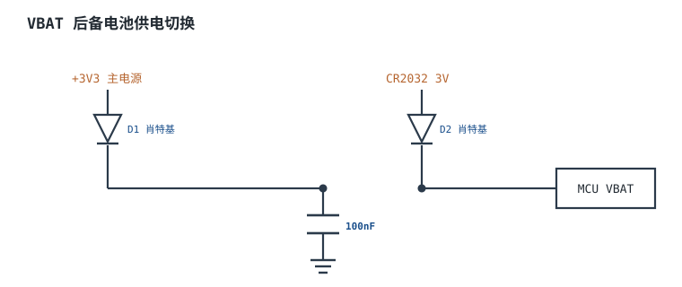

# 最小系统 Minimum System

## 1. 设计动机

::: motivation 为什么"最小系统"是画板第一道坎
一颗 MCU 要跑起来，**不需要**接任何外设，但**必须**接对四样东西：干净的电源、准确的时钟、可靠的复位、确定的启动电平，外加一个能烧录调试的口。这四者合称**最小系统（Minimum System）**。

最小系统接错的表现非常"玄学"：时好时坏、上电不启动、烧不进程序、跑一会儿就复位——因为问题在模拟/电源域，示波器逻辑分析仪未必抓得到。本章给出一张可直接照抄的完整接线图，并把每个取值的来历算清楚。
:::

## 2. 原理图

下图是一颗 3.3V MCU 的完整最小系统：电源入口储能电容 + 每 VDD 脚 100nF 去耦、VDDA 经磁珠独立滤波、外部晶振配负载电容、NRST 去耦与复位键、BOOT0 下拉、SWD 四线调试口。


## 3. 静态分析（DC）

把电容开路、晶振视为高阻，看稳态直流：

- **VDD  rail**：由 LDO 供 3.3V，去耦电容在直流下开路，不影响静态；LDO 提供的静态电流 = MCU 运行电流 + 漏电。
- **VDDA**：经磁珠（直流电阻极小）与数字 VDD 相连，直流上基本等电位，只是交流上被隔离。
- **NRST**：内部弱上拉，稳态为高电平（≈3.3V）；100nF 直流开路；复位键按下时 NRST 对地短路，芯片复位。
- **BOOT0**：经 10kΩ 下拉到地，稳态为 0，MCU 从内置 Flash 启动。
- **晶振**：直流下两个负载电容到地，晶振本身近似开路，不消耗直流。

关键稳态判断：**上电后 NRST 必须能稳定停在高电平、BOOT0 稳定停在低电平**，用万用表量这两点就能排除一大半"不启动"故障。

## 4. 动态分析（AC / 瞬态）

动态问题都在边沿和瞬态：

- **去耦的作用是提供瞬态电流**：MCU 引脚同时翻转时，电流尖峰从最近的 100nF 电容取，而不是从远处的 LDO；这个环路越短，电源阻抗越低。
- **晶振起振是一个瞬态建立过程**：上电后内部反相放大器把热噪声放大，经晶振选频，幅度从小信号按指数爬到稳定振幅，建立时间通常 ms 级。
- **上电复位 POR**：电源 ramp 期间，内部 POR 电路在电压跨过阈值前一直把芯片按住复位；电压单调上升并稳定后才释放。

```echarts
{
  "tooltip": {"trigger": "axis"},
  "legend": {"data": ["VDD", "NRST", "时钟输出"], "bottom": 0, "textStyle": {"fontSize": 13}},
  "grid": {"left": 56, "right": 24, "top": 26, "bottom": 56},
  "xAxis": {"type": "category", "name": "时间 ms", "data": [0,1,2,3,4,5,6,7,8,9], "axisLabel": {"fontSize": 11}},
  "yAxis": {"type": "value", "name": "V", "min": 0, "max": 3.6, "axisLabel": {"fontSize": 11}},
  "series": [
    {"name": "VDD", "type": "line", "step": "end", "showSymbol": false, "lineStyle": {"width": 2.4, "color": "#1a4f8b"},
     "data": [0,0.6,1.6,2.5,3.0,3.25,3.3,3.3,3.3,3.3]},
    {"name": "NRST", "type": "line", "step": "end", "showSymbol": false, "lineStyle": {"width": 2.4, "color": "#b5642e"},
     "data": [0,0,0,0,0,0.5,1.8,3.2,3.3,3.3]},
    {"name": "时钟输出", "type": "line", "step": "end", "showSymbol": false, "lineStyle": {"width": 2.4, "color": "#2e7d4f"},
     "data": [0,0,0,0,0,0,0,0,1.6,3.3]}
  ]
}
```

## 5. 环路分析

::: advanced 进阶：晶振的负阻与起振裕量
晶振皮尔斯振荡（Pierce Oscillator）等效为一个放大器配合晶振的并联谐振网络。振荡的条件是环路增益 ≥1。MCU 内部反相放大器提供负阻 $-R_{neg}$，晶振在谐振时呈感性并与负载电容构成谐振。

起振裕量（Negative-Resistance vs ESR）要求 $|R_{neg}| \gg 5\times R_s$（$R_s$ 为晶振等效串联电阻）。负载电容取错、走线太长、寄生过大，都会把等效增益拖到 1 附近，表现为"冷启不起振、加热又能起"。ST AN2867 给出了按跨导 $G_m$ 核对起振裕量的方法。
:::

## 6. 元件取值与工程权衡

- **去耦电容 100nF（X7R）**：每个 VDD/VSS 对一只，贴引脚下方；再在电源入口并一只 4.7~10µF。100nF 负责高频瞬态，大电容负责储能。
- **VDDA 滤波**：磁珠（600Ω@100MHz 级）+ 10nF + 1µF + 10µF，把数字噪声挡在模拟域外；分工上 10nF 滤高频毛刺、1µF 滤中频、10µF 储能低频。
- **晶振负载电容 C1/C2**：由晶振规格书给的 $C_L$ 反推，见扩展1。常见 8MHz ±20ppm 配 18~22pF（C0G/NP0）。
- **NRST 电容 100nF**：滤毛刺；复位键直接短接到地即可（内部已有上拉）。
- **BOOT0 下拉 10kΩ**：阻值只要保证电平确定即可，10k 是甜点——既不耗电又抗干扰。
- **SWD 四线**：3V3/SWDIO/SWCLK/GND，GND 必留，SWCLK 走线短。

## 7. 完整设计示例

::: example 给一颗 STM32 配最小系统
1. **供电**：外部 5V 经 AMS1117-3.3 出 3.3V，入口放 10µF + 100nF。
2. **去耦**：4 个 VDD 脚各贴一只 100nF；VDDA 走磁珠 + 10nF + 1µF + 10µF。
3. **晶振**：选 8MHz、$C_L=12\text{pF}$，估寄生 $C_{stray}=4\text{pF}$，等容 $C_1=C_2=2(12-4)=16\text{pF}$，取标称 18pF（C0G）。
4. **复位**：NRST 对地 100nF，并联一只轻触按键。
5. **启动**：BOOT0 经 10kΩ 下拉。
6. **调试**：引出 4-pin SWD（3V3/SWDIO/SWCLK/GND）。
7. **验算**：上电量 NRST≈3.3V、BOOT0≈0V，接调试器读到芯片 ID，最小系统通。
:::

## 8. 仿真与实验

- 用示波器 AC 耦合量 VDD 对地的纹波，满载（全速运行+多脚翻转）时应在几十 mV 以内；若上百 mV，说明去耦不足或 LDO 不稳。
- 量晶振两脚波形：稳定时应为近似正弦、幅度接近轨到轨；若幅度极小或起振慢，检查负载电容与走线。
- 手动按复位键，观察 NRST 是否干净地拉到 0 再弹回 3.3V；有毛刺说明复位键线太长耦合了噪声。

## 扩展与变种电路

### 扩展1：晶振负载电容反推 Load Capacitor Sizing

定位：为什么 C1/C2 取 22pF 而不是随便拿。


::: example 工作原理与时序
- 晶振规格书给的 $C_L$ 是"晶振看到的外部等效负载电容"。外部两只等容电容分压后，与寄生串联：
  $$C_L=\frac{C_1 C_2}{C_1+C_2}+C_{stray}$$
- 令 $C_1=C_2$，则 $C_1=C_2=2(C_L-C_{stray})$。
- 例：$C_L=12\text{pF}$、$C_{stray}\approx 4\text{pF}$，得 $C_1=C_2=16\text{pF}$，就近取 18pF。
- 取大了振荡频率偏低、起振变慢；取小了容易不起振或频率漂移。
:::

取值对比：

| $C_L$ 规格 | 估 $C_{stray}$ | 计算 C1=C2 | 实际取值 |
|---|---|---|---|
| 12pF | 4pF | 16pF | 18pF C0G |
| 9pF | 3pF | 12pF | 12pF C0G |
| 8pF（RTC 32.768kHz） | 2pF | 12pF | 12.5pF C0G |

> 注：RTC 用 32.768kHz 晶振，其典型并联负载电容 $C_L$≈6~12.5pF；上例取 $C_L=8\text{pF}$、$C_{stray}=2\text{pF}$，算得 $C_1=C_2=2(8-2)=12\text{pF}$，就近取标称 12.5pF（C0G）。

::: pitfall 用普通 X7R 当晶振负载电容
- **现象**：频率随温度/电压飘，时钟不准。
- **原因**：X7R 容值随直流偏置和温度变化大，晶振负载电容要求稳定。
- **解决**：负载电容用 C0G/NP0 材质，容值稳定、介质吸收小。
:::

### 扩展2：RTC 后备电池 VBAT Backup

定位：主电源掉电后保持 RTC 走时与备份寄存器。



::: example 工作原理
- 两只肖特基二极管做"或"：主 3.3V 正常时经 D1 供电，D2 反偏；主电源掉电时纽扣电池经 D2 顶上。
- 肖特基压降约 0.3V，选低压降型号，保证 VBAT 不被砍得太低。
- 后备模式下 RTC 域只耗几 µA，一颗 CR2032 可撑数年。
- VBAT 就近 100nF 去耦；未用 VBAT 时直接接 VDD。
:::

取值对比：

| 方案 | 优点 | 缺点 |
|---|---|---|
| 二极管或(VBAT) | 简单、便宜 | 有 0.3V 压降 |
| 专用 power-mux IC | 低导通电阻、无压降 | 多一颗料 |
| VBAT 接 VDD | 最省 | 掉电即丢 RTC |

::: pitfall 把电池直接并在 VBAT 而不防倒灌
- **现象**：主电源在时电池被充电/发热。
- **原因**：CR2032 不可充电，直接并接会被 VDD 反灌。
- **解决**：VBAT 与主电源之间必须串二极管或用带切换的 VBAT 引脚设计，防反灌。
:::

## 9. 常见坑与故障现象

::: pitfall 常见坑
- **BOOT0 悬空**：上电随机进 Boot 模式，程序不跑。必须下拉确定电平。
- **晶振负载电容没按 CL 算**：冷启不起振、频率偏差导致串口波特率错。按公式反推 + C0G 材质。
- **只在 VDD 主入口放一只大电容**：高频瞬态电流走不到。每个 VDD 脚就近 100nF。
- **复位键线太长引入毛刺复位**：NRST 加 100nF，走线短，远离晶振/开关电源。
- **SWD 没留 GND**：调试器地夹无处接，时通时不通。四线必含 GND。
:::

## 10. 自测题

<details><summary>晶振 CL=12pF，估寄生 4pF，两只负载电容应取多少？用什么材质？</summary>
等容取 $C_1=C_2=2(12-4)=16\text{pF}$，就近取 18pF，材质 C0G/NP0。
</details>

<details><summary>为什么每个 VDD 脚都要就近放 100nF，而不是只在电源入口放一只 10µF？</summary>
高频瞬态电流必须就近取，大电容走线长、寄生电感大，供不上高频尖峰；100nF 环路最短负责高频，10µF 负责低频储能，两者分工。
</details>

<details><summary>上电后调试器识别不到芯片，量 NRST=3.3V、BOOT0=0V 都正常，下一步查什么？</summary>
查 SWD 接线（SWDIO/SWCLK/GND 是否虚焊、SWCLK 是否太长）与 3.3V 实际供电；最小系统供电正常但调试不通，多在调试口接线或芯片未真正复位释放。
</details>

## 11. 参考资料

- ST AN2586《STM32F10xxx hardware development: getting started》
- ST AN2867《Oscillator design guide for STM8/STM32》
- Espressif《ESP32 Hardware Design Guidelines · Schematic Checklist》
