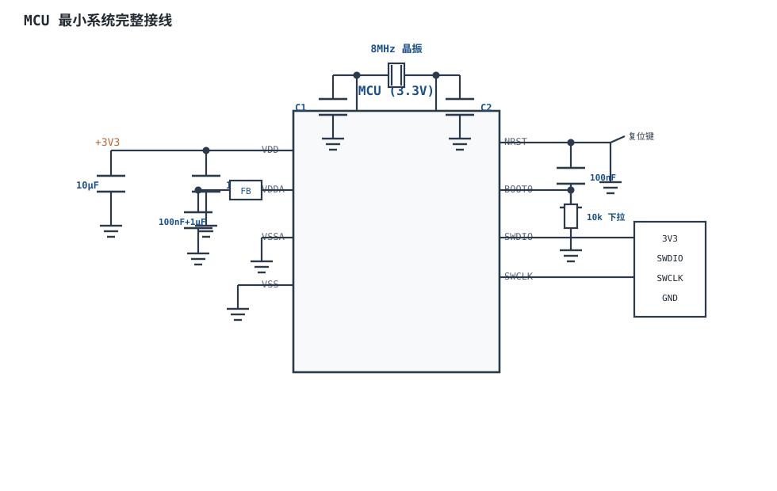
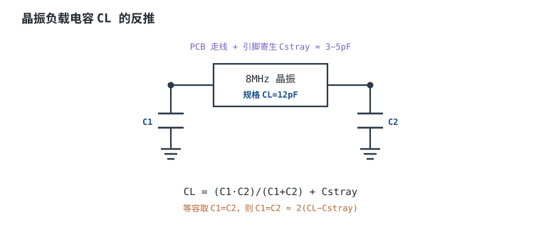

# 最小系统 Minimum System

一颗 MCU 要"跑起来"，不需要接任何外设，但必须把六件事同时做对：**电源、复位、时钟、启动配置、调试口、去耦**。这六项合起来叫**最小系统（Minimum System）**。它们中的任何一项接错，表现都很"玄学"：时好时坏、上电不启动、烧不进程序、跑一会儿复位、电池待机远大于手册值。因为这些问题的根源多在模拟与电源域，逻辑分析仪未必抓得到，必须回到电路和取值上算。

本章把六要素逐个拆开：每一项先讲"它解决什么问题"，再给"错误接法与后果"，最后用一个 3.3V、5V 输入的完整最小系统，把电源电流、LDO 选型、去耦电容、复位 RC、晶振负载电容、BOOT0 上下拉和上电时序一路算完。所有器件参数标"典型量级，以数据手册为准"；算例中的假设与代入过程写全，方便逐项复算。

本章与[MCU 概览](mcu-overview.md)是上下游关系：那一章决定"选哪颗、资源够不够"，这一章决定"怎么把它接活"；引脚电气与驱动级见[GPIO 原理与驱动能力](gpio.md)，中断与调试口的使用见[中断机制（硬件视角）](interrupts.md)；晶振的压电模型、频率牵引与负阻的完整推导见[晶振与谐振器](../components/crystal-oscillator.md)，LDO 的静态电流与热设计见[LDO 原理、选型与功耗计算](../power/ldo.md)。

## 1. 设计动机

::: motivation 四个"看起来接对了、实际上没接对"的现场
**现场一：BOOT0 悬空，程序时跑时不跑。** 板子出厂测试都过，到客户现场偶发"上电不启动、再按一下复位就好"。量 BOOT0 电压，有的板 0.2V、有的 1.8V——引脚悬空，被内部弱上拉、助焊剂漏电和附近走线耦合拉到了不确定电平。芯片在上电那一刻采样 BOOT0，电平落在阈值附近时，启动模式随机：有时进 Flash，有时进系统 Bootloader。

**现场二：去耦只在电源入口放了一只 10µF。** 实验室用线性电源供电，一切正常；装进塑料壳、用开关电源后，跑一会就复位。原因不是"电源不好"，而是 MCU 引脚同时翻转时，瞬态电流要从远处的 10µF 经过长走线取，走线电感让 VDD 瞬间跌了 100mV 以上，ADC 读数跳变、逻辑余量变小；如果负载更重或去耦更差，跌到 BOR（Brown-Out Reset，掉电复位）阈值就会复位。

**现场三：NRST 上多焊了一只 100k 上拉，复位反而变短。** 工程师觉得"内部上拉太弱，外加一只 100k 更稳"，结果内部 40k 与外部 100k 并联成 28.6k，RC 时间常数从 4ms 掉到 2.86ms，复位释放提前，高速晶振还没起振，程序已经去切时钟，偶发启动失败。**在已经有内部上拉的复位脚上并一只外部上拉，是在缩短复位时间，不是在加强复位。**

**现场四：SWD 没留 GND，调试器时通时不通。** 四针排针只引了 3V3、SWDIO、SWCLK，地靠板子边缘的螺丝孔"碰巧"接触。调试器能识别到芯片，但一烧录就失败；换一台调试器又好了。原因是地回路太长、回流路径不确定，SWD 的边沿被地弹淹没。**调试口必须把 GND 一起引出，而且尽量短。**
:::

| 你遇到的问题 | 先查 | 判据（本手册建议值，非标准强制） |
|---|---|---|
| 上电不启动、按复位才好 | BOOT0/BOOT1 电平、NRST 释放时刻、VDD 上升时间 | BOOT 脚有确定电平；复位释放晚于电源稳定 |
| 跑一会复位、随机死机 | 每个 VDD 脚的 100nF、VDDA 滤波、地回路 | 瞬态跌落 <3% VDD；去耦环路 <5mm |
| 烧不进程序、调试器掉线 | SWDIO/SWCLK/GND、复位脚、复用引脚 | 四线齐全；SWCLK 走线短；可 connect under reset |
| 串口误码、CAN 出错 | 晶振负载电容、时钟源精度、波特率分频 | 总频差小于协议容限的 50% |
| 电池待机远大于手册 | LDO 静态电流、上下拉漏电、BOOT 分压 | 平均电流按最坏占空比复算 |
| LDO 发烫、高温复位 | 压差、负载电流、封装热阻 | $T_j$ 至少有 20°C 余量 |

**不算会摔在哪，三个带数字的代价：**

1. **BOOT0 用 1MΩ 下拉。** 引脚漏电 1µA 时，$1\,\mu\text{A}\times1\,\text{M}\Omega=1\text{V}$，足以把"低"抬到阈值附近；换成 10kΩ，同样的漏电只有 10mV。**上下拉不是"随便给一个"，是按漏电和噪声算出来的。**
2. **LDO 从 12V 降到 3.3V、带 86mA。** 耗散 $(12-3.3)\times0.086+12\times0.005=0.808\text{W}$；SOT-223 的 $\theta_{JA}$ 取 60°C/W，温升 48.5°C，70°C 环境下结温 118.5°C，离 125°C 只剩 6.5°C。**同样的电流，5V 输入只有 0.171W；12V 输入应改 Buck，或换更大封装并加散热。**
3. **去耦缺失导致 100mV 跌落。** 50mA 在 5ns 内跳变，走线电感 10nH，$V=L\,di/dt=10\,\text{nH}\times10\,\text{A}/\mu\text{s}=100\text{mV}$；3.3V 的 3% 是 99mV，刚好踩线。**去耦电容的作用不是"储能"，而是把这段高频电流的环路缩到最小。**

## 2. 定义与直观

### 2.1 六要素各解决什么问题

| 要素 | 解决什么问题 | 失败后果 | 本章取值（示例） |
|---|---|---|---|
| 电源 | 把输入电压变成 MCU 要求的稳定电压，并供足电流 | 欠压复位、发热、烧芯片 | 5V→3.3V，300mA LDO |
| 复位 | 上电/按键/异常时把芯片拉到已知状态 | 不启动、随机跑飞、烧录失败 | NRST 100nF + 内部 40k 上拉 |
| 时钟 | 给内核与外设提供准确、稳定的节拍 | 串口误码、CAN 出错、USB 不枚举 | 8MHz 晶振，$C_L=12\text{pF}$ |
| 启动配置 | 告诉芯片上电后从哪里取程序 | 进错 Boot 模式、程序不跑 | BOOT0 10k 下拉 |
| 调试口 | 烧录、单步、读寄存器、测实时变量 | 无法开发/返修，量产测试困难 | SWD 四线 + GND |
| 去耦 | 给高频瞬态电流提供最近的回流路径 | VDD 跌落、ADC 噪声、随机复位 | 每 VDD 脚 100nF + 入口 10µF |

旧版资料常把最小系统概括为"四样东西 + 一个调试口"，漏掉了**启动配置**与**去耦**。这两项恰恰是"上电不启动"和"跑一会复位"的高发点：启动配置决定芯片从哪里取程序，去耦决定瞬态电流从哪里来；把它们归到"电源"或"复位"里一笔带过，就会在排故时漏查。



### 2.2 电源与地：先分清电源域

一颗典型 MCU 至少有这些电源相关引脚：

- **VDD/VSS**：数字电源与地，可能有多对，每个 VDD 脚都要就近去耦。
- **VDDA/VSSA**：模拟电源与地，给 ADC/DAC/比较器供电；即使不用 ADC，也应按数据手册接，不能悬空。
- **VREF+**：ADC 的参考电压输入；有的型号内部连接到 VDDA，有的必须外部给。
- **VBAT**：RTC 与备份寄存器电源；不用时通常接 VDD，不能悬空（以数据手册为准）。

**地的处理**：小系统用一整块地平面通常比"强行分割模拟地/数字地"更稳；模拟部分在布局上远离 DC-DC、晶振和高速数字走线，VDDA 经磁珠或小电感从 VDD 引出，再配 100nF + 1µF 到地（高精度场合可再并 10nF）。把地"切断"反而会让回流路径绕远，产生更大的地弹。**除非有明确的隔离或高精度需求，不要为了"模拟地干净"把地平面切碎。**

### 2.3 复位：上电、按键、掉电三件事

复位要解决三个场景：

1. **上电复位（POR）**：VDD 从 0 上升到 3.3V 的过程中，芯片必须一直被按住，直到电压稳定、内部基准建立。
2. **手动复位**：按键把 NRST 拉到地，松开后按 RC 时间常数释放。
3. **掉电复位（BOR）**：VDD 跌到阈值以下时复位，防止 Flash 在低压下被写坏、逻辑乱跑。

典型 MCU 的 NRST 是**低有效、内部弱上拉**的输入脚。外部通常只放一只 100nF 到地，再并一只按键；不需要外部上拉，也不应该用强上拉把 RC 时间常数做短。复位释放的时刻由 $R_{pull}\times C$ 决定，下一节会算。

### 2.4 时钟：内部 RC 与外部晶振的分工

- **内部 RC（HSI）**：零成本、起振快（微秒级）、精度差（典型 ±1%，全温区可能 ±2%~±5%）。适合做"上电先跑起来"的系统时钟，或对时序不敏感的场合。
- **外部晶振（HSE）**：精度高（典型 ±10~±50ppm）、稳定，但需要 2 只负载电容、起振要几毫秒、布局敏感。串口、CAN、USB 等对时钟有要求的接口通常用它。
- **RTC 晶振（LSE）**：32.768kHz，专供 RTC，负载电容小、ESR 高，起振裕量往往比 8MHz 更紧张。

**常见做法**：上电先用内部 RC 运行，等外部晶振起振、PLL 锁定后再切换。这样复位不必等到晶振稳定，启动时间更短；但切换代码必须检查"时钟就绪"标志，不能假设"过了几毫秒就一定起振"。

### 2.5 启动配置：上电那一刻只采样一次

BOOT0/BOOT1 决定芯片从哪里启动：内置 Flash、系统 Bootloader、外部存储器（具体组合以数据手册的 Boot configuration 表为准）。关键点是：**芯片只在复位释放后的很短时间内采样这些引脚，之后它们可以改作他用。** 所以：

- 采样时刻的电平必须确定；
- 不能靠"内部弱上拉/下拉"碰运气，外部要给明确电平；
- 不能挂大电容让电平"慢慢爬"，否则采样时还没到合法电平。

### 2.6 调试口：SWD 为什么只要两根线

SWD（Serial Wire Debug）用 **SWCLK + SWDIO** 两根线完成调试访问，加上 GND 和可选的 3V3、NRST，就是最常见的四线/五线调试口。它比 JTAG 省引脚，适合小封装 MCU。设计要点：

- **GND 必须引出**，且与板子的地平面低阻连接；
- **SWCLK 走线尽量短**，远离晶振、DC-DC、继电器等噪声源；
- 长线或强干扰场合，SWDIO/SWCLK 可串 22~33Ω 电阻、加 10k 上下拉；
- 如果 SWD 引脚被复用为 GPIO，固件里要在启动早期把调试口"救回来"，否则可能锁死；必要时用 connect under reset。

### 2.7 去耦：不是"放一只大电容"

去耦电容的任务是：在 MCU 引脚电流突变的瞬间，由**最近的电容**提供电荷，而不是让电流从远处的 LDO 经过长走线流过来。因此：

- **每个 VDD/VSS 对**放一只 100nF，紧贴引脚，环路面积最小；
- **电源入口**放一只 4.7~10µF，负责低频储能；
- **VDDA** 经磁珠 + 100nF + 1µF，把数字噪声挡在模拟域外（高精度场合可再并 10nF）；
- 电容的**封装和走线**比容值更关键：0402/0603 的 100nF 比 1206 的 100nF 自谐振频率更高，高频去耦更有效。

::: analogy 去耦像屋顶水箱，LDO 像城市水厂
- **水厂（LDO）** 供水稳定，但水管很长；你突然开十个水龙头（多个引脚同时翻转），水压会先掉一下。
- **屋顶水箱（去耦电容）** 就在楼上，先放水顶住这一下；水厂再慢慢补。
- **水箱越小、离水龙头越近**，响应越快；但水箱太小，撑不了多久。所以 100nF 管高频、10µF 管低频，两者分工。
- **水管太长（走线电感大）**，水箱再大也救不了瞬间的水压——这就是"电容必须贴近引脚"的原因。

类比的边界：水是连续流体，电子的"惯性"表现为电感；水箱不会因为管道共振而"反相"，电容却会和 ESL 形成自谐振，超过谐振频率后反而呈感性。所以去耦要看频率，不只看容值。
:::

## 3. 定量关系

### 3.1 电源电流、LDO 压差与热耗散

总负载电流按各路相加，并留余量：

$$I_{total}=\left(\sum_{i=1}^{n}I_i\right)\times(1+m_I)$$

其中 $I_i$ 是第 $i$ 路负载电流（A 或 mA），$m_I$ 是电流余量比例（无量纲），$I_{total}$ 是设计电流。LDO 的耗散功率：

$$P_{LDO}=(V_{in}-V_{out})I_{out}+V_{in}I_q$$

其中 $V_{in}$、$V_{out}$ 是输入/输出电压（V）；$I_{out}$ 是输出负载电流（A）；$I_q$ 是 LDO 静态电流（A）；$P_{LDO}$ 是耗散功率（W）。结温：

$$T_j=T_a+\theta_{JA}P_{LDO}$$

其中 $T_a$ 是环境温度（°C）；$\theta_{JA}$ 是结到环境的热阻（°C/W）；$T_j$ 是结温（°C）。LDO 效率：

$$\eta_{LDO}=\frac{V_{out}I_{out}}{V_{in}(I_{out}+I_q)}\times100\%$$

压差条件：

$$V_{in,min}-V_{out}\geq V_{do}+V_{margin}$$

其中 $V_{do}$ 是 LDO 在目标电流下的压差（V），$V_{margin}$ 是留给输入纹波与老化的余量（V，建议 ≥0.2V）。**注意 $V_{do}$ 随输出电流变化，必须查目标电流下的曲线或表格，不能用"1A 时的 1.1V"直接套到 86mA。**

### 3.2 去耦电容：电荷、阻抗与环路电感

电容提供的电荷：

$$\Delta Q=C\,\Delta V=I_{step}\Delta t$$

其中 $C$ 是电容量（F），$\Delta V$ 是允许的电压跌落（V），$I_{step}$ 是负载阶跃电流（A），$\Delta t$ 是电流持续时间（s）。反解：

$$C_{min}=\frac{I_{step}\Delta t}{\Delta V}$$

电容的容抗与感抗：

$$Z_C=\frac{1}{2\pi fC},\qquad Z_L=2\pi fL$$

其中 $f$ 是频率（Hz），$L$ 是等效串联电感（H）。走线电感造成的瞬时跌落：

$$V_{droop}=L_{trace}\frac{di}{dt}$$

其中 $L_{trace}$ 是走线电感（H），$di/dt$ 是电流变化率（A/s），$V_{droop}$ 是跌落电压（V）。**这条式子说明：去耦效果由"环路面积"决定，不由容值单独决定；把 100nF 放远 10mm，可能比放近 1mm 的 10nF 更差。**

### 3.3 复位 RC：内部上拉与外部上拉是并联的

RC 充电：

$$V(t)=V_{DD}\left(1-e^{-t/\tau}\right),\qquad \tau=RC$$

其中 $R$ 是等效上拉电阻（Ω），$C$ 是 NRST 对地电容（F），$\tau$ 是时间常数（s）。复位释放发生在电压达到复位阈值 $V_{TH}$ 时：

$$t_{reset}=-\tau\ln\left(1-\frac{V_{TH}}{V_{DD}}\right)$$

若 $V_{TH}=0.7V_{DD}$，则 $t_{reset}=1.204\tau$；若 $V_{TH}=0.3V_{DD}$，则 $t_{reset}=0.357\tau$。**阈值越低，复位释放越早；具体阈值查数据手册的 NRST 输入特性，不能假设。**

内部上拉 $R_{pu}$ 与外部上拉 $R_{ext}$ 并联：

$$R_{eq}=\frac{R_{pu}R_{ext}}{R_{pu}+R_{ext}}$$

**关键结论：在已经有内部上拉的 NRST 上再并一只外部上拉，$R_{eq}$ 只会更小，复位时间只会更短。** 想加长复位，应该增大电容、在 NRST 与电容之间串电阻，或改用带延时的复位芯片；不是"加一只上拉"。

### 3.4 晶振负载电容与起振裕量

晶振看到的等效负载：

$$C_L=\frac{C_1C_2}{C_1+C_2}+C_{stray}$$

对称设计 $C_1=C_2=C$ 时：

$$C=2\left(C_L-C_{stray}\right)$$



其中 $C_L$ 是晶振规格书的标称负载电容（F）；$C_1$、$C_2$ 是两只外部负载电容（F）；$C_{stray}$ 是引脚、焊盘、走线与晶振支架的杂散电容（F，典型 3~7pF）；$C$ 是每只负载电容（F）。

起振裕量按 ST AN2867 的判据：

$$g_{m,crit}=4\cdot ESR\cdot(2\pi f)^2\cdot(C_0+C_L)^2,\qquad \frac{g_m}{g_{m,crit}}\geq5$$

其中 $ESR$ 是晶振等效串联电阻（Ω）；$f$ 是标称频率（Hz）；$C_0$ 是晶振静电容（F）；$g_m$ 是 MCU 内部反相器跨导（S）；$g_{m,crit}$ 是临界跨导（S）。启动时间近似：

$$\tau_{start}=\frac{Q}{\pi f},\qquad t_{start}\approx\tau_{start}\ln\frac{A_{final}}{A_{init}}$$

其中 $Q$ 是晶振品质因数（无量纲）；$A_{final}/A_{init}$ 是幅度增长倍数（典型 $10^3$，即 6.91 个时间常数）；$t_{start}$ 是起振时间（s）。

### 3.5 启动配置：上下拉按漏电与分压算

引脚电压由漏电流与上下拉决定：

$$V_{pin}=I_{leak}R_{pull}$$

其中 $I_{leak}$ 是引脚漏电流（A），$R_{pull}$ 是下拉电阻（Ω），$V_{pin}$ 是引脚电压（V）。若引脚内部还有弱上拉 $R_{pu}$，外部下拉会形成分压：

$$V_{pin}=V_{DD}\frac{R_{pull}}{R_{pull}+R_{pu}}$$

**这两个式子要一起用**：先看漏电把电平抬高多少，再看内部上拉与外部下拉的分压。10kΩ 下拉在 1µA 漏电下只有 10mV，但在 40kΩ 内部上拉下会把 3.3V 分到 0.66V；100kΩ 下拉则会被分到 2.36V，可能被当成高电平。**所以"10k 下拉"不是因为 10k 这个数字吉利，而是因为它同时满足了漏电和分压两个约束。**

BOOT0 上如果并电容，采样时刻会被 RC 延迟：

$$\tau_{boot}=R_{pull}C_{boot}$$

其中 $C_{boot}$ 是 BOOT0 对地电容（F），$\tau_{boot}$ 是时间常数（s）。10kΩ × 100nF = 1ms；如果芯片在复位释放后 1ms 内采样，电容还没充到合法电平，就会采错。**BOOT 脚要么不加电容，要么把时间常数压到采样窗口的 1/10 以下。**

### 3.6 调试口：串联电阻与上下拉

SWD 的边沿受线容与串联电阻影响：

$$t_r\approx2.2R_sC_{line}$$

其中 $R_s$ 是串联电阻（Ω），$C_{line}$ 是线容（F），$t_r$ 是上升时间（s）。22Ω × 50pF 的 $t_r=2.2\times22\times50\times10^{-12}=2.42\text{ns}$，对 1MHz 级的 SWCLK 完全可以忽略；串联电阻的主要作用是限流与抑制振铃，不是"滤波"。

SWDIO 通常需要上拉、SWCLK 需要下拉（具体以调试接口规范和芯片数据手册为准），典型 10kΩ。若用 100kΩ，抗干扰变差；若用 1kΩ，调试器驱动电流增大、功耗增加。**长线、强干扰场合才加外部上下拉；板内短距离通常靠芯片内部上下拉即可。**

### 3.7 上电时序：复位释放、时钟稳定、程序执行

上电时序要满足：

$$t_{release}=t_{ramp}+t_{reset}$$

$$t_{release}\geq t_{ramp}+t_{internal}+t_{margin}\quad\Rightarrow\quad t_{reset}\geq t_{internal}+t_{margin}$$

其中 $t_{ramp}$ 是 VDD 从 0 到稳值的上升时间（s）；$t_{reset}$ 是 VDD 稳定后复位 RC 的释放时间（s，即 3.3 节的 $t_{reset}$）；$t_{release}$ 是从上电到 NRST 释放的总时间（s）；$t_{internal}$ 是内部基准/RC 起振时间（s）；$t_{margin}$ 是余量（s）。如果程序在复位释放后立刻切换外部晶振，还要加上晶振起振时间：

$$t_{boot}\geq t_{release}+t_{start}$$

其中 $t_{boot}$ 是从上电到"程序可以安全使用外部时钟"的时间（s），$t_{start}$ 是晶振起振时间（s）。**很多设计并不是复位不够长，而是复位释放后没有等待 PLL/晶振就绪标志；把"等标志"写进代码，比盲目加大电容更可靠。**

## 4. 典型计算

### 4.1 算例一：3.3V MCU 最小系统的完整设计

**需求与假设（全部为示例量级，实际以所选器件数据手册为准）：**

| 项目 | 取值/要求 |
|---|---|
| 输入 | 5V ±5%（4.75~5.25V） |
| 系统电压 | 3.3V |
| MCU 运行电流 | 40mA（72MHz、外设全开，典型量级） |
| LED | 4 只 × 4mA = 16mA |
| OLED 显示 | 20mA |
| 传感器 | 10mA |
| 继电器 | 5V 线圈 70mA，直接挂在 5V，不经 3.3V LDO |
| LDO | AMS1117-3.3 类，300mA 以上，$I_q$ 典型 5mA |
| 晶振 | 8MHz，$C_L=12\text{pF}$，$C_0=5\text{pF}$，ESR=50Ω，Q≈20000 |
| 复位 | NRST 内部上拉 40kΩ，外部 100nF |
| 启动 | BOOT0 10kΩ 下拉 |
| 调试 | SWD 四线（3V3/SWDIO/SWCLK/GND） |

**第 1 步：3.3V 负载电流。**

$$I_{3V3}=40+16+20+10=86\text{mA}$$

按 30% 余量：$86\times1.3=111.8\text{mA}$。选 300mA 级 LDO，余量 $300/111.8=2.68$ 倍。继电器走 5V，不占 3.3V 电流；如果继电器也走 3.3V，则 $I_{3V3}=156\text{mA}$，按 30% 余量需 $156\times1.3=202.8\text{mA}$，300mA 的余量只有 $300/202.8=1.48$ 倍，而且 LDO 耗散会增加，需按 3.1 节重算。

**第 2 步：LDO 耗散与结温。**

$$P_{LDO}=(5-3.3)\times0.086+5\times0.005=0.1462+0.025=0.1712\text{W}$$

取 $\theta_{JA}=60^{\circ}\text{C/W}$：

$$T_j=70+60\times0.1712=70+10.27=80.3^{\circ}\text{C}$$

低于 125°C，余量 44.7°C，安全。LDO 效率：

$$\eta_{LDO}=\frac{3.3\times0.086}{5\times(0.086+0.005)}\times100\%=\frac{0.2838}{0.455}\times100\%=62.4\%$$

**结论：5V 输入、86mA 负载，线性 LDO 可以，但效率只有 62.4%；这不是"LDO 不好"，而是 1.7V 压差 + 5mA 静态电流的必然结果。**

**第 3 步：压差校验。** 输入最低 4.75V，输出 3.3V，压差 $4.75-3.3=1.45\text{V}$。AMS1117 在 1A 时压差约 1.1V，86mA 时通常更低；按最坏 1.1V 算，余量 $1.45-1.1=0.35\text{V}$。若输入纹波 100mV、老化再留 100mV，余量只剩 0.15V，偏紧；输入电容要足够，或者选低压差、低 Iq 的 LDO。**结论：5V±5% 勉强够；5V±10%（4.5V）时压差只剩 1.2V，应重新核对压差与选型，不能沿用 1A 条件下的 1.1V 数据。**

**第 4 步：去耦配置。**

- 每个 VDD 脚：100nF X7R，0402/0603，紧贴引脚；
- 电源入口：10µF + 100nF；
- 数字电源总储能：4.7µF；
- VDDA：磁珠（600Ω@100MHz，额定电流 ≥20mA）+ 100nF + 1µF（必要时再并 10nF）；
- LDO 输出：按数据手册要求，AMS1117 典型要求 22µF 钽电容（ESR 合适）；若用陶瓷电容，必须核对稳定性，不能只看容值。

去耦电荷校验：50mA 在 20ns 内跳变、允许 50mV 跌落：

$$C_{min}=\frac{0.05\times20\times10^{-9}}{0.05}=20\times10^{-9}\text{F}=20\text{nF}$$

100nF 是 5 倍余量。但真正限制它的是环路电感：50mA 在 5ns 内跳变、走线 10nH：

$$V_{droop}=10\times10^{-9}\times\frac{0.05}{5\times10^{-9}}=10\times10^{-9}\times10^{7}=0.1\text{V}=100\text{mV}$$

所以**电容要贴近引脚、地要就近打孔**，否则 100nF 也救不了 100mV 的跌落。

**第 5 步：复位 RC。**

内部上拉 40kΩ、外部 100nF：

$$\tau=40\times10^3\times100\times10^{-9}=4\times10^{-3}\text{s}=4\text{ms}$$

取 $V_{TH}=0.7V_{DD}$：

$$t_{reset}=1.204\times4\text{ms}=4.82\text{ms}$$

若加一只 100kΩ 外部上拉：

$$R_{eq}=\frac{40\times100}{40+100}=28.6\text{k}\Omega,\qquad \tau=28.6\times10^3\times100\times10^{-9}=2.86\text{ms}$$

$$t_{reset}=1.204\times2.86=3.44\text{ms}$$

复位时间反而短了 1.38ms。若加 10kΩ 外部上拉：

$$R_{eq}=\frac{40\times10}{40+10}=8\text{k}\Omega,\qquad \tau=0.8\text{ms},\qquad t_{reset}=0.96\text{ms}$$

更短。**结论：NRST 不要随便加上拉；要加长复位，加电容或串电阻，或改用复位芯片。**

按键放电：NRST 与按键之间串 100Ω，按下时峰值电流约 $3.3/100=33\text{mA}$，在按键和电容的承受范围内；100nF 的储能 $E=0.5CV^2=0.5\times100\times10^{-9}\times3.3^2=0.545\,\mu\text{J}$，不会造成明显电弧。

**第 6 步：晶振负载电容。**

$$C=2(C_L-C_{stray})=2\times(12-4)=16\text{pF}$$

取 16pF C0G（E24 有 16pF），实际 $C_L=16/2+4=12\text{pF}$，与标称一致。若手头只有 18pF：

$$C_L=18/2+4=13\text{pF}$$

频偏按 8MHz 晶振的灵敏度估算（$C_m=20\text{fF}$、$C_0=5\text{pF}$）：

$$\left|\frac{\Delta f}{f}\right|\approx\frac{C_m}{2(C_0+C_L)^2}\Delta C_L=\frac{20\times10^{-15}}{2\times(18\times10^{-12})^2}\times1\times10^{-12}=30.9\text{ppm}$$

即 1pF 偏差约 30.9ppm；18pF 对应 $+30.9\text{ppm}$。误差预算：初始 ±20ppm + 温度 ±20ppm + 负载 0（16pF 时）+ 老化 ±7ppm = **±47ppm**；若用 18pF，则 ±77.9ppm。UART 的总容限约 $0.5/9.5=5.26\%$（两端各 2.63%，即 26300ppm），CAN 在典型位定时下允许几百到几千 ppm；47~78ppm 都远小于这些容限。**结论：16pF 最优，18pF 也能用，但要把 30.9ppm 算进误差预算。**

起振裕量：

$$g_{m,crit}=4\times50\times(2\pi\times8\times10^6)^2\times(5+12)^2\times10^{-24}$$

$$=200\times2.5266\times10^{15}\times2.89\times10^{-22}=1.46\times10^{-4}\text{S}=0.146\text{mA/V}$$

若 MCU 的 $g_m=5\text{mA/V}$，裕度 $5/0.146=34.2$，远大于 5。启动时间：

$$\tau_{start}=\frac{20000}{\pi\times8\times10^6}=0.796\text{ms},\qquad t_{start}=0.796\times\ln(1000)=5.50\text{ms}$$

**结论：起振裕量充足，但上电后要等约 5.5ms 再用外部晶振；如果代码不等待就切换，会偶发启动失败。**

**第 7 步：BOOT0 下拉。**

取 10kΩ 下拉。若内部是 40kΩ 弱上拉，分压：

$$V_{BOOT0}=3.3\times\frac{10}{10+40}=0.66\text{V}$$

低于典型 $V_{IL}$ 上限（约 0.3VDD=0.99V），可以被识别为低。若用 100kΩ：

$$V_{BOOT0}=3.3\times\frac{100}{100+40}=2.36\text{V}$$

可能被识别为高，进入错误的 Boot 模式。若内部是弱下拉，外部 10kΩ 只是加强下拉，效果更好。**结论：10kΩ 是同时满足"漏电 10mV"和"分压 0.66V"的折中；100kΩ 在内部上拉存在时不安全。** 若需要外部强制拉高进 Bootloader，10kΩ 上拉在内部无下拉时从 3.3V 取 $3.3/10\text{k}=330\,\mu\text{A}$；若内部有 40kΩ 下拉，则电流约 $3.3/50\text{k}=66\,\mu\text{A}$，分压 $3.3\times40/50=2.64\text{V}$ 仍可识别为高。

**第 8 步：SWD。** 四线：3V3、SWDIO、SWCLK、GND；SWCLK 走线 <50mm，远离晶振与 DC-DC；串 22Ω 电阻；SWDIO 10k 上拉、SWCLK 10k 下拉可选。若空间紧张，至少保留 GND 与两根信号线，3V3 可由调试器提供或目标板自供电（注意不要双电源对顶）。

**第 9 步：上电时序校验。** VDD 上升 2ms、内部 RC 起振 0.1ms、复位 RC 释放 4.82ms：

$$t_{release}=2+4.82=6.82\text{ms}\geq2+0.1+0.5=2.6\text{ms}$$

等价地，$t_{reset}=4.82\text{ms}\geq0.1+0.5=0.6\text{ms}$，满足。复位释放后，程序在内部 RC 上运行，等待晶振 5.5ms 与 PLL 锁定，再切换；从上电到"可安全使用外部时钟"约 $2+4.82+5.5=12.3\text{ms}$。**如果产品要求 5ms 内开始控制，就不能等晶振，应先用内部 RC 跑控制，后台等晶振。**

### 4.2 算例二：12V 输入时 LDO 的热设计

同样的 86mA 负载，输入改成 12V：

$$P_{LDO}=(12-3.3)\times0.086+12\times0.005=0.7482+0.06=0.8082\text{W}$$

$$T_j=70+60\times0.8082=70+48.5=118.5^{\circ}\text{C}$$

离 125°C 只剩 6.5°C，量产批次差异、环境温升、LDO 参数分散都可能把它推过线。若环境 85°C，$T_j=133.5^{\circ}\text{C}$，直接超规格。

```echarts
{
  "tooltip": {"trigger": "axis"},
  "legend": {"data": ["LDO 耗散功率"], "bottom": 0, "textStyle": {"fontSize": 12}},
  "grid": {"left": 64, "right": 24, "top": 30, "bottom": 56},
  "xAxis": {"type": "category", "name": "输入电压 V", "data": [5, 9, 12, 15], "axisLabel": {"fontSize": 11}},
  "yAxis": {"type": "value", "name": "耗散功率 W", "min": 0, "max": 1.2, "axisLabel": {"fontSize": 11}},
  "series": [
    {"name": "LDO 耗散功率", "type": "bar", "barWidth": "46%",
     "itemStyle": {"color": "#b5642e"},
     "label": {"show": true, "position": "top", "fontSize": 11, "color": "#2b3a4a"},
     "data": [0.171, 0.535, 0.808, 1.081]}
  ]
}
```

图中每个柱子由 $(V_{in}-3.3)\times0.086+V_{in}\times0.005$ 算出：5V→0.171W、9V→0.535W、12V→0.808W、15V→1.081W。**结论：输入高于 9V 时，线性 LDO 的热设计开始吃紧；高于 12V 应改用 Buck。** 若用 85% 效率的 Buck，输出 0.284W，输入功率 $0.284/0.85=0.334\text{W}$，损耗仅 0.050W，是 LDO 的 1/16。

### 4.3 算例三：BOOT0 上下拉与漏电流

设引脚漏电 $I_{leak}=1\,\mu\text{A}$，内部弱上拉 $R_{pu}=40\text{k}\Omega$（仅作示例，实际以数据手册为准）：

| 外部下拉 | 漏电抬高 $I_{leak}R$ | 与 40k 上拉分压 | 判断 |
|---|---|---|---|
| 10kΩ | 10mV | 0.66V | 低，安全 |
| 100kΩ | 100mV | 2.36V | 可能被当高，危险 |
| 1MΩ | 1V | 3.17V | 高，错误 |

若内部是弱下拉而不是上拉，外部 10kΩ 只会让低电平更稳；100kΩ 仍可能被漏电抬到 100mV，通常仍在 $V_{IL}$ 以内，但抗噪能力差。**无论内部是上拉还是下拉，10kΩ 都能给出确定电平；100kΩ 只在"内部确定是下拉"时才安全。** 选型时务必查数据手册的 BOOT 引脚内部上下拉规格，不要凭经验。

### 4.4 算例四：复位释放与晶振启动的时序

设 VDD 上升 2ms、复位 4.82ms、晶振 5.5ms、PLL 锁定 0.2ms：

| 时刻 | 事件 | 累计时间 |
|---|---|---|
| 0ms | VDD 开始上升 | 0 |
| 2ms | VDD 稳定，内部 RC 起振 | 2ms |
| 6.82ms | NRST 释放，程序开始运行（内部 RC） | 6.82ms |
| 12.32ms | 晶振稳定，可切换 HSE | 12.32ms |
| 12.52ms | PLL 锁定，可切到 72MHz | 12.52ms |

如果代码在 NRST 释放后立刻切 HSE，而 HSE 还没稳定，就会出现"有时启动、有时卡死"。正确做法是轮询 HSE 就绪标志，超时则报错并留在内部 RC。**复位时间只要覆盖"电源 + 内部 RC"，晶振等待应由时钟初始化代码负责；把两者混为一谈，会导致要么复位过长、要么启动失败。**

## 5. 工程含义

### 5.1 布局：去耦、晶振、复位、SWD 的相对位置

- **去耦电容**：放在 MCU 引脚同侧，电容—引脚—地孔形成 <5mm 的环路；电源先经过电容再进引脚，不要"先引脚后电容"。
- **晶振**：紧贴 OSC_IN/OSC_OUT，走线 <5mm，下方禁走任何信号，四周包地并打地孔；负载电容的地就近回到 MCU 的 VSS。
- **复位**：NRST 走线短，远离晶振、DC-DC、继电器；复位按键放在板边，串 100Ω，并联 100nF。
- **SWD**：排在板边，GND 与信号同排；SWCLK 远离晶振与开关节点；必要时加 22Ω 串阻。
- **VDDA**：磁珠靠近 MCU，100nF + 1µF 就近；模拟输入走线远离数字线。

### 5.2 电源树与保护

一个可靠的 5V→3.3V 电源树通常包含：输入保护（保险丝/PPTC、TVS、反接保护）→ 输入滤波（10µF + 100nF）→ LDO/Buck → 输出储能（10~22µF）→ 每脚去耦。若输入可能插拔，TVS 要能吸收 IEC 61000-4-2 的 ESD 与浪涌；若输入可能反接，用 MOSFET 理想二极管或肖特基，不要只靠 LDO 的体二极管。**保护器件的额定值要按最坏输入算，不是按标称 5V 算。**

### 5.3 低功耗：最小系统里的"隐形负载"

电池设备即使 MCU 休眠到 1µA，板上仍可能有：

- LDO 静态电流 5mA（比 MCU 大 5000 倍）；
- BOOT0 分压 330µA（若被上拉）；
- SWD 上拉 330µA（10k 到 3.3V）；
- 复位按键漏电、电容漏电、TVS 漏电（µA 级）；
- 晶振电路（µA 级）。

按 5mA LDO + 2×330µA 上拉算，休眠总电流约 5.66mA；2000mAh 电池只能撑 $2000/5.66=353\text{h}\approx14.7\text{天}$，而 MCU 本身 1µA 理论上能撑 228 年。**低功耗设计的第一步不是选 MCU，而是把 LDO 和上下拉换掉。**

### 5.4 各要素的错误接法与后果

| 要素 | 错误接法 | 现象 | 原因 | 正确做法 |
|---|---|---|---|---|
| 电源 | 只在入口放一只 10µF | 跑一会复位、ADC 噪声大 | 高频瞬态电流走长走线，电感造成跌落 | 每 VDD 脚 100nF，入口 10µF |
| 复位 | NRST 直接接 3.3V 或外部强上拉 | 无法复位、复位时间变短 | 复位脚被钳死或 RC 被并联拉小 | 100nF 到地 + 按键，保留内部上拉 |
| 时钟 | 负载电容随便取 22pF | 频偏、低温不起振 | $C_L$ 与规格不符，负阻下降 | 按 $C=2(C_L-C_{stray})$ 算，C0G |
| 启动 | BOOT0 悬空 | 随机进 Boot 模式、程序不跑 | 采样时电平不确定 | 10kΩ 下拉（或按需上拉） |
| 调试 | SWD 不引出或只引两根信号 | 无法烧录、返修困难 | 没有地回流、无法连接 | 四线 + GND，短走线 |
| 去耦 | 电容放在板子另一侧、远离引脚 | 去耦无效、复位 | 环路电感大 | 同侧、<5mm、就近地孔 |
| 备份 | VBAT 直接并纽扣电池 | 电池发热、漏液 | 主电源反灌不可充电电池 | 串二极管或专用 power-mux |

### 5.5 生产测试与可制造性

- **测试点**：3V3、GND、NRST、BOOT0、SWDIO、SWCLK 都要留测试点；不要只留排针，产线夹具需要探针。
- **电流测量**：在 LDO 输出串一个 0Ω 或跳线，方便量工作/休眠电流；量产可改用电流测试点。
- **复位按钮**：放在外壳可触及的位置，或留测试点给产线自动复位。
- **BOOT0**：留跳线或测试点，方便工厂烧录与恢复。
- **晶振**：不要用普通探头直接测 OSC_IN；OSC_IN 上通常是近似正弦、幅度典型 0.5~1.5Vpp，并不是轨到轨。标准探头有 10~15pF 电容，会改变负载电容、甚至让振荡器停振；要测就看 OSC_OUT（缓冲输出，幅度更大）或用高阻有源探头，并在手册允许的测试条件下测。

## 6. 常见坑

::: pitfall 常见坑
- **BOOT0 悬空。** 现象：上电随机不启动，按复位偶发恢复；量 BOOT0 电压在 0.2~2V 之间飘。原因：引脚高阻，内部弱上下拉、助焊剂漏电、邻近走线耦合共同决定电平，采样时可能落在阈值附近。解决：10kΩ 下拉到地（需要 Bootloader 时用跳线或 10kΩ 上拉），不要只靠内部上下拉。
- **去耦只在入口放一只大电容。** 现象：实验室正常，装壳或换电源后偶发复位；VDD 纹波在引脚处远大于入口。原因：高频瞬态电流的环路太长，走线电感造成跌落。解决：每个 VDD 脚 100nF，紧贴引脚，地就近打孔；入口再放 10µF。
- **晶振负载电容照抄 22pF。** 现象：频率偏几十到上百 ppm，低温起振慢或不起振。原因：$C_L$ 是"晶振看到的负载"，不是单只电容；22pF 两只串联再并杂散，实际 $C_L$ 可能只有 14~15pF。解决：按 $C=2(C_L-C_{stray})$ 算，用 C0G，实测频率反推微调。
- **NRST 外加 100k 上拉。** 现象：复位变短，上电偶发不启动。原因：外部上拉与内部 40k 并联，$R_{eq}$ 变小，RC 时间常数变短。解决：不要加外部上拉；要加长复位就加大电容、串电阻或用复位芯片。
- **SWD 没留 GND 或复用引脚锁死。** 现象：调试器时通时不通，烧录失败；或者量产后退回无法连接。原因：地回流路径差；SWD 引脚被固件改成 GPIO。解决：四线 + GND，短走线；固件启动早期保留调试口，必要时 connect under reset。
- **LDO 从 12V 直接降 3.3V。** 现象：LDO 发烫、高温复位、寿命短。原因：压差大，耗散 $P=(12-3.3)I$，SOT-223 散热不够。解决：12V 输入用 Buck，或加散热/换封装，按第 4.2 节算结温。
- **用万用表测晶振波形。** 现象：一碰就停振，或频率测不准。原因：探头电容改变负载电容，甚至引入短路。解决：测 OSC_OUT 或使用高阻有源探头；不要直接测 OSC_IN。
:::

## 7. 自测题

<details><summary>最小系统的六要素是什么？为什么"去耦"要单独算一项，而不是归到"电源"里？</summary>

六要素：电源、复位、时钟、启动配置、调试口、去耦。去耦虽然属于电源完整性，但它的设计方法（每脚 100nF、环路 <5mm、按 $di/dt$ 算跌落）与"选 LDO、算电流"完全不同；把它单独列项，是为了避免"选了一个大电流 LDO 就以为电源没问题"。

</details>

<details><summary>3.3V 负载 86mA，5V 输入，LDO 静态电流 5mA，$\theta_{JA}=60^{\circ}\text{C/W}$，70°C 环境。LDO 耗散、结温、效率各是多少？</summary>

$P=(5-3.3)\times0.086+5\times0.005=0.1462+0.025=0.1712\text{W}$。$T_j=70+60\times0.1712=80.3^{\circ}\text{C}$。$\eta=3.3\times0.086/[5\times(0.086+0.005)]=0.2838/0.455=62.4\%$。结温低于 125°C，但效率不高；12V 输入时 $P=0.808\text{W}$、$T_j=118.5^{\circ}\text{C}$，应改 Buck。

</details>

<details><summary>NRST 内部上拉 40kΩ、外部 100nF，复位释放时间（$V_{TH}=0.7V_{DD}$）是多少？再并一只 100kΩ 上拉后是多少？为什么？</summary>

仅内部：$\tau=40\text{k}\times100\text{n}=4\text{ms}$，$t=1.204\times4=4.82\text{ms}$。并 100k 后 $R_{eq}=40\parallel100=28.6\text{k}\Omega$，$\tau=2.86\text{ms}$，$t=3.44\text{ms}$。外部上拉与内部上拉并联，等效电阻变小，RC 变短；所以"加上拉加强复位"是错的。

</details>

<details><summary>晶振 $C_L=12\text{pF}$、杂散 4pF，两只负载电容取多少？若取 18pF，$C_L$ 变多少、频偏多少？</summary>

$C=2(12-4)=16\text{pF}$，取 16pF C0G，实际 $C_L=16/2+4=12\text{pF}$。若取 18pF，$C_L=18/2+4=13\text{pF}$，$\Delta C_L=1\text{pF}$；灵敏度 $C_m/[2(C_0+C_L)^2]=20\times10^{-15}/[2(18\times10^{-12})^2]=30.9\text{ppm/pF}$，频偏约 +30.9ppm。

</details>

<details><summary>BOOT0 用 10kΩ 下拉、内部弱上拉 40kΩ、漏电 1µA。引脚电压是多少？换成 100kΩ 呢？</summary>

10kΩ：漏电抬高 $1\,\mu\text{A}\times10\text{k}=10\text{mV}$；分压 $3.3\times10/(10+40)=0.66\text{V}$，可识别为低。100kΩ：漏电抬高 100mV；分压 $3.3\times100/(100+40)=2.36\text{V}$，可能被识别为高，进入错误启动模式。所以 10kΩ 更安全。

</details>

<details><summary>VDD 上升 2ms、复位 4.82ms、晶振起振 5.5ms。复位释放后立刻切外部晶振会怎样？正确做法是什么？</summary>

复位在 6.82ms 释放，而晶振要到 12.32ms 才稳定；立刻切 HSE 会读到未稳定的时钟，表现为偶发启动失败、串口乱码或 PLL 失锁。正确做法：复位后用内部 RC 运行，轮询 HSE 就绪标志，稳定后再切 PLL；设置超时并报错，不要死等。

</details>

<details><summary>为什么不能把 12V 直接接到 AMS1117 输入带 86mA 负载？给出数字。</summary>

$P=(12-3.3)\times0.086+12\times0.005=0.808\text{W}$；$\theta_{JA}=60^{\circ}\text{C/W}$ 时温升 48.5°C，70°C 环境结温 118.5°C，离 125°C 只剩 6.5°C；85°C 环境直接超规格。应改用 Buck，85% 效率时损耗约 0.05W。

</details>

## 8. 参考资料

- STMicroelectronics AN2586，*STM32F10xxx hardware development getting started*：Power Supply、Decoupling、Clock、Reset、Boot Mode 与 Debug 章节给出最小系统的官方接线与取值建议，是本章六要素划分与 BOOT0/SWD 做法的主要依据。
- STMicroelectronics AN2867，*Oscillator design guide for STM8 and STM32 microcontrollers*：负载电容 $C_L$ 的反推、$g_{m,crit}$ 判据、负阻测量与起振裕量，是本章 3.4 节与 4.1 节第 6 步的依据。
- STMicroelectronics DS5319，*STM32F103x8/xB Datasheet*：Section 5 Electrical characteristics 给出 VDD/VDDA、NRST、BOOT0 与 IO 的电气参数，Section 3 Pinouts and pin description 给出引脚复用；本章的电压、电流与上下拉示例按该数据手册口径，具体值以对应型号为准。
- STMicroelectronics RM0008，*STM32F101/102/103/105/107 Reference Manual*：Chapter 2 Memory and bus architecture 的 Boot configuration 小节给出 BOOT0/BOOT1 与启动模式的对应关系，是本章 2.5 节与 4.3 节的依据。
- Advanced Monolithic Systems，*AMS1117 1A Low Dropout Regulator Datasheet*：Electrical Characteristics 给出压差与静态电流，Thermal Information 给出热阻，Application Information 给出输出电容要求；本章 4.1、4.2 节的 LDO 计算按该数据手册口径。
- Espressif，*ESP32 Hardware Design Guidelines*：Power Supply 与 Schematic Checklist 章节给出储能电容、去耦与供电路径建议，用于说明"峰值电流"与"平均电流"要分开算。
- ARM，*Debug Interface Architecture Specification*（ARM IHI 0031）：SWD 两线调试接口的电气与时序约定，是本章 2.6 节与 3.6 节的依据。
- Epson，*FA-238 系列晶振数据手册*：标称频率、负载电容、等效串联电阻与温度特性的取值示例；本章晶振参数为示例量级，实际以所选型号的数据手册为准。

延伸阅读：[MCU 概览](mcu-overview.md) 讲架构与选型；[GPIO 原理与驱动能力](gpio.md) 讲引脚电气与驱动级；[中断机制（硬件视角）](interrupts.md) 讲中断与调试；[晶振与谐振器](../components/crystal-oscillator.md) 讲负载电容、负阻与频率牵引的完整推导；[LDO 原理、选型与功耗计算](../power/ldo.md) 讲压差、静态电流与热设计；[数字系统时钟与复位设计](../digital/clock-reset-design.md) 讲复位同步与亚稳态。
