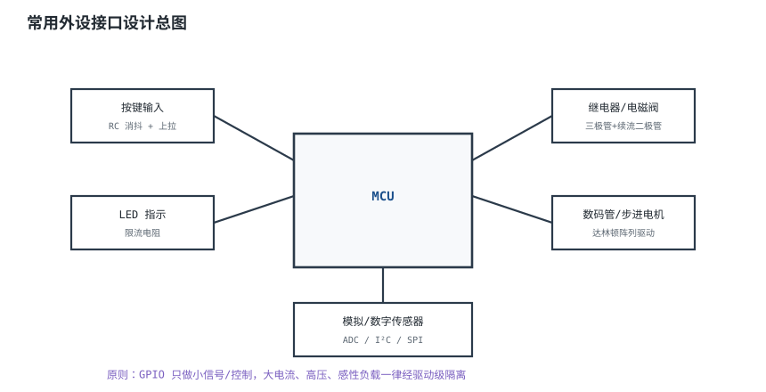
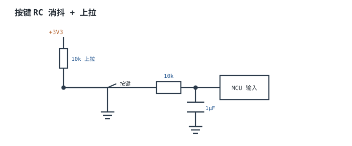
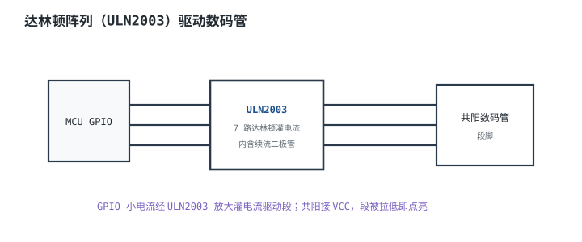

# 常用外设接口设计 Peripheral Interface Design

## 1. 设计动机

::: motivation GPIO 不能直连一切
MCU 的 GPIO 只能做小信号（几 mA、3.3V）的输入输出。真实外设五花八门：按键要消抖、LED 要限流、继电器要大电流和续流、数码管要多路灌电流。直接把 GPIO 接到这些负载上，要么驱动不了、要么烧脚。

本章给出最常用几类外设的标准接口电路：**原则是 GPIO 只做小信号控制，大电流/高压/感性负载一律经驱动级。**
:::

## 2. 原理图

下图是一颗 MCU 周围常见外设接口的总图：按键（带消抖）输入、LED 指示输出、继电器/电磁阀（经三极管+续流）、数码管/步进电机（经达林顿阵列）、传感器。



## 3. 静态分析（DC）

- **按键输入**：上拉电阻把空闲脚拉到高电平，按下接地为低。RC 消抖网络滤除机械抖动。
- **LED**：串限流电阻，电流 2~5mA。
- **继电器**：GPIO 经基极电阻驱动三极管，三极管通断继电器线圈；线圈是感性负载。
- **数码管**：共阳接 VCC，段脚经驱动芯片拉低点亮。

## 4. 动态分析（AC / 瞬态）

机械按键按下/松开时金属簧片会抖动典型 5–20ms，产生多个边沿；RC 消抖网络把这段抖动滤成一个干净边沿。下图取 $\tau=10\text{ms}$（10kΩ+1µF），蓝色曲线按 $V=3.3\,e^{-t/\tau}$ 指数衰减，与所选时间常数一致。

```echarts
{
  "tooltip": {"trigger": "axis"},
  "legend": {"data": ["按键原始", "RC 消抖后(τ=10ms)"], "bottom": 0, "textStyle": {"fontSize": 13}},
  "grid": {"left": 56, "right": 24, "top": 26, "bottom": 56},
  "xAxis": {"type": "category", "name": "ms", "data": [0,2,5,8,10,15,20,30], "axisLabel": {"fontSize": 11}},
  "yAxis": {"type": "value", "min": -0.3, "max": 3.8, "axisLabel": {"fontSize": 11}},
  "series": [
    {"name": "按键原始", "type": "line", "step": "end", "showSymbol": false, "lineStyle": {"width": 2.2, "color": "#b5642e"},
     "data": [3.3,0,2.5,0,0,0,0,0]},
    {"name": "RC 消抖后(τ=10ms)", "type": "line", "step": "end", "showSymbol": false, "lineStyle": {"width": 2.6, "color": "#1a4f8b"},
     "data": [3.3,2.70,2.00,1.48,1.21,0.74,0.45,0.16]}
  ]
}
```

## 5. 环路分析

::: advanced 进阶：为什么感性负载必须续流
继电器线圈、电机是电感。三极管关断瞬间，电感要维持电流 $V=L\,di/dt$，会产生高压尖峰试图继续导通；不加续流二极管，这个尖峰会击穿三极管。续流二极管给电感电流提供低阻回路，把尖峰钳位在一个二极管压降。
:::

## 6. 元件取值与工程权衡

- **按键上拉**：10kΩ；消抖 RC 取 10kΩ + 1µF（$\tau=10\text{ms}$，覆盖 5–20ms 机械抖动）；要求更快响应可降到 10kΩ+100nF（$\tau=1\text{ms}$）。
- **LED 限流**：$R=(V_{DD}-V_f)/I$。
- **三极管基极电阻**：$R_b=(V_{GPIO}-V_{be})/I_b$，让三极管饱和导通。
- **续流二极管**：快恢复/肖特基，反并联在线圈两端。
- **达林顿阵列**：ULN2003 一片 7 路灌电流，内含续流二极管，省外围。

## 7. 完整设计示例

::: example GPIO 控制一只 5V 继电器
1. **需求**：GPIO 3.3V 控制 5V 继电器（线圈电流 70mA）。
2. **三极管**：选 NPN，β=100。基极需 $I_b=70\text{mA}/100=0.7\text{mA}$。
3. **基极电阻**：$R_b=(3.3-0.7)/0.7\text{mA}\approx 3.7\text{k}\Omega$，取 3.3k。
4. **续流二极管**：1N4148 反并联线圈。
5. **验算**：GPIO 输出高 → 三极管饱和 → 继电器吸合；输出低 → 释放，续流二极管泄放。
6. **注意**：5V 继电器与 MCU 3.3V 共地；不要让 GPIO 直接承受 5V。
:::

## 8. 仿真与实验

- 示波器量按键原始波形与 RC 后波形，看抖动被滤平。
- 量三极管基极电流、集电极电流，确认饱和。
- 不接续流二极管，示波器量三极管关断瞬间的尖峰电压。

## 扩展与变种电路

### 扩展1：按键 RC 消抖

定位：机械按键抖动产生多个沿。



::: example 工作原理
- 按键空闲被上拉为高，按下接地为低。
- RC 时间常数 $\tau=RC$，把 5–20ms 的机械抖动平滑成一个边沿；配合软件再次延时确认。
- 10kΩ + 1µF，$\tau=10\text{ms}$，覆盖常见抖动；快响应取 10kΩ+100nF（$\tau=1\text{ms}$）。
:::

取值对比：

| RC | τ | 消抖 | 响应 |
|---|---|---|---|
| 10k+100nF | 1ms | 弱（短抖动） | 快 |
| 10k+1µF | 10ms | 强（覆盖 5–20ms） | 慢 |

::: pitfall 不消抖导致一次按多次
- **现象**：按一次触发多次。
- **原因**：机械抖动产生多沿。
- **解决**：硬件 RC 消抖 + 软件延时再确认。
:::

### 扩展2：三极管驱动继电器

定位：GPIO 驱动不了继电器线圈电流。


::: example 工作原理
- GPIO 高 → 基极电流 → 三极管饱和 → 线圈通电吸合。
- 关断时线圈反电动势由续流二极管泄放。
- 基极电阻按饱和条件 $I_b>I_c/\beta$ 取。
:::

取值对比：

| 基极电阻 | 饱和 | GPIO 负载 |
|---|---|---|
| 1k | 深饱和 | 稍大 |
| 3.3k | 饱和 | 适中 |
| 10k | 可能不饱和 | 小 |

::: pitfall 不接续流二极管
- **现象**：三极管反复击穿。
- **原因**：线圈断电反电动势高压击穿。
- **解决**：线圈两端反并联续流二极管。
:::

### 扩展3：ULN2003 达林顿阵列

定位：多路灌电流负载（数码管/步进电机）。



::: example 工作原理
- ULN2003 是 7 路达林顿灌电流驱动器，输入 TTL/CMOS 兼容，输出可灌 500mA。
- 内含续流二极管，驱动感性负载不必外加。
- 共阳数码管段脚被 ULN2003 拉低即点亮。
:::

取值对比：

| 方案 | 路数 | 灌电流 |
|---|---|---|
| 单个三极管 | 1 | ~100mA |
| ULN2003 | 7 | 500mA |

::: pitfall 数码管亮度不均/电流过大
- **现象**：段脚发热、亮度不一。
- **原因**：段脚没串限流电阻。
- **解决**：每段串限流电阻，由 ULN2003 拉低灌电流。
:::

## 9. 常见坑与故障现象

::: pitfall 常见坑
- **GPIO 直驱继电器**：电流不够/烧脚。经三极管驱动。
- **感性负载无续流**：击穿开关管。加续流二极管。
- **按键不消抖**：一次按多次。RC + 软件消抖。
- **数码管段脚无串阻**：电流过大。每段串限流电阻。
:::

## 10. 自测题

<details><summary>为什么驱动继电器线圈要反并联续流二极管？</summary>
线圈断电瞬间电感反电动势产生高压尖峰，会击穿驱动管；续流二极管给电感电流提供回路，把尖峰钳位。
</details>

<details><summary>按键为什么需要消抖？RC 消抖的时间常数怎么取？</summary>
机械按键簧片抖动典型 5–20ms，会被误读成多次。RC 时间常数取覆盖抖动（5–20ms 量级），如 10k+1µF（$\tau=10\text{ms}$），快响应可 10k+100nF（$\tau=1\text{ms}$）。
</details>

## 11. 参考资料

- STM32 GPIO 应用笔记
- ULN2003 达林顿晶体管阵列数据手册
- 机械按键消抖与续流二极管设计资料
