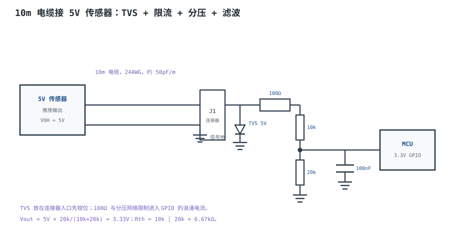

# 常用外设接口设计 Peripheral Interface Design

一颗 3.3V 的 MCU 要读 10m 外的一个 5V 传感器。有人用 10k/20k 分压把 5V 降到 3.33V，实验室桌面测试一切正常；装到现场，传感器和 MCU 分别由两个配电箱供电，地电位差约 1V，分压后的电压变成 $6\times20/(10+20)=4.0\text{V}$，超过 MCU 引脚 3.6V 的绝对最大值，钳位二极管开始导通，读数乱跳。**外设接口不是“把线接上”，而是电平、时序、驱动、保护、参考地、去耦六个约束同时满足。**

这一章给出一套通用的接口设计套路：先看电平，再看时序和驱动，然后加保护和去耦，最后决定共地还是隔离。中间用按键、LED、继电器、数码管这些最常用的外设做例子，最后用一个“MCU ↔ 10m 外 5V 传感器”的完整算例，把分压、限流、TVS、上下拉、共模范围一次算完。UART 见[UART 与 RS-232 物理层](uart-rs232.md)，I²C/SPI 见[I²C 与 SPI 总线时序](i2c-spi.md)，差分长线见[RS-485 与 CAN 总线硬件](rs485-can.md)，高速接口见[USB 与以太网物理层概览](usb-ethernet.md)。

## 1. 设计动机

::: motivation 三个现场
**现场一：5V 传感器直连 3.3V GPIO。** 传感器输出高时 5V，MCU 引脚标称 3.3V、不耐 5V。引脚内部的 ESD 钳位二极管导通，电流灌进 3.3V 电源轨，轻则把 3.3V 抬高、影响其他电路，重则烧二极管。**“3.3V 系统”不等于“所有引脚都 3.3V 容忍”，更不等于 5V 容忍；先查数据手册的绝对最大值。**

**现场二：继电器“吸合但发抖”。** GPIO 经 3.3kΩ 基极电阻驱动 NPN，继电器线圈 5V/70mA。三极管的 $h_{FE}$ 典型 100，算出来 $I_b=0.79\text{mA}$ 好像够，但饱和要求用 $h_{FE,min}$ 并留过驱动；$h_{FE,min}=50$ 时需要至少 1.4mA，3.3kΩ 给不出来，三极管工作在放大区，管压降大、发热，继电器线圈电压不足，接点抖动。**基极电阻要按 $h_{FE,min}$ 和过驱动倍数算，不能按典型 $h_{FE}$ 算。**

**现场三：按键“按一次跳三次”。** 用了 10kΩ+1µF 的 RC，算着 $\tau=10\text{ms}$ 能覆盖 5~20ms 抖动。实际上电容充到 50% 只要 $0.693\tau=6.93\text{ms}$，20ms 的抖动还没结束，门限已经被反复跨过；如果后级是没有施密特触发器的普通 CMOS 输入，慢边沿还会在阈值附近振荡。**RC 不是消抖的充分条件，要配施密特触发器或软件确认。**
:::

接口设计要同时满足六个约束：

| 约束 | 要回答的问题 | 典型手段 | 失效后果 |
|---|---|---|---|
| 电平 | 驱动方 $V_{OH}/V_{OL}$ 是否覆盖接收方 $V_{IH}/V_{IL}$ | 分压、电平转换、开漏上拉 | 读错、倒灌、烧引脚 |
| 时序 | 边沿、延迟、建立/保持是否够 | 降速、缩短线、加缓冲 | 偶发误码、采样错 |
| 驱动 | 电流、电容、感性负载 | 三极管/MOSFET/驱动阵列 | 驱动不足、发热 |
| 保护 | ESD、浪涌、短路 | TVS、限流、PTC、隔离 | 打坏端口 |
| 参考地 | 两地电位差、地环路 | 共地、单点接地、隔离 | 误码、烧接口 |
| 去耦 | 瞬态电流从哪来 | 100nF+10µF、缩短回路 | 复位、误动作 |

## 2. 定义与直观

### 2.1 接口的五个电气维度

**电平**是第一道关。数字接口的四个参数：$V_{OH}$（输出高最小值）、$V_{OL}$（输出低最大值）、$V_{IH}$（输入高最小值）、$V_{IL}$（输入低最大值）。可靠连接要求：

$$
V_{OH,min}\geq V_{IH,min},\qquad V_{OL,max}\leq V_{IL,max}
$$

再留噪声容限。除此之外还要看**绝对最大输入电压**、**是否 5V 容忍**、**钳位二极管位置**。很多“3.3V 引脚”在 VDD=3.3V 时只能承受 $V_{DD}+0.3\text{V}$，5V 输入会直接导通钳位二极管。

**时序**是第二道关。对短线和低速信号，时序通常不是问题；对 10m 电缆、MHz 级信号，电缆延迟、边沿变慢、采样点偏移都会变成问题。10m 电缆的单程延迟约 50ns，1MHz 信号的位时间是 1µs，50ns 占 5%；10MHz 时占 50%，就不能再当“导线”处理了。

**驱动**是第三道关。GPIO 的驱动能力通常是 mA 级（典型 ±8~20mA，以数据手册为准），继电器线圈、LED、电机、数码管段电流都可能超过它。感性负载还要续流，容性负载要考虑浪涌电流。

**保护**是第四道关。外露接口要按 ESD/浪涌设计：TVS 钳位、串联限流、PTC、隔离。保护器件的摆放位置比参数更重要——TVS 要放在连接器入口，先钳位再进芯片。

**参考地/隔离**是第五道关。单端接口以地为参考，两地电位差会直接叠加到信号上；超过门限就误判，超过绝对最大值就损坏。差分接口（RS-485/CAN）能容忍一定共模，但也不是无限。

### 2.2 数字输入/输出的类型

| 类型 | 行为 | 典型用途 | 注意 |
|---|---|---|---|
| 推挽（Push-Pull） | 主动拉高/拉低 | GPIO 输出、SPI、UART | 不能两个输出并接 |
| 开漏（Open-Drain） | 只能拉低，高靠上拉 | I²C、中断、复位 | 必须加上拉；上升沿由 RC 决定 |
| 开集（Open-Collector） | 类似开漏，BJT 实现 | 老式逻辑、驱动 | 电平/电流按器件 |
| 三态（Tri-State） | 使能时推挽，禁止时高阻 | 共享总线 | 使能必须互斥 |
| 模拟输入 | 高阻，接 ADC | 传感器、分压 | 输入阻抗/采样保持 |
| 施密特输入 | 带迟滞 | 按键、慢边沿 | 迟滞宽度看手册 |

**输入端的默认电平**也要设计：CMOS 输入不能悬空，未用的输入要接上拉/下拉；按键、连接器拔掉后的输入要有确定的默认值，否则会乱跳、增加功耗。

### 2.3 保护器件：TVS、ESD、PTC、共模扼流

- **TVS（Transient Voltage Suppressor）**：浪涌/ESD 到来时快速导通，把电压钳在安全值。关键参数：反向 standoff 电压（要高于信号最大电压）、击穿电压、钳位电压（要低于后级绝对最大值）、结电容（高速信号要小）、峰值功率。
- **ESD 阵列**：多路 TVS 集成，适合 USB/以太网/多路 IO；结电容和钳位电压是选型重点。
- **PTC（自恢复保险丝）**：过流时阻值变大，限制电流；响应慢，适合持续过流/短路，不适合快速 ESD。
- **串联电阻**：限制进入芯片的残流，和 TVS 配合；阻值太大会拖慢边沿。
- **共模扼流圈**：抑制共模噪声，差分信号正常通过；长线/外露接口常用。
- **隔离器**：光耦/数字隔离器，切断地环路；需要隔离电源配合。

### 2.4 共地与隔离

**共地**是最简单的方案：所有设备的地通过电缆/机壳连在一起，信号以同一个地为参考。共地的风险是**地环路**：两地之间有电位差时，地线里会有电流，电流在地线电阻上产生压降，叠加到信号上；电流大了还会烧地线/连接器。

**隔离**切断地环路：信号经光耦/数字隔离器，电源经隔离 DC/DC，两侧没有直流连接。隔离要看工作电压、隔离耐压、CMTI、爬电距离/电气间隙（按 IEC 60664-1 计算）。**隔离不是“加一颗隔离器”就完事**：隔离侧的地要浮空，不能再用 0Ω 连回本地地；隔离电源的纹波/共模瞬态也要控制。

| 场景 | 共地 | 隔离 | 说明 |
|---|---|---|---|
| 同一机箱、短电缆 | 可以 | 不需要 | 地电位差小 |
| 跨机柜、10m 以上 | 谨慎 | 推荐 | 地电位差可能几伏 |
| 跨配电、工业现场 | 不允许 | 必须 | 地电位差可达几十伏 |
| 医疗/高安全 | 不允许 | 必须 | 安规要求 |
| 传感器浮地/长线 | 谨慎 | 推荐 | 共模范围可能超 |

## 3. 定量关系

### 3.1 电平与噪声容限

以 3.3V LVCMOS 驱动 5V TTL 为例：3.3V CMOS 的 $V_{OH,min}$ 约 2.4V，5V TTL 的 $V_{IH,min}$ 约 2.0V：

$$
V_{NH}=V_{OH,min}-V_{IH,min}=2.4-2.0=0.4\ \text{V}
$$

低电平：$V_{OL,max}\approx0.4\text{V}$，5V TTL 的 $V_{IL,max}\approx0.8\text{V}$：

$$
V_{NL}=V_{IL,max}-V_{OL,max}=0.8-0.4=0.4\ \text{V}
$$

0.4V 的噪声容限偏小，长线/噪声环境要加缓冲或电平转换。如果驱动 5V CMOS（$V_{IH,min}\approx3.5\text{V}$），3.3V 的 $V_{OH}$ 根本不够，必须电平转换。

**绝对最大值与钳位电流**：3.3V 引脚（不耐 5V）的绝对最大输入通常约 $V_{DD}+0.3=3.6\text{V}$。5V 信号经串联电阻 $R_s$ 进引脚，钳位二极管导通后的电流：

$$
I_{clamp}=\frac{V_{in}-V_{DD}-V_f}{R_s}
$$

其中 $V_f$ 是钳位二极管正向压降（典型 0.7V 量级，以数据手册为准），V；$R_s$ 是串联电阻，$\Omega$。$V_{in}=5\text{V}$、$V_{DD}=3.3\text{V}$、$R_s=100\Omega$：

$$
I_{clamp}=\frac{5-3.3-0.7}{100}=10\ \text{mA}
$$

多数 GPIO 的注入电流极限在 ±20mA 量级（以数据手册为准），10mA 看似可以，但这是持续电流；ESD/浪涌时瞬时电流更大。**更稳妥的做法是分压/电平转换，让引脚电压本身不超限，而不是靠钳位二极管“硬扛”。**

### 3.2 上拉/下拉与电缆电容

上拉电阻 $R$ 和总电容 $C$（电缆+连接器+引脚）构成 RC。10%~90% 上升时间：

$$
t_r=2.2RC
$$

其中 $R$ 是上拉电阻，$\Omega$；$C$ 是总电容，F；$t_r$ 是上升时间，s。10m 电缆按 50pF/m 估算，加连接器/引脚约 60pF：

$$
C=10\times50+60=560\ \text{pF}
$$

10kΩ 上拉：

$$
t_r=2.2\times10^4\times560\times10^{-12}=1.23\times10^{-5}\ \text{s}=12.3\ \mu\text{s}
$$

如果信号是 1kHz（周期 1ms），边沿占 1.2%，没问题；如果是 100kHz（周期 10µs），边沿已经超过一个周期，完全不能用。**上拉电阻要按“电缆电容 + 速率”算，不能只看“10k 是常用值”。**

下拉/上拉还要考虑**湿电流**：机械触点（按键、继电器）在干燥/氧化环境下需要一定电流才能可靠导通，典型 1~5mA；10kΩ 只给 0.33mA，工业环境可能接触不良。按键上拉在干燥环境可以用 10k~100k，潮湿/工业环境建议 1k~4.7k。

漏电也要算：$N$ 个器件的输入漏电 $I_{leak}$ 流过上拉，压降：

$$
V_{drop}=N\,I_{leak}R
$$

10 个器件、每个 1µA、10kΩ：

$$
V_{drop}=10\times1\times10^{-6}\times10^4=0.1\ \text{V}
$$

0.1V 的压降会吃掉噪声容限；如果上拉取 100kΩ，压降 1V，高电平可能就不合法了。**上拉不是越大越省电，要和漏电、电容、湿电流一起算。**

### 3.3 ESD 与浪涌保护

IEC 61000-4-2 的接触放电用 330Ω/150pF 网络模拟人体放电，8kV 等级的开路电压 8kV、短路峰值电流约 30A 量级。信号线上串了电阻、并有 TVS 时，进入芯片的残流由钳位电压和串联阻抗决定：

$$
I_{res}=\frac{V_{clamp}-V_{DD}}{R_s}
$$

其中 $V_{clamp}$ 是 TVS 钳位电压，V；$V_{DD}$ 是芯片电源，V；$R_s$ 是串联电阻，$\Omega$。$V_{clamp}=12\text{V}$、$V_{DD}=3.3\text{V}$、$R_s=100\Omega$：

$$
I_{res}=\frac{12-3.3}{100}=87\ \text{mA}
$$

超过 GPIO 的注入电流极限（典型 ±20mA 量级），会损坏。把 $R_s$ 加到 470Ω：

$$
I_{res}=\frac{12-3.3}{470}=18.5\ \text{mA}
$$

刚好在极限内；但 470Ω 配 560pF 的边沿是 $2.2\times470\times560\text{pF}=579\text{ns}$，1kHz 信号没问题，100kHz 就吃紧了。**保护与速度是一对矛盾：要么加大串联电阻、降速；要么用更低钳位电压的 TVS/更好的拓扑。**

分压网络本身也能限流：10k/20k 的戴维南电阻是 6.67kΩ，$V_{clamp}=12\text{V}$ 时：

$$
I_{res}=\frac{12-3.3}{6.67\times10^3}=1.3\ \text{mA}
$$

远低于极限。**这就是“分压 + TVS”比“5V 直连 + TVS”更稳的原因：分压电阻同时承担了限流。**

浪涌（IEC 61000-4-5）能量比 ESD 大得多，1kV/8/20µs 的浪涌在 100Ω 上可产生 10A 量级电流，TVS 要选峰值功率足够的型号（几百 W 到 kW 级，按试验等级），必要时加 PTC 或气体放电管做两级保护。**ESD 和浪涌不是一回事：ESD 上升快、能量小；浪涌上升慢、能量大。选型要分别看。**

### 3.4 去耦与走线电感

数字芯片的瞬态电流由本地电容提供，不能指望远处的稳压器。电容阻抗：

$$
Z_C=\frac{1}{2\pi fC}
$$

100nF 在 10MHz：

$$
Z_C=\frac{1}{2\pi\times10^7\times100\times10^{-9}}=0.159\ \Omega
$$

走线电感约 5nH/cm，10MHz 的阻抗：

$$
Z_L=2\pi fL=2\pi\times10^7\times5\times10^{-9}=0.314\ \Omega/\text{cm}
$$

**1cm 走线的电感阻抗已经是 100nF 电容阻抗的 2 倍**；电容离芯片越远，去耦越无效。所以 100nF 要放在引脚 1cm 以内，10µF 放在附近做储能，二者配合覆盖低频和高频。

长线接口还要在连接器侧加 TVS 和滤波电容；电容太大会拖慢边沿，太小滤不干净，按信号速率和 ESD 要求折中。

## 4. 典型计算

### 4.1 MCU ↔ 10m 外 5V 传感器：完整接口设计

**需求**：3.3V MCU 读 10m 外的 5V 推挽传感器，信号 1kHz，24AWG 电缆，MCU 引脚不耐 5V（绝对最大 3.6V），现场 ESD 8kV 接触放电，传感器与 MCU 由不同配电箱供电（地电位差可能 1V）。设计接口并验算。

**第一步，电平转换**。用 10k/20k 分压：

$$
V_{out}=5\times\frac{20}{10+20}=3.33\ \text{V}
$$

3.33V 低于 3.6V 绝对最大值，高于 3.3V CMOS 的 $V_{IH}=2.0\text{V}$，高电平余量 1.33V；低电平时传感器拉到 0V，分压输出 0V，低于 $V_{IL}=0.8\text{V}$。**电平上可行。**

**第二步，戴维南电阻与边沿**：

$$
R_{th}=10\text{k}\parallel20\text{k}=\frac{10\times20}{10+20}=6.67\ \text{k}\Omega
$$

电缆电容：

$$
C=10\times50+50+10=560\ \text{pF}
$$

时间常数：

$$
\tau=R_{th}C=6.67\times10^3\times560\times10^{-12}=3.73\ \mu\text{s}
$$

10%~90% 上升时间：

$$
t_r=2.2\tau=8.21\ \mu\text{s}
$$

1kHz 的周期是 1ms，边沿占 0.82%，没问题；100kHz 的周期是 10µs，边沿占 82%，不能用。**这个接口的上限约几十 kHz，不能拿它跑 1MHz。**

**第三步，共模/地电位差**。24AWG 10m 的地线电阻：

$$
R_g=0.084\times10=0.84\ \Omega
$$

传感器电流 20mA 在地线上的压降：

$$
V_g=0.02\times0.84=16.8\ \text{mV}
$$

这只是电缆自身；如果两个配电箱的地之间有 1V 电位差，传感器输出高时，MCU 侧看到的电压：

$$
V_{in}=5+1=6\ \text{V}
$$

分压后：

$$
V_{out}=6\times\frac{20}{30}=4.0\ \text{V}
$$

超过 3.6V 绝对最大值，钳位二极管导通。允许的最大地电位差：

$$
V_{out}\leq3.6\quad\Rightarrow\quad V_{in}\leq3.6\times\frac{30}{20}=5.4\ \text{V}
$$

$$
V_{g,max}=5.4-5=0.4\ \text{V}
$$

**地电位差超过 0.4V 就不行**。现场 1V 的地电位差意味着这个方案不成立，必须改成隔离/差分，或者把两地可靠共地到 0.4V 以内。

**第四步，保护**。连接器入口放 5V standoff 的 TVS，钳位电压约 12V（典型，以数据手册为准）；分压网络的 6.67kΩ 限流：

$$
I_{res}=\frac{12-3.3}{6.67\times10^3}=1.3\ \text{mA}
$$

低于 GPIO 注入极限，安全。ESD 8kV 时，330Ω 源阻抗加 6.67kΩ 分压网络，进入引脚的电流也在 mA 级；TVS 承担主要能量。**TVS 要放在连接器入口，先钳位再分压；如果 TVS 放在分压之后，分压电阻先承受全部浪涌，容易损坏。**

**第五步，上下拉与默认电平**。传感器是推挽输出，不需要上拉；MCU 侧加 100kΩ 下拉，保证传感器拔掉/断线时引脚为低，不会悬空乱跳。100kΩ 与分压下臂 20kΩ 并联：

$$
R_{down}'=20\text{k}\parallel100\text{k}=16.7\ \text{k}\Omega
$$

分压比变成 $16.7/(10+16.7)=0.625$，5V 时输出 3.13V，仍高于 2.0V，可用；低电平仍是 0V。**下拉不能太小，否则会改变分压比、增加传感器负载。**

**第六步，去耦**。传感器侧 100nF + 10µF，MCU 侧 100nF；100nF 放在连接器/引脚 1cm 内，10µF 放在附近。长线接口的 TVS 地要短、粗，直接到连接器地。

**第七步，隔离方案（如果地电位差不能降到 0.4V）**。用数字隔离器（1Mbps 量级）+ 隔离 DC/DC，或者改用 4~20mA 电流环/RS-485。隔离侧的地浮空，不能连回本地地；爬电距离/电气间隙按 IEC 60664-1 的工作电压算。

**第八步，验算清单**：

| 项目 | 计算 | 结果 | 判断 |
|---|---|---|---|
| 高电平 | $5\times20/30$ | 3.33V | >2.0V，<3.6V |
| 低电平 | 传感器拉 0 | 0V | <0.8V |
| 边沿 | $2.2\times6.67\text{k}\times560\text{p}$ | 8.21µs | 1kHz 可用 |
| 地电位差 | 1V 时输出 4.0V | 超 3.6V | 需隔离/共地 |
| 保护残流 | $(12-3.3)/6.67\text{k}$ | 1.3mA | <20mA |
| 默认电平 | 100k 下拉 | 低 | 不悬空 |

**结论**：电平、边沿、保护都过；**共模是唯一不满足的项**。如果现场地电位差确实 1V，这个分压方案不能用，必须隔离或改差分。**接口设计要先算共模，再算电平和保护；共模不过，后面都白算。**

### 4.2 继电器驱动：基极电阻与续流

**需求**：3.3V GPIO 驱动 5V 继电器，线圈电流 70mA，NPN 的 $h_{FE,min}=50$，要求饱和。求基极电阻、基极电流和续流二极管。

**第一步，算饱和所需基极电流**。饱和条件：

$$
I_b\geq\frac{I_c}{h_{FE,min}}
$$

$$
I_b\geq\frac{70}{50}=1.4\ \text{mA}
$$

再留 2 倍过驱动：

$$
I_b=2\times1.4=2.8\ \text{mA}
$$

**第二步，算基极电阻**：

$$
R_b=\frac{V_{GPIO}-V_{BE}}{I_b}=\frac{3.3-0.7}{2.8\times10^{-3}}=929\ \Omega
$$

取 1kΩ，实际基极电流：

$$
I_b=\frac{3.3-0.7}{1000}=2.6\ \text{mA}
$$

强制电流增益：

$$
h_{FE,forced}=\frac{70}{2.6}=26.9
$$

小于 $h_{FE,min}=50$，三极管深度饱和，$V_{CE(sat)}$ 约 0.2~0.3V，线圈电压足够。

**第三步，验算 3.3kΩ**：

$$
I_b=\frac{3.3-0.7}{3300}=0.79\ \text{mA}
$$

只能支持 $0.79\times50=39.5\text{mA}$ 的集电极电流，小于 70mA，**不能保证饱和**。这就是现场“继电器发抖、三极管发热”的原因。

**第四步，续流二极管**。线圈是感性负载，关断瞬间电流不能突变：

$$
V=L\frac{di}{dt}
$$

没有续流回路时，这个电压尖峰会击穿三极管。反并联一只二极管（1N4148 类，200mA/100V 量级；线圈电流更大时用 1N4007 类），把尖峰钳在约 0.7V。**二极管方向不能接反：阴极接线圈电源侧，阳极接集电极侧。**

**第五步，功耗**。基极电阻功耗：

$$
P_{Rb}=\frac{(3.3-0.7)^2}{1000}=6.76\ \text{mW}
$$

三极管饱和功耗：

$$
P_{Q}=V_{CE(sat)}\times I_c\approx0.3\times70=21\ \text{mW}
$$

都很小。继电器线圈自身 5V×70mA=0.35W，选线圈额定功率足够的型号。

### 4.3 按键 RC 消抖：10ms 到底覆盖多少

**需求**：机械按键抖动 5~20ms，用 10kΩ+1µF RC 消抖，后级是普通 CMOS 输入。判断是否可靠。

**第一步，算时间常数**：

$$
\tau=RC=10^4\times10^{-6}=10\ \text{ms}
$$

**第二步，算到 50% 门限的时间**：

$$
t_{50}=0.693\tau=6.93\ \text{ms}
$$

**第三步，算到 95% 的时间**：

$$
t_{95}=3\tau=30\ \text{ms}
$$

如果抖动持续 20ms，电容在 6.93ms 就跨过 50% 门限，后面还在抖，后级可能看到多个边沿；如果后级没有施密特触发器，慢边沿在阈值附近还会振荡。**10kΩ+1µF 只适合抖动 <7ms 的按键，不能宣称“覆盖 5~20ms”。**

**第四步，正确做法**：

1. **RC + 施密特触发器**（如 74HC14）：迟滞把慢边沿整形成干净边沿，RC 取 $\tau$ 大于抖动时间，例如 20kΩ+1µF（$\tau=20\text{ms}$，$t_{50}=13.9\text{ms}$，$t_{95}=60\text{ms}$）；
2. **软件消抖**：每 10ms 采样一次，连续 3 次相同才确认，响应约 30ms；
3. **RC + 软件**：硬件滤毛刺，软件再确认，最稳。

**第五步，上拉/湿电流**。10kΩ 上拉只给 0.33mA 湿电流，干燥环境可以；潮湿/工业环境建议 4.7kΩ（0.70mA）或更小，但要注意按下时的灌电流和功耗。

### 4.4 数码管与 ULN2003：段电流与功耗

**需求**：共阳数码管，每段 10mA，8 段（含小数点），5V 供电，用 ULN2003 灌电流。求每段限流电阻和 ULN2003 功耗。

**第一步，限流电阻**。共阳数码管，段脚经 ULN2003 拉低点亮。设 LED 正向压降 2.0V（典型，以数据手册为准），ULN2003 饱和压降 0.9V（典型，以数据手册为准）：

$$
R_{seg}=\frac{5-2.0-0.9}{10\ \text{mA}}=210\ \Omega
$$

取 220Ω，实际电流：

$$
I_{seg}=\frac{5-2.0-0.9}{220}=9.55\ \text{mA}
$$

**第二步，ULN2003 功耗**。8 段同时亮：

$$
P=8\times0.9\times9.55\ \text{mA}=68.8\ \text{mW}
$$

远小于封装极限。如果是 7 段×20mA，功耗 126mW，仍可接受；但 7 路×500mA 的极限工况不能同时长期工作，要按封装热阻降额。

**第三步，多路复用**。动态扫描时，段电流是脉冲，亮度按平均电流算：

$$
I_{avg}=I_{peak}\times\frac{t_{on}}{T_{frame}}
$$

8 位扫描、每段占空比 1/8，要得到平均 10mA，峰值要 80mA；这时限流电阻按峰值算，ULN2003 的峰值电流和功耗都要重新核对。**“每段 10mA”在动态扫描里不是峰值 10mA，别把平均当峰值。**

## 5. 工程含义

### 5.1 接口设计检查清单

| 检查项 | 通过标准 | 工具/方法 |
|---|---|---|
| 电平 | $V_{OH}\geq V_{IH}$、$V_{OL}\leq V_{IL}$，留 0.2V 以上容限 | 数据手册、直流测试 |
| 绝对最大值 | 任何工况下不超 | 数据手册、故障注入 |
| 时序 | 边沿/延迟/建立保持满足 | 示波器、时序计算 |
| 驱动 | 电流/电容/感性负载在额定内 | 数据手册、温升测试 |
| 保护 | ESD/浪涌后仍工作 | IEC 61000-4-2/4-5 试验 |
| 共模 | 地电位差在容限内 | 万用表/隔离测试 |
| 去耦 | 瞬态下电源纹波可接受 | 示波器、近场探头 |
| 默认电平 | 拔掉/断线时输入确定 | 拔线测试 |

### 5.2 保护器件选型表

| 器件 | 作用 | 关键参数 | 摆放 |
|---|---|---|---|
| TVS | 钳位 ESD/浪涌 | standoff、$V_{clamp}$、结电容、峰值功率 | 连接器入口，先钳位 |
| ESD 阵列 | 多路 ESD | 结电容、钳位电压、通道数 | 连接器入口 |
| PTC | 过流/短路 | 保持电流、动作电流、电压 | TVS 之后/电源入口 |
| 串联电阻 | 限流/阻尼 | 阻值、功率、与电容的 RC | TVS 与芯片之间 |
| 共模扼流 | 共模噪声 | 共模阻抗、额定电流、DCR | 连接器入口 |
| 隔离器 | 切断地环路 | 工作电压、耐压、CMTI、爬电 | 分区边界 |

### 5.3 共地与隔离的取舍

先算地电位差：用万用表/示波器量两地 GND 之间的直流+交流电压，再估地电流。若最坏地电位差小于接口共模容限的 50%，可以共地；否则隔离。**不要用 0Ω 把隔离侧的地连回本地地**——那等于把隔离短路，地环路又回来了。

### 5.4 常用外设的取值速查

| 外设 | 关键取值 | 依据 |
|---|---|---|
| 按键上拉 | 4.7k~10k（工业 1k~4.7k） | 湿电流、功耗、边沿 |
| 按键 RC | 10k+1µF（τ=10ms）或 20k+1µF（τ=20ms） | 抖动时间、施密特/软件 |
| LED 限流 | $R=(V_{DD}-V_f)/I$ | 亮度、功耗 |
| 继电器基极电阻 | $R_b=(V_{GPIO}-V_{BE})/(2I_c/h_{FE,min})$ | 饱和、过驱动 |
| 续流二极管 | 反向耐压 > 电源、电流 > 线圈电流 | 感性负载 |
| 数码管段电阻 | $R=(V_{CC}-V_f-V_{CE(sat)})/I_{seg}$ | 亮度、驱动压降 |
| 去耦 | 100nF（1cm 内）+10µF | 瞬态电流、走线电感 |

### 5.5 测量与排故

- **电平**：万用表/示波器量 $V_{OH}$、$V_{OL}$、$V_{IH}$、$V_{IL}$；先确认没有倒灌/钳位。
- **边沿**：量 10%~90%，和 $2.2RC$ 对比；探头电容要算进去。
- **共模**：量两地 GND 之间的电压；超过容限就隔离。
- **保护**：用 ESD 枪/浪涌发生器打接口，观察是否复位/损坏；没有设备时至少检查 TVS 位置和接地。
- **温升**：驱动管/继电器/ULN2003 在最大负载下测温度，按热阻降额。

## 6. 常见坑

::: pitfall 常见坑（电平与驱动）
- **5V 传感器直连 3.3V GPIO**：现象——读数乱跳、引脚发热，长期后失效。原因——5V 超过绝对最大值，钳位二极管导通、电流灌进电源轨。解决——分压/电平转换；确认引脚是否 5V 容忍，不能只看“3.3V 系统”。
- **分压电阻太大**：现象——直流电平对，但一接长线/高速就错。原因——戴维南电阻大，和电缆电容形成慢 RC。解决——按 $2.2R_{th}C$ 算边沿，必要时加缓冲/降速。
- **继电器基极电阻按典型 $h_{FE}$ 算**：现象——继电器吸合无力、三极管发热。原因——饱和要用 $h_{FE,min}$ 并留过驱动；3.3kΩ 只能给 0.79mA。解决——按 $I_b\geq2I_c/h_{FE,min}$ 算，1kΩ 左右。
- **感性负载不加续流**：现象——三极管反复击穿、继电器接点打火。原因——线圈关断反电动势高压。解决——反并联续流二极管，方向别接反。
- **数码管段脚不串电阻**：现象——段电流过大、亮度不均、驱动发热。原因——LED 没有限流。解决——每段串限流电阻，按 $R=(V_{CC}-V_f-V_{CE(sat)})/I$ 算。
:::

::: pitfall 常见坑（保护、地与时序）
- **TVS 放在分压之后**：现象——浪涌打坏分压电阻/芯片。原因——TVS 没有先钳位，分压网络承受全部能量。解决——TVS 放连接器入口，先钳位再分压/限流。
- **TVS 钳位电压太高**：现象——ESD 后芯片损坏或闩锁。原因——$V_{clamp}$ 高于后级绝对最大值。解决——选低钳位 TVS，或加串联电阻限流。
- **忽略地电位差**：现象——实验室正常、现场乱码/烧口。原因——单端接口地电位差叠加到信号，超过门限/绝对最大值。解决——先量地电位差；超过容限就隔离或改差分。
- **RC 消抖不配施密特**：现象——按一次跳多次，或慢边沿导致振荡。原因——RC 只平滑边沿，不保证单次翻转；普通 CMOS 输入在阈值附近可能振荡。解决——加施密特触发器（74HC14）或软件连续采样确认。
- **去耦电容离芯片太远**：现象——复位、误动作、EMC 差。原因——走线电感抵消电容作用；1cm 约 0.314Ω@10MHz。解决——100nF 放引脚 1cm 内，10µF 就近，地回路短。
- **保护器件结电容拖慢信号**：现象——加了 TVS 后高速信号眼图变差。原因——TVS 结电容与源阻抗形成低通。解决——高速信号选低电容 TVS/ESD，或把保护放在 stub 上。
:::

## 7. 自测题

3.3V MCU 读 5V 传感器，用 10k/20k 分压。输出多少？戴维南电阻多少？10m、560pF 时上升时间多少？

输出：

$$
V_{out}=5\times\frac{20}{10+20}=3.33\ \text{V}
$$

戴维南电阻：

$$
R_{th}=10\text{k}\parallel20\text{k}=6.67\ \text{k}\Omega
$$

上升时间：

$$
t_r=2.2\times6.67\times10^3\times560\times10^{-12}=8.21\ \mu\text{s}
$$

1kHz 可用；100kHz 时边沿占 82%，不可用。

上例中，两地地电位差 1V，分压输出多少？允许的最大地电位差是多少？

传感器输出高 5V，叠加 1V 地电位差：

$$
V_{in}=5+1=6\ \text{V}
$$

$$
V_{out}=6\times\frac{20}{30}=4.0\ \text{V}
$$

超过 3.6V 绝对最大值。允许的最大输入：

$$
V_{in,max}=3.6\times\frac{30}{20}=5.4\ \text{V}
$$

$$
V_{g,max}=5.4-5=0.4\ \text{V}
$$

所以 1V 地电位差不行，要隔离/共地到 0.4V 以内。

5V 信号经 100Ω 串阻进 3.3V 不耐 5V 的引脚，钳位电流多少？12V 钳位 TVS 加 100Ω 时残流多少？

持续 5V、$V_f=0.7\text{V}$：

$$
I_{clamp}=\frac{5-3.3-0.7}{100}=10\ \text{mA}
$$

ESD 钳位 12V：

$$
I_{res}=\frac{12-3.3}{100}=87\ \text{mA}
$$

超过典型 ±20mA 的注入极限。把串联电阻加到 470Ω，残流 18.5mA，刚好在极限内，但边沿会变慢；或者用分压网络（6.67kΩ）把残流降到 1.3mA。

继电器线圈 70mA，$h_{FE,min}=50$，3.3V GPIO、$V_{BE}=0.7\text{V}$。基极电阻取多少？3.3kΩ 为什么不行？

饱和所需：

$$
I_b\geq\frac{70}{50}=1.4\ \text{mA}
$$

2 倍过驱动 2.8mA：

$$
R_b=\frac{3.3-0.7}{2.8\times10^{-3}}=929\ \Omega
$$

取 1kΩ，$I_b=2.6\text{mA}$，强制增益 26.9，饱和。

3.3kΩ 时：

$$
I_b=\frac{3.3-0.7}{3300}=0.79\ \text{mA}
$$

只能支持 $0.79\times50=39.5\text{mA}$，小于 70mA，不能保证饱和，三极管发热、继电器抖动。

按键抖动 20ms，10kΩ+1µF RC，50% 门限在多少 ms？为什么不能覆盖 20ms？正确做法是什么？

$$
t_{50}=0.693\tau=0.693\times10=6.93\ \text{ms}
$$

20ms 抖动还没结束，电压已经跨过 50% 门限，后级可能看到多个边沿；普通 CMOS 输入在慢边沿上还可能在阈值附近振荡。

正确做法：RC + 施密特触发器（74HC14），或软件连续采样确认；RC 取 $\tau$ 大于抖动时间，例如 20kΩ+1µF（$\tau=20\text{ms}$，$t_{50}=13.9\text{ms}$，$t_{95}=60\text{ms}$）。

100nF 去耦电容在 10MHz 的阻抗是多少？1cm 走线（5nH）的感抗是多少？为什么电容要靠近芯片？

$$
Z_C=\frac{1}{2\pi\times10^7\times100\times10^{-9}}=0.159\ \Omega
$$

$$
Z_L=2\pi\times10^7\times5\times10^{-9}=0.314\ \Omega
$$

1cm 走线的感抗已经是电容阻抗的 2 倍，电容离芯片越远，去耦越无效。100nF 要放在引脚 1cm 内，地回路也要短。

共阳数码管、5V、每段 10mA、LED 压降 2.0V、ULN2003 饱和 0.9V，段电阻取多少？8 段同时亮的 ULN2003 功耗多少？

$$
R_{seg}=\frac{5-2.0-0.9}{10\ \text{mA}}=210\ \Omega
$$

取 220Ω，电流 9.55mA。

8 段功耗：

$$
P=8\times0.9\times9.55\ \text{mA}=68.8\ \text{mW}
$$

动态扫描时按峰值电流和占空比重新算，不能把平均电流当峰值。

## 8. 参考资料

- **IEC 61000-4-2 (2008)**：静电放电抗扰度，接触放电/空气放电等级、330Ω/150pF 放电网络与试验波形；本章 3.3、5.2 的 ESD 计算与保护选型参考该标准。
- **IEC 61000-4-5 (2014)**：浪涌抗扰度，1.2/50µs 电压波、8/20µs 电流波与等级；本章 3.3 的浪涌与 ESD 区别参考该标准。
- **IEC 60664-1 (2007)**：低压系统内设备的绝缘配合，电气间隙、爬电距离与隔离电压；本章 2.4、4.1 的隔离设计参考该标准。
- **STMicroelectronics, AN4899 Application note**：STM32 GPIO 的电气特性、保护二极管、5V 容忍与硬件配置；本章 2.1、3.1 的 GPIO 绝对最大值与钳位电流参考该应用笔记。
- **Texas Instruments, ULN2003A 数据手册（SLRS027）**：7 路达林顿阵列、500mA 灌电流、片内续流二极管；本章 4.4、5.4 的 ULN2003 与数码管计算参考该数据手册。
- **Texas Instruments, SLLA272D *RS-485 Design Guide***：长线接口的终端、偏置、共模与保护思路；本章 2.4、5.3 的共模/隔离取舍参考该指南。
