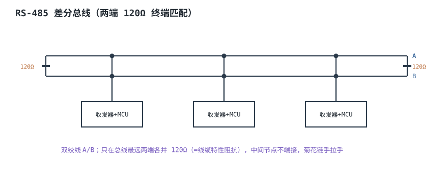
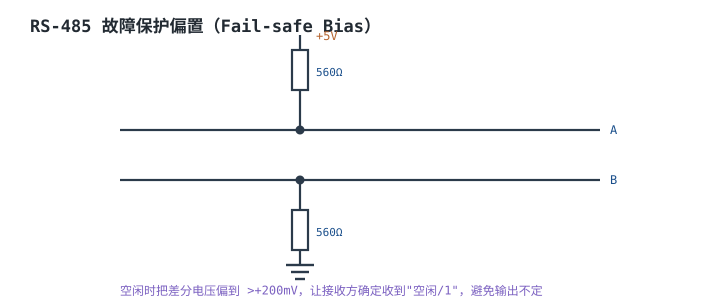
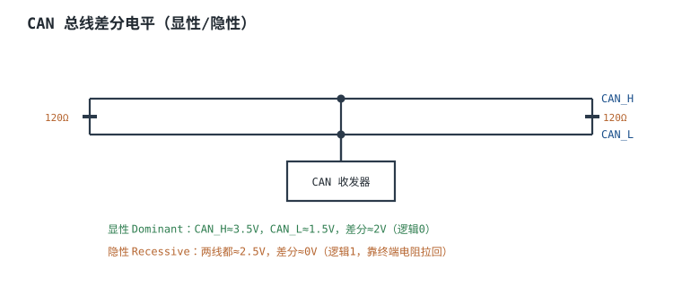
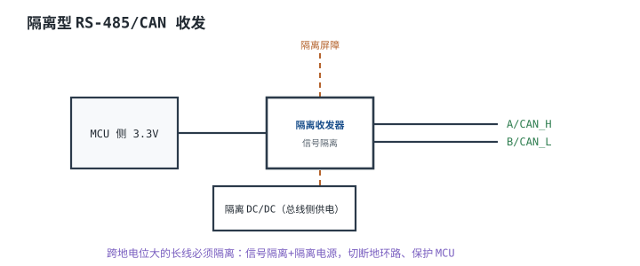

# RS-485 与 CAN 总线硬件 RS-485 & CAN

## 1. 设计动机

::: motivation 为什么多点长距离要用差分总线
UART/RS-232 是单端信号，挂不了多个节点、传不远。工业现场要挂几十个节点、跑上千米，靠的是**差分总线**：信号用两根线的电压差表示，共模干扰被相消掉。

**RS-485** 是通用多点半双工差分总线；**CAN（Controller Area Network）**在差分物理层上叠加了仲裁/帧协议，广泛用于汽车和工业。硬件上两者的关键都一样：终端匹配、拓扑、偏置、隔离——接错就反射、误码、通信时好时坏。
:::

## 2. 原理图

RS-485 用一对双绞线 A/B，多个节点挂在同一总线上，**只在总线最远两端**各并一只 120Ω（≈线缆特性阻抗）。



## 3. 静态分析（DC）

- **空闲电平**：所有收发器都关断时，总线由终端电阻和偏置电阻决定静态电平。RS-485 要靠偏置把空闲差分偏到确定值；CAN 隐性时两线都 ≈2.5V，差分 ≈0V。
- **单位负载（UL）**：RS-485 一节点输入阻抗对应 12kΩ，总线最多 32 个单位负载；高阻收发器可挂更多。
- **共模范围**：RS-485 −7~+12V、CAN 约 ±12V，这是器件能力上限，不是设计目标——跨地电位大就要隔离。

## 4. 动态分析（AC / 瞬态）

终端匹配是为了吸收信号到达总线末端时的反射。不端接/只端一端，高速方波会在末端反射，叠加出振铃、误码。

```echarts
{
  "tooltip": {"trigger": "axis"},
  "legend": {"data": ["正确端接", "未端接"], "bottom": 0, "textStyle": {"fontSize": 13}},
  "grid": {"left": 56, "right": 24, "top": 26, "bottom": 56},
  "xAxis": {"type": "category", "name": "时间", "data": [0,1,2,3,4,5,6,7,8,9,10], "axisLabel": {"fontSize": 11}},
  "yAxis": {"type": "value", "name": "差分 V", "min": -3, "max": 4, "axisLabel": {"fontSize": 11}},
  "series": [
    {"name": "正确端接", "type": "line", "step": "end", "showSymbol": false, "lineStyle": {"width": 2.4, "color": "#2e7d4f"},
     "data": [0,2,2,2,2,2,2,2,2,2,2]},
    {"name": "未端接", "type": "line", "step": "end", "showSymbol": false, "lineStyle": {"width": 2.4, "color": "#b5642e"},
     "data": [0,2,3.2,1.2,3,1.4,2.8,1.6,2.5,1.8,2.2]}
  ]
}
```

速率与距离折中（经验）：RS-485 约 1200m@100kbps、10m@10Mbps；CAN 1Mbps@40m。

## 5. 环路分析

::: advanced 进阶：CAN 显性/隐性与仲裁
CAN 用线与（wired-AND）：显性（dominant，差分≈2V）覆盖隐性（recessive，差分≈0）。多个节点同时发时，发显性位的节点"赢"，发隐性的自动退避——这就是 CSMA/CD+AMP 非破坏性仲裁，靠物理电平实现，无需主节点调度。
:::

## 6. 元件取值与工程权衡

- **终端电阻**：只在总线最远两端各 120Ω；中间节点不端接。
- **拓扑**：菊花链手拉手，避免星型/长分支；CAN 分支 stub ≤0.3m@1Mbps。
- **偏置**：RS-485 空闲不定时加 fail-safe 偏置。
- **隔离**：跨地电位大、长线，用隔离收发器 + 隔离 DC/DC。
- **保护**：总线加 TVS、串脉冲限流电阻。

## 7. 完整设计示例

::: example 一条 1Mbps CAN 总线挂 4 个节点
1. **需求**：4 节点 CAN @1Mbps，总线长 20m。
2. **收发器**：选 3.3V CAN 收发器（如 SN65HVD23x）。
3. **终端**：总线最远两端各 120Ω（中间两个节点不端接）。
4. **拓扑**：手拉手菊花链，分支 <0.3m。
5. **静态**：不上电量隐性电平，CAN_H/CAN_L 都 ≈2.5V。
6. **验算**：差分探头量显性 ≈2V、隐性 ≈0V；通信无错帧。
:::

## 8. 仿真与实验

- 不上电先量总线静态：RS-485 空闲应偏到确定值，CAN 隐性两线 ≈2.5V。
- 差分探头（或两通道相减）看 A/B 波形；反射严重说明终端位置错或拓扑错。
- 故意只端一端，观察高速时误码率上升。

## 扩展与变种电路

### 扩展1：RS-485 故障保护偏置 Fail-Safe Bias

定位：所有收发器关断时总线电平不定。



::: example 工作原理
- 总线空闲（无人驱动）时，若差分电平落在接收门限内，输出不定、误触发。
- 偏置电阻把空闲差分拉到 >+200mV，让接收方确定读到"1/空闲"。
- 取值 560~680Ω，兼顾偏置强度与终端负载。
:::

取值对比：

| 偏置电阻 | 空闲差分 | 负载 |
|---|---|---|
| 560Ω | 强 | 中 |
| 680Ω | 中 | 轻 |
| 不偏置 | 不定 | — |

::: pitfall 偏置和终端电阻一起算错负载
- **现象**：驱动困难、电平不足。
- **原因**：偏置电阻与 120Ω 终端并联后等效负载过小，收发器拉不动。
- **解决**：按等效负载核对收发器驱动能力，选合适偏置阻值。
:::

### 扩展2：CAN 差分电平 Dominant/Recessive

定位：理解 CAN 怎么用物理电平做仲裁。



::: example 工作原理与时序
- 显性（逻辑 0）：收发器主动驱动，CAN_H 拉高 ≈3.5V、CAN_L 拉低 ≈1.5V，差分 ≈2V。
- 隐性（逻辑 1）：收发器高阻，由终端电阻把两线都拉回 ≈2.5V，差分 ≈0V。
- 显性覆盖隐性：多节点同时发，发显性的占线，发隐性的退避，实现无损仲裁。
:::

取值对比：

| 状态 | CAN_H | CAN_L | 差分 |
|---|---|---|---|
| 显性 | 3.5V | 1.5V | ≈2V |
| 隐性 | 2.5V | 2.5V | ≈0V |

::: pitfall 只端接一端或用 60Ω 误解
- **现象**：高速误码、波形反射。
- **原因**：终端错位置/阻值。规范是两端各 120Ω 跨接在 CAN_H-CAN_L 间（总等效 60Ω 是两终端并联的结果，不是单只 60Ω）。
- **解决**：两端各 120Ω，不要中间抽长分支。
:::

### 扩展3：隔离型收发 Isolated Transceiver

定位：长线跨地电位差大。



::: example 工作原理
- 长总线跨不同设备/厂房，地电位差可达几伏到几十伏，超过共模范围会误码甚至打坏收发器。
- 信号隔离 + 隔离 DC/DC，切断地环路，总线侧与 MCU 侧无直流连接。
- 适合工业、汽车、跨厂房组网。
:::

取值对比：

| 方案 | 抗地压差 | 成本 |
|---|---|---|
| 普通收发器 | 弱 | 低 |
| 隔离收发器 | 强 | 高 |

::: pitfall 不隔离导致地环流烧器件
- **现象**：通信口烧、共模误码。
- **原因**：两地电位差在屏蔽/地线形成大环流。
- **解决**：长线跨地用隔离收发器 + 隔离电源。
:::

## 9. 常见坑与故障现象

::: pitfall 常见坑
- **只端接一端**：高速反射误码。两端各 120Ω。
- **星型/长分支拓扑**：反射大。菊花链手拉手。
- **RS-485 空闲不定**：加 fail-safe 偏置。
- **地电位差大不隔离**：误码/烧口。加隔离。
- **DE/RE 方向控制反了**：半双工冲突。注意使能与关断延时。
:::

## 10. 自测题

<details><summary>RS-485 总线的 120Ω 终端电阻接在什么位置？</summary>
只在总线最远两端各并一只 120Ω（跨在 A/B 间），匹配线缆特性阻抗；中间节点不端接。
</details>

<details><summary>CAN 显性和隐性时 CAN_H/CAN_L 各约多少伏？</summary>
显性：CAN_H≈3.5V、CAN_L≈1.5V，差分≈2V；隐性：两线都≈2.5V，差分≈0V。
</details>

<details><summary>为什么长距离跨设备的 RS-485/CAN 要隔离？</summary>
两地电位差可能超过共模范围并形成地环流，导致误码或损坏。隔离收发器+隔离 DC/DC 切断地环路。
</details>

## 11. 参考资料

- TI SLLA272D《RS-485 Design Guide》
- TI SLOA101B《Introduction to CAN》
- ISO 11898-2 高速 CAN 物理层
